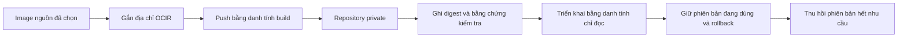

# Đẩy image, cấu hình quyền và quản lý vòng đời image

Một image đã build thành công trên máy lập trình viên vẫn cần được lưu tại nơi mà hệ thống triển khai có thể truy cập. Trong Oracle Cloud Infrastructure, **Container Registry**, thường gọi là **OCIR**, đảm nhiệm việc lưu trữ và phân phối image. Để vận hành được, nhóm phát triển còn phải quyết định ai được push, ai được pull, phiên bản nào được triển khai và khi nào có thể xóa dữ liệu.

Bài học thuộc chương **Containers và Functions** của module **CLOUD_PROVIDERS_ORACLE**. Nội dung kết nối Container Registry với tenancy, compartment và IAM, đồng thời đặt việc phát hành image trong bối cảnh tự động hóa, kiểm soát chi phí và tính sẵn sàng của hạ tầng OCI.

## 1. Mục tiêu và tình huống thực hành

Giả sử nhóm phát triển có dịch vụ Java quản lý đơn hàng. Pipeline tạo ra image ứng dụng, đẩy lên một repository riêng, sau đó hệ thống triển khai sử dụng đúng phiên bản đã được kiểm tra.

Ta chia trách nhiệm thành ba nhóm:

- **ImageBuilders**: danh tính của pipeline, được đọc và cập nhật image tại repository được giao.
- **ImagePullers**: danh tính dùng để lấy image phục vụ triển khai, chỉ cần quyền đọc.
- **RegistryAdmins**: nhóm vận hành, chịu trách nhiệm tạo repository, thay đổi cấu hình và quản lý vòng đời.

Sau bài học, người học cần thực hiện được chuỗi thao tác:

1. Xác định đúng registry endpoint, tenancy namespace, repository và tag.
2. Chuẩn bị repository private trong đúng compartment.
3. Đăng nhập bằng auth token, gắn tag và push image.
4. Xác minh image trên registry, ghi lại digest và OCID.
5. Kiểm tra quyền bằng danh tính dành cho việc pull.
6. Thiết kế quy trình phát hành, rollback, lưu giữ và thu hồi image.

Phần thực hành dùng image `hello-world` để tập trung vào luồng registry. Đây là image minh họa, không chứa dịch vụ Java. Với ứng dụng thực tế, thay image nguồn bằng kết quả build của dự án; các bước quản lý quyền và đẩy image vẫn theo cùng quy trình.

## 2. Đọc đúng địa chỉ image

Địa chỉ Docker sử dụng trong bài có dạng:

```text
<registry-host>/<tenancy-namespace>/<repository>:<tag>
```

Ví dụ minh họa:

```text
sin.ocir.io/axexample123/orders-dev:build-20261120-001
```

| Thành phần | Giá trị minh họa | Ý nghĩa khi thao tác |
| --- | --- | --- |
| Registry host | `sin.ocir.io` | Endpoint của Container Registry tại region Singapore `ap-singapore-1` trong realm thương mại OC1 |
| Tenancy namespace | `axexample123` | Object Storage namespace của tenancy; thay bằng giá trị thực |
| Repository | `orders-dev` | Repository đã được tạo trong compartment quản lý image |
| Tag | `build-20261120-001` | Nhãn phiên bản do nhóm phát triển quy ước |
| Compartment | `AppDelivery` | Phạm vi đặt tài nguyên và phân quyền; không phải một đoạn bắt buộc trong địa chỉ Docker |

Registry có endpoint theo region. Ví dụ `sin.ocir.io` được Oracle liệt kê cho Singapore; nếu dùng region hoặc realm khác, lấy endpoint tương ứng thay vì suy từ tên hiển thị. [Nguồn: Preparing for Container Registry](https://docs.oracle.com/en-us/iaas/Content/Registry/Concepts/registryprerequisites.htm).

### 2.1. Phân biệt namespace, repository và compartment

**Tenancy namespace** là giá trị Object Storage namespace, không mặc định là tên tenancy, tên identity domain hay OCID. Một repository thuộc một compartment, nhưng địa chỉ image không đưa compartment vào như một cấp đường dẫn.

Trong bài, repository tên một đoạn `orders-dev` giúp tránh nhầm lẫn về dấu `/`. Với repository có **top-level capability** tắt, `team/orders` có thể là một tên repository đầy đủ. Khi bật capability này trên repository `team`, `team/orders:v1` là image tại đường dẫn con thuộc repository `team`; quyền và visibility của repository áp dụng chung. [Nguồn: Container Registry Concepts](https://docs.oracle.com/en-us/iaas/Content/Registry/Concepts/registryconcepts.htm).

Vì vậy, trước khi viết điều kiện IAM theo tên repository, hãy xác định tài nguyên repository thực sự sở hữu image. Một đường dẫn trông giống thư mục không tự tạo ra ranh giới phân quyền.

### 2.2. Tag, digest và OCID phục vụ những việc khác nhau

| Định danh | Ví dụ dạng giá trị | Dùng khi nào |
| --- | --- | --- |
| Tag image | `build-20261120-001` | Con người và pipeline đặt tên bản build |
| Digest | `sha256:<64 ký tự hex>` | Tham chiếu nội dung manifest hoặc image index cụ thể |
| Image OCID | `ocid1.containerimage...` | Quản lý tài nguyên image bằng OCI API hoặc CLI |
| Repository OCID | `ocid1.containerrepo...` | Xác định repository khi liệt kê và quản lý tài nguyên |

Tag có thể được chuyển sang nội dung khác theo thời gian. Khi pull bằng digest, Docker yêu cầu đúng nội dung tương ứng với digest đó. Docker hiển thị digest trong kết quả push và pull; đừng lấy cột `IMAGE ID` ở máy local thay cho registry manifest digest. [Nguồn: docker image pull](https://docs.docker.com/reference/cli/docker/image/pull/).

Cần phân biệt thêm **tag phiên bản của image** với **free-form tag/defined tag của tài nguyên OCI**. Tag phiên bản xuất hiện sau dấu `:`; tag tài nguyên OCI phục vụ phân loại tài nguyên, ví dụ gán chủ sở hữu hoặc trung tâm chi phí.

## 3. Chuẩn bị luồng làm việc



Các ví dụ shell bên dưới dùng **Bash**, phù hợp với Linux hoặc WSL có Docker hoạt động. Lệnh OCI CLI ở phần quản trị yêu cầu CLI đã được cấu hình xác thực riêng; việc Docker login thành công không đồng nghĩa OCI CLI đã được cấu hình.

Chuẩn bị trước:

- Quyền sử dụng tenancy và region thực hành.
- Compartment `AppDelivery` hoặc compartment tương đương do quản trị viên cấp.
- Các group và danh tính phục vụ build, pull và quản trị.
- Docker CLI kết nối được tới Docker daemon.
- Đường mạng từ máy thực hành đến endpoint registry qua HTTPS.
- Auth token của đúng danh tính sẽ đăng nhập.

Ghi lại các giá trị môi trường:

```bash
REGISTRY="sin.ocir.io"
OCI_REGION="ap-singapore-1"
TENANCY_NAMESPACE="REPLACE_WITH_OBJECT_STORAGE_NAMESPACE"
REPOSITORY="orders-dev"
VERSION="build-20261120-001"
SOURCE_IMAGE="hello-world:latest"

IMAGE_BASE="$REGISTRY/$TENANCY_NAMESPACE/$REPOSITORY"
IMAGE_REF="$IMAGE_BASE:$VERSION"
```

`VERSION` phải được thay cho mỗi bản build khác nhau. Giữ mã commit và số lần build trong hệ thống phát hành để biết image nào xuất phát từ nguồn nào; không dùng lại một tag build cho các kết quả khác nhau.

## 4. Cấu hình IAM theo trách nhiệm

### 4.1. Hiểu đúng quyền trên `repos`

OCI dùng resource type `repos` cho các tài nguyên Container Registry. Những khác biệt ảnh hưởng trực tiếp tới thiết kế quyền gồm:

| Nhu cầu | Quyền hoặc verb cần chú ý |
| --- | --- |
| Liệt kê tài nguyên | `inspect repos` |
| Đọc và pull | `read repos` |
| Push vào repository đã tồn tại | `REPOSITORY_READ` và `REPOSITORY_UPDATE` |
| Tạo repository | `REPOSITORY_CREATE` |
| Xóa repository | `REPOSITORY_DELETE` |
| Đổi cấu hình repository | `REPOSITORY_MANAGE` |

Với `repos`, verb `use` không bổ sung quyền so với `read`. Ngoài ra, `DeleteContainerImage`, `RestoreContainerImage` và `RemoveContainerVersion` cùng dùng `REPOSITORY_UPDATE`. [Nguồn: Details for Container Registry](https://docs.oracle.com/en-us/iaas/Content/Identity/Reference/registrypolicyreference.htm).

Hệ quả khi thiết kế: cấp quyền cần cho push có thể đồng thời cho phép xóa image. Điều kiện chỉ chọn `REPOSITORY_READ` và `REPOSITORY_UPDATE` thu hẹp quyền so với quản trị toàn bộ repository, nhưng không tạo ra một vai trò “chỉ được thêm image”.

Vì vậy, nên giới hạn danh tính build vào repository của pipeline, bảo vệ credential và kiểm soát bước phát hành. Nếu cần ranh giới chặt hơn giữa môi trường phát triển và production, dùng repository hoặc compartment riêng cùng danh tính phát hành riêng.

### 4.2. Policy cho danh tính pull

Các ví dụ dùng group trong identity domain mặc định và compartment tên `AppDelivery`. Thay tên bằng tài nguyên thực; group ở domain khác cần được định danh đúng theo cấu hình IAM của tenancy.

```text
Allow group ImagePullers to read repos in compartment AppDelivery where target.repo.name = 'orders-dev'
```

Điều kiện `target.repo.name` giới hạn repository được đọc. Policy này không phải là cam kết rằng mọi thao tác liệt kê trong Console đều hoạt động, vì thao tác list có thể không có một repository đích để đánh giá điều kiện.

Nếu vai trò cần duyệt danh sách tài nguyên trong compartment, quản trị viên có thể bổ sung:

```text
Allow group ImagePullers to inspect repos in compartment AppDelivery
```

Khi đó, người dùng có thể thấy thông tin liệt kê của compartment. Hãy cân nhắc nhu cầu này trước khi cấp vì phạm vi nhìn thấy metadata rộng hơn repository duy nhất.

### 4.3. Policy cho pipeline push vào repository có sẵn

```text
Allow group ImageBuilders to manage repos in compartment AppDelivery where all {
  target.repo.name = 'orders-dev',
  any {
    request.permission = 'REPOSITORY_READ',
    request.permission = 'REPOSITORY_UPDATE'
  }
}
```

Nếu pipeline cần liệt kê bằng OCI CLI hoặc sử dụng Console để chẩn đoán, có thể cấp thêm `inspect repos` trong compartment theo nhu cầu. Pipeline biết sẵn địa chỉ image không nên mặc định được cấp quyền quản trị tenancy chỉ để xử lý một lỗi push.

Mẫu dùng điều kiện permission để thu hẹp `manage repos` và yêu cầu quyền đọc/cập nhật khi push được Oracle mô tả trong tài liệu policy. [Nguồn: Policies to Control Repository Access](https://docs.oracle.com/en-us/iaas/Content/Registry/Concepts/registrypolicyrepoaccess.htm).

### 4.4. Policy cho nhóm quản trị repository

```text
Allow group RegistryAdmins to manage repos in compartment AppDelivery
```

Đây là quyền rộng trong compartment, phù hợp cho trách nhiệm quản trị repository hơn danh tính build hằng ngày. Quản lý retention toàn region còn có phạm vi quyền riêng, được đề cập ở phần lưu giữ.

Các policy OCI có tính cộng dồn. Muốn kiểm tra vai trò chỉ đọc, dùng một danh tính chỉ thuộc các group liên quan; một tài khoản đồng thời thuộc nhóm quản trị có thể che khuất việc policy giới hạn đang thiếu hoặc sai.

## 5. Tạo repository trước khi push

Trong Console, mở **Container Registry**, chọn đúng region và tạo repository với cấu hình:

| Thiết lập | Giá trị thực hành |
| --- | --- |
| Compartment | `AppDelivery` |
| Repository type | `Standard` |
| Name | `orders-dev` |
| Visibility/Access | `Private` |
| Top-level capability | Tắt nếu giao diện cung cấp lựa chọn này |

Standard repository hỗ trợ push và pull; pull-through cache repository không nhận client push. Tạo repository trước giúp chọn rõ compartment. Khả năng tạo repository trong root compartment ở lần push đầu tiên phụ thuộc cấu hình và quyền tương ứng; không dựa vào cơ chế đó trong bài thực hành. [Nguồn: Creating a Repository](https://docs.oracle.com/en-us/iaas/Content/Registry/Tasks/registrycreatingarepository.htm).

Ghi repository OCID và compartment OCID để dùng ở các bước quản trị. Cũng kiểm tra chính sách retention hiện đang áp dụng trước khi đưa dữ liệu cần giữ vào repository.

**Private** và **public** là quyết định về phân phối. Public repository cho phép người biết địa chỉ image pull qua internet; việc chuyển public không phải cách sửa credential sai. Với ứng dụng nội bộ, giữ private và cấp quyền cho đúng chủ thể cần sử dụng.

## 6. Đăng nhập, gắn tag và push

### 6.1. Tạo auth token và xác định username

Auth token được tạo trong phần thông tin người dùng OCI. Token chỉ được hiển thị lúc tạo, nên phải lưu ngay trong nơi quản lý secret phù hợp. Nó là credential dùng với registry, không phải mật khẩu Console hoặc khóa API signing. [Nguồn: Getting an Auth Token](https://docs.oracle.com/en-us/iaas/Content/Registry/Tasks/registrygettingauthtoken.htm).

Username Docker thường có dạng:

```text
<tenancy-namespace>/<username>
```

Với danh tính liên kết Oracle Identity Cloud Service, dùng dạng có domain theo thông tin của tài khoản, ví dụ:

```text
<tenancy-namespace>/oracleidentitycloudservice/<username>
```

Lấy đúng phần domain/username của danh tính thực tế; không tự chèn `oracleidentitycloudservice` vào mọi tài khoản. Oracle mô tả hai dạng này trong hướng dẫn push. [Nguồn: Pushing Images Using the Docker CLI](https://docs.oracle.com/en-us/iaas/Content/Registry/Tasks/registrypushingimagesusingthedockercli.htm).

Ví dụ đăng nhập tương tác:

```bash
OCIR_USERNAME="$TENANCY_NAMESPACE/REPLACE_WITH_OCI_USERNAME"

docker login "$REGISTRY" --username "$OCIR_USERNAME"
```

Khi được hỏi password, nhập **auth token**. Chỉ truyền hostname vào `docker login`, không kèm namespace, repository hoặc tiền tố `https://`.

### 6.2. Chuẩn bị image minh họa

```bash
docker pull "$SOURCE_IMAGE"
docker image ls "$SOURCE_IMAGE"
docker tag "$SOURCE_IMAGE" "$IMAGE_REF"
docker image ls "$IMAGE_REF"
```

`docker tag` tạo thêm tên tham chiếu cho image local, chưa đưa dữ liệu lên OCIR. Tới đây, có image xuất hiện trong `docker image ls` mới chứng minh tên local đã được tạo.

Đối với ứng dụng Java, image nguồn có thể là `orders-api:1.4.2` sau bước build và kiểm tra của dự án. Cần biết kiến trúc image và nền tảng đích; đổi tên không chuyển image `amd64` thành `arm64`, cũng không tự tạo đầy đủ các biến thể multi-architecture.

### 6.3. Push đúng một tag

```bash
docker push "$IMAGE_REF"
```

Kết quả thành công thường kết thúc bằng thông tin tag, digest và kích thước manifest. Ghi lại **digest trả về thực tế**. Có layer đã tồn tại và không cần upload lại là tình huống bình thường; điều cần xác nhận là toàn bộ push kết thúc thành công.

Thao tác gắn tên đích theo mẫu `<registry>/<namespace>/<repository>:<version>` rồi `docker push` là quy trình chuẩn mà Oracle hướng dẫn. [Nguồn: Pushing Images Using the Docker CLI](https://docs.oracle.com/en-us/iaas/Content/Registry/Tasks/registrypushingimagesusingthedockercli.htm).

Không dùng việc tag có tên “release” làm bằng chứng đã phát hành. Nên có một bản ghi phát hành chứa ít nhất mã commit, pipeline run, địa chỉ registry, repository, tag và digest.

### 6.4. Đăng nhập trong CI

Ví dụ dưới đây giả định CI đã cung cấp `OCIR_AUTH_TOKEN` qua secret store và đã đặt `REGISTRY`, `OCIR_USERNAME`, `SOURCE_IMAGE`, `IMAGE_REF`:

```bash
set -euo pipefail
set +x

trap 'docker logout "$REGISTRY" >/dev/null 2>&1 || true' EXIT

printf '%s' "$OCIR_AUTH_TOKEN" |
  docker login "$REGISTRY" \
    --username "$OCIR_USERNAME" \
    --password-stdin

docker tag "$SOURCE_IMAGE" "$IMAGE_REF"
docker push "$IMAGE_REF"
```

`--password-stdin` giúp tránh đưa token trực tiếp vào lịch sử lệnh hoặc đối số password. Docker có thể lưu credential thông qua credential store hoặc cấu hình đăng nhập, nên cần bảo vệ cả môi trường runner. [Nguồn: docker login](https://docs.docker.com/reference/cli/docker/login/).

Dùng runner riêng cho pipeline có quyền push, secret được che trong log và giới hạn truy cập cấu hình Docker. Đặt job thất bại khi lệnh push thất bại để bước deploy không tiếp tục với một tag chưa được xác nhận.

## 7. Xác minh image và ghi nhận định danh

### 7.1. Kiểm tra trong Console

Tại đúng region, compartment và repository, mở image vừa push. Kiểm tra phiên bản, kích thước, người đẩy và thời điểm push. Lấy image OCID để thực hiện thao tác quản trị khi cần. Trang chi tiết cũng cung cấp thông tin layer, chữ ký và kết quả scan nếu có. [Nguồn: Getting an Image's Details](https://docs.oracle.com/en-us/iaas/Content/Registry/Tasks/registryviewingimagedetails.htm).

Dùng ba dữ kiện để nối bản build với tài nguyên: tag dự kiến, digest từ kết quả push và image thực tế trong repository. Nếu tag đã bị pipeline khác cập nhật, việc chỉ nhìn tên tag có thể dẫn tới ghi nhận sai bản phát hành.

### 7.2. Liệt kê bằng OCI CLI

Với danh tính có quyền liệt kê phù hợp và OCI CLI đã cấu hình:

```bash
COMPARTMENT_OCID="REPLACE_WITH_COMPARTMENT_OCID"
REPOSITORY_OCID="REPLACE_WITH_REPOSITORY_OCID"

oci --region "$OCI_REGION" artifacts container image list \
  --compartment-id "$COMPARTMENT_OCID" \
  --repository-id "$REPOSITORY_OCID" \
  --all
```

`--repository-id` lọc theo repository OCID; `--all` lấy đủ các trang kết quả. Chọn đúng region ở CLI để tránh trường hợp Console thấy tài nguyên nhưng lệnh lại truy vấn region khác. [Nguồn: OCI CLI — container image list](https://docs.oracle.com/en-us/iaas/tools/oci-cli/latest/oci_cli_docs/cmdref/artifacts/container/image/list.html).

Sau khi có image OCID:

```bash
IMAGE_OCID="REPLACE_WITH_IMAGE_OCID"

oci --region "$OCI_REGION" artifacts container image get \
  --image-id "$IMAGE_OCID"
```

### 7.3. Pull bằng digest

Thay placeholder dưới đây bằng digest đầy đủ đã xác minh:

```bash
IMAGE_DIGEST="sha256:REPLACE_WITH_64_HEX_DIGEST"
PINNED_IMAGE="$IMAGE_BASE@$IMAGE_DIGEST"

docker pull "$PINNED_IMAGE"
docker run --rm "$PINNED_IMAGE"
```

Với image `hello-world`, container in thông điệp minh họa rồi kết thúc. Với image ứng dụng thực, dùng kiểm tra tương ứng của ứng dụng.

Digest khóa nội dung được yêu cầu, nhưng không đảm bảo dữ liệu đó sẽ được lưu mãi. Quy trình rollback vẫn cần giữ image trên registry hoặc có phương án đưa lại đúng nội dung đã lưu trữ.

## 8. Đảm bảo môi trường triển khai thực sự pull được

Một lần pull bằng tài khoản build chỉ chứng minh quyền của tài khoản build. Hãy thử trên máy hoặc runner sạch bằng danh tính `ImagePullers`. Kiểm tra rằng danh tính này pull được image đã biết và không push được một tag thử nghiệm.

Ở OKE, cách dùng registry secret yêu cầu tạo secret chứa credential pull rồi tham chiếu qua `imagePullSecrets` trong Pod spec. Secret phải tồn tại trong namespace Kubernetes của workload. [Nguồn: Pulling Images from Container Registry during Kubernetes Deployment](https://docs.oracle.com/en-us/iaas/Content/Registry/Tasks/registrypullingimagesfromocir.htm).

Ví dụ chỉ minh họa phần cấu hình pull trong Pod spec, cần thay digest trước khi sử dụng:

```yaml
spec:
  containers:
    - name: registry-check
      image: sin.ocir.io/REPLACE_WITH_NAMESPACE/orders-dev@sha256:REPLACE_WITH_DIGEST
  imagePullSecrets:
    - name: ocir-pull
```

Không chép auth token vào manifest được commit. Danh tính pull của cluster nên tách khỏi danh tính build để một credential phục vụ runtime không mang theo quyền cập nhật image.

Với **OCI Functions sử dụng image**, image cũng được quản lý trong OCIR. Cần kiểm tra quyền đọc repository của cơ chế triển khai và dịch vụ Functions; Docker login trên máy build không tự cấp quyền cho runtime. Phạm vi này khác workflow function chỉ cung cấp mã nguồn và managed runtime. [Nguồn: Scanning Images for Image-Based Functions for Vulnerabilities](https://docs.oracle.com/en-us/iaas/Content/Functions/Tasks/functionsimagescanning.htm).

Tính sẵn sàng cần được kiểm tra bằng một lần pull mới từ môi trường đích. Một container đang chạy hoặc một node có image cache chưa chứng minh node mới hay function ở lần khởi tạo tiếp theo sẽ lấy được image.

## 9. Thiết kế vòng đời từ build tới rollback

### 9.1. Quy ước tag là một phần của quy trình phát hành

Một bộ quy ước khả thi:

| Mục đích | Ví dụ tag | Quy tắc của nhóm |
| --- | --- | --- |
| Nhận diện bản build | `build-20261120-001` | Mỗi kết quả build dùng tag riêng |
| Tra ngược mã nguồn | `git-a1b2c3d4` | Kèm pipeline run nếu cùng commit có thể build lại |
| Bản phát hành nghiệp vụ | `release-1.4.2` | Ghi nhận digest đã được phê duyệt |
| Con trỏ môi trường | `dev` hoặc `staging` | Cho phép thay đổi có kiểm soát |
| Bản cần giữ để rollback | `keep-rollback-1.4.1` | Có ngày xem xét lại và người chịu trách nhiệm |

Đây là quy ước đề xuất của bài học, không phải cơ chế cưỡng chế bất biến của dịch vụ. Để ngăn ghi đè tag release, pipeline cần kiểm tra trạng thái và quyền phát hành tương ứng.

Tag theo commit giúp tra cứu nguồn, nhưng không tự chứng minh image có thể tái lập: base image hoặc dependency có thể thay đổi giữa các lần build. Bản ghi digest giải quyết việc nhận diện nội dung cụ thể đã được phát hành.

### 9.2. Promotion phải giữ được quan hệ tới nội dung đã kiểm tra

Ví dụ với bản build đã xác minh:

```bash
docker pull "$PINNED_IMAGE"

RELEASE_REF="$IMAGE_BASE:release-1.4.2"
docker tag "$PINNED_IMAGE" "$RELEASE_REF"
docker push "$RELEASE_REF"
```

Sau push, xác minh lại digest của đích. Ví dụ này minh họa promotion của image đã pull trên nền tảng hiện tại. Với image nhiều kiến trúc, cần công cụ và quy trình sao chép đầy đủ image index cùng các manifest được tham chiếu; không coi thao tác tag local là bằng chứng đã giữ đủ mọi kiến trúc.

Trong thực tế, có thể tách repository phát triển và production. Khi đó, hồ sơ phát hành cần ánh xạ digest nguồn, đích, kết quả kiểm tra và người hoặc pipeline phê duyệt.

### 9.3. Rollback cần cả nội dung và khả năng truy cập

Với mỗi bản production, giữ ít nhất:

- Digest đang chạy và các digest còn trong cửa sổ rollback.
- Thông tin cấu hình triển khai đi cùng từng phiên bản.
- Credential hoặc quyền đọc còn hiệu lực.
- Bằng chứng môi trường đích có thể pull lại image.
- Kết quả kiểm tra tương thích ứng dụng, chẳng hạn thay đổi schema cơ sở dữ liệu.

Khả năng pull đúng image là điều kiện cần để rollback dịch vụ Java, nhưng việc khôi phục hành vi còn phụ thuộc cấu hình và dữ liệu. Không nên xóa image cũ ngay sau khi rollout thành công nếu hệ thống vẫn cam kết một cửa sổ phục hồi.

## 10. Kiểm tra bảo mật trước khi phát hành

### 10.1. Scan và quyết định phát hành

OCIR tích hợp với OCI Vulnerability Scanning để phát hiện lỗ hổng trong image. Cần kiểm tra cấu hình scanner và quyền dịch vụ đọc repository, rồi chờ kết quả của đúng image trước khi quyết định phát hành. Việc push thành công chưa chứng minh image đã vượt qua một quality gate. [Nguồn: Scanning Images for Vulnerabilities](https://docs.oracle.com/en-us/iaas/Content/Registry/Tasks/registryscanningimagesforvulnerabilities.htm).

Nhóm có thể quy định chặn phát hành khi có lỗ hổng Critical chưa được xử lý hoặc chưa có ngoại lệ được duyệt. Ngưỡng này là chính sách của tổ chức; pipeline phải triển khai việc chặn rõ ràng và liên kết quyết định với digest cụ thể.

Khi cần cập nhật base image, build lại thành phiên bản mới, scan lại và phát hành lại. Giữ digest cũ giúp tái lập nội dung đã dùng; nó cũng có nghĩa là bản đó không tự nhận các bản vá mới.

### 10.2. Chữ ký và nguồn phát hành

OCIR hỗ trợ ký image bằng khóa bất đối xứng phù hợp trong OCI Vault. Chữ ký hỗ trợ xác minh nguồn và tính toàn vẹn; quyền dùng khóa và quyền quản lý image cần được thiết kế riêng. [Nguồn: Signing Images for Security](https://docs.oracle.com/en-us/iaas/Content/Registry/Tasks/registrysigningimages_topic.htm).

Quy trình production nên phân biệt ba câu hỏi: image có nội dung nào, có kết quả kiểm tra ra sao và do chủ thể nào phát hành. Digest, scan và chữ ký đóng góp các bằng chứng khác nhau.

Đưa bước xác minh chữ ký vào nơi thực sự quyết định triển khai. Chỉ tạo chữ ký mà không kiểm tra khi nhận image sẽ chưa thực hiện được mục tiêu kiểm soát nguồn.

## 11. Thiết kế retention để tiết kiệm dung lượng mà vẫn phục hồi được

### 11.1. Cơ chế retention của OCIR

Mỗi region có global image retention policy, mặc định giữ toàn bộ image. Custom policy áp dụng cho repository được gán và thay thế global policy; mỗi repository chỉ thuộc một custom policy tại một thời điểm.

Tiêu chí gồm thời gian không được pull, thời gian không được versioned và các phiên bản được miễn. **Exempt versions không áp dụng cho tiêu chí không được versioned.** Tác vụ kiểm tra chạy hằng giờ; policy mới hoặc vừa sửa có thời gian chờ vài giờ. Policy có phạm vi region. [Nguồn: Retaining and Deleting Images Using Retention Policies](https://docs.oracle.com/en-us/iaas/Content/Registry/Tasks/registrymanagingimageretention.htm).

Đừng áp dụng suy luận “image lâu không được pull là không cần nữa”. Một workload chạy ổn định lâu ngày hoặc một bản dự phòng ít sử dụng vẫn có thể cần image khi tạo instance mới.

### 11.2. Tách nhu cầu giữ theo môi trường

Bảng sau là **đề xuất để thảo luận**, không phải cấu hình mặc định của Oracle:

| Nhóm image | Ý định lưu giữ | Điều kiện cần kiểm tra |
| --- | --- | --- |
| Build thử tại dev | Thu hồi sớm sau khi nhánh kết thúc | Không còn môi trường kiểm thử sử dụng |
| Bản staging | Giữ đủ chu kỳ nghiệm thu | Nhóm kiểm thử xác nhận kết thúc đợt |
| Production đang chạy | Luôn có khả năng pull lại | Có trong danh sách digest được bảo vệ |
| Bản rollback | Giữ tới hết cửa sổ phục hồi | Có ngày hết hạn và chủ sở hữu |
| Bản cần điều tra | Giữ theo nhu cầu sự cố | Có bằng chứng về nguồn và lịch sử phát hành |

Ví dụ, nhóm có thể đề xuất dọn image dev không còn được sử dụng sau 14 ngày, còn production có quy trình bảo vệ riêng. Con số 14 ngày phải được so với thời lượng nhánh thử nghiệm và khả năng tái tạo môi trường.

Nếu dùng tag có tiền tố để miễn xóa, cần phân công ai được gắn hoặc gỡ tag đó. Một danh sách digest đang triển khai giúp phát hiện trường hợp image cần giữ nhưng không còn tag phù hợp với quy tắc retention.

### 11.3. Đưa policy vào sử dụng có kiểm soát

Trước khi bật dọn tự động, lập danh sách digest đang chạy, dự phòng và phục vụ điều tra. Đối chiếu từng nhóm với tiêu chí dự định dùng, áp dụng trước cho repository dev và theo dõi các image dự kiến bị loại.

Giữ kế hoạch thay đổi cùng thời điểm áp dụng và cách khôi phục khi cấu hình sai. Khoảng chờ trước khi policy hoạt động là thời gian để rà lại tiêu chí, không phải cam kết image sẽ được giữ tới lần thay đổi tiếp theo.

Sửa global policy ảnh hưởng rộng trong region, nên chỉ giao cho vai trò chịu trách nhiệm quản lý vùng đó. Theo tài liệu Oracle, sửa global policy và tạo/sửa custom policy cần quyền quản lý ở tenancy; thêm hoặc bỏ repository khỏi custom policy cần quyền quản lý repository. [Nguồn: Retaining and Deleting Images Using Retention Policies](https://docs.oracle.com/en-us/iaas/Content/Registry/Tasks/registrymanagingimageretention.htm).

## 12. Phân biệt bỏ tag, xóa image và khôi phục

### 12.1. Bỏ một tag bằng thao tác unversion

OCI gọi thao tác gỡ version identifier là **unversioning**. Nó bỏ nhãn phiên bản mà không trực tiếp xóa image:

```bash
oci --region "$OCI_REGION" artifacts container image remove-version \
  --image-id "$IMAGE_OCID" \
  --image-version "$VERSION"
```

Phải xác nhận `IMAGE_OCID` và `VERSION` tương ứng trước khi chạy. Nếu một image có nhiều tag, bỏ một tag không có nghĩa mọi tag khác cũng bị bỏ. [Nguồn: Unversioning an Image](https://docs.oracle.com/en-us/iaas/Content/Registry/Tasks/registryuntaggingimages.htm).

Nếu tag cuối cùng bị gỡ, hãy đánh giá lại tác động của retention lên image không còn phiên bản. Bản triển khai tham chiếu digest vẫn cần nội dung tồn tại trên registry, nên không thể coi unversion là thao tác không ảnh hưởng vòng đời.

### 12.2. Xóa image sau khi xác nhận hết nhu cầu

Trước khi xóa, đối chiếu image OCID với digest, repository và các bản triển khai liên quan. Chỉ thử thao tác sau trên image thực hành đã xác nhận có thể thu hồi:

```bash
oci --region "$OCI_REGION" artifacts container image delete \
  --image-id "$IMAGE_OCID"
```

OCI có thể cần tới 48 giờ để việc xóa có hiệu lực và giải phóng storage. Vì vậy, không dùng số liệu dung lượng ngay sau lệnh delete để kết luận dọn dẹp thất bại. [Nguồn: Deleting an Image](https://docs.oracle.com/en-us/iaas/Content/Registry/Tasks/registrydeletingimages.htm).

`docker image rm` trên máy lập trình viên chỉ dọn bản local; nó không thay thế thao tác xóa image ở OCIR. Tương tự, xóa một container local không phải là xóa image đã lưu trên registry.

### 12.3. Khôi phục trong cửa sổ cho phép

Oracle hỗ trợ khôi phục image trong vòng tối đa 48 giờ từ lúc xóa, qua API hoặc CLI; thao tác này không thực hiện bằng Console:

```bash
oci --region "$OCI_REGION" artifacts container image restore \
  --image-id "$IMAGE_OCID"
```

Sau cửa sổ đó, image bị loại vĩnh viễn khỏi Container Registry. [Nguồn: Undeleting (Restoring) an Image](https://docs.oracle.com/en-us/iaas/Content/Registry/Tasks/undelete-image.htm).

Sau restore, kiểm tra lại khả năng pull digest và các version identifier cần dùng. Đồng thời xử lý tiêu chí retention hoặc quy trình đã gây xóa để tránh lặp lại sự cố.

Cửa sổ khôi phục ngắn không thay thế kế hoạch lưu giữ và phục hồi dài hạn. Nếu ứng dụng cần khả năng phục hồi ở region khác, phải kiểm tra nơi lưu image và quyền truy cập tại region đó như một phần của diễn tập.

## 13. Chẩn đoán lỗi theo từng lớp

Bảng dưới đây là thứ tự chẩn đoán đề xuất; một thông báo lỗi có thể có nhiều nguyên nhân:

| Triệu chứng | Kiểm tra đầu tiên | Hành động tiếp theo |
| --- | --- | --- |
| Docker login báo unauthorized | Namespace, username/domain và auth token | Xác nhận token thuộc đúng user; kiểm tra token còn hiệu lực |
| Login thành công nhưng push bị denied | Repository đích và IAM của user | Kiểm tra quyền đọc/cập nhật, compartment, điều kiện tên |
| Push vào repository không tồn tại thất bại | Repository đã tạo chưa, đúng region chưa | Tạo trước bằng vai trò quản trị tại compartment dự định |
| CLI không thấy image nhưng Console có | Region và compartment của CLI | Chọn region tường minh, dùng đúng repository OCID |
| Pull báo không tìm thấy manifest | Tag/digest, repository và vòng đời | Đối chiếu hồ sơ phát hành, unversion, xóa và retention |
| Pull được nhưng container không chạy | Kiến trúc và nội dung ứng dụng | Kiểm tra platform, entrypoint và log ứng dụng |
| Node cũ chạy được, node mới lỗi pull | Cache cũ, credential và mạng của node mới | Thử pull mới từ môi trường đích |
| Dung lượng chưa giảm ngay | Thời điểm xóa và tiến trình xử lý | Chờ theo cơ chế dịch vụ, đối chiếu lại số liệu |
| Image production bị dọn ngoài dự kiến | Policy đang áp dụng và tag được miễn | Kiểm tra custom/global policy, tiêu chí versioned và danh sách digest |

Để giảm thời gian tìm lỗi, chia việc kiểm tra thành ba lớp:

1. **Kết nối**: DNS, proxy, tuyến mạng và HTTPS đến registry.
2. **Danh tính và quyền**: đăng nhập đúng user, token hợp lệ, policy đúng tài nguyên.
3. **Nội dung và vòng đời**: đúng tag/digest, image tồn tại và phù hợp platform.

Một lần login thành công chỉ xác nhận bước xác thực tương ứng. Khi đổi region hoặc đổi hostname endpoint, kiểm tra lại credential Docker được lưu cho đúng host.

## 14. Bằng chứng hoàn thành và thói quen vận hành

Kết quả thực hành nên có một bản ghi gồm:

| Bằng chứng | Nội dung cần ghi |
| --- | --- |
| Nơi lưu | Region, compartment, repository OCID và visibility |
| Bản build | Tag duy nhất, image nguồn và mã pipeline nếu có |
| Nội dung phát hành | Digest thực tế sau push |
| Tài nguyên quản trị | Image OCID tương ứng |
| Kiểm tra phân quyền | Danh tính build push được; danh tính pull chỉ thực hiện thao tác được cấp |
| Kiểm tra sử dụng | Pull bằng digest từ môi trường sạch thành công |
| Kế hoạch lưu giữ | Policy áp dụng, digest cần bảo vệ và ngày xem xét lại |
| Khả năng phục hồi | Bản rollback còn pull được và người chịu trách nhiệm |

Không đưa auth token vào bản ghi bằng chứng. Sau thực hành, logout trên máy dùng tạm và thu hồi credential dành riêng cho buổi học theo quy trình quản trị danh tính.

Trong vận hành định kỳ, đối chiếu digest đang chạy với danh sách image được giữ, kiểm tra các lần phát hành thất bại, theo dõi dung lượng và xử lý kết quả scan mới. Một đợt dọn dẹp hoàn tất cần chứng minh các image hết nhu cầu đã được thu hồi và những bản còn cần cho triển khai hoặc rollback vẫn truy cập được.

