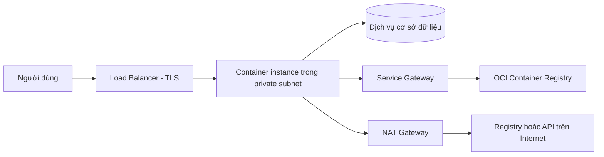
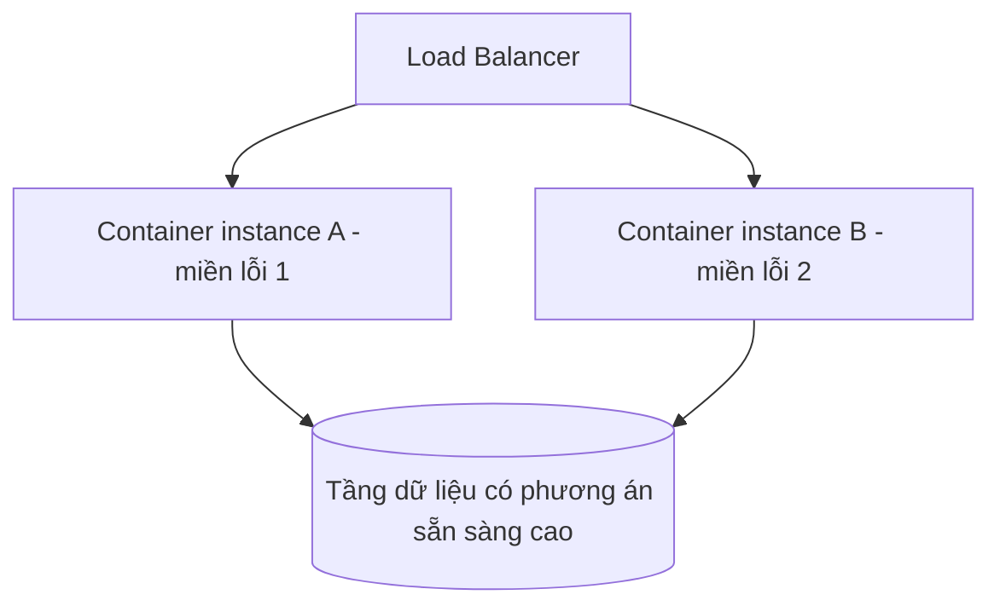

# Container Instances và triển khai container không quản lý máy chủ

OCI Container Instances cho phép chạy ứng dụng đã đóng gói thành container mà không phải tự cài hệ điều hành, Docker daemon hay vận hành máy chủ phía dưới. Người triển khai vẫn cần quyết định image, tài nguyên, quyền truy cập, mạng, dữ liệu và cách phục hồi ứng dụng. Dịch vụ phù hợp với workload container chưa cần một nền tảng điều phối như Kubernetes. [Tổng quan Container Instances](https://docs.oracle.com/en-us/iaas/Content/container-instances/overview-of-container-instances.htm).

Trong chương **Containers và Functions** của module Oracle Cloud Infrastructure, bài này kết nối kiến thức compartment, IAM và VCN với việc triển khai container. Mục tiêu là tạo được dịch vụ có thể kiểm tra, theo dõi và dọn dẹp, đồng thời hiểu các quyết định cần bổ sung khi đưa lên môi trường thật.

Sau bài học, người học có thể:

- Phân biệt image, container và container instance.
- Chọn tài nguyên và thiết kế đường mạng để kéo image, nhận yêu cầu và truy cập dữ liệu.
- Tách quyền của người triển khai khỏi quyền dùng để kéo image riêng tư.
- Tạo container instance bằng Console hoặc OCI CLI, kiểm tra HTTP và đọc log.
- Thiết kế dữ liệu bền vững, phát hành phiên bản mới, tăng tính sẵn sàng và kiểm soát chi phí.

## 1. Đơn vị triển khai là container instance

**Image** là bản đóng gói ứng dụng cùng thư viện và cấu hình mặc định. **Container** là tiến trình được khởi chạy từ image. **Container instance** là tài nguyên OCI cung cấp môi trường để chạy một hoặc nhiều container với cấu hình CPU, bộ nhớ và mạng đã chọn.

Ví dụ, một API xử lý hóa đơn có thể gồm container ứng dụng và container hỗ trợ chuyển tiếp dữ liệu quan sát. Các container cùng instance có thể liên lạc qua `localhost` vì dùng chung network namespace. Vì vậy, hai tiến trình không thể cùng chiếm một địa chỉ và cổng nghe; cần phân bổ cổng rõ ràng. Oracle minh họa đặc điểm này trong [bài thực hành Container Instances](https://docs.oracle.com/en/learn/manage-oci-container-instances/).

Đặt chung container phù hợp khi chúng gắn bó về vòng đời và cần giao tiếp cục bộ. Với các API cần tăng số bản sao, phát hành hoặc phân quyền độc lập, nên cân nhắc tách thành các container instance riêng.

Một instance chạy ba container ứng dụng vẫn là một đơn vị hạ tầng. Nó không tương đương ba bản sao đặt ở ba miền lỗi độc lập. Dừng hoặc thay thế instance sẽ ảnh hưởng cả nhóm.

| Oracle quản lý | Nhóm ứng dụng quản lý |
| --- | --- |
| Hạ tầng host và môi trường chạy do dịch vụ cung cấp | Image và thư viện bên trong image |
| Cấp phát tài nguyên theo cấu hình được yêu cầu | Chọn shape, CPU, RAM và giới hạn của container |
| Cơ chế thực thi các thao tác vòng đời | Chọn restart policy và xử lý việc chạy lại |
| Các khả năng mạng và quan sát của dịch vụ | IAM, route, NSG, health check và cảnh báo phù hợp |
| Hạ tầng phía dưới container | Dữ liệu nghiệp vụ, sao lưu và khôi phục ứng dụng |

Với dịch vụ không quản lý máy chủ, trách nhiệm vận hành chuyển lên cấu hình và hành vi ứng dụng. Container chạy được chưa chứng minh rằng API chịu lỗi hoặc bảo toàn dữ liệu.

## 2. Chọn dịch vụ theo yêu cầu workload

| Yêu cầu chính | Hướng lựa chọn để đánh giá |
| --- | --- |
| Chạy một API nhỏ từ image có sẵn, ít thành phần | Container Instances |
| Chạy tác vụ xử lý tệp hoặc công việc tự động có điểm kết thúc | Container Instances với chính sách chạy lại phù hợp |
| Cần hệ sinh thái Kubernetes, controller và quản lý nhiều dịch vụ | Oracle Kubernetes Engine, gọi tắt là OKE |
| Tổ chức logic thành các function được gọi theo sự kiện hoặc yêu cầu | OCI Functions |
| Cần tùy biến sâu hệ điều hành hoặc quản lý host trực tiếp | OCI Compute |

Bảng là định hướng kiến trúc cần kiểm chứng với yêu cầu cụ thể. Ví dụ, tác vụ import dữ liệu chạy trong 20 phút có thể phù hợp với Container Instances khi nhóm đã có image và cơ chế gọi tác vụ. Nhóm vẫn phải cung cấp lịch chạy, theo dõi kết quả và chống xử lý trùng.

Nếu nhiều dịch vụ phải phát hành độc lập, tự điều chỉnh số bản sao và liên tục cân bằng workload, hãy tính cả chi phí tự xây công cụ điều phối. Gọi API tạo container instance chỉ giải quyết một phần của hệ thống đó.

## 3. Tài nguyên và vị trí triển khai

### 3.1. Compartment và miền lỗi

Compartment tổ chức tài nguyên và là phạm vi áp dụng quyền. Region xác định nơi gọi API và triển khai. Availability domain, viết tắt AD, và fault domain, viết tắt FD, giúp mô tả vị trí và phân bố miền lỗi.

Cấu hình triển khai nên lưu rõ compartment ứng dụng, compartment của subnet/NSG nếu khác, region, tên AD thực tế, shape và nơi chứa image. Không sao chép tên AD của tenancy khác rồi dùng nguyên trạng. Khi không thấy tài nguyên, kiểm tra region và compartment trước khi kết luận tài nguyên đã mất.

### 3.2. Shape và giới hạn container

Container Instances có flexible shape, chẳng hạn `CI.Standard.E4.Flex` và `CI.Standard.A1.Flex`. Đối chiếu shape được hỗ trợ tại region/AD đang dùng và chọn image tương thích kiến trúc CPU. Các loại shape và giới hạn được công bố trong [Container Instances Shapes](https://docs.oracle.com/en-us/iaas/Content/container-instances/container-instance-shapes.htm).

Có hai tầng cấu hình:

| Tầng | Cấu hình tiêu biểu | Ý nghĩa |
| --- | --- | --- |
| Container instance | `ocpus`, `memoryInGBs` | Tổng tài nguyên cấp cho instance |
| Container | `vcpusLimit`, `memoryLimitInGBs` trong `resourceConfig` | Giới hạn tiến trình container được dùng |

`vcpusLimit` dùng đơn vị logical CPU; không hiểu thành `ocpus`. Không đặt giới hạn thì container có thể dùng toàn bộ tài nguyên sẵn có tương ứng của instance. [Cấu hình tài nguyên container](https://docs.oracle.com/en-us/iaas/tools/python/latest/api/container_instances/models/oci.container_instances.models.CreateContainerResourceConfigDetails.html).

Ví dụ thiết kế: instance có 4 GB RAM chạy API và tiến trình hỗ trợ. Có thể giới hạn API ở 2 GB, tiến trình hỗ trợ ở 0,5 GB và dành phần còn lại cho khoảng dao động. Đây là cấu hình ban đầu để đo, không phải công thức bảo đảm hiệu năng.

Với Java, RAM container không chỉ dành cho heap. Cần tính metaspace, thread stack, direct buffer và bộ nhớ native. Đặt heap sát giới hạn RAM container có thể làm tiến trình bị kết thúc dù heap chưa vượt ngưỡng cấu hình của JVM.

## 4. Mạng: đường kéo image và đường phục vụ

Container instance phải kéo được image trước khi ứng dụng phục vụ. Sau đó, ứng dụng còn cần nhận yêu cầu và truy cập dependency. Nên kiểm tra các luồng riêng biệt.



Sơ đồ là phương án tham khảo cho ứng dụng công khai. Bài thực hành phía dưới chỉ tạo container instance trong subnet riêng và kiểm tra từ máy đã có kết nối vào VCN; Load Balancer là bước mở rộng.

### 4.1. Kéo image

| Nguồn image | Đường mạng thường dùng |
| --- | --- |
| OCIR ở region phù hợp | Service Gateway và route đến các dịch vụ Oracle được hỗ trợ |
| Registry công khai ngoài OCI | Private subnet có NAT Gateway và route ra Internet |
| Registry qua mạng riêng của tổ chức | Kết nối riêng, DNS và route đến endpoint tương ứng |

Ngoài route còn phải có DNS, egress và quyền kéo image nếu repository riêng tư. Oracle mô tả yêu cầu truy cập registry trong [hướng dẫn tạo container instance](https://docs.oracle.com/en-us/iaas/Content/container-instances/creating-a-container-instance.htm).

Service Gateway không thay thế đường ra Internet đến mọi registry. NAT Gateway hỗ trợ kết nối đi ra từ subnet riêng; nó không tạo đường để người dùng Internet chủ động gọi vào private IP của container instance.

### 4.2. Nhận lưu lượng

Ứng dụng phải nghe trên địa chỉ phù hợp, ví dụ `0.0.0.0:8080`. Nếu chỉ nghe trên `127.0.0.1:8080`, tiến trình cùng network namespace có thể truy cập nhưng máy khác trong VCN không thể gọi qua private IP.

NSG hoặc security list cần cho phép đúng cổng đích. Khai báo `EXPOSE 8080` trong Dockerfile không tạo quy tắc OCI và không làm ứng dụng tự mở cổng.

| Luồng | Quy tắc thiết kế cho API phía sau Load Balancer |
| --- | --- |
| Người dùng đến Load Balancer | TCP 443 theo phạm vi người dùng cần phục vụ |
| Load Balancer đến API | TCP 8080 từ NSG của Load Balancer |
| API đến database | Cổng dịch vụ dữ liệu, từ NSG ứng dụng đến đích cụ thể |
| API kéo image | HTTPS qua đường mạng được thiết kế cho registry |

Quy tắc NSG và security list có thể cùng cho phép lưu lượng. Một quy tắc mở rộng trong security list vẫn có tác dụng dù NSG chỉ có quy tắc hẹp. Cần xem cả các tập quy tắc đang áp dụng.

Private IP cũng không tự truy cập được từ OCI Cloud Shell. Môi trường chạy `curl` phải có đường vào VCN, chẳng hạn Compute instance kiểm thử, VPN hoặc cấu hình private networking phù hợp.

## 5. IAM và image riêng tư

### 5.1. Quyền triển khai

Người hoặc pipeline tạo tài nguyên cần quyền trên container instance và tài nguyên mạng được tham chiếu. Bộ policy khởi đầu cho lab có thể là:

```text
Allow group CiDeployers to manage compute-container-family in compartment CiLab
Allow group CiDeployers to use virtual-network-family in compartment NetworkLab
```

Các tên phải thay bằng group/compartment thực. Với identity domain khác, dùng cách định danh group có domain theo cấu hình tenancy. Đặt policy tại vị trí có thể cấp quyền cho các compartment được nêu.

`use virtual-network-family` là quyền tương đối rộng để sử dụng mạng đã chuẩn bị, chưa phải bộ quyền tối thiểu cho mọi hệ thống. Người tạo mới hạ tầng mạng cần bộ quyền riêng; quản trị viên nên thu hẹp quyền triển khai theo các thao tác thực sự cần.

### 5.2. Kéo image OCIR riêng tư

Quyền của người triển khai khác quyền để Container Instances kéo image. Với OCIR riêng tư, có thể dùng resource principal của container instance thông qua dynamic group.

Matching rule giới hạn vào compartment ứng dụng:

```text
ALL {resource.type = 'computecontainerinstance', resource.compartment.id = '<CI_COMPARTMENT_OCID>'}
```

Cấp quyền cho dynamic group tên `CiImageReaders`:

```text
Allow dynamic-group CiImageReaders to read repos in compartment ImageLab
```

Các loại tài nguyên và mẫu phân quyền dựa trên [Container Instances IAM Policies](https://docs.oracle.com/en-us/iaas/Content/container-instances/permissions/policy-reference.htm).

Nếu dùng Console để duyệt OCIR, người triển khai cần quyền đọc repository và Object Storage namespace tương ứng theo tài liệu IAM. Các quyền duyệt OCIR này không cần cho lab chỉ dùng public image ngoài OCI.

Tách quyền xuất bản image của pipeline khỏi quyền chỉ kéo image của runtime. Không cấp quyền quản trị tenancy cho container để khắc phục lỗi thiếu quyền đọc repository.

### 5.3. Registry ngoài OCI có xác thực

OCI Vault có thể giữ thông tin đăng nhập cho image pull. Secret chứa JSON có hai trường `username` và `password`; Container Instances cần quyền đọc secret bundle. `imagePullSecrets` nằm trong yêu cầu tạo instance và tham chiếu secret phù hợp với registry. OCIR riêng tư ưu tiên cách dùng IAM/resource principal nêu trên. [Vault Secrets for Image Pull Authorization](https://docs.oracle.com/en-us/iaas/Content/container-instances/vault-secrets-image-authorization.htm).

Secret kéo image không đồng nghĩa ứng dụng tự nhận được mật khẩu database. Thông tin đăng nhập ứng dụng cần cơ chế cung cấp riêng. Tránh đặt mật khẩu trong image, Git, tên tài nguyên hoặc lệnh có thể lưu vào lịch sử shell.

## 6. Dữ liệu và lưu trữ

### 6.1. Ephemeral storage

Lớp ghi của container và vùng lưu trữ tạm phù hợp với dữ liệu có thể tạo lại: tệp giải nén, cache hoặc kết quả trung gian. Restart container instance làm mất dữ liệu ephemeral; không dùng sự tồn tại của tệp sau một lần chạy làm bằng chứng về độ bền. [Hành vi khi restart](https://docs.oracle.com/en-us/iaas/Content/container-instances/restarting-a-container-instance.htm).

Dung lượng tạm còn dùng để tải, giải nén image, giữ log và phục vụ lớp ghi container. Image nhỏ giúp giảm thời gian khởi tạo và áp lực dung lượng. Cần theo dõi mức sử dụng thay vì chỉ tính kích thước tệp ứng dụng. [Ephemeral storage](https://docs.oracle.com/en-us/iaas/Content/container-instances/container-instance-shapes.htm).

### 6.2. File Storage và dữ liệu bên ngoài

Container Instances hỗ trợ gắn OCI File Storage Service, viết tắt FSS. Cần xác định file system, mount target, export, quyền và kết nối mạng. File system được tham chiếu lúc tạo instance; dừng hoặc xóa instance không đồng thời xóa file system đó. [Mounting File System Service Resources](https://docs.oracle.com/en-us/iaas/Content/container-instances/creating-mounting-fss.htm).

| Dữ liệu | Cách thiết kế đề xuất |
| --- | --- |
| Cache có thể tạo lại | Bộ nhớ hoặc vùng tạm, chấp nhận mất khi chạy lại |
| Tệp cần giao diện filesystem và chia sẻ | FSS với mount, quyền và sao lưu phù hợp |
| Hóa đơn, ảnh, kết quả xử lý | Object Storage qua API/SDK ứng dụng |
| Giao dịch và trạng thái nghiệp vụ | Dịch vụ database phù hợp, như Autonomous Database hoặc Oracle Database |
| Session giữa nhiều bản sao | Kho trạng thái dùng chung, tránh buộc vào một container |

Bảng là lựa chọn thiết kế, không có nghĩa mọi dịch vụ dữ liệu tự gắn thành ổ đĩa. Ghi hóa đơn vào Object Storage đòi hỏi ứng dụng gọi API và xử lý lỗi, retry cũng như quyền truy cập.

FSS giải quyết nhu cầu filesystem bền vững; nó không tự tạo cơ chế sao lưu, khóa nghiệp vụ hoặc tính sẵn sàng hoàn chỉnh cho database chạy trong container. Với dữ liệu quan trọng, đánh giá cả sao lưu, khôi phục và vận hành tầng dữ liệu.

## 7. Vòng đời, restart policy và health check

### 7.1. Chọn chính sách chạy lại

Chính sách được cấu hình cho container instance và áp dụng cho các container bên trong. Các giá trị API gồm `ALWAYS`, `ON_FAILURE` và `NEVER`. [Mô hình ContainerInstance](https://docs.oracle.com/en-us/iaas/tools/python/latest/api/container_instances/models/oci.container_instances.models.ContainerInstance.html).

| Chính sách | Hành vi mong muốn | Cách dùng điển hình |
| --- | --- | --- |
| `ALWAYS` | Chạy lại khi container kết thúc, kể cả exit thành công | Dịch vụ HTTP chạy liên tục |
| `ON_FAILURE` | Chạy lại khi container kết thúc do lỗi | Tác vụ cho phép retry |
| `NEVER` | Không tự chạy lại khi kết thúc | Tác vụ cần bên điều phối quyết định retry |

Tác vụ import hóa đơn dùng `ON_FAILURE` phải chịu được trường hợp đã ghi một phần dữ liệu rồi mới lỗi. Có thể lưu mã công việc và đánh dấu từng mục đã xử lý để lần chạy sau không tạo hóa đơn trùng.

Nếu container hỗ trợ chạy vô hạn nhưng container xử lý chính đã hoàn thành, nhóm vẫn còn tiến trình hoạt động. Vì vậy, hãy thống nhất điều kiện kết thúc cho cả nhóm trước khi dùng nhiều container cho batch job.

### 7.2. Health check và kiểm tra phục vụ

Trạng thái tài nguyên và sức khỏe ứng dụng là hai lớp khác nhau. Instance ở trạng thái `ACTIVE` vẫn cần được kiểm tra HTTP, log và dependency trước khi nhận lưu lượng thật.

HTTP health check có cổng, đường dẫn, khoảng kiểm tra, timeout và ngưỡng lỗi. Hành động `KILL` khi kiểm tra thất bại đưa container vào cơ chế restart policy; `NONE` theo dõi mà không thực hiện hành động đó. [Mô hình HTTP health check](https://docs.oracle.com/en-us/iaas/tools/python/latest/api/container_instances/models/oci.container_instances.models.CreateContainerHttpHealthCheckDetails.html).

Một cách phân chia mục đích kiểm tra của ứng dụng:

- Endpoint sống còn xác nhận tiến trình còn hoạt động, không bị kẹt.
- Endpoint sẵn sàng nhận yêu cầu phản ánh khả năng phục vụ để Load Balancer quyết định đưa lưu lượng vào.

Đây là phân chia trong thiết kế ứng dụng, không có nghĩa Container Instances cung cấp nguyên bộ probe và cơ chế rollout của Kubernetes. Tránh cho kiểm tra sống còn phụ thuộc quá chặt vào một database đang gián đoạn, vì khởi động lại mọi container có thể làm tình hình xấu hơn.

### 7.3. Dừng có kiểm soát

Chọn `gracefulShutdownTimeoutInSeconds` phù hợp với thời gian hoàn thành yêu cầu. Ứng dụng cần xử lý tín hiệu dừng, ngừng nhận việc mới và hoàn tất hoặc trả lại công việc đang xử lý. Các tùy chọn liên quan được mô tả trong [CLI create](https://docs.oracle.com/en-us/iaas/tools/oci-cli/latest/oci_cli_docs/cmdref/container-instances/container-instance/create.html).

Với Java, dạng `ENTRYPOINT ["java", "-jar", "/app/app.jar"]` giúp tiến trình Java nhận tín hiệu trực tiếp. Nếu dùng shell script, dùng `exec java ...` ở bước cuối để tránh giữ Java phía sau shell không chuyển tiếp tín hiệu đúng cách.

## 8. Thực hành: web container trong private subnet

### 8.1. Kết quả và điều kiện trước khi chạy

Lab tạo một container instance chạy NGINX từ public image, không gán public IP. Máy kiểm thử đã có đường vào VCN gọi HTTP đến private IP của instance. Mục tiêu là kiểm chứng chuỗi **IAM → image pull → tiến trình → mạng → HTTP → log**.

Chuẩn bị:

- OCI CLI đã xác thực và region đúng; các lệnh dưới đây dùng **Bash**, phù hợp với OCI Cloud Shell hoặc Bash đã cài OCI CLI.
- Compartment triển khai và quyền sử dụng subnet, NSG đã có.
- Private subnet có DNS, route `0.0.0.0/0` qua NAT Gateway và egress HTTPS phục vụ registry ngoài OCI.
- NSG cho instance có ingress stateful TCP 80 từ private IP `/32` hoặc NSG của máy kiểm thử.
- Máy kiểm thử có route đến subnet và egress phù hợp để gọi cổng 80.
- AD và shape còn khả năng cấp phát, nằm trong service limits/quota.

CLI có thể chạy trong Cloud Shell để gọi API OCI. Bước HTTP tới private IP phải chạy tại môi trường có kết nối mạng riêng. Hai yêu cầu này độc lập.

Tag `stable` trong ví dụ giúp giảm thao tác cho lab và có thể thay đổi theo thời gian. Khi phát hành thật, chọn phiên bản đã kiểm tra, ghim digest và bảo đảm image hỗ trợ kiến trúc shape được chọn.

### 8.2. Khai báo giá trị và kiểm tra shape

Thay mọi placeholder bằng giá trị thực. Tên AD lấy từ tenancy đang dùng.

```bash
export OCI_REGION='ap-singapore-1'
export CI_COMPARTMENT_ID='<compartment-ocid>'
export CI_AD='<tenancy-prefix>:AP-SINGAPORE-1-AD-1'
export CI_SUBNET_ID='<private-subnet-ocid>'
export CI_NSG_ID='<container-instance-nsg-ocid>'

oci container-instances container-instance list-shapes \
  --region "$OCI_REGION" \
  --compartment-id "$CI_COMPARTMENT_ID" \
  --availability-domain "$CI_AD" \
  --all
```

Chỉ tiếp tục với `CI.Standard.E4.Flex` nếu được hỗ trợ và điều kiện cấp phát phù hợp. Danh sách shape chưa phải cam kết host còn tài nguyên ngay lúc tạo. [CLI list-shapes](https://docs.oracle.com/en-us/iaas/tools/oci-cli/latest/oci_cli_docs/cmdref/container-instances/container-instance/list-shapes.html).

### 8.3. Tạo container instance

Ví dụ cấp 1 OCPU/4 GB RAM cho instance, giới hạn container ở 1 logical CPU/1 GB RAM. Health check gọi HTTP cổng 80. Container trang tĩnh không cần resource principal nên vô hiệu hóa quyền truy cập principal cho container đó.

```bash
CI_CONTAINERS_JSON='[
  {
    "displayName": "web",
    "imageUrl": "docker.io/library/nginx:stable",
    "isResourcePrincipalDisabled": true,
    "resourceConfig": {
      "vcpusLimit": 1,
      "memoryLimitInGBs": 1
    },
    "healthChecks": [
      {
        "name": "web-http",
        "healthCheckType": "HTTP",
        "port": 80,
        "path": "/",
        "initialDelayInSeconds": 20,
        "intervalInSeconds": 10,
        "timeoutInSeconds": 3,
        "failureThreshold": 3,
        "successThreshold": 1,
        "failureAction": "KILL"
      }
    ]
  }
]'

CI_VNICS_JSON="[{\"subnetId\":\"$CI_SUBNET_ID\",\"isPublicIpAssigned\":false,\"nsgIds\":[\"$CI_NSG_ID\"]}]"

CI_ID=$(oci container-instances container-instance create \
  --region "$OCI_REGION" \
  --compartment-id "$CI_COMPARTMENT_ID" \
  --availability-domain "$CI_AD" \
  --display-name 'ci-web-lab' \
  --shape 'CI.Standard.E4.Flex' \
  --shape-config '{"ocpus":1,"memoryInGBs":4}' \
  --container-restart-policy 'ALWAYS' \
  --graceful-shutdown-timeout-in-seconds 30 \
  --containers "$CI_CONTAINERS_JSON" \
  --vnics "$CI_VNICS_JSON" \
  --freeform-tags '{"project":"ci-web-lab","environment":"lab"}' \
  --query 'data.id' \
  --raw-output) || { echo 'Tạo tài nguyên thất bại'; exit 1; }

printf 'Container instance OCID: %s\n' "$CI_ID"
```

Các tùy chọn container và principal thuộc [CreateContainerDetails](https://docs.oracle.com/en-us/iaas/tools/python/latest/api/container_instances/models/oci.container_instances.models.CreateContainerDetails.html). Các trường `subnetId`, `isPublicIpAssigned`, `nsgIds` thuộc [CreateContainerVnicDetails](https://docs.oracle.com/en-us/iaas/tools/python/latest/api/container_instances/models/oci.container_instances.models.CreateContainerVnicDetails.html).

Ví dụ giữ command/arguments mặc định của image. Không thêm lệnh chạy nền rồi để tiến trình chính thoát, vì vòng đời container gắn với tiến trình chính.

Lưu lại OCID vừa nhận. API chấp nhận yêu cầu tạo không đồng nghĩa ứng dụng đã sẵn sàng.

### 8.4. Kiểm tra trạng thái

```bash
oci container-instances container-instance get \
  --region "$OCI_REGION" \
  --container-instance-id "$CI_ID" \
  --query 'data.{id:id,state:"lifecycle-state",details:"lifecycle-details"}'
```

Lặp lại lệnh khi tài nguyên đang tạo. Nếu `FAILED`, xem `lifecycle-details` và Work Requests trong Console trước khi thử tạo thêm. Nếu script timeout, tìm tài nguyên đã tạo bằng OCID hoặc danh sách tài nguyên trước khi chạy lại create.

Nếu dùng tùy chọn chờ của lệnh create, `--wait-for-state` theo dõi **work request**, với trạng thái như `SUCCEEDED`, `FAILED`; `ACTIVE` là trạng thái tài nguyên. Đối chiếu đúng loại trạng thái trong [CLI create](https://docs.oracle.com/en-us/iaas/tools/oci-cli/latest/oci_cli_docs/cmdref/container-instances/container-instance/create.html).

### 8.5. Lấy private IP và thử HTTP

Sau khi instance tạo xong và VNIC có sẵn:

```bash
CI_VNIC_ID=$(oci container-instances container-instance get \
  --region "$OCI_REGION" \
  --container-instance-id "$CI_ID" \
  --query 'data.vnics[0]."vnic-id"' \
  --raw-output)

CI_PRIVATE_IP=$(oci network vnic get \
  --region "$OCI_REGION" \
  --vnic-id "$CI_VNIC_ID" \
  --query 'data."private-ip"' \
  --raw-output)

printf 'Private IP: %s\n' "$CI_PRIVATE_IP"
```

Từ **máy kiểm thử có kết nối vào VCN**, đặt IP bằng kết quả vừa lấy rồi gọi:

```bash
CI_PRIVATE_IP='<private-ip-vua-lay>'
curl --fail --show-error --connect-timeout 5 "http://$CI_PRIVATE_IP/"
```

Kết quả mong đợi là nội dung trang NGINX và mã thoát `curl` bằng 0. Timeout gợi ý kiểm tra route, nguồn ingress và NSG/security list. Kết nối bị từ chối gợi ý kiểm tra tiến trình và cổng nghe. Nếu trả HTTP lỗi, xem log ứng dụng trước khi đổi quy tắc mạng.

### 8.6. Xác định container và đọc log

Tại shell có OCI CLI và các biến ở bước tạo:

```bash
oci container-instances container list \
  --region "$OCI_REGION" \
  --compartment-id "$CI_COMPARTMENT_ID" \
  --container-instance-id "$CI_ID" \
  --all
```

Bộ lọc instance tránh lấy nhầm container của lab khác. [CLI container list](https://docs.oracle.com/en-us/iaas/tools/oci-cli/latest/oci_cli_docs/cmdref/container-instances/container/list.html).

Lấy OCID của container `web` từ kết quả rồi đọc log:

```bash
CI_CONTAINER_ID='<ocid-cua-container-web>'

oci container-instances container retrieve-logs \
  --region "$OCI_REGION" \
  --container-id "$CI_CONTAINER_ID" \
  --file -
```

`--file -` xuất ra stdout. OCID của **container** khác OCID của **container instance**; lệnh cần ID container. [Hướng dẫn lấy log](https://docs.oracle.com/en-us/iaas/Content/container-instances/retrieve-logs.htm).

### 8.7. Thao tác tương đương trên Console

Tạo tài nguyên với cùng các quyết định: compartment/AD đã chọn, E4 Flex với 1 OCPU/4 GB, restart policy `Always`, private subnet, không gán public IP, NSG đã chuẩn bị và image `docker.io/library/nginx:stable`. Không thêm storage cho lab trang tĩnh.

Sau khi tạo, dùng Details xem VNIC/IP, Containers xem container/log, Work Requests theo dõi cấp phát và Monitoring xem tài nguyên. Tên/vị trí điều khiển có thể thay đổi; đối chiếu chức năng trong [hướng dẫn tạo container instance](https://docs.oracle.com/en-us/iaas/Content/container-instances/creating-a-container-instance.htm).

## 9. Từ lab sang ứng dụng có phân quyền

Một API hóa đơn thực tế có thể dùng thiết kế sau:

1. Pipeline build, kiểm tra image và đẩy vào repository OCIR riêng tư.
2. Container instance chỉ có quyền đọc repository cần dùng để kéo image.
3. API nằm trong private subnet, nhận lưu lượng từ Load Balancer qua NSG.
4. Ứng dụng đọc/ghi giao dịch ở dịch vụ Oracle Database đã chọn, bằng tài khoản chỉ đủ quyền nghiệp vụ.
5. Tệp hóa đơn lưu vào Object Storage; container chỉ giữ tệp tạm khi xử lý.
6. Cảnh báo và dữ liệu quan sát cho biết khi API chậm, lỗi hoặc thiếu tài nguyên.

Đây là phương án đề xuất. Kết nối và xác thực database phải theo dịch vụ cụ thể; triển khai cần TLS hoặc wallet phải cung cấp tệp bằng cơ chế phù hợp. Không đưa thông tin đăng nhập vào image chung để tiện phát hành.

Container hỗ trợ không cần gọi OCI nên được vô hiệu hóa quyền dùng resource principal. Các container được phép dùng principal của cùng container instance không tự trở thành các danh tính IAM độc lập; tách instance khi cần ranh giới quyền khác nhau. Khả năng bật/tắt truy cập principal được mô tả trong [CreateContainerDetails](https://docs.oracle.com/en-us/iaas/tools/python/latest/api/container_instances/models/oci.container_instances.models.CreateContainerDetails.html).

Với image ứng dụng do nhóm xây dựng, nên chạy bằng UID/GID không phải root, hạn chế Linux capabilities và dùng root filesystem chỉ đọc nếu ứng dụng tương thích. Chuẩn bị riêng các thư mục cần ghi như `/tmp` hoặc cache. Không bật chỉ đọc máy móc cho image cần ghi tệp khi khởi động.

## 10. Theo dõi và chẩn đoán

Metric của dịch vụ nằm trong namespace `oci_computecontainerinstance`, gồm `CpuUtilization`, `MemoryUtilization` và `EphemeralStorageUsed`. Xem chúng trên Monitoring của tài nguyên và xây alarm theo nhu cầu. [Container Instance Metrics](https://docs.oracle.com/en-us/iaas/Content/container-instances/container-instance-metrics.htm).

Bộ quan sát API nên kết nối ba lớp:

| Lớp | Cần nhìn thấy | Mục đích |
| --- | --- | --- |
| Tài nguyên | CPU, RAM, lưu trữ tạm, trạng thái instance | Nhận biết thiếu tài nguyên hoặc lỗi cấp phát |
| Container | Log, exit code, thời điểm thoát, số lần restart khi có | Xác định lỗi tiến trình và vòng lặp chạy lại |
| Ứng dụng | Tỷ lệ lỗi, độ trễ, health endpoint, mã yêu cầu | Xác định tác động tới người dùng |

Ví dụ ngưỡng ban đầu để hiệu chỉnh: RAM trên 80% kéo dài, CPU trên 80% kèm độ trễ tăng, hoặc HTTP thất bại nhiều lần liên tiếp. Đây là giả định vận hành của bài học, không phải ngưỡng bắt buộc của OCI.

`retrieve-logs` trả phần log gần nhất; có thể lấy log lần chạy trước bằng `--is-previous true`. Nó không thay thế kho log dài hạn. Nếu cần điều tra nhiều ngày, thiết kế việc chuyển log đến hệ thống tập trung. [CLI retrieve-logs](https://docs.oracle.com/en-us/iaas/tools/oci-cli/latest/oci_cli_docs/cmdref/container-instances/container/retrieve-logs.html).

Log ứng dụng nên có timestamp, mức độ, mã yêu cầu và thông điệp lỗi hữu ích. Tránh ghi token, mật khẩu hoặc chuỗi kết nối chứa thông tin đăng nhập.

| Hiện tượng | Kiểm tra đầu tiên | Hướng xử lý |
| --- | --- | --- |
| Không tạo được tài nguyên | IAM trên compartment ứng dụng/mạng, quota, AD/shape | Sửa đúng quyền/cấu hình thiếu; phân biệt quota với host capacity |
| Image không kéo được | Image/tag/digest, DNS, egress, route, quyền repository | Khôi phục đường kéo image hoặc quyền tương ứng |
| Lỗi định dạng executable | Kiến trúc image và entrypoint | Dùng image đúng kiến trúc; kiểm tra đường dẫn/quyền thực thi |
| Container thoát ngay | Log, command, arguments, exit code | Sửa tiến trình chính hoặc cấu hình khởi động |
| Restart liên tục | Log lần chạy trước, giới hạn RAM, health check | Tìm nguyên nhân thay vì chỉ tăng số lần thử |
| HTTP timeout | Đường từ máy gọi đến private IP, NSG/security list | Cho phép đúng nguồn/cổng và khôi phục route cần thiết |
| Kết nối HTTP bị từ chối | Tiến trình, địa chỉ bind, cổng nghe | Sửa cổng hoặc cho ứng dụng nghe trên địa chỉ phù hợp |
| FSS không mount được | Quyền, export, mount target và kết nối NFS được yêu cầu | Sửa cấu hình FSS và đường đến mount target |
| Mất tệp sau restart | Nơi ghi có phải ephemeral không | Chuyển dữ liệu cần giữ sang dịch vụ bền vững |

Khi cần hỗ trợ, ghi lại OCID, region, thời điểm, work request và lỗi cụ thể. Các thông tin này hữu ích hơn việc chỉ ghi nhận trạng thái “không chạy”.

## 11. Phát hành phiên bản mới và tính sẵn sàng

### 11.1. Quy trình thay thế instance

Không giả định mọi thuộc tính container sửa được tại chỗ. Ví dụ, `container update` hiện mô tả cập nhật tên/tag, không phải một cơ chế rollout image. Kiểm tra khả năng API/CLI đang dùng trước khi thiết kế đổi phiên bản. [CLI container update](https://docs.oracle.com/en-us/iaas/tools/oci-cli/latest/oci_cli_docs/cmdref/container-instances/container/update.html).

Phương án phát hành bằng thay thế tài nguyên:

1. Build image mới, kiểm tra và ghi nhận digest.
2. Tạo instance mới từ cấu hình được quản lý trong mã nguồn.
3. Chạy health check, smoke test và xác nhận kết nối dependency.
4. Thêm instance mới vào backend của Load Balancer, kiểm tra lưu lượng.
5. Ngừng gửi yêu cầu mới tới instance cũ và chờ yêu cầu đang chạy hoàn thành.
6. Giữ khả năng quay lại bản cũ trong thời gian thống nhất, rồi xóa tài nguyên cũ.

Đó là quy trình nhóm tự thiết kế và tự động hóa. Nếu phiên bản mới đổi schema database, cần giữ tương thích trong thời gian hai phiên bản cùng tồn tại.

### 11.2. Bản sao và miền lỗi

Với API cần tiếp tục phục vụ khi một instance lỗi, có thể đặt ít nhất hai container instance sau Load Balancer, phân bố ở FD khác nhau và nhiều AD khi region cũng như thiết kế dữ liệu hỗ trợ.



Đây là kiến trúc đề xuất; số bản sao và cách đặt dựa trên tải, mục tiêu phục hồi và ngân sách. Hai instance cùng phụ thuộc một điểm lỗi ở tầng dữ liệu vẫn có thể cùng ngừng phục vụ.

Restart policy xử lý hành vi chạy lại container. Nó không tạo bản sao độc lập, phân phối lưu lượng hoặc thay thế kế hoạch phục hồi khi một tài nguyên không hoạt động được.

### 11.3. Tự động hóa

Pipeline nên lưu cấu hình triển khai, tham chiếu secret, image digest và mã phiên bản. Sau create phải theo dõi work request, kiểm tra trạng thái tài nguyên và kiểm tra ứng dụng. Khi thất bại giữa chừng, dùng OCID đã nhận để chẩn đoán/dọn dẹp trước khi tạo thêm.

Nếu cần tăng/giảm số bản sao theo tải, nhóm phải thiết kế cơ chế đo, quyết định số lượng, đăng ký backend và thu hồi instance; không suy ra các bước đó chỉ từ nhãn serverless. Khi phần điều phối quá phức tạp, đánh giá lại OKE hoặc dịch vụ phù hợp với mô hình ứng dụng.

## 12. Chi phí và dọn dẹp

Chi phí cần dự toán từ tài nguyên đã cấp, thời gian chạy và dịch vụ đi kèm. Mô hình ước lượng để thảo luận:

```text
Chi phí tổng ước lượng = tài nguyên Container Instances
                       + Load Balancer nếu dùng
                       + dịch vụ dữ liệu và lưu trữ
                       + lưu lượng mạng có tính phí
                       + log và dịch vụ bổ sung
```

Không lấy CPU/RAM sử dụng tức thời làm toàn bộ cơ sở dự toán. Container nhàn rỗi vẫn nằm trong instance đang được cấp tài nguyên. Giới hạn riêng từng container không tự làm giảm cấu hình tổng đã cấp.

Theo mô tả hiện hành, standard shape ngừng tính phí tài nguyên Container Instances khi instance đã dừng; tài nguyên dừng/lỗi vẫn có thể tính vào service limits. Các dịch vụ như FSS hoặc Load Balancer phải xem riêng. [Trạng thái và tính phí](https://docs.oracle.com/en-us/iaas/Content/container-instances/overview-of-container-instances.htm).

Biện pháp kiểm soát phù hợp với lab:

- Gắn tag dự án/môi trường để tìm tài nguyên liên quan.
- Dựa trên metric để điều chỉnh cấu hình cho lần triển khai tiếp theo.
- Dọn tài nguyên tạo thử thất bại và phiên bản đã hết thời gian giữ lại.
- Tính thời gian chạy đồng thời hai phiên bản khi phát hành.
- Kiểm tra bảng giá/quota lúc sử dụng; không suy ra Container Instances miễn phí từ image hoặc ưu đãi tài khoản.

Hoàn tất lab thì dùng đúng OCID đã lưu để xóa instance:

```bash
oci container-instances container-instance delete \
  --region "$OCI_REGION" \
  --container-instance-id "$CI_ID"
```

Xác nhận tài nguyên trong lời nhắc CLI, rồi theo dõi kết quả xóa trong Console. Chỉ xóa NSG, subnet hoặc gateway nếu tạo riêng cho lab và không còn tài nguyên khác sử dụng. Nếu đã mở rộng với FSS, database hoặc Load Balancer, xử lý từng tài nguyên theo vòng đời riêng.

## 13. Tiêu chí hoàn thành thực hành

| Kết quả | Bằng chứng cần quan sát |
| --- | --- |
| Tạo đúng phạm vi | OCID, compartment, region, shape khớp cấu hình |
| Kéo được image | Container khởi động, không còn lỗi image pull |
| Mạng đúng thiết kế | Không có public IP; máy kiểm thử có kết nối riêng gọi được cổng 80 |
| Ứng dụng phục vụ | `curl --fail` thành công, có nội dung trang web |
| Có thể điều tra | Xác định được OCID container, đọc log và xem metric |
| Hiểu vòng đời dữ liệu | Chỉ ra dữ liệu được phép ở ephemeral và dữ liệu phải lưu ngoài |
| Dọn dẹp xong | Instance lab đã xóa; tài nguyên đi kèm được rà soát |

Khi chuyển sang API nghiệp vụ, bổ sung kiểm tra quyền dữ liệu, retry, xử lý tín hiệu dừng và khả năng thay thế instance. Một triển khai hoàn chỉnh cần giải thích được cách khởi động, phục vụ, quan sát, phục hồi và kết thúc vòng đời ứng dụng.
