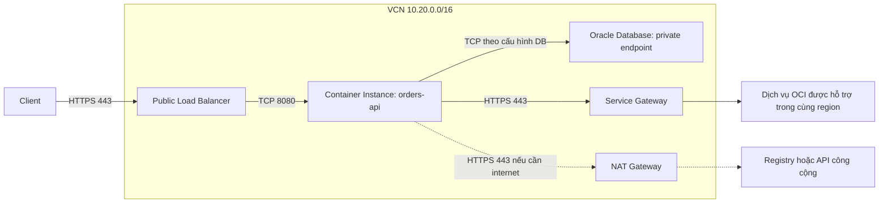
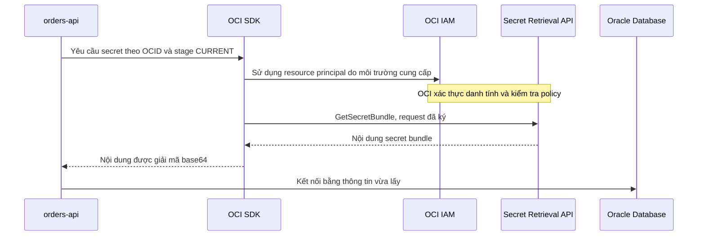

# Cấu hình mạng, tài nguyên và secrets cho Container Instances

## 1. Mục tiêu và tình huống triển khai

Trong chương **Containers và Functions** của module **CLOUD_PROVIDERS_ORACLE**, bài này tập trung vào ba quyết định khi chạy ứng dụng bằng Oracle Cloud Infrastructure (OCI) Container Instances: ứng dụng giao tiếp qua mạng nào, được dùng bao nhiêu tài nguyên và nhận thông tin bí mật bằng cách nào.

Container Instances cho phép chạy một hoặc nhiều container mà không quản lý máy chủ. Người triển khai vẫn phải chọn subnet, shape, tài nguyên và quyền IAM phù hợp. Dịch vụ phù hợp với workload không cần một nền tảng điều phối Kubernetes; xem [tổng quan Container Instances](https://docs.oracle.com/en-us/iaas/Content/container-instances/overview-of-container-instances.htm).

Ví dụ xuyên suốt là `orders-api`, một API Java nhận yêu cầu qua Load Balancer, kết nối Oracle Database qua địa chỉ riêng và đọc mật khẩu từ OCI Secret Management. Các CIDR, cổng và mức tài nguyên trong bài là giả định thiết kế để thực hành, không phải cấu hình mặc định của OCI.

Sau bài học, người học có thể:

- Thiết kế đường đi cho lưu lượng vào ứng dụng, kéo image và gọi dịch vụ phụ thuộc.
- Chọn tài nguyên ở cấp Container Instance và giới hạn ở cấp từng container.
- Phân biệt cấu hình thường, thông tin xác thực kéo image và secret ứng dụng.
- Áp dụng dynamic group và IAM policy để container đọc đúng tài nguyên cần thiết.
- Triển khai bằng OCI CLI, quan sát kết quả và chẩn đoán lỗi theo từng lớp.

## 2. Mô hình cần nắm trước khi cấu hình

Một Container Instance là đơn vị cấp phát hạ tầng cho nhóm container. Các container trong cùng instance dùng chung tài nguyên và không gian mạng; chúng có thể gọi nhau qua `localhost`. Đặc điểm này được minh họa trong [hướng dẫn thực hành Container Instances của Oracle](https://docs.oracle.com/en/learn/manage-oci-container-instances/).

Hệ quả trực tiếp cho thiết kế:

- Hai container không thể đồng thời bind cùng địa chỉ và cổng trong cùng không gian mạng. Nếu API nghe `0.0.0.0:8080`, sidecar phải chọn cổng khác.
- `localhost` chỉ trỏ tới instance hiện tại, không trỏ tới cơ sở dữ liệu ở instance khác hoặc dịch vụ OCI bên ngoài.
- NSG gắn với VNIC kiểm soát lưu lượng qua mạng VCN, không tạo hàng rào giữa hai tiến trình giao tiếp qua loopback trong cùng instance.
- Chỉ nhóm các container có quan hệ tin cậy và cần phối hợp chặt chẽ. Hai ứng dụng cần quyền truy cập secret độc lập nên được tách thành những instance riêng.

Không chuyển nguyên mô hình Docker trên máy cá nhân sang OCI. Dòng `EXPOSE 8080` trong Dockerfile không tạo ingress rule và không cấu hình Load Balancer. Với ứng dụng cần được gọi qua VNIC, tiến trình phải lắng nghe trên địa chỉ phù hợp, chẳng hạn `0.0.0.0:8080`; chỉ bind `127.0.0.1:8080` sẽ khiến client ngoài instance không truy cập được.

Ba lớp cấu hình có vai trò khác nhau:

| Lớp | Quyết định chính | Ví dụ |
| --- | --- | --- |
| Container Instance | Tổng tài nguyên, subnet/VNIC, nhóm container, restart policy | 2 OCPU, 8 GB RAM, private subnet |
| Container | Image, biến môi trường, giới hạn tài nguyên, quyền truy cập resource principal | API tối đa 3 vCPU và 6 GB RAM |
| Ứng dụng | Cổng lắng nghe, connection pool, cách lấy và làm mới secret | TCP 8080, đọc secret theo stage CURRENT |

Thay đổi ở một lớp không tự giải quyết lỗi ở lớp khác. Tăng RAM không sửa được DNS; thêm quyền đọc secret không tạo đường mạng tới Secret Retrieval API.

## 3. Thiết kế mạng cho API trong private subnet

### 3.1. Kiến trúc ví dụ

Giả sử VCN có CIDR `10.20.0.0/16` và ba subnet:

| Subnet | CIDR ví dụ | Thành phần |
| --- | --- | --- |
| Subnet tiếp nhận | `10.20.10.0/24` | Public Load Balancer |
| Subnet ứng dụng | `10.20.20.0/24` | Container Instance, không có public IP |
| Subnet dữ liệu | `10.20.30.0/24` | Endpoint riêng của Oracle Database |



Sơ đồ thể hiện luồng kết nối, không thay thế cấu hình route table, NSG, listener và backend set. Trong ví dụ, TLS kết thúc tại Load Balancer; đoạn Load Balancer đến API dùng HTTP trên TCP 8080. Nếu yêu cầu mã hóa toàn tuyến, cần thêm TLS cho backend và cấu hình kiểm tra chứng thư tương ứng.

API được truy cập qua Load Balancer nên không cần public IP. Với job xử lý nền không phục vụ HTTP, có thể bỏ cả Load Balancer và ingress rule cho cổng ứng dụng.

### 3.2. Route table phải phục vụ cả giai đoạn khởi động

Một cấu hình thường gặp ở subnet ứng dụng:

| Đích | Next hop | Mục đích |
| --- | --- | --- |
| Dịch vụ OCI được hỗ trợ trong region | Service Gateway | Truy cập Oracle Services Network |
| `0.0.0.0/0`, nếu thực sự cần internet | NAT Gateway | Gọi registry ngoài OCI hoặc API công cộng |
| Địa chỉ trong cùng VCN | Định tuyến nội bộ VCN | Gọi Load Balancer và DB trong VCN |

Service Gateway chỉ phục vụ những dịch vụ được hỗ trợ trong cùng region. Cần chọn service CIDR label phù hợp; label chỉ dành cho Object Storage không bao phủ toàn bộ dịch vụ OCI. NAT Gateway phục vụ kết nối do workload khởi tạo ra internet và không cung cấp điểm vào công khai cho API. Các nguyên tắc này được mô tả trong [tài liệu Service Gateway](https://docs.oracle.com/en-us/iaas/Content/Network/Tasks/servicegateway.htm).

Phải xét đường mạng trước khi tiến trình ứng dụng chạy:

1. Phân giải tên registry.
2. Kết nối tới registry và các endpoint liên quan để lấy image.
3. Xác thực kéo image nếu repository riêng.
4. Khởi động ứng dụng.
5. Gọi Secret Retrieval API và kết nối cơ sở dữ liệu.

Ví dụ, API chỉ dùng dịch vụ OCI nhưng image nằm ở registry công cộng bên ngoài thì bước kéo image vẫn cần đường internet thích hợp. Việc lấy được image không chứng minh endpoint secrets hay DB đã truy cập được.

Với public subnet, muốn kết nối IPv4 trực tiếp qua Internet Gateway còn cần public IPv4 trên VNIC và các rule tương ứng. Chỉ chọn public subnet không tự tạo public IP. Các lựa chọn VNIC, subnet và public IP được mô tả trong [quy trình tạo Container Instance](https://docs.oracle.com/en-us/iaas/Content/container-instances/creating-a-container-instance.htm).

### 3.3. NSG theo vai trò và các rule tối thiểu

Đặt ba NSG: `nsg-orders-lb`, `nsg-orders-api` và `nsg-orders-db`. Bảng dưới là thiết kế cho ví dụ, không phải danh sách rule đầy đủ cho mọi tenancy:

| Nơi áp dụng | Chiều | Nguồn hoặc đích | Giao thức/cổng đích | Mục đích |
| --- | --- | --- | --- | --- |
| NSG Load Balancer | Ingress | Dải client được phục vụ | TCP 443 | Nhận HTTPS |
| NSG Load Balancer | Egress | NSG API | TCP 8080 | Gọi backend và health endpoint |
| NSG API | Ingress | NSG Load Balancer | TCP 8080 | Nhận yêu cầu từ tầng tiếp nhận |
| NSG API | Egress | NSG DB | TCP 1521 trong ví dụ | Kết nối Oracle Net của DB đã chọn |
| NSG DB | Ingress | NSG API | TCP 1521 trong ví dụ | Chấp nhận kết nối từ API |
| NSG API | Egress | Service CIDR label thích hợp | TCP 443 | Gọi dịch vụ OCI cần dùng |
| NSG API | Egress, khi cần | Đích internet đã xác định | TCP 443 | Kéo image ngoài OCI hoặc gọi API bên ngoài |

TCP 1521 ở đây giả định một DB dùng listener tương ứng. Với Autonomous Database hoặc kết nối TLS, phải lấy cổng và chuỗi kết nối thực tế từ dịch vụ; không thay máy móc mọi cổng DB bằng 1521.

Đối với DNS tùy chỉnh, cần bảo đảm resolver truy cập được, kể cả UDP/TCP 53 khi kiến trúc yêu cầu. Không mở một rule internet rộng chỉ để xử lý lỗi phân giải tên chưa được xác định.

Dùng rule stateful cho ví dụ này giúp lưu lượng trả về của kết nối được theo dõi. Nếu dùng stateless, phải thiết kế cả chiều trả về. Các rule cho một VNIC là hợp các rule từ security list của subnet và các NSG liên quan: NSG hẹp không thu hồi quyền mà security list rộng đã cho phép. Xem [Security Rules](https://docs.oracle.com/en-us/iaas/Content/Network/Concepts/securityrules.htm).

NSG không phải bộ lọc tên miền. Nếu cần giới hạn egress theo hostname hoặc lớp ứng dụng, phải thiết kế proxy hay firewall thích hợp; cho phép TCP 443 tới `0.0.0.0/0` cho phép nhiều đích hơn riêng một registry.

### 3.4. DNS và địa chỉ backend

Giữ tên DNS cho dịch vụ phụ thuộc thay vì hard-code IP có thể thay đổi. Nếu dùng DNS riêng, phải kiểm tra private zone, resolver và đường đi tới resolver.

Load Balancer cần backend là private IP và cổng của ứng dụng. Khi thay Container Instance, không giả định IP cũ luôn được giữ lại. Quy trình tự động hóa phải cập nhật backend hoặc sử dụng cơ chế quản lý địa chỉ phù hợp với vòng đời triển khai.

Từ một máy kiểm tra đã có đường vào VCN, có thể kiểm tra lần lượt:

```bash
getent hosts orders-db.internal.example
curl --connect-timeout 3 --fail http://10.20.20.15:8080/health/ready
```

Địa chỉ `10.20.20.15` là ví dụ; thay bằng private IP thực tế. Không gửi mật khẩu DB trong URL kiểm tra. Nếu runtime tối giản không có các công cụ này, thực hiện từ một điểm kiểm tra được phép trong VCN.

## 4. Phân bổ CPU và bộ nhớ ở hai cấp

### 4.1. Tổng tài nguyên của instance

Shape và `shapeConfig` quyết định tổng tài nguyên Container Instance. Ví dụ:

```json
{
  "ocpus": 2,
  "memoryInGBs": 8
}
```

Bài dùng `CI.Standard.E4.Flex` làm ví dụ. Với shape x86 E4 này, 2 OCPU tương ứng 4 vCPU. Không áp dụng phép đổi đó cho mọi họ CPU. Khi triển khai, cần kiểm tra shape có trong region, khoảng CPU/RAM hợp lệ, service limit và năng lực còn sẵn. Băng thông cũng phụ thuộc shape và mức OCPU, không chỉ giới hạn CPU của ứng dụng. Tham khảo [Container Instances Shapes](https://docs.oracle.com/en-us/iaas/Content/container-instances/container-instance-shapes.htm).

Tổng tài nguyên là ngân sách chung. Nếu thêm sidecar, phải tính cả CPU, RAM, dung lượng tạm và lưu lượng của sidecar.

### 4.2. Giới hạn cho từng container

OCI dùng `resourceConfig.vcpusLimit` và `resourceConfig.memoryLimitInGBs` ở cấp container:

```json
{
  "displayName": "orders-api",
  "resourceConfig": {
    "vcpusLimit": 3.0,
    "memoryLimitInGBs": 6.0
  }
}
```

`vcpusLimit` tính theo CPU logic và có thể là số lẻ. Nếu không đặt các giới hạn này, tiến trình có thể dùng toàn bộ tài nguyên tương ứng còn có trong instance. Đây là giới hạn tiêu thụ; không nên suy ra chúng là cơ chế đặt trước tài nguyên kiểu Kubernetes requests. Xem [CreateContainerResourceConfigDetails](https://docs.oracle.com/en-us/iaas/tools/java/latest/com/oracle/bmc/containerinstances/model/CreateContainerResourceConfigDetails.html).

Một ngân sách minh họa nếu sau này thêm sidecar:

| Thành phần | Giới hạn CPU | Giới hạn RAM | Lý do |
| --- | --- | --- | --- |
| API Java | 3 vCPU | 6 GB | Xử lý yêu cầu và connection pool |
| Sidecar | 0,5 vCPU | 1 GB | Thu thập hoặc chuyển tiếp dữ liệu vận hành |
| Phần chưa phân cho hai container | 0,5 vCPU | 1 GB | Khoảng dự phòng theo thiết kế |

Trong ví dụ, tổng giới hạn ứng dụng và sidecar nhỏ hơn tổng tài nguyên instance. Đây là lựa chọn bảo thủ để bắt đầu đo tải, không phải tỷ lệ dự phòng bắt buộc của OCI.

Ba quy tắc thực hành:

1. Đặt giới hạn cho sidecar để tránh nó lấn át ứng dụng chính.
2. Theo dõi cả mức dùng của từng container và của instance.
3. Hiểu rằng hạ giới hạn container không tự giảm tài nguyên đã cấp phát và chi phí của instance.

### 4.3. Chọn tài nguyên dựa trên biểu hiện của ứng dụng

| Dấu hiệu | Khả năng cần kiểm tra | Thử nghiệm tiếp theo |
| --- | --- | --- |
| CPU cao và độ trễ tăng theo tải | Thiếu CPU hoặc xử lý quá nhiều trên request | Đo profile, tăng CPU có kiểm soát |
| CPU thấp nhưng request chờ lâu | Chờ DB, DNS, mạng hoặc connection pool | Đo thời gian từng lời gọi phụ thuộc |
| RAM tăng liên tục theo thời gian | Cache không giới hạn, rò rỉ hoặc giữ quá nhiều dữ liệu | Đo heap và bộ nhớ tiến trình |
| Container kết thúc bất thường khi tải tăng | Có thể chạm giới hạn bộ nhớ | Đối chiếu trạng thái, log và metric trước khi dừng |
| Kéo image hoặc ghi file tạm thất bại | Thiếu dung lượng tạm hoặc lỗi mạng | Xem dung lượng, work request và lỗi registry |

Không kết luận chắc chắn OOM chỉ từ exit code 137; mã đó cho biết tiến trình nhận SIGKILL trong môi trường Linux, còn nguyên nhân phải được đối chiếu thêm.

### 4.4. Lưu ý riêng cho Java

Giới hạn RAM container bao gồm nhiều phần ngoài Java heap: metaspace, code cache, thread stack, direct buffer và thư viện native. Đặt `-Xmx` bằng toàn bộ RAM container rất dễ làm thiếu bộ nhớ ngoài heap.

Ví dụ khởi đầu cho container có giới hạn 6 GB:

```text
JAVA_TOOL_OPTIONS=-Xms512m -Xmx3g
```

Đây là tham số để thử tải, không phải công thức tối ưu cho mọi JVM. Cần dùng JDK có khả năng nhận biết giới hạn container, kiểm tra hành vi GC, số luồng và RSS thực tế. API dùng nhiều direct buffer có thể cần phần ngoài heap lớn hơn API xử lý đối tượng nhỏ.

Giới hạn CPU cũng ảnh hưởng lựa chọn số worker và số luồng GC. Tăng thread pool vượt xa mức CPU thực có thể chỉ làm tăng tranh chấp và bộ nhớ stack.

## 5. Cấu hình thường, secret kéo image và secret ứng dụng

Ba loại dữ liệu sau cần được xử lý riêng:

| Loại | Ví dụ | Nơi sử dụng |
| --- | --- | --- |
| Cấu hình không bí mật | `APP_PORT`, `DB_HOST`, `LOG_LEVEL`, OCID secret | Biến môi trường hoặc file cấu hình |
| Thông tin xác thực kéo image | Username và token registry riêng | Cấu hình image pull của Container Instances |
| Secret ứng dụng | Mật khẩu DB, API key, chứng thư và private key | Ứng dụng lấy khi chạy qua cơ chế đã thiết kế |

Một OCID secret là định danh để gọi API, không phải nội dung bí mật. Truyền `DB_PASSWORD_SECRET_OCID` vào môi trường không làm OCI tự động thay nó bằng mật khẩu.

`imagePullSecrets` phục vụ lấy image và không tự cung cấp `DB_PASSWORD` cho ứng dụng. Nếu cần mật khẩu DB, ứng dụng phải có code hoặc thành phần lấy secret tương ứng.

Tránh đưa giá trị bí mật vào:

- Dockerfile, layer image và build argument có thể bị lưu lại.
- File cấu hình triển khai hoặc Terraform state không được bảo vệ.
- Arguments trên dòng lệnh, URL, log debug và output pipeline.
- Biến môi trường do người triển khai điền trực tiếp khi có thể dùng cơ chế lấy secret khi chạy.

Base64 là cách biểu diễn dữ liệu, không phải mã hóa để bảo mật. File chứa mật khẩu đã base64 vẫn phải được bảo vệ như chứa mật khẩu gốc.

## 6. Xác thực kéo image

### 6.1. Image riêng trong OCI Container Registry

Đối với private repository trong OCI Container Registry (OCIR), sử dụng quyền IAM dựa trên resource principal của Container Instance.

Dynamic group ví dụ, giới hạn theo compartment ứng dụng:

```text
ALL {
  resource.type = 'computecontainerinstance',
  resource.compartment.id = '<APP_COMPARTMENT_OCID>'
}
```

Policy cho phép dynamic group đọc repository trong compartment chứa image:

```text
Allow dynamic-group OrdersContainerInstances to read repos in compartment Images
```

`OrdersContainerInstances` và `Images` là tên ví dụ phải thay bằng tên thực tế. `resource.type` dùng giá trị `computecontainerinstance`; đây không phải tên resource-type `compute-container-family` dùng trong policy quản lý dịch vụ.

Quyền của người tạo Container Instance và quyền của Container Instance kéo image là hai danh tính khác nhau. Người dùng thấy được image trong Console không đồng nghĩa instance đã được cấp quyền đọc repository. Mẫu dynamic group và policy nằm trong [Container Instances IAM Policies](https://docs.oracle.com/en-us/iaas/Content/container-instances/permissions/policy-reference.htm).

### 6.2. Image trong registry riêng ngoài OCI

Với registry bên ngoài, OCI hỗ trợ tham chiếu một Vault secret chứa thông tin xác thực. Nội dung logic của secret có dạng:

```json
{
  "username": "<REGISTRY_USERNAME>",
  "password": "<REGISTRY_TOKEN_OR_PASSWORD>"
}
```

Phần cấu hình image pull tương ứng:

```json
[
  {
    "secretType": "VAULT",
    "registryEndpoint": "registry.example.com/team-orders/",
    "secretId": "<REGISTRY_CREDENTIAL_SECRET_OCID>"
  }
]
```

Registry endpoint phải khớp tiền tố của image URL, chẳng hạn `registry.example.com/team-orders/orders-api:1.0.0`. Dynamic group của Container Instance cần quyền đọc secret bundle tương ứng.

Theo tài liệu Oracle, cách dùng Vault secret này dành cho registry bên ngoài; private OCIR dùng resource principal và policy như phần trước. Tham khảo [Vault Secrets for Image Pull Authorization](https://docs.oracle.com/en-us/iaas/Content/container-instances/vault-secrets-image-authorization.htm).

Không dùng cùng một secret cho token registry và mật khẩu DB. Hai thông tin có chủ sở hữu, lịch xoay và phạm vi quyền khác nhau.

## 7. Lấy secret ứng dụng bằng resource principal

### 7.1. Luồng truy cập

Thiết kế ưu tiên trong bài là ứng dụng tự lấy secret:



Sơ đồ mô tả vai trò logic của xác thực và phân quyền; không hàm ý mọi lần đọc secret đều phải thực hiện một lần trao đổi token IAM mới.

Điều kiện để luồng thành công:

1. Container được phép truy cập resource principal của instance.
2. Instance khớp dynamic group đã cấu hình.
3. Dynamic group được cấp quyền đọc đúng secret bundle.
4. DNS, route và security rules cho phép gọi endpoint lấy secret.
5. SDK chọn đúng region của secret và ứng dụng xử lý nội dung đúng định dạng.

### 7.2. IAM theo secret cụ thể

Giả sử secret DB nằm trong compartment `AppSecrets`. Policy chỉ cho đọc secret bundle có OCID được chỉ định:

```text
Allow dynamic-group OrdersContainerInstances to read secret-bundles in compartment AppSecrets where target.secret.id = '<DB_PASSWORD_SECRET_OCID>'
```

`read secret-bundles` cho phép lấy nội dung; chỉ đọc metadata của `secrets` không tương đương quyền này. Không cần cấp `manage secret-family` chỉ để ứng dụng đọc một mật khẩu. Xem [tham chiếu policy cho Vault và Secret Management](https://docs.oracle.com/en-us/iaas/Content/Identity/policyreference/keypolicyreference.htm).

Dynamic group theo toàn bộ compartment phù hợp nếu compartment là ranh giới tin cậy của ứng dụng. Nếu compartment chứa nhiều ứng dụng không nên đọc secret của nhau, cần thu hẹp điều kiện thành viên, chẳng hạn theo resource ID, hoặc tách compartment/dynamic group. Điều kiện `target.secret.id` giới hạn secret được đọc nhưng không phân biệt các instance đã cùng thuộc một dynamic group.

IAM policy phải đặt ở phạm vi có thể cấp quyền cho compartment đích. Không mặc định policy nằm trong compartment ứng dụng sẽ cấp được quyền lên một compartment secrets ngang cấp.

### 7.3. Bật hoặc tắt truy cập resource principal theo container

Container cần gọi OCI SDK:

```json
{
  "displayName": "orders-api",
  "isResourcePrincipalDisabled": false
}
```

Container hỗ trợ không cần gọi OCI API:

```json
{
  "displayName": "local-helper",
  "isResourcePrincipalDisabled": true
}
```

Cờ này kiểm soát việc container có được truy cập resource principal của instance hay không; nó không tạo danh tính IAM riêng cho mỗi container. Các container được bật khả năng này dùng danh tính của cùng instance. Xem [CreateContainerDetails](https://docs.oracle.com/en-us/iaas/tools/java/latest/com/oracle/bmc/containerinstances/model/CreateContainerDetails.html).

Vì các container vẫn dùng chung không gian mạng và có thể được gắn volume chung, không coi việc tắt resource principal là sự cô lập hoàn chỉnh giữa mã không đáng tin cậy.

### 7.4. Ví dụ Java đọc secret

Image ứng dụng cần đóng gói OCI Java SDK, bao gồm module `oci-java-sdk-secrets`, các phụ thuộc xác thực và HTTP client tương thích. Chốt cùng một phiên bản SDK trong hệ thống build; không trộn tùy tiện các phiên bản artifact.

Ví dụ dưới là lớp hỗ trợ chạy bên trong Container Instance. Secret chứa mật khẩu dạng văn bản UTF-8; phương thức trả về byte đã giải mã để phần khởi tạo kết nối sử dụng.

```java
import com.oracle.bmc.Region;
import com.oracle.bmc.auth.ResourcePrincipalAuthenticationDetailsProvider;
import com.oracle.bmc.secrets.SecretsClient;
import com.oracle.bmc.secrets.model.Base64SecretBundleContentDetails;
import com.oracle.bmc.secrets.requests.GetSecretBundleRequest;

import java.util.Base64;

public final class DbPasswordReader {
    private DbPasswordReader() {
    }

    public static byte[] readCurrentPassword() {
        String secretId = requireEnv("DB_PASSWORD_SECRET_OCID");
        String secretsRegion = requireEnv("SECRETS_REGION");

        var provider =
                ResourcePrincipalAuthenticationDetailsProvider.builder().build();

        try (SecretsClient client = SecretsClient.builder()
                .region(Region.fromRegionId(secretsRegion))
                .build(provider)) {

            var request = GetSecretBundleRequest.builder()
                    .secretId(secretId)
                    .stage(GetSecretBundleRequest.Stage.Current)
                    .build();

            var response = client.getSecretBundle(request);
            var content = response.getSecretBundle().getSecretBundleContent();

            if (!(content instanceof Base64SecretBundleContentDetails)) {
                throw new IllegalStateException("Unsupported secret content type");
            }

            var base64Content = (Base64SecretBundleContentDetails) content;
            return Base64.getDecoder().decode(base64Content.getContent());
        }
    }

    private static String requireEnv(String name) {
        String value = System.getenv(name);
        if (value == null || value.isBlank()) {
            throw new IllegalStateException("Missing configuration: " + name);
        }
        return value;
    }
}
```

SDK sử dụng dữ liệu resource principal mà môi trường cung cấp; không sao chép private key người dùng hoặc file `~/.oci/config` vào image. Cơ chế khởi tạo được mô tả trong [ResourcePrincipalAuthenticationDetailsProvider](https://docs.oracle.com/en-us/iaas/tools/java/latest/com/oracle/bmc/auth/ResourcePrincipalAuthenticationDetailsProvider.html).

`GetSecretBundleRequest.Stage.Current` chọn phiên bản đang ở trạng thái CURRENT. Kiểu nội dung và phương thức lấy base64 có trong [Base64SecretBundleContentDetails](https://docs.oracle.com/en-us/iaas/tools/java/latest/com/oracle/bmc/secrets/model/Base64SecretBundleContentDetails.html).

Khi tích hợp vào ứng dụng thực:

- Dùng secret để khởi tạo kết nối rồi xóa vùng byte tạm khi có thể; thư viện DB vẫn có thể giữ bản sao riêng.
- Không in response, nội dung base64 hoặc mật khẩu vào log.
- Đặt timeout và retry có giới hạn, có backoff cho lỗi tạm thời.
- Phân biệt lỗi cấu hình/quyền với lỗi mạng tạm thời; không retry vô hạn mọi lỗi.
- Nếu cần đọc định kỳ, tái sử dụng client phù hợp với vòng đời ứng dụng và có cơ chế làm mới cache.

Đoạn mã là một lần đọc, chưa triển khai cache, retry tùy biến, connection pool hay lịch xoay secret. Nếu lần đọc bắt buộc thất bại lúc khởi động, API chưa nên được đánh dấu sẵn sàng phục vụ.

## 8. Khi ứng dụng cần nhận secret qua file

Ứng dụng cũ có thể chỉ hỗ trợ `DB_PASSWORD_FILE` hoặc thư mục wallet. Khi đó có thể thiết kế bootstrap hoặc thành phần hỗ trợ lấy secret rồi ghi file vào vùng lưu trữ đã chọn.

Ví dụ luồng do ứng dụng tự triển khai:

1. Thành phần lấy secret dùng resource principal gọi Secret Retrieval API.
2. Ghi file tạm với quyền truy cập hạn chế.
3. Đổi tên file trong cùng filesystem để công bố nội dung hoàn chỉnh.
4. Ứng dụng đợi file hợp lệ rồi đọc.
5. Khi xoay secret, ứng dụng reload hoặc được thay thế theo kế hoạch.

Container Instances có các loại volume như thư mục rỗng, cấu hình dạng file và OCI File Storage; lựa chọn cụ thể cần đối chiếu [hướng dẫn tạo instance và storage](https://docs.oracle.com/en-us/iaas/Content/container-instances/creating-a-container-instance.htm).

Một file cấu hình do người triển khai cung cấp không tự trở thành secret được quản lý. Nội dung base64 trong request cấu hình volume vẫn là dữ liệu cần bảo vệ.

Với file secret, cần chủ động thiết kế:

| Vấn đề | Lựa chọn trong ứng dụng |
| --- | --- |
| Tránh lộ qua root filesystem/image | Dùng vùng mount dành riêng, không đóng gói secret vào image |
| Giới hạn ai đọc | UID/GID và quyền file phù hợp |
| Ứng dụng chỉ cần đọc | Mount phía ứng dụng ở chế độ read-only khi thích hợp |
| Tránh đọc file đang ghi dở | Ghi file tạm rồi đổi tên |
| Container khởi động không đúng thứ tự mong đợi | Đợi có giới hạn và kiểm tra nội dung hợp lệ |
| File nằm trên bộ nhớ | Tính dung lượng vào ngân sách RAM |
| Xóa/recreate instance | Có cơ chế lấy lại secret và tái tạo file |

Đây là cơ chế đồng bộ do ứng dụng xây dựng. Không giả định Container Instances cung cấp `initContainers`, `depends_on` hay Kubernetes Secret CSI chỉ vì cấu trúc có nhiều container.

Với Oracle Database wallet, phải phân loại thành phần thực tế: chứng thư công khai, private key và mật khẩu wallet có mức bảo vệ khác nhau. Nếu đưa cả gói wallet vào secret, cần kiểm tra giới hạn dung lượng secret, cách giải mã và quyền thư mục trước khi chọn phương án đó.

## 9. Ví dụ triển khai bằng OCI CLI trên PowerShell

Ví dụ này dùng **image riêng trong OCIR**, một container API và phương án ứng dụng tự đọc secret. VCN, DB, secret, IAM và Load Balancer phải được chuẩn bị trước.

### 9.1. Chuẩn bị

Trước khi chạy, cần có:

- OCI CLI đã cấu hình danh tính của người triển khai.
- Region và availability domain thực tế.
- Compartment ứng dụng, private subnet và NSG API.
- Image `orders-api` đã có trong private repository OCIR.
- Dynamic group và policy đọc repository, đọc đúng secret như các phần trên.
- Đường mạng tới registry, Secret Retrieval API và DB.
- Ứng dụng trong image có HTTP listener trên 8080, endpoint `/health/ready` và code lấy secret.

Danh tính triển khai phải có quyền quản lý Container Instances và dùng tài nguyên mạng liên quan. Nếu network, image hoặc secret thuộc compartment khác, phải xét quyền trên từng compartment, không chỉ compartment chứa instance.

Các file JSON dưới đây là tệp thực hành do người học tạo trong thư mục làm việc của mình. Chúng chỉ chứa cấu hình và định danh, không chứa mật khẩu.

### 9.2. Tạo ba nhóm cấu hình JSON

Thay toàn bộ placeholder trước khi thực thi:

```powershell
$compartmentId = '<APP_COMPARTMENT_OCID>'
$availabilityDomain = '<AVAILABILITY_DOMAIN_NAME>'
$subnetId = '<PRIVATE_SUBNET_OCID>'
$apiNsgId = '<API_NSG_OCID>'

$shapeConfig = @{
    ocpus = 2
    memoryInGBs = 8
}

$vnics = @(
    @{
        subnetId = $subnetId
        isPublicIpAssigned = $false
        nsgIds = @($apiNsgId)
    }
)

$containers = @(
    @{
        displayName = 'orders-api'
        imageUrl = '<REGION_REGISTRY>/<NAMESPACE>/orders-api:1.0.0'
        isResourcePrincipalDisabled = $false
        environmentVariables = @{
            APP_PORT = '8080'
            LOG_LEVEL = 'INFO'
            DB_HOST = 'orders-db.internal.example'
            DB_PORT = '1521'
            DB_PASSWORD_SECRET_OCID = '<DB_PASSWORD_SECRET_OCID>'
            SECRETS_REGION = '<SECRET_REGION_ID>'
            JAVA_TOOL_OPTIONS = '-Xms512m -Xmx3g'
        }
        resourceConfig = @{
            vcpusLimit = 3.0
            memoryLimitInGBs = 6.0
        }
    }
)

$utf8WithoutBom = [System.Text.UTF8Encoding]::new($false)

[System.IO.File]::WriteAllText(
    (Join-Path $PWD.Path 'shape.json'),
    (ConvertTo-Json -InputObject $shapeConfig -Depth 10),
    $utf8WithoutBom
)

[System.IO.File]::WriteAllText(
    (Join-Path $PWD.Path 'vnics.json'),
    (ConvertTo-Json -InputObject $vnics -Depth 10),
    $utf8WithoutBom
)

[System.IO.File]::WriteAllText(
    (Join-Path $PWD.Path 'containers.json'),
    (ConvertTo-Json -InputObject $containers -Depth 10),
    $utf8WithoutBom
)
```

`REGION_REGISTRY` là hostname registry thực tế của region, còn `NAMESPACE` là namespace của tenancy. Có thể thay tag phiên bản bằng image digest để cố định đúng nội dung đã kiểm tra.

Các biến `APP_PORT`, `DB_HOST` và `DB_PORT` là hợp đồng cấu hình của image `orders-api`; ứng dụng phải có code đọc chúng. Chúng không phải những biến mà OCI tự hiểu để cấu hình Java hoặc Oracle Net. JDBC URL, service name, tài khoản và tùy chọn TLS vẫn phải được cấu hình phù hợp trong ứng dụng.

### 9.3. Gửi yêu cầu tạo

Dùng mảng đối số giúp lệnh PowerShell dễ đọc và tránh lỗi ký tự nối dòng:

```powershell
$createArgs = @(
    'container-instances', 'container-instance', 'create',
    '--compartment-id', $compartmentId,
    '--availability-domain', $availabilityDomain,
    '--display-name', 'orders-api-ci',
    '--shape', 'CI.Standard.E4.Flex',
    '--shape-config', 'file://shape.json',
    '--vnics', 'file://vnics.json',
    '--containers', 'file://containers.json',
    '--container-restart-policy', 'ALWAYS',
    '--graceful-shutdown-timeout-in-seconds', '30'
)

oci @createArgs

if ($LASTEXITCODE -ne 0) {
    throw 'Container Instance creation request failed'
}
```

Cấu trúc tham số JSON và tên cờ được mô tả trong [OCI CLI: container-instance create](https://docs.oracle.com/en-us/iaas/tools/oci-cli/latest/oci_cli_docs/cmdref/container-instances/container-instance/create.html).

Ví dụ không truyền `--image-pull-secrets` vì chọn private OCIR với resource principal. Nếu đổi sang registry bên ngoài, cần bổ sung cấu hình image pull phù hợp và kiểm tra lại đường mạng.

`ALWAYS` phù hợp với API cần chạy lâu dài. Với job chạy xong phải kết thúc, lựa chọn này có thể làm công việc chạy lặp lại; phải chọn restart policy theo vòng đời workload.

Thời gian shutdown 30 giây là giá trị ví dụ. Ứng dụng cần xử lý tín hiệu dừng, ngừng nhận request mới và đóng connection pool trong khoảng thời gian đã chọn.

### 9.4. Xác minh sau khi tạo

Lấy OCID từ kết quả tạo, sau đó:

```powershell
$containerInstanceId = '<CREATED_CONTAINER_INSTANCE_OCID>'

$getArgs = @(
    'container-instances', 'container-instance', 'get',
    '--container-instance-id', $containerInstanceId
)

oci @getArgs
```

Kiểm tra chi tiết instance, work request, trạng thái từng container và log ứng dụng trong Console. Sau đó:

1. Xác nhận VNIC nằm trong private subnet đúng và không có public IPv4.
2. Xác nhận NSG gắn trên VNIC.
3. Kiểm tra image được kéo thành công.
4. Kiểm tra ứng dụng lấy secret và tạo kết nối DB thành công mà không ghi mật khẩu vào log.
5. Gọi health endpoint từ một nguồn được phép trong VCN.
6. Đăng ký private IP/cổng làm backend và chờ health check thành công.
7. Gọi API qua hostname TLS của Load Balancer.

`ACTIVE` ở cấp instance không thay thế phép kiểm tra API thực sự phục vụ được. Một tiến trình đang chạy vẫn có thể chưa kết nối được DB hoặc chưa lấy được secret.

## 10. Xoay secret mà không làm gián đoạn ngoài dự kiến

Secret có nhiều phiên bản; OCID secret có thể giữ nguyên trong khi nội dung thay đổi. Việc chọn stage CURRENT giúp ứng dụng lấy phiên bản được chỉ định để sử dụng. Khái niệm này được mô tả trong [Secret Management overview](https://docs.oracle.com/en-us/iaas/Content/secret-management/overview.htm) và [hướng dẫn đọc secret bundle](https://docs.oracle.com/en-us/iaas/Content/secret-management/Tasks/view-secret-properties-all-version.htm).

Chọn chiến lược theo khả năng của ứng dụng:

| Chiến lược | Thích hợp khi | Điều cần chấp nhận |
| --- | --- | --- |
| Đọc lúc khởi động | Ứng dụng đơn giản, có quy trình thay instance | Secret mới cần lần khởi động hoặc triển khai mới |
| Cache có thời hạn | Ứng dụng chạy lâu và hỗ trợ làm mới kết nối | Phải xử lý chuyển phiên bản và lỗi refresh |
| Đọc theo từng yêu cầu | Yêu cầu đặc thù đã đánh giá kỹ | Tăng số lần gọi, độ trễ và phụ thuộc runtime |

Không gọi Secret Retrieval API trên mọi request chỉ vì muốn mật khẩu luôn mới. Cache có thời hạn cùng quy trình reload connection pool thường dễ kiểm soát hơn.

Một quy trình xoay mật khẩu DB cần phối hợp cả phía DB và ứng dụng:

1. Chọn cách chuyển đổi credential mà DB hỗ trợ, chẳng hạn tài khoản song song hoặc khoảng chuyển tiếp đã được thiết kế.
2. Tạo và kiểm tra phiên bản secret mới trong quy trình quản lý secrets.
3. Chuyển phiên bản sẽ dùng sang CURRENT theo kế hoạch.
4. Làm mới cache/connection pool hoặc triển khai instance thay thế.
5. Kiểm tra kết nối mới và request thực tế.
6. Thu hồi credential cũ sau khi không còn consumer phụ thuộc.

Nếu DB chỉ cho một mật khẩu có hiệu lực, không thể suy ra rằng đổi CURRENT và restart ứng dụng sẽ hoàn toàn không có gián đoạn. Phải thiết kế thứ tự và khoảng chuyển đổi tương ứng.

Đổi secret cũng không sửa ngược những container đã nạp giá trị cũ vào môi trường hoặc bộ nhớ. Hành vi reload là trách nhiệm của ứng dụng và quy trình vận hành.

## 11. Quan sát, chi phí và tính sẵn sàng

### 11.1. Theo dõi cả instance và ứng dụng

OCI có metric cho Container Instances như `CpuUtilization`, `MemoryUtilization`, `MemoryUsed`, `EphemeralStorageUsed` và các metric theo container. Xem [Container Instance Metrics](https://docs.oracle.com/en-us/iaas/Content/container-instances/container-instance-metrics.htm).

Đối với API ví dụ, nên kết hợp:

| Tín hiệu | Ý nghĩa thực tế |
| --- | --- |
| CPU và RAM | Có đủ tài nguyên cho tải hiện tại hay không |
| Bộ nhớ tạm và dung lượng tạm | Có nguy cơ ảnh hưởng bootstrap, cache hoặc xử lý file |
| Thời gian lấy secret và lỗi refresh | Ứng dụng có duy trì được credential hợp lệ |
| Kết nối DB và thời gian chờ pool | Có nghẽn ở tầng dữ liệu |
| Độ trễ, tỷ lệ lỗi và health check | Người dùng có sử dụng được API |
| Work request và thay đổi cấu hình | Thay đổi hạ tầng nào liên quan tới sự cố |

Ngưỡng cảnh báo nên dựa trên thử tải và yêu cầu dịch vụ. Mức RAM 80% có thể là tín hiệu cần theo dõi ở workload này nhưng chưa đủ kết luận lỗi ở workload khác.

Log chỉ nên ghi mã lỗi, loại thao tác, thời điểm và request ID cần cho điều tra. Không ghi response secret, header xác thực hay connection string có credential.

### 11.2. Chi phí phụ thuộc tài nguyên đã cấp

Một instance 2 OCPU/8 GB vẫn được cấp mức đó dù container API bị giới hạn ở 3 vCPU/6 GB. Muốn giảm tài nguyên cấp phát, cần điều chỉnh cấu hình instance bằng thao tác được hỗ trợ hoặc triển khai cấu hình thay thế, rồi đo lại khả năng đáp ứng.

Trong dự toán, tính cả Load Balancer, DB, dịch vụ secrets, logging, lưu trữ và truyền dữ liệu nếu có. Không suy ra giá toàn hệ thống chỉ từ số container.

Với môi trường thực hành, dừng hoặc xóa tài nguyên khi không còn dùng và kiểm tra riêng các tài nguyên liên quan còn tồn tại. Trạng thái dừng và cách tính phí Container Instances được trình bày trong [tổng quan dịch vụ](https://docs.oracle.com/en-us/iaas/Content/container-instances/overview-of-container-instances.htm).

### 11.3. Một instance vẫn là một điểm lỗi

Đặt hai container API trong cùng instance không tạo hai miền lỗi độc lập. Với API cần sẵn sàng cao, thiết kế ít nhất hai instance độc lập và phân bố fault domain hoặc availability domain phù hợp với region, sau đó đưa vào Load Balancer.

Tránh trạng thái người dùng chỉ tồn tại trong filesystem tạm của một instance. Nếu phải giữ dữ liệu, lựa chọn dịch vụ lưu trữ và cơ chế khôi phục tương ứng; không xem khả năng container restart là bảo đảm dữ liệu bền vững.

Quy trình cập nhật có thể tạo instance mới, đợi sẵn sàng, thêm backend mới, rút backend cũ rồi mới giải phóng instance cũ. Thay subnet hoặc cấu hình khác có thể cần tạo lại tài nguyên, nên phải kiểm tra kế hoạch thay đổi trước khi áp dụng.

## 12. Chẩn đoán lỗi theo từng lớp

| Triệu chứng | Kiểm tra trước | Hướng xử lý |
| --- | --- | --- |
| Không kéo được image | Image URL/tag/digest, DNS, route và lỗi registry | Sửa địa chỉ hoặc đường mạng; sau đó kiểm tra xác thực |
| Private OCIR trả lỗi quyền | Dynamic group và policy `read repos` | Cấp quyền cho instance ở compartment repository |
| Registry ngoài trả unauthorized | Secret credentials, endpoint prefix, quyền đọc bundle | Cập nhật đúng secret và phạm vi khớp registry |
| Không tìm thấy resource principal | Cờ truy cập principal, SDK và môi trường runtime | Bật cho container cần dùng và dùng đúng auth provider |
| Đọc secret báo không được phép hoặc không tìm thấy | OCID, region, dynamic group và compartment policy | Đối chiếu từng giá trị; không kết luận tài nguyên đã bị xóa chỉ từ một mã lỗi |
| Đọc secret timeout | DNS, route, security rules, endpoint | Khôi phục đường kết nối rồi thử lại có giới hạn |
| Gọi API qua private IP thất bại | Địa chỉ bind, cổng và ingress từ nguồn kiểm tra | Sửa listener hoặc rule đúng nguồn |
| Backend unhealthy | Health path, port, nguồn health check và trạng thái ứng dụng | Sửa health check hoặc điều kiện sẵn sàng |
| API kết nối DB thất bại | DNS, cổng, listener, TLS/wallet và credential | Tách lỗi mạng, lỗi giao thức và lỗi xác thực |
| Container khởi động lại liên tục | Log trước khi dừng, memory, health check và restart policy | Xử lý nguyên nhân; không chỉ tăng số lần restart |
| Secret đã xoay nhưng API vẫn dùng mật khẩu cũ | Cache, biến môi trường, connection pool | Làm mới hoặc triển khai lại theo chiến lược đã chọn |

Thứ tự điều tra hữu ích là **DNS → kết nối TCP/TLS → xác thực → phân quyền → hành vi ứng dụng**. Với thao tác quản lý hạ tầng, xem thêm work request và `lifecycleDetails`.

Không mở toàn bộ ingress/egress hoặc cấp quyền quản trị tenancy chỉ để xem lỗi có biến mất hay không. Điều chỉnh theo giả thuyết cụ thể giúp giữ được bằng chứng về nguyên nhân.

## 13. Bài thực hành tích hợp

Thực hành trong compartment học tập với dữ liệu và secret thử nghiệm:

1. Chuẩn bị private subnet, route và NSG theo luồng API → OCI services/DB.
2. Đưa image API vào private OCIR và cấp quyền kéo image cho Container Instance.
3. Tạo secret mật khẩu thử nghiệm và policy chỉ đọc đúng bundle.
4. Triển khai API với 2 OCPU/8 GB; giới hạn API ở 3 vCPU/6 GB.
5. Gọi API từ nguồn hợp lệ và quan sát CPU, RAM, độ trễ cùng kết nối DB.
6. Từ một nguồn không có ingress phù hợp, kiểm tra cổng API không truy cập được.
7. Cấu hình ứng dụng thử đọc một secret khác nằm ngoài policy; xác nhận bị từ chối mà không sửa policy thành quyền rộng.
8. Xoay secret thử nghiệm và thực hiện cơ chế refresh hoặc thay instance đã chọn.
9. Nếu cần đánh giá tính sẵn sàng, thêm instance thứ hai rồi rút một backend có kiểm soát.
10. Kết thúc, dọn các tài nguyên của buổi thực hành và xác nhận những tài nguyên liên quan nào vẫn còn.

Không thực hiện thay credential hoặc gián đoạn backend của hệ thống dùng chung chỉ để thử bài học.

Kết quả cần đạt:

- API phục vụ qua đường vào đã thiết kế, còn Container Instance không cần public IP.
- Kéo image, lấy secret và gọi DB đều có đường mạng và quyền riêng được xác định.
- Cấu hình triển khai không chứa mật khẩu DB hoặc token registry dạng giá trị trực tiếp.
- Tài nguyên được phân bổ rõ ở cấp instance và container.
- Secret mới được sử dụng theo cơ chế đã chọn, có thể quan sát được quá trình chuyển đổi.
- Có đủ log và metric để phân biệt lỗi mạng, lỗi IAM và lỗi tài nguyên.

