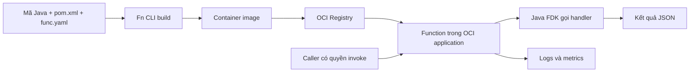

# Tạo, cấu hình và triển khai Java Function

## 1. Mục tiêu và phạm vi

Trong chương **Containers và Functions** của module **CLOUD_PROVIDERS_ORACLE**, bài này xây dựng một Java Function từ mã nguồn đến khi chạy trên Oracle Cloud Infrastructure (OCI). Quy trình kết nối kiến thức Java với compartment, IAM, VCN, container registry và giám sát trên OCI.

Sản phẩm thực hành là function **java-quote**: nhận một yêu cầu JSON, tính báo giá theo cấu hình giảm giá và trả kết quả JSON. Ví dụ không ghi dữ liệu ra ngoài, giúp tập trung vào hợp đồng đầu vào, cấu hình, đóng gói và triển khai.

Người học sẽ thực hiện được:

- Phân biệt application, function, container image và Fn CLI context.
- Tạo dự án Java bằng Fn Project CLI, khai báo handler và dùng Java FDK.
- Truyền cấu hình ở cấp application hoặc function.
- Kiểm thử handler, build image, đẩy lên OCI Registry và triển khai.
- Gọi thử có xác thực, đọc log và chẩn đoán lỗi theo từng lớp.
- Quản lý phiên bản, tài nguyên, quyền truy cập và chi phí của function.

Bài sử dụng **image-based function**, tức đóng gói bằng container image. OCI cũng có luồng code-only dùng archive và managed runtime; không trộn thông số hay quy trình đóng gói của hai luồng. [Nguồn: cách OCI Functions triển khai function](https://docs.oracle.com/en-us/iaas/Content/Functions/Concepts/functionshowitworks.htm).

Các lệnh thực hành dùng Bash trên môi trường Linux có công cụ phù hợp, chẳng hạn môi trường phát triển OCI được chuẩn bị sẵn hoặc WSL có Docker hoạt động. Chúng là hướng dẫn cho người học, không phải kết quả một lần triển khai đã chạy.

## 2. Hiểu các thành phần trước khi thao tác

| Thành phần | Vai trò trong bài |
|---|---|
| Compartment | Phạm vi tổ chức và phân quyền cho tài nguyên |
| Application | Nhóm các function; chứa lựa chọn mạng, kiến trúc và cấu hình dùng chung |
| Function | Tài nguyên thực thi gắn với handler, image, memory và timeout |
| Java FDK | Chuyển dữ liệu invocation sang Java và kết quả Java sang phản hồi |
| Fn CLI | Khởi tạo, build, deploy, cấu hình và gọi thử |
| Fn context | Chọn provider, endpoint, compartment, registry và profile làm việc |
| OCI Registry, thường gọi OCIR | Lưu container image của function |
| OCI Logging và Monitoring | Cung cấp log, metric và tín hiệu vận hành |

Đừng nhầm **Fn application** với một tiến trình Java chạy liên tục. Nó là đối tượng tổ chức và cấu hình của nền tảng. Một function có thể có nhiều môi trường thực thi được tạo hoặc tái sử dụng theo nhu cầu.

Luồng của bài:



Có ba đường truy cập phải được kiểm tra độc lập: máy phát triển tới OCI API, máy phát triển tới registry, và môi trường function tới registry hoặc dịch vụ downstream. Thành công ở một đường không chứng minh hai đường còn lại hoạt động.

## 3. Chuẩn bị môi trường OCI

### 3.1. Ghi nhận thông tin đích

Chuẩn bị các giá trị thực tế:

| Giá trị | Cách dùng |
|---|---|
| Region identifier | Chọn Functions API endpoint |
| Region registry host | Đăng nhập và đẩy image vào đúng region |
| Function compartment OCID | Nơi chứa application và function |
| Image compartment OCID | Nơi chứa repository của image |
| Object Storage namespace | Thành phần trong đường dẫn registry |
| VCN và subnet | Mạng của application |
| OCI CLI profile | Danh tính dùng khi gọi OCI API |
| Registry username và auth token | Xác thực Docker với OCIR |
| Kiến trúc application | Phải tương thích image được build |

Object Storage namespace không phải lúc nào cũng giống tên tenancy hiển thị. Functions API endpoint và registry host cũng có cấu trúc khác nhau; lấy chúng từ thông tin region và hướng dẫn của OCI, không tự ghép từ tên viết tắt chưa xác minh.

### 3.2. Phân biệt các danh tính

| Danh tính | Việc cần được cho phép |
|---|---|
| Người hoặc pipeline triển khai | Quản lý application/function, dùng subnet, đẩy image |
| Caller | Invoke function theo đúng phạm vi |
| Dịch vụ OCI Functions | Truy cập các tài nguyên nền tảng cần để chạy function |
| Function đang chạy | Đọc secret, Object Storage hoặc gọi dịch vụ OCI khi được cấp quyền |

Trong một lab được quản trị viên chuẩn bị, các policy cho người triển khai có thể được giới hạn theo compartment như sau. Thay tên group và compartment bằng giá trị thật; dùng cú pháp identity domain phù hợp nếu tenancy yêu cầu:

```text
Allow group FnDevelopers to manage functions-family in compartment FnLab
Allow group FnDevelopers to use virtual-network-family in compartment FnNetwork
Allow group FnDevelopers to manage repos in compartment FnImages
Allow group FnDevelopers to read objectstorage-namespaces in tenancy
```

Đây là phần policy phục vụ luồng cơ bản, không đại diện cho mọi lựa chọn logging, image signing hay tài nguyên dùng chung. Quản trị viên cần đối chiếu chính sách Functions hiện hành và phạm vi repository mà nền tảng phải truy cập. Không giải quyết lỗi triển khai bằng cách mặc định cấp `manage all-resources in tenancy`. [Nguồn: policy cho mạng và tài nguyên Functions](https://docs.oracle.com/en-us/iaas/Content/Functions/Tasks/functionscreatingpolicies.htm).

### 3.3. Chuẩn bị mạng

Với application dùng private subnet, chuẩn bị service gateway và route tới các dịch vụ OCI cần thiết trong region; kiểm tra security rule và DNS. Nếu function còn gọi API trên Internet, đánh giá thêm NAT gateway và egress phù hợp. Service gateway không thay thế đường tới mọi dịch vụ Internet. [Nguồn: service gateway](https://docs.oracle.com/en-us/iaas/Content/Network/Tasks/servicegateway.htm), [vai trò các loại gateway](https://docs.oracle.com/en-us/iaas/Content/Security/Reference/networking_security.htm).

Đối với image-based function, phải xét đường kéo image lúc khởi động, không chỉ kết nối từ handler. Một function chưa gọi dịch vụ downstream vẫn cần hạ tầng mạng đúng để chạy.

Private subnet của application không tự làm invoke endpoint trở thành endpoint chỉ truy cập nội bộ. Việc kiểm soát caller vẫn cần IAM và thiết kế đường truy cập thích hợp. [Nguồn: lưu ý khi tạo application](https://docs.oracle.com/en-us/iaas/Content/Functions/Tasks/functionscreatingapps.htm).

## 4. Chuẩn bị công cụ và chọn runtime

Kiểm tra công cụ trên môi trường phát triển:

```bash
fn version
fn init --help
docker version
oci --version
java -version
mvn -version
```

`docker version` cần thấy Docker daemon hoạt động. Nếu chỉ có client, quá trình build container chưa sẵn sàng. Java và Maven tại máy phát triển được dùng cho bước kiểm thử độc lập; build của Fn còn sử dụng build image.

Bài chọn Java 21 bằng runtime tường minh:

```bash
fn init --runtime java21 java-quote
cd java-quote
```

Tên runtime hợp lệ phụ thuộc phiên bản Fn CLI. Nếu `java21` chưa có trong trợ giúp, cập nhật công cụ theo hướng dẫn OCI trước khi tiếp tục. Không đổi ngầm sang runtime khác rồi giữ nguyên cấu hình compile.

Java 21 là một phiên bản được liệt kê trong hỗ trợ FDK image-based của OCI tại thời điểm tham khảo. Khi áp dụng bài về sau, xác nhận lại danh sách ngôn ngữ và vòng đời hỗ trợ. [Nguồn: ngôn ngữ OCI Functions hỗ trợ](https://docs.oracle.com/en-us/iaas/Content/Functions/Tasks/languagessupportedbyfunctions.htm).

Dự án sinh ra thường có cấu trúc:

```text
java-quote/
├── func.yaml
├── pom.xml
└── src/
    ├── main/java/com/example/fn/HelloFunction.java
    └── test/java/com/example/fn/HelloFunctionTest.java
```

Giữ lại package và tên lớp `HelloFunction` trong bài để khớp handler của scaffold. Tên function triển khai vẫn là `java-quote`; không bắt buộc trùng tên lớp Java.

## 5. Đọc đúng func.yaml và pom.xml

### 5.1. func.yaml mô tả cách đóng gói và chạy

Sau `fn init`, kiểm tra các trường:

| Trường | Ý nghĩa |
|---|---|
| `schema_version` | Phiên bản schema của file Fn |
| `name` | Tên function |
| `version` | Phiên bản dùng trong luồng build/deploy |
| `runtime` | Runtime mà công cụ dùng để dựng function |
| `build_image` | Image dùng để compile và đóng gói |
| `run_image` | Image nền cho môi trường thực thi |
| `cmd` | Handler Java dưới dạng lớp đầy đủ và phương thức |
| `memory` | Giới hạn memory của function |
| `timeout` | Thời gian chạy đồng bộ tối đa theo cấu hình |
| `config` | Cấu hình riêng của function |

Giữ `runtime`, `build_image` và `run_image` do công cụ hiện hành sinh cho Java 21. Ghi nhận phiên bản cụ thể để tái tạo build; không chép image tag cũ từ một hướng dẫn Java khác. Oracle hướng dẫn dùng scaffold để xác định cặp FDK build/runtime phù hợp. [Nguồn: lựa chọn FDK và base image](https://docs.oracle.com/en-us/iaas/Content/Functions/Tasks/functionssupportedlanguageversions.htm).

Trong `func.yaml`, bổ sung hoặc cập nhật các field dưới đây, giữ các field còn lại của scaffold và tránh tạo key trùng:

```yaml
name: java-quote
cmd: com.example.fn.HelloFunction::handleRequest
memory: 512
timeout: 30
config:
  DISCOUNT_PERCENT: "5"
  CURRENCY: "USD"
```

Đây là **phần cấu hình cần cập nhật**, không phải toàn bộ file thay thế.

`cmd` có ba thành phần phải khớp mã nguồn: package `com.example.fn`, class `HelloFunction`, method `handleRequest`. Function này không tự mở HTTP server hoặc chạy bằng `main()`; FDK tiếp nhận invocation và gọi handler.

### 5.2. pom.xml quản lý dependencies

Giữ `pom.xml` mà scaffold tạo, gồm Java FDK API và các dependency kiểm thử tương ứng. Các artifact FDK nên dùng cùng phiên bản đã chọn trong dự án.

Xác nhận phiên bản compile tương thích runtime 21. Lỗi `UnsupportedClassVersionError` thường xuất hiện khi bytecode được tạo bởi Java mới hơn JVM thực thi.

Chỉ thêm dependency khi cần. Mỗi framework, SDK và thư viện có thể tăng kích thước image, thời gian tải và khởi động. Khi thêm OCI SDK về sau, chọn module cho dịch vụ cần dùng thay vì đưa mọi module vào function.

## 6. Thiết kế hợp đồng báo giá

Đầu vào ví dụ:

```json
{
  "requestId": "req-001",
  "unitPrice": "100.00",
  "quantity": 2
}
```

Quy ước của bài:

- `requestId` có từ 1 đến 64 ký tự, chỉ gồm chữ, số, dấu chấm, gạch dưới hoặc gạch ngang.
- `unitPrice` là chuỗi thập phân không âm, tối đa 9 chữ số phần nguyên và 2 chữ số phần lẻ.
- `quantity` là số nguyên từ 1 đến 10.000.
- `DISCOUNT_PERCENT` là cấu hình từ 0 đến 100, tối đa 2 chữ số phần lẻ.
- Kết quả tiền của ví dụ được làm tròn 2 chữ số với `HALF_UP`.
- `CURRENCY` là nhãn đơn vị tiền trong ví dụ, không thực hiện quy đổi tỷ giá.

Công thức:

```text
subtotal = unitPrice × quantity
total = subtotal × (1 - DISCOUNT_PERCENT / 100)
```

Với giá 100, số lượng 2 và giảm 5%, kết quả là 190.00. Đây là quy tắc minh họa của bài; hệ thống thật phải định nghĩa riêng quy tắc làm tròn và đơn vị tiền của nghiệp vụ.

Phản hồi thành công có cấu trúc:

```json
{
  "code": "OK",
  "requestId": "req-001",
  "invocationId": "gia-tri-duoc-sinh-moi",
  "environment": "dev",
  "currency": "USD",
  "total": "190.00",
  "message": "Quote calculated"
}
```

`requestId` phục vụ liên kết yêu cầu nghiệp vụ. `invocationId` trong ví dụ do mã ứng dụng tạo để tìm log, không phải OCI request ID và không bảo đảm chống xử lý trùng.

## 7. Viết Java handler hoàn chỉnh

Thay nội dung lớp `src/main/java/com/example/fn/HelloFunction.java` trong dự án thực hành bằng mã sau:

```java
package com.example.fn;

import com.fnproject.fn.api.FnConfiguration;
import com.fnproject.fn.api.RuntimeContext;

import java.math.BigDecimal;
import java.math.RoundingMode;
import java.util.UUID;
import java.util.regex.Pattern;

public class HelloFunction {

    private static final Pattern REQUEST_ID =
            Pattern.compile("[A-Za-z0-9._-]{1,64}");
    private static final Pattern PRICE =
            Pattern.compile("[0-9]{1,9}([.][0-9]{1,2})?");
    private static final Pattern PERCENT =
            Pattern.compile("[0-9]{1,3}([.][0-9]{1,2})?");

    private String environment;
    private String currency;
    private BigDecimal multiplier;

    @FnConfiguration
    public void configure(RuntimeContext context) {
        environment = context.getConfigurationByKey("APP_ENV")
                .orElse("dev");
        currency = context.getConfigurationByKey("CURRENCY")
                .orElse("USD");

        String rawDiscount = context
                .getConfigurationByKey("DISCOUNT_PERCENT")
                .orElse("0");

        if (!PERCENT.matcher(rawDiscount).matches()) {
            throw new IllegalStateException(
                    "DISCOUNT_PERCENT must be a decimal percentage");
        }

        BigDecimal discount = new BigDecimal(rawDiscount);
        if (discount.compareTo(new BigDecimal("100")) > 0) {
            throw new IllegalStateException(
                    "DISCOUNT_PERCENT must be between 0 and 100");
        }

        multiplier = BigDecimal.ONE.subtract(
                discount.movePointLeft(2));
    }

    public QuoteResponse handleRequest(QuoteRequest input) {
        long started = System.nanoTime();
        String invocationId = UUID.randomUUID().toString();

        QuoteResponse response = new QuoteResponse();
        response.invocationId = invocationId;
        response.environment = environment;
        response.currency = currency;

        if (input == null
                || input.requestId == null
                || !REQUEST_ID.matcher(input.requestId).matches()) {
            return invalid(response, started,
                    "requestId is missing or invalid");
        }

        response.requestId = input.requestId;

        if (input.unitPrice == null
                || !PRICE.matcher(input.unitPrice).matches()) {
            return invalid(response, started,
                    "unitPrice must be a non-negative decimal string");
        }

        if (input.quantity == null
                || input.quantity < 1
                || input.quantity > 10_000) {
            return invalid(response, started,
                    "quantity must be between 1 and 10000");
        }

        BigDecimal subtotal = new BigDecimal(input.unitPrice)
                .multiply(BigDecimal.valueOf(input.quantity));

        response.total = subtotal.multiply(multiplier)
                .setScale(2, RoundingMode.HALF_UP)
                .toPlainString();
        response.code = "OK";
        response.message = "Quote calculated";
        logOutcome(response, started);
        return response;
    }

    private QuoteResponse invalid(
            QuoteResponse response, long started, String message) {
        response.code = "INVALID_INPUT";
        response.message = message;
        logOutcome(response, started);
        return response;
    }

    private void logOutcome(QuoteResponse response, long started) {
        long durationMs = (System.nanoTime() - started) / 1_000_000;
        System.err.printf(
                "event=quote_complete invocationId=%s code=%s durationMs=%d%n",
                response.invocationId, response.code, durationMs);
    }

    public static class QuoteRequest {
        public String requestId;
        public String unitPrice;
        public Integer quantity;
    }

    public static class QuoteResponse {
        public String code;
        public String requestId;
        public String invocationId;
        public String environment;
        public String currency;
        public String total;
        public String message;
    }
}
```

Java FDK có thể ánh xạ JSON sang POJO đầu vào và serialize POJO trả về. Các lớp DTO trong ví dụ là `public static`, có constructor không tham số ngầm định và field public để việc binding rõ ràng. [Nguồn: data binding của Java FDK](https://github.com/fnproject/fdk-java/blob/master/docs/DataBinding.md).

`@FnConfiguration` khởi tạo cấu hình thông qua `RuntimeContext` trước khi xử lý yêu cầu. Chỉ dùng giá trị mặc định có chủ đích; cấu hình giảm giá sai bị báo lỗi thay vì âm thầm dùng số khác. [Nguồn: cấu hình bằng RuntimeContext](https://fnproject.io/tutorials/basics/UsingRuntimeContext/).

Mẫu chỉ giữ cấu hình đã khởi tạo trong field của đối tượng, không giữ dữ liệu của từng khách hàng ở trạng thái dùng chung. Mỗi request có response mới. Cách này giúp tránh rò dữ liệu giữa các invocation nếu môi trường được tái sử dụng.

Có ba loại kết quả cần phân biệt:

| Trường hợp | Hành vi trong mẫu |
|---|---|
| JSON hợp lệ và đúng quy tắc | Trả `code=OK` |
| JSON bind được nhưng thiếu/sai dữ liệu nghiệp vụ | Trả `code=INVALID_INPUT` |
| JSON hỏng hoặc không bind được, cấu hình runtime lỗi | FDK hoặc runtime có thể báo invocation thất bại |

`INVALID_INPUT` là trường trong body của hợp đồng ví dụ, không tự biến thành HTTP 400. Nếu API cần HTTP status cụ thể, thiết kế thêm `InputEvent`/`OutputEvent` hoặc lớp tích hợp tương ứng; cần kiểm thử cả cách API Gateway chuyển tiếp phản hồi.

## 8. Kiểm thử handler trước khi build image

Scaffold ban đầu có test cho lời chào. Sau khi đổi handler sang báo giá, phải thay test đó; bỏ qua test cũ sẽ che lỗi hợp đồng.

Ví dụ nội dung `src/test/java/com/example/fn/HelloFunctionTest.java`:

```java
package com.example.fn;

import com.fnproject.fn.testing.FnResult;
import com.fnproject.fn.testing.FnTestingRule;
import org.junit.Rule;
import org.junit.Test;

import static org.junit.Assert.assertTrue;

public class HelloFunctionTest {

    @Rule
    public final FnTestingRule testing = FnTestingRule.createDefault()
            .setConfig("APP_ENV", "test")
            .setConfig("CURRENCY", "USD")
            .setConfig("DISCOUNT_PERCENT", "5");

    @Test
    public void calculatesDiscountedQuote() {
        String json = """
                {"requestId":"req-001","unitPrice":"100.00","quantity":2}
                """;

        testing.givenEvent().withBody(json).enqueue();
        testing.thenRun(HelloFunction.class, "handleRequest");

        FnResult result = testing.getOnlyResult();
        assertTrue(result.isSuccess());
        assertField(result, "code", "OK");
        assertField(result, "total", "190.00");
        assertField(result, "environment", "test");
    }

    @Test
    public void rejectsZeroQuantity() {
        String json = """
                {"requestId":"req-002","unitPrice":"100.00","quantity":0}
                """;

        testing.givenEvent().withBody(json).enqueue();
        testing.thenRun(HelloFunction.class, "handleRequest");

        FnResult result = testing.getOnlyResult();
        assertTrue(result.isSuccess());
        assertField(result, "code", "INVALID_INPUT");
    }

    @Test
    public void rejectsNegativePrice() {
        String json = """
                {"requestId":"req-003","unitPrice":"-1.00","quantity":1}
                """;

        testing.givenEvent().withBody(json).enqueue();
        testing.thenRun(HelloFunction.class, "handleRequest");

        assertField(testing.getOnlyResult(), "code", "INVALID_INPUT");
    }

    @Test
    public void roundsAccordingToTheExampleContract() {
        String json = """
                {"requestId":"req-004","unitPrice":"0.10","quantity":1}
                """;

        testing.givenEvent().withBody(json).enqueue();
        testing.thenRun(HelloFunction.class, "handleRequest");

        assertField(testing.getOnlyResult(), "total", "0.10");
    }

    private void assertField(
            FnResult result, String field, String value) {
        String expected = "\"" + field + "\":\"" + value + "\"";
        assertTrue(result.getBodyAsString().contains(expected));
    }
}
```

Bộ test dùng JUnit 4 và `FnTestingRule` theo bộ dependency kiểm thử của scaffold. Rule hỗ trợ cấu hình qua `setConfig`, enqueue event rồi chạy handler trong môi trường FDK kiểm thử. [Nguồn: FnTestingRule](https://raw.githubusercontent.com/fnproject/fdk-java/master/testing-junit4/src/main/java/com/fnproject/fn/testing/FnTestingRule.java).

Hàm kiểm tra field dùng chuỗi JSON compact của serializer mặc định để giữ ví dụ ngắn. Trong dự án thật, nên parse JSON và assert field theo kiểu dữ liệu, đồng thời kiểm tra schema, rounding boundary, trường thiếu và cấu hình lỗi.

Chạy trên JDK phù hợp:

```bash
mvn test
```

Điều kiện qua bước này là test thành công, không chỉ compile thành công. Kiểm thử FDK không kiểm chứng IAM, subnet, khả năng kéo image hay quyền invoke trên OCI; các lớp đó được kiểm chứng sau triển khai.

## 9. Kết nối Fn CLI với OCI và Registry

### 9.1. Cấu hình context

Với máy phát triển dùng OCI API signing profile, chọn các giá trị thực:

```bash
read -r -p "Region identifier: " OCI_REGION
read -r -p "Functions compartment OCID: " FN_COMPARTMENT_OCID
read -r -p "Image compartment OCID: " IMAGE_COMPARTMENT_OCID
read -r -p "Registry host: " OCIR_HOST
read -r -p "Object Storage namespace: " TENANCY_NAMESPACE
read -r -p "OCI CLI profile: " OCI_PROFILE_NAME

FN_CONTEXT_NAME="java-functions-lab"
FN_APP_NAME="java-functions-lab"
FN_FUNCTION_NAME="java-quote"
OCIR_PREFIX="java-learning"

fn create context "$FN_CONTEXT_NAME" --provider oracle
fn use context "$FN_CONTEXT_NAME"
fn update context api-url "https://functions.$OCI_REGION.oci.oraclecloud.com"
fn update context oracle.compartment-id "$FN_COMPARTMENT_OCID"
fn update context oracle.image-compartment-id "$IMAGE_COMPARTMENT_OCID"
fn update context oracle.profile "$OCI_PROFILE_NAME"
fn update context registry "$OCIR_HOST/$TENANCY_NAMESPACE/$OCIR_PREFIX"
fn list contexts
```

Mẫu endpoint trên dành cho OCI commercial region có định dạng tương ứng. Với realm khác, dùng endpoint OCI cung cấp cho region đó.

Nếu context đã tồn tại, kiểm tra rồi dùng hoặc cập nhật context phù hợp thay vì tạo lại cùng tên. Với OCI Cloud Shell, có thể đã có context cho region hiện tại; làm theo phần Getting Started của application để giữ đúng cơ chế xác thực của Cloud Shell, không chép nguyên cấu hình máy cá nhân.

`oracle.image-compartment-id` giúp chọn compartment cho repository. Không khai báo đúng có thể khiến luồng triển khai sử dụng phạm vi repository ngoài dự kiến hoặc thất bại do quyền. Prefix `java-learning` kết hợp với tên function tạo đường dẫn repository tương ứng, không phải một OCID. [Nguồn: tạo Fn context kết nối OCI](https://docs.oracle.com/en-us/iaas/Content/Functions/Tasks/functionscreatefncontext.htm).

### 9.2. Đăng nhập registry

Dùng username OCIR theo identity domain của tài khoản và auth token được tạo cho người có quyền push:

```bash
read -r -p "Registry username: " OCIR_USERNAME
docker login "$OCIR_HOST" --username "$OCIR_USERNAME"
```

Nhập auth token tại prompt password của Docker. Không dùng mật khẩu đăng nhập Console thay auth token.

Username thường gồm tenancy namespace và username; tài khoản thuộc identity domain hoặc federation có thể cần thêm domain trong đường dẫn. Khi lỗi xác thực, kiểm tra định dạng cụ thể của tài khoản thay vì thử thay namespace bằng tên tenancy. [Nguồn: lỗi đăng nhập registry khi deploy](https://docs.oracle.com/en-us/iaas/Content/Functions/Tasks/functionstroubleshooting_topic-Issues-deploying-applications-and-functions.htm).

OCI API signing và Docker registry login là hai cơ chế riêng. `fn list apps` chạy được không chứng minh Docker push được; `docker login` thành công cũng không chứng minh có quyền tạo function.

## 10. Tạo application đúng mạng và kiến trúc

Trong OCI Console, mở Functions, chọn region và compartment đã chuẩn bị rồi tạo application:

- Tên: `java-functions-lab`.
- Chọn VCN và subnet dành cho lab.
- Chọn kiến trúc phù hợp với image sẽ build.
- Ghi nhận application OCID và thông tin mạng.

Nếu máy build tạo image x86, dùng application shape `Generic_X86` cho luồng đơn kiến trúc này. Nếu chọn ARM, image và native dependency phải phù hợp ARM. Shape `Generic_X86_ARM` đòi hỏi khả năng chạy trên cả hai kiến trúc; một image chỉ x86 không đáp ứng lựa chọn đó.

Shape là lựa chọn cần xác định từ đầu vì không thể đổi sau khi application được tạo theo cơ chế này. [Nguồn: tạo application và chọn shape](https://docs.oracle.com/en-us/iaas/Content/Functions/Tasks/functionscreatingapps.htm).

Xác nhận context nhìn thấy đúng application:

```bash
fn list apps
fn inspect app "$FN_APP_NAME"
```

Đừng tạo application lần nữa bằng CLI nếu đã tạo trên Console. Kiểm tra compartment và region khi không tìm thấy tên mong muốn.

Đặt cấu hình dùng chung:

```bash
fn config app "$FN_APP_NAME" APP_ENV dev
```

`APP_ENV` không xuất hiện ở cấp function trong `func.yaml`, giúp quan sát việc kế thừa cấu hình của application.

## 11. Build image và triển khai

### 11.1. Build độc lập

Từ thư mục có `func.yaml` và `pom.xml`:

```bash
fn build
```

Xác nhận build hoàn thành. Đọc log để phân biệt tải dependency Maven, compile, test và tạo runtime image. Build thành công trên máy phát triển chưa có nghĩa image đã có trên OCI Registry.

Bộ ba cần đồng bộ là Java dùng để compile, Java trong runtime image và kiến trúc image. Native library qua JNI còn phải tương thích hệ điều hành/runtime bên trong image.

### 11.2. Deploy vào application

```bash
fn -v deploy --app "$FN_APP_NAME"
```

Với image-based function, luồng deploy thực hiện build, push image và tạo hoặc cập nhật định nghĩa function trỏ tới image. Không chạy `--local` trong lệnh triển khai lên OCI. [Nguồn: quickstart container image của OCI Functions](https://docs.oracle.com/en-us/iaas/Content/Functions/Tasks/functionsquickstartlocalhost.htm).

Lưu lại các bằng chứng:

| Bằng chứng | Mục đích |
|---|---|
| Tên function và OCID | Xác định chính xác tài nguyên triển khai |
| Image URI, tag và digest | Biết artifact nào đang chạy |
| Phiên bản source/build | Liên kết artifact với mã nguồn |
| Memory, timeout, cấu hình | Tái tạo trạng thái function |
| Region, compartment, application | Tránh nhầm môi trường |

Fn CLI có thể cập nhật version trong quá trình deploy theo luồng công cụ. Sau mỗi lần triển khai, đọc trạng thái thật thay vì mặc định tag giữ nguyên.

Kiểm tra:

```bash
fn list functions "$FN_APP_NAME"
fn inspect function "$FN_APP_NAME" "$FN_FUNCTION_NAME"
```

Đối chiếu image, memory, timeout và cấu hình trên Console. Không suy ra một dòng push thành công nghĩa bước cập nhật tài nguyên function cũng thành công.

## 12. Gọi thử và kiểm chứng hợp đồng

### 12.1. Invocation thành công

```bash
printf '%s' '{"requestId":"req-001","unitPrice":"100.00","quantity":2}' | fn invoke "$FN_APP_NAME" "$FN_FUNCTION_NAME"
```

Kết quả cần có `code=OK`, `total=190.00`, `currency=USD`, `environment=dev` và một `invocationId`.

Giá trị `dev` đến từ application; giảm giá và currency đến từ cấu hình function. Đối chiếu phép tính và log, không chỉ kiểm tra CLI kết thúc mà không báo lỗi.

### 12.2. Invocation có dữ liệu sai

```bash
printf '%s' '{"requestId":"req-002","unitPrice":"100.00","quantity":0}' | fn invoke "$FN_APP_NAME" "$FN_FUNCTION_NAME"
```

Mong đợi body có `code=INVALID_INPUT`. Mẫu này chủ động trả response cho lỗi nghiệp vụ nên invocation vẫn có thể được coi là thành công ở lớp nền tảng.

Thử JSON không hợp lệ để quan sát lỗi binding:

```bash
printf '%s' '{invalid-json' | fn invoke "$FN_APP_NAME" "$FN_FUNCTION_NAME"
```

Trường hợp này không có bảo đảm nhận cùng cấu trúc `QuoteResponse`, vì lỗi có thể phát sinh trước khi handler được gọi.

### 12.3. Xác thực khi gọi ngoài Fn CLI

Fn CLI phù hợp cho phát triển. Với hệ thống production, dùng OCI SDK, OCI CLI hoặc cơ chế signed request/tích hợp phù hợp. Một URL invoke không mặc nhiên là HTTP endpoint công khai gọi được bằng `curl` không ký. [Nguồn: các phương thức invoke Functions](https://docs.oracle.com/en-us/iaas/Content/Functions/Tasks/functionsinvokingfunctions.htm).

Khi đưa function sau API Gateway, cần thiết kế thêm xác thực client, quyền Gateway invoke function, request/response mapping và giới hạn traffic. Không giả định JSON của API Gateway giống POJO nghiệp vụ trong mọi cách tích hợp.

## 13. Quản lý cấu hình sau triển khai

### 13.1. Thứ tự ưu tiên

OCI kết hợp cấu hình application với cấu hình riêng function. Nếu cùng key, giá trị riêng của function ưu tiên hơn. Các key tùy chỉnh cũng được đưa vào môi trường thực thi. [Nguồn: mô hình cấu hình tùy chỉnh](https://docs.oracle.com/en-us/iaas/Content/Functions/Tasks/functionspassingconfigparams-about.htm).

Ví dụ đổi riêng function:

```bash
fn config function "$FN_APP_NAME" "$FN_FUNCTION_NAME" DISCOUNT_PERCENT 10
fn config function "$FN_APP_NAME" "$FN_FUNCTION_NAME" APP_ENV staging
```

Gọi lại yêu cầu giá 100, số lượng 2. Kết quả dự kiến là `180.00` và environment `staging`, dù application vẫn khai báo `APP_ENV=dev`.

Trong code mẫu, cấu hình được đọc lúc khởi tạo môi trường FDK. Sau cập nhật cấu hình, xác nhận bằng invocation mới và không giả định mọi tiến trình đang thực hiện yêu cầu sẽ đổi giá trị giữa chừng.

### 13.2. Giữ cấu hình triển khai nhất quán

Nếu chỉnh giảm giá bằng CLI thành 10 nhưng `func.yaml` vẫn là 5, lần deploy sau có thể áp lại cấu hình khai báo. Cần quyết định một nơi quản lý giá trị mong muốn:

- Cấu hình theo môi trường nằm trong hệ thống triển khai.
- Mã nguồn chứa mặc định được kiểm soát.
- Thay đổi khẩn cấp trên Console/CLI được ghi nhận và đồng bộ sau đó.

Đổi cấu hình không phải đổi artifact Java. Tuy nhiên, một lỗi cấu hình vẫn có thể làm function ngừng hoạt động hoặc tính sai nghiệp vụ.

Tên key nên dùng dạng chữ, số và gạch dưới, không bắt đầu bằng số. Tổng cấu hình application/function có giới hạn kích thước; không dùng nó để chứa tài liệu lớn hay toàn bộ nội dung wallet. [Nguồn: khai báo configuration bằng CLI](https://docs.oracle.com/en-us/iaas/Content/Functions/Tasks/functionspassingconfigparams.htm).

### 13.3. Tách secret khỏi cấu hình thông thường

`APP_ENV`, currency và mức giảm giá không phải thông tin xác thực. Với mật khẩu, API token hoặc database credential, sử dụng OCI Vault và chính sách truy cập phù hợp; cấu hình function có thể lưu OCID tham chiếu tới secret.

Không commit secret vào `func.yaml`, `pom.xml`, mã Java, test fixture hoặc image layer. Xóa một file ở layer Docker sau không đảm bảo nó biến mất khỏi các layer trước.

Mẫu báo giá không cần secret nên không bổ sung quyền Vault vào bài thực hành cơ bản.

## 14. Memory, timeout và thời gian khởi động

Trong bài, `memory: 512` và `timeout: 30` là điểm khởi đầu cho lab, không phải cấu hình tối ưu cho mọi Java Function. Oracle khuyến nghị Java function có ít nhất 256 MB; hãy thử tải để chọn giá trị phù hợp.

Memory của function bao gồm JVM heap và phần ngoài heap: metaspace, stack, code cache, direct buffer, native library và runtime. Đặt `-Xmx` bằng toàn bộ memory function có thể gây hết bộ nhớ dù heap chưa đầy theo cách mong đợi.

Timeout đồng bộ có giới hạn dịch vụ; tài liệu OCI hiện nêu tối đa 300 giây. Detached invocation có cấu hình và cách nhận kết quả riêng, không thuộc luồng đồng bộ của bài. [Nguồn: memory và timeout Functions](https://docs.oracle.com/en-us/iaas/Content/Functions/Tasks/functionscustomizing.htm).

Cần đo riêng:

| Chỉ số | Câu hỏi cần trả lời |
|---|---|
| Invocation đầu sau khi môi trường chưa sẵn sàng | Mất bao lâu để có phản hồi? |
| Invocation khi môi trường được tái sử dụng | Thời gian ổn định là bao nhiêu? |
| p95/p99 latency | Độ trễ đuôi có đáp ứng yêu cầu không? |
| Memory sử dụng và lỗi OOM | Có đủ phần dự phòng ngoài heap không? |
| Thời gian downstream | Chậm ở handler hay dịch vụ phụ thuộc? |

Ứng dụng gọi downstream nên có connect timeout, read timeout và ngân sách retry ngắn hơn deadline còn lại của invocation. Caller timeout không chứng minh công việc phía server chưa chạy; thao tác ghi phải có chiến lược idempotency.

Giảm dependency, tránh khởi tạo nặng ở mọi request và đo trước khi đổi memory. Đừng tăng timeout để che DNS lỗi hoặc retry không giới hạn.

## 15. Kết nối tới tài nguyên OCI và cơ sở dữ liệu

Mẫu báo giá thuần tính toán không cần OCI SDK tại runtime. Khi mở rộng sang Object Storage, Vault hoặc dịch vụ OCI khác:

1. Xác định function OCID hoặc điều kiện chọn function phù hợp.
2. Đưa function vào dynamic group.
3. Cấp policy tối thiểu cho tài nguyên đích.
4. Dùng resource principal provider trong SDK của function.
5. Kiểm thử thêm route, DNS và security rule.

Ví dụ điều kiện dynamic group cho các function trong một compartment:

```text
ALL {resource.type = 'fnfunc', resource.compartment.id = '<function-compartment-ocid>'}
```

Resource principal cho phép function dùng danh tính tài nguyên thay vì đóng gói API private key của người triển khai. Quyền deploy function và quyền function đọc dữ liệu là hai phạm vi khác nhau. [Nguồn: function truy cập tài nguyên OCI](https://docs.oracle.com/en-us/iaas/Content/Functions/Tasks/functionsaccessingociresources.htm).

Nếu mở rộng kết nối Oracle Database hoặc Autonomous Database, cần xét thêm:

- Endpoint, private network và listener port.
- TLS, wallet và cách cung cấp credential.
- Giới hạn connection của database khi function scale.
- Timeout, retry và cách xác định giao dịch đã commit hay chưa.
- Reuse client/connection có kiểm soát, kiểm tra kết nối cũ trước khi dùng.

Không giữ một transaction mở qua nhiều invocation. Không tạo thread nền rồi trả kết quả với giả định môi trường sẽ tồn tại để hoàn tất thread đó. Nếu công việc dài hoặc cần xử lý bền vững, thiết kế cơ chế điều phối và lưu tiến độ rõ ràng.

## 16. Logging và giám sát

Code mẫu ghi một dòng kết quả qua `System.err` gồm event, invocationId, code và thời gian xử lý. Nó không ghi toàn bộ payload, giá trị cấu hình hay thông tin xác thực.

Trên application trong OCI Console, bật Functions invocation log tới OCI Logging, chọn log group và retention phù hợp. Nếu cần log có cấu trúc, phát JSON hợp lệ và cấu hình định dạng logging tương ứng. [Nguồn: bật và xem function log](https://docs.oracle.com/en-us/iaas/Content/Functions/Tasks/functionsexportingfunctionlogfiles.htm).

Quy trình chẩn đoán một invocation:

1. Lưu thời điểm gọi và kết quả caller.
2. Lấy `invocationId` của mẫu nếu handler đã trả response.
3. Tìm dòng `event=quote_complete` tương ứng.
4. Đối chiếu OCI request ID và invocation log nền tảng.
5. Kiểm tra metric theo function và khoảng thời gian đó.

Không có log handler có thể vì handler chưa chạy: image pull, khởi tạo runtime hoặc binding đã thất bại. Vì vậy, cần đọc cả log nền tảng.

Theo dõi số invocation, số lỗi, thời gian thực thi và mức tài nguyên bằng Monitoring. Tách lỗi nghiệp vụ `INVALID_INPUT` khỏi lỗi nền tảng; mẫu trả lỗi nghiệp vụ trong body nên metric lỗi dịch vụ không tự đếm đúng mọi yêu cầu bị từ chối.

## 17. Chẩn đoán theo giai đoạn

| Giai đoạn | Dấu hiệu | Điều cần kiểm tra |
|---|---|---|
| Khởi tạo | Runtime không được nhận diện | Phiên bản Fn CLI và runtime hợp lệ |
| Compile/test | Không tìm thấy class hoặc test scaffold cũ thất bại | Package, cmd, dependency và hợp đồng test |
| Khởi động Java | UnsupportedClassVersionError | Phiên bản compile và run image |
| Docker build | Không kết nối daemon | Docker engine và quyền truy cập của máy phát triển |
| Push image | Unauthorized hoặc forbidden | Auth token, username/domain, repository và policy |
| Tạo function | Image không tương thích shape | Kiến trúc image so với application |
| Invoke | Không được xác thực/không có quyền | Context, signing profile và quyền caller |
| Cold start | Image pull hoặc container init timeout | Mạng, kích thước image, memory và FDK |
| Handler | JSON binding lỗi | JSON đầu vào, kiểu dữ liệu và serializer |
| Nghiệp vụ | Giá trị giảm giá khác mong đợi | Cấu hình function ghi đè application |
| Downstream | Timeout dù deploy thành công | DNS, route, NSG, endpoint và quyền runtime |

Với lỗi image pull hoặc container init, đọc mã lỗi cụ thể thay vì mặc định mã Java bị lỗi. OCI có hướng dẫn riêng cho các lỗi invoke như `FunctionInvokeImagePullTimeout` và `FunctionInvokeContainerInitTimeout`. [Nguồn: xử lý lỗi khi invoke](https://docs.oracle.com/en-us/iaas/Content/Functions/Tasks/functionstroubleshooting_topic-Issues-invoking-functions.htm).

Có thể bắt đầu điều tra bằng:

```bash
fn list contexts
fn inspect app "$FN_APP_NAME"
fn inspect function "$FN_APP_NAME" "$FN_FUNCTION_NAME"
docker version
```

Khi dùng chế độ debug của công cụ, đọc và che dữ liệu nhạy cảm trước khi chia sẻ log. Lỗi phải được gắn với đúng region, compartment và phiên bản image, tránh sửa cấu hình của môi trường khác.

## 18. Phát hành, khôi phục và kiểm soát chi phí

### 18.1. Một bản phát hành cần có artifact và cấu hình

Một tag image có thể bị ghi đè nếu quy trình cho phép. Ghi nhận digest, source revision, dependency và cấu hình giúp xác định chính xác bản triển khai.

Trước production, pipeline nên kiểm tra:

- Unit/FDK test và build image.
- Dependency, base image và kiến trúc.
- Quyền deploy theo môi trường.
- Cấu hình, memory, timeout và đường truy cập downstream.
- Invocation thử và log sau khi cập nhật.

Thử tải có giới hạn ở môi trường phù hợp. Function có thể scale nhanh hơn database hoặc API đích; phải đặt giới hạn và thiết kế bảo vệ downstream dựa trên khả năng của toàn hệ thống.

### 18.2. Khôi phục bản đã biết tốt

Khi bản mới lỗi, hướng phục hồi là triển khai lại hoặc cập nhật function về artifact đã xác nhận tốt, cùng cấu hình tương ứng. Không chỉ sửa `version` trong file local rồi cho rằng function trên OCI đã thay đổi.

Nếu tái tạo function mới, OCID có thể đổi; kiểm tra lại dynamic group, quyền invoke và thành phần tham chiếu OCID. Nếu function có ghi dữ liệu, phục hồi image không tự đảo ngược dữ liệu đã ghi.

Ví dụ khi giảm giá sai do cấu hình, xác định nguồn quản lý giá trị, sửa cấu hình đó và gọi thử một bộ đầu vào đã biết. Tránh deploy lại mã không thay đổi nhiều lần khi nguyên nhân nằm ở key cấu hình.

### 18.3. Chi phí và dọn tài nguyên lab

Chi phí phụ thuộc invocation, tài nguyên và thời gian chạy, cùng các dịch vụ đi kèm như registry, log, mạng hoặc database. Đối soát bằng dữ liệu billing hiện hành thay vì gắn một mức giá cố định vào bài.

Kết thúc lab:

1. Xác nhận application chỉ chứa tài nguyên thử nghiệm của bài.
2. Xóa function và application lab qua Console nếu không còn dùng.
3. Kiểm tra repository/image có được môi trường khác tham chiếu không trước khi xóa.
4. Điều chỉnh retention hoặc xóa log lab theo nhu cầu.
5. Thu hồi auth token thử nghiệm khi không còn sử dụng.
6. Chỉ xóa VCN/gateway/subnet nếu chúng được tạo riêng cho lab.

Không xóa image của function còn hoạt động: lần khởi tạo môi trường thực thi tiếp theo có thể vẫn cần kéo artifact đó.

## 19. Tiêu chí hoàn thành bài thực hành

| Tiêu chí | Bằng chứng cần quan sát |
|---|---|
| Handler đúng | Yêu cầu hợp lệ trả 190.00 với giảm 5% |
| Kiểm tra dữ liệu hoạt động | Số lượng 0 bị trả INVALID_INPUT |
| Cấu hình đúng | APP_ENV kế thừa application, giá trị function ưu tiên khi trùng key |
| Artifact đúng | Function trỏ tới image và digest đã ghi nhận |
| Tài nguyên đúng | Memory và timeout trên OCI khớp cấu hình mong muốn |
| Xác thực đúng | Caller được cấp quyền invoke và các lời gọi được ký phù hợp |
| Quan sát được | Tìm thấy invocation log và dòng log handler tương ứng |
| Có đường phục hồi | Biết artifact, cấu hình và cách triển khai lại bản tốt |
| Kiểm soát lab | Tài nguyên còn giữ và chi phí liên quan được xác định |

Khi giải thích được mối quan hệ giữa **mã Java → FDK handler → image → function definition → invocation → log**, người học đã có nền tảng để tích hợp Java Function với API Gateway, Events, Object Storage và các dịch vụ cơ sở dữ liệu Oracle theo đúng quyền và mạng của môi trường.
