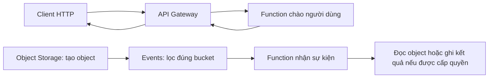
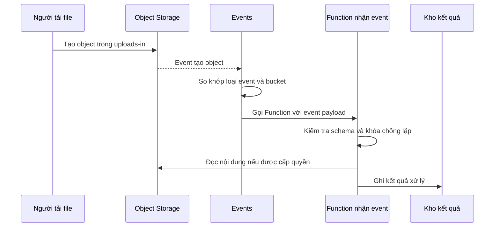

# Gọi Function qua API Gateway và dịch vụ OCI

Một Function chỉ trở thành thành phần của hệ thống khi có nơi gọi nó, có dữ liệu đầu vào rõ ràng và có cách xác nhận kết quả. Trong Oracle Cloud Infrastructure, API Gateway có thể cung cấp điểm vào HTTP cho Function; Events, Notifications và Connector Hub có thể kích hoạt Function từ các thay đổi hoặc luồng dữ liệu của nền tảng.

Bài học thuộc chương **Containers và Functions** của module **CLOUD_PROVIDERS_ORACLE**. Ta kết nối cách gọi Function với compartment, IAM, VCN, giám sát và tự động hóa, đồng thời xem xét chi phí, khả năng phục hồi và tính sẵn sàng của luồng xử lý.

Mục tiêu là xây dựng được một API gọi Function, thiết lập được một luồng kích hoạt từ dịch vụ OCI và giải thích được quyền, đường mạng cùng bằng chứng xử lý trên từng chặng.

## 1. Phân biệt các kiểu gọi trước khi cấu hình

Có ba hướng tương tác thường xuất hiện trong cùng một ứng dụng:

| Hướng tương tác | Ví dụ | Điều cần thiết kế |
| --- | --- | --- |
| Client gọi Function qua API | Ứng dụng web gọi API chào người dùng | Route HTTP, xác thực client, quyền Gateway gọi Function |
| Dịch vụ OCI kích hoạt Function | Object Storage phát sự kiện, Events gọi Function | Điều kiện lọc, schema sự kiện, quyền và xử lý lặp |
| Function gọi dịch vụ OCI | Function đọc object hoặc cập nhật dữ liệu | Resource principal, policy tới tài nguyên đích, kết nối mạng |

OCI hỗ trợ tích hợp Functions với API Gateway, Events, Notifications, Connector Hub và Oracle Integration. Với Connector Hub, Function có thể là bước xử lý dữ liệu hoặc là đích nhận dữ liệu. [Nguồn: Invoking OCI Functions from Other Oracle Cloud Infrastructure Services](https://docs.oracle.com/en-us/iaas/Content/Functions/Tasks/functionsintegratingwithother.htm).

Hai hướng đầu là trọng tâm bài học. Hướng cuối cần được tách rõ vì quyền cho một dịch vụ gọi Function không tự cấp cho Function quyền đọc bucket, stream hoặc cơ sở dữ liệu.

### 1.1. Hai luồng minh họa



Luồng HTTP phù hợp khi client cần câu trả lời trong thời gian ngắn. Luồng sự kiện phù hợp khi công việc bắt đầu từ một thay đổi của hạ tầng và không cần giữ kết nối từ người dùng.

Đừng dùng cùng một schema đầu vào cho mọi nguồn gọi. Một tên người ở dạng text, một event envelope và một batch log là ba contract khác nhau.

## 2. Chuẩn bị tài nguyên và định danh

Phần thực hành dùng hai compartment minh họa:

- **ApiEdge**: chứa API Gateway và API deployment.
- **AppFunctions**: chứa application và Function.

Phần tích hợp Object Storage dùng thêm compartment **DataProcessing** và bucket riêng **uploads-in**. Có thể dùng cùng một compartment trong môi trường học, nhưng vẫn cần nhận diện rõ tài nguyên nào là bên gọi, tài nguyên nào là bên được gọi.

| Giá trị | Cách sử dụng |
| --- | --- |
| Region | Chọn cùng một region cho bài thực hành |
| API Gateway OCID | Chọn gateway khi tạo deployment |
| Compartment OCID của gateway | Giới hạn chủ thể Gateway trong IAM policy |
| Function OCID | Gán native Functions backend |
| Application chứa Function | Quản lý cấu hình ứng dụng và logging |
| Invoke endpoint của Function | Dùng cho OCI SDK hoặc yêu cầu được ký trực tiếp |
| Endpoint API deployment | Địa chỉ HTTPS client thực sự gọi |

Chuẩn bị OCI CLI đã xác thực, quyền quản trị tương ứng và Function đã được deploy thành công. Ví dụ shell trong bài dùng **Bash** trên Linux hoặc WSL. Các placeholder `REPLACE_WITH_...` phải được thay bằng dữ liệu thực trước khi chạy.

Với image-based Function, kiểm tra image còn tồn tại và runtime có thể lấy image từ registry. Bài dùng dạng Function này để minh họa Java với Fn FDK; việc gắn native backend dựa trên Function OCID.

## 3. Tạo Function Java có contract đơn giản

Để dễ kiểm tra đường gọi, Function đầu tiên nhận **text thuần** và trả về lời chào. Chưa đưa kết nối cơ sở dữ liệu hoặc thao tác ghi dữ liệu vào lần kiểm tra đầu.

Nếu application `invocation-lab` và Fn context cho OCI đã sẵn sàng, có thể tạo project:

```bash
fn init --runtime java hello-gateway
cd hello-gateway
```

Trong project mẫu, sử dụng lớp `com.example.fn.HelloFunction`:

```java
package com.example.fn;

public class HelloFunction {
    public String handleRequest(String payload) {
        String person = payload == null ? "" : payload.trim();
        if (person.isEmpty()) {
            person = "bạn";
        }

        System.out.println(
            "operation=greet inputCharacters=" + person.length()
        );

        return "Xin chào, " + person + "!";
    }
}
```

Entry point của project phải trỏ tới phương thức tương ứng:

```yaml
cmd: com.example.fn.HelloFunction::handleRequest
```

Đây là trường trong cấu hình project Function, không phải API deployment. FDK Java hỗ trợ ánh xạ đầu vào/đầu ra và kiểu handler nhận `String` như ví dụ này. [Nguồn: Fn FDK for Java — hướng dẫn và ví dụ](https://github.com/fnproject/docs/blob/master/fdks/fdk-java/README.md).

Deploy bằng quy trình Fn đã cấu hình:

```bash
fn -v deploy --app invocation-lab
```

Ghi Function OCID sau khi deploy. Trong hệ thống production, việc deploy cần nằm trong pipeline và quy trình quản lý phiên bản của nhóm.

### 3.1. Gọi trực tiếp để xác nhận nền tảng

```bash
OCI_REGION="ap-singapore-1"
FUNCTION_OCID="REPLACE_WITH_FUNCTION_OCID"

oci --region "$OCI_REGION" fn function invoke \
  --function-id "$FUNCTION_OCID" \
  --body 'Lan' \
  --file - \
  --fn-invoke-type sync
```

Kết quả body mong đợi:

```text
Xin chào, Lan!
```

`--file -` yêu cầu CLI đưa response ra stdout; `--body` là dữ liệu gửi vào Function. CLI nhận diện và xử lý việc gọi invoke endpoint theo cơ chế OCI. [Nguồn: OCI CLI — fn function invoke](https://docs.oracle.com/en-us/iaas/tools/oci-cli/latest/oci_cli_docs/cmdref/fn/function/invoke.html).

Lưu kết quả này làm mốc: nếu gọi trực tiếp đã lỗi, hãy xử lý Function, danh tính hoặc môi trường chạy trước khi thêm Gateway vào luồng.

Một invoke endpoint của Functions không mặc định là API công khai có thể gọi bằng `curl` không xác thực. Gọi trực tiếp qua OCI API cần xác thực bằng request signature; CLI và SDK hỗ trợ thực hiện phần đó. [Nguồn: Invoking Functions](https://docs.oracle.com/en-us/iaas/Content/Functions/Tasks/functionsinvokingfunctions.htm).

## 4. Cấp quyền đúng cho từng chủ thể

### 4.1. Quyền của người cấu hình API

Một nhóm triển khai API có thể được cấp các policy theo mẫu:

```text
Allow group ApiDeployers to manage api-gateway-family in compartment ApiEdge
Allow group ApiDeployers to use functions-family in compartment AppFunctions
```

Ví dụ dùng group trong identity domain mặc định. Với domain khác, dùng định danh group tương ứng của tenancy. Việc tạo mạng hoặc thay đổi IAM còn cần quyền quản trị riêng theo trách nhiệm đã giao.

Policy cho người tạo deployment giúp họ chọn và cấu hình backend. **Danh tính Gateway lúc xử lý request** vẫn cần quyền gọi Function.

### 4.2. Quyền của API Gateway gọi Function

Mẫu policy chính thức giới hạn các Gateway thuộc một compartment:

```text
Allow any-user to use functions-family in compartment AppFunctions where all {
  request.principal.type = 'ApiGateway',
  request.resource.compartment.id = 'REPLACE_WITH_API_GATEWAY_COMPARTMENT_OCID'
}
```

Trong đó:

- `AppFunctions` là compartment chứa Function đích.
- OCID trong điều kiện là compartment chứa **Gateway**.
- `request.principal.type = 'ApiGateway'` giới hạn loại chủ thể gọi.

Đây là mẫu Oracle hướng dẫn cho quyền Gateway truy cập Functions. Nếu tài nguyên nằm ở các compartment khác nhau, đặt policy ở phạm vi có thể cấp quyền phù hợp, chẳng hạn compartment cha chung. [Nguồn: Create Policies to Control Access to Network and API Gateway-Related Resources](https://docs.oracle.com/en-us/iaas/Content/APIGateway/Tasks/apigatewaycreatingpolicies.htm).

`any-user` đi cùng các điều kiện trên không có nghĩa mọi người trên internet được invoke Function trực tiếp. Client được gọi API hay không là quyết định của lớp xác thực/ủy quyền trên API deployment.

Tuy vậy, mẫu này cho phép các Gateway thỏa điều kiện compartment, không chỉ một Gateway duy nhất. Khi compartment chứa nhiều nhóm ứng dụng, cần đánh giá lại phạm vi cấp quyền.

### 4.3. Lập bảng quyền theo chặng

| Chặng | Chủ thể cần được đánh giá | Phạm vi quyền |
| --- | --- | --- |
| Tạo hoặc cập nhật deployment | User hoặc pipeline triển khai | API Gateway và Function được cấu hình |
| Client gọi route | Danh tính do API xác thực | Route, scope hoặc quyền nghiệp vụ |
| Gateway invoke Function | Principal API Gateway | Function compartment đích |
| Function đọc object | Resource principal của Function | Bucket/object được phép |
| Connector gọi Function | Principal connector | Function dùng làm task hoặc target |

Một tài khoản quản trị có thể gọi trực tiếp thành công trong khi Gateway vẫn bị từ chối. Vì thế, kết quả gọi bằng tài khoản cá nhân không thay thế việc kiểm tra quyền của từng dịch vụ trong luồng.

## 5. Kiểm tra đường mạng riêng với kiểm tra IAM

IAM quyết định **được phép làm gì**. Route table, gateway mạng, NSG và security list quyết định **có thể kết nối tới đâu**.

Với luồng HTTP, xác minh ba đoạn:

1. **Client tới API Gateway**: DNS, TLS, endpoint public/private, ingress HTTPS và đường kết nối của client.
2. **Gateway tới Functions**: đường gọi tới dịch vụ Functions theo mô hình mạng đã chọn.
3. **Function tới dependency**: registry, dịch vụ OCI, cơ sở dữ liệu hoặc hệ thống ngoài mà mã cần sử dụng.

Oracle yêu cầu Function backend có thể được định tuyến từ VCN của API Gateway, với internet gateway hoặc service gateway theo mô hình public/private tương ứng. [Nguồn: Adding a Function in OCI Functions as an API Gateway Back End](https://docs.oracle.com/en-us/iaas/Content/APIGateway/Tasks/apigatewayusingfunctionsbackend.htm).

| Mô hình | Điểm cần kiểm tra |
| --- | --- |
| Gateway public phục vụ client internet | Public endpoint, đường internet, ingress TCP 443 từ nguồn dự định |
| Gateway private | Client có kết nối riêng tới endpoint và đường truy cập dịch vụ OCI phù hợp |
| Function dùng subnet private | Đường ra dịch vụ OCI và dependency được cấu hình rõ ràng |
| Function gọi database private | DNS, route và rule cho cổng database giữa các subnet/NSG |

Chọn nguồn ingress phù hợp với môi trường học hoặc mạng người dùng được phép. Việc Gateway public không đòi hỏi phải mở thêm một cổng web trong container Function như cách triển khai ứng dụng trên Compute.

Nếu image-based Function không khởi tạo được do không lấy được image, cần kiểm tra cả image và đường ra registry. Thông báo `FunctionInvokeImageNotAvailable` là một dấu hiệu được Oracle mô tả cho tình huống này. [Nguồn: Issues invoking functions](https://docs.oracle.com/en-us/iaas/Content/Functions/Tasks/functionstroubleshooting_topic-Issues-invoking-functions.htm).

## 6. Tạo API deployment với native Functions backend

### 6.1. Đặc tả route

Lưu đặc tả sau thành `api-deployment.json` trong môi trường thực hành, thay Function OCID:

```json
{
  "routes": [
    {
      "path": "/hello",
      "methods": ["POST"],
      "backend": {
        "type": "ORACLE_FUNCTIONS_BACKEND",
        "functionId": "REPLACE_WITH_FUNCTION_OCID"
      }
    }
  ]
}
```

`ORACLE_FUNCTIONS_BACKEND` là native backend của API Gateway. Thuộc tính `functionId` nhận Function OCID, không nhận tên image, application OCID hoặc URL HTTP tự dựng. Cấu trúc này được Oracle mô tả trong đặc tả API deployment. [Nguồn: Creating an API Deployment Specification](https://docs.oracle.com/en-us/iaas/Content/APIGateway/Tasks/apigatewaycreatingspecification.htm).

Bản tối thiểu này chưa thêm chính sách xác thực client. Chỉ dùng để kiểm tra lời chào trong môi trường học được kiểm soát; API có dữ liệu hoặc thao tác nghiệp vụ cần cấu hình ở phần bảo vệ API bên dưới.

Đường dẫn route là `/hello`. Deployment path prefix sẽ được đặt riêng là `/training`, nên đường dẫn gọi cuối cùng là `/training/hello`.

### 6.2. Tạo deployment

Trong Console:

1. Mở Gateway tại đúng region và compartment.
2. Tạo deployment với tên dễ nhận diện, ví dụ `hello-api-v1`.
3. Đặt path prefix `/training`.
4. Upload đặc tả hoặc tạo route bằng giao diện.
5. Kiểm tra method `POST`, backend type **Oracle Functions** và Function đích.
6. Tạo deployment rồi đợi lifecycle state cho biết deployment đã hoạt động.

Nếu dùng CLI:

```bash
API_COMPARTMENT_OCID="REPLACE_WITH_API_COMPARTMENT_OCID"
GATEWAY_OCID="REPLACE_WITH_API_GATEWAY_OCID"

oci --region "$OCI_REGION" api-gateway deployment create \
  --compartment-id "$API_COMPARTMENT_OCID" \
  --gateway-id "$GATEWAY_OCID" \
  --display-name "hello-api-v1" \
  --path-prefix "/training" \
  --specification file://api-deployment.json
```

Đặc tả route và thông tin tạo deployment phối hợp để xác định endpoint cuối cùng. Khi triển khai thành công, lấy endpoint từ trang deployment hoặc kết quả quản trị tương ứng. [Nguồn: Deploying an API on an API Gateway by Creating an API Deployment](https://docs.oracle.com/en-us/iaas/Content/APIGateway/Tasks/apigatewaycreatingdeployment.htm).

### 6.3. Gọi API

Đặt `DEPLOYMENT_ENDPOINT` bằng endpoint thực tế của deployment, **đã gồm** path prefix `/training` và không có dấu `/` ở cuối:

```bash
DEPLOYMENT_ENDPOINT="https://REPLACE_WITH_GATEWAY_HOST/training"

curl --silent --show-error --include \
  --request POST \
  --header 'Content-Type: text/plain; charset=utf-8' \
  --data-binary 'Lan' \
  "$DEPLOYMENT_ENDPOINT/hello"
```

Kỳ vọng là response thành công với body:

```text
Xin chào, Lan!
```

Không thêm `/training` lần nữa nếu endpoint đã chứa prefix. Không tắt kiểm tra chứng chỉ TLS chỉ để làm cho lần gọi có vẻ thành công.

Thử thêm body rỗng để kiểm tra nhánh mặc định của handler. Với method hoặc path khác, kiểm tra phản hồi ở lớp Gateway và xác nhận route nào thực sự được áp dụng.

### 6.4. Không trộn body với metadata HTTP

Handler hiện tại đọc text từ body. Query parameter `?name=Lan` không tự trở thành chuỗi body `Lan` của phương thức Java này.

Khi cần đọc method, path, header hoặc query parameter, chọn API context hoặc kiểu sự kiện mà FDK hỗ trợ, rồi viết adapter tương ứng. FDK Java có module `fn-events` và các ví dụ tích hợp với API Gateway, Notifications và Connector Hub. [Nguồn: Fn FDK Java — công cụ hỗ trợ tích hợp OCI](https://github.com/fnproject/fdk-java/blob/master/fn-events/README.md).

Một object JSON tự đặt các field `statusCode` và `body` có thể chỉ là dữ liệu nghiệp vụ. Muốn điều khiển HTTP status hoặc response header, dùng cơ chế HTTP response của FDK và contract backend đã chọn. Ví dụ interface `HTTPGatewayContext` của FDK Java cung cấp `setStatusCode` và `setResponseHeader`. [Nguồn: HTTPGatewayContext của FDK Java](https://github.com/fnproject/fdk-java/blob/master/api/src/main/java/com/fnproject/fn/api/httpgateway/HTTPGatewayContext.java).

## 7. Bảo vệ API trước khi sử dụng cho nghiệp vụ

### 7.1. Xác thực client và ủy quyền route

API Gateway hỗ trợ tự xác minh JWT hoặc gọi authorizer Function để kiểm tra token. Các chức năng xác định danh tính và quyết định quyền truy cập được cấu hình trên API deployment. [Nguồn: Adding Authentication and Authorization to API Deployments](https://docs.oracle.com/en-us/iaas/Content/APIGateway/Tasks/apigatewayaddingauthzauthn.htm).

Với phương án JWT, cần xác định rõ:

- Identity provider và issuer được tin cậy.
- Audience của API.
- Nguồn khóa công khai hoặc JWKS phù hợp.
- Header và token scheme mà client gửi.
- Quyền hoặc scope mà từng route yêu cầu.

Phân biệt token **hợp lệ** với token **được phép thực hiện nghiệp vụ**. Một người dùng đăng nhập hợp lệ vẫn có thể không có quyền đọc đơn hàng của người khác.

Sau khi bảo vệ route, ví dụ gọi có thể là:

```bash
curl --silent --show-error --include \
  --request POST \
  --header "Authorization: Bearer $ACCESS_TOKEN" \
  --header 'Content-Type: text/plain; charset=utf-8' \
  --data-binary 'Lan' \
  "$DEPLOYMENT_ENDPOINT/hello"
```

`ACCESS_TOKEN` là token theo cơ chế xác thực API đã cấu hình, không phải OCIR auth token dùng cho Docker login.

### 7.2. Authorizer và Function nghiệp vụ là hai vai trò

Authorizer quyết định request có được đi tiếp và trả về ngữ cảnh quyền theo contract của nó. Function nghiệp vụ thực hiện lời chào, xử lý đơn hàng hoặc thao tác dữ liệu.

Nếu chọn authorizer, cần quản lý riêng lỗi xác thực, thời gian chạy và quyền Gateway gọi authorizer. Không dùng việc Function nghiệp vụ trả một chuỗi “unauthorized” làm bằng chứng rằng Gateway đã áp dụng chính sách chặn.

### 7.3. Những kiểm tra cần có

| Tình huống | Bằng chứng mong đợi |
| --- | --- |
| Thiếu token khi route yêu cầu xác thực | Request bị từ chối trước xử lý nghiệp vụ |
| Token sai hoặc hết hạn | Có lỗi xác thực phù hợp |
| Token hợp lệ nhưng thiếu quyền | Route/nghiệp vụ từ chối theo thiết kế |
| Token hợp lệ và đủ quyền | Function được gọi, kết quả đúng |
| Request quá lớn hoặc sai kiểu dữ liệu | Có phản hồi có kiểm soát |
| Lưu lượng tăng đột biến | Giới hạn lưu lượng và khả năng xử lý hoạt động như dự định |

CORS xử lý việc trình duyệt cho phép truy cập chéo origin; nó không thay thế xác thực, IAM hoặc quyền nghiệp vụ.

## 8. Kích hoạt Function từ Object Storage qua Events

### 8.1. Contract của luồng sự kiện

Tình huống: khi có object mới trong `uploads-in`, hệ thống nhận metadata rồi bắt đầu xử lý. Luồng là:



Event mô tả thay đổi của tài nguyên; không phải mặc định chứa toàn bộ nội dung file. Nếu công việc cần dữ liệu file, Function phải đọc Object Storage bằng định danh trong event và quyền riêng.

### 8.2. Bật phát sự kiện của object

Trên bucket thực hành, bật **Emit object events**. Có thể dùng Console hoặc:

```bash
OBJECT_NAMESPACE="REPLACE_WITH_OBJECT_STORAGE_NAMESPACE"

oci --region "$OCI_REGION" os bucket update \
  --namespace-name "$OBJECT_NAMESPACE" \
  --name "uploads-in" \
  --object-events-enabled true
```

Đây là lựa chọn của bucket để phát sự kiện khi trạng thái object thay đổi. Việc đã tạo Events rule chưa đủ nếu nguồn chưa phát loại sự kiện mong muốn. [Nguồn: Managing Emitting Events for Object State Changes in an Object Storage Bucket](https://docs.oracle.com/en-us/iaas/Content/Object/Tasks/managingbuckets_topic-To_enable_or_disable_emitting_events_for_object_state_changes.htm).

### 8.3. Tạo rule hẹp theo nhu cầu

Trong Events:

1. Chọn compartment phù hợp với tài nguyên nguồn.
2. Tạo rule có tên `uploads-in-object-created`.
3. Chọn service **Object Storage**, event type tạo object.
4. Thêm điều kiện bucket là `uploads-in`.
5. Dùng chức năng xem logic và validate với event mẫu.
6. Chọn action **Functions**, rồi chọn compartment, application và Function nhận event.
7. Tạo rule, xác nhận rule và action đang được bật.

Events cho phép lọc theo loại sự kiện, thuộc tính và tag; action Functions chọn application cùng Function đã có sẵn. [Nguồn: Creating an Events Rule](https://docs.oracle.com/en-us/iaas/Content/Events/Task/create-events-rule.htm).

Người cấu hình cần quyền quản lý rule và sử dụng tài nguyên được chọn làm action. Đối chiếu quyền Events theo phạm vi tenancy/compartment thực tế; không sao chép policy có principal `ApiGateway` cho một nguồn kích hoạt khác.

Tránh bắt toàn bộ event của tenancy khi chỉ cần object mới trong một bucket. Với xử lý có ghi kết quả, dùng bucket đích riêng hoặc filter đủ chặt để kết quả không kích hoạt lại chính luồng xử lý.

### 8.4. Nhận và kiểm tra event payload

Một phần payload minh họa:

```json
{
  "eventType": "com.oraclecloud.objectstorage.createobject",
  "eventID": "example-event-001",
  "data": {
    "resourceName": "incoming/orders-001.csv",
    "additionalDetails": {
      "namespace": "example_namespace",
      "bucketName": "uploads-in"
    }
  }
}
```

Ví dụ đã rút gọn. Đối chiếu event thực tế và phiên bản schema trước khi viết parser. Envelope của OCI Events có các trường nhận diện loại sự kiện, thời gian và dữ liệu tài nguyên. [Nguồn: Contents of an Event Message](https://docs.oracle.com/en-us/iaas/Content/Events/Reference/eventenvelopereference.htm).

Trong một project Function nhận event riêng, có thể dùng đầu dò Java tối thiểu:

```java
package com.example.fn;

public class HelloFunction {
    public String handleRequest(String eventPayload) {
        int length = eventPayload == null ? 0 : eventPayload.length();
        System.out.println(
            "operation=event-probe payloadCharacters=" + length
        );
        return "received";
    }
}
```

Đầu dò chỉ xác nhận có lần thực thi nhận dữ liệu. Để xử lý nghiệp vụ, bổ sung parser, kiểm tra loại sự kiện, bucket, object và khóa chống lặp; ghi nhận trạng thái xử lý bằng nơi lưu bền vững.

Sau khi rule hoạt động, tải một object mới có tên duy nhất. Kiểm tra log Function và kết quả đầu ra, thay vì chỉ dựa vào việc upload thành công.

## 9. Cho Function quyền đọc tài nguyên liên quan

Để đọc file trong luồng trên, tạo dynamic group chỉ chứa Function xử lý cần thiết. Một matching rule có thể là:

```text
resource.id = 'REPLACE_WITH_EVENT_FUNCTION_OCID'
```

Cấp quyền đọc object tại bucket nguồn:

```text
Allow dynamic-group ObjectEventWorkers to read objects in compartment DataProcessing where target.bucket.name = 'uploads-in'
```

Tên `ObjectEventWorkers` là tên dynamic group đã tạo. Nếu dùng domain khác mặc định, định danh dynamic group theo cấu hình IAM tương ứng.

Resource principal kết hợp dynamic group và policy cho phép Function xác thực tới dịch vụ OCI. Oracle hỗ trợ matching rule theo một Function OCID hoặc theo các Function trong compartment. [Nguồn: Accessing Other Oracle Cloud Infrastructure Resources from Running Functions](https://docs.oracle.com/en-us/iaas/Content/Functions/Tasks/functionsaccessingociresources.htm).

Trong Java, phần tạo authentication provider có dạng:

```java
import com.oracle.bmc.auth.ResourcePrincipalAuthenticationDetailsProvider;

ResourcePrincipalAuthenticationDetailsProvider provider =
    ResourcePrincipalAuthenticationDetailsProvider.builder().build();
```

Truyền provider này cho OCI SDK client phù hợp trong project có dependency SDK tương ứng. Provider lấy thông tin xác thực từ môi trường resource principal của runtime. [Nguồn: OCI Java SDK — ResourcePrincipalAuthenticationDetailsProvider](https://docs.oracle.com/en-us/iaas/tools/java/latest/com/oracle/bmc/auth/ResourcePrincipalAuthenticationDetailsProvider.html).

Không đóng gói private key cá nhân vào image để thực hiện quyền này. Nếu Function cần ghi kết quả, cấp thêm đúng quyền và tài nguyên đầu ra đã chọn.

Cũng cần kiểm tra quyền nghiệp vụ của caller. Nếu Function có quyền đọc cả bucket, mã không nên cho phép một request tùy ý chọn bất kỳ object nhạy cảm nào chỉ vì SDK đọc được nó.

## 10. Gọi Function qua Notifications

### 10.1. Mô hình topic và subscription

Luồng tiêu biểu là:

```text
Alarm hoặc bên publish
    -> Notifications topic
    -> Function subscription
    -> Function nhận thông điệp
```

Trong Console, mở topic, tạo subscription với protocol **Function**, rồi chọn application và Function. Người thêm subscription cần quyền invoke Function. Function subscription không yêu cầu bước xác nhận như email subscription. [Nguồn: Creating a Function Subscription](https://docs.oracle.com/en-us/iaas/Content/Notification/Tasks/create-subscription-function.htm).

Ví dụ CLI:

```bash
TOPIC_OCID="REPLACE_WITH_TOPIC_OCID"
TOPIC_COMPARTMENT_OCID="REPLACE_WITH_TOPIC_COMPARTMENT_OCID"
EVENT_FUNCTION_OCID="REPLACE_WITH_EVENT_FUNCTION_OCID"

oci --region "$OCI_REGION" ons subscription create \
  --topic-id "$TOPIC_OCID" \
  --compartment-id "$TOPIC_COMPARTMENT_OCID" \
  --protocol ORACLE_FUNCTIONS \
  --subscription-endpoint "$EVENT_FUNCTION_OCID"
```

Sau khi subscription hoạt động, publish một thông điệp kiểm tra:

```bash
oci --region "$OCI_REGION" ons message publish \
  --topic-id "$TOPIC_OCID" \
  --title "Function integration lab" \
  --body '{"operation":"probe","requestId":"ons-probe-001"}'
```

Việc publish được chấp nhận là bằng chứng của chặng publish. Xác nhận Function đã xử lý bằng log và trạng thái nghiệp vụ riêng.

### 10.2. Contract và lỗi sau khi nhận

Thông điệp do Notifications chuyển tới cần được xử lý theo schema của tích hợp đó. Một body chứa JSON nghiệp vụ không có nghĩa toàn bộ request nhận được có cùng cấu trúc với OCI Events.

Oracle nêu rằng Notifications không có thông tin về Function sau khi nó đã được invoke. Vì thế, với tác vụ như thay đổi cấu hình hoặc ghi dữ liệu, cần quan sát lỗi thực thi trong Functions và lưu kết quả xử lý ở hệ thống của ứng dụng. [Nguồn: Creating a Function Subscription](https://docs.oracle.com/en-us/iaas/Content/Notification/Tasks/create-subscription-function.htm).

Tách rõ trạng thái “đã gửi”, “đã nhận” và “đã hoàn thành”. Nếu cần retry nghiệp vụ sau một lỗi xảy ra bên trong Function, thiết kế luồng theo dõi và phục hồi thay vì suy rằng mọi lỗi sẽ được nguồn gọi tự động xử lý lại.

## 11. Gọi Function từ Connector Hub

Connector Hub di chuyển dữ liệu giữa các dịch vụ OCI. Function có thể đóng vai trò:

| Vai trò | Ví dụ | Ý nghĩa của đầu ra Function |
| --- | --- | --- |
| **Task** | Chuẩn hóa một batch log trước khi đưa vào Object Storage | Kết quả xử lý được đưa lại cho connector để đi tiếp |
| **Target** | Nhận batch từ Logging để thực hiện công việc cuối | Function tự thực hiện và ghi nhận kết quả cần thiết |

Connector Hub có cơ chế batching theo kích thước và thời gian; nó sử dụng mô hình chuyển giao ít nhất một lần. [Nguồn: Overview of Connector Hub](https://docs.oracle.com/en-us/iaas/Content/connector-hub/overview.htm).

### 11.1. Các bước cấu hình

Ví dụ lấy dữ liệu log làm nguồn:

1. Chọn Logging source và log/log group cần theo dõi.
2. Chọn Functions làm target, hoặc thêm Functions task trước target khác được hỗ trợ.
3. Chọn application và Function dành cho contract của source.
4. Đặt batch size và batch time phù hợp độ trễ, bộ nhớ và thời gian xử lý.
5. Kiểm tra các policy Console đề xuất, cùng quyền tới source và target.
6. Kích hoạt connector, tạo dữ liệu mới rồi kiểm tra luồng di chuyển thực tế.

Không tái dùng trực tiếp handler nhận tên người. Function phải hiểu dữ liệu batch của source, và với task phải trả đầu ra đúng contract để connector tiếp tục xử lý.

### 11.2. Quyền connector gọi Function

Mẫu default policy của Oracle cho Function task hoặc target gồm:

```text
Allow any-user to use fn-function in compartment id REPLACE_WITH_FUNCTION_COMPARTMENT_OCID where all {
  request.principal.type = 'serviceconnector',
  request.principal.compartment.id = 'REPLACE_WITH_CONNECTOR_COMPARTMENT_OCID'
}

Allow any-user to use fn-invocation in compartment id REPLACE_WITH_FUNCTION_COMPARTMENT_OCID where all {
  request.principal.type = 'serviceconnector',
  request.principal.compartment.id = 'REPLACE_WITH_CONNECTOR_COMPARTMENT_OCID'
}
```

Đọc đúng hai compartment: nơi chứa Function đích và nơi chứa connector. Đây là mẫu cho principal connector, khác điều kiện của API Gateway. [Nguồn: Connector Hub — Default Policies](https://docs.oracle.com/en-us/iaas/Content/connector-hub/overview.htm).

Trong vận hành, kích thước batch lớn có thể giảm số lần gọi nhưng tăng bộ nhớ, thời gian xử lý và lượng dữ liệu phải xử lý lại khi lỗi. Chọn batch dựa trên đo đạc của workload, không chỉ để giảm số invocation.

## 12. Thiết kế timeout, bất đồng bộ và xử lý lặp

### 12.1. Thời gian chờ là giới hạn của cả chuỗi

Với API đồng bộ, thời gian client quan sát được gồm:

```text
DNS/TLS + xử lý Gateway + khởi tạo runtime nếu cần
+ mã Function + dependency + trả response
```

Cấu hình timeout cần xét ở client, Gateway, Function và các lời gọi ra ngoài. Tăng thời gian chạy của Function không tự tăng thời gian chờ ở mọi tầng.

Một ngân sách minh họa do nhóm đặt có thể là: API cần trả trong 10 giây, tác vụ chính dùng tối đa 6 giây và dành phần còn lại cho kết nối, khởi tạo cùng trả kết quả. Đây là mục tiêu thiết kế, không phải giới hạn mặc định của OCI.

Đo cả lần gọi sau khi runtime đã nhàn rỗi và lần gọi liên tiếp. OCI Functions có thể chuẩn bị môi trường thực thi ở lần gọi đầu và tái sử dụng môi trường ở những lần sau. [Nguồn: OCI Functions Concepts](https://docs.oracle.com/en-us/iaas/Content/Functions/Concepts/functionsconcepts.htm).

### 12.2. Sync và Detached

Functions hỗ trợ **Sync** trả kết quả khi thực thi hoàn tất và **Detached** trả quyền điều khiển khi xử lý bắt đầu. Với Detached, bên thực thi phải có cách quản lý kết quả; Functions cũng có cấu hình đích thành công/thất bại cho kiểu gọi này. [Nguồn: Invoking Functions](https://docs.oracle.com/en-us/iaas/Content/Functions/Tasks/functionsinvokingfunctions.htm).

Ví dụ gọi trực tiếp ở Detached mode:

```bash
oci --region "$OCI_REGION" fn function invoke \
  --function-id "$EVENT_FUNCTION_OCID" \
  --body '{"operation":"probe","requestId":"detached-probe-001"}' \
  --file - \
  --fn-invoke-type detached
```

Tùy chọn trên dành cho lệnh gọi Functions API. Nó không tự thay đổi contract của route API Gateway đã tạo trước đó.

Với tác vụ dài từ client HTTP, một thiết kế dễ theo dõi là nhận công việc, lưu bền vững vào queue hoặc nơi quản lý job, trả job ID rồi để worker xử lý. Chỉ trả trạng thái đã chấp nhận sau khi việc nhận công việc đã được xác nhận theo thiết kế.

### 12.3. Xử lý thông điệp trùng lặp

Một request có thể được client gửi lại khi không nhận được response, hoặc một batch có thể được connector chuyển lại. Handler tạo side effect cần chịu được việc xử lý lặp.

Quy trình gợi ý:

```text
1. Xác định idempotency key theo nguồn.
2. Kiểm tra schema và quyền nghiệp vụ.
3. Giành quyền xử lý key bằng thao tác ghi có điều kiện/unique constraint.
4. Thực hiện thay đổi cần thiết.
5. Ghi trạng thái hoàn thành và kết quả.
6. Nếu nhận lại key đã hoàn thành, trả hoặc dùng lại kết quả đã lưu.
```

| Nguồn | Khóa cần cân nhắc |
| --- | --- |
| API từ client | Idempotency key do client gửi, gắn với chủ thể và nội dung thao tác |
| OCI Events | Event ID cho lần giao; thêm định danh nghiệp vụ khi cần |
| Xử lý object | Namespace, bucket, object và phiên bản liên quan nếu có |
| Batch connector | Định danh từng bản ghi theo source, không chỉ ID của cả batch |

Không chỉ lưu một biến `alreadyProcessed` trong bộ nhớ Function. Runtime có thể được tạo mới hoặc có nhiều execution environment cùng xử lý.

Nếu Function lỗi sau khi đã tạo side effect nhưng trước khi đánh dấu hoàn thành, một lần gọi lại có thể thực hiện lại thao tác. Cần transaction, ghi có điều kiện hoặc khả năng idempotent của dịch vụ đích để xử lý khoảng trống đó.

## 13. Quan sát luồng và chẩn đoán lỗi

### 13.1. Ghi bằng chứng theo chặng

Lưu metadata cần thiết để nối các bước:

- Thời điểm UTC và môi trường.
- Deployment/route hoặc nguồn sự kiện.
- Request ID do ứng dụng quản lý hoặc event ID của nguồn.
- Function và phiên bản được triển khai.
- Trạng thái nhận, bắt đầu, hoàn thành hoặc thất bại.
- Thời gian xử lý và mã lỗi dependency khi có.

Bật log cần thiết của API Gateway và Functions. Function log nên ghi dữ liệu chẩn đoán có chọn lọc; không ghi bearer token, credential hoặc toàn bộ nội dung file chỉ để tìm một lỗi kết nối.

OCI Functions sử dụng Logging làm lựa chọn mặc định và được khuyến nghị cho việc truy cập, tìm kiếm và lưu log Function. [Nguồn: Troubleshooting OCI Functions](https://docs.oracle.com/en-us/iaas/Content/Functions/Tasks/functionstroubleshooting.htm).

Với Gateway, tách số lượng request và lỗi phía client khỏi các lỗi gọi backend. Một response 2xx chỉ chứng minh contract HTTP tương ứng đã hoàn thành; với tác vụ bất đồng bộ còn cần trạng thái xử lý về sau.

### 13.2. Dùng mã lỗi cùng log, không chỉ status HTTP

API Gateway có các execution log code riêng cho native Function backend, chẳng hạn `functionBackend.notFoundOrNotAuthorized`, `functionBackend.timeout` và `functionBackend.badResponse`. [Nguồn: Details for API Gateway logging](https://docs.oracle.com/en-us/iaas/Content/Logging/Reference/details_for_api_gateway.htm).

| Triệu chứng | Kiểm tra có ích |
| --- | --- |
| Gọi trực tiếp được, qua Gateway lỗi | Function OCID trong deployment, policy principal Gateway, đường mạng |
| Không khớp route | Path prefix, route path, method và deployment đang dùng |
| Client bị từ chối trước khi Function chạy | Authentication/authorization policy và token |
| `notFoundOrNotAuthorized` | Function tồn tại không, đúng compartment/region không, quyền Gateway |
| Timeout | Mốc thời gian ở từng tầng, cold start và dependency |
| Function chạy nhưng body không như mong đợi | Text/JSON, adapter FDK và schema của nguồn |
| Event không tới Function | Emit object events, phạm vi rule, filter, action và quyền |
| Publish topic thành công nhưng thiếu kết quả | Subscription, lần invoke và log xử lý bên trong Function |
| Connector chậm hoặc ngừng tiến | Batch, lỗi task/target, quyền và thời gian giữ dữ liệu nguồn |
| Xử lý lặp tạo hai bản ghi | Idempotency key, thao tác ghi có điều kiện và transaction |

Khi nhận 5xx qua Gateway, xác định lỗi phát sinh ở Gateway hay backend trước khi thay đổi cấu hình. Gateway có thể chuyển tiếp lỗi backend hoặc phát sinh lỗi do chặng gọi backend không hoàn tất. [Nguồn: Unexpected response codes are returned through API Gateway](https://docs.oracle.com/en-us/iaas/Content/APIGateway/Tasks/apigatewaytroubleshooting_topic-unexpected_response_codes_returned.htm).

Đừng áp dụng các tùy chọn timeout của HTTP URL backend một cách máy móc cho native Functions backend. Đối chiếu cấu hình đúng loại backend đang sử dụng.

## 14. Kiểm soát chi phí và duy trì tính sẵn sàng

Lưu lượng Function phụ thuộc trực tiếp vào nguồn kích hoạt. Một filter quá rộng, một vòng lặp sự kiện hoặc client retry liên tục đều có thể làm tăng số lần gọi và lượng log.

Đưa các quyết định sau vào thiết kế:

| Quyết định | Tác động cần đánh giá |
| --- | --- |
| Filter Events theo đúng bucket và loại event | Giảm lần gọi không phục vụ nghiệp vụ |
| Tách dữ liệu đầu vào/đầu ra | Hạn chế vòng lặp kích hoạt |
| Chọn batch connector phù hợp | Cân bằng số lần gọi, độ trễ và chi phí xử lý lại |
| Chọn bộ nhớ Function bằng đo đạc | Cân bằng thời gian chạy, mức dùng bộ nhớ và chi phí |
| Giới hạn lưu lượng API | Bảo vệ dependency và ngân sách |
| Giữ thời gian lưu log hợp lý | Đủ bằng chứng vận hành mà kiểm soát dung lượng |
| Triển khai cấu hình qua pipeline | Có thể tái tạo và rollback route, policy cùng Function |

Cần kiểm tra khởi tạo mới, quyền đọc image và khả năng truy cập dependency sau thay đổi. Một môi trường đang hoạt động ổn định chưa chứng minh mọi runtime mới đều khởi tạo được.

Nếu yêu cầu phục hồi ở region khác, phải chuẩn bị Function, image hoặc artifact tương ứng, cấu hình mạng, IAM, deployment và nguồn kích hoạt tại nơi phục hồi. Diễn tập bằng một request hoặc event mới để xác nhận đường đi thực tế.

Sau buổi thực hành, dọn deployment, Gateway hoặc nguồn kích hoạt chỉ dùng cho bài học theo phạm vi tài nguyên đã tạo. Ngắt trigger trước khi dọn Function giúp tránh các lần gọi lặp vào tài nguyên không còn sử dụng.

## 15. Bằng chứng hoàn thành bài thực hành

Một bản ghi kết quả cần trả lời được:

| Nội dung | Bằng chứng |
| --- | --- |
| Function hoạt động | Gọi trực tiếp bằng OCI CLI nhận đúng body |
| API gọi được backend | `POST /training/hello` trả lời chào đúng |
| Gateway được cấp quyền đúng | Policy có compartment Function và điều kiện đúng compartment Gateway |
| Client được bảo vệ theo yêu cầu | Các trường hợp token hợp lệ, sai và thiếu quyền được kiểm tra |
| Events hoạt động | Object mới trong bucket mục tiêu gây ra lần thực thi nhận event |
| Filter đủ hẹp | Object ngoài phạm vi không gây xử lý nghiệp vụ |
| Function truy cập tài nguyên đúng quyền | Chỉ đọc/ghi nơi cần thiết bằng resource principal |
| Notifications hoặc Connector Hub | Có bằng chứng gửi, invoke và hoàn thành tương ứng |
| Có phương án chịu lỗi | Trạng thái thất bại, retry và xử lý lặp được xác định |
| Có thể vận hành | Theo dõi độ trễ, lỗi, lưu lượng và chi phí theo từng nguồn gọi |

Kết quả quan trọng là có thể theo dấu một request hoặc event từ nguồn tới kết quả cuối cùng, đồng thời giải thích được chủ thể nào có quyền thực hiện mỗi bước và cách phục hồi khi một chặng thất bại.
