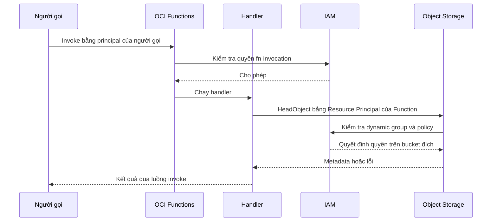

# Resource Principals, timeout và giới hạn tài nguyên Function

## 1. Mục tiêu và bối cảnh

Trong chương **Containers và Functions** của module **CLOUD_PROVIDERS_ORACLE**, một Function chỉ vận hành đúng khi ba quyết định khớp với nhau: nó được phép truy cập tài nguyên nào, được chạy bao lâu và được dùng bao nhiêu tài nguyên.

Ví dụ, một Function đọc báo cáo trong Object Storage có thể đã được gọi thành công nhưng vẫn không đọc được object vì thiếu IAM policy. Một Function khác có quyền đúng nhưng bị ngắt trong lúc chờ cơ sở dữ liệu. Tăng timeout sẽ không sửa được quyền truy cập; tăng memory cũng không tự tăng giới hạn thời gian chờ của client.

Bài học kết nối OCI Functions với tenancy, compartment, IAM, VCN, lưu trữ và giám sát OCI. Bạn sẽ thực hành thiết kế quyền truy cập bằng Resource Principal, đặt ngân sách thời gian, kiểm soát bộ nhớ và nhận diện giới hạn thực thi đồng thời.

Sau khi học, bạn có thể:

- Tách quyền gọi Function khỏi quyền Function gọi dịch vụ OCI.
- Tạo dynamic group và policy có phạm vi phù hợp.
- Dùng Resource Principal trong OCI SDK cho Java.
- Phân biệt timeout của Sync, Detached, client và lời gọi downstream.
- Định cỡ memory, dung lượng tạm, payload và nhu cầu thực thi đồng thời.
- Đọc cấu hình thực tế, log và metric để tìm nguyên nhân lỗi.

Ví dụ chính là một **image-based Java Function** đọc kích thước object trong một bucket cụ thể. Phần timeout và quản lý giới hạn cũng có ý nghĩa với các loại Function khác; cách cập nhật phải đúng loại Function và phiên bản công cụ đang sử dụng.

## 2. Hai luồng quyền độc lập

### 2.1. Người gọi Function là ai?

Người dùng, pipeline hoặc dịch vụ gọi Function cần quyền invoke. Principal của người gọi có thể là user principal, instance principal hoặc danh tính dịch vụ phù hợp với tích hợp.

Ví dụ policy cho một nhóm người dùng chỉ gọi một Function:

```text
Allow group FunctionCallers to use fn-invocation in compartment FunctionsWorkloads where target.function.id = '<FUNCTION_OCID>'
```

Policy này dùng tên nhóm trong identity domain mặc định; khi dùng domain khác, điều chỉnh định danh nhóm theo cấu hình IAM của tenancy. Quyền `use fn-invocation` cho phép gọi Function, không phải quyền cập nhật mã nguồn hoặc cấu hình của Function. [Oracle: kiểm soát quyền invoke và quản lý Functions](https://docs.oracle.com/en-us/iaas/Content/Functions/Tasks/functionsrestrictinguseraccess.htm).

### 2.2. Function gọi dịch vụ khác bằng danh tính nào?

Khi đang chạy trên OCI, Function có thể dùng **Resource Principal** của chính nó để gọi Object Storage hoặc dịch vụ OCI khác. Runtime cung cấp vật liệu xác thực ngắn hạn; SDK dùng chúng để ký request.

Quyền của Function được quyết định bằng dynamic group và IAM policy áp dụng cho tài nguyên Function. Quyền này không tự kế thừa từ người vừa gọi nó. Oracle khuyến nghị sử dụng resource principal provider trong SDK. [Oracle: truy cập tài nguyên OCI từ Function](https://docs.oracle.com/en-us/iaas/Content/Functions/Tasks/functionsaccessingociresources.htm).



Hai tình huống cần phân biệt:

| Tình huống | Kết quả có thể xảy ra |
| --- | --- |
| Người gọi được invoke nhưng Function thiếu quyền trên bucket | Handler chạy, lời gọi Object Storage thất bại |
| Function có quyền trên bucket nhưng người gọi thiếu quyền invoke | Request bị từ chối trước khi handler thực hiện công việc |

Nếu Function phục vụ nhiều người dùng, handler còn phải kiểm tra người dùng được truy cập báo cáo nào theo nghiệp vụ. Resource Principal đại diện cho Function; nó không tự phân quyền từng object theo người dùng cuối.

## 3. Dynamic group và policy cho đúng tài nguyên

### 3.1. Xác định nơi đặt Function và dữ liệu

Ví dụ triển khai:

| Thành phần | Giá trị minh họa |
| --- | --- |
| Compartment của Function | `FunctionsWorkloads` |
| Compartment của bucket | `ReportsData` |
| Bucket | `reports-input` |
| Dynamic group | `fn-report-metadata` |
| Object đã chuẩn bị | `reports/daily.csv` |

Các tên và OCID trong ví dụ phải được thay bằng tài nguyên lab của bạn. Compartment chứa Function và compartment chứa dữ liệu có thể khác nhau.

### 3.2. Chỉ đưa Function cần thiết vào nhóm

Matching rule cho một Function:

```text
ALL {resource.type = 'fnfunc', resource.id = '<FUNCTION_OCID>'}
```

Một cách khác là đưa mọi Function trong compartment vào nhóm bằng điều kiện compartment. Cách đó tiện cho một tập workload có cùng mức tin cậy, nhưng mọi Function mới thỏa điều kiện cũng có thể nhận quyền của nhóm. Với bài lab này, chọn OCID cụ thể để dễ xác định phạm vi.

Nếu xóa Function và tạo lại, OCID mới cần được đưa vào rule. Việc đặt lại cùng tên hiển thị không làm OCID cũ đại diện cho Function mới.

### 3.3. Chỉ cấp quyền cần cho lời gọi API

Bài lab dùng `HeadObject`, chỉ đọc metadata, nên có thể dùng:

```text
Allow dynamic-group fn-report-metadata to inspect objects in compartment ReportsData where target.bucket.name = 'reports-input'
```

Nếu handler cần tải nội dung bằng `GetObject`, quyền `read objects` bao gồm khả năng đọc object. Nếu cần tạo hoặc ghi đè object, phải xác định thêm quyền của thao tác tương ứng.

Bảng quyền của Object Storage phân biệt `OBJECT_INSPECT` và `OBJECT_READ`; vì vậy nên chọn policy sau khi xác định các API thực sự được gọi. [Oracle: policy cho Object Storage](https://docs.oracle.com/en-us/iaas/Content/Identity/policyreference/objectstoragepolicyreference.htm).

Đặt policy tại compartment hoặc tổ tiên có thẩm quyền đối với tài nguyên đích. Trong ví dụ, phần `in compartment ReportsData` nói về nơi chứa bucket, không phải nơi chứa Function.

Một lỗi dễ gặp là thêm lời gọi `GetNamespace`, `ListBuckets` hoặc API khác vào code nhưng vẫn chỉ đánh giá quyền của `HeadObject`. Ví dụ Java bên dưới nhận namespace từ cấu hình, tránh cần khám phá namespace ở runtime.

### 3.4. Quyền IAM và kết nối mạng phải cùng đúng

Resource Principal giải quyết danh tính và quyền; đường mạng từ Function tới endpoint vẫn phải hoạt động.

Với ứng dụng trong private subnet, kiểm tra route tới dịch vụ đích, DNS, NSG/security list và cổng HTTPS. Service Gateway là một lựa chọn để truy cập các dịch vụ Oracle được hỗ trợ qua Oracle Services Network; endpoint Internet khác có thể cần NAT Gateway theo thiết kế mạng. [Oracle: Service Gateway](https://docs.oracle.com/en/learn/service_gateway/index.html).

Dấu hiệu thường khác nhau:

- Lỗi xác thực hoặc từ chối quyền: kiểm tra principal, policy, resource và region.
- Không phân giải DNS hoặc không thiết lập được kết nối: kiểm tra đường mạng.
- Đã kết nối nhưng chờ phản hồi lâu: kiểm tra dịch vụ đích, read timeout và retry.

Quyền đúng không chứng minh mạng đúng. Một lần gọi thành công bằng tài khoản quản trị trên máy cá nhân cũng chưa chứng minh Function trong subnet của ứng dụng có thể gọi cùng endpoint.

## 4. Resource Principal trong Java Function

### 4.1. Dùng provider của SDK

Đoạn tạo provider cốt lõi:

```java
ResourcePrincipalAuthenticationDetailsProvider provider =
    ResourcePrincipalAuthenticationDetailsProvider.builder().build();
```

Provider này đọc thông tin xác thực theo môi trường Resource Principal do OCI cung cấp. Dùng provider giúp giữ việc nạp và làm mới thông tin xác thực trong cơ chế của SDK, thay vì tự sao chép token vào cấu hình ứng dụng. [OCI Java SDK: ResourcePrincipalAuthenticationDetailsProvider](https://docs.oracle.com/en-us/iaas/tools/java/latest/com/oracle/bmc/auth/ResourcePrincipalAuthenticationDetailsProvider.html).

Một số biến runtime có liên quan:

| Biến | Ý nghĩa |
| --- | --- |
| `OCI_RESOURCE_PRINCIPAL_VERSION` | Phiên bản giao thức Resource Principal |
| `OCI_RESOURCE_PRINCIPAL_RPST` | Vị trí token phiên của Function trong môi trường Functions |
| `OCI_RESOURCE_PRINCIPAL_PRIVATE_PEM` | Vị trí khóa dùng ký request |
| `OCI_RESOURCE_PRINCIPAL_REGION` | Region nơi Function đang chạy |
| `FN_FN_ID` | OCID Function |
| `FN_MEMORY` | Bộ nhớ cấu hình cho Function |

Đây là các biến runtime được Oracle mô tả trong [Environment Variables Populated by OCI Functions](https://docs.oracle.com/en-us/iaas/Content/Functions/Tasks/functionsenvironmentvariables.htm). Chỉ ghi log những trường nhận diện cần thiết; không in toàn bộ môi trường, nội dung token hoặc private key.

Oracle lưu ý token có cache trong 15 phút. Sau thay đổi policy hoặc dynamic group, cần tính đến thời gian cache và lan truyền IAM khi xác minh, thay vì giả định lần gọi tiếp theo phải thấy quyền mới ngay. [Oracle: Resource Principal trong Functions](https://docs.oracle.com/en-us/iaas/Content/Functions/Tasks/functionsaccessingociresources.htm).

### 4.2. Chuẩn bị dependency và cấu hình

Trong project Java FDK đã được khởi tạo, bổ sung module `oci-java-sdk-objectstorage` và một HTTP client được SDK hỗ trợ. Giữ các module OCI SDK cùng phiên bản bằng BOM hoặc quản lý dependency tương đương.

SDK Java 3.x yêu cầu chọn HTTP client rõ ràng, ví dụ `oci-java-sdk-common-httpclient-jersey3` nếu phù hợp với runtime/dependency của project. Giữ các dependency FDK và cấu hình đóng gói mà project cần. [Oracle: sử dụng OCI Java SDK và HTTP client](https://docs.oracle.com/en-us/iaas/Content/API/SDKDocs/javasdkgettingstarted.htm).

Cấu hình riêng của Function:

```text
OBJECT_NAMESPACE=<OBJECT_STORAGE_NAMESPACE>
REPORTS_BUCKET=reports-input
OBJECT_STORAGE_REGION=<REGION_CUA_BUCKET>
```

Namespace không phải OCID của tenancy. Region của client phải là region của tài nguyên Object Storage được truy cập; không suy rằng mọi tài nguyên đích luôn cùng region với Function.

### 4.3. Handler minh họa: đọc metadata có timeout

Ví dụ dưới đây nhận JSON có trường `objectName`, chỉ chấp nhận prefix nghiệp vụ `reports/`, gọi `HeadObject` và trả về kích thước object:

```java
package example;

import com.oracle.bmc.ClientConfiguration;
import com.oracle.bmc.Region;
import com.oracle.bmc.auth.ResourcePrincipalAuthenticationDetailsProvider;
import com.oracle.bmc.model.BmcException;
import com.oracle.bmc.objectstorage.ObjectStorageClient;
import com.oracle.bmc.objectstorage.requests.HeadObjectRequest;
import com.oracle.bmc.objectstorage.responses.HeadObjectResponse;
import com.oracle.bmc.retrier.RetryConfiguration;

public final class ObjectMetadataFunction {
    private final ObjectStorageClient objectStorage;
    private final String namespace;
    private final String bucket;

    public ObjectMetadataFunction() {
        namespace = requiredEnv("OBJECT_NAMESPACE");
        bucket = requiredEnv("REPORTS_BUCKET");

        ResourcePrincipalAuthenticationDetailsProvider provider =
            ResourcePrincipalAuthenticationDetailsProvider.builder().build();

        ClientConfiguration http = ClientConfiguration.builder()
            .connectionTimeoutMillis(2_000)
            .readTimeoutMillis(5_000)
            .build();

        objectStorage = ObjectStorageClient.builder()
            .region(Region.fromRegionId(requiredEnv("OBJECT_STORAGE_REGION")))
            .configuration(http)
            .build(provider);
    }

    public Long handleRequest(Input input) {
        String objectName = input == null ? null : input.getObjectName();
        if (objectName == null || !objectName.startsWith("reports/")) {
            throw new IllegalArgumentException(
                "objectName must belong to the reports/ prefix");
        }

        long started = System.nanoTime();
        try {
            HeadObjectResponse response = objectStorage.headObject(
                HeadObjectRequest.builder()
                    .namespaceName(namespace)
                    .bucketName(bucket)
                    .objectName(objectName)
                    .retryConfiguration(
                        RetryConfiguration.NO_RETRY_CONFIGURATION)
                    .build());

            long elapsedMs = (System.nanoTime() - started) / 1_000_000L;
            System.out.printf(
                "event=object_head_ok elapsedMs=%d opcRequestId=%s%n",
                elapsedMs, response.getOpcRequestId());
            return response.getContentLength();
        } catch (BmcException error) {
            System.err.printf(
                "event=object_head_failed status=%d code=%s%n",
                error.getStatusCode(), error.getServiceCode());
            throw error;
        }
    }

    private static String requiredEnv(String key) {
        String value = System.getenv(key);
        if (value == null || value.trim().isEmpty()) {
            throw new IllegalStateException("Missing configuration: " + key);
        }
        return value;
    }

    public static final class Input {
        private String objectName;

        public String getObjectName() {
            return objectName;
        }

        public void setObjectName(String objectName) {
            this.objectName = objectName;
        }
    }
}
```

Trỏ handler Java của project tới `example.ObjectMetadataFunction::handleRequest`. Input ví dụ:

```json
{"objectName":"reports/daily.csv"}
```

`HeadObjectResponse.getContentLength()` trả kích thước theo byte và không tải toàn bộ nội dung object vào heap. [OCI Java SDK: HeadObjectResponse](https://docs.oracle.com/en-us/iaas/tools/java/latest/com/oracle/bmc/objectstorage/responses/HeadObjectResponse.html).

Ví dụ tắt retry tại request để làm rõ ngân sách cho một lần gọi trong lab. Đây không phải chính sách phù hợp cho mọi workload. SDK có cấu hình retry ở nhiều mức; khi đưa vào vận hành, phải quyết định retry theo deadline và tính an toàn của thao tác. [Oracle: Java SDK retries](https://docs.oracle.com/en-us/iaas/Content/API/SDKDocs/javasdkconcepts.htm).

Đối tượng client được giữ trong handler để có thể tái sử dụng khi runtime tái sử dụng handler. Quản lý vòng đời và đóng client khi môi trường chủ quản kết thúc; không để dữ liệu của một request trước trong trường dùng chung của handler.

Kiểm tra prefix trong code là ràng buộc nghiệp vụ bổ sung. Policy trong ví dụ vẫn cấp `inspect` cho object trong bucket được chỉ định, nên cần đánh giá cả quyền IAM lẫn quy tắc nghiệp vụ nếu muốn giới hạn sâu hơn.

## 5. Hiểu timeout theo từng lớp

### 5.1. Sync và Detached có giới hạn riêng

Các giá trị cấu hình hiện được Oracle công bố:

| Thuộc tính | Mục đích | Giá trị |
| --- | --- | --- |
| `timeoutInSeconds` | Thời gian thực thi khi invoke Sync | Mặc định 30 giây; tối đa 300 giây |
| `detachedModeTimeoutInSeconds` | Thời gian thực thi khi invoke Detached | Từ 5 đến 3.600 giây |
| Detached timeout chưa đặt | Giá trị dùng cho Detached | Dùng `timeoutInSeconds` làm mặc định |

Bảng này mô tả giới hạn cấu hình Function, không phải thời gian mà mọi client hoặc gateway đều sẵn sàng chờ. [Oracle: memory và timeout settings](https://docs.oracle.com/en-us/iaas/Content/Functions/Tasks/functionscustomizing.htm).

Khả năng chạy Detached tới một giờ được Oracle bổ sung năm 2025. Vì vậy cần đọc tài liệu hiện hành theo đúng invocation type khi đánh giá công việc chạy dài. [Oracle: longer-running Detached Functions](https://docs.oracle.com/en-us/iaas/releasenotes/functions/functions-long-running-functions.htm).

**Sync** phù hợp khi người gọi cần chờ kết quả trong một request. **Detached** trả quyền điều khiển về người gọi khi xử lý bắt đầu, còn kết quả cần được theo dõi hoặc lưu qua cơ chế phù hợp. Phản hồi chấp nhận không phải bằng chứng nghiệp vụ đã hoàn tất.

### 5.2. Có ít nhất bốn lớp thời gian chờ

| Lớp | Ví dụ | Câu hỏi cần trả lời |
| --- | --- | --- |
| Người gọi | HTTP client, OCI CLI, SDK gọi Functions | Người gọi chờ phản hồi bao lâu? |
| Thành phần trung gian | API Gateway, proxy, load balancer | Thành phần nào kết thúc kết nối sớm hơn? |
| OCI Functions | Sync hoặc Detached execution timeout | Runtime cho phép lần thực thi chạy bao lâu? |
| Lời gọi từ handler | Object Storage SDK, JDBC, HTTP downstream | Mỗi thao tác bên trong có thể giữ handler bao lâu? |

Ví dụ, Function có timeout 120 giây nhưng client chỉ chờ 20 giây. Người gọi vẫn có thể nhận lỗi ở mốc 20 giây. Ngược lại, client chờ 180 giây không làm Function được phép vượt timeout thực thi đã đặt.

OCI CLI có `--read-timeout` khi invoke; SDK của người gọi có client read timeout riêng. Oracle phân biệt invocation timeout và execution timeout trong [hướng dẫn invoke Functions](https://docs.oracle.com/en-us/iaas/Content/Functions/Tasks/functionsinvokingfunctions.htm).

Trong handler Java ở phần trước, `connectionTimeoutMillis` và `readTimeoutMillis` giới hạn các giai đoạn HTTP của lời gọi Object Storage. Chúng không phải execution timeout của Function. [OCI Java SDK: ClientConfiguration](https://docs.oracle.com/en-us/iaas/tools/java/latest/com/oracle/bmc/ClientConfiguration.ClientConfigurationBuilder.html).

### 5.3. Tính ngân sách trước khi đặt số giây

Giả sử thiết kế một workload có execution timeout 30 giây:

| Phần công việc | Ngân sách minh họa |
| --- | --- |
| Kiểm tra và giải mã input | 2 giây |
| Truy cập dịch vụ đích, gồm retry nếu có | 8 giây |
| Xử lý nghiệp vụ | 10 giây |
| Tạo và trả response | 2 giây |
| Dự phòng biến động | 8 giây |
| Tổng | 30 giây |

Đây là phân bổ do bài học đặt ra, cần đo lại trên workload thực. Độ trễ đầu cuối còn bao gồm thời gian chuẩn bị môi trường, mạng và các thành phần phía trước handler.

Nếu dành 8 giây cho dịch vụ đích thì hai lần đọc, mỗi lần chờ 5 giây cộng backoff, đã không phù hợp với ngân sách đó. Giới hạn số lần retry không đủ; cần giới hạn tổng thời gian dành cho chúng.

Một thuật toán khái quát:

```text
deadline = thời_gian_đơn_điệu_hiện_tại + ngân_sách_handler

trước mỗi thao tác:
    remaining = deadline - thời_gian_đơn_điệu_hiện_tại
    nếu remaining không đủ cho thao tác và bước hoàn tất:
        dừng nhận thêm việc
        trả trạng thái hoặc lưu tiến độ theo giao thức nghiệp vụ
    chọn timeout thao tác nhỏ hơn ngân sách còn lại
    chỉ retry khi thao tác an toàn và còn ngân sách
```

Đồng hồ đơn điệu phù hợp với đo khoảng thời gian; trong Java có thể dùng `System.nanoTime()`. Timeout kết nối và timeout đọc vẫn chưa tự tạo ra một deadline tổng cho toàn bộ handler, nhất là khi có nhiều API call hoặc retry.

### 5.4. Timeout không chứng minh thao tác chưa được thực hiện

Xét luồng:

1. Function gửi yêu cầu cập nhật trạng thái đơn hàng.
2. Dịch vụ đích ghi thành công.
3. Phản hồi bị chậm hoặc mất.
4. Client thấy timeout và gửi lại.

Nếu xử lý lại mà không nhận diện trùng, có thể phát sinh hai lần ghi, hai thông báo hoặc hai giao dịch nghiệp vụ. Hãy dùng mã tác vụ/idempotency key, trạng thái lưu bền và khả năng tra cứu kết quả.

Với một thao tác chỉ đọc như `HeadObject`, lặp lại thường dễ kiểm soát hơn thao tác tạo hiệu ứng nghiệp vụ. Tuy nhiên retry vẫn tiêu thụ thời gian, lượt gọi và sức chứa của downstream.

Tác vụ Detached cần có định danh để tra trạng thái và cơ chế lưu kết quả. Nếu dùng success/failure destinations của Functions, theo dõi cả kết quả thực thi lẫn việc chuyển invocation record tới đích; quyền gửi tới đích là một cấu hình IAM bổ sung.

## 6. Memory, bộ nhớ tạm và payload

### 6.1. Định cỡ memory cho toàn bộ tiến trình

Các mức `memoryInMBs` được hỗ trợ trong hướng dẫn Oracle hiện tại là `128`, `256`, `512`, `1024`, `2048` và `3072`. Oracle khuyến nghị Java Function có ngưỡng ít nhất 256 MB. [Oracle: thay đổi memory và timeout](https://docs.oracle.com/en-us/iaas/Content/Functions/Tasks/functionscustomizing.htm).

Memory của Function phải chứa nhiều thành phần:

```text
Bộ nhớ cần thiết
  = Java heap
  + metaspace và code cache
  + thread stacks
  + direct/native buffers
  + FDK, SDK và thư viện
  + các bản sao input/output trong xử lý
  + phần dự phòng
```

Đặt `-Xmx` bằng toàn bộ memory của Function sẽ không để lại khoảng trống cho phần ngoài heap. Tăng memory nên đi cùng đo thời gian khởi động, thời gian xử lý, GC và lỗi, thay vì chỉ nhìn dung lượng file đầu vào.

Ví dụ, file JSON 20 MB có thể tạo ra bộ nhớ lớn hơn nhiều khi tồn tại đồng thời dưới dạng byte array, chuỗi, cây JSON và đối tượng nghiệp vụ. Dùng streaming hoặc xử lý theo lô để hạn chế các bản sao khi workload cho phép.

Trong ví dụ metadata, `HeadObject` tránh tải nội dung chỉ để biết kích thước. Nếu sau này cần `GetObject`, hãy đóng stream và kiểm soát dung lượng đọc, không dùng `readAllBytes()` cho object có kích thước không giới hạn theo nghiệp vụ.

### 6.2. Khi nào tăng memory có ích?

| Dấu hiệu | Giả thuyết cần kiểm chứng | Hành động phù hợp |
| --- | --- | --- |
| Khởi tạo JVM hoặc thư viện thất bại | Thiếu bộ nhớ, dependency hoặc image có vấn đề | Đọc log khởi tạo, kiểm tra image và thử mức memory phù hợp |
| GC nhiều, bộ nhớ gần giới hạn | Heap hoặc cấu trúc dữ liệu quá lớn | Đo profile, giảm bản sao và điều chỉnh memory |
| Handler chờ DNS/kết nối | Đường mạng chưa đúng | Kiểm tra VCN, DNS và endpoint |
| API đích trả lỗi quyền | Policy hoặc principal chưa đúng | Kiểm tra IAM |
| Downstream chậm | Truy vấn, dịch vụ đích hoặc tải quá cao | Tối ưu lời gọi và ngân sách thời gian |

Mỗi hàng là hướng điều tra, không phải kết luận chỉ từ một mã HTTP. Cùng một lỗi bề ngoài có thể đến từ nhiều giai đoạn khác nhau.

### 6.3. `/tmp` có giới hạn riêng và không phải nơi lưu bền

Function có vùng ghi tạm tại `/tmp`. Một số mức được Oracle mô tả:

| Memory cấu hình | Dung lượng tối đa `/tmp` | Số file/inode tối đa |
| --- | --- | --- |
| 256 MB | 64 MB | 2.048 |
| 512 MB | 128 MB | 4.096 |
| 1024 MB | 256 MB | 8.192 |

File của lần thực thi trước có thể còn trong lần gọi kế tiếp nếu môi trường được tái sử dụng. Đừng dùng sự tồn tại của file tạm làm bằng chứng rằng một tác vụ đã hoàn tất. [Oracle: filesystem của Function](https://docs.oracle.com/en-us/iaas/Content/Functions/Tasks/functionsaccessinglocalfilesystem.htm).

Cách tổ chức một lần xử lý file:

1. Tạo tên file hoặc thư mục tạm riêng cho tác vụ.
2. Kiểm tra kích thước đầu vào và dung lượng dự kiến sau giải nén.
3. Dùng stream khi có thể.
4. Ghi kết quả cuối vào nơi lưu bền phù hợp.
5. Xóa tệp tạm trong `finally` hoặc cơ chế tương đương.

Khối `finally` giúp dọn tài nguyên khi tiến trình còn có thể xử lý ngoại lệ, nhưng không bảo đảm chạy nếu runtime bị kết thúc đột ngột. Thuật toán phải chịu được file cũ còn sót lại.

### 6.4. Payload và cấu hình cũng là ngân sách

OCI Functions công bố request payload và response payload tối đa **6 MB mỗi chiều**, là các giới hạn cố định của dịch vụ. [Oracle: capabilities and limits](https://docs.oracle.com/en-us/iaas/Content/Functions/Concepts/functionsoverview.htm).

Với file lớn, truyền tham chiếu đến Object Storage thay vì nhét nội dung hoặc base64 vào request:

```json
{
  "jobId": "report-2026-11-20-001",
  "objectName": "reports/daily.csv"
}
```

Ví dụ input trên giữ bucket và namespace ở cấu hình Function, giúp handler kiểm soát tài nguyên đích. Khi chấp nhận thêm thông tin đích từ caller, cần xác thực thông tin đó theo phạm vi nghiệp vụ và IAM.

Bản mã hóa base64 làm dữ liệu tăng kích thước xấp xỉ một phần ba, chưa tính JSON và các trường khác. Dữ liệu gần giới hạn ở dạng nhị phân có thể vượt trần sau đóng gói.

Tổng kích thước các key/value cấu hình Function còn có trần 4 KB theo tài liệu cập nhật Function; key/value được tính theo byte UTF-8. Cấu hình là nơi đặt tham số ngắn như bucket, region và ngưỡng xử lý, còn dữ liệu lớn cần nơi lưu phù hợp. [OCI CLI: cập nhật container Function](https://docs.oracle.com/en-us/iaas/tools/oci-cli/latest/oci_cli_docs/cmdref/fn/function/update/container-function.html).

## 7. Giới hạn thực thi đồng thời và tác động đến chi phí

### 7.1. Memory mỗi lần chạy khác tổng memory của region

OCI Functions có các service limits cho số ứng dụng, số Function, tổng memory phục vụ thực thi đồng thời và provisioned concurrency. Các giá trị thực tế phụ thuộc tenancy và region.

Trong Console, mở **Limits, Quotas and Usage**, chọn dịch vụ **Functions**, đúng region và phạm vi tenancy để kiểm tra:

| Tên giới hạn | Đại lượng |
| --- | --- |
| `application-count` | Số application |
| `function-count` | Số Function |
| `total-concurrency-mb` | Tổng memory cho thực thi đồng thời |
| `provisioned-concurrency-mb` | Memory cho provisioned concurrency |

Dùng giá trị hiện tại trong tenancy, vì một giới hạn có thể đã được tăng trước đó. [Oracle: xem giới hạn Functions](https://docs.oracle.com/en-us/iaas/Content/Functions/Tasks/functionsviewinglimits.htm).

Ví dụ hoạch định: giả sử còn 8.192 đơn vị memory khả dụng cho các lần chạy của một Function:

```text
Memory mỗi lần chạy: 512
Sức chứa ước tính: floor(8192 / 512) = 16 lần đồng thời

Memory mỗi lần chạy: 1024
Sức chứa ước tính: floor(8192 / 1024) = 8 lần đồng thời
```

Đây là phép ước lượng cho một workload trong điều kiện giả định, không phải mặc định dịch vụ hoặc cam kết concurrency cho một Function. Thực tế còn có các Function khác, cấu hình provisioned concurrency, quota và điều kiện cấp tài nguyên.

### 7.2. Downstream chậm có thể làm cạn sức chứa

Một mô hình để ước lượng mức đồng thời trung bình:

```text
Số lần chạy đồng thời ≈ tốc độ đến × thời gian xử lý trung bình
```

Với tốc độ 20 request/giây và thời gian xử lý 0,4 giây, nhu cầu trung bình khoảng 8 lần chạy. Nếu Object Storage hoặc DB chậm làm thời gian tăng lên 2 giây, nhu cầu tăng lên khoảng 40 lần chạy, dù lưu lượng đầu vào không đổi.

Khi chạm giới hạn memory đồng thời, dịch vụ có thể trả HTTP 429. Theo dõi tổng memory được cấp và áp dụng backpressure thay vì retry ngay hàng loạt. [Oracle: theo dõi memory concurrent execution](https://docs.oracle.com/en-us/iaas/Content/Functions/Tasks/functionsmonitoringcapacityusage_topic-Monitoring-concurrent-function-execution.htm).

Với ứng dụng gọi Oracle Database, mỗi môi trường thực thi có thể tạo kết nối riêng. Ví dụ 40 môi trường, mỗi môi trường cho phép tối đa 4 kết nối, tạo tiềm năng 160 kết nối. Đánh giá ngân sách DB trước khi tăng concurrency và kích thước connection pool.

### 7.3. Memory lớn hơn cần được đo cùng duration

Bảng sau là số liệu giả định để minh họa cách so sánh:

| Memory | Thời gian xử lý | Tích memory × thời gian |
| --- | --- | --- |
| 512 | 1.200 ms | 614.400 |
| 1024 | 700 ms | 716.800 |

Cấu hình 1024 hoàn thành nhanh hơn trong ví dụ, nhưng tích memory–thời gian lớn hơn. Chọn cấu hình theo mục tiêu độ trễ, mức lỗi và chi phí thực tế; đối chiếu quy tắc tính phí, làm tròn và mô hình giá áp dụng trước khi quy đổi thành tiền.

Provisioned concurrency có thể giảm độ trễ chuẩn bị môi trường bằng cách giữ sẵn năng lực cho một mức thực thi đồng thời. Nó cần ngân sách riêng và không tự sửa timeout của downstream hay quyền IAM. [Oracle: provisioned concurrency](https://docs.oracle.com/en-us/iaas/Content/Functions/Tasks/functionsusingprovisionedconcurrency.htm).

## 8. Thực hành cấu hình và xác minh trên OCI

### 8.1. Chuẩn bị môi trường lab

Cần có:

- Application Functions dành cho lab, với VCN/subnet và đường đến Object Storage đã chuẩn bị.
- Project Java FDK dùng image, có handler và dependency như phần 4.
- Bucket `reports-input` chứa object `reports/daily.csv`.
- Người triển khai có quyền deploy/cập nhật Function, và có người có thẩm quyền cấu hình IAM.
- OCI CLI, Fn CLI và context deploy trỏ đúng tenancy, compartment, application và region.

Nếu chạy trên Fn Server cục bộ, có thể kiểm tra giải mã input và logic bằng mock hoặc principal phát triển riêng, nhưng Resource Principal của OCI Functions cần xác minh khi Function chạy trên OCI. [Oracle: giới hạn khi phát triển bằng Fn Server cục bộ](https://docs.oracle.com/en-us/iaas/Content/Functions/Tasks/functionsusingwithfnserverlocally.htm).

### 8.2. Đặt cấu hình nguồn và deploy

Ghép các giá trị sau vào `func.yaml` của project Java hiện có, giữ các trường runtime/image cần thiết:

```yaml
memory: 512
timeout: 30
```

Nếu project dùng trường `cmd` để trỏ handler Java, giá trị tương ứng với ví dụ là:

```yaml
cmd: example.ObjectMetadataFunction::handleRequest
```

Trong thư mục project, deploy bằng Fn CLI đã cấu hình:

```powershell
$appName = "<APPLICATION_NAME>"
fn deploy --app $appName
```

Ghi nhận OCID Function được tạo hoặc cập nhật. Hoàn tất dynamic group và policy ở phần 3, rồi đặt ba key cấu hình của phần 4 tại Function trong Console:

```text
OBJECT_NAMESPACE
REPORTS_BUCKET
OBJECT_STORAGE_REGION
```

Điền giá trị lab tương ứng. Function-level configuration ghi đè key cùng tên ở application-level configuration; kiểm tra giá trị hiệu lực để tránh bucket hoặc region bị lấy từ một cấu hình khác.

Sửa `func.yaml` cần deploy lại mới phản ánh lên dịch vụ. Thay đổi trực tiếp trên dịch vụ cũng cần được ghi lại trong cấu hình quản lý triển khai để lần deploy sau nhất quán. [Oracle: cập nhật Function](https://docs.oracle.com/en-us/iaas/Content/Functions/Tasks/functionsupdatingfunctions.htm).

### 8.3. Cập nhật và đọc lại cấu hình thực tế

Với phiên bản OCI CLI có nhóm lệnh cập nhật theo loại Function, lệnh cho image-based Function là:

```powershell
$functionId = "<FUNCTION_OCID>"
oci --version
oci fn function update --help
oci fn function update container-function --function-id $functionId --memory-in-mbs 512 --timeout-in-seconds 30 --detached-mode-timeout-in-seconds 120
oci fn function get --function-id $functionId
```

Lệnh `update container-function` và các tham số được mô tả trong [OCI CLI Command Reference](https://docs.oracle.com/en-us/iaas/tools/oci-cli/latest/oci_cli_docs/cmdref/fn/function/update/container-function.html). Nếu công cụ đang cài khác cấu trúc lệnh, đối chiếu `--help` của phiên bản đó trước khi áp dụng.

Trong kết quả đọc lại, kiểm tra ít nhất:

| Field | Giá trị dự kiến của lab |
| --- | --- |
| `id` | OCID Function được giao cho dynamic group |
| `memory-in-mbs` | 512 |
| `timeout-in-seconds` | 30 |
| `detached-mode-timeout-in-seconds` | 120 |
| `config` | Namespace, bucket và region đúng |
| `lifecycle-state` | Trạng thái sẵn sàng cho thao tác tương ứng |

Đọc lại tài nguyên trên dịch vụ là cách xác định cấu hình đang hiệu lực. File nguồn trong máy và một lệnh update đã được gửi chưa đủ chứng minh cấu hình cuối cùng.

### 8.4. Gọi Sync bằng input rõ ràng

Trong PowerShell, có thể dùng file JSON cho tham số CLI để tránh nhầm dấu nháy khi truyền body JSON:

```powershell
$invokeArguments = @{
    functionId = $functionId
    body = '{"objectName":"reports/daily.csv"}'
    file = "-"
    fnInvokeType = "sync"
}
$utf8NoBom = [System.Text.UTF8Encoding]::new($false)
$invokePath = Join-Path (Get-Location).Path "invoke-sync.json"
[System.IO.File]::WriteAllText(
    $invokePath,
    ($invokeArguments | ConvertTo-Json),
    $utf8NoBom
)

oci fn function invoke --from-json file://./invoke-sync.json --read-timeout 45 --no-retry
```

Trong ví dụ, execution timeout Sync là 30 giây và CLI cho phép chờ đọc 45 giây. Đây là cách để timeout phía người gọi không chủ động ngắn hơn giới hạn xử lý của lab, nhưng vẫn cần xét mạng và các thành phần trung gian trong triển khai thật.

`--file "-"` yêu cầu in response body ra stdout; `--no-retry` giúp bài thử không tự lặp ở lớp CLI. Tham số invoke và `--from-json` có trong [OCI CLI: invoke](https://docs.oracle.com/en-us/iaas/tools/oci-cli/latest/oci_cli_docs/cmdref/fn/function/invoke.html).

Kết quả mong đợi là kích thước của `reports/daily.csv` theo byte. Đối chiếu với metadata object và log `object_head_ok`, thay vì chỉ kết luận thành công từ việc CLI không hiển thị lỗi.

### 8.5. Gọi Detached và theo dõi hoàn tất

Dùng cùng input nhưng thay invocation type:

```powershell
$invokeArguments.fnInvokeType = "detached"
$detachedPath = Join-Path (Get-Location).Path "invoke-detached.json"
[System.IO.File]::WriteAllText(
    $detachedPath,
    ($invokeArguments | ConvertTo-Json),
    $utf8NoBom
)

oci fn function invoke --from-json file://./invoke-detached.json --read-timeout 45 --no-retry
```

Bài thử này xác nhận cách gọi Detached, không cố tạo một tác vụ kéo dài. Giá trị 120 giây trong Function là giới hạn cho lần chạy Detached; người gọi không cần giữ kết nối đến lúc nhận kết quả nghiệp vụ.

Nếu cấu hình success/failure destinations, Functions có thể chuyển invocation record tới Notifications, Queue hoặc Streaming. Cơ chế chuyển record cần IAM policy riêng theo hướng dẫn, có thể sử dụng principal `fnapp`; policy dynamic group `fnfunc` cấp cho handler truy cập bucket không tự bao phủ việc chuyển record của dịch vụ. [Oracle: Detached invocation và destinations](https://docs.oracle.com/en-us/iaas/Content/Functions/Tasks/functionsinvokingfunctions.htm#Invoking_Functions_in_Detached_Mode).

Lưu kết quả nghiệp vụ lớn ở nơi lưu bền và dùng mã tác vụ để tra cứu. Invocation record là thông tin về kết quả invocation, không phải cam kết chứa toàn bộ output nghiệp vụ.

### 8.6. Thiết kế các lần thử có mục tiêu

| Lần thử | Dữ liệu hoặc thay đổi trong lab | Bằng chứng cần thu |
| --- | --- | --- |
| Quyền và mạng đúng | Object tồn tại trong bucket được cấp quyền | Kích thước đúng, log lời gọi Object Storage thành công |
| Input ngoài phạm vi nghiệp vụ | `objectName` không bắt đầu bằng `reports/` | Handler từ chối trước khi gọi Object Storage |
| Object không tồn tại | Tên object chưa có trong bucket lab | Mã lỗi từ Object Storage và thời điểm phát sinh |
| Ngân sách downstream | Endpoint thử nghiệm có độ trễ kiểm soát | Read timeout xuất hiện trước deadline tổng |
| So sánh memory | Cùng workload ở 256, 512, 1024 | Duration, lỗi, bộ nhớ đo được và biến động cold/warm |
| Thực thi đồng thời | Tăng tốc độ gọi từng bước trong hạn mức lab | Số lần đồng thời, throttles và mức cấp memory |

Bài thử metadata thường quá nhẹ để kết luận cấu hình memory tối ưu cho tác vụ xử lý file. Muốn đánh giá một workload biến đổi dữ liệu, cần bộ dữ liệu và luồng xử lý đại diện cho công việc đó.

Khi kiểm tra IAM, chờ đủ ảnh hưởng của cache/lan truyền, rồi dùng đúng principal và đúng OCID Function. Ghi rõ thời điểm thay đổi quyền để tránh coi kết quả của một token cũ là cấu hình cuối cùng.

## 9. Log, metric và chẩn đoán

### 9.1. Đo đúng phần đang quan sát

Trong handler minh họa, `elapsedMs` chỉ đo phần gọi `HeadObject` kể từ trước request đó. Nó không bao gồm toàn bộ khởi tạo container, JVM, dependency và đoạn constructor.

Một bản ghi điều tra nên liên kết:

- Mã tác vụ hoặc correlation ID của caller.
- Function OCID, invocation type, phiên bản image.
- Thời điểm vào handler và các mốc gọi downstream.
- Mã lỗi dịch vụ và request ID cần cho tra cứu.
- Memory, Sync timeout, Detached timeout và timeout client đang dùng.

Tránh đưa private key, RPST, nội dung cấu hình chứa bí mật hoặc toàn bộ payload vào log. Nếu cần log tên object cho điều tra nghiệp vụ, đánh giá mức nhạy cảm và chính sách lưu log của hệ thống.

### 9.2. Metric có sẵn trong `oci_faas`

| Metric | Cách sử dụng |
| --- | --- |
| `FunctionInvocationCount` | Quan sát số invocation |
| `FunctionExecutionDuration` | Quan sát thời gian thực thi |
| `FunctionResponseCount` | Phân tích phản hồi Success, Error hoặc Throttled |
| `AllocatedTotalConcurrency` | Theo dõi memory được cấp cho thực thi đồng thời |
| `AllocatedProvisionedConcurrency` | Theo dõi phần provisioned concurrency |
| `FunctionDetachedDeliveries` | Theo dõi việc chuyển record cho Detached |

Chọn đúng function/application, region, khoảng thời gian và các dimension được hỗ trợ. Memory được cấp cho concurrency không phải số byte Java heap đang sử dụng trong một handler. [Oracle: Functions metrics](https://docs.oracle.com/en-us/iaas/Content/Functions/Reference/functionsmetrics.htm).

Có thể đặt cảnh báo cho throttles, lỗi tăng bất thường và mức memory đồng thời gần ngân sách. Ngưỡng cảnh báo cần gắn với lưu lượng thực tế và khoảng dự phòng cần để xử lý đột biến.

### 9.3. Bảng chẩn đoán theo triệu chứng

| Triệu chứng | Kiểm tra ưu tiên | Hành động dựa trên bằng chứng |
| --- | --- | --- |
| Invoke bị từ chối trước handler | Principal của caller và `fn-invocation` | Sửa quyền của người gọi tại Function/compartment phù hợp |
| SDK không tạo được Resource Principal provider | Runtime, dependency, môi trường OCI | Xác nhận đang chạy đúng môi trường và dùng đúng provider |
| Object Storage trả lỗi quyền hoặc không tìm thấy | OCID/rule, compartment đích, bucket, region, object | Phân biệt tài nguyên sai với quyền thiếu |
| Quyền vừa sửa nhưng kết quả còn cũ | Thời điểm thay đổi, cache token, IAM propagation | Xác minh lại sau thời gian phù hợp |
| `FunctionInvokeTooManyMatchingDGs` | Các dynamic group có rule chồng lấn | Thu hẹp tập rule và đối chiếu giới hạn IAM |
| `FunctionInvokeContainerInitTimeout` | Log khởi tạo, image/FDK, memory | Xử lý giai đoạn khởi tạo thay vì chỉ kéo dài xử lý nghiệp vụ |
| `FunctionInvokeTimeout` hoặc 504 | Execution timeout, từng API call và retry | Tìm bước chiếm thời gian, đặt lại ngân sách hoặc đổi cách chia việc |
| Caller timeout nhưng log chưa cùng kết luận | Client timeout, proxy và thời điểm handler | Kiểm tra trạng thái nghiệp vụ trước khi gửi lại |
| HTTP 429 | Memory concurrent execution, lưu lượng và giới hạn liên quan | Giảm tốc độ, backoff có jitter, kiểm tra capacity |
| Không ghi được file tạm | Dung lượng/inode `/tmp`, file cũ | Giảm nhu cầu tạm, dọn file và đổi cách xử lý |
| Payload bị từ chối | Kích thước trước/sau base64 và lớp trung gian | Chuyển sang tham chiếu dữ liệu lưu ngoài |
| Detached được nhận nhưng không thấy record | Kết quả handler, destination, quyền gửi và delivery metric | Điều tra execution và delivery riêng |

Các lỗi invoke và giai đoạn khởi tạo được mô tả trong [Oracle: Issues invoking functions](https://docs.oracle.com/en-us/iaas/Content/Functions/Tasks/functionstroubleshooting_topic-Issues-invoking-functions.htm). Cùng mã HTTP có thể xuất hiện từ những lớp khác nhau, nên lưu cả service error code và mốc thời gian thay vì chỉ chụp mã HTTP cuối cùng.

## 10. Khi nào cần chia nhỏ hoặc đổi cách thực thi?

### 10.1. Công việc dài hơn một request

Một tác vụ xuất báo cáo lớn có thể được chia thành:

```text
Nhận yêu cầu
  -> tạo jobId và bản ghi trạng thái
  -> xử lý một phần dữ liệu có giới hạn
  -> ghi checkpoint và kết quả phần
  -> gửi phần việc tiếp theo qua cơ chế điều phối phù hợp
  -> đánh dấu hoàn tất sau khi mọi phần hợp lệ
```

Checkpoint cần lưu bền; tên output hoặc khóa idempotency phải cho phép nhận diện phần đã xử lý. Nếu một lần chạy timeout sau khi đã ghi output, lần sau phải xác định có thể tiếp tục hoặc bỏ qua, thay vì tạo bản sao không kiểm soát.

Detached mở rộng ngân sách thực thi nhưng vẫn có giới hạn. Nếu công việc cần CPU chạy liên tục rất lâu, bộ nhớ lớn, trạng thái tiến trình dài hạn hoặc yêu cầu điều khiển môi trường sâu, đánh giá Container Instances, OKE hoặc Compute theo nhu cầu thực tế.

### 10.2. Mở rộng Function phải đi cùng downstream

Khi Function gọi một DB hoặc API có sức chứa nhỏ hơn, có thể cần:

- Giới hạn tốc độ đầu vào hoặc đưa công việc vào hàng đợi.
- Chọn số tác vụ song song theo năng lực DB/API.
- Đặt timeout, retry và backoff nhất quán.
- Theo dõi số kết nối DB và thời gian chờ pool.
- Tách tác vụ nhẹ, phản hồi nhanh khỏi xử lý dữ liệu lớn.

IAM, timeout và memory là ba trục độc lập nhưng cùng tác động tới khả năng hoàn tất công việc. Một thiết kế vận hành cần chỉ rõ ai được làm gì, mỗi bước được chờ bao lâu và tổng nhu cầu tài nguyên ở mức tải mục tiêu.

## 11. Kết thúc lab và bàn giao cấu hình

Ghi lại các giá trị đã xác minh:

| Nhóm | Nội dung cần lưu trong hồ sơ triển khai |
| --- | --- |
| Danh tính | Function OCID, dynamic group, matching rule, phạm vi policy |
| Dữ liệu | Namespace, bucket, region, các API được phép dùng |
| Thời gian | Sync, Detached, caller, timeout downstream, chính sách retry |
| Tài nguyên | Memory, nhu cầu `/tmp`, giới hạn payload, ngân sách concurrency |
| Quan sát | Metric, log, correlation ID và cảnh báo |
| Kết quả | Lần thử nào thành công/thất bại, bằng chứng và thời điểm |

Khi hoàn tất, dừng nguồn tạo tải; xóa các Function, image, object và policy chỉ được tạo riêng cho lab theo quy trình quản lý của môi trường. Kiểm tra provisioned concurrency nếu đã bật để thử nghiệm và thu hồi cấu hình không còn cần thiết.

Giữ cấu hình triển khai và IAM đồng bộ với tài nguyên còn sử dụng. Một Function tạo lại bằng OCID mới, một bucket chuyển compartment hoặc một lần deploy ghi lại memory/timeout đều là những thay đổi cần được xem xét trong cùng hồ sơ vận hành.
