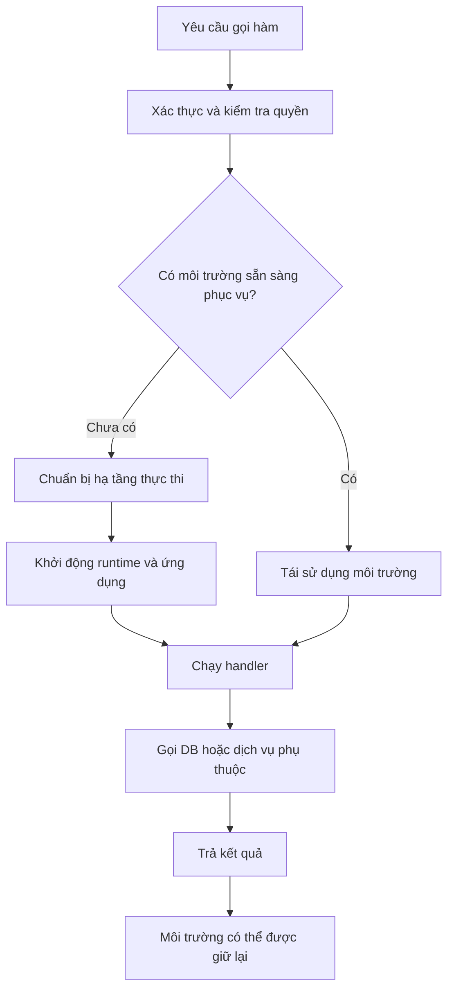

# Cold start, concurrency và tối ưu chi phí serverless

## 1. Mục tiêu và bối cảnh

Trong chương **Containers và Functions** của module **CLOUD_PROVIDERS_ORACLE**, bài này tìm hiểu cách OCI Functions khởi động, mở rộng theo số lượt gọi và tính chi phí. Mục tiêu là chọn được cấu hình đáp ứng yêu cầu độ trễ mà vẫn kiểm soát tài nguyên, kết nối tới Oracle Database và ngân sách.

OCI Functions là dịch vụ chạy hàm do Oracle quản lý. Người học không vận hành máy chủ cho từng hàm nhưng vẫn phải thiết kế mã ứng dụng, mạng, IAM, giới hạn tải và khả năng quan sát. Dịch vụ hỗ trợ hàm từ container image và hàm code-only với runtime được quản lý; xem [tổng quan OCI Functions](https://docs.oracle.com/en-us/iaas/Content/Functions/Concepts/functionsoverview.htm).

Ví dụ xuyên suốt là hàm Java `quote-order`: nhận giỏ hàng, đọc dữ liệu giá và tính báo giá. Hàm được gọi qua API Gateway, dùng resource principal để truy cập dịch vụ OCI được cho phép và kết nối Oracle Database qua đường mạng đã cấu hình. Một tác vụ gửi thông báo sau khi tạo đơn có thể được xử lý riêng theo luồng bất đồng bộ.

Các số liệu tải, thời gian và ngân sách trong bài là dữ liệu giả định để giải thích cách tính. Chúng không phải benchmark hay cam kết hiệu năng của Oracle.

Sau bài học, người học có thể:

- Phân biệt cold start, warm start và thời gian thực thi nghiệp vụ.
- Ước lượng concurrency từ tốc độ đến và thời gian xử lý.
- Đọc giới hạn concurrency theo bộ nhớ của OCI Functions.
- Chọn provisioned concurrency theo yêu cầu độ trễ và chi phí.
- Thiết kế phép đo có cả tải nền, thời gian nhàn rỗi và tải tăng đột ngột.
- Giảm chi phí trên một nghiệp vụ thành công, đồng thời bảo vệ dịch vụ phụ thuộc.

## 2. Cold start là gì và xuất hiện khi nào?

### 2.1. Vòng đời một môi trường thực thi

Khi cần chạy hàm trong một môi trường mới, nền tảng phải chuẩn bị hạ tầng thực thi rồi khởi động runtime và mã ứng dụng. Với hàm dùng image, quá trình có thể liên quan đến việc lấy image từ registry. Với code-only, nền tảng chuẩn bị môi trường từ archive và runtime được chọn.

Một môi trường đã phục vụ xong có thể được giữ lại để tái sử dụng. Khi có thêm yêu cầu lúc các môi trường hiện có đang bận, OCI Functions mở rộng theo chiều ngang. Sau một khoảng nhàn rỗi, môi trường có thể bị loại bỏ. Các hành vi này được mô tả trong [How OCI Functions Works](https://docs.oracle.com/en-us/iaas/Content/Functions/Concepts/functionshowitworks.htm).



Cold start là đường đi cần chuẩn bị môi trường mới. Warm start, còn gọi là hot start, là đường đi tái sử dụng môi trường đã có.

Cold start không chỉ xuất hiện ở lần gọi đầu tiên trong lịch sử của một hàm. Nó còn có thể xuất hiện khi:

- Hàm ít được gọi và môi trường cũ đã được thu hồi.
- Tải tăng khiến số môi trường sẵn có không đủ.
- Có triển khai hoặc thay đổi khiến môi trường thực thi được thay thế.
- Nền tảng cần tạo môi trường mới trong quá trình vận hành.

Không xây dựng hợp đồng ứng dụng dựa trên giả định môi trường luôn tồn tại trong một số phút cố định. Kết quả thử nghiệm về thời gian giữ ấm không phải cam kết vòng đời.

### 2.2. Tách thời gian người dùng chờ thành các phần

Một mô hình quan sát hữu ích:

```text
T_end_to_end =
    T_client_and_network
  + T_gateway_and_platform
  + T_environment_preparation_if_needed
  + T_runtime_and_application_initialization_if_needed
  + T_handler
  + T_dependencies
  + T_response_transfer
```

Các phần có thể chồng lấn hoặc được đo ở những ranh giới khác nhau; không cộng chồng hai metric đã bao gồm cùng một khoảng thời gian.

Nếu log đầu handler chỉ cho thấy 100 ms nhưng client chờ 2 giây, chưa thể kết luận mã xử lý là nguyên nhân. Ngược lại, nếu phần gọi DB mất 1,8 giây thì làm nóng hạ tầng không giải quyết được phần chờ DB.

Cần phân biệt thêm:

| Khái niệm | Ý nghĩa | Cách quan sát |
| --- | --- | --- |
| Thời gian khởi động hạ tầng | Chuẩn bị môi trường cần để gọi hàm | Đối chiếu quan sát phía client và nền tảng |
| Khởi tạo ứng dụng | Nạp lớp, cấu hình, SDK, serializer hoặc pool | Đo các đoạn khởi tạo do ứng dụng kiểm soát |
| Thời gian handler | Đoạn xử lý từ lúc handler bắt đầu | Log hoặc tracing trong mã |
| Thời gian phụ thuộc | DNS, TCP/TLS, DB, HTTP hoặc lấy secret | Span/timer cho từng lời gọi |
| Thời gian tính phí | Khoảng thời gian theo quy tắc metering | Usage report và rate card thực tế |

Không dùng trực tiếp toàn bộ độ trễ client làm thời lượng tính phí nếu chưa biết ranh giới đo của dịch vụ.

### 2.3. Vì sao chỉ nhìn trung bình dễ bỏ sót cold start?

Giả sử bộ dữ liệu tổng hợp có:

- 97% request mất 180 ms.
- 3% request đi qua đường khởi động mới và mất 2.000 ms.

Trung bình là:

```text
0,97 × 180 + 0,03 × 2.000 = 234,6 ms
```

Con số trung bình khoảng 235 ms có thể trông tốt, trong khi p99 của bộ dữ liệu này là 2 giây. Nếu mục tiêu người dùng là p99 dưới 700 ms, cấu hình đó chưa đạt.

p95/p99 mô tả phân vị của dữ liệu đã thu thập. Không lấy trung bình các p99 theo phút rồi gọi kết quả là p99 của cả ngày; phải tổng hợp mẫu hoặc histogram phù hợp.

## 3. Concurrency khác tốc độ gọi như thế nào?

### 3.1. Ba đại lượng cần phân biệt

| Đại lượng | Câu hỏi trả lời | Đơn vị |
| --- | --- | --- |
| Arrival rate hoặc request rate | Mỗi giây có bao nhiêu yêu cầu đến? | Request/giây |
| Duration | Mỗi lượt chạy giữ tài nguyên trong bao lâu? | Giây |
| Concurrency | Tại một thời điểm có bao nhiêu lượt đang chạy? | Lượt đồng thời |

Một hàm nhận 60 request/giây không nhất thiết cần 60 lượt thực thi đồng thời:

```text
Nếu mỗi lượt chạy khoảng 0,25 giây:
Concurrency trung bình ≈ 60 × 0,25 = 15

Nếu mỗi lượt chạy khoảng 1 giây:
Concurrency trung bình ≈ 60 × 1 = 60
```

Đây là cách áp dụng quan hệ giữa thông lượng, thời gian lưu lại và số công việc trong hệ thống ở trạng thái tương đối ổn định. Phải dùng cùng một ranh giới: thời gian giữ một lượt thực thi phải đi với số lượt thực thi, còn thời gian chờ toàn tuyến đi với số request trong toàn tuyến.

Công thức trung bình không bảo đảm đủ năng lực cho mọi burst. Sizing thực tế cần thêm phân bố thời gian, mẫu tải và khoảng dự phòng được kiểm chứng bằng thử tải.

### 3.2. OCI mở rộng bằng các môi trường thực thi

Khi một hàm đang chạy và nhận các lượt gọi đồng thời, OCI Functions tạo thêm môi trường thực thi trong phạm vi năng lực và giới hạn của tenancy. Xem [Concurrency and Scalability của OCI Functions](https://docs.oracle.com/en-us/iaas/Content/Functions/Concepts/functionsavailability.htm).

Mô hình này có hai hệ quả:

1. Biến `static`, cache và connection pool trong một JVM chỉ thuộc môi trường đó.
2. Mở rộng số môi trường cũng có thể mở rộng số kết nối, request tới dịch vụ khác và lượng bộ nhớ được cấp.

Không dùng biến toàn cục trong một hàm để đếm chính xác số đơn hàng hoặc làm khóa đồng bộ cho toàn bộ hệ thống. Trạng thái nghiệp vụ bền vững cần nằm ở nơi hỗ trợ tính nhất quán và khả năng phục hồi thích hợp.

### 3.3. Giới hạn concurrency của OCI được thể hiện bằng bộ nhớ

OCI Functions có hai giới hạn quan trọng ở cấp region:

| Tên giới hạn | Ý nghĩa |
| --- | --- |
| `total-concurrency-mb` | Tổng bộ nhớ có thể cấp cho thực thi đồng thời |
| `provisioned-concurrency-mb` | Tổng bộ nhớ có thể cấp cho provisioned concurrency |

Phải xem giá trị hiện tại của tenancy trong đúng region; không sao chép một con số mặc định rồi coi đó là năng lực của mọi tài khoản.

Ví dụ phục vụ tính toán: giả sử phần ngân sách bộ nhớ đồng thời còn có thể dùng là 16.384 MiB và mỗi môi trường của hàm dùng cấu hình 512 MiB:

```text
Số môi trường tương đương theo bộ nhớ ≈ floor(16.384 / 512) = 32
```

Đó là ước lượng từ ngân sách bộ nhớ giả định, không phải cam kết chắc chắn tạo được 32 môi trường ngay lập tức. Các hàm khác cùng region, cách cấp phát, năng lực nền tảng và phụ thuộc mạng vẫn ảnh hưởng kết quả.

Nếu nhiều hàm cùng chạy, dùng mô hình:

```text
M_concurrent ≈ tổng của (C_i × M_i)
```

Trong đó `C_i` là số lượt đồng thời và `M_i` là cấu hình bộ nhớ của hàm thứ i.

Khi chạm giới hạn tổng bộ nhớ đồng thời, OCI có thể trả HTTP 429. Metric `AllocatedTotalConcurrency` cho biết bộ nhớ được cấp, không phải bộ nhớ heap đang dùng hoặc số request đang chạy chính xác. Xem [Monitoring Concurrent Function Execution](https://docs.oracle.com/en-us/iaas/Content/Functions/Tasks/functionsmonitoringcapacityusage_topic-Monitoring-concurrent-function-execution.htm).

### 3.4. Thời gian xử lý là một yếu tố kiểm soát concurrency

Giả sử lúc DB hoạt động bình thường, 60 request/giây với duration 0,25 giây cần trung bình 15 lượt chạy. Nếu DB chậm làm duration tăng lên 2 giây:

```text
Concurrency trung bình ≈ 60 × 2 = 120
```

Nếu lập tức retry khi lỗi, tải thực tế còn tăng. Vì vậy, tối ưu truy vấn và timeout cho phụ thuộc có thể giảm cả độ trễ, nhu cầu mở rộng và chi phí.

Tăng giới hạn OCI mà không kiểm tra sức chịu tải của DB có thể chỉ chuyển điểm nghẽn sang tầng dữ liệu.

## 4. Provisioned concurrency: chuẩn bị trước bao nhiêu là đủ?

### 4.1. Vai trò của PCU

Provisioned concurrency giữ sẵn hạ tầng cho một mức tối thiểu lượt gọi đồng thời. OCI biểu diễn cấu hình này bằng **Provisioned Concurrency Units — PCUs**.

Theo [hướng dẫn provisioned concurrency](https://docs.oracle.com/en-us/iaas/Content/Functions/Tasks/functionsusingprovisionedconcurrency.htm), số PCU hợp lệ phụ thuộc cấu hình RAM:

| Bộ nhớ hàm | PCU tối thiểu | Bước tăng |
| --- | --- | --- |
| 128 MB | 40 | 40 |
| 256 MB | 20 | 20 |
| 512 MB | 10 | 10 |
| 1024 MB | 10 | 10 |
| 2048 MB | 10 | 10 |
| 3072 MB | 10 | 10 |

Ví dụ, với hàm 512 MB, có thể chọn 10, 20 hoặc 30 PCU; 15 không phù hợp với bước tăng trong bảng.

PCU là mức tối thiểu được chuẩn bị, không phải cấu hình trần concurrency của hàm. Khi nhu cầu vượt phần chuẩn bị, nền tảng có thể cần mở rộng thêm và các lượt vượt phần sẵn có không nên được giả định đều có cùng độ trễ như lượt đã sẵn sàng.

### 4.2. Ước lượng điểm bắt đầu rồi kiểm chứng

Với tải giả định:

```text
Tải nền:                 60 request/giây
Duration đo được:        khoảng 0,25 giây
Concurrency trung bình:  khoảng 15
Bộ nhớ:                  512 MB
PCU bắt đầu thử nghiệm:  20
```

Giá trị 20 là lựa chọn thử nghiệm sau khi làm tròn theo bước PCU và thêm một khoảng dự phòng. Nó không tự bảo đảm SLO.

Nếu burst lên 200 request/giây với duration vẫn 0,25 giây, trung bình trong đoạn burst đã cần khoảng 50 lượt đồng thời. Cấu hình 20 PCU không che phủ hết đoạn đó. Có thể phải:

- Tăng PCU nếu burst đủ thường xuyên và yêu cầu độ trễ đủ nghiêm.
- Giới hạn tốc độ vào hoặc dùng hàng đợi cho phần việc không cần trả ngay.
- Giảm duration.
- Thiết kế SLO khác nhau cho luồng tương tác và tác vụ nền.

Không tính PCU bằng request rate một cách trực tiếp. 20 PCU không đồng nghĩa 20 request/giây; thông lượng còn phụ thuộc thời gian mỗi lượt chạy.

### 4.3. PCU không thay thế tối ưu ứng dụng

Provisioned concurrency tập trung vào độ trễ chuẩn bị hạ tầng. Vẫn phải đo:

- Khởi tạo theo nhánh chỉ xảy ra khi có request thực tế.
- Kết nối DB hoặc TLS bị hết hạn sau khi nhàn rỗi.
- Làm mới secret, token hoặc cấu hình.
- Handler chậm, khóa trong mã và truy vấn DB chậm.
- Tải vượt mức đã chuẩn bị.

Không coi bật PCU là bằng chứng rằng mọi cache nghiệp vụ đã được nạp hoặc mọi kết nối bên ngoài đều còn hợp lệ.

### 4.4. Chọn thời gian bật theo nhu cầu

| Loại workload | Điểm bắt đầu hợp lý để đánh giá |
| --- | --- |
| Tác vụ nền ít chạy, không nhạy độ trễ | Chạy theo nhu cầu, chấp nhận cold start |
| API tương tác ít tải nhưng p99 nghiêm ngặt | So sánh mức PCU tối thiểu với phương án chạy dịch vụ thường trực |
| API có tải nền ổn định | PCU cho phần nền đã đo, đánh giá riêng burst |
| Khung giờ bán hàng dự đoán được | Tự động bật trước giờ và tắt sau giờ nếu quy trình hỗ trợ |
| Xử lý batch có thể đợi | Điều tiết tốc độ và theo dõi độ tuổi công việc |

Việc bật/tắt theo lịch phải do một cơ chế tự động hóa thực hiện qua công cụ hoặc API phù hợp, với quyền IAM và kiểm tra kết quả. Không giả định cấu hình `CONSTANT` tự biến thành lịch theo giờ.

Sau khi cập nhật, phải đợi cấu hình có hiệu lực và xác minh trước khi hướng tải thật tới hàm. Đọc thấy cấu hình đã lưu không thay thế việc đo khả năng phục vụ.

## 5. Tối ưu Java và đường khởi tạo

### 5.1. Giảm việc bắt buộc trước request đầu

Với Java, thời gian khởi tạo có thể liên quan tới số lớp, thư viện, reflection, framework, cấu hình và client bên ngoài. Cách tiếp cận thực tế:

1. Loại dependency không dùng và tài nguyên không cần đóng gói.
2. Dùng runtime, FDK và thư viện tương thích với loại hàm đã chọn.
3. Với hàm từ image, giữ image gọn và dùng các bước build phù hợp.
4. Tránh quét classpath hoặc khởi tạo toàn bộ framework nếu hàm chỉ làm một thao tác nhỏ.
5. Tách phần ít dùng khỏi đường đi bắt buộc, rồi đo request đầu của từng nhánh.

Lazy initialization chuyển chi phí sang lúc sử dụng đầu tiên. Nó có ích nếu nhánh hiếm khi được dùng, nhưng không làm biến mất chi phí của nhánh chính.

Không dùng kích thước image làm thước đo duy nhất cho cold start. Hai image cùng kích thước vẫn có thể có thời gian khởi tạo rất khác nhau.

### 5.2. Tái sử dụng client và pool có giới hạn

Tái sử dụng HTTP client, SDK client hoặc pool có thể giảm tạo kết nối ở các lượt sau. Oracle cũng hướng dẫn [connection pooling để cải thiện hiệu năng](https://docs.oracle.com/en-us/iaas/Content/Functions/Tasks/functionsusingconnectionpooling.htm).

Tuy nhiên, pool nằm trong từng môi trường:

```text
40 môi trường × tối đa 3 kết nối DB/môi trường
= tối đa 120 kết nối DB theo cấu hình pool
```

Đó mới chỉ là một hàm; phải cộng những consumer khác của DB.

Cần giới hạn pool nhỏ theo nhu cầu, tránh khởi tạo hàng loạt kết nối không cần dùng và kiểm tra kết nối cũ trước khi tái sử dụng. Môi trường đã ấm không bảo đảm socket vẫn hợp lệ.

Một nguyên tắc quan trọng: tái sử dụng tài nguyên dùng chung của tiến trình, nhưng không để dữ liệu riêng của request trước tồn tại trong đối tượng sẽ trả cho request sau.

### 5.3. Không dùng tác vụ nền trong tiến trình làm hàng đợi

Sau khi handler trả kết quả, không dựa vào một thread tự tạo để hoàn tất công việc nghiệp vụ quan trọng. Môi trường có thể bị thu hồi và không cung cấp hợp đồng xử lý bền vững cho tác vụ đó.

Với phần việc tách rời, lưu trạng thái hoặc công việc ở cơ chế phù hợp, rồi để consumer xử lý theo quy trình có retry và idempotency. Nếu chọn Detached invocation của OCI Functions, phải thiết kế nhận kết quả và xử lý thất bại tương ứng.

## 6. Đo cold start và concurrency đúng ranh giới

### 6.1. Thu thập nhiều nguồn quan sát

Dùng ít nhất ba nguồn:

| Nguồn | Dữ liệu cần có |
| --- | --- |
| Client hoặc bộ tạo tải | Thời điểm gửi, latency, status, timeout, số request gửi thực tế |
| API Gateway và OCI Functions | Lỗi, duration, invocation count, bộ nhớ concurrency được cấp |
| Ứng dụng | Dấu hiệu môi trường mới, thời gian khởi tạo, handler và từng phụ thuộc |

Gắn correlation ID không chứa thông tin nhạy cảm để nối các quan sát. Log cần đủ chẩn đoán nhưng không ghi payload khách hàng, secret hoặc token.

### 6.2. Ví dụ Java ghi dấu hiệu JVM mới

Lớp sau minh họa cách ghi lần gọi đầu trong một JVM. Nó có thể được ghép vào dự án Java Fn đã cấu hình handler tương ứng:

```java
import java.time.Instant;
import java.util.Locale;
import java.util.UUID;
import java.util.concurrent.atomic.AtomicBoolean;

public class QuoteFunction {
    private static final String PROCESS_ID = UUID.randomUUID().toString();
    private static final AtomicBoolean FIRST_CALL = new AtomicBoolean(true);

    public String handleRequest(String input) {
        boolean firstInProcess = FIRST_CALL.getAndSet(false);
        long started = System.nanoTime();
        boolean success = false;

        try {
            // Thay bằng nghiệp vụ đã kiểm soát side effect và dữ liệu đầu vào.
            String result = "quote-ready";
            success = true;
            return result;
        } finally {
            double elapsedMs = (System.nanoTime() - started) / 1_000_000.0;
            System.err.printf(
                    Locale.ROOT,
                    "{\"event\":\"handler_complete\","
                            + "\"time\":\"%s\","
                            + "\"process_id\":\"%s\","
                            + "\"first_in_process\":%s,"
                            + "\"success\":%s,"
                            + "\"handler_ms\":%.3f}%n",
                    Instant.now(),
                    PROCESS_ID,
                    firstInProcess,
                    success,
                    elapsedMs
            );
        }
    }
}
```

`first_in_process=true` là dấu hiệu ứng dụng mới phục vụ lần đầu trong JVM đó. Nó không phải metric cold start chính thức của OCI và không đo toàn bộ thời gian chuẩn bị hạ tầng trước khi JVM/handler chạy.

Nếu JVM bị thay thế trong khi hạ tầng đã được chuẩn bị sẵn, dấu hiệu này vẫn có thể xuất hiện. Ngược lại, nếu FDK hoặc thư viện khởi tạo trước khi lớp trên được dùng, timer trong handler không nhìn thấy phần đó.

Không lấy `process_id` làm metric dimension có cardinality cao nếu chưa có kế hoạch lưu trữ; có thể giữ nó trong log để điều tra.

### 6.3. Ma trận thử tải

| Kịch bản | Điều muốn biết | Lưu ý khi đọc kết quả |
| --- | --- | --- |
| Sau triển khai hoặc môi trường mới | Đường khởi tạo mới | Ghi phiên bản code và cấu hình |
| Gọi tuần tự liên tục | Hiệu năng khi tái sử dụng | Không đại diện cho tải đồng thời |
| Sau khoảng nghỉ | Khả năng gặp môi trường mới sau idle | Khoảng nghỉ không bảo đảm chắc chắn cold start |
| Tăng tải từng bậc | Khả năng mở rộng và giới hạn | Theo dõi cả DB và HTTP 429/503 |
| Burst đột ngột | Độ trễ lúc cần thêm môi trường | Không suy ra từ bài chạy tuần tự |
| Có và không có PCU | Phần cải thiện và chi phí tương ứng | Dùng cùng payload, mạng và giới hạn |
| DB chậm có kiểm soát | Backpressure và timeout | Thực hiện trên môi trường thử nghiệm |

Với các kịch bản so sánh, giữ nguyên region, loại nguồn hàm, kiến trúc, phiên bản runtime/FDK, payload, dependencies và vị trí bộ tạo tải. Mỗi lần đổi một yếu tố giúp kết luận rõ hơn.

Bộ tạo tải phải ghi cả request thất bại. Chỉ tính percentile từ các request thành công có thể làm cấu hình quá tải trông nhanh hơn thực tế.

Một client luôn đợi response rồi mới gửi request tiếp theo sẽ tự giảm tốc khi hệ thống chậm. Muốn khảo sát arrival rate độc lập, phải dùng công cụ/mô hình tạo tải tương ứng và kiểm tra tốc độ thực gửi được.

### 6.4. Metric OCI cần đọc

Namespace của OCI Functions là `oci_faas`. Những metric hữu ích:

| Metric | Ý nghĩa |
| --- | --- |
| `FunctionInvocationCount` | Số lượt gọi |
| `FunctionExecutionDuration` | Thời lượng thực thi theo metric dịch vụ |
| `FunctionResponseCount` | Phản hồi thành công, lỗi hoặc throttled |
| `AllocatedTotalConcurrency` | Bộ nhớ được cấp cho concurrency |
| `AllocatedProvisionedConcurrency` | Bộ nhớ được cấp cho provisioned concurrency |

Tên metric, đơn vị và dimensions cần đối chiếu [Function Metrics](https://docs.oracle.com/en-us/iaas/Content/Functions/Reference/functionsmetrics.htm).

Ví dụ MQL xem phần bộ nhớ concurrency được cấp cho một application:

```text
AllocatedTotalConcurrency[1m]{resourceId = "<APPLICATION_OCID>"}.max()
```

Không dùng OCID function thay cho application nếu metric đang ở mức application. Tương tự, `AllocatedProvisionedConcurrency` có thể được lọc theo function theo tài liệu dành cho provisioned concurrency.

Đồ thị một phút có thể không biểu diễn rõ một burst rất ngắn. Cần kết hợp dữ liệu từng request và log khi điều tra phần đuôi độ trễ.

## 7. Mô hình chi phí serverless

### 7.1. Ba thành phần riêng

Đối với OCI Functions, cần tách:

1. Số lượt gọi.
2. Tài nguyên bộ nhớ nhân với thời gian thực thi.
3. Provisioned concurrency không được dùng để thực thi.

Ngoài ra còn có API Gateway, DB, logging, lưu trữ, truyền dữ liệu và các dịch vụ liên quan.

Theo [bảng giá OCI](https://www.oracle.com/cloud/price-list/) được đối chiếu ngày 20/11/2026, mức niêm yết USD cho Functions gồm:

| Hạng mục | Mức công bố |
| --- | --- |
| 2 triệu lượt gọi đầu mỗi tháng | Miễn phí |
| Lượt gọi vượt phần trên | 0,0000002 USD/lượt |
| 400.000 GB-memory-second đầu mỗi tháng | Miễn phí |
| Thời gian vượt phần trên | 0,00001417 USD/GB-memory-second |
| Provisioned concurrency không dùng | 25% đơn giá execution time |
| PCU đang dùng để chạy hàm | Không cộng thêm phí PCU; execution vẫn tính theo quy tắc áp dụng |

Đây là giá tham chiếu; khi lập dự toán thực tế phải lấy rate card và điều kiện subscription tương ứng. Không mặc định mỗi function có một phần miễn phí riêng hoặc PCU nhàn rỗi được bù bằng phần miễn phí execution.

### 7.2. Công thức execution và invocation

Đặt:

- `N`: số lượt gọi được metering trong kỳ, gồm các lần retry có phát sinh lượt gọi tương ứng.
- `M_i`: bộ nhớ cấp cho lượt i theo đơn vị GB-memory.
- `D_i`: thời lượng tính phí của lượt i, đơn vị giây.
- `p_exec`: đơn giá mỗi GB-memory-second.
- `p_inv`: đơn giá mỗi lượt gọi vượt phần miễn phí.

```text
E = tổng của (M_i × D_i)

C_execution = max(0, E - E_free_available) × p_exec
C_invocation = max(0, N - N_free_available) × p_inv
```

`E_free_available` và `N_free_available` là phần miễn phí thực sự còn áp dụng trong kỳ sau khi xét các workload liên quan.

Dùng thời lượng theo metering, gồm quy tắc làm tròn nếu có. Một timer trong handler và một biểu đồ latency không tự chứng minh số GB-memory-second trên hóa đơn.

Ví dụ thuần tính toán, giả sử đây là toàn bộ usage được xét trong kỳ và còn đủ phần miễn phí nêu trên:

```text
N = 10.000.000 lượt
M = 0,5 GB-memory
D = 0,25 giây/lượt tính phí

E = 10.000.000 × 0,5 × 0,25
  = 1.250.000 GB-memory-second

Execution vượt miễn phí:
1.250.000 - 400.000 = 850.000

C_execution = 850.000 × 0,00001417
            = 12,0445 USD

Invocation vượt miễn phí:
10.000.000 - 2.000.000 = 8.000.000

C_invocation = 8.000.000 × 0,0000002
             = 1,60 USD

Tổng hai hạng mục ≈ 13,64 USD
```

Ví dụ chưa cộng PCU nhàn rỗi hay các dịch vụ khác; cũng chưa có điều chỉnh hợp đồng, thuế và chênh lệch usage thực tế.

### 7.3. Provisioned concurrency tạo chi phí nền

Mô hình cho phần PCU chưa dùng:

```text
U = tích phân theo thời gian của
    [bộ nhớ PCU đã chuẩn bị - bộ nhớ PCU đang thực thi]

C_PCU_idle ≈ U × p_idle
p_idle = 0,25 × p_exec theo mức niêm yết tham chiếu
```

Nếu bật 10 PCU cho hàm 512 MiB, mô hình trong ví dụ quy đổi mỗi PCU thành 0,5 GB-memory:

```text
Bộ nhớ chuẩn bị = 10 × 0,5 = 5 GB-memory

Một tháng giả định 30 ngày:
T = 30 × 24 × 3.600 = 2.592.000 giây

Nếu toàn bộ PCU không dùng trong khoảng đó:
U = 5 × 2.592.000 = 12.960.000 GB-memory-second

p_idle = 0,25 × 0,00001417
       = 0,0000035425 USD/GB-memory-second

C_PCU_idle ≈ 45,91 USD
```

Đây là kịch bản PCU hoàn toàn nhàn rỗi để thấy chi phí nền. Nếu PCU được dùng, phần thời gian đó không cộng phí PCU nhàn rỗi nhưng vẫn có execution tương ứng. Không cộng cả phí PCU nhàn rỗi và phí PCU sử dụng cho cùng một khoảng tài nguyên.

Kết luận thiết kế là phải so lợi ích độ trễ với số giờ bật và mức sử dụng PCU. Một function rất ít được gọi có thể có execution nhỏ nhưng PCU nền lại là phần chi phí lớn nhất.

## 8. Chọn bộ nhớ theo chi phí trên một công việc thành công

### 8.1. Bộ nhớ nhỏ nhất chưa chắc rẻ nhất

Cấu hình bộ nhớ ảnh hưởng không gian chạy và có thể làm thay đổi thời gian hoàn thành. Không giả định thời gian giảm tuyến tính khi tăng RAM; phải thử cùng workload.

Bảng dưới là dữ liệu giả định sau một phép đo, chưa áp dụng phần miễn phí:

| Bộ nhớ | Duration tính phí giả định | GB-memory-second/lượt |
| --- | --- | --- |
| 256 MiB | 0,90 giây | 0,225 |
| 512 MiB | 0,35 giây | 0,175 |
| 1024 MiB | 0,20 giây | 0,200 |
| 2048 MiB | 0,17 giây | 0,340 |

Trong bộ dữ liệu này, 512 MiB có tích bộ nhớ × thời gian nhỏ nhất. Nếu SLO yêu cầu thời gian nhanh hơn mức 512 MiB đạt được, 1024 MiB vẫn có thể là lựa chọn phù hợp.

Cần kiểm tra đồng thời:

- Phân vị cold/warm và toàn tuyến.
- Lỗi thiếu bộ nhớ, timeout và GC.
- Nhu cầu concurrency theo duration mới.
- Bước PCU và lượng bộ nhớ PCU cần chuẩn bị.
- Kết nối DB và chi phí các phụ thuộc.

Tài liệu [Changing Default Memory and Timeout Settings](https://docs.oracle.com/en-us/iaas/Content/Functions/Tasks/functionscustomizing.htm) liệt kê các mức RAM hỗ trợ và khuyến nghị ít nhất 256 MB cho Java. Mức khởi đầu vẫn phải được kiểm chứng với mã thực tế.

### 8.2. Thước đo kinh tế nên gắn với nghiệp vụ

Một thước đo hữu ích hơn giá mỗi invocation:

```text
Chi phí / 1.000 báo giá thành công =
    tổng chi phí được phân bổ cho luồng báo giá
    / số báo giá thành công
    × 1.000
```

Nếu giảm RAM làm 10% request timeout rồi retry, giá từng invocation có thể thấp nhưng chi phí trên nghiệp vụ thành công tăng. Ghi nhận cả lỗi, retry, tác vụ bị xử lý lại và phí downstream.

Không tối ưu bằng cách tắt log cần thiết hoặc bỏ kiểm tra quyền. Điều đó có thể làm mất khả năng điều tra và tạo lỗi nghiệp vụ mà bảng usage không phản ánh.

## 9. Bảo vệ concurrency và dịch vụ phụ thuộc

### 9.1. Rate limit khác giới hạn concurrency

API Gateway có thể giới hạn số request theo thời gian bằng request policy. Điều này giúp điều tiết đầu vào; xem [Limiting Requests to API Gateway Back Ends](https://docs.oracle.com/en-us/iaas/Content/APIGateway/Tasks/apigatewaylimitingbackendaccess.htm).

Rate limit 60 request/giây không bảo đảm chỉ có 60 lượt chạy. Nếu mỗi request mất 2 giây, concurrency trung bình đã có thể khoảng 120. Vì vậy, cần kết hợp rate limit, timeout, giới hạn số kết nối và backpressure.

### 9.2. Tránh khuếch đại retry

Nếu client, Gateway và code gọi DB đều retry không phối hợp, một sự cố ngắn có thể tạo lượng công việc lớn hơn ban đầu.

Ví dụ, nếu mỗi trong ba lớp thực hiện tối đa 3 lần thử, một yêu cầu ban đầu có thể kéo theo tới:

```text
3 × 3 × 3 = 27 lần thử ở lớp trong cùng
```

Đây là mô hình cực đại của cấu hình giả định, không phải hành vi retry mặc định của OCI.

Thiết kế retry cần có:

- Ngân sách thời gian tổng và số lần thử tối đa.
- Exponential backoff cùng jitter cho lỗi tạm thời phù hợp.
- Phân biệt 429, 503, timeout với lỗi dữ liệu hoặc quyền.
- Idempotency key và nơi ghi nhận bền vững cho thao tác có side effect.
- Khả năng trả lỗi rõ ràng khi không còn ngân sách.

Client timeout không chứng minh giao dịch DB chưa được commit. Nếu retry tạo đơn mà không kiểm tra idempotency, có thể tạo đơn trùng và làm tăng cả tải lẫn chi phí.

### 9.3. Hàng đợi thay đổi yêu cầu thời gian, không xóa chi phí

Nếu công việc chấp nhận xử lý sau, có thể lưu công việc vào hàng đợi và dùng cơ chế consumer/invoker được thiết kế rõ ràng. Không mặc định cứ có OCI Queue là function tự được gọi mà không cần tích hợp.

Cần theo dõi độ tuổi công việc, backlog, tốc độ xử lý, retry và nơi chứa công việc lỗi. Cách này giúp làm phẳng burst, nhưng vẫn có phí hàng đợi, thực thi và lưu trữ; độ trễ hoàn tất nghiệp vụ cũng thay đổi.

### 9.4. Timeout phải khớp cả chuỗi

Phải xét timeout của client, API Gateway, lời gọi function và phụ thuộc DB/HTTP. Đặt timeout phụ thuộc trong ngân sách mà handler còn có thể xử lý và trả kết quả.

OCI phân biệt Sync và Detached invocation, cùng các ranh giới timeout tương ứng. Detached trả quyền điều khiển khi xử lý bắt đầu, không có nghĩa nghiệp vụ đã hoàn tất. Xem [Invoking Functions](https://docs.oracle.com/en-us/iaas/Content/Functions/Tasks/functionsinvokingfunctions.htm).

Tăng timeout làm request giữ tài nguyên lâu hơn khi phụ thuộc chậm. Thực hiện sau khi đã hiểu nguyên nhân và yêu cầu nghiệp vụ.

## 10. Thực hành thay đổi bộ nhớ và PCU

### 10.1. Điều kiện và phạm vi

Thực hiện trên function thử nghiệm đã triển khai, có quyền IAM phù hợp để cập nhật/gọi function và đọc metric. Dùng dữ liệu giả, tránh phát sinh đơn hàng hoặc thông báo thật.

Ví dụ dưới chọn function từ container image. Phiên bản OCI CLI được đối chiếu trong bài có subcommand `update container-function`; cần kiểm tra `--help` của CLI đang dùng. Function code-only có lệnh cập nhật nguồn tương ứng, không áp dụng nguyên lệnh cập nhật image cho mọi loại hàm.

Không chạy tải lớn trước khi biết giới hạn tenancy và khả năng của DB.

### 10.2. Cấu hình PCU trong một file JSON

Tệp `pcu-20.json` dùng để thực hành chứa:

```json
{
  "strategy": "CONSTANT",
  "count": 20
}
```

Với function 512 MB, 20 PCU là một giá trị hợp lệ theo bảng ở phần 4.

Trong PowerShell, sau khi người học lưu JSON vào thư mục thực hành:

```powershell
$functionId = '<FUNCTION_OCID>'

$updateArgs = @(
    'fn', 'function', 'update', 'container-function',
    '--function-id', $functionId,
    '--memory-in-mbs', '512',
    '--provisioned-concurrency', 'file://pcu-20.json',
    '--wait-for-state', 'SUCCEEDED'
)

oci @updateArgs

if ($LASTEXITCODE -ne 0) {
    throw 'Function update did not complete successfully'
}
```

Tham số và cách theo dõi work request nằm trong [OCI CLI: update container-function](https://docs.oracle.com/en-us/iaas/tools/oci-cli/latest/oci_cli_docs/cmdref/fn/function/update/container-function.html).

Lệnh bật tài nguyên chuẩn bị sẵn có thể làm phát sinh phí. Nó chỉ là bước cập nhật cấu hình trong bài thực hành, không phải hệ thống tự điều chỉnh PCU theo tải.

### 10.3. Gọi thử một request

Ví dụ dưới dành cho handler thử nghiệm chấp nhận nội dung `sample-order`:

```powershell
$invokeArgs = @(
    'fn', 'function', 'invoke',
    '--function-id', $functionId,
    '--body', 'sample-order',
    '--file', '-',
    '--fn-invoke-type', 'sync'
)

$watch = [System.Diagnostics.Stopwatch]::StartNew()
oci @invokeArgs
$invokeExitCode = $LASTEXITCODE
$watch.Stop()

[pscustomobject]@{
    ExitCode = $invokeExitCode
    ClientElapsedMs = [Math]::Round($watch.Elapsed.TotalMilliseconds, 2)
}
```

Lệnh gọi và tham số body/output được mô tả trong [OCI CLI: function invoke](https://docs.oracle.com/en-us/iaas/tools/oci-cli/latest/oci_cli_docs/cmdref/fn/function/invoke.html).

Timer này đo cả khởi động OCI CLI, ký request, mạng và hiển thị kết quả. Nó hữu ích để kiểm tra chức năng nhưng không phải benchmark chính xác riêng cold start. Khi đo tải, dùng client sống lâu hoặc công cụ thích hợp, đồng thời ghi thời gian phía handler.

### 10.4. So sánh có kiểm soát

Thực hiện lần lượt:

1. Lưu cấu hình ban đầu trong hồ sơ thực hành được quản lý.
2. Chạy theo nhu cầu và ghi dữ liệu cho từng kịch bản ở phần 6.
3. Đổi một mức bộ nhớ, giữ các yếu tố khác ổn định rồi đo lại.
4. Chọn mức bộ nhớ đáp ứng SLO và chi phí phù hợp.
5. Bật PCU hợp lệ, đợi cập nhật hoàn tất và xác minh metric.
6. Đo tải nền và burst vượt mức PCU.
7. Tính chi phí execution, invocation và PCU nhàn rỗi từ usage phù hợp.
8. Khôi phục cấu hình hoặc tắt PCU khi kết thúc.

Không dùng một lần gọi duy nhất để kết luận p99 hoặc chứng minh cold start đã biến mất.

### 10.5. Tắt PCU sau thực hành

Tệp `pcu-none.json`:

```json
{
  "strategy": "NONE"
}
```

Cập nhật:

```powershell
$disableArgs = @(
    'fn', 'function', 'update', 'container-function',
    '--function-id', $functionId,
    '--provisioned-concurrency', 'file://pcu-none.json',
    '--wait-for-state', 'SUCCEEDED'
)

oci @disableArgs

if ($LASTEXITCODE -ne 0) {
    throw 'Provisioned concurrency was not disabled successfully'
}
```

Sau đó kiểm tra chi tiết function và metric trong khoảng thời gian phù hợp. Nếu có pipeline tự triển khai lại cấu hình PCU, phải cập nhật nguồn cấu hình đó để tránh bị bật lại ngoài ý muốn.

## 11. Giám sát giới hạn và ngân sách

### 11.1. Cảnh báo phải gắn với hành động

| Tín hiệu | Cách diễn giải ban đầu | Hành động cần xem xét |
| --- | --- | --- |
| p99 tăng nhưng handler ổn định | Có thể tăng thời gian ngoài handler | Xem môi trường mới, Gateway và mạng |
| Duration DB tăng | Có thể thiếu kết nối hoặc truy vấn chậm | Xem pool, session và truy vấn |
| HTTP 429 tăng | Có thể chạm rate limit hoặc giới hạn concurrency | Xác định nơi trả 429 và điều tiết tải |
| HTTP 503 khi burst | Có thể chưa đủ năng lực phục vụ lúc tăng tải | Backoff có giới hạn, xem PCU và capacity |
| Bộ nhớ concurrency được cấp gần giới hạn | Ít khoảng dư để mở rộng | Tối ưu duration, điều tiết hoặc xin tăng limit |
| PCU cấp cao nhưng sử dụng ít | Có thể chuẩn bị quá mức | Giảm số PCU hoặc số giờ bật sau khi đo |
| Chi phí/1.000 nghiệp vụ tăng | Có thể nhiều retry hoặc duration tăng | Phân tách execution, PCU và downstream |

Mã lỗi phải đọc cùng error code/message. Những trường hợp 429, 503 và lỗi khởi tạo được Oracle mô tả trong [Issues invoking functions](https://docs.oracle.com/en-us/iaas/Content/Functions/Tasks/functionstroubleshooting_topic-Issues-invoking-functions.htm).

### 11.2. Giám sát PCU bằng đúng metric

`AllocatedProvisionedConcurrency` phản ánh bộ nhớ được cấp cho PCU, không trực tiếp là phần trăm số PCU đang bận. Vì vậy, chỉ nhìn metric này không đủ tính tỷ lệ sử dụng hay chi phí nhàn rỗi chính xác.

Theo dõi thêm tải, duration và usage có metering. Kiểm tra giới hạn `provisioned-concurrency-mb` ở đúng region, nhất là khi nhiều hàm cùng bật PCU. Xem [Monitoring Provisioned Concurrency](https://docs.oracle.com/en-us/iaas/Content/Functions/Tasks/functionsmonitoringcapacityusage_topic-Monitoring-provisioned-concurrency.htm).

### 11.3. Budget là cảnh báo mềm

Đặt budget theo compartment hoặc cơ chế phân bổ phù hợp, gắn tag chủ sở hữu/môi trường và theo dõi Cost Analysis. Budget không tự chặn việc chạy function khi vượt một số tiền; đó là giới hạn mềm và cơ chế cảnh báo, như [hướng dẫn quản lý usage và cost của OCI](https://docs.oracle.com/en/solutions/oci-best-practices/track-and-manage-usage-and-cost1.html) giải thích.

Muốn kiểm soát vận hành còn cần rate limit, retry budget, timeout, giới hạn tài nguyên và quy trình bật/tắt PCU. Cảnh báo chi phí có độ trễ nên không thay thế cơ chế điều tiết tải thời gian thực.

## 12. Những nhầm lẫn thường gặp

| Nhận định | Cách hiểu cần sửa |
| --- | --- |
| Serverless luôn không mất tiền khi không có request | PCU nhàn rỗi và các dịch vụ liên quan vẫn có thể phát sinh phí |
| Gọi ping định kỳ loại bỏ cold start | Một lời gọi chỉ có thể chạm một phần môi trường; không bảo đảm đủ năng lực cho burst |
| 20 PCU là tối đa 20 request đồng thời | PCU là phần tối thiểu chuẩn bị, không phải trần concurrency |
| 60 request/giây cần đúng 60 môi trường | Nhu cầu còn phụ thuộc duration và phân bố tải |
| Tăng timeout giúp hệ thống chịu tải tốt hơn | Nó có thể làm request giữ tài nguyên và kết nối lâu hơn |
| Đặt pool DB lớn cho mỗi JVM sẽ tăng tốc | Tổng số kết nối có thể bùng lên khi mở rộng nhiều môi trường |
| Tăng RAM luôn tăng chi phí | Cần xét tích bộ nhớ × thời lượng và tỷ lệ thành công |
| Dữ liệu static tồn tại cho toàn bộ function | Dữ liệu đó thuộc một tiến trình và có thể mất khi môi trường bị thay |
| Lần đầu trong JVM đo được toàn bộ cold start | Nó chỉ là dấu hiệu ứng dụng, không bao gồm mọi bước nền tảng |
| Bật PCU thì không cần tối ưu handler | DB, mạng, khởi tạo theo nhánh và burst vẫn ảnh hưởng |
| Budget bảo đảm không vượt tiền đã đặt | Budget là cảnh báo mềm, cần cơ chế kiểm soát riêng |

Không dùng keep-warm ping như sự thay thế có bảo đảm cho provisioned concurrency. Ngoài giới hạn kỹ thuật, các lượt ping còn tạo invocation và có thể kích hoạt side effect nếu handler không được thiết kế riêng.

## 13. Tiêu chí hoàn thành bài thực hành

Một kết quả có thể đánh giá được cần ghi rõ:

- Function, region, phiên bản code/runtime, loại nguồn và cấu hình bộ nhớ.
- Tốc độ tải thực tế, duration và concurrency ước lượng trong cùng ranh giới.
- p50/p95/p99, tỷ lệ lỗi, timeout và dấu hiệu môi trường mới theo từng kịch bản.
- Giá trị giới hạn concurrency hiện tại cùng các workload dùng chung.
- Mức PCU hợp lệ, số giờ bật và khả năng phục vụ khi vượt phần đã chuẩn bị.
- Số kết nối DB, thời gian phụ thuộc và hành vi retry/idempotency.
- Chi phí trên một nghiệp vụ thành công, gồm cả PCU và dịch vụ liên quan.
- Bằng chứng đã khôi phục cấu hình hoặc tắt PCU sau buổi thực hành.

Lựa chọn cuối cùng phải gắn với SLO cụ thể. Nếu một API rất ít tải vẫn cần độ trễ thấp liên tục nhưng PCU tối thiểu tạo chi phí nền lớn, có thể so sánh thêm với một dịch vụ chạy thường trực trên Container Instances hoặc nền tảng phù hợp khác. Việc so sánh cần dùng cùng yêu cầu sẵn sàng, mạng, bảo mật và công vận hành.
