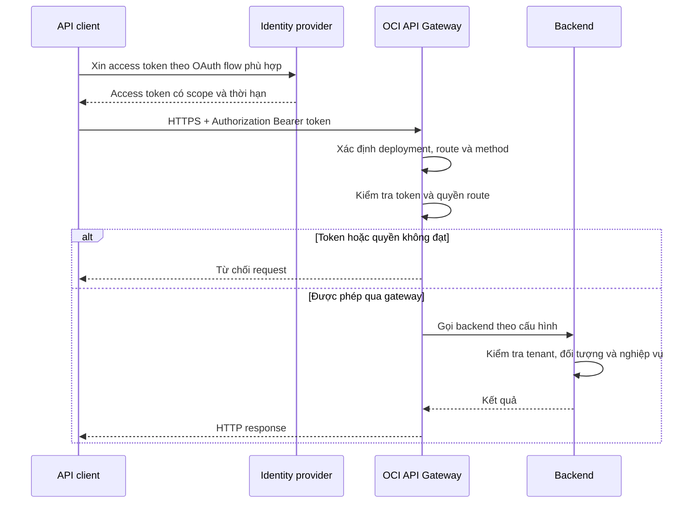

# Định tuyến, xác thực JWT và kiểm soát truy cập API

## 1. Mục tiêu và phạm vi

Trong chương **API, sự kiện và tích hợp** của module **CLOUD_PROVIDERS_ORACLE**, bài này trình bày cách đưa API qua OCI API Gateway, kiểm tra JWT và giới hạn quyền theo từng thao tác. Nội dung kết nối chính sách API với compartment, IAM, VCN, backend và giám sát trên Oracle Cloud Infrastructure.

Một API được bảo vệ đúng cần trả lời ba câu hỏi:

1. Request phải được chuyển tới route và backend nào?
2. Token có được phát hành bởi nguồn tin cậy và dùng được cho API này không?
3. Chủ thể của token được phép thực hiện thao tác trên dữ liệu nào?

Bài thực hành dùng API đơn hàng với hai scope độc lập: `orders:read` và `orders:write`. Trước tiên, backend trả response mẫu để kiểm chứng routing và policy. Sau đó, bài hướng dẫn chuyển sang backend HTTP hoặc OCI Functions và bổ sung kiểm soát truy cập dữ liệu.

Kết quả cần đạt là giải thích và kiểm chứng được cả request được chấp nhận lẫn request bị từ chối. Việc một token gọi được một endpoint chưa đủ chứng minh API đã phân quyền đúng.

## 2. Các lớp kiểm soát và ranh giới trách nhiệm

| Lớp | Câu hỏi được giải quyết | Ví dụ |
|---|---|---|
| Mạng và TLS | Client có tới được endpoint, kết nối có tin cậy không? | Public/private gateway, NSG, chứng chỉ |
| Định tuyến | Path và method thuộc thao tác nào? | GET /orders khác POST /orders |
| Xác thực token | Token có hợp lệ cho API không? | Chữ ký, issuer, audience, thời hạn |
| Phân quyền route | Token có scope cho thao tác không? | orders:read |
| Phân quyền nghiệp vụ | Chủ thể có quyền trên đối tượng cụ thể không? | Đọc đúng đơn hàng của tenant |
| Quyền gọi backend | Gateway có được gọi dịch vụ đích không? | Quyền invoke OCI Function |
| Quyền quản trị OCI | Ai được tạo hoặc sửa gateway/deployment? | IAM policy trong compartment |

OCI API Gateway có thể đưa nhiều backend về một endpoint và áp dụng chính sách xác thực, phân quyền, biến đổi request, CORS hoặc giới hạn request. Public/private endpoint là lựa chọn mạng; nó không thay thế các lớp quyền của API. [Nguồn: tổng quan OCI API Gateway](https://docs.oracle.com/en-us/iaas/Content/APIGateway/Concepts/apigatewayoverview.htm).

**Request policy của API deployment khác IAM policy.** Một người có quyền cập nhật deployment trên OCI không mặc nhiên có scope nghiệp vụ của người gọi API; JWT hợp lệ cũng không tự cấp quyền quản trị OCI. [Nguồn: request và response policies](https://docs.oracle.com/en-us/iaas/Content/APIGateway/Tasks/apigatewayaddingrequestpolicies.htm).

## 3. Mô hình xử lý request



Sơ đồ thể hiện ranh giới quyết định, không mô tả toàn bộ thứ tự nội bộ của mọi policy. Khi bổ sung CORS, validation hoặc transformation, cần tuân theo thứ tự xử lý của loại policy đó.

Chọn route là chọn nơi xử lý, không phải bằng chứng request đã được cho phép. Mọi đường tới dữ liệu nhạy cảm, kể cả đường gọi trực tiếp backend, phải có cơ chế kiểm soát phù hợp.

## 4. Thiết kế route bằng path và HTTP method

### 4.1. Phân biệt gateway, deployment và route

Giả sử deployment được tạo với path prefix:

```text
/shop/v1
```

Route bên trong deployment có path `/orders`. URL client gọi là:

```text
https://<gateway-hostname>/shop/v1/orders
```

`pathPrefix` là thuộc tính của **deployment**. Trong deployment specification, `routes[].path` là đường tương đối với prefix đó. Không chép cả `/shop/v1` vào mỗi route nếu deployment đã có prefix tương ứng. [Nguồn: cấu trúc deployment specification](https://docs.oracle.com/en-us/iaas/Content/APIGateway/Tasks/apigatewaycreatingspecification.htm).

Ma trận thiết kế của bài:

| Method | Route path | Mục đích | Yêu cầu quyền |
|---|---|---|---|
| GET | /session | Kiểm chứng token hợp lệ | Chỉ cần xác thực |
| GET | /orders | Liệt kê đơn hàng | orders:read |
| POST | /orders | Tạo đơn hàng | orders:write |
| GET | /orders/{orderId} | Đọc một đơn hàng | orders:read và kiểm tra đối tượng ở backend |

Không suy ra scope đọc từ scope ghi. Nếu sản phẩm muốn một người vừa đọc vừa ghi, IdP phải cấp hai scope hoặc hệ thống phải có quy tắc quyền tường minh.

### 4.2. Path parameter và wildcard

`/orders/{orderId}` nhận một đoạn path làm giá trị `orderId`. Một wildcard như `/files/{remainingPath*}` có thể khớp nhiều đoạn, một đoạn hoặc không có đoạn phía sau theo quy tắc OCI. Vì vậy, wildcard cần được xem xét như một phần của phạm vi truy cập. [Nguồn: path parameter và wildcard](https://docs.oracle.com/en-us/iaas/Content/APIGateway/Tasks/apigatewayaddingparamswildcards.htm).

Tránh để một wildcard rộng gắn policy yếu bao trùm đường dẫn quản trị. Đừng dựa vào vị trí dòng trong JSON để kết luận một route cụ thể luôn được bảo vệ. Kiểm thử các path chồng lấn, dấu gạch chéo cuối, ký tự được encode và method không khai báo.

Ví dụ một route `/{all*}` công khai để phục vụ nội dung chung cần được kiểm tra đặc biệt nếu cùng deployment còn có `/admin`, `/orders` hoặc đường dẫn nội bộ.

### 4.3. Ánh xạ path ngoài và URL backend

Khi cần chuyển:

```text
/shop/v1/orders/A123
```

tới:

```text
https://orders.internal.example.com/orders/A123
```

backend URL phải biểu diễn phép ánh xạ đó. Không giả định gateway tự thêm mọi phần path của request vào URL đích.

OCI lưu path parameter trong context table `request.path`. Trong URL có thể dùng biểu thức như `${request.path[orderId]}` để chèn giá trị. Các giá trị query/header là dữ liệu do client đưa vào; chúng không tự trở thành danh tính đã xác thực. [Nguồn: context variables](https://docs.oracle.com/en-us/iaas/Content/APIGateway/Tasks/apigatewaycontextvariables.htm).

Giữ hostname backend trong cấu hình được kiểm soát. Không dựng hostname đích trực tiếp từ một query parameter tùy ý của client.

## 5. JWT là gì và cần kiểm tra gì?

### 5.1. Đọc được payload chưa chứng minh token hợp lệ

Một JWT có chữ ký ở dạng JWS compact thường gồm:

```text
base64url(header).base64url(payload).signature
```

Base64url là cách biểu diễn dữ liệu, không phải mã hóa bảo mật. Có thể đọc claim mà không có khóa; điều đó không chứng minh claim do IdP phát hành. Cũng không đặt secret hoặc dữ liệu nhạy cảm vào JWT chỉ vì token có chữ ký.

JWT có nhiều hình thức và profile. Bài tập trung access token được ký mà OCI Gateway có thể kiểm tra bằng public key. [Nguồn: định nghĩa JWT](https://www.rfc-editor.org/rfc/rfc7519.html).

### 5.2. Các thành phần cần thống nhất với IdP

| Thành phần | Ý nghĩa | Điều phải xác minh |
|---|---|---|
| alg | Thuật toán ký | Thuật toán được chấp nhận trong cấu hình tin cậy |
| kid | Định danh khóa | Tìm được khóa công khai phù hợp trong tập khóa tin cậy |
| iss | Nguồn phát hành | Khớp issuer được cho phép |
| aud | Đối tượng nhận token | Có audience của API đang được bảo vệ |
| exp | Thời điểm hết hạn | Token còn trong thời hạn theo policy/profile |
| nbf | Chưa có hiệu lực trước thời điểm này | Không sử dụng token quá sớm |
| sub | Chủ thể | Được backend diễn giải theo loại token |
| scope | Các quyền truy cập | Khớp scope yêu cầu của route |
| tenant_id | Claim tùy chỉnh của ví dụ mở rộng | Nguồn IdP tin cậy phát hành và có quy tắc sử dụng |

Chữ ký đúng không đủ: token có thể dành cho API khác hoặc đã hết hạn. Không tự chọn thuật toán kiểm tra chỉ dựa vào nội dung header do bên gửi cung cấp; cần quy tắc tin cậy về thuật toán, khóa, issuer và audience. [Nguồn: JWT Best Current Practices](https://www.rfc-editor.org/rfc/rfc8725.html).

Với thời gian, dùng đồng hồ đồng bộ và clock skew nhỏ có chủ đích. Clock skew không phải thời gian gia hạn dài để token hết hạn vẫn tiếp tục dùng.

### 5.3. Access token, ID token và refresh token

| Token | Mục đích chính | Dùng gọi API của bài? |
|---|---|---|
| Access token | Truy cập resource server theo quyền được cấp | Có, nếu đúng profile và audience |
| ID token | Chuyển thông tin xác thực tới OIDC client | Không dùng thay access token |
| Refresh token | Xin access token mới | Không gửi cho resource API |

Không chấp nhận token chỉ vì nó có ba đoạn hoặc cùng được ký bởi IdP quen thuộc. Profile JWT access token có yêu cầu riêng nhằm tránh nhầm token giữa các ngữ cảnh. [Nguồn: JWT Profile for OAuth 2.0 Access Tokens](https://www.rfc-editor.org/rfc/rfc9068.html).

Trong luồng machine-to-machine, subject có thể đại diện ứng dụng/client thay vì người dùng cuối. Backend không được mặc định mọi `sub` là một tài khoản khách hàng.

## 6. Chọn cách xác thực token trong OCI API Gateway

Đối với cấu hình mới, Oracle khuyến nghị policy loại `TOKEN_AUTHENTICATION`. Policy cũ `JWT_AUTHENTICATION` vẫn được hỗ trợ nhưng không còn là lựa chọn khuyến nghị để tạo mới. [Nguồn: lưu ý về JWT_AUTHENTICATION](https://docs.oracle.com/en-us/iaas/Content/APIGateway/Tasks/apigatewayusingjwttokens-requestpolicy.htm).

Các hướng kiểm tra:

| Cách | Cơ chế | Điểm cần vận hành |
|---|---|---|
| Remote JWKS | Lấy public key từ URI tin cậy, kiểm tra JWT | Mạng tới IdP, TLS, cache và xoay khóa |
| Static keys | Khai báo public key trong cấu hình | Cập nhật khóa có kiểm soát |
| OAuth introspection | Hỏi authorization server về token | Kết nối, secret và cache kết quả |
| Custom authorizer | Gọi OCI Function để quyết định | Hợp đồng authorizer, IAM, timeout và cache |

Token validation có sẵn và custom authorizer là những phương án cần chọn theo yêu cầu, không phải mọi API đều cần triển khai thêm authorizer. Bài dùng Remote JWKS vì phù hợp access token JWT được ký bất đối xứng. [Nguồn: các hình thức kiểm tra token](https://docs.oracle.com/en-us/iaas/Content/APIGateway/Tasks/apigatewayusingjwttokens.htm).

Remote JWKS lấy **public key**, không gửi private signing key vào deployment. Public key cũng không cho phép gateway tự phát hành token của IdP.

## 7. Chuẩn bị IdP và thông tin cấu hình

Trước khi tạo deployment, cần một authorization server/IdP đã được cấu hình cho resource API của lab:

- Audience: ví dụ `api://orders-api`.
- Scope đọc: `orders:read`.
- Scope ghi: `orders:write`.
- Issuer chính xác của token.
- JWKS URI có thể truy cập từ mạng gateway.
- Client thử nghiệm được phép xin các scope tương ứng.

Ví dụ sẽ dùng `https://idp.example.com/` và JWKS URI minh họa. Phải thay bằng thông tin IdP thật trước khi triển khai.

Với OCI IAM Identity Domains, không mặc định issuer là hostname của domain. Issuer, audience và JWKS URI do cấu hình IdP quyết định; tài liệu Oracle có thông tin riêng theo từng nhà cung cấp. [Nguồn: issuer, audience và JWKS theo IdP](https://docs.oracle.com/en-us/iaas/Content/APIGateway/Tasks/apigatewayusingjwttokens-identityprovider.htm).

Chuẩn bị các access token thử nghiệm do IdP phát hành:

| Nhãn dùng trong bài | Quyền mong muốn |
|---|---|
| TOKEN_READ | Chỉ orders:read |
| TOKEN_WRITE | Chỉ orders:write |
| TOKEN_BOTH | Cả orders:read và orders:write |
| TOKEN_OTHER_AUD | Token thật nhưng dành cho resource API khác |
| TOKEN_NO_SCOPE | Token hợp lệ cho API nhưng không có scope đơn hàng |

Token đọc và ghi có thể dùng các client hoặc người dùng thử nghiệm khác nhau. Kiểm tra scope thực tế trong token trả về; việc gửi yêu cầu xin scope không bảo đảm authorization server đã cấp đúng các scope đó.

Dùng flow OAuth phù hợp với loại client. Client credentials thích hợp cho ứng dụng dịch vụ được cho phép; không dùng client secret trong mã frontend công khai.

## 8. Deployment specification hoàn chỉnh cho lab

Specification dưới đây tạo bốn route, đều yêu cầu token. Backend trả dữ liệu mẫu ngay tại gateway để kiểm chứng policy trước khi tích hợp dịch vụ thật.

Người học có thể lưu nội dung thành `orders-deployment.json` trong thư mục thực hành của mình:

```json
{
  "requestPolicies": {
    "authentication": {
      "type": "TOKEN_AUTHENTICATION",
      "tokenHeader": "Authorization",
      "tokenAuthScheme": "Bearer",
      "isAnonymousAccessAllowed": false,
      "maxClockSkewInSeconds": 10,
      "validationPolicy": {
        "type": "REMOTE_JWKS",
        "uri": "https://idp.example.com/.well-known/jwks.json",
        "isSslVerifyDisabled": false,
        "maxCacheDurationInHours": 1,
        "additionalValidationPolicy": {
          "issuers": [
            "https://idp.example.com/"
          ],
          "audiences": [
            "api://orders-api"
          ]
        }
      }
    }
  },
  "routes": [
    {
      "path": "/session",
      "methods": [
        "GET"
      ],
      "backend": {
        "type": "STOCK_RESPONSE_BACKEND",
        "status": 200,
        "headers": [
          {
            "name": "Content-Type",
            "value": "application/json"
          },
          {
            "name": "Cache-Control",
            "value": "no-store"
          }
        ],
        "body": "{\"demo\":true,\"route\":\"session\"}"
      },
      "requestPolicies": {
        "authorization": {
          "type": "AUTHENTICATION_ONLY"
        }
      }
    },
    {
      "path": "/orders",
      "methods": [
        "GET"
      ],
      "backend": {
        "type": "STOCK_RESPONSE_BACKEND",
        "status": 200,
        "headers": [
          {
            "name": "Content-Type",
            "value": "application/json"
          },
          {
            "name": "Cache-Control",
            "value": "no-store"
          }
        ],
        "body": "{\"demo\":true,\"route\":\"list-orders\"}"
      },
      "requestPolicies": {
        "authorization": {
          "type": "ANY_OF",
          "allowedScope": [
            "orders:read"
          ]
        }
      }
    },
    {
      "path": "/orders",
      "methods": [
        "POST"
      ],
      "backend": {
        "type": "STOCK_RESPONSE_BACKEND",
        "status": 202,
        "headers": [
          {
            "name": "Content-Type",
            "value": "application/json"
          },
          {
            "name": "Cache-Control",
            "value": "no-store"
          }
        ],
        "body": "{\"demo\":true,\"route\":\"create-order\",\"persisted\":false}"
      },
      "requestPolicies": {
        "authorization": {
          "type": "ANY_OF",
          "allowedScope": [
            "orders:write"
          ]
        }
      }
    },
    {
      "path": "/orders/{orderId}",
      "methods": [
        "GET"
      ],
      "backend": {
        "type": "STOCK_RESPONSE_BACKEND",
        "status": 200,
        "headers": [
          {
            "name": "Content-Type",
            "value": "application/json"
          },
          {
            "name": "Cache-Control",
            "value": "no-store"
          }
        ],
        "body": "{\"demo\":true,\"route\":\"get-order\"}"
      },
      "requestPolicies": {
        "authorization": {
          "type": "ANY_OF",
          "allowedScope": [
            "orders:read"
          ]
        }
      }
    }
  ]
}
```

Các giá trị `idp.example.com` là placeholder, không phải dịch vụ cấp token của bài. Các response có `demo: true`; POST trả 202 để minh họa route, **không tạo đơn hàng và không lưu dữ liệu**.

Stock response là loại backend do gateway trả status, header và body theo cấu hình. Body JSON được chứa trong một chuỗi nên dấu nháy bên trong phải được escape. [Nguồn: stock response backend](https://docs.oracle.com/en-us/iaas/Content/APIGateway/Tasks/apigatewayaddingstockresponses.htm).

Trong policy JWT:

- `tokenHeader` và `tokenAuthScheme` chọn `Authorization: Bearer ...`.
- `isAnonymousAccessAllowed: false` giữ các route của lab sau xác thực.
- `validationPolicy.type: REMOTE_JWKS` chọn nguồn public key.
- `additionalValidationPolicy` chứa issuer và audience.
- `isSslVerifyDisabled: false` giữ kiểm tra chứng chỉ TLS của JWKS.
- `maxCacheDurationInHours: 1` là lựa chọn cho lab, cần đánh giá lại theo yêu cầu xoay khóa.

Đây là cấu trúc của `TOKEN_AUTHENTICATION`; không đặt các field của policy JWT cũ vào vị trí tùy ý. [Nguồn: cấu hình token authentication bằng JSON](https://docs.oracle.com/en-us/iaas/Content/APIGateway/Tasks/apigatewayusingjwttokens-usinjson.htm).

## 9. Phân quyền theo route và scope

### 9.1. AUTHENTICATION_ONLY

Route `GET /session` chấp nhận chủ thể được xác thực mà không yêu cầu scope đơn hàng. Response chỉ là tín hiệu lab, không phải hồ sơ người dùng.

Chỉ chọn cách này cho thao tác mà mọi chủ thể hợp lệ của API đều được phép thực hiện. Nếu thiếu policy authorization trên một route trong deployment có authentication, OCI áp dụng ý nghĩa mặc định tương ứng `AUTHENTICATION_ONLY`; vì thế phải rà soát quyền của từng route khi soạn cấu hình.

### 9.2. ANY_OF

`allowedScope: ["orders:read"]` yêu cầu scope đọc.

Nếu khai báo:

```json
{
  "type": "ANY_OF",
  "allowedScope": ["orders:read", "orders:write"]
}
```

thì một trong hai scope là đủ. Cấu hình này **không yêu cầu đồng thời cả hai**. Nếu thao tác cần nhiều điều kiện cùng lúc, thực hiện policy phù hợp ở authorizer/backend hoặc thiết kế scope riêng biểu thị quyền đó.

Giá trị scope phân biệt hoa thường. Claim `roles`, `groups` hoặc một claim riêng của IdP không tự thay cho `scope` trong policy này. [Nguồn: route authorization và allowedScope](https://docs.oracle.com/en-us/iaas/tools/terraform-provider-oci/latest/docs/r/apigateway_deployment.html).

### 9.3. ANONYMOUS

Nếu muốn thêm một route công khai trong deployment có authentication, cần kết hợp:

- Cho phép anonymous ở authentication policy.
- Đặt authorization của đúng route đó thành `ANONYMOUS`.

Không đổi mọi route thành `AUTHENTICATION_ONLY` rồi gọi đó là phân quyền theo scope. Cũng không chỉ bật anonymous toàn deployment rồi cho rằng mọi route đều đã công khai.

Với health endpoint công khai đơn giản, có thể tạo deployment riêng như `/public/v1` để giảm việc trộn các yêu cầu xác thực. Nếu chọn trộn, kiểm thử cả request không có token và request có token sai theo hành vi policy đang dùng. [Nguồn: các loại authorization trong cấu hình token trên Console](https://docs.oracle.com/en-us/iaas/Content/APIGateway/Tasks/apigatewayusingjwttokens-usingconsole.htm).

## 10. Tạo deployment và xác nhận đúng môi trường

### 10.1. Điều kiện hạ tầng

Trước thao tác, xác định region, compartment, gateway OCID, subnet, DNS và đường tới JWKS. Với public gateway, chỉ mở ingress cần thiết; với private gateway, máy kiểm thử phải có đường mạng tới endpoint.

Người triển khai cần IAM để tạo/cập nhật deployment trong đúng compartment. Nếu dùng backend Functions hoặc introspection có secret, cần thêm quyền liên quan; không cấp những quyền đó chỉ vì bài dùng JWT. [Nguồn: IAM cho API Gateway](https://docs.oracle.com/en-us/iaas/Content/APIGateway/Tasks/apigatewaycreatingpolicies.htm).

### 10.2. Tạo bằng Console hoặc CLI

Trên Console, chọn gateway đúng môi trường, tạo deployment với:

| Thông số | Giá trị của lab |
|---|---|
| Tên | orders-jwt-lab |
| Path prefix | /shop/v1 |
| Specification | Nội dung JSON đã thay thông tin IdP |
| Backend ban đầu | Stock response |
| Authentication | Token authentication với Remote JWKS |

Nếu dùng OCI CLI trên Bash:

```bash
read -r -p "Compartment OCID: " COMPARTMENT_OCID
read -r -p "Gateway OCID: " GATEWAY_OCID

oci api-gateway deployment create --compartment-id "$COMPARTMENT_OCID" --display-name orders-jwt-lab --gateway-id "$GATEWAY_OCID" --path-prefix /shop/v1 --specification file://orders-deployment.json --wait-for-state ACTIVE
```

Chỉ chọn một cách tạo. Nếu deployment đã tồn tại, kiểm tra và cập nhật đúng tài nguyên thay vì tạo bản trùng với cùng prefix.

Lưu deployment OCID, endpoint và Work Request liên quan nếu có. Trạng thái `ACTIVE` phản ánh việc triển khai cấu hình; vẫn phải kiểm thử token, route và mạng lúc nhận request. [Nguồn: tạo API deployment](https://docs.oracle.com/en-us/iaas/Content/APIGateway/Tasks/apigatewaycreatingdeployment.htm).

Mọi lệnh trong bài là hướng dẫn thực hành cho môi trường của người học; chúng không phải bằng chứng đã có một deployment hoạt động sẵn.

## 11. Kiểm thử bằng token thật

Các lệnh sau dùng Bash. Lấy access token từ IdP đã cấu hình, không tự sửa payload token rồi dùng lại chữ ký cũ.

### 11.1. Nhập endpoint và token

Nhập deployment endpoint không có dấu gạch chéo cuối, ví dụ `https://<gateway-hostname>/shop/v1`:

```bash
read -r -p "Deployment endpoint: " API_BASE_URL
read -r -s -p "Access token chỉ có orders:read: " TOKEN_READ
printf '\n'
read -r -s -p "Access token chỉ có orders:write: " TOKEN_WRITE
printf '\n'
```

Token không hiện trên màn hình lúc nhập. Không bật shell tracing trong phiên thử nghiệm có credential, và không chép token vào báo cáo.

Bearer token phải được bảo vệ khi lưu và truyền; dùng HTTPS và header Authorization giúp tránh nhiều nguồn lộ token do URL. [Nguồn: Bearer Token Usage](https://www.rfc-editor.org/rfc/rfc6750.html).

### 11.2. Không có token

```bash
curl -i "$API_BASE_URL/orders"
```

Với cấu hình lab và response xác thực mặc định, request không được phép đi tới stock backend. Mặc định token authentication trả HTTP 401 khi token thiếu hoặc không hợp lệ; không cấu hình OAuth redirect hoặc custom failure response trong ví dụ này.

### 11.3. Token đọc gọi route đọc

```bash
curl -i --header "Authorization: Bearer $TOKEN_READ" "$API_BASE_URL/orders"
```

Mong đợi HTTP 200 và body nhận diện `list-orders`.

Thử route tham số:

```bash
curl -i --header "Authorization: Bearer $TOKEN_READ" "$API_BASE_URL/orders/A123"
```

Mong đợi stock response `get-order`. Response này chỉ chứng minh route/policy khớp, không chứng minh có đơn hàng A123 hay chủ thể được quyền đọc nó.

### 11.4. Token đọc gọi route ghi

```bash
curl -i --request POST --header "Authorization: Bearer $TOKEN_READ" --header "Content-Type: application/json" --data '{"item":"demo","quantity":1}' "$API_BASE_URL/orders"
```

Request phải bị từ chối do không có scope ghi. Phân biệt kết quả này với token sai chữ ký: một trường hợp là không đủ quyền, trường hợp kia là xác thực thất bại. Với phản hồi HTTP thông thường, thiếu scope được biểu thị bằng 403; đối chiếu log nếu hệ thống có tùy chỉnh response.

### 11.5. Token ghi gọi route ghi

```bash
curl -i --request POST --header "Authorization: Bearer $TOKEN_WRITE" --header "Content-Type: application/json" --data '{"item":"demo","quantity":1}' "$API_BASE_URL/orders"
```

Mong đợi HTTP 202 cùng body `persisted: false`.

Thử token ghi trên GET để chứng minh không có quan hệ kế thừa scope ngầm:

```bash
curl -i --header "Authorization: Bearer $TOKEN_WRITE" "$API_BASE_URL/orders"
```

Nếu token thực sự chỉ có scope ghi, GET phải bị từ chối.

### 11.6. Kiểm thử token bị thay đổi

```bash
BAD_TOKEN="x$TOKEN_READ"
curl -i --header "Authorization: Bearer $BAD_TOKEN" "$API_BASE_URL/orders"
unset BAD_TOKEN
```

Token đã bị thay đổi phải bị từ chối. Với trường hợp sai audience, issuer, thời gian hoặc scope, dùng token kiểm thử do IdP phát hành với đặc tính đó. Chỉnh payload bằng tay chỉ kiểm tra token hỏng/chữ ký sai, không cô lập được kiểm tra claim.

## 12. Ma trận kiểm thử bắt buộc của thiết kế

Ma trận này là kế hoạch kiểm chứng trên môi trường thực hành, không phải kết quả đã chạy:

| Trường hợp | Request | Kết quả mong muốn |
|---|---|---|
| Không có token | GET /orders | Từ chối xác thực, mặc định 401 |
| Chữ ký/token hỏng | GET /orders | Từ chối xác thực |
| Token hết hạn | GET /orders | Từ chối ngoài skew được cho phép |
| Token chưa có hiệu lực | GET /orders | Từ chối khi nbf chưa đạt |
| Sai issuer | GET /orders | Từ chối dù thuật toán ký hợp lệ |
| Sai audience | GET /orders | Từ chối dù token hợp lệ cho API khác |
| Token đọc | GET /orders | 200 từ stock backend |
| Token đọc | POST /orders | Từ chối phân quyền |
| Token ghi | POST /orders | 202 từ stock backend |
| Token ghi | GET /orders | Từ chối nếu không có scope đọc |
| Token không có scope đơn hàng | GET /session | Được phép nếu token vẫn hợp lệ cho API |
| Token không có scope đơn hàng | GET /orders | Từ chối phân quyền |
| Token đủ quyền | Method không được khai báo | Không được chuyển thành thao tác hợp lệ khác |
| Token đủ quyền | Path không khớp | Không được rơi vào backend nhạy cảm |
| Client giả header danh tính | Route backend thật | Không thay được danh tính đã xác thực |
| Token tenant A | Đối tượng tenant B | Backend từ chối |

Ghi cả status, body, route được chọn và log. Không kết luận chỉ từ một status code vì response có thể do gateway, IdP integration hoặc backend tạo ra.

Sau kiểm thử, xóa các biến chứa token trong phiên terminal:

```bash
unset TOKEN_READ TOKEN_WRITE
```

## 13. Chuyển sang HTTP backend và truyền danh tính có kiểm soát

Khi policy lab hoạt động, có thể thay route đọc một đơn hàng bằng route HTTP sau. Đây là **một route thay thế**, không phải toàn bộ deployment; giữ authentication policy toàn cục đã cấu hình:

```json
{
  "path": "/orders/{orderId}",
  "methods": [
    "GET"
  ],
  "backend": {
    "type": "HTTP_BACKEND",
    "url": "https://orders.internal.example.com/orders/${request.path[orderId]}",
    "isSslVerifyDisabled": false
  },
  "requestPolicies": {
    "authorization": {
      "type": "ANY_OF",
      "allowedScope": [
        "orders:read"
      ]
    },
    "headerTransformations": {
      "setHeaders": {
        "items": [
          {
            "name": "X-Authenticated-Subject",
            "values": [
              "${request.auth[sub]}"
            ],
            "ifExists": "OVERWRITE"
          },
          {
            "name": "X-Authenticated-Tenant",
            "values": [
              "${request.auth[tenant_id]}"
            ],
            "ifExists": "OVERWRITE"
          }
        ]
      }
    }
  }
}
```

Trong ví dụ mở rộng, IdP phải phát hành claim `tenant_id` phù hợp và backend phải từ chối khi claim bắt buộc bị thiếu. Placeholder hostname backend cần thay bằng endpoint thật có DNS, route và TLS phù hợp.

Header transformation lấy claim từ `request.auth` sau xác thực. `ifExists: OVERWRITE` thay giá trị cùng tên do client đưa vào để giảm nguy cơ giả danh qua header. [Nguồn: chuyển claim JWT thành header](https://docs.oracle.com/en-us/iaas/Content/APIGateway/Tasks/apigatewaymodifyingresponsesrequests-transformexamples.htm).

Chỉ tin các header đó khi backend có ranh giới tin cậy rõ ràng:

- Chỉ nhận traffic từ đường gateway được phép hoặc có xác thực dịch vụ bổ sung.
- Kiểm tra nguồn request theo kiến trúc mạng và danh tính dịch vụ.
- Không mở một đường trực tiếp cho Internet gửi cùng header.
- Không cho một route anonymous đi vào cùng thao tác với header danh tính không hợp lệ.
- Không coi một header có tên giống mẫu là bằng chứng mật mã.

Một cách khác là backend tự xác minh access token theo chính sách tin cậy. Chọn phương án phù hợp với số đường truy cập và kiến trúc dịch vụ, rồi kiểm thử khả năng bỏ qua gateway.

HTTP backend phải có thể định tuyến từ subnet gateway; DNS, TLS và timeout là các điều kiện độc lập với JWT. Giữ xác minh chứng chỉ TLS khi gọi HTTPS backend. [Nguồn: HTTP/HTTPS backend](https://docs.oracle.com/en-us/iaas/Content/APIGateway/Tasks/apigatewayusinghttpbackend.htm).

## 14. Scope chưa giải quyết quyền trên từng đối tượng

Giả sử token của người A có `orders:read`. Điều đó có thể cho phép gọi route đọc đơn hàng, nhưng chưa cho phép A đọc mọi đơn hàng trên hệ thống.

Backend cần kết hợp:

```text
Cho phép đọc =
  token/nguồn danh tính được tin cậy
  AND có quyền thao tác đọc
  AND đúng tenant
  AND có quyền trên đơn hàng cụ thể
  AND trạng thái nghiệp vụ cho phép
```

Ví dụ truy vấn Oracle Database với bind parameter ở lớp truy cập dữ liệu:

```sql
SELECT order_id, owner_subject, status
FROM orders
WHERE tenant_id = :tenant_id
  AND order_id = :order_id
```

`:tenant_id` lấy từ danh tính đã xác thực, không lấy trực tiếp từ query parameter hoặc body do client tự chọn. Sau khi tìm thấy bản ghi, kiểm tra thêm owner hoặc vai trò hỗ trợ được phép nếu nghiệp vụ yêu cầu.

Mẫu quyết định nghiệp vụ:

```text
principal = danh tính đã được xác thực
require scope orders:read
require principal.tenantId có giá trị hợp lệ

order = tìm đơn bằng principal.tenantId và orderId
require order tồn tại trong phạm vi được phép
require principal là owner hoặc có quyền hỗ trợ theo policy
trả dữ liệu được phép công bố
```

Chính sách trả 403 hay 404 cho đối tượng ngoài phạm vi cần được thiết kế nhất quán để tránh lộ thông tin tồn tại của tài nguyên.

Tương tự, scope ghi không tự cho phép client sửa `tenant_id`, `owner_subject`, giá, trạng thái thanh toán hoặc các trường quản trị. Validation và authorization ở mức field vẫn thuộc backend.

## 15. Claim tùy chỉnh, nhiều tenant và dynamic routing

Có thể yêu cầu một claim tùy chỉnh bằng `verifyClaims` trong `additionalValidationPolicy`. Ví dụ fragment chỉ cho tenant lab:

```json
{
  "verifyClaims": [
    {
      "key": "tenant_id",
      "values": ["t-demo"],
      "isRequired": true
    }
  ]
}
```

Đây là điều kiện toàn cục của authentication policy, do đó ảnh hưởng mọi route trong deployment đó. Không thêm fragment này nếu IdP chưa phát hành claim tương ứng.

Việc so khớp claim tùy chỉnh theo cấu hình OCI có quy tắc cụ thể; không coi field `values` là ngôn ngữ biểu thức để so sánh claim với path hoặc body. Để kiểm tra `tenant_id` của token bằng tenant của đối tượng, vẫn cần policy nghiệp vụ phù hợp.

Với nhiều backend theo tenant, OCI có dynamic routing dựa trên context như `request.auth[tenant_id]`. Điều này có thể chọn backend từ danh tính đã xác thực, nhưng vẫn cần xác định default khi không khớp và quyền trên từng backend. Không chọn tenant tin cậy từ header client tự gửi. [Nguồn: lựa chọn backend động](https://docs.oracle.com/en-us/iaas/Content/APIGateway/Tasks/apigatewaydynamicroutingbasedonrequest_topic.htm).

Giữ tập issuer, audience và khóa được tin cậy có chủ đích. Thêm một issuer để “sửa nhanh” token bị từ chối có thể mở rộng tập chủ thể được chấp nhận ngoài phạm vi API.

## 16. OCI Functions backend và quyền gateway

Nếu dùng OCI Function, backend route có dạng:

```json
{
  "type": "ORACLE_FUNCTIONS_BACKEND",
  "functionId": "<function-ocid>"
}
```

JWT của người dùng giải quyết truy cập API ở phía client. Gateway gọi function bằng cơ chế tích hợp OCI và cần IAM tương ứng; scope `orders:read` không tự tạo quyền invoke function.

Cần kiểm tra riêng:

1. Người triển khai có quyền chọn và cấu hình function.
2. Gateway có quyền gọi function đích.
3. Function có quyền runtime để dùng tài nguyên OCI nếu cần.
4. Function tiếp tục kiểm tra quyền nghiệp vụ từ danh tính đã thiết kế.
5. Hợp đồng request/response của function khớp cách tích hợp.

Không mặc định JSON gửi vào route giống hệt payload mà Java handler nhận trong mọi cơ chế tích hợp. Xác minh hình thức sự kiện, body, header và cách trả HTTP response. [Nguồn: OCI Functions làm API backend](https://docs.oracle.com/en-us/iaas/Content/APIGateway/Tasks/apigatewayusingfunctionsbackend.htm).

Với bài báo giá Java ở một luồng học khác, chỉ chuyển sang function thật sau khi xác nhận được policy gateway và hợp đồng function; stock backend ở bài này có thể được giữ làm mốc chẩn đoán.

## 17. CORS, validation và giới hạn truy cập

### 17.1. CORS là cơ chế của trình duyệt

CORS cho phép trình duyệt quyết định frontend ở origin nào được đọc phản hồi cross-origin. Công cụ CLI hoặc dịch vụ backend không bị bảo vệ chỉ nhờ cấu hình CORS.

Nếu frontend cần gọi API từ `https://shop.example.com`, cấu hình origin, method và header cần thiết, bao gồm `Authorization` và `Content-Type` khi dùng chúng. Kiểm thử preflight OPTIONS và request thật với policy authentication hiện tại. Đừng đổi toàn API thành anonymous để làm preflight thành công. [Nguồn: CORS trong OCI API Gateway](https://docs.oracle.com/en-us/iaas/Content/APIGateway/Tasks/apigatewayaddingcorssupport.htm).

Khi có cookie hoặc credential theo cơ chế trình duyệt, cấu hình origin tường minh và đánh giá thêm CSRF theo mô hình client. Token bearer và session cookie có các đặc tính vận hành khác nhau.

### 17.2. Validation và rate limiting

Sau khi biết request được phép vào route, vẫn cần kiểm tra:

- Content-Type và cấu trúc body.
- Trường bắt buộc và kích thước dữ liệu.
- Path/query theo hợp đồng API.
- Giới hạn số request và năng lực downstream.
- Timeout và cách xử lý retry.

OCI hỗ trợ request validation trước khi chuyển tới backend, nhưng validation schema không thay thế phân quyền nghiệp vụ. [Nguồn: request validation](https://docs.oracle.com/en-us/iaas/Content/APIGateway/Tasks/apigatewayaddingrequestvalidation.htm).

Rate limiting hoặc usage plan hỗ trợ quản lý tải và mức sử dụng. Chúng không chứng minh người gọi có quyền đọc đối tượng. Một client có subscription hợp lệ vẫn phải qua policy xác thực và authorization mà API yêu cầu.

Không tự động retry vô hạn khi gặp 401/403. Với thao tác POST, xác định rõ idempotency để tránh tạo đơn trùng khi caller timeout rồi gửi lại.

## 18. Xoay khóa, cache và thu hồi token

Remote JWKS làm phát sinh một phụ thuộc vận hành ngoài backend nghiệp vụ. Gateway cần truy cập được URI, kiểm tra TLS và tìm thấy khóa phù hợp với token.

Quy trình xoay khóa nên có giai đoạn chồng lấn:

1. Công bố public key mới trong JWKS.
2. Cho phép hệ thống kiểm tra cập nhật khóa theo cơ chế cache.
3. Chuyển phát hành token sang khóa mới.
4. Duy trì khóa cũ đủ cho token cũ còn hợp lệ và vòng đời cache đã tính.
5. Gỡ khóa cũ sau khi xác nhận tác động.

Thời gian cache JWKS là cache **khóa**, không phải cam kết token của một người vừa bị khóa tài khoản sẽ bị từ chối ngay. JWT được kiểm tra cục bộ có thể còn hợp lệ tới khi hết hạn nếu không có cơ chế thu hồi bổ sung.

Khi yêu cầu thu hồi gần thời gian thực, cân nhắc introspection, denylist hoặc authorizer/backend phù hợp. Bản thân introspection cũng có thể có cache và phụ thuộc mạng, cần tính vào thời gian hiệu lực của thay đổi.

Không gỡ khóa ký của mọi người dùng chỉ để thu hồi một token nếu chưa đánh giá phạm vi ảnh hưởng. Không tắt xác minh TLS hoặc bỏ audience khi IdP gặp sự cố. Phương án phục hồi phải giữ được điều kiện tin cậy của API.

## 19. Logging, chẩn đoán và vận hành

OCI cung cấp hai nhóm log hữu ích:

| Log | Dùng để xem |
|---|---|
| Access log | Tóm tắt request và response qua deployment |
| Execution log | Các bước xử lý và lỗi bên trong gateway |

Đặt log level trong specification hoặc Console chưa thay thế việc tạo và bật log tương ứng trong OCI Logging. Có thể bật từng loại log ở tab Logs của deployment, chọn log group và retention. [Nguồn: bật logging cho API deployment](https://docs.oracle.com/en-us/iaas/Content/APIGateway/Tasks/apigatewayaddinglogpolicies.htm).

Ghi nhận request ID, thời điểm, deployment, path, method và status để đối chiếu. Tránh ghi Authorization header, toàn bộ token, refresh token hoặc dữ liệu nhạy cảm vào log ứng dụng và log proxy.

Bảng chẩn đoán:

| Dấu hiệu | Cần phân biệt | Bước kiểm tra |
|---|---|---|
| Client không kết nối được | DNS, route, NSG, private/public endpoint | Kiểm tra mạng trước policy JWT |
| Không chọn được route | Sai prefix, path, method | Đối chiếu endpoint và specification |
| Token bị từ chối | Chữ ký, issuer, audience, thời gian | Xem execution log và token test đã kiểm soát |
| Token hợp lệ nhưng bị cấm | Scope không đủ, claim/policy không đạt | Đối chiếu route authorization |
| Lỗi lấy JWKS | URI, DNS, egress, TLS, định dạng khóa | Kiểm tra đường từ subnet gateway |
| Stock route chạy, backend thật lỗi | Routing/policy đã qua nhưng backend chưa đạt | Kiểm tra mạng, TLS, timeout và IAM backend |
| Backend trả lỗi nghiệp vụ | Quyền đối tượng hoặc trạng thái dữ liệu | Đối chiếu principal với dữ liệu |
| Lỗi chỉ ở browser | CORS/preflight hoặc cơ chế credential | Kiểm tra OPTIONS và header response |
| Scope thay đổi chưa có hiệu lực | Token cũ, cache hoặc client xin sai token | Lấy token mới và kiểm tra giá trị thật |

Lỗi lấy khóa hoặc lỗi backend có thể là 5xx; không quy mọi lỗi có token thành 401. Tương tự, mã lỗi quản trị OCI khi dùng CLI không phải mã lỗi của client gọi deployment endpoint.

Theo dõi tỷ lệ 4xx/5xx, latency, lưu lượng và lỗi downstream. 401 tăng có thể do client dùng token hết hạn; 5xx tăng có thể do IdP/JWKS hoặc backend. Muốn phân biệt cần cả log xử lý lẫn kết quả từ phía client.

## 20. Quản lý thay đổi, khả dụng và chi phí

### 20.1. Phát hành policy có bằng chứng

Trước khi cập nhật deployment thật, lưu specification đang dùng, region, OCID, endpoint và bộ test dương/âm đã xác nhận. Dùng môi trường lab/staging để kiểm tra trước khi thay đổi issuer, audience, scope hoặc wildcard.

Một thay đổi nhỏ trong policy có thể có ảnh hưởng lớn: bỏ authorization của route ghi có thể làm route chỉ còn yêu cầu xác thực, còn thay `ANY_OF` có thể mở quyền cho nhóm rộng hơn dự định.

Tiêu chí chấp nhận nên bao gồm:

- Route đúng và method không bị mở ngoài kế hoạch.
- Token sai hoặc thiếu bị chặn.
- Token thiếu scope không tới backend.
- Danh tính không bị thay bởi header client.
- Backend thực thi quyền tenant/đối tượng.
- Client vẫn hoạt động trong giai đoạn xoay khóa đã thiết kế.

### 20.2. Phục hồi sự cố

Khi policy mới chặn client hợp lệ, đối chiếu cấu hình cũ với issuer, audience và scope thực tế. Phục hồi một specification đã biết tốt bằng quy trình cập nhật được kiểm soát.

Khi backend mới lỗi, có thể phục hồi route về backend đã xác nhận, đồng thời giữ các policy xác thực và phân quyền phù hợp. Một stock response thành công chỉ giúp cô lập lỗi, không thể thay thế dịch vụ nghiệp vụ production.

Không có phương án phục hồi hợp lệ nào dựa vào việc mở anonymous cho các thao tác nhạy cảm để “khôi phục lưu lượng”.

### 20.3. Khả dụng và chi phí

Đánh giá khả dụng của toàn đường đi: client, gateway, IdP/JWKS, backend, database và mạng. Không chỉ đo gateway còn trả response.

Chi phí thực hành có thể gồm gateway/API usage, log, network, function và backend. Dùng usage/billing hiện hành để đối soát; chọn retention log và nhịp kiểm thử phù hợp.

Kết thúc lab, xóa deployment hoặc gateway được tạo riêng nếu không cần giữ; kiểm tra các API khác dùng chung trước khi xóa gateway. Thu hồi client/token thử nghiệm và dọn log theo kế hoạch. Không xóa VCN, subnet hoặc policy dùng chung chỉ vì đã hoàn thành bài này.

## 21. Tiêu chí hoàn thành

| Tiêu chí | Bằng chứng |
|---|---|
| Định tuyến chính xác | Prefix, path, method đi tới đúng route |
| Token được kiểm tra | Issuer, audience, chữ ký và thời gian không hợp lệ bị từ chối |
| Scope có hiệu lực | Token đọc không gọi được thao tác ghi và ngược lại nếu thiếu quyền |
| Cấu hình mới đúng loại policy | TOKEN_AUTHENTICATION với validationPolicy tương ứng |
| Danh tính truyền an toàn | Claim được xác thực, header giả không thay được principal |
| Có quyền nghiệp vụ | Tenant và đối tượng được backend kiểm tra |
| Tích hợp OCI rõ ràng | Phân biệt quyền quản trị, quyền caller và quyền gateway gọi backend |
| Quan sát được | Có log, request ID và cách chẩn đoán theo từng lớp |
| Vận hành được | Có kế hoạch xoay khóa, phục hồi policy và kiểm soát chi phí |

Một thiết kế hoàn chỉnh duy trì được chuỗi tin cậy từ **token do IdP cấp**, qua **route và scope tại gateway**, tới **quyền trên dữ liệu ở backend**. Mỗi lớp cần có kiểm thử độc lập và bằng chứng cho các trường hợp phải bị từ chối.
