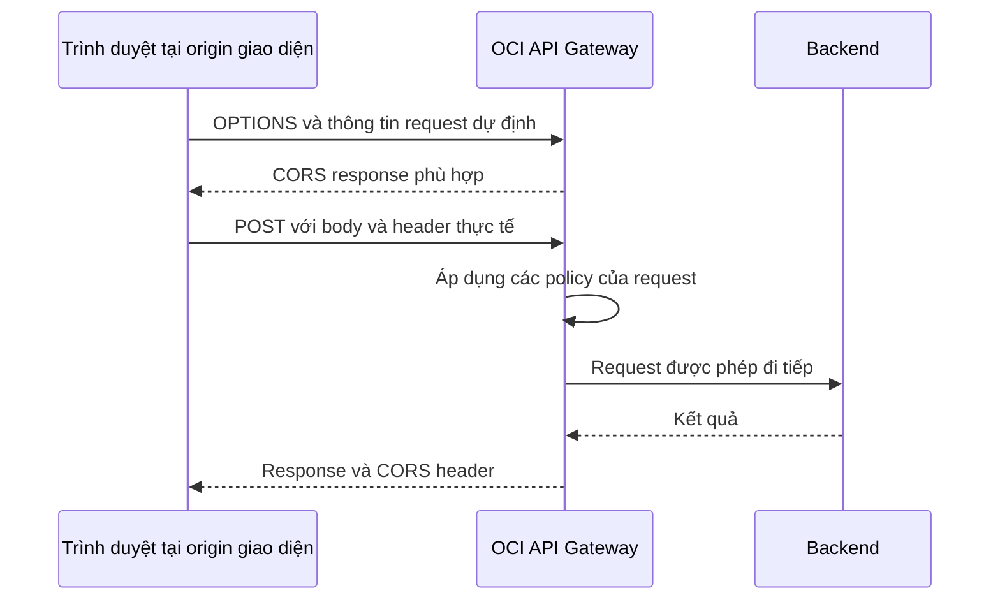

# Rate limiting, CORS và chính sách xử lý request

Khi một API được đưa lên Oracle Cloud Infrastructure, việc định tuyến tới backend mới chỉ giải quyết đường đi của request. Hệ thống còn cần giới hạn lưu lượng, cho phép đúng ứng dụng web đọc response và loại bỏ các request không phù hợp trước khi chúng tiêu thụ tài nguyên phía sau.

Bài học thuộc chương **API, sự kiện và tích hợp** của module **CLOUD_PROVIDERS_ORACLE**. Ta sử dụng OCI API Gateway để kết nối các quyết định ở lớp HTTP với IAM, mạng VCN, giám sát, tự động hóa và mục tiêu kiểm soát chi phí, tính sẵn sàng.

Mục tiêu thực hành là cấu hình được rate limiting, CORS, validation và transformation trong một API deployment; kiểm chứng được cả trường hợp được phép và bị từ chối; đồng thời hiểu phần trách nhiệm vẫn thuộc về backend.

## 1. Mỗi policy giải quyết một câu hỏi khác nhau

Giả sử ứng dụng web bán hàng gọi API tạo đơn hàng. Backend có thể là dịch vụ Java trên Compute/OKE hoặc một Function.

| Cơ chế | Câu hỏi cần trả lời | Ví dụ |
| --- | --- | --- |
| Authentication | Client là ai? | Xác minh token |
| Authorization | Client được làm gì? | Có quyền tạo đơn hàng cho tenant này không? |
| Rate limiting | Cho phép bao nhiêu request trong một khoảng thời gian? | Bảo vệ backend khỏi lưu lượng vượt khả năng |
| CORS | Trình duyệt có được chia sẻ response cho origin gọi API không? | Cho phép giao diện từ domain đã chọn |
| Request validation | Request có các thành phần giao thức cần thiết không? | Có header, query parameter, media type yêu cầu |
| Request transformation | Backend sẽ nhận header/query parameter dưới dạng nào? | Gán header nội bộ hoặc đổi tên tham số |
| Kiểm tra nghiệp vụ | Dữ liệu có hợp lệ trong miền ứng dụng không? | Sản phẩm còn hàng, số lượng dương, đúng chủ đơn hàng |

Request/response policy của API Gateway được khai báo trong đặc tả API deployment. Chúng khác IAM policy dùng để cấp quyền đối với tài nguyên OCI. [Nguồn: Adding Request Policies and Response Policies to API Deployment Specifications](https://docs.oracle.com/en-us/iaas/Content/APIGateway/Tasks/apigatewayaddingrequestpolicies.htm).

Một origin nằm trong danh sách CORS không xác định danh tính người dùng. Tương tự, request chứa đủ header chưa chứng minh dữ liệu bên trong header là đáng tin cậy.

### 1.1. Phạm vi global và route

Đặc tả thường có hai vị trí đặt request policy:

```json
{
  "requestPolicies": {
  },
  "routes": [
    {
      "path": "/orders",
      "methods": ["POST"],
      "backend": {
        "type": "STOCK_RESPONSE_BACKEND",
        "status": 200
      },
      "requestPolicies": {
      }
    }
  ]
}
```

`requestPolicies` ở ngoài `routes` là cấp deployment; `requestPolicies` nằm trong một route chỉ áp dụng ở phạm vi route đó đối với những loại policy hỗ trợ.

Không phải policy nào cũng đặt được ở cả hai nơi. OCI áp dụng **rate limiting ở cấp toàn API deployment**, còn CORS có thể cấu hình ở deployment hoặc route. Validation và các transformation trong bài được đặt tại route. [Nguồn: API Gateway request policies](https://docs.oracle.com/en-us/iaas/Content/APIGateway/Tasks/apigatewayaddingrequestpolicies.htm).

Khi cùng một loại policy có mặt ở nhiều cấp, kiểm tra cấu hình thực sự có hiệu lực cho route; không tự coi các danh sách hoặc giá trị sẽ được cộng gộp theo ý muốn.

## 2. Rate limiting: giới hạn lưu lượng vào deployment

### 2.1. Chọn khóa gom request

Policy có hai thuộc tính chính:

```json
{
  "requestPolicies": {
    "rateLimiting": {
      "rateKey": "TOTAL",
      "rateInRequestsPerSecond": 20
    }
  }
}
```

| `rateKey` | Ý nghĩa | Trường hợp phù hợp |
| --- | --- | --- |
| `TOTAL` | Ngưỡng tổng hợp cho các client gọi deployment | Bảo vệ một ngân sách xử lý chung |
| `CLIENT_IP` | Ngưỡng theo địa chỉ IP client | Hạn chế một nguồn gọi sử dụng quá nhiều tài nguyên |

Với `CLIENT_IP`, Oracle dùng từng IPv4 và nhóm client IPv6 theo prefix **/64**. Policy không đặt riêng trên từng route trong cùng deployment. [Nguồn: Limiting the Number of Requests to API Gateway Back Ends](https://docs.oracle.com/en-us/iaas/Content/APIGateway/Tasks/apigatewaylimitingbackendaccess.htm).

Nếu muốn thử theo client, thay `rateKey` bằng `CLIENT_IP` và chọn ngưỡng phù hợp. Các giá trị ngưỡng trong bài là lựa chọn thực hành, không phải cấu hình mặc định hay khuyến nghị cho mọi hệ thống.

### 2.2. Hệ quả của lựa chọn khóa

Với `TOTAL`, một client có lưu lượng lớn có thể chiếm phần đáng kể ngân sách chung. Với `CLIENT_IP`, nhiều người dùng đi qua cùng NAT hoặc proxy có thể bị gom vào một nhóm, trong khi một nguồn gọi phân tán qua nhiều IP có thể không bị hạn chế như một người dùng duy nhất.

Vì vậy, IP không tương đương user, tenant hoặc hợp đồng khách hàng. Khi có CDN, reverse proxy hoặc load balancer ở phía trước, kiểm tra IP mà Gateway thực sự ghi nhận; không mặc định rằng header `X-Forwarded-For` do client tự gửi là danh tính có thể tin cậy.

Nếu `/catalog` và `/reports` nằm trong cùng deployment, chúng chịu cùng rate-limiting policy của deployment đó. Muốn phân chia ngân sách phù hợp các backend có chi phí rất khác nhau, cần xem lại cách tách deployment hoặc cơ chế giới hạn ở lớp khác.

Giới hạn cũng không tự trở thành tổng ngân sách cho tất cả deployment trong tenancy. Hai deployment cùng hướng vào một database vẫn cần được xem xét cùng nhau khi thiết kế năng lực.

### 2.3. RPS khác concurrency và quota

**RPS** đo tốc độ request; **concurrency** đo lượng công việc đang xử lý; **quota** đo ngân sách sử dụng trong một khoảng thời gian dài hơn.

Một ước lượng khi hệ thống ổn định:

```text
Số request đang xử lý trung bình ≈ tốc độ request × thời gian xử lý trung bình

Ví dụ thiết kế:
20 request/giây × 0,2 giây ≈ 4 request đang xử lý
20 request/giây × 3 giây   ≈ 60 request đang xử lý
```

Đây là ước lượng năng lực, không phải cam kết về cách thực thi của OCI. Cùng một ngưỡng RPS có thể tạo ra mức tải khác hẳn khi truy vấn database chậm đi.

Nếu cần quản lý mức sử dụng theo subscriber, OCI có **usage plan** với entitlement, rate limit và quota. Đây là một cơ chế riêng, không phải cách tự đặt `rateKey` thành tên user trong policy trên. [Nguồn: Creating a Usage Plan](https://docs.oracle.com/en-us/iaas/Content/APIGateway/Tasks/apigatewaydefiningusageplans_topic-Creating-a-usage-plan.htm).

### 2.4. Client cần xử lý việc bị giới hạn

HTTP `429 Too Many Requests` biểu thị tình huống client gửi quá nhiều request. Response có thể cung cấp `Retry-After`. [Nguồn: RFC 6585, mục 4](https://www.rfc-editor.org/rfc/rfc6585.html#section-4).

Client nên có:

- Số lần retry hữu hạn và thời hạn tổng thể.
- Khoảng chờ theo hướng dẫn của server khi có.
- Backoff kèm jitter để nhiều client không gửi lại cùng lúc.
- Cách giảm nhịp gọi hoặc báo người dùng chờ.
- Cơ chế chống xử lý lặp cho thao tác có side effect.

`Retry-After` có thể là số giây hoặc một HTTP date theo chuẩn HTTP. Parser cần hiểu định dạng thực tế thay vì luôn ép kiểu sang số nguyên. [Nguồn: RFC 9110, Retry-After](https://www.rfc-editor.org/rfc/rfc9110.html#section-10.2.3).

Không dùng retry vô hạn cho `POST` tạo đơn hàng. Một timeout hoặc lỗi mạng có thể xảy ra sau khi backend đã thực hiện thay đổi; idempotency cần được thiết kế ở contract ứng dụng.

## 3. CORS: hiểu đúng origin và preflight

### 3.1. Origin là gì?

Trong trường hợp URL HTTP thông thường, so sánh origin dựa trên **scheme, host và port**. [Nguồn: HTML Standard — Origins](https://html.spec.whatwg.org/multipage/browsers.html#origin).

| URL | So với `https://shop.example.com` |
| --- | --- |
| `https://shop.example.com/orders` | Cùng origin; path không tạo origin mới |
| `https://api.example.com` | Khác host |
| `http://shop.example.com` | Khác scheme |
| `https://shop.example.com:8443` | Khác port |
| `http://localhost:3000` | Origin phát triển riêng |

Trong CORS allowlist, khai báo origin như `https://shop.example.com`, không đưa path `/orders` vào để biểu thị một origin.

### 3.2. Preflight kiểm tra trước điều kiện chia sẻ

Với request cần preflight, trình duyệt gửi `OPTIONS` trước:

```http
OPTIONS /policy-lab/orders?channel=web HTTP/1.1
Origin: https://shop.example.com
Access-Control-Request-Method: POST
Access-Control-Request-Headers: content-type,x-correlation-id
```

Gateway cần trả các CORS header phù hợp với origin, method và header dự định sử dụng. Preflight hợp lệ dùng response status thành công, ví dụ 200 hoặc 204. [Nguồn: Fetch Standard — CORS protocol](https://fetch.spec.whatwg.org/#http-cors-protocol).

Luồng minh họa:



Một `POST` gửi `application/json` hoặc request dùng custom header thường cần preflight. Không phải mọi request khác origin đều có bước này.

Với một số request không cần preflight, request có thể đã tới server trước khi trình duyệt quyết định có chia sẻ response cho JavaScript hay không. Vì thế, **CORS không thay thế xác thực, phân quyền hoặc kiểm soát side effect**.

### 3.3. Đọc đúng các trường CORS của OCI

```json
{
  "cors": {
    "allowedOrigins": ["https://shop.example.com"],
    "allowedMethods": ["POST"],
    "allowedHeaders": ["Content-Type", "X-Correlation-Id"],
    "exposedHeaders": ["Retry-After", "opc-request-id"],
    "isAllowCredentialsEnabled": false,
    "maxAgeInSeconds": 60
  }
}
```

| Trường | Quyết định cần đưa ra |
| --- | --- |
| `allowedOrigins` | Giao diện từ những origin nào được chia sẻ response |
| `allowedMethods` | Method của request thực tế được phép theo CORS |
| `allowedHeaders` | Header request mà trình duyệt được phép gửi theo CORS |
| `exposedHeaders` | Header response bổ sung mà JavaScript được đọc |
| `isAllowCredentialsEnabled` | Có hỗ trợ chia sẻ response cho request dùng credentials tương ứng không |
| `maxAgeInSeconds` | Thời gian cache kết quả preflight |

OCI cung cấp các trường trên ở CORS request policy và ánh xạ chúng sang response header của CORS. [Nguồn: Adding CORS support to API Deployments](https://docs.oracle.com/en-us/iaas/Content/APIGateway/Tasks/apigatewayaddingcorssupport.htm).

`allowedHeaders` và `exposedHeaders` tác động hai chiều khác nhau. Muốn client gửi `X-Correlation-Id`, khai báo nó ở `allowedHeaders`. Muốn JavaScript đọc `Retry-After` hoặc một header chẩn đoán ngoài danh sách được đọc mặc định, xem xét `exposedHeaders`.

Đưa tên vào `exposedHeaders` không tự tạo header đó. Response phải thực sự có header, và bản thân response vẫn cần vượt qua kiểm tra CORS.

### 3.4. Credentials, wildcard và cache

Nếu giao diện cần gửi cookie khác origin, cấu hình phía client như `credentials: "include"` phải đi cùng policy phía server phù hợp. Với credentials mode này, wildcard `Access-Control-Allow-Origin: *` không thay thế được một origin cụ thể; response cần cho phép credentials theo chuẩn. [Nguồn: Fetch Standard — CORS protocol and credentials](https://fetch.spec.whatwg.org/#cors-protocol-and-credentials).

Thiết kế thực tế nên xác định rõ các origin được phép, cơ chế cookie/token và kiểm soát CSRF nếu ứng dụng dùng cookie cho xác thực. CORS không tự cấp quyền đọc dữ liệu của một tài khoản.

`maxAgeInSeconds` là cache kết quả **preflight**, không phải thời gian cache response nghiệp vụ. Khi thay đổi CORS, trình duyệt có thể còn dùng kết quả preflight đã lưu; kiểm tra với môi trường trình duyệt sạch hoặc đợi cache hết hạn.

Nếu có shared cache hoặc CDN, kiểm tra cache key và `Vary: Origin` khi response thay đổi theo origin. Một cấu hình cache không phân biệt origin có thể đưa response header của origin này cho client khác.

Không dùng `mode: "no-cors"` để chữa API cần đọc response: cách đó không làm response trở thành dữ liệu có thể đọc tùy ý từ JavaScript.

## 4. Request validation: chặn sai contract ở lớp giao thức

OCI hỗ trợ policy kiểm tra header, query parameter và content type của request body. Ba chế độ:

| `validationMode` | Cách sử dụng |
| --- | --- |
| `ENFORCING` | Request không đạt bị trả 4xx và không được chuyển tới backend |
| `PERMISSIVE` | Vẫn chuyển request, đồng thời ghi nhận lỗi validation để đánh giá tác động |
| `DISABLED` | Tắt kiểm tra của policy đó |

Validation được áp dụng sau CORS và authentication/authorization, trước transformation. [Nguồn: Adding Request Validation to API deployments](https://docs.oracle.com/en-us/iaas/Content/APIGateway/Tasks/apigatewayaddingrequestvalidation.htm).

### 4.1. Bắt buộc có header

```json
{
  "headerValidations": {
    "headers": [
      {
        "name": "X-Correlation-Id",
        "required": true
      }
    ],
    "validationMode": "ENFORCING"
  }
}
```

`headers` là một danh sách các mục kiểm tra, phù hợp với model SDK của OCI. [Nguồn: HeaderValidationRequestPolicy](https://docs.oracle.com/en-us/iaas/tools/java/latest/com/oracle/bmc/apigateway/model/HeaderValidationRequestPolicy.html).

Yêu cầu hiện diện không chứng minh giá trị có định dạng UUID, có độ dài hợp lý hoặc xác định một danh tính. Backend hoặc thành phần kiểm tra chuyên biệt vẫn cần xác thực giá trị theo contract.

Trong bài, correlation ID phục vụ lần theo request. Nó không phải user ID đáng tin cậy chỉ vì client đã gửi header.

### 4.2. Bắt buộc có query parameter

```json
{
  "queryParameterValidations": {
    "parameters": [
      {
        "name": "channel",
        "required": true
      }
    ],
    "validationMode": "ENFORCING"
  }
}
```

`parameters` cũng là danh sách trong model policy của OCI. [Nguồn: QueryParameterValidationRequestPolicy](https://docs.oracle.com/en-us/iaas/tools/java/latest/com/oracle/bmc/apigateway/model/QueryParameterValidationRequestPolicy.html).

Ví dụ này chưa kiểm tra `channel` có thuộc tập `web`, `mobile` hay giá trị nào khác. Nó cũng không chứng minh người gọi được quyền sử dụng một tenant hoặc kênh nghiệp vụ do họ tự khai báo.

### 4.3. Kiểm tra media type của body

```json
{
  "bodyValidation": {
    "required": true,
    "content": {
      "application/json": {
        "validationType": "NONE"
      }
    },
    "validationMode": "ENFORCING"
  }
}
```

Với `validationType: "NONE"`, policy này giới hạn content type theo cấu hình; không thực hiện JSON Schema validation. [Nguồn: Adding Request Validation to API deployments](https://docs.oracle.com/en-us/iaas/Content/APIGateway/Tasks/apigatewayaddingrequestvalidation.htm).

Ngay cả khi request khai báo `Content-Type: application/json`, backend vẫn phải parse dữ liệu và kiểm tra các field cần thiết. Một chuỗi không phải JSON có thể vượt qua kiểm tra media type của ví dụ.

Các kiểm tra như `quantity > 0`, sản phẩm tồn tại, quyền của người mua, giới hạn kích thước nghiệp vụ và tính toàn vẹn giao dịch cần có nơi thực thi rõ ràng.

### 4.4. Triển khai validation cho API đang có client

Một phương án vận hành là dùng `PERMISSIVE` để quan sát các request sẽ bị ảnh hưởng, sửa contract hoặc client, sau đó chuyển sang `ENFORCING` khi đã có bằng chứng phù hợp.

Trong giai đoạn permissive, backend vẫn nhận request sai contract. Chỉ chọn cách triển khai này khi backend hiện tại có thể xử lý các request đó theo thiết kế; nó không phải trạng thái đã chặn lỗi.

## 5. Request transformation: chuẩn hóa dữ liệu trước backend

Transformation có thể lọc, đổi tên hoặc gán header/query parameter. Ví dụ gán một header nội bộ:

```json
{
  "headerTransformations": {
    "setHeaders": {
      "items": [
        {
          "name": "X-Internal-Channel",
          "values": ["policy-lab"],
          "ifExists": "OVERWRITE"
        }
      ]
    }
  }
}
```

| `ifExists` | Ý nghĩa thiết kế |
| --- | --- |
| `OVERWRITE` | Thay giá trị đang có bằng giá trị policy chọn |
| `APPEND` | Bổ sung giá trị, có thể tạo nhiều giá trị cho cùng header |
| `SKIP` | Giữ giá trị có sẵn |

OCI dùng cấu trúc `setHeaders.items` với `values` và hành vi khi header đã tồn tại. Có một số protected header không được biến đổi bằng policy này. [Nguồn: Adding Header Transformation Request Policies](https://docs.oracle.com/en-us/iaas/Content/APIGateway/Tasks/apigatewaymodifyingresponsesrequests-addingheadertransformrequestpolicies.htm).

### 5.1. Ranh giới tin cậy khi truyền danh tính

Trong một route đã xác thực token, có thể truyền claim đã kiểm tra sang backend:

```json
{
  "headerTransformations": {
    "setHeaders": {
      "items": [
        {
          "name": "X-Authenticated-Subject",
          "values": ["${request.auth[sub]}"],
          "ifExists": "OVERWRITE"
        }
      ]
    }
  }
}
```

Ví dụ chỉ dùng khi authentication policy đã tạo đúng ngữ cảnh `request.auth[sub]`. Oracle có mẫu chuyển claim đã xác minh thành header cho backend. [Nguồn: Transformation Examples](https://docs.oracle.com/en-us/iaas/Content/APIGateway/Tasks/apigatewaymodifyingresponsesrequests-transformexamples.htm).

Với header thể hiện danh tính, giữ nguyên giá trị client gửi bằng `SKIP` có thể làm mất ranh giới tin cậy. Backend cũng cần ngăn đường truy cập trực tiếp cho phép client bỏ qua Gateway rồi tự gán cùng header.

Header tĩnh `X-Internal-Channel: policy-lab` trong bài chỉ là nhãn xử lý; nó không tự trở thành credential.

### 5.2. Validation xảy ra trước transformation

Nếu yêu cầu client phải gửi header `X-Correlation-Id`, không đồng thời giả định một transformation phía sau sẽ bổ sung header để cứu request đã thiếu nó.

Tương tự, nếu client gửi `locale` và Gateway đổi tên thành `region`, validation của request đầu vào cần khớp tên mà client thực sự gửi. Việc đổi tên không có tác dụng quay ngược lại một bước validation đã chạy.

Các phần tử trong object JSON không phải ngôn ngữ chỉ định thứ tự chạy policy. Chuyển vị trí `headerTransformations` lên trên `headerValidations` trong file không thay đổi quan hệ xử lý do dịch vụ quy định.

### 5.3. Đổi query parameter có kiểm soát

Ví dụ ánh xạ tham số công khai sang tên backend mong đợi:

```json
{
  "queryParameterTransformations": {
    "renameQueryParameters": {
      "items": [
        {
          "from": "locale",
          "to": "region"
        }
      ]
    }
  }
}
```

OCI hỗ trợ filter, rename và set query parameter ở request transformation. [Nguồn: Adding Query Parameter Transformation Request Policies](https://docs.oracle.com/en-us/iaas/Content/APIGateway/Tasks/apigatewaymodifyingresponsesrequests-addingqueryparamtransformrequestpolicies.htm).

Trước khi đổi, kiểm tra điều gì xảy ra nếu request chứa cả `locale` lẫn `region` hoặc một tham số có nhiều giá trị. Chọn rõ cách backend nhận và diễn giải dữ liệu để tránh các tầng sử dụng hai giá trị khác nhau cho cùng một quyết định.

## 6. Đặc tả thực hành hoàn chỉnh

Phần thực hành dùng **stock response backend**: Gateway tự trả response cấu hình sẵn. Cách này cho phép kiểm tra policy mà chưa cần tạo dịch vụ Java, Function hoặc database. Oracle hỗ trợ loại backend này với status, header và body cố định. [Nguồn: Adding Stock Responses as an API Gateway Back End](https://docs.oracle.com/en-us/iaas/Content/APIGateway/Tasks/apigatewayaddingstockresponses.htm).

Mục tiêu của deployment:

| Thành phần | Lựa chọn cho bài học |
| --- | --- |
| Deployment path prefix | `/policy-lab` |
| Route | `POST /orders` |
| Rate limit | `TOTAL`, 2 request/giây |
| Origin giao diện | `https://shop.example.com` |
| Header đầu vào bắt buộc | `X-Correlation-Id` |
| Query parameter bắt buộc | `channel` |
| Media type đầu vào | `application/json` |
| Kết quả mẫu | JSON cố định, chưa tạo đơn hàng |
| Nhãn response | `X-Lab-Policy: policy-demo` |

`shop.example.com` là origin minh họa. Khi kiểm tra từ một ứng dụng web thật, thay bằng origin thực tế mà người học kiểm soát. Nếu dùng `http://localhost:3000` cho giao diện phát triển, khai báo chính xác origin đó thay vì chỉ ghi `localhost`.

### 6.1. JSON của API deployment specification

```json
{
  "requestPolicies": {
    "rateLimiting": {
      "rateKey": "TOTAL",
      "rateInRequestsPerSecond": 2
    },
    "cors": {
      "allowedOrigins": ["https://shop.example.com"],
      "allowedMethods": ["POST"],
      "allowedHeaders": [
        "Content-Type",
        "X-Correlation-Id"
      ],
      "exposedHeaders": [
        "Retry-After",
        "opc-request-id",
        "X-Lab-Policy"
      ],
      "isAllowCredentialsEnabled": false,
      "maxAgeInSeconds": 60
    }
  },
  "routes": [
    {
      "path": "/orders",
      "methods": ["POST"],
      "backend": {
        "type": "STOCK_RESPONSE_BACKEND",
        "status": 200,
        "headers": [
          {
            "name": "Content-Type",
            "value": "application/json"
          },
          {
            "name": "X-Lab-Policy",
            "value": "policy-demo"
          }
        ],
        "body": "{\"accepted\":true,\"mode\":\"policy-lab\"}"
      },
      "requestPolicies": {
        "headerValidations": {
          "headers": [
            {
              "name": "X-Correlation-Id",
              "required": true
            }
          ],
          "validationMode": "ENFORCING"
        },
        "queryParameterValidations": {
          "parameters": [
            {
              "name": "channel",
              "required": true
            }
          ],
          "validationMode": "ENFORCING"
        },
        "bodyValidation": {
          "required": true,
          "content": {
            "application/json": {
              "validationType": "NONE"
            }
          },
          "validationMode": "ENFORCING"
        },
        "headerTransformations": {
          "setHeaders": {
            "items": [
              {
                "name": "X-Internal-Channel",
                "values": ["policy-lab"],
                "ifExists": "OVERWRITE"
              }
            ]
          }
        }
      }
    }
  ]
}
```

Các vị trí cấp deployment và cấp route được chọn theo phạm vi hỗ trợ của từng policy. Dạng stock response dùng `headers` với cặp `name`/`value`; transformation dùng `setHeaders.items` với `values` là danh sách.

Bản này phục vụ kiểm tra kỹ thuật, chưa thêm authentication hay authorization cho dữ liệu nghiệp vụ. Body `accepted: true` chỉ là kết quả cố định của stock response, không xác nhận một đơn hàng đã được lưu.

### 6.2. Tạo deployment

Chuẩn bị:

- Một API Gateway tại region và compartment được giao.
- Tài khoản có quyền quản lý deployment trong compartment đó.
- Đường mạng từ máy kiểm tra tới endpoint Gateway.
- Logging cần thiết để kiểm chứng policy.

Trong Console:

1. Mở Gateway tại đúng region.
2. Tạo deployment riêng cho bài học.
3. Đặt tên, ví dụ `request-policies-lab`.
4. Đặt path prefix `/policy-lab`.
5. Upload JSON specification đã lưu trong môi trường thực hành.
6. Kiểm tra các policy ở cấp deployment và route.
7. Tạo deployment, chờ trạng thái hoạt động rồi lấy endpoint.

OCI cho phép cấu hình rate limiting, CORS và các policy khác trong quá trình tạo API deployment. [Nguồn: Deploying an API on an API Gateway by Creating an API Deployment](https://docs.oracle.com/en-us/iaas/Content/APIGateway/Tasks/apigatewaycreatingdeployment.htm).

Nếu dùng OCI CLI với file `api-policy-lab.json` đã chuẩn bị:

```bash
OCI_REGION="ap-singapore-1"
API_COMPARTMENT_OCID="REPLACE_WITH_API_COMPARTMENT_OCID"
GATEWAY_OCID="REPLACE_WITH_GATEWAY_OCID"

oci --region "$OCI_REGION" api-gateway deployment create \
  --compartment-id "$API_COMPARTMENT_OCID" \
  --gateway-id "$GATEWAY_OCID" \
  --display-name "request-policies-lab" \
  --path-prefix "/policy-lab" \
  --specification file://api-policy-lab.json
```

Lấy endpoint thực tế của deployment, đã gồm prefix `/policy-lab`:

```bash
DEPLOYMENT_ENDPOINT="https://REPLACE_WITH_GATEWAY_HOST/policy-lab"
API_URL="$DEPLOYMENT_ENDPOINT/orders"
```

Ví dụ shell bên dưới dùng Bash. Không tự thêm prefix lần nữa nếu endpoint đã chứa nó.

## 7. Kiểm chứng CORS và validation theo từng trường hợp

Với ngưỡng tổng chỉ 2 request/giây, hãy chạy các ca kiểm tra contract ở nhịp thấp và để giới hạn hồi phục giữa các ca. Nếu nhận 429, xử lý tình trạng rate limit trước khi kết luận một ca validation bị sai.

### 7.1. Preflight hợp lệ

```bash
curl --silent --show-error --include \
  --request OPTIONS \
  --header 'Origin: https://shop.example.com' \
  --header 'Access-Control-Request-Method: POST' \
  --header 'Access-Control-Request-Headers: content-type,x-correlation-id' \
  "$API_URL?channel=web"
```

Kiểm tra response:

- Status phù hợp cho preflight thành công.
- `Access-Control-Allow-Origin` khớp origin được phép.
- `Access-Control-Allow-Methods` cho phép `POST`.
- `Access-Control-Allow-Headers` cho phép các header yêu cầu.
- Thông tin cache preflight phản ánh policy đang áp dụng.

Preflight liệt kê tên custom header trong `Access-Control-Request-Headers`; nó không gửi giá trị `X-Correlation-Id` của request thực tế. Không sửa bằng cách yêu cầu trình duyệt gắn token hoặc body nghiệp vụ vào preflight tiêu chuẩn.

Trong ví dụ, route nghiệp vụ chỉ khai báo `POST`. CORS handler có trách nhiệm xử lý preflight; việc liệt kê `OPTIONS` vào `allowedMethods` không thay thế việc cho phép method thực tế là `POST`.

### 7.2. Request thực tế hợp lệ

```bash
curl --silent --show-error --include \
  --request POST \
  --header 'Origin: https://shop.example.com' \
  --header 'Content-Type: application/json' \
  --header 'X-Correlation-Id: policy-probe-001' \
  --data '{"sku":"BOOK-001","quantity":1}' \
  "$API_URL?channel=web"
```

Kỳ vọng ở nhịp thấp:

```json
{"accepted":true,"mode":"policy-lab"}
```

Kiểm tra cả status, CORS response header, `Content-Type` và `X-Lab-Policy`. Chỉ nhìn body chưa đủ xác nhận browser có thể đọc response.

### 7.3. Thiếu header bắt buộc

Giữ nguyên query parameter và body, bỏ `X-Correlation-Id`:

```bash
curl --silent --show-error --include \
  --request POST \
  --header 'Content-Type: application/json' \
  --data '{"sku":"BOOK-001","quantity":1}' \
  "$API_URL?channel=web"
```

Kỳ vọng validation chặn bằng 4xx và có bằng chứng tương ứng trong execution log. Không cần giả định mọi loại vi phạm đều dùng cùng một status chi tiết.

### 7.4. Thiếu query parameter bắt buộc

```bash
curl --silent --show-error --include \
  --request POST \
  --header 'Content-Type: application/json' \
  --header 'X-Correlation-Id: policy-probe-002' \
  --data '{"sku":"BOOK-001","quantity":1}' \
  "$API_URL"
```

Request thiếu `channel` cần bị chặn khi policy đang ở `ENFORCING`.

Thử tiếp một giá trị ngoài dự định, chẳng hạn `channel=unknown`. Kiểm tra hiện diện có thể vẫn cho qua; nếu ứng dụng chỉ chấp nhận một tập giá trị, backend cần kiểm tra tập đó.

### 7.5. Media type không được cho phép

```bash
curl --silent --show-error --include \
  --request POST \
  --header 'Content-Type: text/plain' \
  --header 'X-Correlation-Id: policy-probe-003' \
  --data 'hello' \
  "$API_URL?channel=web"
```

Kỳ vọng policy media type chặn request ở chế độ enforcing.

Để hiểu giới hạn của policy, gửi body không phải JSON nhưng vẫn khai báo `application/json`:

```bash
curl --silent --show-error --include \
  --request POST \
  --header 'Content-Type: application/json' \
  --header 'X-Correlation-Id: policy-probe-004' \
  --data 'this-is-not-json' \
  "$API_URL?channel=web"
```

Với stock response và `validationType: NONE`, ca này có thể vẫn nhận kết quả mẫu vì chưa có parser JSON nghiệp vụ. Khi thay bằng backend thật, backend phải từ chối dữ liệu không parse được.

### 7.6. Origin không được phép

Thử preflight với origin khác:

```bash
curl --silent --show-error --include \
  --request OPTIONS \
  --header 'Origin: https://unlisted.example.net' \
  --header 'Access-Control-Request-Method: POST' \
  --header 'Access-Control-Request-Headers: content-type,x-correlation-id' \
  "$API_URL?channel=web"
```

Kết quả không được cấp quyền CORS cho origin ngoài allowlist. Đánh giá dựa trên header và hành vi trình duyệt, không chỉ một status cố định.

Nếu dùng `curl` gửi thẳng request thực tế, công cụ này không tự thực thi chính sách chia sẻ response của trình duyệt. Một request như vậy có thể tới server ngay cả khi origin không được phép đọc response bằng JavaScript.

### 7.7. Header hoặc method ngoài contract CORS

Có thể giữ origin hợp lệ nhưng thay:

```http
Access-Control-Request-Method: DELETE
```

Hoặc yêu cầu thêm header chưa khai báo:

```http
Access-Control-Request-Headers: content-type,x-correlation-id,x-debug-mode
```

Kiểm tra rằng policy không cấp quyền cho method/header đó. Danh sách CORS cho phép một method cũng không tự tạo route nghiệp vụ tương ứng.

## 8. Kiểm chứng từ trình duyệt

Chạy JavaScript trong giao diện được phục vụ từ origin đã khai báo. Trình duyệt tự đặt `Origin` và thực hiện preflight khi cần:

```javascript
const response = await fetch(
  "https://REPLACE_WITH_GATEWAY_HOST/policy-lab/orders?channel=web",
  {
    method: "POST",
    headers: {
      "Content-Type": "application/json",
      "X-Correlation-Id": crypto.randomUUID()
    },
    body: JSON.stringify({
      sku: "BOOK-001",
      quantity: 1
    })
  }
);

console.log("status", response.status);
console.log("policy", response.headers.get("X-Lab-Policy"));
console.log("retryAfter", response.headers.get("Retry-After"));
console.log("body", await response.text());
```

Trong Developer Tools:

1. Kiểm tra origin thực tế của trang.
2. Xem request `OPTIONS` và các header yêu cầu.
3. Xem request `POST` có được gửi sau preflight hay không.
4. Kiểm tra CORS header trên response thực tế.
5. Xác nhận JavaScript đọc được `X-Lab-Policy`.

Header `Retry-After` có thể là `null` trên response thành công vì server không có lý do tạo nó. Thêm vào `exposedHeaders` chỉ cho phép đọc khi header có mặt.

Nếu `fetch` bị lỗi ở lớp CORS, mã JavaScript có thể không đọc được status/body thật. Đối chiếu Network tab và log Gateway để biết lỗi gốc là CORS, rate limit, authentication hay backend.

Cũng kiểm tra CORS trên **response lỗi**, nhất là khi frontend cần đọc 429 và thông tin retry. Response thành công có đủ header chưa chứng minh mọi response bị chặn đều có cùng khả năng được chia sẻ.

## 9. Tạo một đợt lưu lượng nhỏ để quan sát rate limit

Chỉ chạy ví dụ trên deployment stock response riêng của bài học. Đợt sau có tối đa 30 request và thời gian chờ cho từng lệnh:

```bash
for n in $(seq 1 30); do
  curl --silent --show-error \
    --max-time 10 \
    --output /dev/null \
    --write-out '%{http_code}\n' \
    --request POST \
    --header 'Content-Type: application/json' \
    --header "X-Correlation-Id: rate-probe-$n" \
    --data '{"sku":"BOOK-001","quantity":1}' \
    "$API_URL?channel=web" &
done
wait
```

Mục tiêu là thấy các request bị policy giới hạn khi lưu lượng vượt ngưỡng, sau đó đối chiếu log. Không đặt tiêu chí rằng trong mọi phép thử phải có đúng 2 response thành công và 28 response bị từ chối: thời điểm tới, thời gian chạy và trạng thái giới hạn trước đó đều ảnh hưởng quan sát.

Lấy thêm một response bị giới hạn bằng `curl --include` để xem header hướng dẫn thử lại. Sau khi đợt thử kết thúc và khoảng chờ đã qua, request hợp lệ ở nhịp thấp cần có khả năng đi tiếp.

### 9.1. So sánh TOTAL và CLIENT_IP

Để so sánh, cập nhật riêng `rateKey` rồi lặp phép thử có kiểm soát:

| Ca thử | Điều cần quan sát |
| --- | --- |
| `TOTAL`, nhiều client cùng deployment | Có ngân sách tổng chung |
| `CLIENT_IP`, cùng địa chỉ ra internet | Các request có thể bị gom chung theo IP |
| `CLIENT_IP`, nguồn mạng khác nhau | Xác định nhóm client mà Gateway ghi nhận |
| Gọi hai route trong cùng deployment | Hiểu phạm vi rate policy của deployment |
| Gọi hai deployment tới cùng backend | Đánh giá tải tổng mà backend có thể nhận |

Không giả định preflight miễn mọi giới hạn ở mọi cấu hình. Khi đo lưu lượng browser, tách request `OPTIONS` khỏi request nghiệp vụ và kiểm tra hành vi thực tế bằng log.

### 9.2. Chọn ngưỡng cho hệ thống thật

Đo năng lực backend ở điều kiện đại diện: thời gian xử lý, lỗi, số kết nối database và tài nguyên sử dụng. Sau đó chừa dư địa cho biến động, retry và các nguồn gọi khác.

Nếu gateway giới hạn 100 request/giây nhưng mỗi request kích hoạt nhiều truy vấn hoặc downstream call, giới hạn ở mép hệ thống chưa phản ánh toàn bộ tải bên trong.

Ngưỡng cần có chủ sở hữu và lý do lựa chọn. Việc tăng rate limit để làm biến mất 429 có thể chuyển vấn đề thành timeout hoặc lỗi database.

## 10. Kiểm chứng transformation với backend quan sát được

Stock response không cho biết một backend bên ngoài đã nhận header nào. Để xác minh transformation, dùng một HTTP backend hoặc Function thử nghiệm do nhóm kiểm soát, chỉ trả metadata cần kiểm tra.

Ví dụ phép thử:

1. Client gửi `X-Internal-Channel: client-value`.
2. Gateway áp dụng `OVERWRITE` thành `policy-lab`.
3. Backend ghi hoặc trả lại giá trị thực nhận.
4. Đối chiếu rằng backend chỉ nhận giá trị theo contract dự định.

Giữ việc quan sát trong môi trường thực hành; không trả mọi header ra response vì chúng có thể chứa thông tin nhạy cảm.

Nếu triển khai header danh tính từ `request.auth[sub]`, kiểm chứng thêm request có token hợp lệ, token sai, thiếu token và client cố tự gán header danh tính. Chỉ được tin giá trị khi authentication policy, transformation và đường vào backend đều tạo được ranh giới tin cậy.

Khi backend là OCI Function hoặc dịch vụ OCI khác, vẫn cần IAM cho chủ thể gọi tương ứng. Request transformation không cấp quyền invoke hoặc thay thế xác thực OCI.

## 11. Quan sát log và phân biệt nguyên nhân lỗi

Bật **access log** để nhìn request/status/thời gian và **execution log** để hiểu policy nào xử lý hoặc từ chối request.

OCI có các execution log code:

| Log code | Ý nghĩa khi chẩn đoán |
| --- | --- |
| `rateLimiting.requestDenied` | Rate-limiting policy đã từ chối |
| `rateLimiting.requestPermitted` | Request vượt qua bước rate limiting |
| `requestValidation.validationError` | Vi phạm validation policy |
| `requestValidation.validationPermitted` | Vượt qua validation |
| `headerTransformation.protectedHeaderTransformed` | Cố biến đổi protected header |
| `tokenAuthentication.authenticationFailed` | Lỗi xác thực token theo policy tương ứng |

Các mã này được Oracle mô tả trong tài liệu Logging cho API Gateway. [Nguồn: Details for API Gateway](https://docs.oracle.com/en-us/iaas/Content/Logging/Reference/details_for_api_gateway.htm).

Một request vượt qua rate limiting vẫn có thể thất bại ở bước sau. Đừng dùng riêng `requestPermitted` làm bằng chứng đã xử lý nghiệp vụ thành công.

### 11.1. Thông tin nên nối giữa các tầng

Ghi lại deployment, route, thời điểm UTC, method, status, độ trễ và request ID. Backend có thể ghi correlation ID để nối log với lần gọi, nhưng vẫn cần xử lý độ dài và định dạng của giá trị do client cung cấp.

Dữ liệu log phục vụ đo lường nên tách:

- Request nghiệp vụ và preflight.
- Lỗi policy và lỗi backend.
- Rate limit theo deployment và giới hạn theo usage plan nếu có.
- Lỗi do client cũ với thay đổi contract và lỗi bất thường.
- Trường hợp browser không đọc được response với lỗi gốc trên server.

Không ghi toàn bộ bearer token, cookie hoặc body đơn hàng chỉ để tìm một trường bị thiếu.

### 11.2. Bảng chẩn đoán nhanh

| Triệu chứng | Hướng kiểm tra |
| --- | --- |
| `curl` được, browser lỗi | Origin thực, preflight, credentials và CORS response header |
| Browser không đọc được `Retry-After` | Header có thật không, có được expose không, response có vượt qua CORS không |
| Mới đổi CORS nhưng browser vẫn dùng hành vi cũ | Cache preflight và cache trung gian |
| Thiếu header nhưng request vẫn qua | Đúng deployment/route chưa, mode có đang permissive/disabled không |
| Body JSON sai vẫn nhận 200 ở bài thực hành | Stock response và `validationType: NONE` chưa parse JSON |
| Transformation không cứu được header bị thiếu | Validation xảy ra trước transformation |
| Một nhóm người dùng cùng bị 429 | NAT/proxy và nhóm IP của client |
| Tăng RPS nhưng backend lỗi nhiều hơn | Năng lực backend, thời gian chạy và concurrency |
| Client tự gán header có vẻ là danh tính | Authentication context, overwrite và đường truy cập trực tiếp backend |
| Test nhận 429 thay vì lỗi validation mong muốn | Hạ nhịp thử, để rate limit hồi phục rồi kiểm tra lại |

## 12. Đưa policy vào vận hành và quản lý thay đổi

Đặc tả API deployment nên được quản lý phiên bản cùng cách triển khai có thể tái tạo. Với mỗi thay đổi, lưu lý do, phạm vi route/deployment, ảnh hưởng tới client và cấu hình có thể khôi phục.

Một trình tự áp dụng có thể gồm:

1. Thử trên deployment học hoặc staging với backend quan sát được.
2. Kiểm tra cả request thành công và các nhóm request bị chặn.
3. Đánh giá client đang dùng các origin, header và media type nào.
4. Đo ngưỡng rate theo khả năng backend.
5. Chuyển validation sang enforcing theo kế hoạch tương thích.
6. Theo dõi sau triển khai và rollback khi có bằng chứng ảnh hưởng ngoài dự định.

Đừng mặc định rollback policy sẽ xóa ngay kết quả preflight đã được browser cache. Khi thay đổi allowlist hoặc header, tính cả khoảng tồn tại của cache vào kế hoạch chuyển đổi.

### 12.1. Kiểm soát chi phí và tính sẵn sàng

Rate limiting có thể giảm tải chuyển vào backend, nhưng không phải cam kết tổng chi phí OCI sẽ bị khóa cứng ở một con số. Chi phí còn phụ thuộc tài nguyên Gateway, Functions/Compute, log, dữ liệu và các dịch vụ liên quan.

Cân nhắc:

| Quyết định | Lợi ích và đánh đổi |
| --- | --- |
| Giới hạn chặt hơn | Giảm áp lực backend, có thể làm tăng request hợp lệ bị từ chối |
| Dùng `CLIENT_IP` | Hạn chế một nguồn IP, có thể ảnh hưởng nhóm người dùng chung NAT |
| Dùng `TOTAL` | Bảo vệ ngân sách tổng, cần theo dõi công bằng giữa client |
| Tăng cache preflight | Có thể giảm số lần OPTIONS, thay đổi CORS mất lâu hơn để phản ánh |
| Giảm dữ liệu log | Giảm dung lượng, cần giữ đủ metadata chẩn đoán |
| Chuẩn hóa header nội bộ | Giúp backend đơn giản hơn, cần bảo vệ ranh giới tin cậy |

Nếu có nhiều deployment hoặc region dự phòng, kiểm tra policy tại từng nơi. Tái tạo route mà bỏ sót rate limit hoặc CORS có thể tạo ra hành vi khác lúc chuyển lưu lượng.

### 12.2. Ranh giới trách nhiệm của Gateway và backend

Gateway nên xử lý các yêu cầu giao thức và chính sách truy cập đã chọn. Backend Java hoặc Function vẫn cần:

- Parse và kiểm tra dữ liệu thực tế.
- Xác thực quyền trên tài nguyên nghiệp vụ.
- Thực thi idempotency và transaction khi cần.
- Đặt timeout cho dependency và quản lý kết nối.
- Trả lỗi phù hợp để client biết có nên thử lại.
- Bảo vệ đường truy cập không đi qua Gateway theo kiến trúc mạng và danh tính.

Cùng một response 200 ở mép API không luôn chứng minh dữ liệu đã được lưu theo nghiệp vụ, đặc biệt với stock response hoặc công việc bất đồng bộ.

## 13. Bằng chứng hoàn thành bài thực hành

| Nội dung | Bằng chứng cần có |
| --- | --- |
| Policy đúng phạm vi | Rate limit ở cấp deployment; validation/transformation ở route |
| Request hợp lệ | Nhận stock response và header dự kiến ở nhịp thấp |
| Preflight hợp lệ | Origin, method và header yêu cầu được cho phép |
| CORS không quá rộng | Origin/header/method ngoài contract không được cấp quyền chia sẻ tương ứng |
| Validation hoạt động | Thiếu header, thiếu query hoặc sai media type bị chặn khi enforcing |
| Hiểu giới hạn body validation | Phân biệt media type với parse/JSON Schema/nghiệp vụ |
| Rate limit hoạt động | Có response bị giới hạn và log `rateLimiting.requestDenied` tương ứng |
| Client đọc được thông tin cần thiết | Browser đọc được response/header được expose theo thiết kế |
| Transformation đúng | Backend thử nghiệm nhận giá trị sau biến đổi |
| Có thể vận hành | Theo dõi lỗi, độ trễ, nhóm client và cấu hình rollback |

Sau bài học, người học cần giải thích được vì sao một request được đi tiếp hoặc bị chặn, policy nào đã quyết định việc đó và phần kiểm tra nào còn phải được thực hiện tại backend.
