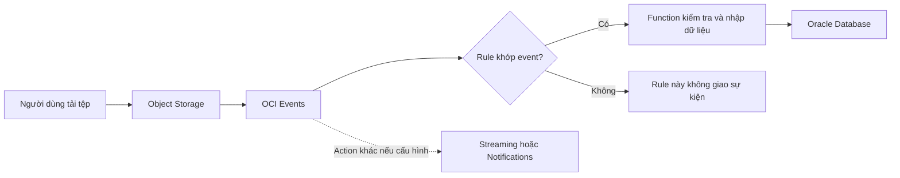

# OCI Events và cấu trúc CloudEvents

## 1. Mục tiêu và tình huống tích hợp

Trong chương **API, sự kiện và tích hợp** của module **CLOUD_PROVIDERS_ORACLE**, bài này trình bày cách OCI Events nhận sự kiện từ tài nguyên Oracle Cloud Infrastructure, chọn sự kiện bằng rule và chuyển tới dịch vụ xử lý. Trọng tâm là đọc đúng cấu trúc CloudEvents mà OCI sử dụng, thiết kế bộ lọc và xây dựng consumer có khả năng vận hành ổn định.

Tình huống xuyên suốt: người dùng tải tệp CSV vào thư mục logic `incoming/` của bucket `incoming-documents`. Object Storage phát sự kiện tạo object; Events chọn đúng sự kiện và gọi một Function để kiểm tra tệp, sau đó ghi kết quả nhập dữ liệu vào Oracle Database.

Mục tiêu sau bài học:

- Phân biệt producer, event, rule, action và consumer.
- Đọc envelope OCI Events và payload theo từng dịch vụ.
- Phân biệt envelope CloudEvents 0.1 của OCI với CloudEvents 1.0.
- Tạo condition theo đúng đường dẫn JSON và phạm vi compartment.
- Hiểu giới hạn của việc giao sự kiện đối với thứ tự, retry và hoàn tất nghiệp vụ.
- Thiết kế parser, idempotency, giám sát và bài thực hành kiểm chứng.

Tên bucket, OCID, event ID và dữ liệu trong các ví dụ là giá trị minh họa. Các đoạn lệnh triển khai chỉ dùng sau khi thay placeholder và chuẩn bị tài nguyên thử nghiệm.

## 2. OCI Events nằm ở đâu trong kiến trúc?

### 2.1. Từ thay đổi tài nguyên đến hành động

Một sự kiện mô tả việc đã xảy ra, chẳng hạn object được tạo, backup hoàn tất hoặc tài nguyên chuyển trạng thái. Producer cung cấp thông tin về sự việc; consumer quyết định phản ứng phù hợp.

OCI Events định tuyến sự kiện bằng rule, gồm điều kiện chọn và action đích. Những loại đích trực tiếp được tài liệu liệt kê là Notifications, Streaming và Functions. Xem [Overview of Events](https://docs.oracle.com/en-us/iaas/Content/Events/Concepts/eventsoverview.htm).



Các vai trò cần phân biệt:

| Thành phần | Vai trò trong ví dụ |
| --- | --- |
| Producer | Object Storage phát sự kiện trạng thái object |
| Event | Bản ghi JSON mô tả lần tạo object |
| Rule | Chọn create-object của đúng bucket và prefix |
| Action | Cấu hình chuyển sự kiện tới một Function |
| Consumer | Mã Function đọc event và xử lý tệp |
| Nghiệp vụ cuối | Các dòng dữ liệu hợp lệ được ghi vào DB |

Một rule có thể có nhiều action. Không coi các action là một chuỗi chạy lần lượt hoặc một giao dịch chung: action A thành công không chứng minh action B đã chạy xong.

### 2.2. Sự kiện hạ tầng khác sự kiện nghiệp vụ

`ObjectCreated` cho biết thay đổi của object, không tự khẳng định:

- Tệp đúng định dạng CSV mà ứng dụng hỗ trợ.
- Người tải có ý định gửi một hóa đơn mới.
- Các bản ghi trong tệp chưa được nhập trước đó.
- Toàn bộ quy trình nhập dữ liệu đã thành công.

Nếu muốn công bố `InvoiceImported`, ứng dụng phải xác định thời điểm nghiệp vụ đó hoàn tất và chọn cơ chế phát hành phù hợp.

CloudEvents chuẩn hóa cách mô tả sự kiện. Nó không tự cung cấp broker, API nhận sự kiện tùy ý hay cơ chế commit giao dịch DB. Việc viết JSON đúng CloudEvents không đồng nghĩa có thể gửi JSON đó vào mọi hệ thống tự nhận mình hỗ trợ CloudEvents.

### 2.3. Events khác log, audit và stream

| Nhu cầu | Điều cần lựa chọn |
| --- | --- |
| Tự động phản ứng với thay đổi tài nguyên OCI | Events rule và action phù hợp |
| Điều tra ai gọi API và thao tác gì | Audit và log liên quan |
| Lưu chuỗi bản ghi cho consumer đọc lại | Streaming hoặc lớp lưu trữ được thiết kế |
| Điều phối nhiều bước có trạng thái | Cơ chế điều phối và lưu trạng thái quy trình |
| Xử lý công việc với kiểm soát nhận/hoàn tất | Queue hoặc cơ chế công việc tương ứng |

Không giả định mọi API call đều tạo một event mà Events có thể chọn. Phải tra event type của đúng dịch vụ và thao tác trong [Services that Produce Events](https://docs.oracle.com/en-us/iaas/Content/Events/Reference/eventsproducers.htm).

## 3. Đọc đúng envelope OCI Events

### 3.1. Phiên bản envelope đang được OCI mô tả

Tài liệu OCI Events được đối chiếu cho bài này xác định envelope sử dụng **CloudEvents 0.1**, với những trường như `eventID`, `eventType` và `cloudEventsVersion`. Không thay chúng bằng `id`, `type`, `specversion` khi đang viết filter cho event OCI gốc.

Định nghĩa trường nằm trong [Contents of an Event Message](https://docs.oracle.com/en-us/iaas/Content/Events/Reference/eventenvelopereference.htm).

Một event có hai phần chính:

- **Envelope**: ngữ cảnh chung để nhận diện và định tuyến.
- **Payload `data`**: chi tiết do producer cung cấp, thay đổi theo loại tài nguyên.

### 3.2. Event tạo object minh họa

Ví dụ dưới dựa trên cấu trúc object event trong tài liệu producer, với giá trị giả định cho bài thực hành:

```json
{
  "cloudEventsVersion": "0.1",
  "eventID": "4f5d29a8-82ef-48ab-9d34-9248b676b151",
  "eventType": "com.oraclecloud.objectstorage.createobject",
  "source": "objectstorage",
  "eventTypeVersion": "2.0",
  "eventTime": "2026-11-20T02:15:30Z",
  "contentType": "application/json",
  "extensions": {
    "compartmentId": "ocid1.compartment.oc1..exampleintegrationlab"
  },
  "data": {
    "compartmentId": "ocid1.compartment.oc1..exampleintegrationlab",
    "compartmentName": "IntegrationLab",
    "resourceName": "incoming/invoice-001.csv",
    "resourceId": "",
    "availabilityDomain": "all",
    "additionalDetails": {
      "eTag": "21af9b1c-6d37-49f2-b120-43b2f77f6101",
      "namespace": "acmedemo",
      "archivalState": null,
      "bucketName": "incoming-documents",
      "bucketId": "ocid1.bucket.oc1.ap-singapore-1.exampleincoming"
    }
  }
}
```

Các event type object gồm create, update và delete; payload mẫu của object có thể có `resourceId` rỗng. Đối chiếu phần Object Storage trong [danh mục producer của Oracle](https://docs.oracle.com/en-us/iaas/Content/Events/Reference/eventsproducers.htm).

Vì vậy, consumer của ví dụ lấy object bằng namespace, bucket và `resourceName`. Không bắt buộc mọi event đều phải có một resource OCID không rỗng.

### 3.3. Các trường nên đọc theo vai trò

| Trường OCI | Cách sử dụng |
| --- | --- |
| `cloudEventsVersion` | Chọn cách hiểu envelope |
| `eventID` | Nhận diện event để truy vết và chống xử lý giao trùng |
| `eventType` | Chọn loại thao tác/handler |
| `eventTypeVersion` | Chọn hợp đồng dữ liệu của event type |
| `source` | Nhận diện nguồn theo quy ước của producer |
| `eventTime` | Thời điểm sự việc, không phải lúc consumer nhận |
| `contentType` | Kiểu dữ liệu payload |
| `extensions` | Ngữ cảnh mở rộng của envelope OCI |
| `data` | Dữ liệu về tài nguyên và thao tác |

Cần giữ nguyên chữ hoa/chữ thường của key. `eventID`, `eventId` và `eventid` là những tên JSON khác nhau.

`eventID` nhận diện event; `resourceId` nhận diện tài nguyên. Hai thay đổi trên cùng một tài nguyên có thể có hai event ID khác nhau. Request ID của một API call, nếu được cung cấp ở nơi khác, cũng không phải event ID.

### 3.4. Payload không có schema chung cho mọi dịch vụ

Trong ví dụ:

```text
data.resourceName                      → tên object
data.additionalDetails.bucketName      → tên bucket
data.additionalDetails.namespace       → namespace Object Storage
data.additionalDetails.eTag            → ETag được producer đưa vào event
```

Trong event của Compute hoặc Database, `resourceName` và `additionalDetails` có ý nghĩa khác. Không viết parser toàn cục với giả định `resourceName` luôn là bucket hay luôn là OCID.

Một số event có tags trong `data`, nhưng không suy ra mọi event đều có đủ `freeFormTags` và `definedTags`. Chỉ dùng trường để lọc sau khi xác nhận producer thực sự phát trường đó.

`availabilityDomain: "all"` không có nghĩa consumer được tự chọn một AD từ chuỗi này. Đây là giá trị ngữ cảnh của producer; không dùng làm cấu hình triển khai.

### 3.5. Event mô tả quá khứ, API thường đọc hiện tại

Khi Function nhận event, object có thể đã được cập nhật hoặc xóa. Lấy object theo tên tại thời điểm xử lý có thể trả phiên bản khác phiên bản gây ra event.

Nếu nghiệp vụ cần đúng nội dung tại thời điểm đó, phải thiết kế tên object bất biến, sử dụng versioning khi phù hợp hoặc kiểm tra ETag/điều kiện đọc mà API hỗ trợ. Không giả định payload luôn có version ID đầy đủ.

ETag cần được xem như giá trị opaque theo hợp đồng dịch vụ. Không coi mọi ETag đều là checksum MD5 hoặc một số thứ tự tăng dần.

## 4. CloudEvents 1.0 khác cấu trúc OCI ở điểm nào?

### 4.1. Bốn thuộc tính bắt buộc của 1.0

CloudEvents 1.0 có bốn context attribute bắt buộc:

| Thuộc tính | Vai trò |
| --- | --- |
| `specversion` | Phiên bản envelope, giá trị `1.0` |
| `id` | ID không rỗng, duy nhất trong phạm vi source |
| `source` | Ngữ cảnh nguồn theo dạng URI-reference |
| `type` | Loại sự kiện |

Những trường như `time`, `subject`, `datacontenttype` và `dataschema` là tùy chọn trong chuẩn. Một ứng dụng có thể yêu cầu thêm chúng trong hợp đồng riêng. Xem [CloudEvents Core 1.0.2](https://github.com/cloudevents/spec/blob/v1.0.2/cloudevents/spec.md).

Số bản phát hành tài liệu `1.0.2` không làm giá trị `specversion` thành `1.0.2`; giá trị trên event vẫn là `1.0`.

### 4.2. Bảng ánh xạ để hiểu, không phải phép đổi tên tự động

| OCI Events gốc | CloudEvents 1.0 tương ứng | Điều phải quyết định |
| --- | --- | --- |
| `cloudEventsVersion` | `specversion` | Chuyển đổi envelope thực sự |
| `eventID` | `id` | Giữ ổn định khi chuyển lại cùng event |
| `eventType` | `type` | Giữ ý nghĩa loại event |
| `source` | `source` | Chọn namespace nguồn rõ ràng |
| `eventTime` | `time` | Giữ thời điểm gốc |
| `contentType` | `datacontenttype` | Mô tả data, không nhầm HTTP Content-Type |
| `eventTypeVersion` | Không có trường chuẩn cùng tên | Dùng extension hoặc hợp đồng schema |
| `extensions` OCI | Các extension phù hợp | Không bê nguyên một object làm context extension |
| `data` | `data` | Giữ đúng kiểu JSON và nội dung |

Trong CloudEvents 1.0 JSON, extension context attribute được đặt ở cấp cao nhất; tên dùng chữ thường ASCII và chữ số. Quy tắc serialization được nêu trong [CloudEvents JSON Event Format 1.0.2](https://github.com/cloudevents/spec/blob/v1.0.2/cloudevents/formats/json-format.md).

Không chỉ thêm `"specversion": "1.0"` vào event OCI cũ rồi tuyên bố đó là event 1.0 hợp lệ. Các trường ngữ cảnh, serialization và hợp đồng phía nhận phải được xử lý nhất quán.

### 4.3. Ví dụ đầu ra của adapter do ứng dụng thiết kế

Giả sử tổ chức cần chuyển event OCI sang CloudEvents 1.0 để đưa vào một luồng tích hợp khác. Adapter có thể tạo event:

```json
{
  "specversion": "1.0",
  "id": "4f5d29a8-82ef-48ab-9d34-9248b676b151",
  "source": "urn:example:oci:objectstorage:demo-tenancy:ap-singapore-1",
  "type": "com.oraclecloud.objectstorage.createobject",
  "subject": "incoming-documents/incoming/invoice-001.csv",
  "time": "2026-11-20T02:15:30Z",
  "datacontenttype": "application/json",
  "ocieventversion": "2.0",
  "ocisource": "objectstorage",
  "ocicompartmentid": "ocid1.compartment.oc1..exampleintegrationlab",
  "data": {
    "compartmentId": "ocid1.compartment.oc1..exampleintegrationlab",
    "compartmentName": "IntegrationLab",
    "resourceName": "incoming/invoice-001.csv",
    "resourceId": "",
    "availabilityDomain": "all",
    "additionalDetails": {
      "eTag": "21af9b1c-6d37-49f2-b120-43b2f77f6101",
      "namespace": "acmedemo",
      "archivalState": null,
      "bucketName": "incoming-documents",
      "bucketId": "ocid1.bucket.oc1.ap-singapore-1.exampleincoming"
    }
  }
}
```

Đây là quy ước adapter trong bài, không phải đầu ra mặc định hay namespace extension tiêu chuẩn do Oracle quy định.

Các quyết định của adapter:

- `source` được tạo từ cấu hình nguồn tin cậy, có tenancy/region ổn định.
- `id` giữ event ID gốc để nhận ra một event được chuyển lại.
- `subject` là quy ước tên tài nguyên của tích hợp, không mặc định là một URL Object Storage.
- `eventTypeVersion` được giữ bằng extension riêng.
- Payload `data` được giữ là JSON object, không biến thành chuỗi JSON.
- Không lấy thời điểm chuyển đổi thay cho `eventTime`.

Khóa nhận diện trong CloudEvents 1.0 là cặp `source + id`. Nếu mỗi lần replay adapter tạo một source hoặc id mới, consumer sẽ khó nhận ra event trùng.

Nếu muốn phát một sự kiện nghiệp vụ mới sau khi nhập dữ liệu, chẳng hạn `com.example.invoice.imported`, đó là một occurrence khác: cần ID và schema nghiệp vụ riêng, đồng thời giữ liên kết tới event đầu vào theo quy ước truy vết.

## 5. Cấu trúc sự kiện và cách truyền trên HTTP

### 5.1. Structured mode

Với CloudEvents 1.0 dạng JSON structured, envelope và data nằm trong body; HTTP Content-Type nhận diện định dạng CloudEvents:

```http
POST /integration/events HTTP/1.1
Host: consumer.example.com
Content-Type: application/cloudevents+json

{
  "specversion": "1.0",
  "id": "demo-event-001",
  "source": "urn:example:integration:lab",
  "type": "com.example.file.accepted",
  "datacontenttype": "application/json",
  "data": {
    "fileName": "invoice-001.csv"
  }
}
```

`Content-Type: application/cloudevents+json` mô tả toàn bộ envelope trên HTTP. `datacontenttype: application/json` mô tả riêng data.

### 5.2. Binary mode

Cùng sự kiện có thể được truyền với context trong HTTP headers và data trong body:

```http
POST /integration/events HTTP/1.1
Host: consumer.example.com
ce-specversion: 1.0
ce-id: demo-event-001
ce-source: urn:example:integration:lab
ce-type: com.example.file.accepted
Content-Type: application/json

{
  "fileName": "invoice-001.csv"
}
```

Binary mode không có nghĩa payload nhất thiết là byte nhị phân. Nó mô tả cách phân bố context và data trên giao thức.

Hai cách truyền được định nghĩa trong [CloudEvents HTTP Protocol Binding 1.0.2](https://github.com/cloudevents/spec/blob/v1.0.2/cloudevents/bindings/http-protocol-binding.md).

Không áp dụng máy móc các ví dụ HTTP 1.0 này để suy ra mọi action của OCI Events đều giao event bằng `ce-*` headers. Phải đọc hợp đồng thực tế của tuyến giao nhận.

### 5.3. Wrapper của dịch vụ đích

Nếu event đi qua Notifications, một stream record hoặc một lớp tích hợp khác, consumer có thể nhận thêm wrapper hoặc encoding. Quy trình đọc đúng là:

1. Xác định giao thức và lớp đóng gói của dịch vụ vừa giao.
2. Giải mã hoặc bỏ wrapper theo hợp đồng đó.
3. Xác định envelope sự kiện bên trong.
4. Validate và chuyển sang model của ứng dụng.

Không thử lặp `JSON.parse` cho đến khi hết chuỗi mà không kiểm tra cấu trúc. Cách đó dễ làm chấp nhận nhầm dữ liệu hoặc mất ranh giới giữa thông điệp vận chuyển và payload.

## 6. Viết rule đúng cấu trúc JSON

### 6.1. Condition chọn object được tạo

Filter cho tình huống của bài:

```json
{
  "eventType": [
    "com.oraclecloud.objectstorage.createobject"
  ],
  "data": {
    "compartmentId": [
      "ocid1.compartment.oc1..exampleintegrationlab"
    ],
    "resourceName": [
      "incoming/*"
    ],
    "additionalDetails": {
      "namespace": [
        "acmedemo"
      ],
      "bucketName": [
        "incoming-documents"
      ]
    }
  }
}
```

Điều kiện diễn đạt: đúng event type, compartment, namespace, bucket và object name có prefix đã chọn.

OCI yêu cầu field có cùng cấu trúc lồng nhau như event. Các field khác nhau đều phải khớp; nhiều giá trị trong một mảng là các lựa chọn để khớp field đó. Field không được nêu không tham gia lọc. Xem [Matching Events with Filters](https://docs.oracle.com/en-us/iaas/Content/Events/Concepts/filterevents.htm).

Sai phổ biến là viết `bucketName` ngay trong `data`, trong khi event object đặt nó dưới `data.additionalDetails`.

### 6.2. Phạm vi compartment quan trọng như condition

Rule áp dụng cho event từ compartment chứa rule và các compartment con theo phạm vi dịch vụ mô tả. Rule đặt ở một compartment anh em không tự nhìn thấy nguồn chỉ vì condition có OCID nguồn đó.

Trong bài thực hành, đặt rule ở cùng compartment với bucket. Nếu đặt ở compartment cha để quản lý tập trung, điều kiện `data.compartmentId` cụ thể giúp thu hẹp nguồn.

Không đổi compartment chỉ để một filter sai đường dẫn bắt đầu khớp; phải xác định lỗi thuộc phạm vi hay thuộc điều kiện.

### 6.3. Wildcard, null và schema

Một số quy tắc cần nhớ:

- Wildcard `*` nằm trong giá trị, không thay thế tên key.
- Wildcard không phải regular expression đầy đủ.
- Giá trị `*` không đồng nghĩa chấp nhận field null hoặc field không có.
- Condition rỗng `{}` rất rộng trong phạm vi của rule.

Chỉ lọc trên những trường cần cho định tuyến. Nếu lọc quá nhiều trường có thể thay đổi, việc cập nhật producer hoặc tags có thể làm event hợp lệ không còn được chọn.

Ngược lại, condition quá rộng có thể gọi consumer nhiều lần không cần thiết và gây tác động lên những tài nguyên ngoài mục tiêu.

### 6.4. Condition không phải schema validator

Rule khớp đúng bucket không chứng minh event đủ dữ liệu cho nghiệp vụ. Consumer vẫn phải kiểm tra phiên bản, trường bắt buộc và giá trị đầu vào.

Cũng không coi field `source` trong JSON là bằng chứng xác thực. Người có thể gửi dữ liệu vào một endpoint không được bảo vệ có thể tự đặt source tùy ý; quyền gọi endpoint và độ tin cậy của tuyến nhận phải được kiểm soát riêng.

## 7. Quyền IAM và mạng trong luồng sự kiện

Tách các phạm vi quyền:

| Danh tính hoặc bước | Quyền cần xem xét |
| --- | --- |
| Người triển khai | Quản lý rule trong compartment được giao |
| Người cấu hình action | Truy cập tài nguyên đích cần chọn và cấu hình |
| Cơ chế giao event | Được phép thực hiện action theo chính sách áp dụng |
| Function chạy nghiệp vụ | Đọc đúng object, ghi đúng bảng/kho dữ liệu |
| Người vận hành | Đọc rule, metric và log cần thiết |

Một policy quản lý rule theo compartment, dùng tên ví dụ:

```text
Allow group EventRuleEditors to manage cloudevents-rules in compartment IntegrationLab
```

Dòng này chỉ minh họa quyền quản lý rule; không phải toàn bộ policy của một luồng có Function và Object Storage. Mẫu quyền phải đối chiếu [Events and IAM Policies](https://docs.oracle.com/en-us/iaas/Content/Events/Concepts/eventspolicy.htm), rồi thu hẹp theo đích và phạm vi sử dụng.

Quyền Function đọc object là quyền runtime riêng, thường được thiết kế bằng resource principal và policy phù hợp. Cho người triển khai quản lý rule không tự cấp cho mã Function quyền đọc bucket.

Về mạng, Function phải có DNS, route và security rules để gọi Object Storage hoặc DB theo kiến trúc đã chọn. Event được giao thành công tới Function không tạo đường mạng từ Function tới private endpoint DB.

Không nhúng credential DB hay token vào rule, tên event hoặc payload để tránh phải thiết kế IAM. Secrets cần được quản lý và truy cập bằng cơ chế thích hợp.

## 8. Bài thực hành tạo rule bằng OCI CLI

### 8.1. Chuẩn bị tài nguyên

Sử dụng một compartment thử nghiệm và cùng region cho các tài nguyên của ví dụ:

- Bucket `incoming-documents`, namespace và compartment thực tế.
- Một Function đã triển khai, nhận được event OCI dạng JSON và có log tối thiểu.
- Quyền cập nhật bucket, tạo rule và sử dụng action theo chính sách áp dụng.
- Quyền runtime và đường mạng cho Function nếu nó đọc tệp hoặc ghi DB.
- Dữ liệu CSV giả, tránh thông tin khách hàng thật.

Các tệp JSON trong đoạn lệnh là tệp thực hành do người học tạo tại thư mục làm việc của mình.

### 8.2. Bật object events cho bucket

Object state-change events không được bật mặc định cho mọi bucket. Với CLI:

```powershell
$namespace = '<OBJECT_STORAGE_NAMESPACE>'
$bucketName = 'incoming-documents'

$bucketArgs = @(
    'os', 'bucket', 'update',
    '--namespace-name', $namespace,
    '--name', $bucketName,
    '--object-events-enabled', 'true'
)

oci @bucketArgs

if ($LASTEXITCODE -ne 0) {
    throw 'Could not enable object events'
}
```

Xem [Managing Emitting Events for Object State Changes](https://docs.oracle.com/en-us/iaas/Content/Object/Tasks/managingbuckets_topic-To_enable_or_disable_emitting_events_for_object_state_changes.htm).

Bật phát event cho object là cấu hình nguồn. Bật rule là cấu hình định tuyến. Cần cả hai để bài thực hành hoạt động.

### 8.3. Tạo request rule, giữ condition là chuỗi JSON

API rule dùng `condition` là một **chuỗi chứa JSON**, còn `actions` là cấu trúc JSON. Khi dùng `--from-json`, cần giữ đúng kiểu đó.

```powershell
$sourceCompartmentId = '<BUCKET_COMPARTMENT_OCID>'
$functionId = '<FUNCTION_OCID>'

$condition = @{
    eventType = @('com.oraclecloud.objectstorage.createobject')
    data = @{
        compartmentId = @($sourceCompartmentId)
        resourceName = @('incoming/*')
        additionalDetails = @{
            namespace = @($namespace)
            bucketName = @($bucketName)
        }
    }
}

$ruleRequest = @{
    compartmentId = $sourceCompartmentId
    displayName = 'incoming-document-created'
    description = 'Route incoming object events to the import function'
    isEnabled = $true
    condition = (ConvertTo-Json -InputObject $condition -Depth 10 -Compress)
    actions = @{
        actions = @(
            @{
                actionType = 'FAAS'
                functionId = $functionId
                isEnabled = $true
            }
        )
    }
}

$ruleJson = ConvertTo-Json -InputObject $ruleRequest -Depth 20
$ruleFile = Join-Path $PWD.Path 'rule.json'
$utf8WithoutBom = [System.Text.UTF8Encoding]::new($false)

[System.IO.File]::WriteAllText(
    $ruleFile,
    $ruleJson,
    $utf8WithoutBom
)

oci events rule create --from-json file://rule.json --wait-for-state ACTIVE

if ($LASTEXITCODE -ne 0) {
    throw 'Event rule creation did not complete successfully'
}
```

Các kiểu action và cấu trúc của chúng được minh họa trong [Getting Started with Events](https://docs.oracle.com/en-us/iaas/Content/Events/Concepts/eventsgetstarted.htm). Cú pháp tham số nằm trong [OCI CLI: events rule create](https://docs.oracle.com/en-us/iaas/tools/oci-cli/latest/oci_cli_docs/cmdref/events/rule/create.html).

Tên `FAAS` là discriminator của action gọi Function. Với Notifications và Streaming, tài nguyên đích và thuộc tính action tương ứng khác; không thay `functionId` bằng một OCID khác mà giữ nguyên loại action.

Nếu đọc `rule.json`, ký tự escape bên trong `condition` là kết quả serialize một chuỗi JSON trong request JSON. Không xóa chúng bằng thao tác thay chuỗi thủ công.

### 8.4. Gây sự kiện thật có kiểm soát

Sau khi rule ở trạng thái hoạt động:

1. Tạo một tệp CSV nhỏ, dùng dữ liệu giả.
2. Tải lên object có tên mới, chẳng hạn `incoming/invoice-001.csv`.
3. Quan sát metric event được phát và khớp rule.
4. Kiểm tra giao action và log của Function.
5. Đối chiếu tên bucket/object, event ID và kết quả nghiệp vụ.

Một lần gọi Function trực tiếp bằng JSON mẫu chỉ kiểm tra consumer. Nó không chứng minh bucket đã bật phát event, rule nằm đúng compartment hoặc action được cấu hình đúng.

Tương tự, một công cụ thử condition bằng sample chỉ kiểm tra phần matching; muốn xác nhận toàn tuyến phải gây thay đổi thật trong môi trường thử nghiệm.

## 9. Parser Java theo hợp đồng event cụ thể

### 9.1. Validate trước khi xử lý nghiệp vụ

Consumer nên thực hiện:

1. Kiểm tra kích thước và cấu trúc JSON ở đầu vào theo giới hạn của hệ thống.
2. Xác định envelope được hỗ trợ.
3. Chọn handler theo event type và version.
4. Kiểm tra các trường nghiệp vụ bắt buộc.
5. Đối chiếu nguồn được phép từ cấu hình tin cậy.
6. Kiểm tra idempotency trước side effect.
7. Chỉ báo hoàn tất sau khi kết quả đã được lưu theo thiết kế.

Không dùng một DTO bắt buộc tất cả trường của mọi dịch vụ OCI. Hãy tách phần envelope dùng chung và payload của từng loại event.

### 9.2. Ví dụ Java 17 và Jackson

Ví dụ dưới chỉ đọc OCI object-created event theo hợp đồng `eventTypeVersion=2.0`. Nó không phải parser CloudEvents tổng quát và chưa triển khai đọc Object Storage hay ghi DB.

Dự án cần Jackson Databind với phiên bản được quản lý nhất quán trong build.

```java
import com.fasterxml.jackson.databind.JsonNode;
import com.fasterxml.jackson.databind.ObjectMapper;

import java.io.IOException;
import java.time.Instant;

public final class OciObjectCreatedParser {
    private static final ObjectMapper JSON = new ObjectMapper();

    private static final String EVENT_TYPE =
            "com.oraclecloud.objectstorage.createobject";

    public record ObjectCreated(
            String eventId,
            String eventTypeVersion,
            String source,
            Instant eventTime,
            String compartmentId,
            String namespace,
            String bucketName,
            String objectName,
            String eTag
    ) {
    }

    public static ObjectCreated parse(String body) throws IOException {
        JsonNode root = JSON.readTree(body);
        if (root == null || !root.isObject()) {
            throw new IllegalArgumentException("Expected an event object");
        }

        if (!"0.1".equals(text(root, "cloudEventsVersion"))) {
            throw new IllegalArgumentException("Unsupported OCI envelope");
        }
        if (!EVENT_TYPE.equals(text(root, "eventType"))) {
            throw new IllegalArgumentException("Unsupported event type");
        }
        if (!"2.0".equals(text(root, "eventTypeVersion"))) {
            throw new IllegalArgumentException("Unsupported event type version");
        }
        if (!"application/json".equals(text(root, "contentType"))) {
            throw new IllegalArgumentException("Unsupported content type");
        }
        if (!"objectstorage".equals(text(root, "source"))) {
            throw new IllegalArgumentException("Unexpected event source");
        }

        JsonNode data = object(root, "data");
        JsonNode details = object(data, "additionalDetails");
        JsonNode extensions = object(root, "extensions");

        String compartmentId = text(data, "compartmentId");
        if (!compartmentId.equals(text(extensions, "compartmentId"))) {
            throw new IllegalArgumentException("Conflicting compartment context");
        }

        return new ObjectCreated(
                text(root, "eventID"),
                text(root, "eventTypeVersion"),
                text(root, "source"),
                Instant.parse(text(root, "eventTime")),
                compartmentId,
                text(details, "namespace"),
                text(details, "bucketName"),
                text(data, "resourceName"),
                text(details, "eTag")
        );
    }

    private static JsonNode object(JsonNode parent, String name) {
        JsonNode value = parent.get(name);
        if (value == null || !value.isObject()) {
            throw new IllegalArgumentException("Missing object field: " + name);
        }
        return value;
    }

    private static String text(JsonNode parent, String name) {
        JsonNode value = parent.get(name);
        if (value == null || !value.isTextual() || value.textValue().isBlank()) {
            throw new IllegalArgumentException("Missing text field: " + name);
        }
        return value.textValue();
    }
}
```

Đoạn mã cố ý không dùng `data.resourceId`, vì object event mẫu có thể để nó rỗng. Trường lạ được giữ ngoài model này hoặc bỏ qua; các trường bắt buộc của hợp đồng vẫn phải kiểm tra.

Sau khi parse, đối chiếu compartment, namespace, bucket và prefix với cấu hình ứng dụng được phép xử lý. Rule là lớp định tuyến, không thay thế kiểm tra ở consumer.

Không ghép `objectName` vào shell command hay đường dẫn file cục bộ bằng thao tác nối chuỗi thiếu kiểm tra. Tên object là khóa của Object Storage, không mặc định là một đường dẫn an toàn trên máy chạy consumer.

### 9.3. Phân loại lỗi parser và lỗi tạm thời

| Loại lỗi | Cách xử lý trong thiết kế |
| --- | --- |
| JSON sai hoặc thiếu dữ liệu bắt buộc | Lưu bằng chứng an toàn, đưa vào nơi cách ly đã thiết kế |
| Event type/version chưa hỗ trợ | Cảnh báo hợp đồng thay đổi và xử lý theo chính sách |
| Object không còn tồn tại | Xác định trạng thái hợp lệ hay mất dữ liệu cần phục hồi |
| Mạng/DB lỗi tạm thời | Retry có giới hạn và backoff |
| Quyền truy cập sai | Sửa IAM/cấu hình; không retry vô hạn |
| Event đã xử lý | Trả kết quả trùng được bỏ qua theo hợp đồng |

Nếu consumer đã lưu thành công event lỗi vào nơi bền vững để xử lý sau, có thể xác nhận nhận theo thiết kế. Nếu việc lưu đó thất bại, không được chỉ log lỗi rồi báo thành công, vì có thể mất đường khôi phục.

## 10. Giao trùng, thứ tự và idempotency

### 10.1. Giao thành công không có nghĩa xử lý đúng một lần

Consumer cần chuẩn bị cho khả năng cùng event được giao lại và sự kiện đến khác thứ tự xảy ra. Tài liệu FAQ của Oracle mô tả khả năng giao trùng, không bảo đảm thứ tự và khuyến nghị consumer idempotent; xem [Events Service FAQ](https://www.oracle.com/webfolder/technetwork/tutorials/faqs/oci/events-faq.pdf).

Không diễn giải khả năng retry thành cam kết rằng đích luôn nhận được event bất kể sự cố kéo dài. Giao sự kiện có thể thất bại; phải giám sát và thiết kế phục hồi.

CloudEvents là định dạng ngữ cảnh, không tự cung cấp exactly-once delivery hay exactly-once processing.

### 10.2. Chọn khóa chống xử lý trùng

Với event OCI nguyên gốc, một khóa nhận diện thực hành có thể gồm:

```text
consumer_name + trusted_source_scope + eventID
```

`trusted_source_scope` do cấu hình ingress xác định, chẳng hạn tenancy, region và producer. Nó không nên chỉ là một trường tùy ý mà client ngoài hệ thống có thể tự gửi.

Khi đã chuyển sang CloudEvents 1.0, dùng cặp source/id của hợp đồng chuyển đổi, cùng tên consumer để mỗi consumer theo dõi tiến độ riêng.

Không dùng mỗi `resourceName` làm khóa event: cùng object có thể thay đổi nhiều lần. Chống giao trùng cũng khác chống trùng nghiệp vụ: hai event ID khác nhau vẫn có thể đại diện hai lần người dùng gửi cùng một hóa đơn.

### 10.3. Inbox cùng giao dịch DB

Nếu toàn bộ side effect nghiệp vụ nằm trong cùng Oracle Database, có thể dùng inbox và giao dịch:

```sql
CREATE TABLE integration_event_inbox (
    consumer_name VARCHAR2(64 CHAR) NOT NULL,
    source_scope  VARCHAR2(256 CHAR) NOT NULL,
    event_id      VARCHAR2(128 CHAR) NOT NULL,
    recorded_at   TIMESTAMP WITH TIME ZONE DEFAULT SYSTIMESTAMP NOT NULL,
    payload       CLOB,
    CONSTRAINT pk_integration_event_inbox
        PRIMARY KEY (consumer_name, source_scope, event_id),
    CONSTRAINT ck_integration_event_payload
        CHECK (payload IS JSON)
);
```

Luồng xử lý khái niệm:

```text
BEGIN TRANSACTION

INSERT inbox với khóa consumer/source/eventID
    Nếu trùng đúng khóa event đã commit:
        kết thúc theo kết quả "đã xử lý"

Thực hiện thay đổi nghiệp vụ trong cùng DB
COMMIT

Sau đó báo xử lý thành công cho bên gọi
```

Nếu tiến trình chết trước commit, inbox và thay đổi nghiệp vụ cùng rollback. Nếu commit thành công nhưng phản hồi bị mất, lần giao lại gặp khóa inbox đã tồn tại và không lặp side effect.

Không commit inbox trước rồi mới thực hiện nghiệp vụ mà thiếu cơ chế phục hồi trạng thái. Mẫu đó có thể đánh dấu event đã xử lý trong khi công việc chưa hoàn tất.

Chỉ coi lỗi trùng của đúng khóa inbox là duplicate event; lỗi unique constraint của bảng nghiệp vụ khác cần được xử lý theo ý nghĩa của nó.

### 10.4. Side effect bên ngoài cần hợp đồng riêng

Một giao dịch Oracle DB không tự bao phủ việc gửi email hoặc gọi API của đối tác. Với các thao tác đó, cân nhắc transactional outbox và worker gửi, kết hợp idempotency key ở phía nhận khi được hỗ trợ.

Không hứa exactly-once cho một API ngoài hệ thống chỉ vì đã thêm bảng inbox.

Thời gian giữ inbox phải bao phủ cửa sổ retry/replay mà tổ chức cần hỗ trợ. Xóa khóa quá sớm có thể khiến bản phát lại được xử lý như sự kiện mới.

### 10.5. Không suy ra thứ tự từ eventTime

Hai event có thể đến theo thứ tự khác thời gian sự việc. Timestamp không phải số phiên bản tài nguyên và không đủ để khóa cạnh tranh.

Ví dụ event update đến sau delete đã được xử lý. Nếu nghiệp vụ là đồng bộ trạng thái hiện tại, consumer có thể đọc lại tài nguyên và xử lý trạng thái mới nhất. Nếu nghiệp vụ cần lịch sử chính xác, phải có cơ chế lưu phiên bản, ordering hoặc đối soát phù hợp với producer.

Không dùng chính sách bỏ mọi event cũ hơn một mốc thời gian nếu chưa hiểu những sự kiện bị bỏ có mang thông tin nghiệp vụ độc lập hay không.

## 11. Retry, lưu vết và phục hồi

### 11.1. Tách từng chặng giao nhận

Một pipeline có thể có nhiều chặng:

```text
Producer → Events → Streaming → Consumer → Database
```

Mỗi chặng có cách xác nhận, retry, lưu trữ và lỗi riêng. Streaming nhận thành công không có nghĩa consumer đã ghi DB; Function được gọi thành công cũng chưa đủ nếu mã bắt lỗi nghiệp vụ rồi luôn trả thành công.

Khi thiết kế, phải ghi rõ:

| Ranh giới | Điều được xác nhận |
| --- | --- |
| Events giao action | Dịch vụ đích tiếp nhận theo hợp đồng |
| Consumer nhận | Dữ liệu đã vào tiến trình hoặc vùng lưu bền vững |
| Consumer xử lý xong | Kết quả nghiệp vụ đã được lưu |
| Giao tới bên ngoài | Bên nhận đã xác nhận ở mức nào |

### 11.2. Không coi Events là kho replay mặc định

Nếu yêu cầu có thể phát lại sau nhiều ngày, hãy thiết kế lưu event ở một đích/lớp lưu trữ phù hợp, với retention, phân quyền và quy trình replay rõ ràng.

Thêm Streaming làm action có thể tạo đường lưu nhận sự kiện, nhưng action này vẫn là một chặng độc lập có thể thất bại. Không coi nó là bảo đảm khôi phục nếu không giám sát chính việc giao vào stream.

Không tự giả định một action DLQ hoặc kho lưu vô hạn đã có sẵn trong mỗi rule. Nơi cách ly và đường phục hồi trong bài là thành phần do kiến trúc ứng dụng phải lựa chọn.

### 11.3. Replay phải giữ nhận diện và có phạm vi

Khi phát lại một event đã lưu để consumer xử lý lại:

- Giữ ID và ngữ cảnh nguồn của cùng event theo hợp đồng.
- Ghi nhận thời điểm, người thực hiện và lý do replay riêng.
- Chọn consumer, khoảng thời gian và số lượng cần xử lý.
- Điều tiết tốc độ để không làm quá tải Function hoặc DB.
- Chỉ cho phép lặp side effect khi đã có quy trình nghiệp vụ rõ ràng.

Nếu sửa dữ liệu và muốn chạy lại như một công việc mới, cần mô hình tác vụ/sự kiện mới cùng quan hệ tới bản gốc. Không âm thầm đổi event ID để vượt cơ chế chống trùng.

## 12. Quan sát và kiểm soát chi phí

### 12.1. Metric của Events

Namespace metric là `oci_cloudevents`. Những metric chính:

| Metric | Câu hỏi hỗ trợ trả lời |
| --- | --- |
| `PublishedEvents` | Nguồn trong compartment có phát event không? |
| `MatchedEvents` | Rule có khớp những event đó không? |
| `DeliverySucceedEvents` | Giao action có thành công không? |
| `DeliveryFailedEvents` | Có thất bại giao nhận cần xử lý không? |

Phải xem đúng dimensions và mức rule/compartment theo [Events Metrics](https://docs.oracle.com/en-us/iaas/Content/Events/Reference/eventsmetrics.htm).

Một rule có nhiều action có thể tạo nhiều lần giao cho một event đã khớp. Không lấy số lần giao bằng số nghiệp vụ hoàn tất hoặc kết luận có giao trùng chỉ từ phép chia hai metric tổng.

Không có dữ liệu trên chart cũng có thể do chọn sai khoảng thời gian, region hoặc compartment; cần đối chiếu với thay đổi thật đã gây ra.

### 12.2. Metric ứng dụng cần bổ sung

Consumer nên ghi hoặc đo:

- Số event nhận được theo type/version.
- Số event hợp lệ, bị cách ly và không được hỗ trợ.
- Số duplicate được bỏ qua.
- Số nghiệp vụ thành công và thất bại.
- Độ trễ từ thời điểm event đến lúc nhận/xử lý, có xét sai lệch đồng hồ.
- Thời gian DB, Object Storage và retry.
- Backlog hoặc số việc chờ phục hồi trong thành phần đã chọn.

Log có thể gồm event ID, loại event, phiên bản, rule/correlation context và kết quả. Tránh log toàn bộ payload mặc định vì tên object, tags và metadata có thể chứa thông tin nhạy cảm.

Event ID thường phù hợp với log để tìm kiếm; không dùng nó làm dimension metric có số lượng giá trị rất lớn nếu chưa đánh giá chi phí và giới hạn hệ thống quan sát.

### 12.3. Filter và vòng lặp ảnh hưởng chi phí

Một condition rộng có thể gọi Function cho rất nhiều event không cần thiết. Fan-out, retry, logging, Streaming và truy cập DB cũng tạo mức sử dụng riêng.

Ví dụ tổng hợp: 10.000 object đầu vào, một Function ghi lại kết quả vào cùng bucket và cùng prefix, khiến mỗi đầu ra tiếp tục khớp rule. Một cấu hình tưởng chỉ có 10.000 lượt xử lý có thể tạo vòng lặp tự kích hoạt.

Biện pháp thiết kế:

- Tách prefix hoặc bucket đầu vào/đầu ra.
- Filter vào đúng tài nguyên và loại event.
- Consumer xác nhận lại phạm vi được phép xử lý.
- Đặt giới hạn kích thước tệp, số bản ghi và thời gian xử lý.
- Theo dõi tỷ lệ output/input, số retry và tốc độ invocation.
- Dùng budget/cảnh báo phù hợp cho compartment, kèm cơ chế điều tiết vận hành.

Không chỉ dựa vào event type create-object để ngăn vòng lặp: đầu ra mới cũng có thể tạo đúng event type đó.

## 13. Ma trận kiểm chứng và chẩn đoán lỗi

### 13.1. Tình huống thực hành cần có

| Tình huống | Kết quả mong đợi |
| --- | --- |
| Tạo object mới đúng bucket và prefix | Rule chọn và consumer xử lý |
| Tạo object khác prefix | Rule ví dụ không chọn |
| Tạo object trong bucket khác | Rule ví dụ không chọn |
| Chưa bật object events | Chẩn đoán từ nguồn, không chỉ sửa Function |
| Giao lại cùng event ID | Không lặp side effect đã commit |
| Hai event khác nhau trên cùng tên object | Không coi chúng trùng chỉ vì tên giống |
| Event thiếu trường bắt buộc | Được phân loại và lưu phục hồi theo thiết kế |
| Thêm trường không ảnh hưởng | Consumer vẫn xử lý nếu hợp đồng còn tương thích |
| Event version chưa hỗ trợ | Cảnh báo và áp dụng chính sách phiên bản |
| DB lỗi tạm thời | Không đánh dấu nghiệp vụ hoàn tất sai |
| Ghi đầu ra | Không tạo vòng lặp qua rule đầu vào |

Thử giao trùng có thể thực hiện bằng cách gọi trực tiếp consumer thử nghiệm với cùng mẫu hai lần. Phép thử đó chứng minh logic idempotency của consumer, không chứng minh toàn bộ cơ chế retry của Events.

### 13.2. Chẩn đoán theo chặng

| Hiện tượng | Kiểm tra đầu tiên |
| --- | --- |
| Không thấy event được phát | Event type có được hỗ trợ, region, bật emit object events |
| Có published nhưng không matched | Compartment rule, đường dẫn field, giá trị và wildcard |
| Có matched nhưng giao thất bại | Action enable/state, OCID đích, quyền và khả năng tiếp nhận |
| Giao thành công nhưng không có dữ liệu | Log consumer, parser, đọc object, giao dịch DB |
| Parser tìm không thấy `id` | Có đang đọc OCI 0.1 bằng parser 1.0 không? |
| Filter bucket không khớp | Có đặt `bucketName` dưới `additionalDetails` không? |
| SDK CloudEvents báo thiếu `specversion` | Cần adapter hoặc parser đúng envelope gốc |
| Lỗi ghi DB trùng | Tách duplicate event khỏi trùng khóa nghiệp vụ |
| Object đọc khác nội dung dự kiến | Event bị trễ, object thay đổi, thiếu cơ chế phiên bản |
| Số invocation tăng nhanh | Rule rộng, nhiều action, retry hoặc vòng lặp output |

Không mở rộng quyền IAM lên toàn tenancy hoặc đổi filter thành `{}` rồi để cấu hình đó chạy lâu dài chỉ để xem lỗi có biến mất hay không. Kiểm tra từng giả thuyết với nguồn thử nghiệm đã giới hạn.

## 14. Tiêu chí hoàn thành bài học

Một kết quả thực hành đầy đủ cần có:

- Một event OCI gốc đã được nhận diện đúng envelope, event type và event type version.
- Giải thích được vai trò event ID, resource ID, event time và additional details.
- Một condition đúng cấu trúc, có phạm vi compartment và nguồn dữ liệu rõ ràng.
- Một rule/action hoạt động cùng bằng chứng event thật đi qua toàn tuyến.
- Consumer kiểm tra hợp đồng trước side effect và không bắt buộc resourceId có giá trị với object event.
- Cơ chế idempotency có lưu bền vững và kiểm chứng giao lại.
- Cách phân biệt giao thành công với hoàn tất nghiệp vụ.
- Đường lưu lỗi, giám sát và phục hồi phù hợp yêu cầu.
- Nếu có chuyển sang CloudEvents 1.0, quy tắc mapping được ghi rõ và giữ ổn định nhận diện.

Kết thúc buổi thực hành, vô hiệu hóa hoặc xóa rule thử nghiệm theo nhu cầu, khôi phục cấu hình phát object event nếu cần và dọn các đích/tài nguyên không còn sử dụng. Kiểm tra riêng các tài nguyên Function, stream, bucket và log còn tồn tại để quản lý chi phí.
