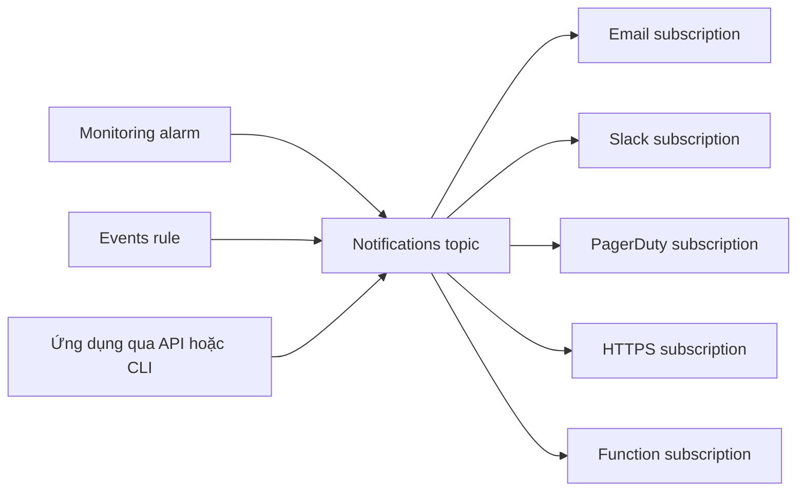
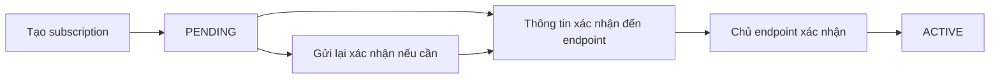

# Notifications, topics, subscriptions và kênh thông báo

Trong chương **API, sự kiện và tích hợp** của module **CLOUD_PROVIDERS_ORACLE**, OCI Notifications là mắt xích đưa thông tin từ hạ tầng đến người vận hành hoặc chương trình xử lý. Một hệ thống có thể phát hiện CPU cao, thay đổi Compute hoặc tình trạng bất thường của cơ sở dữ liệu Oracle; nhưng nếu thông tin không đến đúng người, đúng kênh và đúng thời điểm thì khả năng giám sát vẫn chưa hoàn chỉnh.

Bài này hướng dẫn thiết kế topic, tạo subscription, kiểm soát quyền trong compartment, gửi thử thông báo và theo dõi đường đi của message. Mục tiêu là xây dựng kênh thông báo có thể vận hành được trong OCI, đồng thời nhận biết những giới hạn ảnh hưởng đến bảo mật, chi phí và tính sẵn sàng.

Sau bài học, bạn có thể:

- Phân biệt publisher, topic, subscription, endpoint và message.
- Chọn kênh email, Slack, PagerDuty, HTTPS, Functions hoặc SMS phù hợp.
- Tạo và xác nhận subscription, sau đó gửi thử bằng OCI CLI.
- Thiết kế xử lý nhận trùng, giám sát giao nhận và khắc phục khi thông báo không đến.

## 1. Mô hình publisher → topic → subscriptions

**OCI Notifications** là dịch vụ publish–subscribe được quản lý. Publisher gửi message vào topic; Notifications phân phối message đến các subscription đang hoạt động của topic. Một lần publish có thể phục vụ nhiều người nhận hoặc nhiều hệ thống đích. [Tổng quan OCI Notifications](https://docs.oracle.com/en-us/iaas/Content/Notification/Concepts/notificationoverview.htm).

| Thành phần | Ý nghĩa | Ví dụ trong hệ thống bán hàng |
| --- | --- | --- |
| Publisher | Thành phần phát thông tin | Monitoring alarm báo CPU cao của máy chạy ứng dụng |
| Topic | Kênh logic tập hợp người nhận cùng một loại thông tin | `prod-orders-critical-sin` |
| Subscription | Liên kết giữa topic, protocol và endpoint | Subscription `EMAIL` của nhóm trực vận hành |
| Endpoint | Địa chỉ hoặc tài nguyên nhận | Hộp thư, Slack webhook, URL HTTPS hoặc function OCID |
| Message | Nội dung được phát | Môi trường, tài nguyên, mức độ, thời điểm và hướng xử lý |



Sơ đồ thể hiện quan hệ phân phối, không khẳng định mọi nguồn gửi đều tương thích với mọi protocol. SMS có hạn chế riêng, được trình bày ở phần chọn kênh.

Một topic không phải địa chỉ email. Topic cũng không tự phát hiện sự cố: điều kiện kích hoạt nằm ở alarm, Events rule, connector hoặc ứng dụng gửi. Việc tách publisher khỏi danh sách người nhận giúp thêm nhóm vận hành mà không phải sửa từng ứng dụng.

Ví dụ, một message vào topic có hai email subscription và một Slack subscription sẽ tạo nhiều lượt giao nhận. Các subscription cùng nhận thông tin; chúng không chia nhau mỗi subscription một công việc như các worker cạnh tranh đọc một hàng đợi.

## 2. Notifications nằm ở đâu trong luồng tích hợp OCI?

Cần tách ba câu hỏi khi thiết kế:

1. **Điều gì xảy ra?** Nguồn dữ liệu có thể là metric, sự kiện tài nguyên hoặc kết quả nghiệp vụ.
2. **Khi nào cần báo?** Alarm, rule hoặc mã ứng dụng quyết định điều kiện và tần suất.
3. **Ai nhận và nhận bằng cách nào?** Topic và subscription quyết định đầu ra.

| Nhu cầu | Nơi đặt logic chính | Vai trò của Notifications |
| --- | --- | --- |
| CPU của Compute vượt ngưỡng trong một khoảng thời gian | Monitoring alarm | Phân phối thông tin đến nhóm phụ trách |
| Sự kiện quản lý tài nguyên cần được thông báo | Events rule phù hợp loại sự kiện | Chuyển message đến các endpoint |
| Dữ liệu hoặc log cần đi qua luồng tích hợp | Connector Hub với nguồn và đích được hỗ trợ | Là đích thông báo khi cấu hình cho phép |
| Ứng dụng hoàn tất một quy trình và muốn báo kết quả | Mã ứng dụng gọi API/SDK | Tách danh sách người nhận khỏi ứng dụng |

Đây là cách phân chia trách nhiệm trong kiến trúc. Notifications không tự chạy truy vấn SQL để kiểm tra cơ sở dữ liệu Oracle, không thay thế hệ thống lưu log và không quyết định ai đang trực trong một lịch trực phức tạp. Nguồn phát, hệ thống quản lý sự cố và logic xử lý phải đảm nhiệm các phần tương ứng.

Nếu yêu cầu chính là lưu công việc để worker kéo về, kiểm soát xử lý tồn đọng hoặc đọc lại lịch sử theo vị trí, cần đánh giá dịch vụ hàng đợi hoặc streaming phù hợp. Chỉ dựa vào việc một topic đã nhận message sẽ không đáp ứng được các yêu cầu đó.

## 3. Chọn protocol và kênh thông báo

Giá trị protocol trong API/CLI cần phân biệt với nhãn hiển thị trong Console. HTTPS tùy chỉnh sử dụng `CUSTOM_HTTPS`; `HTTPS` là giá trị cũ đã bị đánh dấu deprecated dành cho tích hợp PagerDuty, nên ví dụ mới sử dụng `PAGERDUTY`. [Tham chiếu lệnh tạo subscription](https://docs.oracle.com/en-us/iaas/tools/oci-cli/latest/oci_cli_docs/cmdref/ons/subscription/create.html).

| Kênh | Protocol | Endpoint | Khi nên dùng |
| --- | --- | --- | --- |
| Email | `EMAIL` | Địa chỉ email hoặc alias của nhóm | Thông báo vận hành thông thường, nội dung cần đọc lại |
| Slack | `SLACK` | Incoming webhook của kênh Slack | Phối hợp xử lý trong nhóm |
| PagerDuty | `PAGERDUTY` | Endpoint tích hợp PagerDuty | Đánh thức người trực và quản lý sự cố |
| HTTPS tùy chỉnh | `CUSTOM_HTTPS` | URL công khai đáp ứng yêu cầu OCI | Tích hợp hệ thống tiếp nhận riêng |
| OCI Functions | `ORACLE_FUNCTIONS` | OCID của function | Xử lý hoặc tự động hóa bằng mã |
| SMS | `SMS` | Số điện thoại E.164 thuộc vùng hỗ trợ | Thông báo ngắn từ nguồn được hỗ trợ |

### 3.1. Email, Slack và PagerDuty phục vụ các cách làm việc khác nhau

Email subscription có thể dùng địa chỉ cá nhân hoặc alias của distribution list. Với nhóm vận hành, alias giúp quản lý thành viên ở hệ thống thư, nhưng vẫn phải xác định ai chịu trách nhiệm xác nhận và duy trì địa chỉ đó. [Tạo email subscription](https://docs.oracle.com/en-us/iaas/Content/Notification/Tasks/create-subscription-email.htm).

Slack subscription yêu cầu webhook của endpoint đích. URL webhook chứa token; hãy quản lý nó như thông tin truy cập, tránh đưa vào repository, ảnh chụp hoặc log công khai. Việc webhook tồn tại chưa chứng minh subscription đã được xác nhận. [Tạo Slack subscription](https://docs.oracle.com/en-us/iaas/Content/Notification/Tasks/create-subscription-slack.htm).

PagerDuty phù hợp khi cần quy trình trực và escalation do nền tảng quản lý sự cố thực hiện. Subscription sử dụng endpoint tích hợp PagerDuty và cần xác nhận qua thông tin được gửi đến đó. Không nên đánh đồng việc tạo incident với việc người trực đã nhận trách nhiệm xử lý. [Tạo PagerDuty subscription](https://docs.oracle.com/en-us/iaas/Content/Notification/Tasks/create-subscription-pagerduty.htm).

Một cách tổ chức thực tế là gửi cảnh báo mức cảnh báo đến Slack và email, còn cảnh báo nghiêm trọng đến topic có PagerDuty subscription. Quyết định mức độ nên nằm ở nguồn phát hoặc lớp định tuyến trước topic, thay vì gửi mọi thông tin đến tất cả người nhận.

### 3.2. SMS có giới hạn về nguồn gửi và quốc gia

Theo tài liệu Oracle được đối chiếu ngày 20/11/2026, SMS subscription chỉ áp dụng trong commercial realm OC1 và chỉ hỗ trợ message từ **Announcements, Monitoring và Connector Hub**. Message từ nguồn không hỗ trợ bị loại bỏ; vì vậy publish trực tiếp hoặc Events rule không phải phép thử hợp lệ để kết luận SMS hoạt động.

Số điện thoại phải theo E.164 và thuộc danh sách quốc gia/vùng được hỗ trợ. Danh sách được dẫn dưới đây tại thời điểm đối chiếu chưa bao gồm Việt Nam; không thể giả định số `+84` dùng được. Cần kiểm tra lại tài liệu và khả năng nhận SMS quốc tế khi triển khai. [Tạo SMS subscription và danh sách hỗ trợ](https://docs.oracle.com/en-us/iaas/Content/Notification/Tasks/create-subscription-sms.htm).

Trong bài thực hành, dùng email làm đầu ra cơ sở. SMS chỉ là lựa chọn bổ sung khi đã xác minh đủ điều kiện.

### 3.3. Function subscription cần quyền và thiết kế xử lý riêng

Function subscription trỏ đến một OCI Function; khi nhận message, function được gọi. Loại subscription này không yêu cầu xác nhận qua liên kết. Người tạo cần quyền `FN_INVOCATION` đối với function. [Tạo function subscription](https://docs.oracle.com/en-us/iaas/Content/Notification/Tasks/create-subscription-function.htm).

Nếu function tiếp tục gọi Compute, Object Storage hoặc dịch vụ cơ sở dữ liệu, quyền truy cập các tài nguyên ấy là một lớp riêng. Cần cấu hình principal và IAM cho công việc cụ thể; quyền quản lý topic không tự cấp quyền sửa hạ tầng cho function. [Bảo mật Notifications](https://docs.oracle.com/en-us/iaas/Content/Security/Reference/notifications_security.htm).

Với tự động hóa có tác động lớn, nên bắt đầu bằng kiểm tra trạng thái, ghi nhận đề xuất hoặc tạo ticket. Chỉ cho phép thay đổi tài nguyên khi đã có điều kiện bảo vệ, giới hạn phạm vi và khả năng xử lý lặp an toàn.

## 4. Vòng đời subscription và bước xác nhận

Đối với các kênh yêu cầu xác nhận, quy trình cơ bản là:



URL xác nhận có hiệu lực ba ngày; có thể gửi lại nếu cần. Email nhận liên kết trong thư, Slack nhận trong kênh, PagerDuty nhận qua incident xác nhận, còn HTTPS nhận thông tin trong request xác nhận. Với HTTPS, URL có trong header `X-OCI-NS-ConfirmationURL` hoặc trường `ConfirmationURL` của body. Function là ngoại lệ không cần xác nhận. [Xác nhận subscription](https://docs.oracle.com/en-us/iaas/Content/Notification/Tasks/confirm-subscription.htm).

Subscription `PENDING` không được xem là kênh thông báo sẵn sàng. Sau khi xác nhận, phải kiểm tra trạng thái và gửi message mới để kiểm thử; không kỳ vọng các thông báo bỏ lỡ trước đó tự được phát lại.

Các URL xác nhận và hủy đăng ký có thể thay đổi trạng thái subscription. Không sao chép chúng vào tài liệu chia sẻ rộng, không tự động truy cập URL lấy từ request chưa xác minh và không để công cụ phân tích log vô tình kích hoạt chúng.

Về quản trị, cần chỉ định rõ chủ topic và chủ từng endpoint. Người tạo tài nguyên OCI có thể không phải người có quyền mở hộp thư, quản lý kênh Slack hay truy cập PagerDuty để xác nhận.

## 5. Thiết kế topic theo compartment, môi trường và người nhận

Topic thuộc một region; chọn đúng region khi thao tác Console và CLI. Thông tin region cũng là một dimension trong metrics Notifications. [Tham chiếu metrics](https://docs.oracle.com/en-us/iaas/Content/Notification/Reference/notificationmetrics-reference.htm).

Khi thiết kế dự phòng ở region khác, hãy chuẩn bị cấu hình tương ứng tại đó và kiểm thử đường gửi trong kịch bản chuyển vùng. Không suy ra khả năng sao chép cấu hình giữa các region từ việc cùng dùng một tenancy.

Topic có OCID và tên; tên topic phải duy nhất trong tenancy. Tên nên thể hiện mục đích nhưng không chứa dữ liệu bí mật. [Tạo topic](https://docs.oracle.com/en-us/iaas/Content/Notification/Tasks/create-topic.htm).

Một quy ước có thể dùng là:

```text
<môi-trường>-<dịch-vụ>-<mức-độ>-<vùng>

dev-orders-info-sin
prod-orders-warning-sin
prod-orders-critical-sin
prod-database-critical-sin
```

Đây là quy ước của tổ chức, không phải định dạng bắt buộc của OCI. Trong cùng tenancy, cần điều chỉnh quy ước để tránh trùng giữa các nhóm.

| Quyết định | Lý do |
| --- | --- |
| Tách topic development và production | Giảm nguy cơ đánh thức nhóm trực bởi thử nghiệm |
| Tách thông báo thông thường và nghiêm trọng | Phù hợp danh sách người nhận và quy trình xử lý |
| Đặt trong compartment có người quản lý rõ ràng | Dễ giới hạn quyền và truy trách nhiệm |
| Gắn owner, environment, service bằng tags phù hợp | Hỗ trợ kiểm kê, vận hành và quản trị chi phí |
| Kiểm kê lại khi đổi đội phụ trách | Tránh endpoint tồn tại nhưng không còn người xử lý |

Khi tạo mới, subscription phải ở cùng compartment với topic cha; sau đó có thể chuyển subscription sang compartment khác. Bài thực hành giữ cả hai trong cùng compartment để đơn giản hóa phạm vi quyền. [Tạo subscription](https://docs.oracle.com/en-us/iaas/Content/Notification/Tasks/create-subscription.htm).

## 6. IAM: phân biệt quản lý tài nguyên và publish message

Notifications có resource type `ons-topics`, `ons-subscriptions` và aggregate `ons-family`. Đừng suy quyền chỉ từ tên verb: với `ons-topics`, quyền `use` bao gồm cả publish message và các thao tác subscription tương ứng, chứ không chỉ gửi thông báo. [Chi tiết IAM Notifications](https://docs.oracle.com/en-us/iaas/Content/Identity/Reference/notificationpolicyreference.htm).

Giả sử compartment thực hành tên `LearnIntegration`, nhóm quản lý tên `NotificationAdmins`, nhóm người gửi tên `NotificationSenders`. Thay những tên này bằng đối tượng thực trong tenancy.

```text
Allow group NotificationAdmins to manage ons-family in compartment LearnIntegration

Allow group NotificationSenders to use ons-topics in compartment LearnIntegration
```

Policy đầu dành cho người quản lý tài nguyên Notifications trong compartment. Policy thứ hai là cấu hình đơn giản cho nhóm sử dụng topic; cần nhận biết nó rộng hơn quyền publish thuần túy. Các ví dụ quản lý và sử dụng topic được Oracle trình bày trong [hướng dẫn bảo mật Notifications](https://docs.oracle.com/en-us/iaas/Content/Security/Reference/notifications_security.htm).

Khi cần publisher chỉ được gửi, có thể giới hạn permission trong policy:

```text
Allow group NotificationSenders to use ons-topics in compartment LearnIntegration where request.permission = 'ONS_TOPIC_PUBLISH'
```

Ví dụ giới hạn này chỉ cho phép publish nằm trong điều kiện. Người gửi không tự có quyền liệt kê, đọc topic hoặc quản lý subscription từ policy đó. Nếu ứng dụng cần khám phá tài nguyên, cấp riêng đúng quyền đọc cần thiết. `PublishMessage` yêu cầu `ONS_TOPIC_PUBLISH`, còn tạo subscription yêu cầu `ONS_TOPIC_SUBSCRIBE`. [Permission theo API](https://docs.oracle.com/en-us/iaas/Content/Identity/Reference/notificationpolicyreference.htm).

Với identity domain, dùng cú pháp định danh nhóm phù hợp với domain thực tế của tenancy. Với ứng dụng chạy trên OCI, cân nhắc instance principal hoặc resource principal và policy cho dynamic group thích hợp, thay vì gắn API key của quản trị viên vào ứng dụng.

Hai lớp xác thực cần phân biệt:

- **Publisher → OCI:** OCI xác thực principal và đánh giá IAM trước khi chấp nhận API call.
- **OCI → endpoint:** Endpoint xác minh request giao nhận theo cơ chế protocol; quyền publish không thay thế việc xác minh request đến webhook.

## 7. Thực hành tạo topic và gửi thử bằng OCI CLI

### 7.1. Chuẩn bị

Ví dụ dùng **PowerShell** với OCI CLI đã cài đặt và xác thực. Cần có:

- Một compartment thực hành và quyền tạo topic, subscription, publish và đọc lại chúng.
- Một region đã sử dụng được trong tenancy.
- Một hộp thư hoặc alias bạn quản lý được để nhận xác nhận.

Thay các giá trị mẫu trước khi chạy. Đây là lệnh để người học thực hiện trong môi trường thực hành; OCID và email mẫu không phải tài nguyên đã có sẵn.

```powershell
$region = 'ap-singapore-1'
$compartmentId = 'ocid1.compartment.oc1..REPLACE_WITH_REAL_ID'
$recipientEmail = 'REPLACE_WITH_YOUR_EMAIL'
$topicName = 'lab-notify-sin-' + [Guid]::NewGuid().ToString('N').Substring(0, 8)
```

Giữ region cố định cho cả chuỗi thao tác. Hậu tố ngẫu nhiên giúp tránh tạo trùng tên topic trong tenancy.

### 7.2. Tạo topic và lấy OCID

```powershell
$topicCreateArgs = @(
    'ons', 'topic', 'create',
    '--compartment-id', $compartmentId,
    '--name', $topicName,
    '--description', 'Kenh thong bao thuc hanh OCI',
    '--region', $region,
    '--query', 'data.id',
    '--raw-output'
)

$topicId = & oci @topicCreateArgs
if ($LASTEXITCODE -ne 0) {
    throw 'Khong tao duoc topic; dung bai thuc hanh de kiem tra loi.'
}
$topicId = ($topicId -join "`n").Trim()
$topicId
```

Lưu OCID trả về để dùng trong các bước sau. `--compartment-id` là nơi tạo tài nguyên; tên hiển thị không thay thế được OCID khi API yêu cầu định danh topic. [Tham chiếu `oci ons topic create`](https://docs.oracle.com/en-us/iaas/tools/oci-cli/latest/oci_cli_docs/cmdref/ons/topic/create.html).

### 7.3. Tạo email subscription

```powershell
$subscriptionCreateArgs = @(
    'ons', 'subscription', 'create',
    '--compartment-id', $compartmentId,
    '--topic-id', $topicId,
    '--protocol', 'EMAIL',
    '--subscription-endpoint', $recipientEmail,
    '--region', $region,
    '--query', 'data.id',
    '--raw-output'
)

$subscriptionId = & oci @subscriptionCreateArgs
if ($LASTEXITCODE -ne 0) {
    throw 'Khong tao duoc subscription.'
}
$subscriptionId = ($subscriptionId -join "`n").Trim()
$subscriptionId
```

Mở hộp thư và xác nhận subscription theo thư OCI gửi đến. Sau đó đọc lại trạng thái:

```powershell
$subscriptionOutput = & oci ons subscription get --subscription-id $subscriptionId --region $region
if ($LASTEXITCODE -ne 0) {
    throw 'Khong doc duoc subscription.'
}
$subscription = ($subscriptionOutput -join "`n") | ConvertFrom-Json
$subscription.data.'lifecycle-state'

if ($subscription.data.'lifecycle-state' -ne 'ACTIVE') {
    throw 'Subscription chua ACTIVE; hay hoan tat xac nhan truoc khi gui thu.'
}
```

Đầu ra cần là `ACTIVE`. Nếu vẫn `PENDING`, xử lý bước xác nhận trước khi đi tiếp.

### 7.4. Lấy publish endpoint và gửi message

Topic có `api-endpoint` dùng cho publish. Đọc giá trị OCI trả về thay vì tự ghép hostname theo tên region. [Tham chiếu publish và topic endpoint](https://docs.oracle.com/en-us/iaas/tools/oci-cli/latest/oci_cli_docs/cmdref/ons/message/publish.html).

```powershell
$topicOutput = & oci ons topic get --topic-id $topicId --region $region
if ($LASTEXITCODE -ne 0) {
    throw 'Khong doc duoc topic.'
}
$topic = ($topicOutput -join "`n") | ConvertFrom-Json
$topicEndpoint = $topic.data.'api-endpoint'
if ([string]::IsNullOrWhiteSpace($topicEndpoint)) {
    throw 'Topic khong tra ve api-endpoint hop le.'
}

$eventId = [Guid]::NewGuid().ToString()
$message = "event_id=$eventId; environment=lab; service=orders; severity=info; text=Kiem tra duong gui OCI Notifications"

$publishArgs = @(
    'ons', 'message', 'publish',
    '--topic-id', $topicId,
    '--title', '[LAB] Kiem tra OCI Notifications',
    '--body', $message,
    '--endpoint', $topicEndpoint,
    '--region', $region
)

& oci @publishArgs
if ($LASTEXITCODE -ne 0) {
    throw 'Publish that bai.'
}
```

Ví dụ dùng chuỗi văn bản để tập trung vào đường giao nhận. Ghi lại `event_id`, thời điểm gửi và kết quả API, sau đó tìm đúng thông báo trong hộp thư.

Title được dùng làm subject email và có cách dùng riêng ở PagerDuty; không giả định HTTPS, Slack hoặc SMS đều dùng title. Thông tin quan trọng nên có trong body. [Gửi message đến topic](https://docs.oracle.com/en-us/iaas/Content/Notification/Tasks/publishingmessages.htm).

### 7.5. Đánh giá kết quả và dọn tài nguyên thực hành

Một lần kiểm thử đạt yêu cầu phải có bằng chứng từ cả hai đầu:

1. Topic và subscription đúng compartment, region; subscription đã `ACTIVE`.
2. Publish thành công với mã nhận diện của lần thử.
3. Email đích nhận được nội dung chứa đúng mã đó.
4. Metrics được kiểm tra sau thời gian cập nhật hợp lý.

Nếu có nhiều kênh, kiểm tra từng endpoint; nhận được email chưa chứng minh Slack hoặc webhook cũng hoạt động.

Sau khi hoàn tất và không còn nguồn phát nào tham chiếu tài nguyên thực hành, có thể xóa đúng subscription và topic vừa tạo:

```powershell
oci ons subscription delete --subscription-id $subscriptionId --region $region
# Chi tiep tuc sau khi lenh xoa subscription thanh cong.
oci ons topic delete --topic-id $topicId --region $region
```

Các biến phải còn chứa OCID của bài thực hành. Không sử dụng chuỗi lệnh này cho topic production hoặc topic dùng chung.

## 8. Tích hợp HTTPS tùy chỉnh: endpoint phải đáp ứng contract

Không phải mọi URL nhận webhook đều dùng trực tiếp được với Notifications. HTTPS tùy chỉnh phải công khai, nhận POST và dùng chứng chỉ do CA hợp lệ cấp. Private endpoint trong VCN và chứng chỉ self-signed không đáp ứng yêu cầu. Khi cần HTTP authentication, dịch vụ hỗ trợ Basic Access Authentication, không hỗ trợ tùy ý thêm custom header; query parameter trong URL cũng không được hỗ trợ. Endpoint phải đáp ứng yêu cầu `401`/`WWW-Authenticate` của cơ chế này.

Timeout kết nối và đọc đều cố định ở mức năm giây theo tài liệu hiện hành. Endpoint cần tiếp nhận nhanh và chuyển tác vụ dài sang xử lý nền. [Yêu cầu HTTPS subscription](https://docs.oracle.com/en-us/iaas/Content/Notification/Tasks/create-subscription-https.htm).

Với ứng dụng chỉ có private IP trong VCN, một hướng thiết kế là đặt lớp tiếp nhận HTTPS công khai được kiểm soát phía trước, rồi chuyển nội dung đã xác minh vào hệ thống riêng. Khả năng tương thích xác thực phải được kiểm tra từ đầu; API bắt buộc OAuth bearer token do caller tự gắn vào header sẽ cần lớp tích hợp phù hợp.

Handler nên phân biệt request xác nhận subscription và request thông báo nghiệp vụ. Không đưa thông điệp xác nhận vào quy trình xử lý sự cố như một alarm thật.

```text
Khi nhận request:
    kiểm tra topic và nguồn gửi được tin cậy
    xác minh chữ ký theo đặc tả OCI, nếu protocol cung cấp
    phân loại xác nhận subscription hoặc message nghiệp vụ
    kiểm tra schema, kích thước và dữ liệu bắt buộc
    ghi nhận bền vững trước khi trả phản hồi thành công
    để worker xử lý phần công việc dài
```

Các header `X-OCI-NS-MessageId`, `X-OCI-NS-TopicOcid`, `X-OCI-NS-MessageType` hỗ trợ định danh và phân loại. Thông tin chữ ký gồm `X-OCI-NS-Signature`, timestamp và signing certificate URL. Một header ghi tên topic không phải bằng chứng xác thực; cần áp dụng quy trình xác minh phù hợp. [Metadata chuẩn của Notifications](https://docs.oracle.com/en-us/iaas/Content/Notification/Concepts/notificationoverview.htm).

Verifier cần kiểm soát việc lấy chứng chỉ hoặc truy cập URL xác nhận. Không tự động tải URL tùy ý do request chưa tin cậy cung cấp.

## 9. Thiết kế message để người và chương trình đều xử lý được

Một thông báo hữu ích phải trả lời: tài nguyên nào, ở môi trường nào, điều gì xảy ra, mức độ ra sao và bước tiếp theo là gì. Với thông báo do ứng dụng tự phát, có thể dùng schema riêng như ví dụ:

```json
{
  "schemaVersion": 1,
  "eventId": "orders-api-cpu-20261120T031500Z-001",
  "occurredAt": "2026-11-20T03:15:00Z",
  "environment": "production",
  "service": "orders-api",
  "severity": "critical",
  "region": "ap-singapore-1",
  "resourceId": "ocid1.instance.oc1.ap-singapore-1.EXAMPLE",
  "summary": "CPU vuot nguong van hanh",
  "runbookId": "orders-high-cpu",
  "correlationId": "incident-orders-20261120-001"
}
```

Đây là **schema minh họa do ứng dụng tự định nghĩa**, không phải payload mặc định của OCI Monitoring hoặc Events. Consumer phải nhận biết nguồn phát và schema thực tế; không áp cùng bộ trường cho mọi message OCI.

JSON nghiệp vụ có thể gửi dưới dạng body chuỗi rồi được bên nhận parse theo contract. Không cần chọn chế độ `message-type JSON` cũ để gửi chuỗi có nội dung JSON; tham số chế độ đó đã được đánh dấu deprecated. [Tham chiếu body của lệnh publish](https://docs.oracle.com/en-us/iaas/tools/oci-cli/latest/oci_cli_docs/cmdref/ons/message/publish.html).

Các nguyên tắc nên áp dụng:

- Có phiên bản schema để consumer nhận biết thay đổi cấu trúc.
- Dùng timestamp có timezone rõ ràng, ưu tiên UTC khi trao đổi giữa hệ thống.
- Giữ mã sự kiện ổn định nếu retry cùng sự kiện nghiệp vụ.
- Đưa đủ thông tin để mở runbook nhưng tránh nhúng toàn bộ log hoặc dữ liệu khách hàng.
- Dùng đường dẫn đến hệ thống có kiểm soát truy cập khi cần chi tiết; tránh URL cấp quyền bằng token xuất hiện trong email.

Không gửi password cơ sở dữ liệu, private key, access token, chuỗi kết nối có mật khẩu hoặc nội dung SQL chứa thông tin cá nhân trong message. Fan-out làm tăng số nơi nội dung có thể được lưu lại, đặc biệt khi có email và công cụ cộng tác bên ngoài OCI.

## 10. Giao nhận, retry và xử lý nhận trùng

Notifications sử dụng cơ chế giao ít nhất một lần; consumer phải có khả năng gặp lại message. Khi endpoint không xác nhận nhận thành công, dịch vụ retry, với cửa sổ mặc định hai giờ và cơ chế backoff. Hết cửa sổ retry, message có thể bị loại bỏ. Không diễn giải “ít nhất một lần” thành cam kết cuối cùng luôn giao được dù endpoint ngừng hoạt động vô thời hạn. [FAQ về giao nhận Notifications](https://www.oracle.com/cloud/cloud-native/notifications/faq/).

Có thể cập nhật delivery policy của subscription, gồm thời gian retry tối đa. Cần chọn giá trị theo thời gian phục hồi endpoint và độ trễ chấp nhận được, đồng thời kiểm tra giới hạn cấu hình hiện hành. [Cập nhật subscription](https://docs.oracle.com/en-us/iaas/Content/Notification/Tasks/update-subscription.htm).

### 10.1. Chọn khóa chống trùng theo nguồn phát

Oracle gợi ý khóa khác nhau theo trigger: với alarm có thể kết hợp `dedupekey` và `timestampEpochMillis`; với Events dùng `eventID`; với message publish trực tiếp có thể dùng `X-OCI-NS-MessageId` trong header. Ứng dụng cũng có thể cung cấp khóa nghiệp vụ trong body. [Chống xử lý trùng](https://docs.oracle.com/en-us/iaas/Content/Notification/Concepts/notificationbestpractices.htm).

Message ID của một lần publish và event ID nghiệp vụ giải quyết hai cấp khác nhau. Nếu ứng dụng tự publish lại cùng sự kiện thành request mới, không nên kỳ vọng ID do dịch vụ cấp vẫn giống lần trước. Để chống tạo hai ticket cho cùng sự cố, thường cần event ID hoặc khóa nghiệp vụ do ứng dụng quản lý.

### 10.2. Đánh dấu “đã xử lý” vào thời điểm nào?

Cách làm dễ sai là lưu khóa “đã xong” trước khi tạo ticket, rồi tiến trình lỗi giữa chừng. Lần giao sau bị bỏ qua dù ticket chưa tồn tại. Ngược lại, tạo ticket trước rồi mới lưu khóa cũng có thể sinh hai ticket nếu tiến trình lỗi ngay sau thao tác tạo.

Một thiết kế tiếp nhận bền vững có thể là:

```text
1. Xác minh request và tính khóa nghiệp vụ.
2. Trong transaction, chèn bản ghi inbox trạng thái RECEIVED với khóa unique.
3. Chỉ phản hồi thành công sau khi bản ghi đã được lưu bền vững.
4. Worker nhận công việc từ inbox, chuyển sang PROCESSING bằng cơ chế claim an toàn.
5. Gọi hệ thống đích với idempotency key nếu hệ thống đó hỗ trợ.
6. Ghi DONE khi kết quả được xác nhận; công việc lỗi có cơ chế phục hồi.
```

Khóa unique ngăn chèn trùng vào inbox; trạng thái và cơ chế phục hồi ngăn bản ghi bị mắc kẹt. Nếu thao tác bên ngoài không hỗ trợ idempotency, cần đối soát trước khi làm lại. Một lệnh `if key exists then return` đơn giản chưa đủ giải quyết mọi tình huống lỗi.

Với Function tự động điều chỉnh hạ tầng, bổ sung kiểm tra trạng thái hiện tại và thời gian chờ giữa các lần thay đổi. Không tăng tài nguyên một lần cho mỗi bản sao của cùng cảnh báo.

### 10.3. Tự lưu bằng chứng nếu cần xử lý lại

Không thiết kế quy trình phục hồi với giả định topic là kho lịch sử có thể replay tùy ý. Nếu cần xử lý sau thời gian gián đoạn dài, hãy có nơi lưu riêng như inbox, hàng đợi hoặc kho sự kiện phù hợp.

Tương tự, không dựa vào thứ tự đến của các kênh để quyết định trạng thái cuối cùng. Thông báo “phục hồi” và “đang lỗi” nên có thời điểm hoặc phiên bản đủ để consumer nhận biết dữ liệu cũ.

## 11. Giám sát đường gửi và chẩn đoán lỗi

Theo dõi cả nguồn phát, Notifications và endpoint. Namespace metrics là `oci_notification`; những metric chính gồm:

| Metric | Điều cần quan sát |
| --- | --- |
| `PublishedMessagesCount` | Số message trong request mà dịch vụ nhận được |
| `DeliveredMessagesCount` | Số message đã truyền thành công đến endpoint |
| `FailedMessagesCount` | Số message không truyền được; metric xuất hiện khi có lỗi |
| `PublishedMessagesSize`, `DeliveredMessagesSize`, `FailedMessagesSize` | Kích thước message ở từng nhóm |

Lọc topic bằng dimension phù hợp như `resourceId`; với giao nhận có thể xem `endpointType`. Một số dimension lỗi chỉ xuất hiện khi có dữ liệu tương ứng. [Tham chiếu metrics Notifications](https://docs.oracle.com/en-us/iaas/Content/Notification/Reference/notificationmetrics-reference.htm).

Một lần publish đến nhiều subscription có thể tạo nhiều lượt giao. Vì vậy, không so sánh máy móc `PublishedMessagesCount == DeliveredMessagesCount`. Khi thử một message với hai email và một Slack đang hoạt động, cần kiểm tra từng đầu nhận, cùng khoảng thời gian và điều kiện lọc metric.

Phản hồi thành công từ endpoint cũng không chứng minh nghiệp vụ đã hoàn thành. Webhook có thể lưu được request nhưng worker chưa tạo ticket; function được gọi nhưng thao tác cơ sở dữ liệu sau đó có thể lỗi. Cần metrics, log và trạng thái nghiệp vụ của consumer để kiểm tra phần còn lại.

### 11.1. Lần theo luồng thay vì chỉ bấm gửi lại

| Triệu chứng | Kiểm tra trước |
| --- | --- |
| Không có lượt publish | Điều kiện nguồn phát hoặc mã ứng dụng có chạy không? |
| Có publish nhưng email không đến | Trạng thái subscription, địa chỉ, spam và suppression |
| Subscription còn `PENDING` | Thông tin xác nhận đã đến và đã được xác nhận chưa? |
| HTTPS không nhận xác nhận | Truy cập công khai, TLS, POST và yêu cầu xác thực |
| Email đến nhưng SMS không đến | Nguồn gửi và quốc gia có được hỗ trợ không? |
| Subscription biến mất | Audit của thao tác xóa hoặc hủy đăng ký |

Các nhóm nguyên nhân và cách đối chiếu nguồn phát với topic được mô tả trong [hướng dẫn xử lý lỗi Notifications](https://docs.oracle.com/en-us/iaas/Content/Notification/Tasks/troubleshootingnotifications.htm).

Ví dụ, nếu gửi trực tiếp bằng CLI đến email thành công nhưng alarm không tạo thông báo, đường email cơ bản đã có bằng chứng hoạt động. Bước tiếp theo là kiểm tra alarm có chuyển trạng thái trong khoảng thời gian dự kiến không, đích topic có đúng không và quyền/cấu hình tích hợp có phù hợp không. Tạo thêm email subscription lúc này chưa giải quyết đúng điểm chưa được xác minh.

Không gửi alarm về chính lỗi giao nhận vào duy nhất kênh đang lỗi. Với đường báo động quan trọng, nên có kênh kiểm tra độc lập và lịch thử đầu cuối để phát hiện endpoint ngừng hoạt động.

## 12. Kiểm soát lưu lượng, chi phí và tính sẵn sàng

Kích thước message publish hiện được tài liệu nêu giới hạn 64 KB mỗi request. Dịch vụ còn có giới hạn publish và tốc độ giao theo loại subscription; kiểm tra bảng hiện hành và service limits của tenancy trước khi thiết kế lưu lượng lớn. Không lấy khả năng gửi thử thành công một message làm bằng chứng chịu tải. [Giới hạn khi publish](https://docs.oracle.com/en-us/iaas/Content/Notification/Tasks/publishingmessages.htm).

Để ước lượng khối lượng vận hành, có thể bắt đầu bằng:

```text
Lượt giao cơ sở ≈ số message publish × số subscription hoạt động phù hợp
```

Đây là ước lượng fan-out, không phải công thức hóa đơn. Retry, protocol, lưu lượng thực tế và biểu phí hiện hành phải được xem xét riêng. Ví dụ 100 message gửi đến bốn subscription tạo khoảng 400 lượt giao cơ sở, trước khi xét retry và các hạn chế giao nhận.

Những quyết định giúp kiểm soát chi phí và nhiễu thông báo:

- Đặt ngưỡng và thời gian chờ alarm để tránh dao động liên tục quanh ngưỡng.
- Tách thông báo nghiêm trọng khỏi dữ liệu thông thường.
- Giới hạn tần suất thông báo lặp và tránh một sự kiện đi qua hai đường không chủ ý.
- Rà soát subscription không còn chủ sở hữu hoặc không còn nhu cầu.
- Tính thêm chi phí function, log, lưu trữ và hệ thống xử lý phía sau.

Về tính sẵn sàng, nhiều kênh giúp tăng cơ hội con người nhận được tin, nhưng không bảo đảm độc lập hoàn toàn. Email, Slack và PagerDuty vẫn có thể cùng phụ thuộc một danh tính, thiết bị hoặc quy trình trực. Cần kiểm thử theo tình huống thực tế: endpoint hỏng, webhook bị thu hồi, người phụ trách nghỉ việc hoặc chuyển sang region dự phòng.

Tự động hóa tạo tài nguyên bằng CLI hoặc IaC nên quản lý rõ tên, OCID và cấu hình mong muốn. Tuy nhiên, với kênh cần chủ endpoint xác nhận, việc công cụ tạo subscription xong chưa phải bằng chứng kênh hoạt động. Quy trình triển khai cần kiểm tra `ACTIVE` và gửi thử đầu cuối.

## 13. Ví dụ thiết kế cho ứng dụng dùng cơ sở dữ liệu Oracle

Giả sử ứng dụng `orders-api` chạy trên OCI Compute và sử dụng một dịch vụ cơ sở dữ liệu Oracle. Đội vận hành muốn nhận cảnh báo ứng dụng, thông tin phục hồi và kết quả kiểm tra sao lưu. Có thể tổ chức như sau:

| Nhóm thông tin | Nguồn phát được thiết kế | Topic | Người/hệ thống nhận |
| --- | --- | --- | --- |
| Compute bất thường | Monitoring alarm dựa trên metric phù hợp | `prod-orders-warning-sin` | Slack và email nhóm ứng dụng |
| Sự cố nghiêm trọng | Alarm hoặc ứng dụng kiểm tra sức khỏe | `prod-orders-critical-sin` | PagerDuty và email trực |
| Kết quả kiểm tra sao lưu | Tác vụ kiểm tra gọi publish sau khi có kết quả | `prod-database-status-sin` | Email DBA |
| Cần tạo ticket đối soát | Message có schema do ứng dụng kiểm soát | Topic chuyên cho tích hợp | HTTPS receiver lưu inbox |

Bảng là phương án kiến trúc minh họa. Cần xác minh metric, loại sự kiện và khả năng tích hợp của đúng dịch vụ cơ sở dữ liệu sử dụng; không mặc định mọi hoạt động sao lưu đều có cùng event type hoặc payload.

Trong phương án này, IAM cho phép thành phần gửi phát vào phạm vi topic cần thiết; subscription do nhóm quản lý hạ tầng kiểm soát. Receiver tạo ticket dùng khóa nghiệp vụ để chống trùng. Thông báo chứa định danh tài nguyên và hướng dẫn mở runbook, không chứa mật khẩu hay bản sao dữ liệu khách hàng.

Phép thử vận hành nên chứng minh cả chuỗi: điều kiện giả lập an toàn → nguồn phát → topic → endpoint → người hoặc chương trình tiếp nhận → kết quả xử lý. Khi kết thúc sự cố, thông báo phục hồi cần được liên kết với cùng tài nguyên hoặc incident, tránh để người trực phải tự đoán hai message có thuộc cùng sự cố hay không.

## 14. Những điểm cần ghi nhớ khi triển khai

- Topic tổ chức đường phân phối; điều kiện cần thông báo nằm ở nguồn phát.
- Subscription cần đúng protocol, endpoint và trạng thái hoạt động; tạo xong chưa đồng nghĩa nhận được message.
- Chọn kênh theo quy trình làm việc; xác minh riêng hạn chế SMS và contract HTTPS.
- Kiểm soát IAM theo nhiệm vụ, đặc biệt vì `use ons-topics` bao gồm quyền thao tác subscription.
- Consumer phải xử lý nhận trùng, timeout và tình huống nghiệp vụ lỗi sau khi giao nhận thành công.
- Giám sát toàn bộ đường gửi, kiểm thử từng endpoint và chuẩn bị nơi lưu riêng nếu cần phục hồi hoặc xử lý lại.

Cấu hình Notifications đáng tin cậy kết hợp đúng người nhận, quyền đủ dùng, endpoint được kiểm thử và quy trình vận hành có bằng chứng. Đó là nền tảng đưa sự kiện của hạ tầng OCI và các dịch vụ cơ sở dữ liệu Oracle đến đúng hành động cần thực hiện.
