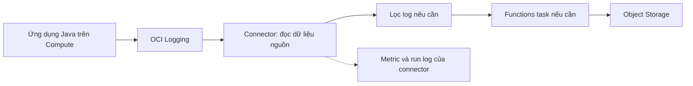

# Service Connector Hub và luân chuyển dữ liệu giữa dịch vụ

Trong Oracle Cloud Infrastructure (OCI), Service Connector Hub hiện được gọi là **Connector Hub**. Dịch vụ giúp định nghĩa và vận hành luồng dữ liệu giữa các dịch vụ OCI. Tên lệnh CLI vẫn sử dụng nhóm `sch service-connector`. [Tổng quan Connector Hub](https://docs.oracle.com/en-us/iaas/Content/connector-hub/overview.htm), [Tham chiếu OCI CLI](https://docs.oracle.com/en-us/iaas/tools/oci-cli/latest/oci_cli_docs/cmdref/sch/service-connector/create.html).

Bài thuộc chương **API, sự kiện và tích hợp** của module Oracle Cloud Infrastructure. Trọng tâm là xây dựng đường đi cho log, metric và message, gắn luồng đó với compartment, IAM, giám sát và chi phí. Ví dụ xuyên suốt là đưa log của ứng dụng Java vào Object Storage để lưu trữ và kiểm tra sự cố.

## 1. Mục tiêu và tình huống sử dụng

Sau bài học, bạn có thể:

- Chọn source, task và target phù hợp với yêu cầu luân chuyển dữ liệu.
- Phân biệt quyền của người triển khai với quyền mà connector cần khi chạy.
- Triển khai luồng Logging → Object Storage và chứng minh dữ liệu đã tới đích.
- Thiết kế xử lý bản ghi trùng, phát hiện luồng bị nghẽn và dự trù khả năng khôi phục.
- Quản lý cấu hình, thời gian lưu dữ liệu và tài nguyên phát sinh từ luồng tích hợp.

Giả sử ứng dụng `checkout-api` chạy trên Compute. Log đã xuất hiện trong OCI Logging, nhưng đội vận hành muốn lưu riêng các bản ghi phục vụ điều tra trong một bucket. Nếu tự viết chương trình định kỳ đọc log rồi tải lên bucket, đội phải quản lý lịch chạy, vị trí đọc, quyền truy cập, retry và giám sát chương trình đó.

Với Connector Hub, nhóm mô tả luồng bằng cấu hình. Trách nhiệm còn lại là chọn dữ liệu đúng, cấp quyền đúng, xác định cách xử lý lỗi và kiểm tra kết quả ở đích. Một luồng được tạo thành công chưa đủ để chứng minh yêu cầu lưu trữ đã được đáp ứng.

## 2. Mô hình source → task → target

Một connector mô tả luồng từ một dịch vụ nguồn tới một dịch vụ đích; task là bước xử lý tùy chọn. Muốn chuyển dữ liệu tới nhiều đích, cần thiết kế nhiều luồng. [Khái niệm connector, source, task và target](https://www.oracle.com/application-development/connector-hub/faq/).

| Thành phần | Câu hỏi khi thiết kế | Ví dụ của bài |
| --- | --- | --- |
| Source | Dữ liệu nào cần lấy, đang ở đâu? | Một log trong một log group của Logging |
| Task | Cần lọc hoặc biến đổi gì trước khi gửi? | Chọn log lỗi; loại bỏ trường nhạy cảm |
| Target | Dữ liệu cuối cùng được nhận ở đâu? | Bucket dành cho lưu trữ log |
| Connector | Ai sở hữu và vận hành luồng? | Connector trong compartment tích hợp |



Trong bài thực hành cơ bản, bỏ qua cả bước lọc và Functions để quan sát đường truyền ngắn nhất. Chỉ bổ sung task sau khi đã chứng minh được khả năng đọc nguồn và ghi đích.

Connector cũng là tài nguyên có OCID và compartment riêng. Compartment chứa connector có thể khác compartment chứa source hoặc target; cách phân chia này hữu ích khi nhóm tích hợp quản lý luồng còn nhóm ứng dụng sở hữu dữ liệu. [Mô hình tài nguyên và compartment trong lệnh tạo connector](https://docs.oracle.com/en-us/iaas/tools/oci-cli/latest/oci_cli_docs/cmdref/sch/service-connector/create.html).

## 3. Chọn tổ hợp dịch vụ được hỗ trợ

Bảng dưới mô tả các tổ hợp source–target trong tài liệu Oracle tại thời điểm biên soạn. Dấu “—” thể hiện tổ hợp không được hỗ trợ trong bảng này.

| Source | Functions | Log Analytics | Monitoring | Notifications | Object Storage | Streaming |
| --- | --- | --- | --- | --- | --- | --- |
| Logging | Có | Có | Có | Có | Có | Có |
| Monitoring | Có | — | — | — | Có | Có |
| Queue | Có | — | — | Có* | Có | Có |
| Streaming | Có | Có | — | Có* | Có | Có |

`*`: Không hỗ trợ Functions task cho Queue → Notifications và Streaming → Notifications. Logging task chỉ dành cho Logging source. [Ma trận source–target chính thức](https://docs.oracle.com/en-us/iaas/Content/connector-hub/overview.htm).

Cách áp dụng ma trận vào thiết kế:

- **Lưu trữ log:** bắt đầu bằng Logging → Object Storage.
- **Đưa log sang hệ thống xử lý tiếp:** cân nhắc Logging → Streaming.
- **Xử lý message bằng mã ứng dụng:** cân nhắc Queue → Functions.
- **Lưu metric phục vụ phân tích riêng:** cân nhắc Monitoring → Object Storage.
- **Đưa dữ liệu vào Oracle Database:** cần một thành phần thực thi, chẳng hạn Functions target, tự thực hiện kết nối và ghi cơ sở dữ liệu. Database không phải target trực tiếp trong ma trận trên.

Chọn một tổ hợp hợp lệ mới giải quyết được khả năng kết nối. Bạn vẫn cần xác định dữ liệu đầu ra, độ trễ chấp nhận được và trách nhiệm khi đích nhận lại cùng một bản ghi.

Đặc biệt, không tạo hai connector đọc cùng một queue với kỳ vọng mỗi connector nhận đủ một bản sao. Với Queue source, message được chuyển thành công sẽ bị xóa khỏi queue nguồn; hai luồng như vậy có thể cạnh tranh tiêu thụ. Nếu cần nhiều bản sao, hãy thiết kế cơ chế phân phối riêng trước các queue. [Hành vi tiêu thụ Queue source](https://docs.oracle.com/en-us/iaas/Content/connector-hub/create-service-connector-queue-source.htm).

## 4. Task: lọc dữ liệu và xử lý bằng Functions

### 4.1. Lọc Logging source

Bộ lọc giúp giảm dữ liệu đi tiếp, nhưng phải dựa trên schema thực tế. Ví dụ, với Audit log, có thể chọn sự kiện xóa object bằng biểu thức sau; thay placeholder bằng OCID compartment của bạn:

```text
search "<compartment_ocid>/Audit"
| where type = 'com.oraclecloud.objectstorage.deleteobject'
```

Đây là ví dụ cho Audit log, độc lập với custom log của ứng dụng trong bài thực hành. Đừng áp dụng trường `type` này cho log ứng dụng rồi kết luận connector mất dữ liệu khi không có bản ghi khớp.

Connector Hub hỗ trợ một tập con của Logging Query Language, với các toán tử luồng `search` và `where`. Vì vậy, truy vấn phân tích chạy được trong Logging Search chưa chắc phù hợp để đưa vào connector. [Tham chiếu truy vấn log](https://docs.oracle.com/en-us/iaas/Content/connector-hub/queryreference.htm).

Khi bổ sung bộ lọc, hãy giữ một bản ghi mẫu phải đi qua và một bản ghi mẫu phải bị loại. Ghi lại dấu hiệu phân biệt của hai mẫu để việc kiểm tra có bằng chứng rõ ràng.

### 4.2. Functions task và Functions target

Hai vị trí này có hợp đồng khác nhau:

| Vị trí | Vai trò trong thiết kế | Cách xử lý đầu ra |
| --- | --- | --- |
| Functions task | Biến đổi dữ liệu giữa nguồn và đích | Phải trả dữ liệu phù hợp để chuyển tiếp |
| Functions target | Thực hiện công việc ở cuối luồng | Connector không sử dụng dữ liệu trả về để chuyển sang một target khác |

Functions task có thể trả JSON với `Content-Type: application/json` hoặc binary với `application/octet-stream`. Connector ghi đầu ra task tới target mà không tự diễn giải lại nội dung nghiệp vụ. Functions được gọi đồng bộ; tài liệu quy định giới hạn payload 6 MB và thời gian thực thi tối đa 5 phút trong ngữ cảnh này. [Cấu hình task và target Functions](https://docs.oracle.com/en-us/iaas/Content/connector-hub/create-service-connector.htm).

Một phép biến đổi minh họa là chuẩn hóa tên dịch vụ và che địa chỉ email:

```json
{
  "eventId": "checkout-evt-1042",
  "service": "checkout-api",
  "level": "ERROR",
  "customerEmail": "customer@example.invalid"
}
```

Đầu ra nghiệp vụ mong muốn:

```json
{
  "eventId": "checkout-evt-1042",
  "service": "checkout-api",
  "severity": "ERROR",
  "customerEmail": "[REDACTED]",
  "schemaVersion": 1
}
```

Hai JSON trên chỉ minh họa nội dung nghiệp vụ, không phải toàn bộ envelope mà một OCI Function chắc chắn nhận được. Khi hiện thực, cần kiểm tra payload thực của source, xử lý danh sách bản ghi và giữ định danh ổn định để đối soát.

Nếu task chỉ che dữ liệu trước khi lưu trữ, nên giữ nó như một phép biến đổi thuần. Việc vừa trả dữ liệu vừa gọi API tạo giao dịch sẽ làm retry khó kiểm soát: một lần gọi lại task có thể tạo thêm giao dịch dù đầu ra lưu trữ trông vẫn đúng.

## 5. IAM: quyền triển khai và quyền chạy luồng

Hãy lập bản đồ tài nguyên trước khi viết policy:

| Tài nguyên | Compartment minh họa | Chủ sở hữu |
| --- | --- | --- |
| Custom log của ứng dụng | `AppDev` | Nhóm ứng dụng |
| Connector | `IntegrationDev` | Nhóm tích hợp |
| Bucket lưu trữ | `ArchiveDev` | Nhóm lưu trữ |
| Run log của connector | `IntegrationDev` | Nhóm vận hành |

Tên compartment chỉ là ví dụ; thay bằng tên hoặc OCID thật trước khi sử dụng policy.

Người triển khai cần quyền quản lý connector. Ví dụ dưới dùng nhóm `OciIntegrationBuilders` trong identity domain mặc định:

```text
Allow group Default/OciIntegrationBuilders to manage serviceconnectors in compartment IntegrationDev
```

Nhóm còn cần quyền phù hợp để chọn và xem tài nguyên nguồn, đích. Quyền `manage serviceconnectors` không tự cấp toàn bộ quyền đối với log, bucket hay function. [IAM cho người dùng và dịch vụ](https://docs.oracle.com/en-us/iaas/Content/Security/Reference/sch_security.htm).

Khi chạy, connector sử dụng danh tính tài nguyên của nó. Ví dụ policy cho phép các connector trong một compartment ghi vào đúng bucket:

```text
Allow any-user to manage objects in compartment ArchiveDev where all {request.principal.type='serviceconnector', request.principal.compartment.id='<connector_compartment_ocid>', target.bucket.name='oci-log-archive-lab'}
```

Ba điều kiện lần lượt giới hạn loại principal, compartment chứa connector và tên bucket. `any-user` phải được đọc cùng các điều kiện, không được sao chép rồi bỏ điều kiện. Mẫu này dựa trên policy mặc định cho Object Storage target; nó không đồng nghĩa với bộ quyền tối thiểu cho mọi hệ thống. [Policy Object Storage target](https://docs.oracle.com/en-us/iaas/Content/connector-hub/overview.htm#Default_Policies).

Với luồng khác, tham chiếu quyền của đúng source, task và target. Console đề xuất default policy theo cấu hình khi cần. Khi triển khai bằng CLI hoặc Terraform, chuẩn bị các quyền tương ứng trước khi trông chờ dữ liệu đi qua. [Cấp quyền khi tạo connector](https://docs.oracle.com/en-us/iaas/Content/connector-hub/create-service-connector-logging-source.htm).

Trong môi trường nhiều nhóm, cần đánh giá ai có thể tạo connector trong `IntegrationDev`: policy theo compartment có thể áp dụng cho nhiều connector trong đó. Nếu hai nhóm có mức độ tin cậy khác nhau, hãy cân nhắc tách compartment hoặc dùng thiết kế policy chi tiết phù hợp.

Nếu Functions target tự ghi vào Autonomous Database, cần xét thêm danh tính, secret và quyền kết nối của function. Quyền gọi function từ connector chỉ giải quyết chặng connector → function.

## 6. Thực hành: Logging → Object Storage

### 6.1. Chuẩn bị

Thực hiện trong một môi trường lab cùng region:

1. Một custom log của ứng dụng đã có dữ liệu trong OCI Logging.
2. Một bucket private tên `oci-log-archive-lab`, hoặc tên khác do bạn chọn.
3. Compartment dành cho connector.
4. Quyền tạo connector, xem cấu hình log và kiểm tra object trong bucket.
5. Quyền chạy luồng đã được quản trị viên chuẩn bị hoặc có thể tạo qua default policy được đề xuất.

Ghi lại các giá trị:

| Giá trị | Dùng cho |
| --- | --- |
| Region | Chọn đúng vùng khi dùng Console và CLI |
| OCID compartment chứa log | `source.logSources[].compartmentId` |
| OCID log group và log | Chỉ rõ dữ liệu nguồn |
| OCID compartment chứa connector | `--compartment-id` |
| Object Storage namespace | `target.namespace` |
| Tên bucket | `target.bucketName` |

Bucket là tài nguyên có sẵn mà connector sẽ ghi vào. Bài này không yêu cầu ứng dụng Java tự ghi trực tiếp vào bucket.

### 6.2. Tạo luồng bằng Console

1. Tìm **Connector Hub** trong Console, chọn đúng region và compartment chứa connector.
2. Tạo connector tên `checkout-logs-to-archive`.
3. Chọn source **Logging**, rồi chọn compartment, log group và custom log của ứng dụng.
4. Lần đầu giữ luồng đơn giản: chưa thêm filter và Functions task.
5. Chọn target **Object Storage**, chọn compartment và bucket đã chuẩn bị.
6. Đặt object prefix, chẳng hạn `checkout/`, để dễ tìm dữ liệu.
7. Dùng batch mặc định hoặc cấu hình được Console chấp nhận cho mục tiêu lab; xem xét các policy được đề xuất.
8. Kiểm tra bản xem trước, tạo connector và chờ trạng thái hoạt động.

Các trường cấu hình và định dạng object được mô tả trong [hướng dẫn Logging source](https://docs.oracle.com/en-us/iaas/Content/connector-hub/create-service-connector-logging-source.htm). Object được ghi tới Object Storage dưới dạng nén gzip.

Để quan sát rõ hơn, bật service log của connector và chọn log group dành riêng cho vận hành luồng. [Cách bật service log](https://docs.oracle.com/en-us/iaas/Content/connector-hub/enable-logs.htm).

### 6.3. Chứng minh dữ liệu đã đi hết luồng

Sau khi connector hoạt động, sinh log mới từ ứng dụng bằng một hành động lab đã biết. Gắn mã đánh dấu riêng, chẳng hạn `SCHLAB-20261120-001`, vào thông điệp log.

Thực hiện kiểm tra theo thứ tự:

1. Tìm thấy mã đánh dấu trong đúng log nguồn.
2. Chờ thời gian gom batch và xử lý, rồi tìm object mới dưới prefix `checkout/`.
3. Tải object, giải nén gzip và tìm mã đánh dấu trong nội dung.
4. Ghi lại thời điểm phát log, thời điểm thấy dữ liệu ở đích và OCID connector.
5. Xem run log để đối chiếu lần chạy tương ứng.

Không dùng một log cũ có từ trước khi tạo connector làm bằng chứng duy nhất. Với Logging source, luồng bắt đầu từ thời điểm tạo connector; cửa sổ lấy bù của Connector Hub là 24 giờ. Đây là giới hạn riêng, khác với thời gian giữ log mà bạn cấu hình trong Logging. [Thời điểm bắt đầu và retention của Logging source](https://docs.oracle.com/en-us/iaas/Content/connector-hub/create-service-connector-logging-source.htm#Retention_Period_Logging_Source).

Nếu muốn kiểm tra số lượng, tạo một tập nhỏ có `eventId` riêng cho từng bản ghi. Đếm **định danh khác nhau** xuất hiện ở đích và đối chiếu với tập nguồn. Số object hoặc số lần đọc không cho biết trực tiếp có bao nhiêu sự kiện nghiệp vụ khác nhau đã được lưu.

### 6.4. Tự động hóa bằng OCI CLI

Các file JSON sau là cấu hình minh họa mà người học tạo trong môi trường lab. Thay toàn bộ placeholder và bảo đảm bucket cùng các quyền đã sẵn sàng.

Nội dung `source.json`:

```json
{
  "kind": "logging",
  "logSources": [
    {
      "compartmentId": "<source_compartment_ocid>",
      "logGroupId": "<log_group_ocid>",
      "logId": "<log_ocid>"
    }
  ]
}
```

Nội dung `target.json`:

```json
{
  "kind": "objectStorage",
  "namespace": "<object_storage_namespace>",
  "bucketName": "oci-log-archive-lab",
  "objectNamePrefix": "checkout/",
  "batchRolloverSizeInMBs": 10,
  "batchRolloverTimeInMs": 60000
}
```

Các trường target và đơn vị được định nghĩa trong [ObjectStorageTargetDetails](https://docs.oracle.com/en-us/iaas/tools/typescript/latest/modules/_sch_lib_model_object_storage_target_details_.objectstoragetargetdetails.html). Trong ví dụ, thời gian gom batch là 60.000 mili giây; giá trị cấu hình không phải cam kết dữ liệu sẽ xuất hiện ở đích sau đúng 60 giây.

Ví dụ chạy từ PowerShell, tại thư mục chứa hai file JSON:

```powershell
$connectorCompartmentId = "<connector_compartment_ocid>"
$ociRegion = "<region_identifier>"

oci sch service-connector create `
  --compartment-id $connectorCompartmentId `
  --display-name "checkout-logs-to-archive" `
  --source file://source.json `
  --target file://target.json `
  --region $ociRegion
```

Lưu OCID connector từ kết quả. Có thể xem lại cấu hình trong Console và lặp lại phép kiểm tra mã đánh dấu. Cú pháp `file://` và khả năng sinh mẫu JSON cho tham số phức hợp được mô tả trong [lệnh create](https://docs.oracle.com/en-us/iaas/tools/oci-cli/latest/oci_cli_docs/cmdref/sch/service-connector/create.html).

Lệnh `create` tạo tài nguyên mới; chạy lại không phải thao tác cập nhật tự động. Với nhiều môi trường, nên quản lý OCID và vòng đời tài nguyên bằng hạ tầng dưới dạng mã. OCI Terraform provider có tài nguyên `oci_sch_service_connector`; cấu hình, policy và tài nguyên phụ thuộc cần được quản lý cùng nhau. [Tham chiếu Terraform](https://docs.oracle.com/en-us/iaas/tools/terraform-provider-oci/latest/docs/r/sch_service_connector.html).

## 7. Batch, độ trễ và tải dữ liệu

Khi có cấu hình batch theo dung lượng và thời gian, điều kiện đạt trước sẽ kích hoạt gửi batch. [Cơ chế batch](https://docs.oracle.com/en-us/iaas/Content/connector-hub/overview.htm#Batch_Settings).

Hãy phân rã độ trễ để đặt yêu cầu thực tế:

```text
Độ trễ đầu cuối
≈ chờ dữ liệu ở nguồn
+ chờ gom batch
+ thời gian chạy task
+ thời gian ghi đích
+ thời gian chờ retry nếu có
```

Đây là mô hình để phân tích, không phải công thức SLA của Oracle. Ví dụ, giảm thời gian gom batch từ vài phút xuống một phút chỉ cải thiện một thành phần. Nếu function đang timeout hoặc đích bị giới hạn tốc độ, người dùng vẫn có thể thấy dữ liệu rất muộn.

| Điều chỉnh thiết kế | Lợi ích có thể có | Điều cần đo |
| --- | --- | --- |
| Batch nhỏ hơn | Giảm thời gian chờ khi ít dữ liệu | Số lần gọi function, số object nhỏ |
| Batch lớn hơn | Gom nhiều bản ghi cho mỗi lần xử lý | Thời gian chờ, payload, bộ nhớ |
| Lọc sớm | Giảm dữ liệu và công việc ở đích | Có loại nhầm dữ liệu cần giữ không |
| Tách luồng theo nguồn | Dễ phân quyền và khoanh vùng lỗi | Có chồng lấn dữ liệu hoặc vượt quota không |

Với ứng dụng Java, nên phát log có cấu trúc và giữ kích thước mỗi bản ghi hợp lý. Một stack trace dài hoặc payload chứa toàn bộ request có thể làm tăng lưu lượng đáng kể dù số lượng request không đổi.

Không suy ra tính sẵn sàng của toàn luồng từ khả năng hoạt động của từng dịch vụ riêng lẻ. Luồng chỉ hoàn thành khi cả nguồn, task và đích đáp ứng được cùng một yêu cầu về độ trễ và mất dữ liệu.

## 8. Retry, bản ghi trùng và khả năng khôi phục

Connector Hub sử dụng cơ chế giao **ít nhất một lần**. Thao tác chuyển lỗi được thử lại trước khi chuyển các batch sau; quá thời gian lưu nguồn có thể không giao được dữ liệu. [Cơ chế delivery](https://docs.oracle.com/en-us/iaas/Content/connector-hub/overview.htm#Delivery_Details).

### 8.1. Vì sao có dữ liệu trùng?

Xét tình huống giả định:

1. Function đã ghi sự kiện `checkout-evt-1042` vào cơ sở dữ liệu.
2. Kết nối bị ngắt trước khi bên gọi nhận được xác nhận thành công.
3. Batch được gọi lại.
4. Nếu function cứ chèn thêm dòng, sự kiện bị ghi hai lần.

Vì vậy, thiết kế đích cần có tính lũy đẳng: xử lý lại cùng một sự kiện không làm lặp tác động nghiệp vụ. Một phương án là khóa duy nhất trên `eventId`, kết hợp việc đánh dấu đã xử lý và cập nhật nghiệp vụ trong cùng giao dịch.

```text
Bắt đầu giao dịch
  Thử đăng ký eventId trong bảng tiếp nhận có khóa duy nhất
  Nếu eventId đã hoàn tất:
    Kết thúc mà không lặp tác động nghiệp vụ
  Nếu là sự kiện mới:
    Cập nhật dữ liệu nghiệp vụ
    Đánh dấu hoàn tất
Commit
```

Đây là mã giả thiết kế, không phải API sẵn có của Connector Hub. Nếu tác động nằm ngoài cơ sở dữ liệu, chẳng hạn gọi hệ thống thanh toán, cần cơ chế idempotency hoặc outbox thích hợp ở chặng đó. Một biến `Set` trong bộ nhớ function không đủ bảo vệ giữa các lần khởi động hoặc nhiều instance.

Không gán UUID mới mỗi lần retry để làm khóa chống trùng. Khóa phải gắn với sự kiện gốc và giữ nguyên qua các lần thử lại.

### 8.2. Retention và replay

| Source | Điều cần biết cho phương án khôi phục |
| --- | --- |
| Logging | Cửa sổ lấy bù của connector là 24 giờ |
| Monitoring | Retention của nguồn trong Connector Hub là 24 giờ |
| Streaming | Phụ thuộc retention của stream và vị trí bắt đầu đọc |
| Queue | Phụ thuộc cấu hình queue và trạng thái message đã tiêu thụ |

Các giới hạn này được mô tả theo từng nguồn: [Logging](https://docs.oracle.com/en-us/iaas/Content/connector-hub/create-service-connector-logging-source.htm), [Monitoring](https://docs.oracle.com/en-us/iaas/Content/connector-hub/create-service-connector-monitoring-source.htm), [Streaming](https://docs.oracle.com/en-us/iaas/Content/connector-hub/create-service-connector-streaming-source.htm), [Queue](https://docs.oracle.com/en-us/iaas/Content/connector-hub/create-service-connector-queue-source.htm).

Với Streaming source, `Latest` bắt đầu từ dữ liệu sau khi tạo connector, còn `Trim Horizon` bắt đầu từ message cũ nhất còn được giữ. Chọn sai vị trí có thể khiến một đợt chuyển đổi bỏ qua dữ liệu cần lấy hoặc đọc lại nhiều dữ liệu cũ. [Cấu hình vị trí đọc](https://docs.oracle.com/en-us/iaas/Content/connector-hub/create-service-connector-streaming-source.htm).

Ví dụ, nhóm cần dữ liệu xuất hiện trong vòng 10 phút và không được thiếu log của một ca trực. Hãy đặt cảnh báo sớm hơn đáng kể so với cửa sổ 24 giờ, đồng thời chuẩn bị nguồn lưu trữ để đối soát. Chờ tới khi gần hết cửa sổ mới điều tra sẽ để lại rất ít thời gian xử lý.

Đối với Queue → Functions, lỗi một phần trong batch không được hỗ trợ: batch lỗi có thể làm các message đã xử lý thành công được đưa ra xử lý lại. Delivery count vẫn tăng và message có thể vào dead letter queue theo cấu hình queue. [Xử lý lỗi Queue → Functions](https://docs.oracle.com/en-us/iaas/Content/connector-hub/queue-to-function.htm#Error_Handling_When_Processing_Queues).

Đừng giả định mọi source đều có sẵn dead letter queue. Hãy ghi rõ nơi lưu dữ liệu lỗi và cách đưa nó trở lại đường xử lý trong phương án của từng luồng.

### 8.3. Thay đổi cấu hình

Cập nhật source, task hoặc target có thể reset nội bộ connector và khiến dữ liệu được đọc lại. [Hành vi khi cập nhật cấu hình](https://docs.oracle.com/en-us/iaas/Content/connector-hub/overview.htm#Updated_Connectors_are_Internally_Reset).

Một phương án chuyển đổi cần xác định trước:

1. Thời điểm hoặc dấu mốc dùng để đối soát.
2. Luồng cũ được dừng khi nào.
3. Luồng mới bắt đầu từ đâu.
4. Đích loại trùng bằng khóa nào.
5. Cách phát hiện phần dữ liệu thiếu và cách lấy bù.

Nếu chạy hai luồng song song trong giai đoạn kiểm tra, chỉ áp dụng khi semantics của nguồn cho phép và đã dự trù dữ liệu trùng. Với queue, phải đặc biệt xét hành vi cạnh tranh tiêu thụ.

## 9. Giám sát và xử lý sự cố

Connector Hub phát metric trong namespace `oci_service_connector_hub`. Các metric có sẵn tự động; có thể lọc theo `connectorId`. [Tham chiếu metric](https://docs.oracle.com/en-us/iaas/Content/connector-hub/metrics-reference.htm).

| Tín hiệu | Cách dùng khi điều tra |
| --- | --- |
| `ErrorsAtSource` | Khoanh vùng lỗi đọc nguồn |
| `ErrorsAtTask` | Khoanh vùng lỗi tại task |
| `ErrorsAtTarget` | Khoanh vùng lỗi ghi đích |
| `ServiceConnectorHubErrors` | Kiểm tra lỗi thuộc Connector Hub |
| `DataFreshness` | Theo dõi tuổi dữ liệu gần nhất đã xử lý |
| `BytesWrittenToTarget` | Một chỉ báo chung về dữ liệu ghi đích |

`DataFreshness` dùng đơn vị mili giây và dựa trên bản ghi mới nhất của tập vừa xử lý; nó không chứng minh toàn bộ backlog đã được giải quyết. Byte đọc và ghi có thể khác nhau do nén hoặc biến đổi. `BytesWrittenToTarget` không được phát cho Monitoring target. [Định nghĩa và lưu ý về metric](https://docs.oracle.com/en-us/iaas/Content/connector-hub/metrics-reference.htm).

Thiết kế cảnh báo nên có cả lỗi kỹ thuật và dấu hiệu dữ liệu:

- Cảnh báo lỗi kéo dài ở source, task hoặc target.
- Cảnh báo độ trễ vượt mục tiêu riêng của luồng.
- Kiểm tra một bản ghi đánh dấu định kỳ khi cần chứng minh đường truyền vẫn hoạt động.
- Đối soát định danh nghiệp vụ ở đích đối với luồng có yêu cầu đầy đủ dữ liệu.

Ngưỡng và khoảng chờ phải phản ánh tải thực. Một nguồn không sinh log trong đêm khác với một nguồn có log nhưng connector không ghi được. Đối chiếu nguồn và đích giúp phân biệt hai tình huống này.

Service log sử dụng loại sự kiện `com.oraclecloud.sch.serviceconnector.runlog`; nội dung có thông điệp bắt đầu, kết thúc lần chạy và thông tin thành công hoặc lỗi. [Cấu trúc run log](https://docs.oracle.com/en-us/iaas/Content/Logging/Reference/details-for-service-connector-hub.htm).

| Hiện tượng | Bước kiểm tra ưu tiên |
| --- | --- |
| Connector hoạt động nhưng bucket chưa có dữ liệu | Kiểm tra log mới tại nguồn, region, bộ lọc và thời gian gom batch |
| `NotAuthorizedOrNotFound` | Kiểm tra cả OCID/tên tài nguyên và policy theo đúng compartment |
| Task báo JSON không hợp lệ | Đối chiếu payload thực với `Content-Type` của function |
| Có lỗi giới hạn tốc độ | Xem tải và giới hạn của chặng đang lỗi |
| Luồng ngừng sau thời gian lỗi kéo dài | Kiểm tra trạng thái connector và thông báo dịch vụ |

Bảng là trình tự khoanh vùng, không phải kết luận tự động từ một mã lỗi. Oracle có thể vô hiệu hóa connector lỗi kéo dài trong một số điều kiện; sau khi sửa cần kích hoạt lại và xác minh dữ liệu tại đích. [Hướng dẫn xử lý sự cố](https://docs.oracle.com/en-us/iaas/Content/connector-hub/troubleshooting.htm).

Tránh cho connector thu thập chính run log của mình rồi tiếp tục tạo thêm dữ liệu giám sát theo vòng lặp. Hãy dùng log group vận hành riêng và chọn nguồn có phạm vi rõ ràng.

## 10. Chi phí, dữ liệu nhạy cảm và mạng

Theo Oracle, bản thân Connector Hub không thu phí; chi phí phát sinh từ các dịch vụ tham gia. [Thông tin giá trong FAQ](https://www.oracle.com/application-development/connector-hub/faq/).

Khi ước lượng, lập danh sách theo đường đi thực tế:

| Khoản cần theo dõi | Câu hỏi kiểm soát |
| --- | --- |
| Logging | Có thu quá nhiều log debug hoặc giữ lâu hơn nhu cầu không? |
| Object Storage | Dung lượng tăng mỗi ngày, số object và thời gian lưu là bao nhiêu? |
| Functions | Mỗi batch mất bao lâu, retry có làm tăng số lần chạy không? |
| Streaming hoặc Queue | Tải và thời gian giữ dữ liệu có phù hợp mục tiêu phục hồi không? |
| Đọc lại, tải xuống và tích hợp ngoài | Có chi phí truy xuất hoặc truyền dữ liệu nào cần tính thêm không? |

Có thể dùng phép tính sơ bộ `dung lượng trung bình/ngày × số ngày giữ` để ước lượng lượng dữ liệu đang lưu. Sau đó điều chỉnh bằng số đo nén thực tế, bản sao, dữ liệu trùng và chính sách vòng đời. Phép tính này phục vụ lập kế hoạch, không thay thế bảng giá của từng dịch vụ.

Về dữ liệu, hãy chọn những trường thật sự cần cho điều tra. Loại secret và thông tin định danh không cần thiết ngay từ nơi phát log; task che dữ liệu ở giữa luồng chỉ bảo vệ các chặng sau task, trong khi bản nguồn có thể vẫn chứa dữ liệu ban đầu.

Với Streaming private endpoint, Connector Hub có hỗ trợ nhưng cần đáp ứng điều kiện IAM và quy tắc ingress/egress được tài liệu quy định. Không phải mọi connector đang dùng stream public đều có thể sửa trực tiếp sang private; có trường hợp phải tạo lại connector. [Điều kiện private endpoint cho stream](https://docs.oracle.com/en-us/iaas/Content/connector-hub/create-service-connector-streaming-source.htm#Private_Endpoint_Prerequisites_for_Streams).

Khi thiết kế một luồng có Functions gọi cơ sở dữ liệu hoặc API riêng, hãy kiểm tra thêm đường mạng của function tới hệ thống đó. Việc connector gọi được function chưa chứng minh function truy cập được tài nguyên tiếp theo.

## 11. Hoàn tất thực hành và dọn tài nguyên

Bài thực hành đạt mục tiêu khi bạn có đủ bằng chứng:

- Xác định được log nguồn, connector, bucket và compartment tương ứng.
- Có mã đánh dấu xuất hiện ở cả nguồn và nội dung object đã giải nén.
- Giải thích được policy nào cho người triển khai và policy nào phục vụ luồng chạy.
- Biết nơi xem metric, run log và cách phát hiện luồng chậm.
- Nêu được cách xử lý dữ liệu trùng và giới hạn lấy bù của nguồn.

Khi kết thúc lab, dừng hoặc xóa connector để ngừng luồng. Sau đó kiểm tra object, bucket, run log và các tài nguyên Functions, Streaming hoặc Queue đã tạo riêng cho bài thực hành. Chỉ xóa tài nguyên lab khi không còn cần dữ liệu đối soát.

Các policy tạo tự động có thể vẫn tồn tại sau khi xóa connector; rà soát và gỡ các policy không còn được sử dụng, sau khi kiểm tra phụ thuộc của những luồng khác. [Lưu ý về policy sau khi xóa connector](https://docs.oracle.com/en-us/iaas/Content/connector-hub/create-service-connector-logging-source.htm).
