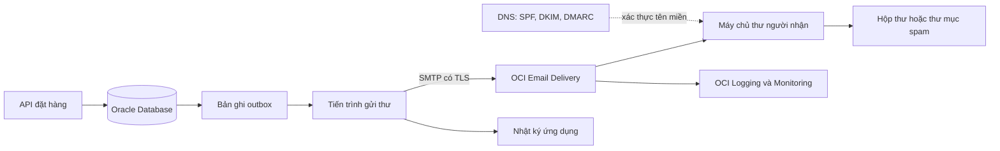

# OCI Email Delivery và cấu hình gửi thư ứng dụng

## 1. Mục tiêu và tình huống triển khai

Trong chương **API, sự kiện và tích hợp** của module **CLOUD_PROVIDERS_ORACLE**, bài này hướng dẫn đưa thư giao dịch của ứng dụng qua Oracle Cloud Infrastructure (OCI) Email Delivery. Người học kết hợp tenancy, compartment, IAM, mạng VCN và giám sát để xây dựng một luồng gửi thư có thể vận hành.

Tình huống xuyên suốt là ứng dụng Java gửi xác nhận sau khi đơn hàng được ghi vào cơ sở dữ liệu Oracle. Ví dụ sử dụng compartment `app-prod`, tên miền gửi `notify.example.com` và địa chỉ `orders@notify.example.com`. `example.com` là miền minh họa: khi thực hành, phải thay bằng miền có quyền quản trị DNS và hộp thư nhận do mình kiểm soát.

Sau bài học, người học có thể:

- Phân biệt email domain, approved sender, SMTP credential và địa chỉ nhận thư.
- Cấp quyền gửi theo compartment, thiết lập DNS và kết nối SMTP có TLS.
- Cấu hình ứng dụng Spring Boot gửi thư tiếng Việt, giữ bí mật ngoài mã nguồn và đặt timeout.
- Theo dõi acceptance, relay, bounce và suppression; thiết kế retry có giới hạn.
- Chuẩn bị hạn mức, chi phí và phương án chuyển region trước khi chạy thật.

## 2. Vai trò của Email Delivery trong luồng ứng dụng

Email Delivery cung cấp dịch vụ gửi thư ra ngoài, gồm thư giao dịch và thư theo chiến dịch. Ứng dụng chịu trách nhiệm chọn người nhận, dựng nội dung và quyết định thời điểm gửi; dịch vụ đảm nhiệm phần chuyển tiếp thư. Không dùng dịch vụ này thay cho hệ thống lưu hộp thư đến của nhân viên. Xem [tổng quan OCI Email Delivery](https://docs.oracle.com/en-us/iaas/Content/Email/Concepts/overview.htm) và [hướng dẫn về khả năng nhận thư của Oracle](https://docs.oracle.com/en-us/iaas/Content/Email/Reference/deliverabilitybestpractices_topic-bestpractices.htm).

Một kiến trúc đề xuất cho thư xác nhận đơn hàng:



Trong thiết kế này, đơn hàng và bản ghi outbox được tạo trong cùng giao dịch cơ sở dữ liệu. Một tiến trình nền đọc outbox rồi gửi thư. Cách tổ chức này giúp API đặt hàng không phải chờ kết nối SMTP và tạo nơi lưu công việc khi dịch vụ gửi tạm thời gián đoạn.

Cần đặt tên trạng thái đúng với bằng chứng đã có:

| Mốc | Bằng chứng | Điều chưa thể kết luận |
| --- | --- | --- |
| Đã xếp hàng | Ứng dụng ghi nhận công việc trong outbox | OCI đã nhận thư |
| Đã được OCI tiếp nhận | Có kết quả tiếp nhận thành công hoặc log tương ứng | Máy chủ đích đã nhận |
| Đã chuyển tiếp | Dịch vụ báo relay thành công tới máy chủ đích | Thư nằm trong inbox |
| Người dùng xác nhận | Người nhận xác nhận hoặc hoàn thành hành động nghiệp vụ | Mọi email sau đều sẽ vào inbox |

Do đó, API đặt hàng có thể trả về “đã ghi nhận yêu cầu gửi email”. Không nên hiển thị “khách hàng đã nhận email” ngay khi hàm gửi SMTP trả về bình thường.

## 3. Các thành phần cần phân biệt

| Thành phần | Vai trò | Ví dụ trong bài |
| --- | --- | --- |
| Tenancy | Phạm vi tài khoản và quản trị OCI | Tenancy của tổ chức |
| Compartment | Nhóm tài nguyên và giới hạn phạm vi quyền | `app-prod` |
| Email domain | Tài nguyên đại diện miền gửi để cấu hình xác thực, nhật ký | `notify.example.com` |
| Approved sender | Địa chỉ được phép sử dụng để gửi | `orders@notify.example.com` |
| SMTP credential | Cặp username/password do OCI cấp cho một IAM user | Bí mật của tiến trình gửi thư |
| SMTP endpoint | Máy chủ tiếp nhận thư trong region đã chọn | Giá trị lấy từ Email Delivery Configuration |
| Suppression | Chặn gửi tới người nhận do nguyên nhân như hard bounce hoặc complaint | Địa chỉ bị loại khỏi luồng gửi |

Email domain phải thuộc quyền kiểm soát DNS của người cấu hình; không thể tùy ý dùng miền của một nhà cung cấp hộp thư công cộng. Tạo email domain cũng không tự tạo hộp thư `orders@...`. Xem [quản lý email domain](https://docs.oracle.com/en-us/iaas/Content/Email/Tasks/configureemaildomains.htm).

Approved sender có phạm vi region và compartment. Ứng dụng phải gửi tới endpoint của region nơi sender được cấu hình. Khi nộp thư qua SMTP, nên giữ địa chỉ envelope `MAIL FROM` trùng với header `From`; địa chỉ khác nhau có thể đòi hỏi cả hai đều được cấp phép. Trong bài thực hành, tạo đúng một approved sender thay vì cấp phép cho toàn miền. Xem [tạo approved sender](https://docs.oracle.com/en-us/iaas/Content/Email/Reference/gettingstarted_topic-Create_an_approved_sender.htm).

Phân biệt thêm các trường thư:

- **Header `From`**: địa chỉ người dùng nhìn thấy trong trình đọc thư.
- **SMTP envelope `MAIL FROM`**: địa chỉ được client dùng trong phiên nộp thư; khác với header hiển thị.
- **`Reply-To`**: nơi ứng dụng muốn người nhận trả lời; cần có hệ thống hộp thư thực sự tiếp nhận.
- **`Return-Path`**: phản ánh đường nhận thông báo lỗi ở phía chuyển phát. Để dịch vụ quản lý theo cấu hình return path; không tự gán header này để thay cho cấu hình DNS.

## 4. Chuẩn bị IAM và credential

### 4.1. Tách vai trò quản trị và gửi thư

Một cách phân quyền đề xuất là dùng nhóm `EmailAdmins` để cấu hình tài nguyên, nhóm `AppMailSenders` chỉ để tiến trình ứng dụng gửi. Với identity domain tên `Default`, policy minh họa:

```text
Allow group 'Default'/'EmailAdmins' to manage email-family in compartment app-prod
Allow group 'Default'/'AppMailSenders' to use approved-senders in compartment app-prod
```

Phải thay identity domain, tên nhóm và compartment bằng giá trị thực tế. IAM user sở hữu SMTP credential cần là thành viên nhóm có quyền gửi. Quyền `use approved-senders` bao gồm quyền `SmtpSend`; không cần cấp `manage email-family in tenancy` cho tiến trình chỉ gửi thư. Xem [chi tiết IAM của Email Delivery](https://docs.oracle.com/en-us/iaas/Content/Identity/Reference/emailpolicyreference.htm).

Policy quản trị ở trên là điểm bắt đầu cho tài nguyên email trong compartment; quản trị Logging, đọc Monitoring hoặc truy xuất secret cần quyền tương ứng của các dịch vụ đó. Nên để approved sender trong compartment ứng dụng để tránh mở rộng quyền tới toàn tenancy.

### 4.2. Tạo SMTP credential

Dùng một IAM user dành riêng cho ứng dụng; không lấy credential của tài khoản quản trị hằng ngày. Trong trang chi tiết user, mở **SMTP credentials**, chọn tạo credential và lưu username/password vào nơi quản lý bí mật ngay khi chúng được hiển thị. Password không thể xem lại sau khi đóng hộp thoại. Xem [tạo SMTP credential](https://docs.oracle.com/en-us/iaas/Content/Email/Reference/gettingstarted_topic-create-smtp-credentials.htm).

SMTP username/password là chuỗi do Oracle tạo, không phải email đăng nhập Console, mật khẩu Console, auth token hay API signing key. Tài liệu IAM quy định mỗi user có tối đa hai SMTP credential và chúng không tự hết hạn; cần chủ động xoay vòng. Xem [vòng đời SMTP credential](https://docs.oracle.com/en-us/iaas/Content/Identity/access/working-with-smtp-credentials.htm).

Quy trình xoay vòng đề xuất:

1. Tạo credential mới khi còn chỗ cho credential thứ hai.
2. Lưu phiên bản secret mới vào OCI Vault hoặc hệ thống bí mật của tổ chức.
3. Cập nhật cấu hình và thay thế dần các tiến trình gửi.
4. Gửi một thư kiểm tra, xác nhận các tiến trình đã chuyển sang credential mới.
5. Thu hồi credential cũ khi không còn tiến trình sử dụng.

Không ghi password trong Git, ảnh chụp cấu hình, tham số dòng lệnh hoặc nhật ký SMTP. Việc đọc secret từ Vault chỉ cung cấp bí mật cho ứng dụng; nó không thay thế quyền `SmtpSend` của IAM user sở hữu credential.

## 5. Cấu hình miền gửi và DNS

### 5.1. Tạo email domain, approved sender và bật nhật ký

Trong Console, chọn đúng region và compartment rồi mở **Email Delivery**. Tạo email domain cho `notify.example.com`; cấu hình DKIM theo mục tiếp theo; tạo approved sender `orders@notify.example.com` trong cùng region.

Bật các log phù hợp trên email domain trước khi gửi thử. Hai danh mục phục vụ theo dõi luồng gửi là **Outbound Accepted** và **Outbound Relayed**. Chọn log group, đặt thời gian lưu phù hợp và cấp quyền đọc cho người vận hành. Log chưa bật tại thời điểm gửi sẽ không tự xuất hiện ngược về quá khứ. Xem [bật log cho Email Delivery](https://docs.oracle.com/en-us/iaas/Content/Email/Tasks/enablelogs_using-the-console.htm).

### 5.2. SPF: cho phép hạ tầng gửi thay mặt miền

SPF là bản ghi TXT công bố các nguồn được phép gửi cho miền mà SPF đánh giá. Với ví dụ chỉ gửi qua các commercial region châu Á/Thái Bình Dương, nội dung minh họa trên miền gửi là:

```dns
notify.example.com. IN TXT "v=spf1 include:ap.rp.oracleemaildelivery.com ~all"
```

Phải dùng include phù hợp với vị trí gửi và realm theo [bảng SPF chính thức của OCI](https://docs.oracle.com/en-us/iaas/Content/Email/Tasks/configurespf.htm). Bản ghi này giả định đây là nguồn gửi duy nhất của miền minh họa; nếu có nguồn khác, hợp nhất các nguồn hợp lệ vào chính sách SPF đang có. Không tạo nhiều bản ghi `v=spf1` độc lập cho cùng một tên miền.

SPF kiểm tra danh tính ở tầng SMTP, không xác nhận trực tiếp rằng mọi địa chỉ trong header `From` đều hợp lệ. Khi đánh giá thư thực tế, xem cả miền `smtp.mailfrom` và kết quả alignment của DMARC.

### 5.3. DKIM: xác minh chữ ký của miền gửi

Trong email domain, thêm DKIM với selector riêng, chẳng hạn prefix `orders-prod`. OCI sinh tên và giá trị DNS cần công bố; với commercial realm, giao diện cung cấp CNAME. Sao chép nguyên giá trị được sinh, không tự đoán target từ region hoặc OCID. Tên có dạng khái niệm:

```text
<selector-do-OCI-sinh>._domainkey.notify.example.com
    CNAME <target-do-OCI-cung-cap>
```

Thêm record tại DNS authoritative của miền, đợi cập nhật và kiểm tra trạng thái xác thực trong OCI. Nếu DNS nằm ngoài OCI, phải thay đổi ở nhà cung cấp DNS đó. Xem [cấu hình DKIM](https://docs.oracle.com/en-us/iaas/Content/Email/Tasks/configure-dkim-using-the-console.htm).

Một lỗi dễ gặp là giao diện DNS tự nối zone: nhập tên đầy đủ vào trường chỉ nhận tên tương đối có thể tạo `...example.com.example.com`. Kiểm tra tên record thực tế khi DKIM báo cần xử lý, theo [hướng dẫn khắc phục của Oracle](https://docs.oracle.com/en-us/iaas/Content/Email/Concepts/troubleshooting.htm).

### 5.4. DMARC và alignment

DMARC liên kết miền trong header `From` với danh tính đã qua SPF hoặc DKIM. Để đạt DMARC, ít nhất một cơ chế phải vừa xác thực thành công vừa aligned với miền `From`. Vì vậy, chỉ thấy `spf=pass` ở miền return path của nhà cung cấp vẫn chưa đủ để kết luận DMARC pass.

Ví dụ khởi đầu để quan sát, khi đã có hộp thư nhận báo cáo:

```dns
_dmarc.notify.example.com. IN TXT "v=DMARC1; p=none; rua=mailto:dmarc-reports@notify.example.com"
```

`p=none` yêu cầu chế độ quan sát; không phải chính sách từ chối thư giả. Sau khi kiểm kê các nguồn gửi và xem báo cáo, tổ chức có thể triển khai `quarantine` hoặc `reject` phù hợp. Hộp thư báo cáo phải được cung cấp bởi hệ thống nhận thư khác. Xem [khuyến nghị về DMARC của Oracle](https://docs.oracle.com/en-us/iaas/Content/Email/Reference/deliverabilitybestpractices_topic-bestpractices.htm).

Ngoài DNS, khả năng vào inbox còn phụ thuộc nội dung, uy tín và yêu cầu của bên nhận. Khi gửi tới Gmail, tham khảo trực tiếp [quy định xác thực dành cho người gửi của Google](https://support.google.com/mail/answer/81126) để kiểm tra yêu cầu áp dụng cho lưu lượng của mình.

## 6. Kết nối SMTP và đường mạng

### 6.1. Chọn endpoint và chế độ TLS

Lấy **Public endpoint**, port và thông tin bảo mật ở trang **Email Delivery → Configuration** của region sử dụng. Bài này chọn port **465** với TLS ngay từ lúc mở kết nối, còn gọi là implicit TLS. OCI yêu cầu mã hóa đường truyền từ ứng dụng tới dịch vụ. Xem [cấu hình kết nối SMTP](https://docs.oracle.com/en-us/iaas/Content/Email/Reference/gettingstarted_topic-Configure_the_SMTP_connection.htm).

Cần phân biệt hai cấu hình client:

| Cách kết nối | Port thường dùng trong cấu hình này | Client phải thực hiện |
| --- | --- | --- |
| Implicit TLS | `465` | Bắt tay TLS trước khi trao đổi SMTP |
| STARTTLS | `587`, khi được endpoint hỗ trợ | Bắt đầu SMTP, yêu cầu nâng cấp TLS trước khi xác thực |

Không chỉ đổi port mà giữ nguyên các cờ TLS. Ví dụ dùng port 465 nhưng chờ banner SMTP trước khi bắt tay TLS có thể bị treo hoặc timeout. Với STARTTLS, phải yêu cầu nâng cấp thành công; bật chế độ “có TLS thì dùng” là chưa đủ. Tài liệu [SMTP provider của Eclipse Angus](https://eclipse-ee4j.github.io/angus-mail/docs/api/org.eclipse.angus.mail/org/eclipse/angus/mail/smtp/package-summary.html) mô tả các thuộc tính SSL và STARTTLS này.

### 6.2. Khi ứng dụng nằm trong private subnet

Đối với public endpoint trong bài, ứng dụng cần phân giải DNS và có đường đi ra ngoài. Một phương án đề xuất là private subnet có route phù hợp qua NAT Gateway, kèm egress của NSG/security list và firewall hệ điều hành cho TCP 465. Internet Gateway gắn vào VCN không tự cung cấp truy cập Internet cho máy chỉ có private IP.

Đây là kết nối do ứng dụng khởi tạo ra ngoài; mở inbound 465 trên máy ứng dụng không giải quyết lỗi gửi. Nếu dùng rule stateless, phải tính cả luồng trả về. Không mặc định rằng Service Gateway thay thế được đường tới public SMTP endpoint; cần kiểm tra khả năng và đường mạng thực tế của endpoint sử dụng.

Kiểm tra theo từng tầng từ đúng môi trường chạy ứng dụng. Ví dụ trên PowerShell:

```powershell
Resolve-DnsName -Name $env:SMTP_HOST
Test-NetConnection -ComputerName $env:SMTP_HOST -Port 465
```

Ở máy đã có OpenSSL và biến môi trường `SMTP_HOST`, có thể kiểm tra thêm TLS:

```bash
openssl s_client \
  -connect "${SMTP_HOST}:465" \
  -servername "${SMTP_HOST}" \
  -verify_hostname "${SMTP_HOST}" \
  -verify_return_error \
  -brief
```

Các lệnh này không gửi email và chưa kiểm tra quyền SMTP. TCP thành công mới chứng minh kết nối được tới port; bắt tay TLS thành công mới chứng minh thêm được phần TLS trong môi trường kiểm tra. Không đưa SMTP password vào lệnh chẩn đoán.

## 7. Tích hợp Java với Spring Boot

### 7.1. Phụ thuộc và biến cấu hình

Ví dụ dành cho dự án Spring Boot dùng Jakarta Mail, chẳng hạn Boot 3 trở lên, đã có lớp khởi động và quản lý phiên bản dependency bằng Spring Boot parent hoặc BOM. Thêm starter dưới đây vào `pom.xml` của dự án thực hành:

```xml
<dependency>
    <groupId>org.springframework.boot</groupId>
    <artifactId>spring-boot-starter-mail</artifactId>
</dependency>
```

Spring Boot có thể tự tạo `JavaMailSender` khi có thư viện và cấu hình host phù hợp. Nên đặt timeout rõ ràng vì một số giá trị mặc định có thể chờ vô hạn. Xem [tài liệu gửi email của Spring Boot](https://docs.spring.io/spring-boot/reference/io/email.html).

Chuẩn bị các biến sau thông qua hệ thống triển khai và quản lý bí mật:

| Biến | Nội dung | Cách quản lý đề xuất |
| --- | --- | --- |
| `SMTP_HOST` | Public endpoint sao chép từ OCI Configuration | Cấu hình theo region |
| `OCI_SMTP_USERNAME` | Username của SMTP credential | Cấu hình bí mật |
| `OCI_SMTP_PASSWORD` | Password tương ứng | Vault hoặc secret store |
| `MAIL_FROM` | Approved sender đầy đủ | Cấu hình theo môi trường |

Biến môi trường chỉ là cách truyền giá trị trong ví dụ; không phải mọi nền tảng đều bảo vệ biến môi trường khỏi người có quyền quản trị tiến trình. Khi triển khai thật, chọn cơ chế cấp secret phù hợp với Compute, OKE hoặc môi trường đang dùng.

### 7.2. Cấu hình implicit TLS trên port 465

Nội dung minh họa cho `application.yml` của ứng dụng:

```yaml
spring:
  mail:
    host: ${SMTP_HOST}
    port: 465
    protocol: smtp
    username: ${OCI_SMTP_USERNAME}
    password: ${OCI_SMTP_PASSWORD}
    default-encoding: UTF-8
    properties:
      "[mail.smtp.auth]": true
      "[mail.smtp.ssl.enable]": true
      "[mail.smtp.ssl.checkserveridentity]": true
      "[mail.smtp.starttls.enable]": false
      "[mail.smtp.starttls.required]": false
      "[mail.smtp.connectiontimeout]": 5000
      "[mail.smtp.timeout]": 10000
      "[mail.smtp.writetimeout]": 10000
      "[mail.smtp.from]": ${MAIL_FROM}
      "[mail.debug]": false

app:
  email:
    from: ${MAIL_FROM}
```

Cấu hình giữ `protocol: smtp` và dùng thuộc tính `mail.smtp.*`; `ssl.enable: true` khiến kết nối bắt đầu bằng TLS. Việc tắt STARTTLS ở đây không tắt mã hóa: TLS đã được thiết lập ngay khi kết nối. `mail.smtp.from` đặt envelope sender; `app.email.from` được lớp Java dùng cho header `From`. Xem ý nghĩa các thuộc tính tại [tài liệu SMTP provider](https://eclipse-ee4j.github.io/angus-mail/docs/api/org.eclipse.angus.mail/org/eclipse/angus/mail/smtp/package-summary.html).

Ba timeout trong ví dụ có đơn vị mili giây và chỉ là giá trị khởi đầu. Điều chỉnh theo độ trễ thực tế, ngân sách xử lý công việc và cách worker nhận việc. Không dùng `mail.smtp.ssl.trust=*` hay tắt kiểm tra hostname để vượt qua lỗi chứng chỉ.

Nếu chọn STARTTLS port 587 sau khi xác minh endpoint hỗ trợ, đổi đồng bộ các giá trị sau; giữ các cấu hình khác phù hợp:

```properties
spring.mail.port=587
spring.mail.properties[mail.smtp.ssl.enable]=false
spring.mail.properties[mail.smtp.starttls.enable]=true
spring.mail.properties[mail.smtp.starttls.required]=true
```

Đây là các thay đổi cho phương án thay thế, không phải khối cần cộng thêm vào cấu hình 465 mà không xét thứ tự ưu tiên cấu hình.

### 7.3. Dịch vụ gửi xác nhận đơn hàng

Đặt lớp dưới đây trong package được Spring quét. Lớp nhận một người nhận cho mỗi công việc, gửi văn bản UTF-8 và gắn mã thông báo nội bộ để hỗ trợ truy vết:

```java
package com.example.notification;

import java.nio.charset.StandardCharsets;
import java.util.Objects;
import java.util.UUID;

import jakarta.mail.MessagingException;
import jakarta.mail.internet.MimeMessage;

import org.springframework.beans.factory.annotation.Value;
import org.springframework.mail.javamail.JavaMailSender;
import org.springframework.mail.javamail.MimeMessageHelper;
import org.springframework.stereotype.Service;

@Service
public class OrderEmailService {

    private final JavaMailSender mailSender;
    private final String from;

    public OrderEmailService(
            JavaMailSender mailSender,
            @Value("${app.email.from}") String from) {
        this.mailSender = mailSender;
        this.from = from;
    }

    public void sendOrderConfirmation(
            String recipient,
            String orderReference,
            UUID notificationId) throws MessagingException {

        Objects.requireNonNull(notificationId, "notificationId");
        Objects.requireNonNull(orderReference, "orderReference");

        MimeMessage message = mailSender.createMimeMessage();
        MimeMessageHelper helper = new MimeMessageHelper(
                message, false, StandardCharsets.UTF_8.name());

        helper.setValidateAddresses(true);
        helper.setFrom(from);
        helper.setTo(recipient);
        helper.setSubject("Xác nhận đơn hàng");
        helper.setText(
                "Chúng tôi đã ghi nhận đơn hàng " + orderReference
                + ".\nBạn có thể xem trạng thái trong ứng dụng.",
                false);

        message.setHeader(
                "X-App-Notification-Id", notificationId.toString());

        mailSender.send(message);
    }
}
```

Người gọi phải lấy `recipient` từ dữ liệu nghiệp vụ đã được cho phép gửi. Kiểm tra cú pháp địa chỉ không chứng minh hộp thư tồn tại hoặc chủ hộp thư đồng ý nhận tin. Không mở API công khai cho phép bất kỳ ai dùng dịch vụ này để gửi đến địa chỉ tùy ý.

`MessagingException` có thể phát sinh khi dựng thư; lỗi gửi cũng có thể được Spring biểu diễn bằng ngoại lệ `MailException`. Worker cần ghi nhận loại lỗi, cập nhật trạng thái công việc và áp dụng chính sách xử lý ở mục sau. Không bắt mọi ngoại lệ rồi đánh dấu công việc thành công.

Header `X-App-Notification-Id` phục vụ liên kết dữ liệu phía ứng dụng. Nó không cung cấp tính idempotent ở OCI và không bảo đảm mọi hệ thống trung gian đều giữ nguyên header. Hàm trên cũng không cài đặt outbox hoặc retry; hai phần đó thuộc tiến trình điều phối.

Khi cần HTML, dùng template có escape và cung cấp bản plain text tương ứng. Khi cần tệp đính kèm, tính dung lượng MIME sau mã hóa; ưu tiên liên kết có thời hạn tới nội dung trong ứng dụng hoặc Object Storage nếu nghiệp vụ cho phép. Không đưa dữ liệu nhạy cảm không cần thiết vào tiêu đề thư.

## 8. Gửi qua HTTPS: một lựa chọn tích hợp khác

OCI còn hỗ trợ **HTTPS email submission** qua data plane; không phải mọi API Email Delivery đều chỉ dùng để quản lý sender và domain. Cơ chế HTTPS có thể sử dụng các phương thức xác thực chuẩn của OCI SDK như API key, instance principal hoặc resource principal. Endpoint phải lấy theo region từ Configuration hoặc API cấu hình. Xem [HTTPS email submissions](https://docs.oracle.com/en-us/iaas/Content/Email/Concepts/email-submission-using-https.htm).

| Tiêu chí | SMTP | HTTPS submission |
| --- | --- | --- |
| Điểm phù hợp | Ứng dụng đã có thư viện SMTP hoặc mail relay | Ứng dụng tích hợp trực tiếp OCI SDK/API |
| Xác thực | SMTP username/password | Cơ chế xác thực OCI SDK được hỗ trợ |
| Đường kết nối | Port SMTP và chế độ TLS tương ứng | HTTPS tới endpoint data plane |
| Công việc vận hành | Bảo quản, xoay vòng SMTP credential | Quản trị principal, policy và cấu hình SDK |

Với ứng dụng chạy trên OCI Compute, có thể cân nhắc HTTPS cùng instance principal để giảm nhu cầu lưu SMTP password. Principal vẫn cần IAM policy phù hợp; đổi giao thức không bỏ qua yêu cầu về sender, DNS hoặc quyền gửi. Tài liệu [thực hành HTTPS của Oracle](https://docs.oracle.com/en/learn/send-email-with-ociemaildelivery-http/) minh họa instance principal và dynamic group.

Ví dụ Spring Boot trong bài chọn SMTP để phù hợp với ứng dụng đã dùng `JavaMailSender`. Không dùng SMTP credential làm API signing key và cũng không đưa instance principal token vào trường SMTP password.

## 9. Thiết kế gửi bền vững và retry

### 9.1. Outbox giải quyết khoảng trống giữa dữ liệu và email

Không có giao dịch cơ sở dữ liệu chung bao trùm cả thao tác commit đơn hàng và việc chuyển email qua Internet. Nếu gửi trước commit, khách hàng có thể nhận xác nhận cho đơn hàng bị rollback. Nếu chỉ gửi sau commit ngay trong request, tiến trình có thể chết giữa hai thao tác và làm mất yêu cầu gửi.

Thiết kế outbox đề xuất lưu tối thiểu các thông tin sau trong cùng giao dịch với đơn hàng:

| Trường | Mục đích |
| --- | --- |
| `notification_id` | Định danh ổn định của một thông báo nghiệp vụ |
| `business_key` | Khóa như `order-confirmation:<order-id>` để hạn chế tạo trùng |
| `recipient_ref` | Tham chiếu người nhận; bảo vệ địa chỉ theo chính sách dữ liệu |
| `template_version` | Biết phiên bản nội dung đã sử dụng |
| `state` | Trạng thái xử lý nội bộ |
| `attempts`, `next_attempt_at` | Quản lý retry |
| `expires_at` | Không gửi nội dung đã hết giá trị |
| `last_error_class` | Phục vụ vận hành, không lưu password hoặc toàn thân thư |

Worker nhận việc bằng cơ chế claim/lease hoặc khóa phù hợp của cơ sở dữ liệu, tránh hai tiến trình chủ động gửi cùng công việc. Với worker có lease, phải tính thời gian xử lý và gia hạn khi cần; lease hết giữa lúc gửi vẫn có thể gây xử lý trùng.

### 9.2. Phân loại kết quả trước khi thử lại

Các trạng thái dưới đây là đề xuất cho ứng dụng, không phải enum chính thức của OCI:

```text
PENDING -> PROCESSING -> SUBMITTED
                     -> RETRY_WAIT -> PROCESSING
                     -> FAILED_PERMANENT
                     -> UNKNOWN
PENDING / RETRY_WAIT  -> EXPIRED
```

`SUBMITTED` có nghĩa ứng dụng đã ghi nhận lần nộp thư thành công. Các tín hiệu bounce hoặc relay về sau phải được theo dõi riêng, không suy ra ngay từ trạng thái này.

| Tình huống | Cách xử lý đề xuất |
| --- | --- |
| Không mở được kết nối hoặc lỗi tạm thời trước khi nộp thư | Retry có backoff, jitter và giới hạn số lần |
| Dịch vụ từ chối do vượt tốc độ gửi | Giảm tốc toàn luồng, lập lịch lại theo cửa sổ hạn mức |
| Sai credential, thiếu quyền hoặc sender chưa đúng | Dừng retry tự động theo từng thư; sửa cấu hình chung |
| Địa chỉ bị suppression hoặc lỗi vĩnh viễn đã xác định | Đưa vào luồng xử lý dữ liệu người nhận; không lặp vô hạn |
| Timeout sau khi đã gửi nội dung nhưng chưa nhận phản hồi cuối | Ghi nhận kết quả chưa biết; đối soát trước khi quyết định gửi lại |
| Nội dung giao dịch hết hạn | Chuyển `EXPIRED` hoặc tạo lại thông báo phù hợp nghiệp vụ |

Đọc mã phản hồi và giai đoạn xảy ra lỗi; một ngoại lệ `timeout` tự nó không cho biết dịch vụ đã tiếp nhận thư hay chưa. Backoff minh họa cho lỗi tạm thời có thể bắt đầu ở 30 giây, 2 phút, 10 phút rồi chuyển xử lý thủ công; đây là lựa chọn thiết kế, không phải thời gian Oracle quy định. Deadline của OTP có thể ngắn hơn nhiều và cần chính sách riêng.

Khóa `business_key` giúp ngăn ứng dụng tạo hai bản ghi cho cùng ý định gửi, nhưng không loại bỏ tình huống dịch vụ đã nhận thư rồi ứng dụng mất kết nối trước khi nhận phản hồi. SMTP không cung cấp bảo đảm exactly-once cho toàn luồng này. Với thư xác nhận đơn hàng, có thể chấp nhận một tỷ lệ trùng nhỏ sau đối soát; với thông báo nhạy cảm, cần quy trình xử lý trạng thái `UNKNOWN` rõ ràng.

Khi dùng một queue riêng để vận chuyển công việc, queue là một thành phần của kiến trúc đề xuất. Không mặc định OCI Email Delivery tự đẩy mọi bounce vào OCI Queue hoặc tự tạo webhook cho ứng dụng; phải xây dựng đường thu thập trạng thái theo khả năng Logging/API đã chọn.

## 10. Theo dõi gửi thư và suppression

### 10.1. Kết hợp log ứng dụng với OCI Monitoring

Log ứng dụng nên chứa `notification_id`, loại thông báo, thời điểm bắt đầu/kết thúc, số lần thử, region và phân loại kết quả. Nếu cần tra theo người nhận, dùng tham chiếu hoặc định danh đã xử lý phù hợp thay vì ghi địa chỉ đầy đủ trong mọi dòng log. Không ghi nội dung mã OTP, liên kết đặt lại mật khẩu hoặc SMTP password.

OCI cung cấp metric trong namespace `oci_emaildelivery`, có thể lọc theo approved sender hoặc miền gửi. Các nhóm cần quan sát gồm accepted, relayed, hard bounce, soft bounce, suppressed và complaint. Custom header của ứng dụng không tự trở thành dimension metric. Xem [hướng dẫn metrics và logs](https://docs.oracle.com/en-us/iaas/Content/Email/Reference/guide-to-metrics-logs.htm).

Ví dụ MQL lấy từ hệ thống metric của Email Delivery:

```text
EmailsAccepted[1m].count()
EmailsRelayed[1d]{resourceDomain = "notify.example.com"}.count()
EmailsHardBounced[1d].count()
EmailsSuppressed[1d]{resourceId = "<approved-sender-ocid>"}.count()
```

Trong truy vấn cuối, `resourceId` là OCID của approved sender, không phải địa chỉ email. Chọn namespace, compartment, region và khoảng thời gian ở Metrics Explorer trước khi diễn giải số liệu. Xem [cách truy vấn metric chính thức](https://docs.oracle.com/en-us/iaas/Content/Email/Reference/metrics-guide.htm).

Với kiến trúc trong bài, nên bổ sung metric ứng dụng cho tuổi của công việc cũ nhất, độ dài outbox, số lỗi xác thực và số lần gửi chưa biết kết quả. Đây là thông tin dịch vụ chuyển phát không thể thay ứng dụng biết đầy đủ.

Ví dụ mục tiêu nội bộ: phần lớn thư xác nhận được nộp cho dịch vụ trong hai phút sau khi đơn hàng commit. Từ đó đặt cảnh báo khi tuổi công việc vượt hai phút hoặc queue tiếp tục tăng. Không chỉ cảnh báo khi số thư giảm về không: ban đêm không có đơn hàng cũng có thể tạo ra số không hợp lệ.

Không lấy `accepted - relayed` của một cửa sổ ngắn làm số backlog tuyệt đối. Hai mốc có độ trễ, có thể nằm ở hai cửa sổ thời gian khác nhau và còn chịu ảnh hưởng của kết quả chuyển phát khác. Đối chiếu log theo thời điểm và cùng nhóm thư khi điều tra.

### 10.2. Suppression là tín hiệu cần xử lý dữ liệu

OCI có thể tự đưa địa chỉ nhận vào suppression khi gặp hard bounce hoặc complaint; địa chỉ bị chặn sẽ không tiếp tục nhận thư qua luồng đó. Quản trị suppression cần policy ở cấp tenancy, dù khi vận hành vẫn phải chọn region thích hợp. Xem [quản lý suppression](https://docs.oracle.com/en-us/iaas/Content/Email/Tasks/managingsuppressionlist.htm) và [phạm vi region của Email Delivery](https://docs.oracle.com/en-us/iaas/Content/Email/Concepts/overview.htm).

Quy trình đề xuất khi phát hiện suppression:

1. Tra nguyên nhân và thời điểm từ thông tin suppression hoặc log đã bật.
2. Dừng tạo thêm lần gửi cho mục đích bị chặn trong dữ liệu ứng dụng.
3. Kiểm tra địa chỉ nhập sai, hộp thư đã đóng, alias có thành viên không hợp lệ hoặc complaint.
4. Chỉ xem xét bỏ suppression sau khi có căn cứ sửa nguyên nhân và xác nhận phù hợp.
5. Giữ quyết định chặn/ngừng nhận ở cấp ứng dụng để các luồng và region cùng tuân thủ.

Không dùng tác vụ định kỳ xóa toàn bộ suppression để “khôi phục gửi”. Cũng không chuyển region nhằm tiếp tục gửi tới người nhận đã khiếu nại. Tách danh sách marketing khỏi thư giao dịch và quản lý mục đích liên hệ rõ ràng trong dữ liệu ứng dụng.

## 11. Chẩn đoán theo triệu chứng

Thực hiện từ tầng kết nối đến tầng nghiệp vụ. Kiểm tra từ chính máy, container hoặc pod đang gửi để tránh kết luận dựa trên một laptop có đường mạng khác.

| Triệu chứng | Kiểm tra trước | Hướng xử lý |
| --- | --- | --- |
| Không phân giải được endpoint | `SMTP_HOST`, DNS resolver | Sao chép lại endpoint đúng region; kiểm tra DNS của môi trường |
| TCP timeout | Route, NAT, egress, firewall | Khôi phục đường ra tới endpoint và port đã chọn |
| TLS handshake hoặc certificate lỗi | Chế độ 465/587, hostname, JDK, trust store | Cập nhật môi trường tin cậy; không bỏ xác minh TLS |
| SMTP authentication lỗi | Cặp credential, trạng thái user, khoảng trắng khi copy | Cấp lại hoặc sửa secret; không dùng mật khẩu Console |
| Sender bị từ chối | `From`, envelope sender, approved sender, region, IAM | Đồng bộ địa chỉ và cấp quyền đúng compartment |
| DKIM chưa hoạt động | Tên record, target, DNS authoritative | Sửa bản ghi, kiểm tra tên tương đối/đầy đủ và chờ DNS cập nhật |
| Nộp thành công nhưng không thấy thư | Log relay, bounce, suppression, quarantine/spam | Theo dõi tiếp ở dịch vụ và hệ thống đích |
| Thư vào spam | Kết quả xác thực, alignment, uy tín, nội dung | Sửa nguyên nhân và theo dõi thay đổi trên nhiều thư |
| Bị giới hạn khi tăng worker | Tốc độ tổng, hạn mức ngày, kích thước | Giới hạn đồng thời và tốc độ; xin nâng hạn mức khi cần |
| Có thư trùng | Lease, bản ghi outbox trùng, timeout sau nộp | Sửa khóa nghiệp vụ và cách đối soát kết quả chưa biết |

Oracle có [bảng lỗi SMTP/HTTPS và hướng khắc phục](https://docs.oracle.com/en-us/iaas/Content/Email/Concepts/troubleshooting.htm). Dùng phản hồi thực tế để xác định lỗi; không suy ra một nguyên nhân duy nhất chỉ từ tên ngoại lệ ở ứng dụng.

## 12. Hạn mức, chi phí và tính sẵn sàng

### 12.1. Kiểm soát lưu lượng và chi phí

Trước khi triển khai, kiểm tra hạn mức hiện hành của tenancy và region, tốc độ gửi, dung lượng thông điệp, số sender/domain và điều kiện nâng hạn mức. Không coi một con số trong ví dụ hoặc tài khoản thử nghiệm là hạn mức chung cho mọi tenancy. Oracle hướng dẫn kiểm tra và yêu cầu tăng tại phần [Limits by Service](https://docs.oracle.com/en-us/iaas/Content/General/service-limits/default.htm).

Bảng chuẩn bị năng lực đề xuất:

| Dữ liệu cần ước tính | Tác động tới thiết kế |
| --- | --- |
| Số thư mỗi giờ/ngày | Hạn mức, kế hoạch gửi bù và ngân sách |
| Số người nhận trên một giao dịch | Một yêu cầu nghiệp vụ có thể tạo nhiều lần chuyển phát |
| Dung lượng MIME sau mã hóa | Hạn kích thước và cách tính lưu lượng áp dụng |
| Số lần retry tối đa | Tải bổ sung khi có sự cố |
| Đỉnh lưu lượng | Tốc độ worker và dung lượng queue |
| Thời gian lưu log/outbox | Chi phí lưu trữ và phạm vi dữ liệu vận hành |

Các công thức sau chỉ phục vụ ước lượng thiết kế, không thay thế công thức tính phí của dịch vụ:

```text
số lần thử tối đa = số thông báo × số người nhận mỗi thông báo × số lần thử tối đa mỗi người
thời gian xả queue tối thiểu ≈ số công việc còn lại / tốc độ gửi được phép
```

Ví dụ queue có 9.000 công việc, tốc độ được phép giả định là 30 công việc/phút, mỗi công việc một người nhận: riêng thời gian xả tối thiểu đã là 300 phút, chưa tính thư mới và lỗi. Đây không phải hạn mức mặc định của OCI. Thêm worker khi đã chạm giới hạn tốc độ sẽ không làm queue hết nhanh hơn.

Khi dự toán, tra cách tính phí đang áp dụng cho Email Delivery, Logging, mạng và các thành phần hỗ trợ trong tài khoản. Dùng log đủ phục vụ điều tra, gửi thư kiểm tra với số lượng nhỏ và ngăn retry vô hạn. Không ghi cố định đơn giá trong cấu hình ứng dụng.

### 12.2. Chuẩn bị chuyển region

SMTP credential là tài sản danh tính có thể dùng giữa các region; approved sender và suppression là tài nguyên theo region. Vì vậy, đổi `SMTP_HOST` không đủ để hoàn thành phương án dự phòng. Xem [phần cấu hình region mới](https://docs.oracle.com/en-us/iaas/Content/Email/Concepts/overview.htm).

Một kế hoạch chuyển region đề xuất phải chuẩn bị trước:

- Sender, domain, DKIM và chính sách SPF phù hợp với region/realm dự phòng.
- Quyền của principal hoặc IAM user, endpoint, đường mạng và hạn mức đã xác minh.
- Dữ liệu chặn gửi và quyết định ngừng nhận được áp dụng nhất quán từ ứng dụng.
- Một nơi điều phối công việc để hai region không tự gửi cùng một thông báo.
- Log, cảnh báo, kiểm tra gửi thử và điều kiện chuyển lại region chính.

Có thể vận hành nhiều tiến trình gửi trong region để tránh phụ thuộc một máy, nhưng vẫn cần claim/lease và giới hạn tốc độ chung. Đối với luồng quan trọng như khôi phục tài khoản, cần có phương án nghiệp vụ khi email chậm; đổi region không bảo đảm thư sẽ vào inbox.

## 13. Thực hành triển khai có kiểm soát

Thực hành trong compartment dành cho học tập và gửi tới hộp thư do mình kiểm soát. Không chạy kiểm thử tải bằng cách gửi hàng loạt tới địa chỉ người dùng thật.

1. **Chọn môi trường:** xác định tenancy, compartment, region, miền DNS, địa chỉ gửi và hộp thư nhận. Thay toàn bộ miền minh họa bằng miền thật có quyền quản trị.
2. **Cấp quyền:** tạo nhóm quản trị và nhóm gửi; tạo IAM user riêng cho SMTP và áp dụng policy theo compartment. Xác nhận ứng dụng không cần quyền quản trị toàn tenancy.
3. **Chuẩn bị miền:** tạo email domain, bật log, cấu hình SPF/DKIM và thiết lập DMARC quan sát nếu có hệ thống nhận báo cáo. Đợi các bản ghi được xác minh.
4. **Chuẩn bị sender và secret:** tạo approved sender, sinh SMTP credential và đưa vào secret store. Kiểm tra địa chỉ `MAIL_FROM` trùng sender đã tạo.
5. **Kiểm tra kết nối:** lấy endpoint trong Configuration; thử DNS, TCP và TLS từ nơi chạy ứng dụng. Ghi nhận region và port đã kiểm tra.
6. **Tích hợp Java:** thêm starter vào dự án thực hành, dùng cấu hình 465 và gọi `sendOrderConfirmation` một lần từ luồng thử nội bộ. Giữ một UUID để theo dõi thông báo.
7. **Xác minh nhiều tầng:** xem kết quả phía ứng dụng, log accepted/relayed, metric theo sender và thư thực tế ở hộp thư nhận. Mở phần header gốc để kiểm tra SPF, DKIM và DMARC.
8. **Thử lỗi an toàn:** trên cấu hình thử, dùng một password sai để kiểm tra việc phân loại lỗi và dừng retry; sau đó khôi phục secret đúng. Không cố tạo complaint hoặc làm hỏng uy tín miền bằng thử nghiệm gửi hàng loạt.
9. **Kết thúc:** ghi nhận kết quả quan sát, thu hồi credential thử không còn dùng, dừng worker thử và kiểm tra công việc chờ. Chỉ xóa tài nguyên/DNS dành riêng cho lab, tránh tác động các nguồn gửi khác.

Kết quả thực hành đạt yêu cầu khi có bằng chứng cho từng tầng: sender đúng region, DNS xác thực, kết nối TLS hợp lệ, lần nộp thư được ghi nhận và kết quả ở hộp thư đích được kiểm tra độc lập. Nếu thư chưa đến, hồ sơ cần chỉ rõ mốc cuối cùng đã xác minh cùng hướng điều tra tiếp theo; không chuyển trạng thái thành “đã nhận” chỉ để hoàn tất lab.

## 14. Tự đối chiếu cấu hình trước khi đưa vào sử dụng

- Endpoint, approved sender và compartment khớp với region triển khai.
- IAM user gửi thư chỉ có các quyền cần thiết; credential được bảo quản và có quy trình xoay vòng.
- SPF/DKIM đã được xác minh; kết quả DMARC được kiểm tra trên thư thực tế.
- Cổng và chế độ TLS khớp nhau; hostname được xác minh; timeout đã cấu hình.
- Người nhận được chọn từ luồng nghiệp vụ cho phép; có biện pháp hạn chế lạm dụng.
- Công việc gửi có định danh, deadline, retry hữu hạn và cách xử lý kết quả chưa biết.
- Log đã bật trước khi gửi; dashboard phân biệt accepted, relayed, bounce và suppression.
- Hạn mức, tốc độ chung của worker, ngân sách và phương án phục hồi đã được thử ở quy mô phù hợp.
