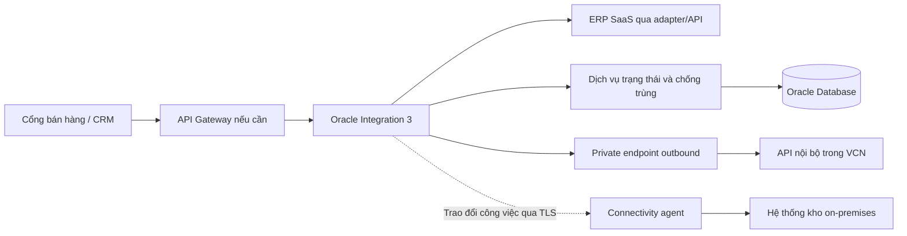
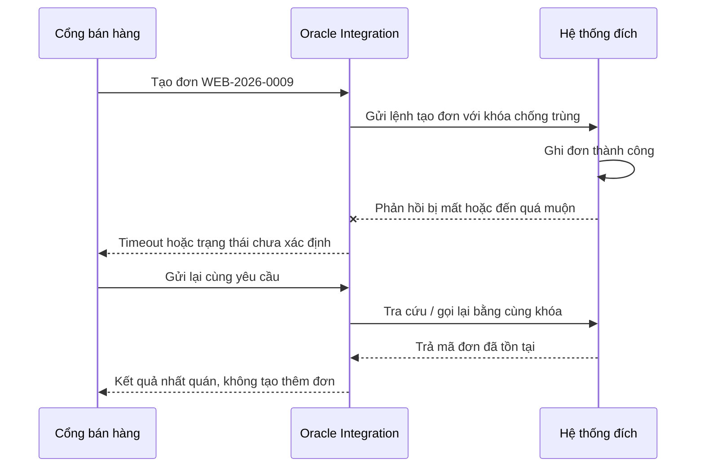

# Oracle Integration và kết nối ứng dụng doanh nghiệp

## 1. Mục tiêu và phạm vi

Trong chương **API, sự kiện và tích hợp** của module Oracle Cloud Infrastructure, Oracle Integration là lớp kết nối các hệ thống nghiệp vụ: CRM, ERP, HCM, ứng dụng nội bộ và cơ sở dữ liệu. Bài học dùng **Oracle Integration 3** làm mốc thuật ngữ; tài liệu cũ có thể dùng tên Oracle Integration Cloud hoặc OIC.

Sau bài học, người học có thể:

- Phân biệt adapter, connection, trigger, invoke và integration.
- Chọn luồng đồng bộ, bất đồng bộ, theo lịch hoặc theo sự kiện.
- Thiết kế kết nối SaaS và hệ thống trong mạng riêng với quyền truy cập phù hợp.
- Giải thích việc chống xử lý trùng, phục hồi lỗi và đối soát dữ liệu.
- Thực hành một luồng REST, quan sát lần chạy và lập phương án đưa sang môi trường thật.

Bài tập xoay quanh việc nhận đơn hàng từ cổng bán hàng rồi chuyển sang hệ thống xử lý đơn. Các cấu trúc JSON, tên integration và API nghiệp vụ dưới đây là **hợp đồng minh họa do bài học thiết kế**. Khi kết nối Oracle Fusion Cloud ERP thật, phải chọn đúng đối tượng, operation, schema và quyền của adapter/API được hỗ trợ.

## 2. Oracle Integration giải quyết vấn đề gì?

Giả sử doanh nghiệp có ba hệ thống:

1. CRM quản lý khách hàng và cơ hội bán hàng.
2. ERP ghi nhận chứng từ và nghiệp vụ tài chính.
3. Hệ thống kho tại trung tâm dữ liệu nội bộ quản lý xuất hàng.

Nếu từng hệ thống gọi trực tiếp mọi hệ thống còn lại, mỗi cặp phải tự giải quyết xác thực, chuyển đổi mã dữ liệu, xử lý lỗi và truy vết. Khi ERP thay đổi schema, nhiều ứng dụng có thể phải sửa cùng lúc.

Oracle Integration cung cấp môi trường thiết kế và thực thi tích hợp với adapter, ánh xạ dữ liệu và khả năng theo dõi luồng. Nhờ đó, nhóm phát triển có thể tập trung logic kết nối ở một nơi. Oracle giới thiệu dịch vụ theo hướng kết nối ứng dụng, dữ liệu và tự động hóa quy trình. [Nguồn: Oracle Integration concepts](https://docs.oracle.com/en/cloud/paas/application-integration/integrations-user/watch-video.html).

Trong thiết kế doanh nghiệp, vẫn phải xác định **hệ thống chủ quản dữ liệu**. Ví dụ, ERP quyết định mã hóa đơn chính thức; lớp tích hợp giữ quan hệ giữa mã đơn ở cổng bán hàng và mã ERP. Việc đặt một công cụ ở giữa không tự giải quyết xung đột dữ liệu hoặc bảo đảm giao dịch xuyên nhiều ứng dụng.

| Thành phần trong kiến trúc | Trách nhiệm nên giao |
| --- | --- |
| Oracle Integration | Điều phối kết nối, chuyển đổi thông điệp, gọi ứng dụng và xử lý lỗi tích hợp |
| API Gateway | Quản lý cửa vào API theo chính sách xác thực, định tuyến và kiểm soát lưu lượng đã cấu hình |
| Ứng dụng nghiệp vụ | Kiểm tra quy tắc miền nghiệp vụ và quyết định trạng thái chứng từ |
| Cơ sở dữ liệu hoặc dịch vụ trạng thái | Lưu kết quả, khóa chống trùng và tiến độ cần tồn tại lâu dài |
| Hàng đợi hoặc nền tảng streaming | Làm đệm, phân phối và xử lý thông điệp theo khả năng của công nghệ được chọn |

Bảng trên là phân công trách nhiệm cho kiến trúc tham chiếu. Không phải mọi luồng đều cần đủ các thành phần.

## 3. Những khái niệm cần dùng đúng

| Khái niệm | Ý nghĩa | Ví dụ trong bài |
| --- | --- | --- |
| Adapter | Cơ chế làm việc với giao thức hoặc ứng dụng cụ thể | REST Adapter, Oracle ERP Cloud Adapter |
| Connection | Cấu hình kết nối dựa trên adapter tới một hệ thống, gồm endpoint và bảo mật phù hợp | `ORDER_SERVICE_INVOKE` tới API xử lý đơn thử nghiệm |
| Trigger | Điểm nhận yêu cầu hoặc tín hiệu bắt đầu integration | REST `POST /orders` |
| Invoke | Một bước gọi từ integration tới hệ thống khác | Gọi API tạo đơn ở hệ thống đích |
| Mapper | Ánh xạ trường và chuyển đổi cấu trúc dữ liệu | `orderId` thành `externalOrderId` |
| Lookup | Bảng quy đổi giá trị giữa các hệ thống | `WEB_VN` thành `ONLINE_VN` |
| Integration | Luồng gồm điểm bắt đầu, ánh xạ, điều kiện, hành động và lời gọi | Luồng tạo đơn |
| Integration instance | Một lần thực thi của luồng | Lần xử lý đơn `WEB-2026-0009` |
| Project | Không gian tổ chức, quản lý vòng đời và theo dõi nhóm tài nguyên tích hợp | Giải pháp hoàn tất đơn hàng |
| Business identifier | Trường nghiệp vụ dùng để tìm lần chạy | `orderId` |

Một connection có thể được dùng trong nhiều bước hoặc luồng theo phạm vi chia sẻ được cấu hình. Tạo connection thành công chưa chứng minh toàn bộ nghiệp vụ hoạt động: tài khoản có thể xác thực được nhưng thiếu quyền tạo chứng từ, hoặc metadata đúng nhưng dữ liệu thực tế không hợp lệ.

Với Oracle Integration 3, project giúp tập hợp tài nguyên và quản lý deployment. Nên nhóm theo giải pháp nghiệp vụ có chung vòng đời, chẳng hạn `ORDER_FULFILLMENT`, thay vì gom mọi luồng của doanh nghiệp vào một project khổng lồ. [Nguồn: About Projects](https://docs.oracle.com/en/cloud/paas/application-integration/integrations-user/integration-projects.html).

## 4. Chọn cách khởi chạy và cách trả kết quả

**Cách khởi chạy** và **quan hệ chờ kết quả** là hai quyết định khác nhau.

### 4.1. Application integration

Luồng bắt đầu khi nhận yêu cầu hoặc tín hiệu từ ứng dụng qua trigger phù hợp. Với REST, có thể thiết kế:

- **Đồng bộ:** bên gọi chờ integration trả kết quả xử lý.
- **Bất đồng bộ:** bên gọi gửi yêu cầu; kết quả nghiệp vụ được theo dõi hoặc chuyển về qua cơ chế riêng.

Đồng bộ phù hợp với thao tác ngắn, cần kết quả ngay và có thời gian xử lý dự đoán được. Bất đồng bộ phù hợp hơn khi cần chờ ERP nhập dữ liệu, xử lý khối lượng lớn hoặc phối hợp nhiều hệ thống. Oracle mô tả lựa chọn này trong hướng dẫn về application integrations. [Nguồn: Synchronous and asynchronous integrations](https://docs.oracle.com/en/cloud/paas/application-integration/integrations-user/how-choose-between-synchronous-asynchronous-integrations.html).

Một HTTP response xác nhận tiếp nhận chưa chứng minh ERP đã ghi nhận đơn hàng. Nếu API công bố `202 Accepted`, hợp đồng phải chỉ rõ cách lấy trạng thái cuối cùng; mã HTTP này không tự tạo ra hàng đợi bền vững hay API tra cứu.

### 4.2. Schedule integration

Luồng chạy theo lịch, phù hợp với các tình huống như lấy thay đổi định kỳ, xử lý tệp hoặc đối soát cuối ngày. Trong thiết kế lấy dữ liệu tăng dần, cần lưu mốc tiến độ và chỉ cập nhật sau khi phần dữ liệu tương ứng được xử lý an toàn.

Ví dụ, nếu lấy khách hàng cập nhật từ 08:00 đến 08:05 nhưng lỗi giữa chừng, việc đặt mốc ngay thành 08:05 có thể làm mất phần chưa xử lý. Một phương án là chia trang, lưu checkpoint và dùng khóa chống trùng khi đọc chồng lấn cửa sổ thời gian. Đây là logic ứng dụng cần thiết kế thêm. [Tham khảo mẫu khởi tạo Application và Schedule: Oracle tutorial](https://docs.oracle.com/en/cloud/paas/application-integration/integrations-user/build-your-first-integration-from-scratch.html).

### 4.3. Event integration

Oracle Integration hỗ trợ định nghĩa sự kiện, publish từ một integration và subscribe bằng event integration. Cách này giúp bên phát và bên nhận có vòng đời tương đối độc lập. [Nguồn: About Event Integrations](https://docs.oracle.com/en/cloud/paas/application-integration/integrations-user/event-integrations.html).

Cần phân biệt ba nguồn sự kiện trong kiến trúc:

- Sự kiện nghiệp vụ do ứng dụng SaaS phát, được nhận qua adapter và cấu hình ứng dụng tương ứng.
- Sự kiện publish/subscribe trong Oracle Integration.
- Sự kiện tài nguyên OCI do dịch vụ OCI Events xử lý.

Không giả định ba cơ chế này dùng chung schema, quyền hay đường truyền. Khi cần nối chúng, phải chỉ rõ thành phần nhận, xác thực, chuyển đổi và chuyển tiếp.

## 5. Kiến trúc kết nối SaaS và mạng riêng

Sơ đồ sau mô tả kiến trúc tham chiếu. Mỗi nhánh sử dụng connection riêng; API Gateway là lựa chọn khi cần một cửa vào được quản trị tập trung.



### 5.1. Kết nối SaaS công khai

Chọn adapter ứng dụng khi nó hỗ trợ đúng operation cần dùng. REST/SOAP là phương án khi endpoint mục tiêu có API phù hợp nhưng không có operation cần thiết trong adapter chuyên dụng.

Oracle ERP Cloud Adapter hỗ trợ những API và business event được Oracle công bố, bao gồm các tình huống nhập dữ liệu bulk và thông báo hoàn tất. Khi triển khai, phải kiểm tra operation, điều kiện bật event và quyền tương ứng trong ERP. [Nguồn: Oracle ERP Cloud Adapter Capabilities](https://docs.oracle.com/en/cloud/paas/application-integration/erp-adapter/oracle-erp-cloud-adapter-capabilities.html).

Thiết kế nghiệp vụ nên tách trạng thái “đã gửi yêu cầu import” khỏi “job import thành công”. Với batch, còn cần kiểm tra số dòng được chấp nhận và số dòng lỗi. Không ghi trực tiếp vào cơ sở dữ liệu SaaS để bỏ qua API nghiệp vụ.

### 5.2. Private endpoint cho lời gọi outbound

Private endpoint của Oracle Integration phục vụ kết nối outbound tới tài nguyên riêng, với hỗ trợ phụ thuộc adapter. Đặt tên “private endpoint” không đồng nghĩa tất cả luồng vào/ra của instance đều đã được chuyển thành private. [Nguồn: Private Endpoint vs. Connectivity Agent](https://docs.oracle.com/en-us/iaas/application-integration/doc/private-endpoint-vs-connectivity-agent.html).

Trước khi thử nghiệp vụ, nhóm hạ tầng cần kiểm tra:

1. DNS trả về đúng địa chỉ cho tên máy đích.
2. Định tuyến tới đích và đường trả về tồn tại.
3. NSG, security list và firewall cho phép đúng cổng.
4. Chứng thư TLS khớp hostname và chuỗi tin cậy.
5. Adapter/connection đang chọn đúng phương thức truy cập.

Compartment tổ chức tài nguyên và phạm vi quyền quản trị; việc đưa instance và database vào cùng compartment không tự tạo kết nối mạng.

### 5.3. Connectivity agent cho hệ thống nội bộ

Connectivity agent chạy trong môi trường có thể truy cập ứng dụng nội bộ. Agent chủ động tạo kết nối outbound, lấy công việc từ Oracle Integration và gửi kết quả qua TLS. REST/SOAP callback không đi ngược qua agent mà gọi trực tiếp endpoint Oracle Integration. Vì vậy, không coi agent là reverse proxy cho mọi lời gọi inbound. [Nguồn: About the Connectivity Agent](https://docs.oracle.com/en/cloud/paas/application-integration/integrations-user/connectivity-agent.html).

Trong thiết kế hệ thống kho, cần mô tả riêng hai đường: integration gọi kho và kho gửi callback. Nếu callback bị firewall chặn, kiểm thử invoke thành công vẫn chưa chứng minh quy trình hai chiều hoạt động.

## 6. Phân quyền và quản lý thông tin kết nối

Có ba lớp quyền cần cấu hình riêng:

| Lớp quyền | Câu hỏi phải trả lời |
| --- | --- |
| OCI IAM cho tài nguyên | Ai được tạo, sửa hoặc quản lý instance trong compartment? |
| Vai trò trong Oracle Integration | Ai được thiết kế, giám sát hoặc gọi integration? |
| Quyền tại ứng dụng đích | Tài khoản tích hợp được thao tác dữ liệu nào trong ERP, CRM hoặc database? |

Oracle Integration có các vai trò định sẵn như `ServiceAdministrator`, `ServiceDeveloper`, `ServiceMonitor` và `ServiceInvoker`. `ServiceInvoker` phục vụ gọi luồng; vai trò này không cho dùng giao diện quản trị hoặc Developer APIs. Không gán `ServiceAdministrator` cho mọi client chỉ để vượt qua lỗi quyền. [Nguồn: Service Roles](https://docs.oracle.com/en-us/iaas/application-integration/doc/oracle-integration-roles.html).

Với OAuth, xác thực inbound, outbound và Developer APIs là các trường hợp cấu hình riêng. Developer APIs yêu cầu OAuth; grant type và vai trò phải phù hợp API được gọi. [Nguồn: Where Can You Use OAuth?](https://docs.oracle.com/en/cloud/paas/application-integration/integrations-user/where-can-you-use-oauth-oracle-integration.html).

Trong triển khai:

- Dùng danh tính kỹ thuật riêng theo môi trường và mục đích.
- Đặt credential trong cấu hình bảo mật được dịch vụ hỗ trợ; không đưa token, password vào mapper, lookup, Git hoặc payload mẫu.
- Cấp quyền đọc/ghi nhỏ nhất ở hệ thống đích, kể cả quyền truy cập dữ liệu theo tổ chức nghiệp vụ.
- Theo dõi hạn token, secret và chứng thư; diễn tập đổi credential.
- Phân quyền xem payload vì log có thể chứa thông tin khách hàng.

Nếu đặt API Gateway phía trước, phải thiết kế rõ danh tính mà gateway sử dụng khi gọi backend. Xác thực client ở gateway không tự cấp quyền gọi Oracle Integration.

## 7. Hợp đồng dữ liệu và ánh xạ nghiệp vụ

Một hợp đồng tốt mô tả cấu trúc, ý nghĩa trường, phiên bản, quy tắc lỗi và cách phát lại. Chỉ cung cấp JSON mẫu chưa đủ để xác định trường bắt buộc hoặc giới hạn hợp lệ.

Thông điệp minh họa từ cổng bán hàng:

```json
{
  "schemaVersion": "1.0",
  "messageId": "msg-web-2026-0009-v1",
  "orderId": "WEB-2026-0009",
  "sourceSystem": "WEB_VN",
  "occurredAt": "2026-11-20T09:00:00+07:00",
  "customerCode": "CUST-010",
  "currency": "VND",
  "lines": [
    {
      "lineNumber": 1,
      "sku": "BOOK-OCI",
      "quantity": 2,
      "unitPrice": 250000
    }
  ]
}
```

Hợp đồng này quy định:

- `messageId` nhận diện một thông điệp; gửi lại cùng thông điệp phải giữ nguyên mã.
- `orderId` nhận diện đơn hàng trong hệ thống nguồn.
- `occurredAt` có offset múi giờ; không dùng chuỗi thời gian thiếu ngữ cảnh.
- `currency` là mã tiền tệ; số lượng và giá phải được kiểm tra theo quy tắc nghiệp vụ.
- `lines` phải có ít nhất một phần tử; mỗi dòng cần mã hàng và số lượng hợp lệ.
- Thay đổi làm mất tương thích phải có phương án phiên bản và chuyển đổi cho bên nhận.

Một lần cập nhật hợp lệ của đơn cũ có thể dùng cùng `orderId` nhưng một `messageId` mới, kèm phiên bản nghiệp vụ nếu hệ thống hỗ trợ cập nhật. Vì vậy, khóa chống trùng cần gắn với **operation**, không chỉ chọn một trường rồi dùng cho tất cả tình huống.

### 7.1. Ánh xạ sang hợp đồng đích

| Dữ liệu nguồn | Dữ liệu đích minh họa | Quy tắc |
| --- | --- | --- |
| `orderId` | `externalOrderId` | Giữ nguyên để đối soát |
| `sourceSystem` | `salesChannel` | Lookup từ `WEB_VN` sang `ONLINE_VN` |
| `customerCode` | `customerReference` | Kiểm tra quan hệ mã khách hàng giữa hai hệ thống |
| `lines[].sku` | `items[].itemCode` | Đối chiếu danh mục hàng |
| `lines[].quantity` | `items[].orderedQuantity` | Giữ kiểu số, kiểm tra lớn hơn 0 |
| `occurredAt` | `sourceTimestamp` | Chuẩn hóa định dạng mà API đích chấp nhận |

Nếu ERP dùng mã khách hàng riêng, không thể giả định `CUST-010` ở CRM chính là khóa ERP. Nên dùng bảng đối chiếu mã hoặc dịch vụ tra cứu đã có chủ sở hữu dữ liệu.

Lookup phù hợp với tập mã quy đổi nhỏ, được quản trị. Không dùng lookup để giữ secret hoặc thay thế kho dữ liệu giao dịch. Oracle lưu ý rằng sửa lookup đang được luồng active sử dụng thường có hiệu lực mà không cần kích hoạt lại luồng; vì vậy thay đổi lookup cũng phải được kiểm soát như thay đổi hành vi. [Nguồn: Manage Lookups](https://docs.oracle.com/en/cloud/paas/application-integration/integrations-user/managing-lookups.html).

### 7.2. Phân biệt dữ liệu thiếu, rỗng và mặc định

Ví dụ, thiếu `currency` không nhất thiết mang cùng ý nghĩa với `currency: ""`. Nếu mặc định mọi yêu cầu thành VND, đơn ngoại tệ có thể bị ghi sai mà không sinh lỗi kỹ thuật.

Với mỗi trường, cần quyết định rõ: bắt buộc, cho phép rỗng, có giá trị mặc định hay phải từ chối. Tiền tệ còn cần quy tắc làm tròn và độ chính xác; không dựa vào chuyển kiểu chuỗi ngầm định.

## 8. Thiết kế luồng đầu cuối

Một luồng tạo đơn có thể được thiết kế theo trình tự:

1. Nhận và xác thực yêu cầu.
2. Kiểm tra schema và điều kiện nghiệp vụ cơ bản.
3. Xác định khóa chống trùng cho operation tạo đơn.
4. Quy đổi mã và bổ sung dữ liệu cần thiết.
5. Gọi ứng dụng đích.
6. Ghi nhận mã đích và kết quả xử lý.
7. Trả phản hồi hoặc cập nhật trạng thái cho bên gọi.
8. Đưa lỗi chưa xử lý được vào quy trình phục hồi, có người chịu trách nhiệm.

Trong bài thực hành, luồng đồng bộ chỉ gọi một API giả lập. Trong triển khai thực, nếu ERP cần import lâu, nên tách tiếp nhận khỏi xử lý hoàn tất. Cơ chế tiếp nhận phải lưu yêu cầu hoặc đưa vào kênh bền vững trước khi công bố rằng đã nhận thành công.

### 8.1. Theo dõi bằng business identifier

Dùng `orderId` làm business identifier chính và `messageId`, `sourceSystem` làm hai trường bổ sung nếu cần. Oracle Integration cho phép tối đa ba business identifier, trong đó một trường là chính; giá trị được chọn từ dữ liệu nguồn phù hợp. [Nguồn: Assign Business Identifiers](https://docs.oracle.com/en/cloud/paas/application-integration/integrations-user/assign-business-identifiers-tracking-fields-messages.html).

Business identifier giúp tìm lần chạy. Nó **không tạo unique constraint**, không khóa đơn hàng và không ngăn hai lần chạy song song.

Mã nghiệp vụ ở hệ thống đích, như `targetOrderId`, vẫn cần được lưu trong dữ liệu đối soát và phản hồi. Không phụ thuộc hoàn toàn vào thời gian lưu lịch sử runtime của công cụ.

### 8.2. Giữ luồng dễ vận hành

Mỗi integration nên có mục đích rõ ràng: tiếp nhận đơn, gọi tạo đơn, nhận callback hoặc đối soát. Một luồng chứa toàn bộ nghiệp vụ của nhiều phòng ban sẽ khó kiểm thử và khó xác định phạm vi lỗi.

Tách luồng cũng tạo thêm ranh giới lỗi và nhu cầu truy vết. Vì vậy, chỉ tách khi có lý do như khác thời gian xử lý, quyền truy cập, khả năng tái sử dụng hoặc vòng đời phát hành.

## 9. Chống trùng và tính nhất quán giữa các hệ thống

### 9.1. Timeout tạo ra kết quả chưa biết

Xét tình huống sau:



Phần tra cứu hoặc gọi lại an toàn trong sơ đồ là **yêu cầu của thiết kế ứng dụng đích**. Oracle Integration không tự bổ sung tính năng này cho mọi API.

Nếu coi timeout là “chắc chắn chưa tạo đơn” rồi gửi một lệnh mới, hệ thống có thể tạo hai đơn. Trước khi retry thao tác ghi, phải biết đích hỗ trợ idempotency key, external reference duy nhất hoặc operation tra cứu nào.

### 9.2. Một mô hình trạng thái minh họa

Dịch vụ trạng thái do doanh nghiệp xây dựng có thể lưu:

| Trường | Mục đích |
| --- | --- |
| `sourceSystem`, `operation`, `orderId` | Khóa nghiệp vụ cho thao tác tạo đơn |
| `messageId` | Nhận diện thông điệp và lần phát lại |
| `payloadHash` | Phát hiện cùng khóa nhưng nội dung khác |
| `status` | `PROCESSING`, `SUCCEEDED`, `REJECTED`, `UNKNOWN` |
| `targetOrderId` | Tham chiếu bản ghi đã tạo ở đích |
| `updatedAt`, `attemptCount` | Phục vụ kiểm soát tiến độ và phục hồi |

Việc giữ khóa cần thực hiện nguyên tử, chẳng hạn dùng unique constraint và thao tác ghi có kiểm soát trong Oracle Database. Hai bước “SELECT chưa có” rồi “INSERT” riêng lẻ vẫn có thể chạy đua. Không giữ một giao dịch database dài trong suốt thời gian chờ mạng.

Cách phản ứng đề xuất:

- **Đã thành công, cùng nội dung:** trả kết quả đã lưu.
- **Đang xử lý:** trả trạng thái hiện có; không tự khởi tạo thêm thao tác.
- **Cùng khóa, khác nội dung:** từ chối xung đột theo hợp đồng.
- **Không rõ kết quả ở đích:** đưa sang đối soát, không vội coi là chưa thực hiện.
- **Worker chết khi đang xử lý:** dùng thời hạn giữ quyền xử lý và quy trình thu hồi có kiểm tra trạng thái đích.

Kho chống trùng ở giữa vẫn có khoảng hở: hệ thống đích có thể ghi thành công trước khi integration cập nhật kết quả vào kho. Muốn khép khoảng hở đó, cần khả năng chống trùng hoặc tra cứu ở đích. Không thể suy ra bảo đảm “exactly once” chỉ từ việc có bảng trạng thái.

### 9.3. Nhiều bước không tạo thành một giao dịch chung

Giả sử tạo đơn ở ERP thành công nhưng giữ hàng ở kho thất bại. Rollback một giao dịch database cục bộ không xóa được đơn ERP qua API.

Cần chọn một chính sách nghiệp vụ: giữ đơn ở trạng thái chờ, thử giữ hàng lại, chuyển sang xử lý thủ công hoặc gọi operation hủy đơn nếu hợp lệ. Hành động bù có thể bị từ chối, ví dụ khi đơn đã chuyển sang xuất kho, nên bản thân nó cũng phải được theo dõi.

## 10. Xử lý lỗi, retry và resubmit

### 10.1. Phân loại lỗi trước khi chọn hành động

| Tình huống | Hành động thiết kế đề xuất |
| --- | --- |
| Thiếu mã khách hàng hoặc sai kiểu dữ liệu | Từ chối rõ lý do; nguồn sửa dữ liệu trước khi gửi lại |
| 401/403 | Kiểm tra token, scope, vai trò và quyền dữ liệu; tránh retry lặp vô ích |
| 429 | Giảm tốc, tôn trọng `Retry-After` nếu có và giới hạn số lần thử |
| Lỗi kết nối hoặc 5xx | Xem khả năng tạm thời và tính an toàn khi lặp thao tác |
| Timeout sau lệnh tạo | Xác định kết quả ở đích hoặc dùng cùng khóa chống trùng |
| Không có mã quy đổi | Chuyển lỗi dữ liệu cấu hình; không tự gán mã ngẫu nhiên |

Đây là chính sách kiến trúc được đề xuất, không phải mặc định áp dụng cho mọi adapter.

### 10.2. Scope và global fault handler

Dùng Scope để gom các bước có cùng ranh giới xử lý lỗi. Ví dụ, một scope bao quanh ánh xạ và lời gọi tạo đơn; handler thu thập lỗi cùng `orderId` rồi quyết định trả lỗi, thử lại hay đưa vào đối soát.

Oracle lưu ý với invoke dùng connectivity agent, lỗi phải được xử lý qua default fault handler của scope thay vì dựa vào named fault handler. [Nguồn: Scope Action](https://docs.oracle.com/en/cloud/paas/application-integration/integrations-user/manage-group-actions-scope-action.html).

Global fault handler là lớp xử lý lỗi toàn luồng. Nếu handler xử lý xong lỗi, lần chạy có thể hiện `Succeeded`. Vì vậy, cần lưu trạng thái nghiệp vụ riêng; gửi email thông báo lỗi thành công không có nghĩa đơn hàng đã được tạo. [Nguồn: Global Fault Handling](https://docs.oracle.com/en/cloud/paas/application-integration/integrations-user/add-global-faults-orchestrated-integrations.html).

### 10.3. Retry lời gọi và resubmit lần chạy là hai thao tác khác nhau

**Retry invoke** thử lại một lời gọi trong logic luồng. Tính năng **Add Retry Logic** trong project tạo logic thử lại cho invoke; tài liệu hiện hành nêu rằng nó bao gồm mọi loại fault của invoke, không chỉ lỗi mạng. Phải kiểm tra logic được sinh trước khi áp dụng cho thao tác ghi. [Nguồn: Add Retry Logic](https://docs.oracle.com/en/cloud/paas/application-integration/integrations-user/retry-invoke-connections-project.html).

Với chính sách tùy chỉnh, có thể thiết kế thời gian chờ tăng dần, giới hạn số lần và tổng thời gian, đồng thời thêm jitter để tránh nhiều client thử lại cùng lúc. Các quy tắc này cần được triển khai rõ bằng công cụ được hỗ trợ; không mặc định nút Add Retry Logic đã cung cấp đủ.

**Resubmit** là phục hồi một integration instance đã lỗi. Oracle Integration không tự resubmit mọi message lỗi. Luồng đồng bộ không resubmit được; khả năng phục hồi luồng bất đồng bộ có ngoại lệ, gồm scheduled flow có scheduled parameters, và chịu cửa sổ phục hồi. Vị trí bắt đầu lại phụ thuộc thiết kế. [Nguồn: Resubmit Failed Messages](https://docs.oracle.com/en/cloud/paas/application-integration/integrations-user/resubmit-failed-messages.html).

Trước resubmit, người vận hành cần biết:

1. Lỗi gốc đã được sửa chưa?
2. Bước nào đã tạo tác động tại ứng dụng đích?
3. Phát lại có dùng cùng khóa chống trùng không?
4. Nếu kết quả chưa rõ, đã tra cứu đích chưa?
5. Ai theo dõi kết quả phục hồi và đóng sự cố?

Không nhấn phát lại hàng loạt chỉ vì endpoint đã hoạt động trở lại.

## 11. Quan sát kỹ thuật và đối soát nghiệp vụ

Oracle Integration cung cấp theo dõi instance, business identifier và chi tiết thực thi. Dùng các thông tin này để tìm đúng lần chạy và xác định bước lỗi. [Nguồn: Track Integration Instances](https://docs.oracle.com/en/cloud/paas/application-integration/integrations-user/track-integration-instances.html).

Trong vận hành, nên theo dõi hai nhóm chỉ số:

| Nhóm | Ví dụ | Quyết định hỗ trợ |
| --- | --- | --- |
| Kỹ thuật | Lưu lượng, tỷ lệ lỗi, thời gian xử lý p95, số lần gọi đích | Phát hiện chậm hoặc lỗi kết nối |
| Tiến độ | Số yêu cầu đang chờ, tuổi yêu cầu lâu nhất | Phát hiện backlog |
| Nghiệp vụ | Đơn nguồn so với đơn đã có mã đích, batch có dòng bị loại | Phát hiện dữ liệu chưa hoàn tất |
| Phục hồi | Số lần retry, yêu cầu UNKNOWN, thời gian chưa đối soát | Ưu tiên xử lý sự cố |
| Phụ thuộc | Agent, credential, chứng thư, API đích | Tìm điểm gây gián đoạn |

Các chỉ số nghiệp vụ và trạng thái đề xuất cần thu thập từ ứng dụng/kho đối soát nếu chưa có sẵn trong runtime.

Với backlog bất đồng bộ nội bộ của Oracle Integration, Oracle có metric theo dõi độ sâu hàng chờ và hướng dẫn tạo alarm. Không coi dung lượng chờ là vô hạn. [Nguồn: Asynchronous Message Queue Depth](https://docs.oracle.com/en-us/iaas/application-integration/doc/asynchronous-queue-depth.html).

Một SLO minh họa là “99% yêu cầu hợp lệ có kết quả cuối cùng trong 5 phút”. SLO này khác “99% HTTP request được tiếp nhận”. Đối soát cuối ngày cần so sánh theo khóa, số lượng và giá trị nghiệp vụ; chỉ so tổng số bản ghi có thể bỏ sót trường hợp một đơn bị thiếu và một đơn bị trùng.

Khi bật trace chi tiết để điều tra, phải giới hạn thời gian và phạm vi. Log hữu ích nên có integration/version, mã instance, khóa nghiệp vụ, bước lỗi và mã lỗi đã lọc; tránh ghi toàn bộ token hoặc thông tin khách hàng.

## 12. Thực hành: REST từ cổng bán hàng tới dịch vụ xử lý đơn

### 12.1. Điều kiện và phạm vi bài thực hành

Chuẩn bị một instance Oracle Integration 3 dùng cho phát triển, quyền thiết kế phù hợp và client OAuth có quyền gọi integration. Instance cần được tạo trong compartment và region theo quy ước của môi trường học.

Để thực hành invoke, chuẩn bị **API giả lập do người học kiểm soát**, có HTTPS hợp lệ và đường mạng mà Oracle Integration truy cập được. Không dùng endpoint sản xuất hoặc gửi dữ liệu cá nhân thật tới dịch vụ thử nghiệm công cộng.

API giả lập cần đáp ứng hợp đồng tối thiểu:

- Nhận `POST /orders`.
- Chấp nhận request theo mẫu bên dưới.
- Trả HTTP 200 và JSON theo mẫu phản hồi.
- Có thể chuyển sang trả HTTP 500 để kiểm tra lỗi invoke.
- Có cách xem request đã nhận, phục vụ xác minh mapper.

Hợp đồng request của API giả lập:

```json
{
  "externalOrderId": "WEB-2026-0009",
  "salesChannel": "ONLINE_VN",
  "customerReference": "CUST-010",
  "currencyCode": "VND",
  "items": [
    {
      "itemCode": "BOOK-OCI",
      "orderedQuantity": 2,
      "unitPrice": 250000
    }
  ]
}
```

Phản hồi mẫu từ API giả lập:

```json
{
  "targetOrderId": "MOCK-0009",
  "status": "CREATED"
}
```

Đây là API để học kết nối; `MOCK-0009` không phải chứng từ ERP thật. Phiên bản tối thiểu của bài thực hành chưa triển khai kho chống trùng. Phần thử nghiệm chống trùng chỉ thực hiện khi bổ sung dịch vụ trạng thái và API đích đáp ứng thiết kế ở mục 9.

### 12.2. Tạo project, connection và lookup

1. Trong Projects, tạo project `ORDER_FULFILLMENT_LAB`.
2. Tạo connection REST dùng làm trigger, đặt tên `ORDER_REST_TRIGGER`.
3. Chọn cấu hình bảo mật inbound phù hợp OAuth của môi trường.
4. Tạo connection REST invoke `ORDER_SERVICE_INVOKE`, cấu hình base URL và thông tin bảo mật của API giả lập.
5. Test connection. Nếu lỗi, xử lý xác thực, TLS hoặc kết nối trước khi xây logic nghiệp vụ.
6. Tạo lookup `SALES_CHANNEL_MAP` với hai cột nguồn/đích và dòng `WEB_VN → ONLINE_VN`.

Không gắn credential production vào connection thử nghiệm. Kết quả Test connection cũng cần được bổ sung bằng kiểm thử operation thực tế.

### 12.3. Xây application integration

Tạo application integration `CREATE_ORDER_LAB`, phiên bản ban đầu theo quy ước của instance.

Thiết kế theo thứ tự:

1. Thêm REST trigger, chọn `POST`, resource path `/orders`.
2. Khai báo request theo JSON ở mục 7 và response thành công theo mẫu dưới đây. Đây là luồng đồng bộ.
3. Thêm Switch kiểm tra `orderId`, `customerCode`, danh sách dòng và số lượng. Thiết kế nhánh lỗi bằng Throw New Fault khi dữ liệu không hợp lệ.
4. Kiểm tra mã nguồn có quy đổi hợp lệ; với bài lab chỉ chấp nhận `WEB_VN`. Không dùng giá trị mặc định để che lỗi mã chưa cấu hình.
5. Thêm Scope cho bước gọi dịch vụ đích.
6. Thêm REST invoke `POST /orders`, khai báo request/response của API giả lập.
7. Trong mapper trước invoke, ánh xạ các trường và danh sách dòng theo bảng ở mục 7; dùng lookup cho `salesChannel`.
8. Trong mapper phản hồi, lấy `orderId` từ trigger, `targetOrderId` từ invoke và đặt trạng thái nghiệp vụ `COMPLETED` khi invoke thành công.
9. Gán business identifier chính là `orderId`; bổ sung `messageId`, `sourceSystem` nếu cần.
10. Trong fault handler, giữ thông tin phục vụ theo dõi và để lỗi chưa giải quyết đi vào cơ chế lỗi. Không trả phản hồi `COMPLETED` cho nhánh invoke thất bại.
11. Kiểm tra lỗi cấu hình trên canvas, lưu và activate integration.

Dùng Expression Builder để chọn đường dẫn trường, kiểu dữ liệu và hàm phù hợp schema thực tế; không sao chép XPath có namespace từ một integration khác.

Response thành công của integration:

```json
{
  "orderId": "WEB-2026-0009",
  "targetOrderId": "MOCK-0009",
  "status": "COMPLETED"
}
```

Đường dẫn `/orders` trong wizard là resource path; URL gọi đầy đủ còn chứa phần endpoint do Oracle Integration tạo. Sau activation, sao chép **runtime endpoint thực tế** từ instance. Không dùng URL Developer API hoặc tự ghép đường dẫn từ tên integration.

### 12.4. Gọi thử bằng PowerShell

Đặt `OIC_ORDER_ENDPOINT` và `OIC_ACCESS_TOKEN` trong môi trường shell theo cấu hình được cấp. Token phải đúng audience/scope và quyền gọi instance; snippet không thực hiện quy trình xin token.

```powershell
$endpoint = $env:OIC_ORDER_ENDPOINT
$accessToken = $env:OIC_ACCESS_TOKEN

if ([string]::IsNullOrWhiteSpace($endpoint) -or
    [string]::IsNullOrWhiteSpace($accessToken)) {
    throw 'Thieu OIC_ORDER_ENDPOINT hoac OIC_ACCESS_TOKEN.'
}

$payload = @{
    schemaVersion = '1.0'
    messageId = 'msg-web-2026-0009-v1'
    orderId = 'WEB-2026-0009'
    sourceSystem = 'WEB_VN'
    occurredAt = '2026-11-20T09:00:00+07:00'
    customerCode = 'CUST-010'
    currency = 'VND'
    lines = @(
        @{
            lineNumber = 1
            sku = 'BOOK-OCI'
            quantity = 2
            unitPrice = 250000
        }
    )
} | ConvertTo-Json -Depth 6

$invokeParameters = @{
    Method = 'Post'
    Uri = $endpoint
    Headers = @{ Authorization = "Bearer $accessToken" }
    ContentType = 'application/json; charset=utf-8'
    Body = $payload
}

$response = Invoke-RestMethod @invokeParameters
$response | ConvertTo-Json -Depth 6
```

Không in token ra màn hình hoặc lưu vào tài liệu nộp bài. Kết quả mong đợi là response nghiệp vụ đã cấu hình, có `orderId` đúng và `targetOrderId` từ mock.

### 12.5. Xác minh kết quả và thử lỗi có kiểm soát

Vào phần Observe của project hoặc Observability phù hợp, tìm bằng `orderId` và đối chiếu activity stream với request nhận được tại mock.

| Ca thử | Kết quả cần quan sát |
| --- | --- |
| Yêu cầu hợp lệ | Mock nhận đúng dữ liệu ánh xạ; response có mã đích |
| `quantity = 0` | Nhánh kiểm tra dữ liệu phát lỗi trước invoke |
| Mã nguồn không được hỗ trợ | Luồng không gửi mã đích mặc định sai |
| Token không hợp lệ | Bị từ chối ở lớp xác thực; có thể chưa tạo instance nghiệp vụ |
| Mock trả HTTP 500 | Invoke lỗi; không có response nghiệp vụ thành công giả |
| Bật retry cho invoke rồi mock trả lỗi | Activity stream thể hiện đúng số lần gọi lại đã thiết kế |

Nếu cần trả mã 400/422 và cấu trúc lỗi công khai ổn định, hãy cấu hình hợp đồng lỗi REST tương ứng rồi kiểm thử riêng. Throw New Fault trong lab không tự bảo đảm mã HTTP và body lỗi mà doanh nghiệp mong muốn.

Để mở rộng sang chống trùng, bổ sung kho trạng thái và cơ chế ở đích, rồi thử cùng yêu cầu hai lần, hai yêu cầu song song và mất phản hồi sau khi đích đã ghi dữ liệu. Mỗi ca phải đối chiếu số bản ghi thực tế, không chỉ so nội dung response.

Khi kết thúc, tắt lịch nếu có, deactivate integration không còn dùng và thu hồi credential thử nghiệm theo quy trình môi trường. Việc deactivate luồng không đồng nghĩa đã dừng mọi chi phí của instance và hạ tầng phụ thuộc.

## 13. Quản lý phiên bản và tự động hóa triển khai

Nên có ranh giới rõ giữa development, test và production. Dùng endpoint, danh tính và bộ dữ liệu riêng; tránh để một lần test gọi nhầm ERP production.

Một quy trình phát hành đề xuất:

1. Tạo phiên bản thay đổi trong development.
2. Chạy các ca hợp đồng và lỗi quan trọng với hệ thống sandbox.
3. Tạo project deployment gồm đúng phiên bản cần phát hành.
4. Export artifact và lưu cùng thông tin phiên bản, cấu hình kỳ vọng, kế hoạch phục hồi.
5. Import vào môi trường đích.
6. Kiểm tra endpoint, connection, credential, certificate, lookup và lịch chạy.
7. Activate theo trình tự đã thống nhất; chạy smoke test và đối soát kết quả.
8. Theo dõi giai đoạn đầu rồi đóng thay đổi.

Oracle hỗ trợ export project/project deployment dưới dạng `.CAR`. Tài nguyên kết nối chia sẻ từ xa và một số cấu hình override có quy tắc export riêng; artifact không nên được coi là bản sao đầy đủ của mọi phụ thuộc môi trường. [Nguồn: Export a Project](https://docs.oracle.com/en/cloud/paas/application-integration/integrations-user/export-project.html).

Có thể tự động hóa thao tác được hỗ trợ bằng Developer APIs, sử dụng danh tính riêng và OAuth. Pipeline phải chờ kết quả import/activation rồi mới kiểm thử runtime. “API triển khai trả thành công” và “nghiệp vụ đầu cuối thành công” là hai điều cần xác minh riêng.

Kế hoạch quay lại phiên bản cũ cần trả lời:

- Có còn endpoint/schema tương thích với bên gọi không?
- Phiên bản mới đã tạo dữ liệu nào ở hệ thống đích?
- Schedule hoặc event subscription có nguy cơ chạy trùng không?
- Kho chống trùng có nhận diện được thông điệp giữa hai phiên bản không?

Khôi phục artifact cũ không hoàn tác chứng từ đã tạo.

## 14. Tính sẵn sàng và phương án phục hồi

Dịch vụ được quản lý giúp giảm việc vận hành máy chủ runtime, nhưng độ sẵn sàng đầu cuối còn phụ thuộc DNS, mạng, agent, token, ứng dụng đích và dữ liệu trạng thái.

Với agent group, Oracle hướng dẫn tối đa hai agent và đặt trên hai host để đạt khả năng chịu lỗi host; cả hai phải truy cập được cùng endpoint. Hai tiến trình trên một VM vẫn cùng mất khi VM hỏng. [Nguồn: Workflows for the Connectivity Agent](https://docs.oracle.com/en/cloud/paas/application-integration/integrations-user/workflow-using-connectivity-agent.html).

Trong thiết kế doanh nghiệp, cần diễn tập:

- Một host agent ngừng hoạt động.
- API ERP gián đoạn trong một khoảng thời gian.
- Secret hoặc certificate hết hạn.
- Luồng bị lỗi sau khi một bước đã ghi dữ liệu.
- Khôi phục kho trạng thái từ bản sao lưu.
- Chuyển vùng theo phương án DR đã chọn.

Xác định **RTO** là thời gian mục tiêu để khôi phục dịch vụ và **RPO** là mức mất dữ liệu theo thời gian có thể chấp nhận. Các mục tiêu phải tính cả bản ghi tiếp nhận, trạng thái chống trùng và dữ liệu ở ứng dụng đích.

Nếu dùng khả năng DR của dịch vụ, cần kiểm tra edition, tính khả dụng tại vùng và cấu hình được hỗ trợ. Nếu tổ chức tự xây phương án phục hồi, export metadata chỉ là một phần; còn cần credential, kết nối, DNS, dữ liệu bền vững và trình tự bật lại luồng.

Sau khôi phục, đối soát trước khi phát lại hàng loạt. Tránh để hai môi trường đồng thời chạy cùng schedule hoặc cùng xử lý một nguồn nếu chưa có thiết kế phân công và chống trùng.

## 15. Dung lượng và kiểm soát chi phí

### 15.1. Hiểu đúng đơn vị tiêu thụ

Oracle Integration dùng message pack theo mô hình tiêu thụ và giấy phép. Tài liệu hiện hành phân biệt mô hình Universal Credits với gói mới, BYOL và subscription cho SaaS; đơn vị theo giờ hoặc tháng có thể khác nhau. Ví dụ gói mới theo Universal Credits được mô tả là 5.000 billing messages/giờ cho mỗi pack. Không áp con số này cho mọi hợp đồng. [Nguồn: Consumption Models](https://docs.oracle.com/en-us/iaas/application-integration/doc/consumption-models.html).

Billing message không luôn bằng một đơn hàng hoặc một HTTP request. Payload lớn, phản hồi invoke lớn và một số tính năng bổ sung ảnh hưởng cách tính. Quy tắc hiện hành mô tả ngưỡng 50 KB cho một số phép tính message; phải đọc toàn bộ quy tắc cho luồng cụ thể. [Nguồn: How Features Impact Billing Messages](https://docs.oracle.com/en-us/iaas/application-integration/doc/how-billing-message-usage-is-calculated-based-feature.html).

### 15.2. Ước lượng bằng tải đo được

Có thể bắt đầu bằng mô hình nội bộ:

```text
Lưu lượng theo giờ:
    số yêu cầu gốc + yêu cầu phát lại + tải định kỳ

Nhu cầu xử lý đồng thời xấp xỉ:
    tốc độ đến mỗi giây × thời gian xử lý trung bình tính bằng giây

Chi phí toàn giải pháp:
    Oracle Integration
    + API Gateway / mạng
    + host agent
    + database / lưu trữ trạng thái
    + quan sát và các dịch vụ phụ thuộc
```

Ví dụ, 2 yêu cầu/giây với thời gian xử lý trung bình 3 giây gợi ý khoảng 6 yêu cầu đang được xử lý đồng thời trong điều kiện ổn định. Đây là ước lượng hàng chờ, không phải cam kết năng lực hay công thức tính billing message.

Đo thêm giờ cao điểm, thời gian xử lý p95/p99, kích thước payload và tỷ lệ retry. Tăng message pack không thể sửa ngay giới hạn API của ERP hoặc một query database chậm.

Cách kiểm soát chi phí và tải đề xuất:

- Dùng lịch theo nhu cầu nghiệp vụ thay vì polling quá dày.
- Lọc dữ liệu tại nguồn, dùng phân trang và lấy thay đổi khi API hỗ trợ.
- Giới hạn retry để tránh một sự cố sinh thêm tải hàng loạt.
- Chuyển tệp lớn bằng cơ chế phù hợp thay vì lặp lại toàn bộ dữ liệu qua nhiều bước.
- Đặt chủ sở hữu, tag chi phí và theo dõi cả tài nguyên phụ thuộc.
- Kiểm tra cấu hình message pack của môi trường phát triển khi không còn dùng.

Thay đổi số message pack là một thao tác quản trị có ảnh hưởng hóa đơn và thời gian bổ sung tài nguyên; phải dựa vào số liệu và mô hình giấy phép thực tế. [Nguồn: Edit the Number of Message Packs](https://docs.oracle.com/en-us/iaas/application-integration/doc/edit-number-message-packs.html).

## 16. Chẩn đoán những lỗi thường gặp

| Hiện tượng | Hướng kiểm tra |
| --- | --- |
| Không gọi được runtime endpoint | Kiểm tra URL sau activation, DNS/TLS, mạng và chính sách inbound |
| Nhận 401/403 | Kiểm tra thời hạn token, audience/scope, service role và quyền ứng dụng đích |
| Connection test thành công nhưng tạo đơn lỗi | Kiểm tra operation, quyền dữ liệu, trường bắt buộc và quy tắc nghiệp vụ |
| API riêng không truy cập được | Kiểm tra phương thức connection, adapter support, DNS, route và firewall |
| Agent báo hoạt động nhưng invoke lỗi | Kiểm tra đường từ host agent tới đích, credential, chứng thư và log được phép xem |
| Invoke thành công nhưng callback không về | Kiểm tra riêng endpoint callback và khả năng ứng dụng gọi vào Oracle Integration |
| Không tìm thấy đơn trong lịch sử | Kiểm tra instance/version, cửa sổ thời gian, business identifier và việc request đã qua xác thực chưa |
| Runtime báo Succeeded nhưng ERP thiếu đơn | Kiểm tra handler có xử lý rồi kết thúc lỗi, trạng thái job import và dữ liệu đối soát |
| Xuất hiện đơn trùng sau phục hồi | Kiểm tra khóa nghiệp vụ, thao tác giữ khóa nguyên tử và khả năng chống trùng/tra cứu tại đích |
| Hàng chờ tăng dù ít lỗi | Kiểm tra tốc độ đích, concurrency, tải định kỳ và thời gian xử lý |
| Sau phát hành luồng chạy hai lần | Kiểm tra schedule, subscription, endpoint cũ và việc hai môi trường cùng nhận nguồn |

Từ bài thực hành tới triển khai doanh nghiệp, tiêu chí hoàn tất phải bao gồm dữ liệu được ghi đúng ở hệ thống chủ quản, có thể tìm theo khóa nghiệp vụ và có quy trình xử lý trạng thái chưa rõ. Một lời gọi REST thành công là bằng chứng của một bước; kết quả nghiệp vụ đầu cuối cần được kiểm chứng bằng phản hồi, trạng thái và đối soát.

