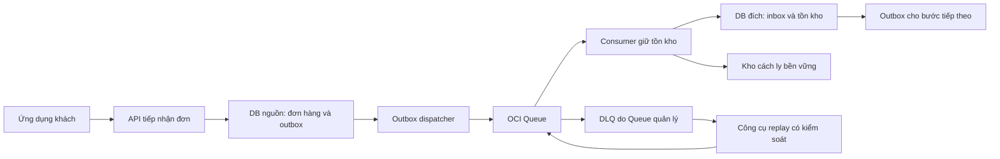

# Thiết kế luồng tích hợp bất đồng bộ có retry và idempotency

## 1. Bài toán và mục tiêu thiết kế

Trong chương **API, sự kiện và tích hợp** của module **CLOUD_PROVIDERS_ORACLE**, bài học này thiết kế một luồng xử lý nền trên Oracle Cloud Infrastructure (OCI). Trọng tâm là phối hợp hàng đợi, cơ sở dữ liệu và ứng dụng để công việc tiếp tục được xử lý khi có lỗi, đồng thời tránh tạo tác động nghiệp vụ lặp lại.

Xét một hệ thống bán hàng:

1. API tiếp nhận đơn hàng và lưu vào Oracle Database.
2. Ứng dụng công bố sự kiện `OrderAccepted` vào OCI Queue.
3. Consumer nhận sự kiện, giữ tồn kho cho từng dòng hàng.
4. Khi cơ sở dữ liệu tạm thời không truy cập được, công việc được thử lại.
5. Nếu consumer dừng sau khi đã giữ hàng nhưng chưa xác nhận với hàng đợi, lần nhận tiếp theo phải nhận biết kết quả trước đó.

Bất đồng bộ giúp API không phải chờ toàn bộ quy trình hoàn tất. Tuy nhiên, nó tạo thêm các khoảng thời gian mà producer, hàng đợi và consumer chưa có cùng nhận thức về kết quả.

Thiết kế cần bảo đảm các bất biến sau:

- Khi API báo đã tiếp nhận bền vững, hệ thống đã lưu được cả yêu cầu nghiệp vụ và ý định phát sự kiện.
- Một thao tác giữ hàng đã hoàn tất không bị thực hiện lần thứ hai dù thông điệp được giao lại.
- Không xác nhận hoàn tất với hàng đợi trước khi kết quả hoặc quyết định cách ly đã được lưu bền vững.
- Mọi lần thử lại đều có giới hạn về số lần, thời gian và mức tải.
- Công việc chưa xử lý được có chủ sở hữu, trạng thái theo dõi và đường phục hồi.

Các cấu hình thời gian, tải và số lần thử trong bài là **giả định thiết kế để thực hành**. Chúng cần được điều chỉnh bằng số liệu của hệ thống triển khai thực tế.

## 2. Tách rõ giao thông điệp và hoàn tất nghiệp vụ

### 2.1. Ba loại kết quả khác nhau

| Kết quả | Ý nghĩa | Chưa chứng minh được điều gì? |
| --- | --- | --- |
| API trả `202 Accepted` | Hệ thống chấp nhận xử lý nền theo hợp đồng API | Chưa có nghĩa đã giữ hàng hoặc lập hóa đơn |
| Producer nhận xác nhận từ Queue | Hàng đợi đã tiếp nhận thông điệp | Chưa có nghĩa consumer đã xử lý |
| Consumer commit kết quả nghiệp vụ | Tác động trong giao dịch đã được lưu | Chưa có nghĩa thông điệp đã bị xóa khỏi Queue |

API nên trả một `operationId` và địa chỉ kiểm tra trạng thái. Ví dụ:

```http
HTTP/1.1 202 Accepted
Location: /operations/op-order-20261120-1042
Content-Type: application/json

{
  "operationId": "op-order-20261120-1042",
  "status": "ACCEPTED"
}
```

Endpoint kiểm tra trạng thái phải kiểm tra quyền truy cập theo khách hàng và tenant. Khi nghiệp vụ kết thúc, nó trả kết quả như `SUCCEEDED` hoặc `REJECTED`, thay vì suy ra trạng thái từ việc hàng đợi đang rỗng.

### 2.2. Thiết kế consumer với khả năng nhận lặp

OCI Queue giữ thông điệp đã nhận trong một khoảng invisibility, sau đó có thể giao lại nếu consumer chưa xóa. Consumer phải xử lý an toàn tình huống giao lại. Bài học vì vậy dùng mô hình **at-least-once ở mức thiết kế ứng dụng**: một công việc có thể đến nhiều lần trong cửa sổ lưu giữ, và mỗi lần đến đều phải an toàn. Cơ chế nhận, gia hạn và xóa được mô tả trong [Consuming Messages](https://docs.oracle.com/en-us/iaas/Content/queue/consume-messages.htm).

Không được suy từ tính bền vững của hàng đợi ra lời hứa “nghiệp vụ luôn chạy đúng một lần”. Một thông điệp còn có thể hết hạn trước khi được xử lý; producer có thể gửi lại sau một phản hồi bị mất; consumer có thể chết giữa hai thao tác.

**Idempotency** là tính chất thực hiện lại cùng một ý định vẫn cho cùng tác động nghiệp vụ như lần thực hiện hợp lệ đầu tiên. Ví dụ, gọi lại “giữ 2 sản phẩm cho dòng hàng L1 của đơn ORD-1042” không được trừ thêm 2 sản phẩm.

Mục tiêu đạt được trong thiết kế này là **một tác động đã commit cho một khóa thao tác trong phạm vi bảo vệ được xác định**. Phạm vi đó phụ thuộc vào giao dịch, khóa duy nhất, thời gian giữ lịch sử và khả năng phục hồi dữ liệu.

## 3. Chọn thành phần OCI và xác định trách nhiệm

| Thành phần | Vai trò trong thiết kế |
| --- | --- |
| API Gateway và ứng dụng API | Cổng tiếp nhận yêu cầu, xác thực và tạo thao tác nghiệp vụ |
| Oracle Database hoặc Autonomous Database | Lưu đơn hàng, outbox, inbox và trạng thái nghiệp vụ theo ranh giới giao dịch của từng dịch vụ |
| OCI Queue | Đệm công việc giữa producer và consumer |
| Worker trên Compute hoặc OKE | Tự poll Queue; chủ động quản lý từng thông điệp, retry và xác nhận |
| Connector Hub và OCI Functions | Lựa chọn xử lý theo batch do connector điều phối |
| OCI Events | Phản ứng với sự kiện tài nguyên OCI khi luồng có nguồn từ hạ tầng |
| Logging, Monitoring và Alarms | Theo dõi lỗi, độ trễ, backlog và khả năng phục hồi |
| IAM, compartment và Vault | Phân quyền tài nguyên, phân tách môi trường và quản lý bí mật |

OCI Queue phù hợp khi cần tách công việc và điều chỉnh số consumer độc lập với producer. Tài liệu [Overview of Queue](https://docs.oracle.com/en-us/iaas/Content/queue/overview.htm) mô tả thông điệp được lưu đến khi bị xóa hoặc hết retention.

OCI Events và sự kiện nghiệp vụ có vai trò khác nhau. `OrderAccepted` do ứng dụng tạo sau khi lưu đơn hàng. Sự kiện một tài nguyên OCI thay đổi trạng thái có thể được OCI Events chuyển đến Functions, Notifications hoặc Streaming theo rule. Nếu cần đưa sự kiện ấy vào Queue, phải chỉ rõ thành phần cầu nối, chẳng hạn Function gọi API của Queue. Các đích rule được mô tả trong [Managing Rules for Events](https://docs.oracle.com/en-us/iaas/Content/Events/Task/managingrules.htm).

Oracle Database cũng có AQ/TxEventQ tích hợp với giao dịch cơ sở dữ liệu. Đây là lựa chọn kiến trúc khác; không được lấy đặc tính giao dịch của AQ/TxEventQ gán cho lời gọi OCI Queue qua mạng. Xem [Introduction to Transactional Event Queues and Advanced Queuing](https://docs.oracle.com/en/database/oracle/oracle-database/26/adque/aq-introduction.html).

### Hai cách vận hành consumer

- **Worker tự poll:** ứng dụng gọi `GetMessages`, `UpdateMessage` và `DeleteMessage`; ứng dụng quyết định khi nào hoàn tất từng thông điệp.
- **Queue → Connector Hub → Functions:** connector nhận và chuyển batch; kết quả invocation điều khiển hành vi của connector.

Ví dụ triển khai chi tiết trong bài dùng worker tự poll. Phần Functions sẽ chỉ ra những điều cần thay đổi khi chuyển cách vận hành.

## 4. Kiến trúc tham chiếu và các ranh giới giao dịch



DB nguồn và DB đích biểu diễn hai ranh giới giao dịch độc lập. Chúng có thể thuộc hai dịch vụ khác nhau. Chỉ các bảng thực sự nằm trong cùng giao dịch mới được hưởng tính nguyên tử chung.

Luồng bình thường:

1. API lưu đơn hàng và bản ghi outbox trong **một giao dịch DB nguồn**.
2. Dispatcher đọc outbox, gửi sự kiện vào Queue rồi đánh dấu đã gửi.
3. Consumer nhận sự kiện, kiểm tra hợp đồng và khóa idempotency.
4. Consumer ghi inbox và thay đổi tồn kho trong **một giao dịch DB đích**.
5. Sau khi commit, consumer xóa thông điệp bằng receipt của lần nhận hiện tại.
6. Nếu cần bước tiếp theo, consumer ghi một outbox mới trong chính giao dịch ở bước 4.

Không có giao dịch nguyên tử chung bao trùm `COMMIT` Oracle Database và `DeleteMessage` của OCI Queue trong thiết kế này. Inbox giải quyết khoảng hở đó ở phía nhận; outbox giải quyết khoảng hở giữa lưu dữ liệu và phát thông điệp ở phía gửi.

## 5. Hợp đồng thông điệp và các loại định danh

Ví dụ dưới đây biểu diễn việc giữ tồn kho cho một dòng hàng:

```json
{
  "eventId": "evt-20261120-1042-L1",
  "eventType": "com.example.orders.accepted.v1",
  "schemaVersion": 1,
  "occurredAt": "2026-11-20T02:15:00Z",
  "tenantId": "retail-a",
  "aggregateId": "ORD-1042",
  "aggregateVersion": 7,
  "operationKey": "reserve:ORD-1042:L1:v1",
  "correlationId": "op-order-20261120-1042",
  "data": {
    "orderId": "ORD-1042",
    "lineId": "L1",
    "sku": "SKU-USB-C",
    "quantity": 2
  }
}
```

Đây là hợp đồng JSON của ứng dụng, không phải schema bắt buộc của OCI Queue hay OCI Events.

| Định danh | Phạm vi và cách sử dụng |
| --- | --- |
| `eventId` | Định danh một sự kiện logic; giữ nguyên khi dispatcher gửi lại hoặc replay nguyên sự kiện |
| Queue message ID | Định danh bản sao trong hệ thống vận chuyển; có thể đổi khi publish lại |
| `receipt` | Dùng thao tác với lần nhận hiện tại; không dùng làm khóa nghiệp vụ |
| `operationKey` | Định danh ý định nghiệp vụ cần chống lặp |
| `correlationId` | Nối log của nhiều bước trong một quy trình; không thay cho idempotency key |
| `replayId` | Nếu có, định danh một đợt vận hành phát lại; không thay `eventId` |

Khóa chống lặp ở consumer nên có phạm vi:

```text
(consumer_name, tenant_id, operation_key)
```

Ví dụ `(reserve-inventory-v1, retail-a, reserve:ORD-1042:L1:v1)`.

Nếu chỉ dùng `eventId`, hai sự kiện khác ID nhưng cùng yêu cầu giữ hàng vẫn có thể gây tác động lặp. Nếu chỉ dùng `orderId`, nhiều dòng hàng hoặc nhiều loại thao tác hợp lệ lại có thể chặn lẫn nhau.

### Bảo vệ tính nhất quán của khóa

Consumer lưu thêm `request_hash`, tính từ biểu diễn chuẩn hóa các trường quyết định tác động: tenant, loại thao tác, phiên bản hợp đồng nghiệp vụ, order, line, SKU và quantity.

- Cùng khóa và cùng hash: lần nhận lặp hợp lệ.
- Cùng khóa nhưng khác hash: xung đột hợp đồng; phải cách ly và điều tra.
- Một điều chỉnh nghiệp vụ hợp lệ: dùng thao tác/phiên bản mới theo quy tắc đã thống nhất.

Không hash trực tiếp chuỗi JSON nếu thứ tự thuộc tính hoặc cách biểu diễn số có thể thay đổi. Không đưa `correlationId`, thời điểm replay hoặc số lần nhận vào hash nghiệp vụ.

Consumer phải kiểm tra tenant và loại thao tác từ nguồn đã được tin cậy hoặc được ràng buộc với danh tính producer. Việc payload tự khai một `tenantId` chưa tạo ra quyền tác động lên dữ liệu tenant đó.

## 6. Producer đáng tin cậy với transactional outbox

### 6.1. Hai cách mất nhất quán thường gặp

**Commit đơn hàng rồi mới gửi Queue:** ứng dụng dừng sau commit làm đơn hàng tồn tại nhưng không có công việc giữ hàng.

**Gửi Queue rồi mới commit đơn hàng:** consumer có thể thấy sự kiện của một đơn hàng cuối cùng bị rollback.

Outbox lưu ý định gửi cùng giao dịch với dữ liệu nguồn:

```sql
CREATE TABLE integration_outbox (
    event_id       VARCHAR2(80 CHAR) PRIMARY KEY,
    aggregate_id   VARCHAR2(80 CHAR) NOT NULL,
    event_type     VARCHAR2(120 CHAR) NOT NULL,
    payload        CLOB NOT NULL,
    publish_state  VARCHAR2(12 CHAR) DEFAULT 'PENDING' NOT NULL,
    created_at     TIMESTAMP WITH TIME ZONE DEFAULT SYSTIMESTAMP NOT NULL,
    published_at   TIMESTAMP WITH TIME ZONE,
    CONSTRAINT ck_outbox_state
        CHECK (publish_state IN ('PENDING', 'SENT')),
    CONSTRAINT ck_outbox_payload CHECK (payload IS JSON)
);

CREATE INDEX ix_outbox_pending
    ON integration_outbox (publish_state, created_at);
```

Trong giao dịch tạo đơn:

```sql
-- Bind parameters được truyền từ ứng dụng.
INSERT INTO orders (order_id, tenant_id, order_status)
VALUES (:order_id, :tenant_id, 'ACCEPTED');

INSERT INTO integration_outbox (
    event_id, aggregate_id, event_type, payload
) VALUES (
    :event_id, :order_id, :event_type, :payload
);

COMMIT;
```

Bảng `orders` được giả định đã tồn tại trong ứng dụng. Outbox ở đây minh họa hợp đồng lưu trữ tối thiểu; không phải script tạo đầy đủ hệ thống bán hàng.

### 6.2. Dispatcher vẫn có thể gửi trùng

Dispatcher thực hiện:

1. Chọn một nhóm outbox chưa gửi.
2. Gửi payload với `eventId` đã lưu, không tạo ID mới mỗi lần thử.
3. Xác nhận kết quả publish của từng bản ghi.
4. Chỉ đánh dấu `SENT` cho những bản ghi đã được tiếp nhận thành công.

Nếu Queue đã nhận nhưng dispatcher mất phản hồi hoặc chết trước bước 4, dispatcher sẽ gửi lại. Đây là lý do outbox và consumer idempotent phải đi cùng nhau.

Khi có nhiều dispatcher, cần cơ chế claim hoặc lease có thời hạn và phục hồi bản ghi bị bỏ dở. Không giữ khóa DB kéo dài tùy ý trong khi chờ mạng. Nếu gửi batch, phải xử lý kết quả từng phần khi API trả thông tin thành công/thất bại theo từng phần tử.

Outbox không thể sửa việc client gọi lại API tạo hai đơn hàng khác nhau. API tiếp nhận cũng cần khóa idempotency theo khách hàng/tenant, lưu khóa, hash yêu cầu và kết quả trong cùng giao dịch tạo đơn. Client gửi lại cùng khóa sẽ nhận lại cùng thao tác đã được tiếp nhận.

## 7. Consumer idempotent khi tác động nằm trong một Oracle Database

### 7.1. Inbox và tác động nghiệp vụ phải commit cùng nhau

```sql
CREATE TABLE integration_inbox (
    consumer_name  VARCHAR2(80 CHAR) NOT NULL,
    tenant_id      VARCHAR2(80 CHAR) NOT NULL,
    operation_key  VARCHAR2(160 CHAR) NOT NULL,
    event_id       VARCHAR2(80 CHAR) NOT NULL,
    request_hash   VARCHAR2(64 CHAR) NOT NULL,
    process_state  VARCHAR2(12 CHAR) NOT NULL,
    outcome_code   VARCHAR2(80 CHAR),
    completed_at   TIMESTAMP WITH TIME ZONE,
    CONSTRAINT pk_integration_inbox
        PRIMARY KEY (consumer_name, tenant_id, operation_key),
    CONSTRAINT ck_inbox_state
        CHECK (process_state IN ('PROCESSING', 'COMPLETED', 'REJECTED'))
);
```

Các bảng tồn kho cần có khóa và ràng buộc riêng. Ví dụ `inventory_reservations` có khóa duy nhất `(tenant_id, operation_key)`; số lượng giữ phải dương.

Thứ tự giao dịch:

```text
BEGIN
  INSERT inbox với khóa duy nhất và trạng thái PROCESSING
  UPDATE tồn kho với điều kiện số lượng còn đủ
  INSERT bản ghi giữ hàng
  Ghi outbox cho kết quả nếu có bước tiếp theo
  UPDATE inbox thành COMPLETED
COMMIT

Sau COMMIT:
  DeleteMessage bằng receipt của lần nhận hiện tại
```

Ở biến thể này, `PROCESSING` chỉ là trạng thái bên trong giao dịch chưa commit. Consumer không commit một bản ghi `PROCESSING` rồi mới đi làm việc. Một dòng inbox đã tồn tại nhưng chưa kết thúc không được mặc nhiên coi là thành công.

### 7.2. Dùng thao tác có điều kiện thay cho kiểm tra rồi ghi

Ví dụ cập nhật kho:

```sql
UPDATE inventory_stock
SET available_quantity = available_quantity - :quantity
WHERE tenant_id = :tenant_id
  AND sku = :sku
  AND available_quantity >= :quantity;
```

Ứng dụng phải kiểm tra số dòng cập nhật:

- Một dòng: tiếp tục ghi reservation và kết quả.
- Không có dòng: xử lý theo hợp đồng “không đủ hàng” hoặc “SKU không hợp lệ”.

Trong ví dụ này, không đủ hàng là kết quả nghiệp vụ `REJECTED`: lưu kết quả inbox và sự kiện từ chối trong cùng giao dịch rồi commit. Retry cùng yêu cầu phải trả lại kết quả đó. Nếu hệ thống muốn chờ nhập hàng, cần một trạng thái/quy trình chờ riêng có thời hạn.

### 7.3. Xử lý cạnh tranh giữa nhiều consumer

Không dùng chuỗi “SELECT chưa tồn tại → INSERT” làm hàng rào chống lặp duy nhất. Hai consumer có thể cùng đi qua bước SELECT.

Khóa duy nhất của inbox là hàng rào trong DB. Khi hai giao dịch cùng chèn một khóa, một giao dịch có thể phải chờ kết quả của giao dịch còn lại. Nhánh xử lý khóa trùng cần:

1. Xác định lỗi thực sự đến từ `pk_integration_inbox`, không gom mọi lỗi unique constraint thành duplicate thành công.
2. Rollback giao dịch đang thất bại.
3. Đọc lại inbox bằng giao dịch phù hợp.
4. So sánh hash và kiểm tra trạng thái kết thúc.
5. Chỉ xác nhận thông điệp nếu tìm thấy kết quả đã commit tương ứng.

Nếu đọc lại không xác định được kết quả, để công việc được thử lại hoặc điều tra. Không suy đoán rằng một exception luôn đồng nghĩa với chưa có tác động.

### 7.4. Mã giả Java cho ranh giới xử lý

Đoạn sau là **mã giả theo phong cách Java**, không phải mẫu có thể biên dịch trực tiếp. Các adapter `database`, `queue`, `quarantine` và `retryLedger` biểu diễn hợp đồng cần được triển khai.

```java
void handle(ReceivedMessage message) {
    final Envelope event;
    try {
        event = validateAndDecode(message.content());
    } catch (InvalidMessage error) {
        // Lưu bền vững payload hoặc tham chiếu, fingerprint và nguyên nhân.
        quarantine.persistInvalid(message, error);
        queue.delete(message.receipt());
        return;
    }

    BusinessResult result;
    try {
        result = database.inTransaction(tx -> {
            InboxInsert insert = tx.inbox().insertOrFindCommitted(
                CONSUMER_NAME,
                event.tenantId(),
                event.operationKey(),
                event.eventId(),
                semanticHash(event)
            );

            if (insert.isDuplicate()) {
                insert.requireSameHash();
                return insert.requireTerminalResult();
            }

            // Chỉ có SQL trong cùng transaction; không gọi HTTP ở đây.
            BusinessResult outcome = reserveInventoryOrReject(tx, event);
            tx.outbox().appendOutcomeIfRequired(event, outcome);
            tx.inbox().finish(event, outcome);
            return outcome;
        });
    } catch (IdempotencyConflict error) {
        quarantine.persistConflict(event, error);
        queue.delete(message.receipt());
        return;
    } catch (RetryableFailure error) {
        RetryDecision decision = retryLedger.recordAndDecide(event, error);
        if (decision.shouldRetry()) {
            queue.updateVisibility(
                message.receipt(), decision.delaySeconds()
            );
        } else {
            quarantine.persistExhausted(event, decision);
            queue.delete(message.receipt());
        }
        return;
    }

    // Commit đã được xác nhận hoặc đã đọc thấy kết quả cũ hợp lệ.
    // Xóa lỗi thì để redelivery; không rollback nghiệp vụ đã commit.
    queue.delete(message.receipt());
}
```

`insertOrFindCommitted` phải hiện thực đúng giao thức cạnh tranh ở mục 7.3; không thể chỉ nuốt exception và tiếp tục trên cùng giao dịch đã lỗi.

Các lệnh xóa/gia hạn là thao tác mạng riêng. Nếu xóa hoặc ghi kho cách ly lỗi, vòng điều phối phải ghi nhận lỗi và cho phép giao lại. Mọi bản ghi cách ly cũng cần khóa duy nhất để lần nhận lặp không tạo vô hạn bản sao lỗi.

Khi commit mất phản hồi, kết quả DB có thể chưa biết chắc. Ứng dụng phải phân giải bằng inbox trên kết nối/giao dịch mới hoặc cơ chế xác định kết quả commit được hỗ trợ, rồi mới quyết định xóa. Không lặp tác động ngoài DB để “bù” cho việc chưa biết kết quả commit.

## 8. Tác động bên ngoài DB cần một giao thức khác

Một transaction Oracle Database không bao trùm lời gọi HTTP đến cổng thanh toán, dịch vụ email hoặc hệ thống ERP độc lập.

Ví dụ nguy hiểm:

```text
Gọi thanh toán thành công
Ứng dụng dừng
Chưa lưu COMPLETED trong inbox
Nhận lại thông điệp
Gọi thanh toán lần nữa
```

Giữ transaction DB mở quanh lời gọi HTTP không loại bỏ khoảng hở trên. Cần một trong các hợp đồng sau:

| Khả năng của hệ thống đích | Cách xử lý |
| --- | --- |
| Hỗ trợ idempotency key bền vững | Gửi cùng khóa nghiệp vụ cho mọi lần gọi, kiểm tra phạm vi và thời gian giữ khóa của bên đích |
| Tra cứu được bằng mã tham chiếu duy nhất | Sau timeout, tra cứu kết quả trước khi quyết định gửi lại |
| Có bước prepare/confirm hoặc giao thức giao dịch phù hợp | Thiết kế quy trình theo đúng hợp đồng của bên đích |
| Không chống lặp và không tra cứu được | Ghi trạng thái chưa rõ kết quả, đối soát hoặc xử lý thủ công |

Một state machine có thể gồm:

```text
PENDING -> IN_PROGRESS -> SUCCEEDED
                    \-> RETRY_WAIT
                    \-> UNKNOWN -> RECONCILING
                    \-> REJECTED
```

Đây là biến thể có trạng thái được commit qua nhiều bước, khác với inbox một giao dịch ở mục 7. Nếu nhiều worker được phép tiếp quản:

- Claim công việc bằng lease có thời hạn và cập nhật có điều kiện.
- Dùng generation/fencing token để worker cũ không ghi đè kết quả của chủ sở hữu mới.
- Giữ nguyên idempotency key khi gọi hệ thống ngoài.
- Đặt timeout mạng và lưu attempt, request reference, kết quả đã biết.

Fencing trong DB chỉ ngăn ghi trạng thái cũ vào DB. Nó không tự ngăn một request cũ gây tác động tại hệ thống ngoài; hệ thống đích vẫn cần hợp đồng idempotency hoặc đối soát.

Nếu bước sau thất bại sau khi thanh toán đã thành công, hoàn tiền là một **thao tác bù mới**, có định danh và khả năng chống lặp riêng. Đó không phải rollback transaction ban đầu.

## 9. Phân loại lỗi trước khi retry

| Nhóm lỗi | Ví dụ | Hành động |
| --- | --- | --- |
| Tạm thời | Mất kết nối DB ngắn hạn, tranh chấp khóa có thể phục hồi | Rollback phần chưa hoàn tất; retry trong ngân sách |
| Hạn chế tốc độ | HTTP `429` từ dịch vụ đích | Tôn trọng `Retry-After` khi hợp lệ, giảm concurrency |
| Lỗi dịch vụ có khả năng phục hồi | Một số HTTP `5xx` | Retry nếu thao tác an toàn và còn thời gian |
| Payload/hợp đồng không hợp lệ | Thiếu SKU, số lượng âm, phiên bản không hỗ trợ | Cách ly bền vững, không retry liên tục |
| Kết quả nghiệp vụ từ chối | Không đủ hàng theo hợp đồng của ví dụ | Commit `REJECTED`, công bố kết quả nếu cần rồi xác nhận |
| Sai cấu hình hoặc quyền | Policy IAM thiếu, thông tin kết nối sai | Cảnh báo, tạm dừng/giảm poll và sửa cấu hình |
| Kết quả tác động ngoài chưa rõ | Timeout sau khi gửi request thanh toán | Tra cứu/đối soát; chỉ retry theo hợp đồng chống lặp |

Không phân loại mọi HTTP `4xx` là vĩnh viễn hoặc mọi `5xx` là an toàn để gọi lại. Cần biết ngữ nghĩa API, loại thao tác và kết quả có thể đã xảy ra hay chưa.

Một lỗi quyền kéo dài ảnh hưởng toàn consumer không nên làm hết ngân sách của mọi thông điệp. Có thể dừng nhận thêm, giữ cảnh báo và phục hồi sau khi cấu hình được sửa, trong giới hạn retention.

## 10. Retry có backoff, jitter và ngân sách rõ ràng

### 10.1. Backoff tăng dần

Với lần retry thứ `k`, bắt đầu từ `k = 1` sau lần xử lý đầu tiên:

```text
cap(k)   = min(max_delay, base_delay × 2^(k - 1))
delay(k) = random_uniform(0, cap(k))
```

Đây là full jitter. Ví dụ `base_delay = 2 giây`, `max_delay = 30 giây`:

| Lần retry | Trần chờ | Khoảng chờ ngẫu nhiên |
| --- | --- | --- |
| 1 | 2 giây | 0–2 giây |
| 2 | 4 giây | 0–4 giây |
| 3 | 8 giây | 0–8 giây |
| 4 | 16 giây | 0–16 giây |
| 5 | 30 giây | 0–30 giây |

Jitter phân tán thời điểm thử lại của nhiều worker. Nó không thay cho giới hạn concurrency hoặc rate limit. Khi dịch vụ yêu cầu một khoảng chờ tối thiểu hợp lệ qua `Retry-After`, không chọn ngẫu nhiên xuống dưới khoảng tối thiểu đó.

### 10.2. Ngân sách phải tồn tại qua lần giao lại

Cấu hình ứng dụng minh họa:

```yaml
# Hợp đồng cấu hình do ứng dụng tự định nghĩa; không phải OCI resource schema.
retry:
  max_business_attempts: 6
  max_elapsed_seconds: 1800
  base_delay_seconds: 2
  max_delay_seconds: 30

consumer:
  processing_timeout_seconds: 20
  initial_visibility_seconds: 60
  max_concurrency: 8
```

`max_business_attempts: 6` gồm lần xử lý đầu và tối đa năm lần retry. Consumer lưu số attempt và thời điểm bắt đầu vào retry ledger bền vững theo khóa thao tác; bộ đếm trong RAM sẽ mất khi tiến trình khởi động lại.

Ngân sách cần kiểm tra ít nhất:

- Số lần ứng dụng thực sự bắt đầu một attempt.
- Thời gian từ khi thao tác được tiếp nhận.
- Deadline nghiệp vụ.
- Thời gian còn lại trước khi thông điệp hết hạn.
- Năng lực và hạn mức của hệ thống đích.

Retry ledger phải cập nhật nguyên tử khi nhiều worker cùng tranh công việc. Nếu cần giới hạn nghiêm ngặt sau crash, đếm attempt trước khi bắt đầu; attempt bị dừng giữa chừng vẫn tiêu thụ ngân sách theo quy ước này.

Delivery count của Queue là bộ đếm vận chuyển, khác với business attempt. Một lần nhận trùng đã hoàn tất có thể không chạy lại nghiệp vụ; ngược lại, nhiều lần gọi HTTP trong một lần nhận có thể tạo nhiều attempt mà Queue chỉ thấy một lần giao.

### 10.3. Tránh nhiều tầng retry nhân nhau

Nếu SDK gọi lại 3 lần, mã HTTP bên ngoài gọi lại 4 lần và hàng đợi giao lại 6 lần, một công việc có thể tạo tới `3 × 4 × 6 = 72` lời gọi khi các tầng lồng nhau.

Cần chọn tầng chịu trách nhiệm retry nghiệp vụ, kiểm tra cấu hình retry của SDK và đặt tổng deadline. Những retry mạng ngắn bên trong một attempt cũng phải tính vào thời gian xử lý và tải lên hệ thống đích.

Circuit breaker giúp ngừng gọi một phụ thuộc đang lỗi kéo dài. Khi mở circuit, consumer giảm hoặc dừng nhận công việc mới; không nhận liên tục rồi ném trả, vì hành vi đó vẫn tăng tải và có thể tiêu thụ delivery count.

## 11. Visibility timeout, receipt và cách hẹn thử lại trên OCI Queue

### 11.1. Visibility là thời hạn sở hữu ở tầng vận chuyển

Một lần nhận có `receipt` để gia hạn hoặc xóa. Thông điệp chưa được xóa sẽ có thể xuất hiện lại khi hết visibility. Chi tiết API nằm trong [Consuming Messages](https://docs.oracle.com/en-us/iaas/Content/queue/consume-messages.htm).

Với mục tiêu xử lý phần lớn công việc trong 15 giây, có thể bắt đầu visibility 60 giây để chừa thời gian commit, xóa và biến động độ trễ. Đây là lựa chọn của bài thực hành.

Chọn quá ngắn làm tăng khả năng có worker mới bắt đầu trong khi worker cũ còn hoạt động. Chọn quá dài làm phục hồi sau crash chậm hơn.

Việc thông điệp hết visibility không tự hủy câu SQL hoặc request HTTP đang chạy. Vì vậy, visibility không thay thế khóa duy nhất, lease nghiệp vụ hay idempotency của hệ thống đích.

### 11.2. Gia hạn cho công việc dài

Có thể dùng heartbeat khi thời gian xử lý biến động. Ví dụ, trước khi thời hạn còn lại quá ngắn, worker gọi `UpdateMessage` và theo dõi việc gia hạn có thành công hay không.

OCI cho phép tăng hoặc giảm visibility bằng receipt; visibility không thể kéo dài quá thời điểm hết retention của thông điệp. Xem [Updating Messages](https://docs.oracle.com/en-us/iaas/Content/queue/update-messages.htm).

Nếu không còn xác nhận được quyền nhận hoặc gia hạn thất bại, worker không được tiếp tục giả định mình độc quyền xử lý. Phần việc có thể hủy nên được dừng; phần không hủy được phải được bảo vệ bằng hợp đồng nghiệp vụ đã thiết kế.

### 11.3. Dùng visibility để trì hoãn redelivery

Đối với worker tự poll, sau lỗi tạm thời:

1. Đảm bảo phần transaction chưa thành công đã rollback.
2. Ghi attempt và quyết định retry bền vững.
3. Tính thời gian chờ.
4. Cập nhật visibility bằng receipt hiện tại.
5. Kết thúc attempt, không xóa thông điệp.

Thời gian chờ là khoảng invisibility tính từ lần cập nhật; đây không phải cam kết lịch chạy chính xác. Khi nó hết, hệ thống chỉ làm thông điệp đủ điều kiện nhận lại.

Nếu lịch retry cần chờ dài hoặc vượt cửa sổ của thông điệp, dùng kho công việc có `next_attempt_at` và bộ điều phối bền vững. Việc chuyển từ Queue sang kho ấy phải được ghi bền vững trước khi xóa thông điệp nguồn, và bộ điều phối phải phát lại an toàn khi dừng giữa chừng.

Không giữ một thread ngủ lâu trong khi bỏ qua trạng thái visibility. Cách đó tiêu tốn tài nguyên và vẫn có thể để worker khác nhận cùng công việc.

### 11.4. Dùng đúng endpoint và receipt

Producer/consumer cần endpoint thông điệp của queue; có thể lấy từ thông tin queue hoặc `GetQueue`. Nó khác vai trò với endpoint quản trị. Xem [Message Management](https://docs.oracle.com/en-us/iaas/Content/queue/messages.htm).

Receipt dùng cho lần nhận hiện tại không được thay bằng Queue message ID hoặc `eventId`. Sau khi quyền nhận thay đổi, thao tác bằng receipt cũ có thể thất bại. Khi xóa lỗi sau commit, ghi log và chấp nhận giao lại để inbox trả kết quả cũ.

## 12. DLQ, kho cách ly và replay có kiểm soát

OCI Queue tự tạo dead letter queue cùng queue chính. Thông điệp có các lần giao không thành công đến ngưỡng cấu hình sẽ được đưa sang DLQ; thông điệp trong DLQ vẫn chịu retention. DLQ không phải kho lưu lỗi vô thời hạn. Xem [Dead Letter Queues](https://docs.oracle.com/en-us/iaas/Content/queue/deadletterqueues.htm).

### 12.1. Phân biệt hai đường thất bại

| Đường xử lý | Ai quyết định? | Khi nào phù hợp? |
| --- | --- | --- |
| DLQ gắn với Queue | Queue dựa trên delivery count và cấu hình | Consumer liên tục không xử lý/xóa được, kể cả crash |
| Kho cách ly do ứng dụng quản lý | Ứng dụng sau khi phân loại lỗi | Payload sai, khóa xung đột, hết ngân sách nghiệp vụ, cần điều tra sớm |

Kho cách ly có thể là bảng DB chứa lỗi và payload hoặc tham chiếu tới Object Storage. Thao tác lưu phải bền vững và chống lặp, rồi mới được xóa nguồn.

Nếu ghi cách ly thất bại, không xóa thông điệp. Nếu ghi thành công nhưng xóa nguồn lỗi, lần nhận lại phải nhận ra quyết định cách ly đã có.

Không giả định OCI Queue cung cấp một lệnh “chuyển ngay thông điệp bất kỳ vào DLQ” trong luồng ứng dụng. Cách ly chủ động ở đây là cơ chế do ứng dụng xây dựng; DLQ gốc vẫn làm việc theo chính sách giao của Queue.

### 12.2. Dữ liệu cần giữ cho điều tra

- `eventId`, khóa thao tác, tenant và phiên bản schema nếu parse được.
- Fingerprint nội dung và tham chiếu payload được bảo vệ.
- Thời điểm tiếp nhận đầu tiên, các attempt và nguyên nhân gần nhất.
- Trạng thái tác động: chưa thực hiện, đã commit, hay chưa rõ.
- Đợt replay, người/công cụ thực hiện và kết quả.
- Hạn cuối phải xử lý trước khi dữ liệu nguồn hết retention.

Với thông điệp không parse được, dùng định danh vận chuyển và fingerprint để lưu cách ly; không cố lấy một khóa nghiệp vụ chưa đáng tin cậy.

### 12.3. Quy trình replay

1. Xác định nguyên nhân và sửa lỗi hoặc cấu hình.
2. Kiểm tra tác động trước đó trong inbox, reservation và hệ thống ngoài.
3. Chọn tập thông điệp cần phát lại và kiểm tra điều kiện nghiệp vụ còn hợp lệ.
4. Giữ nguyên `eventId`, khóa thao tác và payload nghiệp vụ nếu đây là phát lại cùng một sự kiện.
5. Thêm metadata vận hành như `replayId`, không đưa nó vào semantic hash.
6. Phát lại một nhóm nhỏ với giới hạn tốc độ, theo dõi rồi mới tăng tải.
7. Chỉ xóa bản nguồn sau khi việc chuyển giao đã được xác nhận hoặc đã ghi một ý định phát lại bền vững.

Publish lại thường tạo bản sao vận chuyển mới. Vì vậy không dùng delivery count của bản sao mới để làm mới ngân sách nghiệp vụ. Ledger gốc là nguồn quyết định số lần còn được phép thử; payload từ công cụ replay không được tự ý ghi đè bộ đếm.

Nếu hết ngân sách nhưng vẫn cần thử sau khi đã sửa lỗi, ghi một quyết định vận hành có audit để cấp ngân sách mới. Nếu phải sửa nội dung nghiệp vụ, tạo sự kiện/thao tác sửa chữa mới và liên kết với bản gốc; không dùng cùng khóa cho hai ý định khác nhau.

### 12.4. Thời gian giữ inbox

Giữ inbox ít nhất qua toàn bộ khoảng mà bản sao của một thao tác còn được phép quay lại: outbox gửi chậm, retry, lưu DLQ, replay vận hành và phục hồi sau sự cố.

Ví dụ, nếu công cụ cho phép replay sự kiện trong 30 ngày kể từ lần tiếp nhận đầu tiên, xóa inbox sau 3 ngày sẽ làm mất bảo vệ dù queue chính chỉ giữ dữ liệu 3 ngày. Cần giữ inbox ít nhất qua cửa sổ 30 ngày và biên an toàn, hoặc ngăn mọi replay ngoài cửa sổ được bảo vệ.

Thời hạn giữ idempotency key của hệ thống ngoài cũng phải tương thích. Một key đã hết hạn ở cổng thanh toán có thể không còn bảo vệ được request replay từ lịch sử cũ.

## 13. Khi dùng Queue → Connector Hub → Functions

OCI hỗ trợ luồng Queue đến Functions qua Connector Hub. Theo [Scenario: Sending Queue Messages to a Function](https://docs.oracle.com/en-us/iaas/Content/connector-hub/queue-to-function.htm), lỗi xử lý một batch có thể khiến cả batch được giao lại, kể cả những thông điệp đã xử lý thành công; cơ chế này không hỗ trợ xác nhận thành công từng phần của batch.

Hệ quả thiết kế:

- Function phải có idempotency theo từng thông điệp.
- Không dùng một bản ghi “batch thành công” thay cho inbox của từng thao tác.
- Function chỉ báo invocation thành công sau khi mọi phần tử đã có kết quả bền vững hoặc đã được cách ly theo hợp đồng.
- Không bắt mọi exception rồi trả thành công, vì connector có thể coi dữ liệu đã được chuyển giao.
- Khi một phần tử lỗi tạm thời làm invocation thất bại, những phần tử đã commit sẽ được bỏ qua an toàn ở lần gọi lại.

Ví dụ batch gồm A, B, C: A đã commit, B gặp lỗi DB, C chưa chạy. Lần invocation tiếp theo phải đọc kết quả của A thay vì giữ hàng lần nữa, sau đó thử B và C.

Kích thước batch lớn có thể giảm overhead nhưng tăng phạm vi retry khi một phần tử lỗi. Chọn batch dựa trên thời gian xử lý, khả năng giới hạn tác động lặp và năng lực phụ thuộc.

Trong biến thể connector, connector quản lý việc nhận/xóa thông điệp nguồn. Không sao chép máy móc mã `DeleteMessage` của worker tự poll vào Function; hợp đồng báo thành công/thất bại là ở ranh giới invocation và connector.

## 14. IAM, mạng và bảo vệ dữ liệu

### 14.1. Phân quyền theo luồng dữ liệu

Tách publisher, consumer và công cụ replay thành các danh tính có quyền riêng. Với worker trên Compute dùng instance principal, dynamic group phải khớp đúng các instance được triển khai.

Ví dụ policy, thay tên compartment, dynamic group và OCID bằng giá trị thực:

```text
Allow dynamic-group OrderPublishers to use queue-push in compartment integration-prod where target.queue.id = 'ocid1.queue.oc1..replace_with_queue_ocid'
Allow dynamic-group InventoryWorkers to use queue-pull in compartment integration-prod where target.queue.id = 'ocid1.queue.oc1..replace_with_queue_ocid'
```

`queue-push` cấp quyền publish; `queue-pull` cấp quyền nhận, cập nhật và xóa. Nếu ứng dụng cần `GetQueue` để khám phá endpoint hoặc đọc thống kê, cấp thêm quyền đọc queue theo đúng phạm vi. Đối chiếu [Queue Policies](https://docs.oracle.com/en-us/iaas/Content/queue/policy-reference.htm).

Replay thường cần cả quyền đọc nguồn lỗi và quyền ghi đích. Không cấp `manage queues in tenancy` cho mọi worker chỉ để đơn giản hóa triển khai.

Tài khoản DB của consumer chỉ cần quyền trên inbox và các bảng nghiệp vụ liên quan. Phân quyền DB và IAM Queue là hai lớp riêng; có quyền nhận thông điệp không đồng nghĩa có quyền sửa mọi schema.

### 14.2. Kết nối và bí mật

- Đảm bảo workload có đường HTTPS tới messages endpoint thực tế của Queue trong region triển khai.
- Kiểm tra DNS, định tuyến VCN, quy tắc egress và kết nối DB từ đúng môi trường chạy worker.
- Quản lý thông tin xác thực DB và thông tin kết nối bằng cơ chế bí mật phù hợp, chẳng hạn OCI Vault.
- Giới hạn kích thước, phiên bản và cấu trúc payload trước khi xử lý.
- Log ID, trạng thái và mã lỗi; che dữ liệu khách hàng, secret, token và receipt.

Nếu payload lớn hoặc nhạy cảm, có thể gửi tham chiếu tới Object Storage kèm version/checksum. Cần bảo đảm quyền đọc và thời gian giữ đối tượng đủ dài cho toàn bộ retry/replay. Tham chiếu đến một đối tượng đã bị xóa sẽ biến công việc có thể phục hồi thành lỗi không thể giải quyết bằng retry.

## 15. Giám sát, năng lực xử lý và chi phí

### 15.1. Đo kết quả nghiệp vụ cùng với trạng thái hàng đợi

| Tín hiệu | Ý nghĩa vận hành |
| --- | --- |
| Tuổi của công việc chưa hoàn tất lâu nhất | Phát hiện vi phạm thời gian xử lý mà số lượng backlog nhỏ có thể che khuất |
| Visible và in-flight messages | Phân biệt công việc đang chờ với công việc đã được nhận |
| Số thông điệp DLQ và tuổi dữ liệu lỗi | Phát hiện lỗi kéo dài và nguy cơ hết retention |
| Tỷ lệ attempt thất bại theo loại lỗi | Phân biệt lỗi phụ thuộc, payload và cấu hình |
| Duplicate bị chặn, hash xung đột | Kiểm tra giao lại và phát hiện lỗi hợp đồng |
| Tuổi outbox `PENDING` | Phát hiện publisher bị kẹt dù API vẫn nhận đơn |
| Số thao tác `UNKNOWN` | Theo dõi khoản công việc cần đối soát |
| Độ trễ p95/p99 và số cuộc gọi mỗi thao tác | Đánh giá timeout, retry amplification và chi phí |

Thống kê visible/in-flight của Queue có tính xấp xỉ; không dùng một lần đọc thống kê làm bằng chứng tất cả nghiệp vụ đã hoàn tất. Xem [Getting Queue Statistics](https://docs.oracle.com/en-us/iaas/Content/queue/queue-statistics.htm).

Các tín hiệu như tuổi outbox, hash xung đột và `UNKNOWN` là metric do ứng dụng phải phát hoặc tính từ dữ liệu, không mặc định coi là tên metric có sẵn trong OCI.

Mỗi log attempt nên nối được `eventId`, `operationKey`, `correlationId`, consumer, số attempt và kết quả. Không đặt mọi ID làm nhãn metric, vì cardinality cao làm tăng chi phí và khó tổng hợp.

### 15.2. Backlog và backpressure

Giả sử hệ thống nhận 20 công việc/giây nhưng chỉ xử lý thành công 15 công việc/giây. Backlog tăng xấp xỉ:

```text
(20 - 15) × 60 = 300 công việc/phút
```

Sau khi nguồn ngừng tăng tải, để xả 3.000 công việc với năng lực ròng 10 công việc/giây cần khoảng 300 giây, chưa tính retry và biến động tải.

Tăng worker chỉ hữu ích khi DB hoặc hệ thống ngoài còn khả năng tiếp nhận. Nếu DB đã bão hòa, tăng concurrency có thể gây thêm timeout và retry.

Áp dụng backpressure bằng giới hạn số công việc đang xử lý, connection pool hữu hạn, rate limit theo phụ thuộc và chính sách giảm nhận khi circuit mở. Deadline của API, timeout worker và retention cần đủ để hệ thống có cơ hội xả backlog.

### 15.3. Các điểm phát sinh chi phí

Retry làm tăng số API call, thời gian Compute/Functions, tải DB và lượng log. Poll liên tục khi không có dữ liệu cũng tạo thêm yêu cầu. Long polling giúp giảm các vòng nhận rỗng; cơ chế này được mô tả trong [Consuming Messages](https://docs.oracle.com/en-us/iaas/Content/queue/consume-messages.htm).

Giới hạn số lần retry, giảm log payload lặp, đặt retention có chủ đích cho log và giám sát tài nguyên theo compartment. Nếu dùng budget alert, coi đó là tín hiệu cảnh báo tài chính; không mặc định hệ thống sẽ tự dừng tiêu thụ tài nguyên.

Không đưa đơn giá cố định vào thuật toán. Ước tính chi phí bằng số lần publish/receive/update/delete, thời gian xử lý, dữ liệu lưu và mức log theo giá áp dụng tại thời điểm triển khai.

## 16. Thứ tự, tính sẵn sàng và phục hồi

### 16.1. Idempotency không giải quyết sự kiện đến sai thứ tự

Hai sự kiện `OrderAccepted` và `OrderCancelled` có khóa khác nhau vẫn có thể được xử lý theo thứ tự bất lợi. Không dựa vào thứ tự quan sát trên Queue để bảo đảm trạng thái nghiệp vụ.

Có thể dùng `aggregateVersion`, state machine và cập nhật có điều kiện:

- Chỉ áp dụng chuyển trạng thái hợp lệ.
- Với sự kiện snapshot, phiên bản cũ có thể bị bỏ qua theo hợp đồng.
- Với sự kiện delta phải đủ chuỗi, phát hiện thiếu phiên bản và chờ/reconcile thay vì tự bỏ qua.
- Hủy đơn sau khi đã giữ hàng cần một thao tác giải phóng riêng có idempotency.

Không dùng một quy tắc “phiên bản nhỏ hơn thì bỏ” cho mọi loại sự kiện.

### 16.2. Nhiều worker và sự cố hạ tầng

Worker nên giữ trạng thái quyết định trong DB, không dựa vào bộ nhớ của một máy. Có thể triển khai nhiều replica trên các miền lỗi hoặc miền sẵn sàng được region hỗ trợ, dùng chung kho idempotency nhất quán.

Hệ thống cần kế hoạch cho cả Queue, DB và workload. Nhiều worker không khắc phục được một DB chưa có phương án sẵn sàng phù hợp.

Khi phục hồi sang region khác hoặc khôi phục DB từ backup:

- Giữ nguyên định danh sự kiện và khóa thao tác khi nạp lại dữ liệu.
- Xác định dữ liệu inbox/outbox bị mất theo RPO.
- Đối soát các tác động đã xảy ra sau điểm backup.
- Ngăn hai nơi đồng thời phát hoặc xử lý cùng công việc khi chưa có cơ chế phối hợp.
- Kiểm tra phạm vi idempotency của dịch vụ ngoài có xuyên region hay không.

Nếu DB phục hồi về thời điểm trước một thanh toán đã thực hiện, inbox cũ có thể biến mất trong khi tác động ở bên ngoài vẫn còn. Replay lúc đó cần đối soát với bên đích. Không giả định tính bền vững trong một region đồng nghĩa có bản sao Queue và lịch sử chống lặp sẵn ở region khác.

## 17. Thực hành triển khai và kiểm chứng bằng sự cố

### 17.1. Chuẩn bị môi trường

1. Dùng compartment thực hành riêng, gắn tag phục vụ nhận diện tài nguyên và chi phí.
2. Tạo Queue, ghi nhận OCID và messages endpoint.
3. Đặt retention theo cửa sổ phục hồi; ví dụ bài lab dùng 3 ngày, visibility ban đầu 60 giây và ngưỡng giao lỗi gốc của Queue là 8 theo trường cấu hình tương ứng.
4. Tạo DB hoặc schema thực hành, các bảng outbox/inbox và dữ liệu kho.
5. Cấp quyền publisher/consumer theo dynamic group và giới hạn queue.
6. Triển khai API, dispatcher và worker; cấu hình ngân sách nghiệp vụ tối đa 6 attempt và deadline 30 phút.
7. Bật log, metric ứng dụng và cảnh báo khi outbox tồn đọng hoặc xuất hiện dữ liệu lỗi.

Ngưỡng giao lỗi của Queue và sáu business attempt là hai giới hạn riêng. Ứng dụng có thể cách ly sớm hơn khi hết ngân sách; Queue vẫn bảo vệ trường hợp worker crash hoặc không thực hiện được quyết định ấy.

Retention của Queue cần được chọn ngay khi tạo; tài liệu nêu nó không thể thay đổi sau khi queue đã được tạo. Xem [Creating a Queue](https://docs.oracle.com/en-us/iaas/Content/queue/queue-create.htm).

### 17.2. Các tình huống cần quan sát

| Điểm gây sự cố | Kết quả mong đợi |
| --- | --- |
| API dừng sau commit đơn hàng/outbox | Dispatcher vẫn tìm được sự kiện và phát về sau |
| Dispatcher dừng sau publish trước khi đánh dấu `SENT` | Có thể gửi trùng; chỉ một tác động giữ hàng được commit |
| Worker dừng trước commit | Giao dịch rollback; lần nhận sau có thể xử lý |
| Worker dừng sau commit trước delete | Lần nhận sau đọc kết quả inbox, không trừ kho lần nữa |
| Hai worker xử lý cùng khóa | Khóa duy nhất và giao thức đọc kết quả ngăn hai tác động |
| Cùng khóa nhưng đổi quantity | Hash xung đột; cách ly, không trừ kho thêm |
| DB lỗi trong một khoảng ngắn | Retry giãn cách; số attempt được giữ qua restart |
| Dịch vụ ngoài timeout sau khi đã thành công | Cùng key/tra cứu giúp xác định kết quả; không tự gửi thao tác mới |
| Xóa Queue lỗi sau khi cách ly | Lần giao lại nhận ra quyết định cách ly đã tồn tại |
| Batch Function lỗi ở phần tử giữa | Những phần tử đã commit được bỏ qua an toàn khi batch đến lại |
| Replay sau khi tiến trình được triển khai lại | Dùng lịch sử bền vững; không làm mới ngân sách vô điều kiện |

Đây là các kịch bản thực hành cho người học triển khai. Việc đọc bài hoặc lưu tài liệu không đồng nghĩa các phép thử đã được chạy trên một tenancy thực tế.

### 17.3. Đối chiếu tác động thay vì chỉ nhìn log

Sau khi gửi cùng một thao tác nhiều lần, truy vấn reservation phải chỉ thấy một kết quả nghiệp vụ:

```sql
SELECT tenant_id, operation_key, COUNT(*) AS reservation_count
FROM inventory_reservations
WHERE tenant_id = :tenant_id
  AND operation_key = :operation_key
GROUP BY tenant_id, operation_key;
```

Kiểm tra inbox:

```sql
SELECT consumer_name, tenant_id, operation_key,
       request_hash, process_state, outcome_code, completed_at
FROM integration_inbox
WHERE consumer_name = 'reserve-inventory-v1'
  AND tenant_id = :tenant_id
  AND operation_key = :operation_key;
```

Với ví dụ SKU ban đầu có 10 sản phẩm và yêu cầu giữ 2, kết quả thành công phải là còn 8 sản phẩm sau cả các lần giao lại. Một reservation duy nhất nhưng kho bị trừ thành 6 vẫn là sai; phải kiểm tra đồng thời cả tác động và bản ghi chống lặp.

Khi hoàn tất lab, dừng worker và dispatcher, xử lý hoặc lưu lại dữ liệu lỗi cần giữ, rồi thu hồi tài nguyên thực hành theo kế hoạch. Dữ liệu idempotency dùng để phục hồi thật chỉ được xóa khi đã hết cửa sổ replay được cho phép.

## 18. Các quyết định cần chốt trước khi đưa vào vận hành

| Quyết định | Kết quả cần được mô tả cụ thể |
| --- | --- |
| Ranh giới giao dịch | Những bảng nào commit cùng nhau; bước nào gọi dịch vụ ngoài |
| Khóa idempotency | Phạm vi consumer/tenant/thao tác và quy tắc canonical hash |
| Lặp và xung đột | Cách trả kết quả cũ, phát hiện payload đổi và xử lý cạnh tranh |
| Retry | Phân loại lỗi, backoff, deadline, tổng attempt và giới hạn tải |
| Quyền nhận | Visibility, heartbeat, receipt và hành vi khi mất quyền nhận |
| Xác nhận | Điều kiện đủ để xóa nguồn hoặc báo invocation thành công |
| Thất bại | Ngưỡng DLQ, kho cách ly, trạng thái chưa rõ và người xử lý |
| Replay | Giữ ID, audit, giới hạn tốc độ và quyền cấp lại ngân sách |
| Lưu giữ | Retention thông điệp, inbox, outbox, payload và khóa ở bên đích |
| Vận hành | Metric nghiệp vụ, cảnh báo, phân quyền và phương án khôi phục |

Một luồng tích hợp bất đồng bộ được bảo vệ khi mọi điểm có thể dừng đều có kết quả xác định: công việc chưa hoàn tất còn đường thử lại, công việc đã commit có lịch sử để ngăn tác động lặp, và công việc chưa rõ kết quả được đưa vào đối soát. Với OCI, các tính chất ấy được xây bằng sự phối hợp giữa Queue, giao dịch Oracle Database, hợp đồng ứng dụng và quy trình vận hành.
