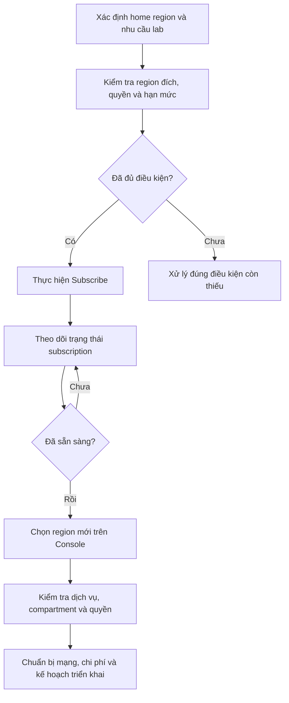

# Thiết lập home region và đăng ký thêm region

## Mục tiêu và bối cảnh

Trong chương **Tài khoản và môi trường thực hành** của module **CLOUD_PROVIDERS_ORACLE**, lựa chọn region là một bước chuẩn bị trước khi triển khai VCN, Compute, lưu trữ hoặc Oracle Database. Quyết định này liên quan đến trải nghiệm kết nối, khả năng sử dụng dịch vụ, quản trị danh tính và kế hoạch chi phí của môi trường lab.

Bài này hướng dẫn hai tình huống khác nhau: chọn **home region** khi tạo tenancy và đăng ký thêm **infrastructure region** cho tenancy đã có. Người học cũng sẽ kiểm tra được region đang thao tác, phân biệt region identifier với region key và nhận diện những việc chưa được thực hiện sau khi đăng ký thành công.

Sau bài học, người học có thể:

- Giải thích vai trò của home region và vì sao cần chọn cẩn thận.
- Xác định home region của một tenancy đang sử dụng.
- Đánh giá một region bổ sung theo nhu cầu thực hành.
- Đăng ký và kiểm tra region bằng Console hoặc OCI CLI khi có quyền và hạn mức.
- Chuẩn bị các bước quản trị, mạng và chi phí trước khi tạo tài nguyên tại region mới.

## 1. Phân biệt các khái niệm ngay từ đầu

| Khái niệm | Ý nghĩa trong bài |
| --- | --- |
| Region | Khu vực địa lý triển khai hạ tầng OCI |
| Home region | Region gốc gắn với tenancy khi tenancy được cung cấp |
| Subscribed region | Region mà tenancy đã đăng ký sử dụng |
| Current region | Region đang chọn trên Console hoặc trong lời gọi CLI/API |
| Region identifier | Chuỗi định danh như `ap-singapore-1` |
| Region key | Mã ngắn như `SIN`, dùng ở một số thao tác và điều kiện |
| Realm | Nhóm region có cùng phạm vi phân tách hạ tầng OCI |

Ví dụ tên và mã:

| Tên hiển thị | Region identifier | Region key |
| --- | --- | --- |
| Singapore (Singapore) | `ap-singapore-1` | `SIN` |
| Japan East (Tokyo) | `ap-tokyo-1` | `NRT` |

Các cặp tên và mã trên chỉ minh họa cách nhận diện, không phải đề xuất bắt buộc cho mọi người học. Tenancy thuộc một realm và chỉ có thể đăng ký các region phù hợp trong realm đó. [Danh sách và khái niệm region của OCI](https://docs.oracle.com/en-us/iaas/Content/General/Concepts/regions.htm).

### Ba thao tác thường bị gọi chung là “đổi region”

```text
Chọn home region khi tạo tenancy
  → quyết định region gốc của tenancy

Đăng ký thêm region
  → mở thêm phạm vi region có thể sử dụng cho tenancy

Chuyển current region
  → thay đổi nơi đang xem hoặc nơi gửi yêu cầu dịch vụ
```

Đổi lựa chọn trong menu Region trên Console không biến region vừa chọn thành home region. Tương tự, đổi thuộc tính `region` trong profile OCI CLI chỉ thay đổi giá trị mặc định cho các lệnh dùng profile đó.

## 2. Vai trò của home region

Home region chứa thông tin tài khoản và các định nghĩa IAM gốc liên quan đến tenancy. Sau khi tenancy được cung cấp, **không thể đổi home region**. Vì vậy, cần xem lựa chọn này là một quyết định ban đầu có tính lâu dài. [Home region và quy tắc quản lý region](https://docs.oracle.com/en-us/iaas/Content/Identity/Tasks/managingregions.htm).

Điều này không có nghĩa mọi workload của tổ chức phải triển khai tại home region. Khi tenancy có quyền sử dụng region khác và đáp ứng điều kiện dịch vụ, ứng dụng và dữ liệu có thể được triển khai tại region phù hợp.

### IAM có phạm vi toàn tenancy nhưng vẫn có nơi quản trị gốc

Một compartment có thể được dùng để tổ chức tài nguyên tại nhiều region. Việc nhìn thấy compartment ở region mới không có nghĩa một compartment riêng đã được tạo lại cho region đó.

Với các thao tác IAM quản trị tenancy yêu cầu home region, CLI/API cần gọi endpoint phù hợp. Console có thể chuyển yêu cầu quản trị IAM về home region thay cho người dùng. Việc cập nhật IAM cũng có thể cần vài phút để được phản ánh ở các region khác. [Hành vi IAM và home region](https://docs.oracle.com/en-us/iaas/Content/Identity/Tasks/managingregions.htm).

### Lưu ý khi tenancy sử dụng identity domains

Không nên suy rộng rằng mọi identity domain có cùng cấu hình sao chép.

Default identity domain có home region gắn với home region của tenancy và tự được sao chép đến các region mà tenancy đăng ký. Identity domain bổ sung có thể có home region và cấu hình replication riêng trong phạm vi được hỗ trợ. Khi kiểm tra đăng nhập hoặc tích hợp danh tính liên vùng, cần xem đúng domain đang dùng. [Home region và replication của identity domains](https://docs.oracle.com/en-us/iaas/Content/cloud-adoption-framework/iam-security-structure.htm).

Đối với bài lab cơ bản, chỉ cần ghi nhận home region của tenancy và domain đăng nhập hiện tại. Không cần tạo thêm domain chỉ để đăng ký một infrastructure region.

## 3. Chọn home region trước khi hoàn tất đăng ký tài khoản

Không nên chọn một region chỉ vì tên quen thuộc hoặc vì một bài hướng dẫn cũ dùng region đó. Hãy bắt đầu từ mục tiêu lab và những dịch vụ cần học.

### 3.1. Xác định tài nguyên bắt buộc

Ví dụ một lộ trình thực hành cần:

- VCN và subnet để triển khai mạng riêng.
- Compute chạy ứng dụng Java.
- Block Volume hoặc Object Storage cho dữ liệu.
- Một dịch vụ Oracle Database phù hợp với bài học.
- Logging, Monitoring và công cụ tự động hóa tương ứng.

Với từng dịch vụ, kiểm tra khả năng cung cấp và các tính năng cần dùng tại region dự kiến. Một region có dịch vụ Compute không đồng nghĩa mọi shape hoặc mọi biến thể database đều sẵn sàng cho tenancy của mình.

### 3.2. Đánh giá độ trễ và cách truy cập

Đối với người học làm việc tại Việt Nam, một region trong khu vực có thể là ứng viên để đánh giá. Tuy nhiên, độ trễ thực tế phụ thuộc đường truyền, nhà mạng và điểm truy cập; khoảng cách địa lý chỉ là một yếu tố.

Có thể lập bảng lựa chọn:

| Tiêu chí | Câu hỏi cần trả lời |
| --- | --- |
| Người sử dụng | Người học hoặc người dùng ứng dụng truy cập từ đâu? |
| Dịch vụ | Region có đúng dịch vụ và tính năng cần thực hành không? |
| Tài khoản | Loại tài khoản cho phép tạo những tài nguyên nào tại đó? |
| Dung lượng | Hạn mức và khả năng cấp phát hiện tại có đáp ứng không? |
| Dữ liệu | Tổ chức đã xác nhận vị trí lưu trữ phù hợp chưa? |
| Vận hành | Người hỗ trợ có quen region và cách quản trị tài nguyên tại đó không? |
| Chi phí | Các tài nguyên và luồng truyền dữ liệu dự kiến được tính thế nào? |

Không cần biến việc chọn region thành một bài tối ưu phức tạp cho một lab nhỏ. Mục tiêu là có đủ thông tin để tránh chọn một nơi không đáp ứng yêu cầu bắt buộc.

### 3.3. Kiểm tra điều kiện Free Tier và Always Free

Home region đặc biệt đáng chú ý với người học dùng ưu đãi miễn phí. Theo tài liệu Free Tier, các Compute instance và Autonomous Database thuộc diện Always Free được cung cấp theo điều kiện home region tương ứng. Không suy ra rằng đăng ký region khác sẽ mở thêm cùng một gói tài nguyên miễn phí tại đó. [Điều kiện home region của OCI Free Tier](https://docs.oracle.com/en-us/iaas/Content/FreeTier/freetier.htm).

Cần phân biệt:

- **Đủ điều kiện ưu đãi:** loại tài nguyên và cấu hình có nằm trong phạm vi chương trình không?
- **Có hạn mức:** tenancy còn được phép cấp thêm tài nguyên không?
- **Có capacity:** OCI có khả năng cấp tài nguyên đó tại thời điểm yêu cầu không?

Đáp ứng một điều kiện chưa bảo đảm đáp ứng hai điều kiện còn lại. Lựa chọn home region không phải cam kết tài nguyên Always Free luôn có thể được cấp phát ngay.

### 3.4. Chốt lựa chọn trước khi tạo tenancy

Trước khi hoàn tất biểu mẫu tạo tài khoản, đối chiếu lại tên region, yêu cầu lab và điều kiện tài khoản. Nếu tổ chức có quy định về region, làm theo lựa chọn đã được xác nhận.

Nếu tenancy đã tồn tại, không tiếp tục tìm một mục “Edit home region” để chuyển nó. Hãy xác định nhu cầu thực tế là triển khai workload ở nơi khác, đăng ký thêm region hay thay đổi cấu hình ứng dụng.

## 4. Xác định home region của tenancy đã có

### Cách 1: Xem trang chi tiết tenancy

Trên Console, tìm trang thông tin tenancy và đọc trường home region. Ghi nhận cùng tenancy OCID để tránh nhầm với một tài khoản khác mà người học cũng có quyền truy cập.

Thông tin này là dữ kiện cấu hình, không phải region cuối cùng đã chọn trong menu. [Cách xem tenancy và home region](https://docs.oracle.com/en-us/iaas/Content/General/tenancy/managingtenancy.htm).

### Cách 2: Xem danh sách region subscription

Trong menu Region, mở trang quản lý các infrastructure region. Xác định region được đánh dấu là home và những region tenancy đã đăng ký.

Khi đọc bằng CLI/API, bản ghi region subscription thể hiện region, trạng thái subscription và dấu hiệu region đó có phải home region hay không. [Đối tượng region subscription](https://docs.oracle.com/en-us/iaas/tools/oci-cli/latest/oci_cli_docs/cmdref/iam/region-subscription.html).

### Mẫu ghi nhận cho bài thực hành

```text
Tenancy OCID:       <ocid-tenancy-dang-su-dung>
Home region:        <region-identifier>
Current region:     <region-dang-xem>
Identity domain:    <domain-dang-dang-nhap>
Lab compartment:    <ocid-compartment-lab>
Muc tieu them vung: <ly-do-cu-the-hoac-chua-can>
```

Không cần ghi khóa API, mật khẩu, private key hoặc thông tin xác thực vào mẫu. Việc ghi nhận cấu hình nhằm giúp người vận hành xác định đúng phạm vi trước khi tạo tài nguyên.

## 5. Kiểm tra điều kiện trước khi đăng ký region bổ sung

### 5.1. Quyền quản trị region subscription

Subscription là cấu hình ở cấp tenancy. Nó không chỉ áp dụng cho người vừa bấm Subscribe hoặc một compartment riêng.

Người thực hiện cần quyền IAM tương ứng. Quản trị viên tenancy có quyền phù hợp theo cấu hình quản trị mặc định; thành viên nhóm ứng dụng không nên tự được nâng quyền toàn tenancy chỉ để hoàn thành một bước lab.

Trong môi trường tổ chức, yêu cầu người phụ trách tenancy thực hiện hoặc cấp đúng quyền quản trị region theo quy trình hiện có. Không cần cung cấp thông tin đăng nhập quản trị cho người học.

### 5.2. Hạn mức số region đã đăng ký

Khả năng đăng ký nhiều region phụ thuộc loại tài khoản và hạn mức tenancy. Theo tài liệu giới hạn hiện hành, Trial, Free Tier và Pay As You Go có giới hạn ban đầu một subscribed region; Pay As You Go có thể yêu cầu tăng giới hạn. Hạn mức thực tế và kết quả xử lý yêu cầu cần được kiểm tra trên tenancy đang dùng. [Giới hạn subscribed region và cách yêu cầu tăng](https://docs.oracle.com/en-us/iaas/Content/General/Concepts/regions.htm).

Vì vậy:

- Tài khoản Free Tier không nên giả định có thể đăng ký thêm region để làm mọi bài lab.
- Việc nâng cấp tài khoản không đồng nghĩa mọi yêu cầu tăng hạn mức được chấp nhận ngay.
- Nếu tenancy đã được cấp thêm region, vẫn phải kiểm tra trạng thái subscription trước khi sử dụng.

Nếu bị giới hạn, có thể hoàn thành phần quan sát và thiết kế của bài. Không cần tự tạo thêm tài khoản hoặc nâng cấp thanh toán chỉ để làm biến mất một thông báo lỗi.

### 5.3. Region đúng với nhu cầu và realm

Chọn region có trong danh sách khả dụng của tenancy, đúng realm và có dịch vụ dự kiến. Không sử dụng một region key tìm được trong ví dụ trên Internet mà chưa đối chiếu với danh sách hiện tại.

### 5.4. Hiểu tính lâu dài của subscription

OCI không hỗ trợ thao tác unsubscribe một infrastructure region sau khi đã đăng ký. Đây là lý do cần có mục đích rõ ràng trước khi thực hiện. Dọn tài nguyên tại region đó là một công việc khác với hủy region subscription. [Đăng ký infrastructure region và giới hạn unsubscribe](https://docs.oracle.com/en-us/iaas/Content/Identity/regions/To_subscribe_to_an_infrastructure_region.htm).

Trong bài thực hành, chỉ thực hiện subscription nếu tenancy và người phụ trách đã cho phép sử dụng thêm region. Nếu chỉ học cách đọc home region, không cần bấm Subscribe.

## 6. Quy trình đăng ký bằng Console

Quy trình sau giả định đã xác nhận quyền, hạn mức và region cần sử dụng. Tên vị trí điều khiển có thể thay đổi theo giao diện Console; tìm mục quản lý infrastructure regions trong menu Region.

### Bước 1: Xác nhận tenancy

Đọc lại tên tenancy và home region. Nếu trình duyệt có nhiều phiên hoặc profile đăng nhập, bảo đảm thao tác được thực hiện trong đúng tenancy dành cho lab.

### Bước 2: Mở danh sách infrastructure regions

Mở menu Region rồi chọn chức năng quản lý region. Phân biệt danh sách region có thể xem với danh sách subscription đã hoạt động.

### Bước 3: Kiểm tra region đích

Đối chiếu tên hiển thị và identifier. Kiểm tra region đó chưa được đăng ký và phù hợp với mục tiêu đã xác định.

Nếu đã có subscription đang xử lý, theo dõi subscription đó thay vì gửi thêm yêu cầu trùng mục đích.

### Bước 4: Thực hiện Subscribe

Chọn Subscribe cho region đích theo giao diện được cung cấp. Đọc kết quả thao tác; nếu có thông báo hạn mức hoặc quyền, xử lý đúng nguyên nhân trước khi tiếp tục.

### Bước 5: Theo dõi đến khi sẵn sàng

Việc kích hoạt tenancy tại region mới có thể mất vài phút. Chờ trạng thái subscription sẵn sàng rồi mới dùng region đó để triển khai tài nguyên. [Các bước đăng ký region trên Console](https://docs.oracle.com/en-us/iaas/Content/Identity/regions/To_subscribe_to_an_infrastructure_region.htm).

### Bước 6: Chuyển current region và kiểm tra

Chọn region mới từ menu Region. Mở trang một dịch vụ dự định sử dụng và chọn đúng lab compartment.

Danh sách Compute hoặc VCN trống có thể hoàn toàn đúng: subscription chưa tạo tài nguyên dịch vụ nào cho bài lab.



Sơ đồ dừng ở bước chuẩn bị triển khai. Nó không biểu diễn một quy trình tạo hệ thống dự phòng tự động.

## 7. Kiểm tra và đăng ký bằng OCI CLI

Các lệnh dưới đây dành cho PowerShell có OCI CLI đã cài đặt và cấu hình xác thực. Đây là mã mẫu để người học thực hiện trong môi trường được cấp quyền; không phải các thao tác đã được chạy trên tenancy.

### 7.1. Đọc subscription hiện có

Lấy tenancy OCID và home region từ Console trước:

```powershell
$tenancyId = '<ocid-tenancy-cua-ban>'
$ociHomeRegion = '<home-region-identifier>'

$subscriptionJson = oci iam region-subscription list `
    --tenancy-id $tenancyId `
    --region $ociHomeRegion `
    --output json

if ($LASTEXITCODE -ne 0) {
    throw 'Khong doc duoc danh sach region subscription.'
}

$subscriptions = ($subscriptionJson | ConvertFrom-Json).data

$subscriptions |
    Select-Object 'region-name', 'region-key', 'is-home-region', status
```

Quan sát các trường:

- `region-name`: identifier của region trong bản ghi subscription.
- `region-key`: mã region.
- `is-home-region`: region đó có phải home region không.
- `status`: tình trạng subscription.

Lệnh list đọc subscription của tenancy, khác với việc liệt kê toàn bộ region OCI cung cấp. [Tham chiếu lệnh region-subscription list](https://docs.oracle.com/en-us/iaas/tools/oci-cli/latest/oci_cli_docs/cmdref/iam/region-subscription/list.html).

### 7.2. Đọc danh sách region được cung cấp

```powershell
oci iam region list `
    --region $ociHomeRegion `
    --output json

if ($LASTEXITCODE -ne 0) {
    throw 'Khong doc duoc danh sach region.'
}
```

Kết quả dùng để đối chiếu identifier và key. Một region xuất hiện trong danh sách này chưa có nghĩa tenancy đã có subscription sẵn sàng tại đó. [Tham chiếu lệnh region list](https://docs.oracle.com/en-us/iaas/tools/oci-cli/latest/oci_cli_docs/cmdref/iam/region/list.html).

### 7.3. Gửi yêu cầu subscription khi đã được phép

Ví dụ region đích là Tokyo:

```powershell
$targetRegionKey = 'NRT'
$targetRegionName = 'ap-tokyo-1'

oci iam region-subscription create `
    --tenancy-id $tenancyId `
    --region-key $targetRegionKey `
    --region $ociHomeRegion

if ($LASTEXITCODE -ne 0) {
    throw 'Yeu cau dang ky region chua thanh cong.'
}
```

Ba tham số có ý nghĩa khác nhau:

| Tham số | Giá trị minh họa | Vai trò |
| --- | --- | --- |
| `--tenancy-id` | OCID tenancy | Tenancy nhận subscription |
| `--region-key` | `NRT` | Region đích cần đăng ký |
| `--region` | Home region identifier | Endpoint region dùng cho lời gọi quản trị |

`--region-key` không nhận OCID của VCN, compartment hoặc tenancy. Cũng không nên thay nó bằng identifier chỉ vì identifier được dùng ở `--region`. [Tham chiếu lệnh tạo region subscription](https://docs.oracle.com/en-us/iaas/tools/oci-cli/latest/oci_cli_docs/cmdref/iam/region-subscription/create.html).

Đây là thao tác thay đổi cấu hình tenancy; không chạy khối lệnh chỉ để xem thử cú pháp hoặc khi chưa kiểm tra subscription đang có.

### 7.4. Đọc lại trạng thái sau yêu cầu

```powershell
$subscriptionJson = oci iam region-subscription list `
    --tenancy-id $tenancyId `
    --region $ociHomeRegion `
    --output json

if ($LASTEXITCODE -ne 0) {
    throw 'Khong doc duoc trang thai subscription.'
}

$targetSubscription = (($subscriptionJson | ConvertFrom-Json).data) |
    Where-Object { $_.'region-name' -eq $targetRegionName }

$targetSubscription |
    Select-Object 'region-name', 'region-key', 'is-home-region', status
```

Nếu còn xử lý, kiểm tra lại sau khoảng thời gian phù hợp. Chỉ chuyển sang triển khai tài nguyên khi subscription đạt trạng thái sẵn sàng, thường được thể hiện là `READY`.

Không coi exit code thành công của yêu cầu create là bằng chứng Compute, database hoặc quota tại region đích đã sẵn sàng cho mọi cấu hình.

### 7.5. Chọn endpoint rõ ràng cho các lệnh tiếp theo

Sau khi region đích sẵn sàng, các lệnh đọc hoặc tạo tài nguyên vùng cần dùng đúng region đích, đồng thời chỉ định đúng compartment theo yêu cầu dịch vụ.

Trong một phiên lab liên quan hai region, nên truyền `--region` rõ ràng cho từng lệnh. Việc đó giúp tránh vô tình tạo tài nguyên ở home region vì profile mặc định vẫn trỏ về đó.

## 8. Những việc subscription không tự làm

Giả sử tenancy có home region Singapore và vừa đăng ký Tokyo. Mô hình lúc này có thể là:

```text
Tenancy
├── Subscription Singapore: home, sẵn sàng
│   └── Tài nguyên đã triển khai tại Singapore
└── Subscription Tokyo: sẵn sàng
    └── Chưa có tài nguyên workload
```

Subscription mới không tự thực hiện các việc sau:

- Sao chép VCN, subnet hoặc security rule của region cũ.
- Tạo instance và boot volume tương ứng.
- Sao chép dữ liệu Object Storage hoặc database.
- Thiết lập kết nối mạng riêng giữa hai region.
- Cấu hình DNS chuyển hướng và failover cho ứng dụng.
- Kiểm chứng khả năng phục hồi hoặc cam kết thời gian khôi phục.

Các tài nguyên như instance, VCN và bucket được xem trong region nơi chúng tồn tại; đổi current region chỉ đổi phạm vi hiển thị của dịch vụ. [Làm việc giữa các region](https://docs.oracle.com/en-us/iaas/Content/GSG/Concepts/working-with-regions.htm).

Để có hệ thống dự phòng, phải xây dựng thêm một thiết kế gồm hạ tầng đích, đồng bộ dữ liệu, mạng, danh tính, giám sát và quy trình chuyển đổi. Đăng ký region chỉ là điều kiện chuẩn bị của thiết kế đó.

## 9. Rà soát quyền khi mở thêm region

Các policy đang có có thể tiếp tục áp dụng ở region mới nếu không giới hạn region. Vì vậy, người vận hành cần đánh giá việc mở rộng phạm vi sử dụng đối với các nhóm hiện hữu.

Ví dụ một nhóm được đọc Compute trong compartment lab mà không có điều kiện region có thể được đọc tài nguyên phù hợp của compartment đó tại các region đã đăng ký. Để giới hạn rõ một region, có thể dùng điều kiện IAM phù hợp.

Ví dụ policy được giả định tạo ở root, group đã tồn tại trong domain Default và compartment OCI-Lab nằm dưới root:

```text
Allow group Default/LabComputeReaders to read instance-family in compartment OCI-Lab where request.region = 'NRT'
```

Điều kiện IAM `request.region` trong ví dụ sử dụng region key, không phải chuỗi `ap-tokyo-1`. Không áp dụng nguyên quy tắc mã ngắn này cho mọi ngôn ngữ cấu hình: quota policy có quy tắc biểu diễn region khác. [Biến region trong IAM policy](https://docs.oracle.com/en-us/iaas/Content/Identity/Reference/policyreference.htm), [phạm vi region trong policy](https://docs.oracle.com/en-us/iaas/Content/Identity/policysyntax/location.htm).

Đây là ví dụ quyền đọc Compute, không phải bộ quyền đầy đủ để tạo mạng hoặc database. Nếu người dùng còn được quyền rộng từ policy khác, thêm một câu hẹp như trên chưa thu hồi các quyền đó.

Với tổ chức có nhiều nhóm, nên ghi lại ai chịu trách nhiệm tài nguyên mới, ai xem chi phí, ai được triển khai và ai xử lý sự cố tại region bổ sung.

## 10. Chuẩn bị chi phí và vận hành cho lab đa region

### Phạm vi tài nguyên cần kiểm kê

Nếu lab chỉ có tài nguyên ở home region, việc kiểm tra một region thường đơn giản. Khi có hai region, danh sách tài nguyên cần được đối chiếu theo cả region lẫn compartment.

Bảng quản lý gợi ý:

| Region | Compartment | Nhóm tài nguyên | Chủ sở hữu | Thời điểm dọn |
| --- | --- | --- | --- | --- |
| Home region | OCI-Lab | Tài nguyên thực hành chính | Nhóm học tập | Theo kế hoạch lab |
| Region bổ sung | OCI-Lab | Tài nguyên kiểm tra liên vùng | Người phụ trách lab | Sau khi kiểm thử |

Không đưa private key, mật khẩu database hoặc token vào bảng theo dõi này.

### Kiểm soát chi phí theo toàn bộ bài thực hành

Trước khi tạo tài nguyên ở region mới, ước lượng Compute, volume, database, lưu trữ bản sao, log và truyền dữ liệu liên quan. Không cho rằng ưu đãi tại home region áp dụng tự động cho mọi region.

Nếu dùng budget, hiểu đó là cơ chế theo dõi và cảnh báo, không phải bảo đảm mọi tài nguyên sẽ tự dừng khi đạt ngưỡng. Khi lab chỉ cần quan sát subscription, không cần tạo workload có phí để chứng minh subscription tồn tại.

### Dọn dẹp phải bao quát cả hai region

Sau một bài lab đa region, kiểm tra tài nguyên ở từng region đã dùng. Việc danh sách Compute tại home region trống không chứng minh mọi volume, database hoặc bucket của lab ở region khác đã được dọn.

Xóa đúng tài nguyên thử nghiệm khi được phép. Region subscription vẫn tồn tại; không tìm cách xóa tài nguyên hệ thống hoặc xóa tenancy chỉ để loại region khỏi menu.

## 11. Chẩn đoán các tình huống thường gặp

| Hiện tượng | Nội dung cần kiểm tra |
| --- | --- |
| Không thấy nút Subscribe hoặc thao tác bị từ chối | Danh tính hiện tại, quyền quản trị subscription, loại tài khoản và hạn mức |
| Region có trong danh sách OCI nhưng không dùng được | Tenancy đã đăng ký chưa, đúng realm chưa, trạng thái đã sẵn sàng chưa |
| Subscription đang xử lý lâu hơn dự kiến | Trạng thái hiện tại và thông tin lỗi; tránh tạo yêu cầu trùng |
| Đổi region rồi không thấy instance cũ | Instance thuộc region nào và compartment nào |
| Tạo tài nguyên bị báo vượt limit | Hạn mức đúng dịch vụ, region hoặc availability domain |
| Có limit nhưng không cấp được shape | Khả năng cấp phát và thông tin lỗi của dịch vụ |
| Đã sửa IAM nhưng region mới chưa phản ánh | Thời gian lan truyền, endpoint quản trị và policy có hiệu lực |
| CLI tạo tài nguyên sai region | Profile mặc định và giá trị `--region` của lệnh |
| Không tìm thấy thao tác đổi home region | Home region không đổi được sau khi tenancy được cung cấp |
| Không tìm thấy thao tác unsubscribe | OCI không hỗ trợ hủy infrastructure region subscription |

Một lỗi capacity khi tạo Compute không chứng minh subscription thất bại. Ngược lại, thấy tên region trong menu cũng chưa chứng minh người dùng có đủ quyền tạo tài nguyên trong mọi compartment.

Khi cần hỗ trợ, cung cấp region identifier, thời điểm, thao tác, mã lỗi và request ID nếu có. Không đưa bí mật xác thực vào yêu cầu hỗ trợ hoặc ảnh chụp màn hình.

## 12. Bài thực hành và kết quả cần đạt

### Phần A: Chỉ quan sát cấu hình hiện có

Phần này phù hợp cả khi chưa được phép thêm region:

1. Xác định tenancy OCID và home region.
2. Ghi lại current region trên Console.
3. Đọc danh sách subscription và nhận diện bản ghi home.
4. Chuyển giữa các region đã sẵn sàng nếu tenancy có nhiều region.
5. Mở cùng một dịch vụ và cùng compartment để quan sát phạm vi hiển thị.
6. Giải thích vì sao danh sách tài nguyên ở hai region có thể khác nhau.

### Phần B: Đăng ký thêm region khi đủ điều kiện

1. Nêu mục tiêu cụ thể cần region thứ hai.
2. Kiểm tra dịch vụ, quyền, hạn mức và điều kiện tài khoản.
3. Xác nhận identifier cùng region key của region đích.
4. Đăng ký bằng Console hoặc CLI theo phạm vi đã được giao.
5. Đọc lại trạng thái đến khi sẵn sàng.
6. Kiểm tra home region không thay đổi.
7. Ghi nhận tài nguyên workload nào đã có và phần nào còn phải triển khai.

Nếu chưa đủ điều kiện, ghi lại chính xác điều kiện thiếu thay vì báo subscription thành công. Không cần nâng cấp tài khoản hoặc xin tăng limit nếu mục tiêu bài học hiện tại chưa yêu cầu triển khai liên vùng.

### Mẫu bằng chứng hoàn thành

```text
Tenancy:                 <tenancy-OCID>
Home region:             <identifier>
Region du kien bo sung:  <identifier-va-key>
Subscription truoc:      <chua-co/dang-xu-ly/da-san-sang>
Thao tac da thuc hien:   <chi-doc/tao-subscription>
Subscription sau:        <trang-thai-thuc-te>
Current region da thu:   <identifier>
Workload moi da tao:     <khong-co/liet-ke-neu-co>
Dieu kien con thieu:     <khong-co/ghi-ro>
```

Bằng chứng cần thể hiện điều đã quan sát hoặc thực hiện. Không ghi “đã có dự phòng liên vùng” nếu mới chỉ đăng ký subscription.

## 13. Điểm cần ghi nhớ

**Home region là thuộc tính gốc không thay đổi của tenancy; current region là phạm vi thao tác có thể chuyển đổi.** Đăng ký thêm infrastructure region mở thêm nơi có thể sử dụng dịch vụ khi đáp ứng quyền, hạn mức và điều kiện tài khoản.

Với môi trường học OCI, hãy chọn home region có căn cứ, xác định đúng identifier và key, đọc lại trạng thái subscription rồi mới tạo tài nguyên. Mạng, database, lưu trữ, giám sát, chi phí và phương án phục hồi tại region mới vẫn cần được thiết kế và kiểm thử riêng.