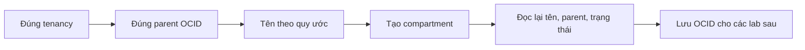

# Tạo compartment học tập và quy ước đặt tên

## Mục tiêu và bối cảnh

Trong chương **Tài khoản và môi trường thực hành** của module **CLOUD_PROVIDERS_ORACLE**, compartment học tập là nơi tổ chức tài nguyên trước khi thực hành VCN, Compute, lưu trữ và Oracle Database. Chuẩn bị đúng compartment giúp người học biết tài nguyên thuộc phạm vi nào, ai quản lý và cần kiểm tra gì khi kết thúc lab.

Bài này tập trung vào một kết quả cụ thể: tạo được một compartment học tập dưới đúng parent, xác minh bằng OCID và áp dụng một quy ước đặt tên có thể dùng xuyên suốt các bài thực hành OCI.

Sau bài học, người học có thể:

- Chọn parent và phạm vi quản trị phù hợp cho lab.
- Phân biệt tên compartment, đường dẫn compartment, OCID và tên tài nguyên dịch vụ.
- Tạo compartment bằng Console hoặc OCI CLI.
- Kiểm tra lại tên, parent, trạng thái và quyền sử dụng.
- Đặt tên và gắn thông tin chủ sở hữu nhất quán để hỗ trợ tìm kiếm, tự động hóa và dọn tài nguyên.

## 1. Đầu ra của bài thực hành

Giả sử tổ chức đã có compartment `Training` dành cho đào tạo. Người học được phép tạo một compartment con để thực hành Java trên OCI.

Cây mục tiêu:

```text
Tenancy / root
└── Training                         ← parent đã có
    └── lab-oci-java-an01             ← compartment tạo trong bài
```

Trong ví dụ:

- `lab` chỉ mục đích học tập.
- `oci` chỉ nền tảng.
- `java` là mã dự án hoặc lộ trình thực hành.
- `an01` là mã người phụ trách giả định, không phải tài khoản đã được tạo sẵn.

Nếu dùng tenancy cá nhân và không có `Training`, parent có thể là root khi người học có quyền phù hợp. Không cần tạo thêm `Training` chỉ để sao chép hình minh họa.

Bài này chỉ yêu cầu tạo compartment. Chưa cần tạo Compute, database hoặc tài nguyên lưu trữ để chứng minh bước chuẩn bị đã hoàn tất.

### Tiêu chí hoàn thành

| Nội dung | Kết quả cần xác minh |
| --- | --- |
| Tên | Theo quy ước đã chọn |
| Parent | Đúng OCID của Training hoặc parent được giao |
| Trạng thái | Compartment đã sẵn sàng sử dụng |
| Mô tả | Nêu mục đích và chủ sở hữu |
| Định danh | Đã ghi nhận OCID của compartment mới |
| Quyền | Người học biết mình được làm gì trong compartment |
| Vòng đời | Có kế hoạch kiểm kê và dọn tài nguyên lab |

Tên đúng là một phần của kết quả. Nếu tên đúng nhưng parent sai, bài thực hành vẫn chưa đạt mục tiêu quản trị.

## 2. Compartment học tập giúp gì và cần bổ sung gì?

Compartment là phạm vi tổ chức tài nguyên trong tenancy. Người học chọn compartment này khi tạo các tài nguyên dịch vụ có hỗ trợ compartment.

Ví dụ ở những bài sau:

```text
lab-oci-java-an01
├── VCN của bài thực hành mạng
├── Compute chạy ứng dụng Java
├── Volume phục vụ máy thực hành
└── Database thử nghiệm khi bài học yêu cầu
```

Danh sách trên là cách tổ chức về mặt quản trị. Nó chưa mô tả đầy đủ quan hệ mạng hoặc phụ thuộc giữa các tài nguyên.

Một compartment riêng hỗ trợ:

- Tìm đúng nhóm tài nguyên của lab.
- Cấp quyền theo phạm vi học tập.
- Theo dõi trách nhiệm và chi phí liên quan.
- Kiểm kê trước khi dọn môi trường.
- Truyền đúng compartment OCID cho công cụ tự động hóa.

Tuy nhiên, tên có chữ `lab` không tự giới hạn chi phí, chặn truy cập Internet hoặc đặt ngày xóa tài nguyên. Cần thiết kế IAM, mạng, quota, budget và quy trình dọn dẹp theo yêu cầu thực tế.

Compartment cũng không phải tài nguyên chỉ tồn tại trong một region. Khi triển khai các tài nguyên có phạm vi region, vẫn cần chọn đúng region riêng. [Phạm vi và cách sử dụng compartment](https://docs.oracle.com/en-us/iaas/Content/Identity/Tasks/managingcompartments.htm).

## 3. Chuẩn bị trước khi tạo

### 3.1. Xác định đúng tenancy và parent

Trước khi mở biểu mẫu tạo compartment, ghi nhận:

```text
Tenancy:            <tenancy-OCID>
Home region:        <home-region-identifier>
Parent:             <parent-compartment-OCID>
Ten du kien:        lab-oci-java-an01
Chu so huu:         an01
Muc dich:           thuc hanh OCI cho ung dung Java
```

Tenancy OCID và compartment OCID không được dùng thay thế tùy ý. Tenancy là root compartment; dùng tenancy OCID làm parent sẽ tạo compartment trực tiếp dưới root.

Trong môi trường nhiều người học, nên lấy parent OCID từ người phụ trách thay vì chọn một compartment chỉ vì tên có vẻ phù hợp.

### 3.2. Phân biệt quyền tạo compartment và quyền tạo workload

Người thực hiện cần quyền quản lý compartment ở phạm vi phù hợp. Quyền đó có thể do quản trị viên tenancy thực hiện hoặc được ủy quyền trong một parent cụ thể. [Quyền quản lý compartment](https://docs.oracle.com/en-us/iaas/Content/Identity/compartments/managingcompartments.htm).

Tạo được compartment chưa có nghĩa người học được tạo mọi dịch vụ bên trong. Ví dụ, một bài Compute có thể còn cần quyền trên instance, volume, image và subnet liên quan.

Trước khi bắt đầu chuỗi lab, thống nhất:

| Vai trò | Trách nhiệm |
| --- | --- |
| Người phụ trách tenancy | Chọn parent và cấp phạm vi quyền cần thiết |
| Người học | Tạo hoặc sử dụng đúng compartment được giao |
| Người phụ trách lab | Xác nhận quy ước tên và phạm vi tài nguyên được phép |
| Chủ sở hữu tài nguyên | Kiểm kê, theo dõi sử dụng và dọn tài nguyên sau lab |

Không cần cấp quyền quản trị toàn tenancy chỉ để người học có một nơi thực hành.

### 3.3. Kiểm tra xem compartment đã tồn tại chưa

Nếu cùng lab đã được chuẩn bị trước đó, đối chiếu tên, OCID, parent và chủ sở hữu. Không tạo thêm một compartment mới mỗi lần bắt đầu buổi học.

Nếu đã có một compartment cùng tên nhưng chưa rõ mục đích, dừng việc tạo và xác minh với người phụ trách. Đừng đổi hậu tố thành `02`, `03` liên tục để né xung đột tên; việc đó có thể làm môi trường bị phân tán.

## 4. Quy tắc OCI và quy ước nội bộ là hai lớp khác nhau

Theo tài liệu tạo compartment, tên phải duy nhất trong parent, dài tối đa 100 ký tự và dùng các ký tự được hỗ trợ như chữ, số, dấu chấm, dấu gạch nối hoặc gạch dưới. Mô tả là thông tin riêng, có thể thay đổi. [Yêu cầu khi tạo compartment](https://docs.oracle.com/en-us/iaas/Content/Identity/compartments/To_create_a_compartment.htm).

Một tổ chức có thể chọn quy ước chặt hơn để tên dễ đọc. Trong bài này, quy ước đề xuất là:

```text
lab-oci-<project>-<owner>
```

Ví dụ:

```text
lab-oci-java-an01
lab-oci-java-binh02
lab-oci-orders-team01
```

Quy ước này là lựa chọn cho bài học, không phải mẫu tên bắt buộc của Oracle.

### Các quy tắc nội bộ được chọn

| Thành phần | Quy ước của bài |
| --- | --- |
| Chữ | Dùng chữ thường ASCII |
| Dấu phân cách | Dấu gạch nối `-` |
| Project | Mã ngắn, ổn định, một nhóm chữ hoặc số |
| Owner | Mã người hoặc nhóm được thống nhất |
| Độ dài mục tiêu | Không quá 48 ký tự để còn dễ đọc |
| Số lượng từ | Chỉ chứa thông tin cần nhận diện |
| Thông tin thay đổi thường xuyên | Đặt trong mô tả hoặc tag |

Giới hạn 48 ký tự là mục tiêu nội bộ, nhỏ hơn giới hạn kỹ thuật của compartment. Dùng ASCII không dấu cũng là lựa chọn để đơn giản hóa thao tác CLI, không phải khẳng định rằng mọi tên OCI đều có cùng bảng ký tự.

Với mẫu này, một phép kiểm tra quy ước có thể dùng biểu thức:

```text
^lab-oci-[a-z0-9]+-[a-z0-9]+$
```

Biểu thức chỉ kiểm tra mẫu đặt tên của bài. Nó không thay thế kiểm tra độ dài, xung đột hoặc các quy tắc của API OCI.

### So sánh tên

| Tên | Đánh giá theo quy ước của bài |
| --- | --- |
| `lab-oci-java-an01` | Rõ mục đích, nền tảng, dự án và chủ sở hữu |
| `Lab_Java_An01` | Có thể khác quy ước đã thống nhất về chữ và dấu phân cách |
| `test` | Khó biết lab nào và ai chịu trách nhiệm |
| `new-final-test-2` | Thể hiện lịch sử thử tên, không thể hiện mục đích ổn định |
| `lab-oci-java-an01-password123` | Chứa thông tin không nên đưa vào tên |
| `Training:lab-oci-java-an01` | Đây là cách diễn đạt đường dẫn, không phải tên compartment con |

Tên, mô tả và tag không nên chứa mật khẩu, private key hoặc dữ liệu bí mật. Chúng xuất hiện ở nhiều màn hình quản trị và công cụ vận hành. [Định danh và tên tài nguyên OCI](https://docs.oracle.com/en-us/iaas/Content/General/Concepts/identifiers.htm).

## 5. Phân biệt tên, đường dẫn và OCID

Ba giá trị sau phục vụ các mục đích khác nhau:

```text
Name:    lab-oci-java-an01
Path:    Training:lab-oci-java-an01
OCID:    <ocid-compartment-cua-lab>
```

- **Name** giúp người vận hành nhận diện trong danh sách.
- **Path** mô tả vị trí trong cây compartment.
- **OCID** là định danh do Oracle cấp cho đối tượng cụ thể.

Trong công cụ triển khai, nên truyền OCID đã được xác minh. Không tìm tài nguyên chỉ bằng tên rồi chọn phần tử đầu tiên nếu chưa kiểm tra parent.

### Đường dẫn trong policy

Giả sử `Training` nằm trực tiếp dưới root, group `LabReaders` đã tồn tại trong identity domain Default, policy được tạo ở root:

```text
Allow group Default/LabReaders to read instance-family in compartment Training:lab-oci-java-an01
```

Dấu hai chấm mô tả đường đi đến compartment con. Nếu policy được đặt tại vị trí khác, cách tham chiếu phải phù hợp với vị trí đó. OCI cũng hỗ trợ chỉ định compartment bằng OCID. [Cách xác định phạm vi trong policy](https://docs.oracle.com/en-us/iaas/Content/Identity/policysyntax/location.htm).

Ví dụ trên chỉ minh họa quyền đọc họ tài nguyên Compute instance, chưa phải bộ quyền đầy đủ để làm lab Compute hoặc database.

### Đổi tên không tạo một compartment khác

Compartment có thể được đổi tên theo thao tác quản trị được hỗ trợ. Tuy nhiên, người vận hành cần rà soát các script tra cứu theo tên, tài liệu, danh mục và quy ước liên quan trước khi đổi.

Đổi tên không phải chuyển parent hoặc tạo lại môi trường. Khi kiểm tra sau thao tác, dùng OCID để xác nhận mình vẫn đang làm việc với đúng đối tượng. [Đổi tên compartment](https://docs.oracle.com/en-us/iaas/Content/Identity/compartments/To_update_a_compartments_name.htm).

## 6. Tạo compartment bằng Console

### Bước 1: Mở danh sách compartment

Trong phần Identity & Security của Console, tìm Compartments. Kiểm tra tenancy đang đăng nhập và chọn đúng nhánh parent được phép.

Nếu parent là Training, mở chi tiết Training trước khi tạo compartment con.

### Bước 2: Điền thông tin

Nhập các giá trị của bài:

| Trường | Giá trị minh họa |
| --- | --- |
| Name | `lab-oci-java-an01` |
| Description | `OCI training for Java; owner=an01; temporary lab resources.` |
| Parent compartment | `Training`, đối chiếu bằng OCID |
| Tags | Theo quy ước của tổ chức hoặc bộ tag minh họa ở mục 9 |

Mô tả nên nêu mục đích và chủ sở hữu; không cần nhồi toàn bộ kế hoạch học vào tên.

### Bước 3: Kiểm tra parent trước khi tạo

Nếu biểu mẫu đang chỉ root nhưng mục tiêu là Training, sửa parent trước khi lưu. Tên compartment mới giống nhau không làm hai vị trí trở thành tương đương.

### Bước 4: Tạo và theo dõi kết quả

Thực hiện Create compartment. Đọc thông báo thành công hoặc lỗi và kiểm tra trạng thái sẵn sàng của compartment mới.

### Bước 5: Đọc lại chi tiết

Mở compartment vừa tạo rồi đối chiếu tên, mô tả, parent, trạng thái và OCID. Không chỉ dựa trên việc xuất hiện một dòng có tên đúng.

Quy trình Console và các trường trên được mô tả trong [hướng dẫn tạo compartment của Oracle](https://docs.oracle.com/en-us/iaas/Content/Identity/compartments/To_create_a_compartment.htm).



Việc đọc lại ở cuối giúp phát hiện sai parent trước khi có thêm VCN, Compute hoặc database phụ thuộc vào cấu trúc đó.

## 7. Minh họa tạo bằng OCI CLI trên PowerShell

Phần này dành cho máy có OCI CLI đã được cài đặt và cấu hình xác thực. Các lệnh là ví dụ để người học thực hiện trong môi trường lab được cấp quyền; bài viết không thực thi thao tác trên tenancy.

Dùng home region cho các lời gọi IAM yêu cầu endpoint quản trị tại home region. Thay giá trị placeholder bằng thông tin đã được xác nhận.

### 7.1. Xác nhận parent

```powershell
$ociHomeRegion = '<home-region-identifier>'
$parentCompartmentId = '<ocid-compartment-Training>'
$labName = 'lab-oci-java-an01'

oci iam compartment get `
    --compartment-id $parentCompartmentId `
    --region $ociHomeRegion

if ($LASTEXITCODE -ne 0) {
    throw 'Khong doc duoc parent compartment.'
}
```

Đọc kết quả để bảo đảm đây là parent được giao. Nếu tổ chức dùng root làm parent, biến `$parentCompartmentId` sẽ chứa tenancy OCID thay vì OCID của Training.

### 7.2. Kiểm tra tên trong các compartment con trực tiếp

```powershell
$existingJson = oci iam compartment list `
    --compartment-id $parentCompartmentId `
    --name $labName `
    --all `
    --region $ociHomeRegion `
    --output json

if ($LASTEXITCODE -ne 0) {
    throw 'Khong kiem tra duoc compartment da ton tai.'
}

$existingCompartments = @(($existingJson | ConvertFrom-Json).data)

if ($existingCompartments.Count -gt 0) {
    $existingCompartments |
        Select-Object name, id, 'compartment-id', 'lifecycle-state'

    throw 'Ten da ton tai duoi parent; doi chieu OCID va muc dich truoc khi dung lai.'
}
```

Lệnh list với một parent thông thường trả về các compartment con trực tiếp. Tham số `--all` lấy hết các trang kết quả, không có nghĩa tự duyệt mọi nhánh con sâu hơn. [Tham chiếu lệnh compartment list](https://docs.oracle.com/en-us/iaas/tools/oci-cli/latest/oci_cli_docs/cmdref/iam/compartment/list.html).

Đoạn kiểm tra dừng khi thấy tên đã có, thay vì tự nhận một compartment chưa xác minh là tài nguyên của bài. Trong triển khai tự động hóa hoàn chỉnh, cần thêm cơ chế quản lý trạng thái và xử lý việc hai người tạo đồng thời; một lần list trước create chưa giải quyết mọi tình huống cạnh tranh.

### 7.3. Tạo compartment mới

Chỉ tiếp tục khi chưa có compartment trùng mục đích:

```powershell
if ($labName.Length -gt 48 -or
    $labName -cnotmatch '^lab-oci-[a-z0-9]+-[a-z0-9]+$') {
    throw 'Ten khong dung quy uoc lab.'
}

$labCompartmentId = oci iam compartment create `
    --compartment-id $parentCompartmentId `
    --name $labName `
    --description 'OCI training for Java; owner=an01; temporary lab resources.' `
    --wait-for-state ACTIVE `
    --max-wait-seconds 180 `
    --region $ociHomeRegion `
    --query 'data.id' `
    --raw-output

if ($LASTEXITCODE -ne 0) {
    throw 'Chua xac nhan tao compartment thanh cong; doc lai trang thai truoc khi thu lai.'
}
```

Trong lệnh create, `--compartment-id` là **OCID của parent**, không phải OCID của compartment sắp tạo. `--wait-for-state ACTIVE` yêu cầu CLI đợi đối tượng đạt trạng thái Active trong thời gian giới hạn đã chỉ định. [Tham chiếu lệnh compartment create](https://docs.oracle.com/en-us/iaas/tools/oci-cli/latest/oci_cli_docs/cmdref/iam/compartment/create.html).

Nếu hết thời gian chờ, không kết luận tài nguyên chắc chắn chưa được tạo. Đọc lại danh sách và trạng thái trước khi gửi yêu cầu tạo mới.

### 7.4. Đọc lại đối tượng vừa tạo

```powershell
$labJson = oci iam compartment get `
    --compartment-id $labCompartmentId `
    --region $ociHomeRegion `
    --output json

if ($LASTEXITCODE -ne 0) {
    throw 'Khong doc lai duoc compartment.'
}

$lab = ($labJson | ConvertFrom-Json).data

if ($lab.name -cne $labName -or
    $lab.'compartment-id' -ne $parentCompartmentId -or
    $lab.'lifecycle-state' -ne 'ACTIVE') {
    throw 'Thong tin readback khong khop muc tieu lab.'
}

$lab |
    Select-Object name, id, 'compartment-id', 'lifecycle-state'
```

Sau bước này, `$labCompartmentId` mới là OCID được dùng để chỉ compartment đích của các tài nguyên ở những bài sau.

Script minh họa không tự tạo lại compartment khi chạy lần hai. Nếu compartment đã có, dùng OCID được xác minh thay vì xóa nó chỉ để làm script chạy lại từ đầu.

## 8. Mở rộng quy ước tên cho tài nguyên của lab

Compartment học tập không thay thế tên của từng tài nguyên. Khi bắt đầu triển khai workload, có thể dùng một mẫu display name:

```text
<type>-<project>-<env>-<region>-<sequence>
```

Ví dụ cho tài nguyên tại Singapore:

| Loại tài nguyên | Display name minh họa |
| --- | --- |
| VCN | `vcn-java-lab-sin-01` |
| Subnet | `subnet-java-lab-sin-01` |
| Route table | `rt-java-lab-sin-01` |
| NSG | `nsg-java-lab-sin-01` |
| Compute instance | `vm-java-lab-sin-01` |
| Block Volume | `vol-java-lab-sin-01` |
| Tài nguyên database có trường display name phù hợp | `db-java-lab-sin-01` |

Đây là quy ước đặt display name của lab. Mỗi loại dịch vụ vẫn có quy tắc trường tên, độ dài và tính duy nhất riêng.

### Vì sao tên compartment không chứa region?

Trong ví dụ, `lab-oci-java-an01` không chứa `sin` vì compartment có thể tổ chức tài nguyên ở nhiều region. Tài nguyên cụ thể có thêm mã region để người vận hành dễ nhận diện khi làm lab liên vùng.

Mã trong tên chỉ là nhãn. Một instance mang tên chứa `sin` vẫn phải được kiểm tra region thực tế từ Console hoặc API.

### Chọn sequence có ý nghĩa

Dùng `01`, `02` để phân biệt các tài nguyên cùng vai trò khi có nhu cầu thực tế. Không dùng số tăng dần như một cách duy nhất để ghi lịch sử chạy lại lab.

Ví dụ, `vm-java-lab-sin-01` có thể là máy ứng dụng và `vm-java-lab-sin-02` là máy kiểm thử. Nếu vai trò cần được nhận diện rõ, có thể thống nhất thêm thành phần role trong quy ước:

```text
vm-java-app-lab-sin-01
vm-java-test-lab-sin-01
```

Khi đã chọn biến thể có role, áp dụng nhất quán trong phạm vi nhóm thay vì trộn nhiều cách tùy từng lần tạo.

### Display name không phải khóa định danh duy nhất

Nhiều tài nguyên OCI cho phép display name không duy nhất. Vì vậy, việc tìm theo tên có thể trả về nhiều đối tượng; luôn đối chiếu OCID, compartment và region trước một thao tác thay đổi hoặc xóa. [OCID và display name](https://docs.oracle.com/en-us/iaas/Content/General/Concepts/identifiers.htm).

## 9. Không dùng cùng một mẫu cho mọi loại tên kỹ thuật

Một tài nguyên có thể có nhiều trường mang ý nghĩa “tên”, với quy tắc khác nhau.

### Ví dụ VCN và subnet

VCN có thể dùng:

```text
Display name: vcn-java-lab-sin-01
DNS label:    javalab
```

Subnet có thể dùng:

```text
Display name: subnet-java-lab-sin-01
DNS label:    app01
```

DNS label của VCN và subnet có quy tắc riêng: tối đa 15 ký tự chữ hoặc số, bắt đầu bằng chữ; không dùng dấu gạch nối hoặc gạch dưới. Vì vậy, không sao chép nguyên display name ở trên vào trường DNS label. [DNS label và hostname trong VCN](https://docs.oracle.com/en-us/iaas/Content/Network/Concepts/dns.htm).

### Ví dụ database và Object Storage

Các trường như database name, service name, unique name hoặc bucket name có yêu cầu của dịch vụ tương ứng. `db-java-lab-sin-01` trong bảng chỉ là display name minh họa cho nơi cho phép dùng nó.

Trước khi tạo một tài nguyên, đọc mô tả từng trường thay vì giả định tất cả đều nhận chữ thường và dấu gạch nối. Lỗi ở một tên kỹ thuật không có nghĩa phải đổi toàn bộ quy ước compartment.

### Quy tắc ra quyết định

```text
Trường này là display name?
  → áp dụng mẫu display name nếu đáp ứng ràng buộc dịch vụ

Trường này là DNS label, hostname hoặc tên kỹ thuật database?
  → dùng quy tắc riêng của trường đó

Công cụ cần định danh tài nguyên cụ thể?
  → dùng OCID hoặc định danh được API yêu cầu
```

Cách phân biệt này giúp tránh sai ngay từ bước khai báo hạ tầng bằng CLI hoặc Terraform.

## 10. Dùng mô tả và tag cho thông tin quản trị

Tên nên ổn định, còn mô tả và tag chứa các thông tin cần phân loại bổ sung.

Bộ tag minh họa:

| Key | Value mẫu | Mục đích |
| --- | --- | --- |
| `Purpose` | `training` | Nhận diện tài nguyên học tập |
| `Project` | `java` | Liên hệ với lộ trình hoặc dự án |
| `Environment` | `lab` | Phân loại môi trường |
| `Owner` | `an01` | Xác định người phụ trách |
| `ReviewAfter` | `<YYYY-MM-DD>` | Nhắc thời điểm kiểm tra lại nhu cầu |

Thay ngày mẫu bằng ngày thực tế được thống nhất. Tag `ReviewAfter` không tự tạo một tác vụ xóa; nếu cần tự động hóa vòng đời, phải có quy trình hoặc công cụ đọc và xử lý tag.

### Free-form tag và defined tag

Free-form tag là cặp key-value có thể dùng cho lab khi được phép. Defined tag cần namespace và key được quản lý trước, giúp tổ chức chuẩn hóa các giá trị và cơ chế quản trị liên quan.

Nếu nhóm đã có namespace và chính sách tag, dùng bộ tag đó thay vì tự tạo một bộ khác. Với nhu cầu theo dõi chi phí bằng cơ chế tagging của OCI, kiểm tra loại tag và cấu hình được hỗ trợ; không giả định mọi free-form tag đều là cost-tracking tag. [Tổng quan tagging của OCI](https://docs.oracle.com/en-us/iaas/Content/Tagging/Concepts/taggingoverview.htm).

### Tag trên compartment không tự gắn cho mọi resource

Gắn `Owner=an01` lên compartment không đồng nghĩa mọi instance hoặc database tạo sau đó đã có cùng tag.

Nếu tổ chức dùng tag defaults, cần cấu hình và kiểm tra cơ chế đó cho các tài nguyên mới theo phạm vi được hỗ trợ. Không suy ra các tài nguyên đã tồn tại sẽ tự được sửa tag theo. [Cơ chế tag defaults](https://docs.oracle.com/en-us/iaas/Content/Tagging/Tasks/managingtagdefaults.htm).

Trong lab nhỏ, có thể áp dụng tag khi tạo từng tài nguyên và đọc lại để xác minh. Khi số lượng tài nguyên tăng, mới bổ sung tự động hóa phù hợp.

## 11. Kiểm tra quyền và chuẩn bị dùng compartment trong bài tiếp theo

Sau khi compartment đã Active, xác nhận người học nhìn thấy đúng nhánh và có những quyền được giao.

Ví dụ các mức kiểm tra khác nhau:

| Kiểm tra | Điều có thể kết luận |
| --- | --- |
| Đọc được chi tiết compartment | Danh tính có thể truy xuất đối tượng quản trị này |
| Xem được danh sách Compute trong lab | Có đường cấp quyền đọc/list tương ứng |
| Tạo được một VCN lab theo bài mạng | Có quyền cho thao tác mạng đã thực hiện |
| Không sửa được tài nguyên ngoài lab | Phù hợp mục tiêu nếu danh tính chỉ được giao lab |

Không dùng tài khoản quản trị toàn tenancy để kết luận quyền của nhóm người học đã bị giới hạn đúng. Cũng không tạo tài nguyên có phí chỉ để thử quyền nếu bài học chưa cần đến nó.

Khi tạo tài nguyên ở những bài sau, đối chiếu bộ ba:

```text
Region đích
Compartment OCID
Tên và mục đích tài nguyên
```

Tài nguyên mang tên có chữ `lab` nhưng nằm ngoài compartment học tập vẫn có thể làm sai kế hoạch phân quyền và kiểm kê.

### Chuẩn bị chi phí và tính sẵn sàng

Compartment giúp xác định phạm vi để theo dõi sử dụng, nhưng không tự có một ngân sách hoặc hạn mức tài nguyên. Trước lab Compute/database, thống nhất cấu hình được phép, cách cảnh báo chi phí và thời gian giữ tài nguyên.

Tương tự, đặt hai máy vào cùng một compartment không bảo đảm dự phòng. Tính sẵn sàng phụ thuộc cách triển khai dịch vụ, miền lỗi, dữ liệu và cơ chế chuyển đổi tương ứng; các bài chuyên sâu sẽ thiết kế phần đó trên nền phạm vi quản trị đã chuẩn bị.

## 12. Xử lý các lỗi thường gặp

| Hiện tượng | Cách kiểm tra |
| --- | --- |
| Tên bị từ chối | Độ dài, ký tự, xung đột trong parent và thông báo cụ thể của API |
| Compartment nằm sai nhánh | Đối chiếu parent OCID, không chỉ tên trong danh sách |
| Không thấy compartment vừa tạo | Tenancy, danh tính, phạm vi danh sách, trạng thái và thời gian cập nhật |
| List không thấy compartment ở nhánh sâu | List parent thông thường chỉ liệt kê con trực tiếp |
| Tạo được compartment nhưng không tạo được VCN | Quyền trên compartment và quyền trên dịch vụ là các yêu cầu khác nhau |
| CLI timeout khi đợi Active | Đọc lại đối tượng trước khi gửi create lần nữa |
| DNS label không nhận display name | Dùng quy tắc riêng của DNS label |
| Resource mang tên lab nhưng không xuất hiện trong lab | Kiểm tra compartment và region thực tế |
| Thêm tag Owner nhưng resource con chưa có tag | Kiểm tra tag từng resource hoặc cấu hình tag defaults |
| Không xóa được compartment | Kiểm kê tài nguyên, compartment con và policy còn tồn tại |

### Nếu đã tạo sai parent

Khi compartment mới còn rỗng, xác định phương án sửa với người có quyền. Khi đã có tài nguyên, không tự di chuyển hoặc xóa chỉ để làm cây khớp ảnh minh họa.

Di chuyển compartment có thể thay đổi quyền kế thừa từ parent và ảnh hưởng các công cụ đang dựa vào vị trí cũ. Cần biết nội dung và phụ thuộc trước khi xử lý.

### Nếu quy ước tên thay đổi

Ưu tiên cập nhật có kế hoạch: danh mục tên, công cụ tra cứu và tài liệu vận hành. Không cần đổi hàng loạt tên tài nguyên đang phục vụ bài lab chỉ vì vừa nghĩ ra một cách viết đẹp hơn.

Mục tiêu của quy ước là giúp thao tác rõ ràng và nhất quán, không phải tạo thêm công việc đổi tên liên tục.

## 13. Kết thúc lab và dọn tài nguyên

Sau khi hoàn tất một chuỗi bài, người học cần biết tài nguyên nào tiếp tục dùng và tài nguyên nào phải thu hồi.

Trình tự quản lý gợi ý:

1. Liệt kê tài nguyên thuộc đúng compartment ở các region đã sử dụng.
2. Xác nhận chủ sở hữu và tài nguyên còn được bài khác cần đến.
3. Xóa hoặc dừng các tài nguyên theo quy định riêng của từng dịch vụ.
4. Kiểm tra volume, bản sao lưu, database, lưu trữ và log còn lại.
5. Thu hồi các policy hoặc cấu hình chỉ phục vụ lab khi phù hợp.
6. Chỉ xóa compartment nếu không còn cần dùng và đã đáp ứng điều kiện xóa.

Compartment phải được làm trống trước khi xóa; các policy gắn tại đó cũng cần được kiểm tra. Thao tác xóa là bất đồng bộ và có thể thất bại nếu còn phụ thuộc. [Điều kiện xóa compartment](https://docs.oracle.com/en-us/iaas/Content/Identity/compartments/To_delete_a_compartment.htm).

Không suy ra rằng tên bắt đầu bằng `lab-` là đủ điều kiện để xóa hàng loạt. Tên hỗ trợ tìm kiếm; quyết định xóa vẫn cần đối chiếu OCID, phạm vi và mục đích sử dụng thực tế.

Nếu compartment được tái sử dụng cho các buổi sau, có thể giữ lại cấu trúc quản trị và dọn workload bên trong theo kế hoạch đã thống nhất.

## 14. Bài tập và bằng chứng hoàn thành

Thực hiện trong phạm vi được cấp quyền:

1. Chọn một mã project và owner cho lab.
2. Viết tên theo mẫu `lab-oci-<project>-<owner>`.
3. Xác nhận parent bằng OCID.
4. Kiểm tra compartment đã tồn tại trước khi tạo.
5. Tạo bằng Console hoặc CLI, sau đó đọc lại trạng thái và parent.
6. Soạn tên dự kiến cho VCN, subnet, Compute và database display name.
7. Tách DNS label ra khỏi display name trong bản thiết kế.
8. Ghi nhận tag, chủ sở hữu và thời điểm kiểm tra lại môi trường.

Không cần tạo các tài nguyên workload chỉ để hoàn thành mục 6 và 7.

Mẫu bàn giao:

```text
Tenancy OCID:           <gia-tri-thuc-te>
Parent name:            <ten-parent>
Parent OCID:            <ocid-parent>
Lab compartment name:   <ten-theo-quy-uoc>
Lab compartment OCID:   <ocid-lab>
Lifecycle state:        <trang-thai-doc-lai>
Owner:                  <ma-chu-so-huu>
Purpose:                <muc-dich-lab>
Naming convention:      <mau-da-thong-nhat>
Review after:           <ngay-thuc-te>
Quyen da xac nhan:      <pham-vi-duoc-giao>
Tai nguyen workload:    <chua-tao/liet-ke-neu-co>
```

Đối chiếu mẫu với kết quả thực tế. Nếu chưa được cấp quyền tạo compartment, ghi rõ điều kiện thiếu; không báo hoàn thành chỉ vì đã soạn được tên.

## 15. Điểm cần ghi nhớ

Một compartment lab hữu ích cần **đúng parent, đúng phạm vi quyền, có OCID được xác minh và có người chịu trách nhiệm**. Quy ước tên giúp người học tìm và hiểu tài nguyên, còn tag và mô tả bổ sung thông tin quản trị.

Với các bài OCI tiếp theo, hãy dùng compartment OCID đã xác nhận, chọn region rõ ràng và áp dụng quy tắc tên riêng cho từng trường. Cách chuẩn bị này giúp triển khai VCN, Compute, lưu trữ và database nhất quán, đồng thời thuận tiện hơn khi kiểm kê và dọn môi trường.