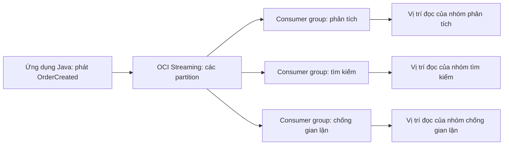
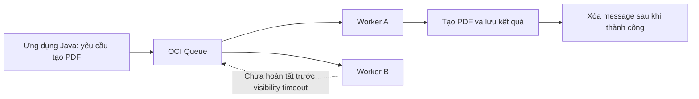
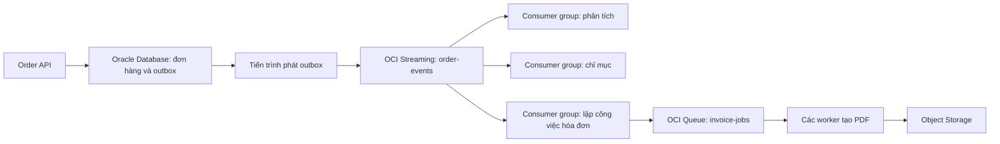

# Lựa chọn OCI Streaming và OCI Queue

Trong Oracle Cloud Infrastructure (OCI), **Streaming** phù hợp khi ứng dụng cần giữ một dòng sự kiện để các bên đọc độc lập và có thể đọc lại. **Queue** phù hợp khi cần giao từng message cho worker, theo dõi việc xử lý và thử lại khi chưa hoàn tất. Cả hai đều giúp tách bên phát sinh dữ liệu khỏi bên xử lý, nhưng có vòng đời dữ liệu khác nhau. [Tổng quan Streaming](https://docs.oracle.com/en-us/iaas/Content/Streaming/Concepts/streamingoverview.htm), [Tổng quan Queue](https://docs.oracle.com/en-us/iaas/Content/queue/overview.htm).

Bài mở đầu chương **Streaming và Queue**, tập trung vào cách chọn dịch vụ cho hạ tầng OCI và ứng dụng Java. Kết quả cần đạt là một quyết định có căn cứ về mô hình tiêu thụ, thứ tự, khả năng khôi phục, IAM, giám sát và chi phí; không chỉ là chọn tên dịch vụ theo loại dữ liệu.

## 1. Bắt đầu từ vòng đời dữ liệu

Trước khi so sánh sản phẩm, hãy trả lời ba câu hỏi:

1. Sau khi một bên xử lý xong, dữ liệu có cần được giữ để bên khác đọc hoặc để chạy lại logic không?
2. Một message đại diện cho một sự việc đã xảy ra, hay một công việc cần được hoàn thành?
3. Khi worker lỗi giữa chừng, hệ thống xác định phần việc đã hoàn tất bằng cách nào?

Ví dụ, hệ thống bán hàng có hai nhu cầu:

- `OrderCreated`: sự kiện đơn hàng đã được tạo, phục vụ phân tích, cập nhật mô hình tìm kiếm và kiểm tra gian lận.
- `GenerateInvoicePdf`: công việc tạo một file hóa đơn, có thể giao cho bất kỳ worker phù hợp nào trong một nhóm.

Hai message có thể cùng chứa `orderId`, nhưng yêu cầu vận hành khác nhau. Nhóm phân tích có thể muốn chạy lại dữ liệu hôm qua; worker tạo PDF chủ yếu cần biết công việc nào còn chưa hoàn thành.

Sự phân biệt giữa sự kiện và công việc là điểm khởi đầu, không phải quy tắc cứng. Một sự kiện cũng có thể được giao qua Queue; điều quyết định là cách giữ, giao, xác nhận và đọc lại dữ liệu.

## 2. Hiểu hai mô hình xử lý

### 2.1. Streaming: nhật ký phân vùng có vị trí đọc

Một stream là nhật ký chỉ bổ sung, chia thành các partition. Message có offset trong partition. Consumer đọc dữ liệu bằng vị trí đọc; đọc xong không làm message bị xóa ngay. Dữ liệu còn khả dụng trong thời gian retention. [Mô hình Streaming](https://docs.oracle.com/en-us/iaas/Content/Streaming/Concepts/streamingoverview.htm).



Trong một consumer group, các instance chia nhau partition; mỗi partition được giao cho một instance tại một thời điểm. Các nhóm khác nhau có tiến độ riêng. Khi số instance vượt số partition, các instance dư không nhận partition để đọc. [Consumer groups của Streaming](https://docs.oracle.com/en-us/iaas/Content/Streaming/Tasks/using_consumer_groups.htm).

Ví dụ, nhóm `search-indexer` có ba instance và stream có ba partition. Khi một instance dừng, nhóm có thể phân phối lại partition cho các instance còn lại. Nhóm `fraud-analysis` vẫn có tiến độ độc lập, không dùng chung mốc hoàn tất với `search-indexer`.

Điểm cần thiết kế là partition key. Nếu các sự kiện của cùng một đơn hàng cần đi cùng thứ tự, có thể dùng `orderId` làm key. Cùng key đi vào cùng partition; bảo đảm thứ tự áp dụng trong partition, không phải toàn bộ stream. [Partition và thứ tự](https://docs.oracle.com/en-us/iaas/Content/Streaming/Concepts/partitioningastream.htm).

Bảo đảm này cũng không tự làm cho các lời gọi nghiệp vụ chạy song song trong consumer hoàn tất đúng thứ tự. Nếu consumer đọc tuần tự rồi đưa mọi message vào một thread pool tự do, ứng dụng vẫn có thể cập nhật trạng thái đơn hàng sai thứ tự.

### 2.2. Queue: giao message, ẩn tạm thời và xác nhận hoàn tất

Với mô hình queue cơ bản, các worker trong cùng đường tiêu thụ cạnh tranh nhận công việc:



Khi worker nhận message, Queue ẩn message khỏi các worker khác trong thời gian visibility timeout. Worker có thể gia hạn thời gian này. Sau khi xử lý thành công, worker phải xóa message; nếu chưa xóa và thời gian ẩn hết hạn, message có thể được giao lại. [Cơ chế tiêu thụ và visibility timeout](https://docs.oracle.com/en-us/iaas/Content/queue/consume-messages.htm).

Yêu cầu xóa sử dụng `receipt` nhận từ lần lấy message, thay vì chỉ dùng định danh nghiệp vụ trong payload. [Xóa message](https://docs.oracle.com/en-us/iaas/Content/queue/delete-messages.htm).

Ba khoảng thời gian có ý nghĩa khác nhau:

| Khái niệm | Ý nghĩa khi chọn Queue |
| --- | --- |
| Retention | Message được giữ tối đa bao lâu nếu chưa được xóa |
| Visibility timeout | Một lần giao được dành cho worker trong bao lâu |
| Polling timeout | Một yêu cầu lấy message chờ dữ liệu trong bao lâu |

Nếu tác vụ mất hai phút nhưng visibility timeout chỉ ngắn hơn thời gian xử lý, worker khác có thể nhận lại công việc khi worker đầu vẫn đang chạy. Cần chọn thời gian phù hợp hoặc gia hạn theo tiến độ, đồng thời xử lý tình huống gia hạn thất bại.

## 3. Bảng so sánh để ra quyết định

| Tiêu chí | OCI Streaming | OCI Queue |
| --- | --- | --- |
| Đơn vị tổ chức chính | Stream, partition, offset | Queue, message, đường tiêu thụ |
| Sau khi xử lý thành công | Ghi nhận tiến độ đọc; dữ liệu vẫn chịu retention | Xóa message của đường tiêu thụ tương ứng |
| Đọc lại lịch sử | Đọc từ vị trí hoặc thời điểm còn được giữ | Không lấy lại message đã xóa như cách tua lại stream |
| Chia tải | Phân phối partition trong một consumer group | Nhiều worker nhận các message còn khả dụng |
| Thứ tự | Trong từng partition | Best-effort; không dựa vào FIFO nghiêm ngặt |
| Xử lý công việc lỗi | Ứng dụng thiết kế retry, cách ly lỗi và checkpoint | Visibility timeout, delivery count và DLQ hỗ trợ vòng đời xử lý |
| Nhiều bên nhận độc lập | Consumer groups có tiến độ riêng | Consumer groups và fan-out nếu bật tính năng tương ứng |
| Câu hỏi quyết định | “Cần giữ và đọc lại dòng dữ liệu như thế nào?” | “Cần giao và hoàn tất từng message như thế nào?” |

Các khác biệt về vị trí đọc dựa trên [consumer groups của Streaming](https://docs.oracle.com/en-us/iaas/Content/Streaming/Tasks/using_consumer_groups.htm); vòng đời message dựa trên [Queue](https://docs.oracle.com/en-us/iaas/Content/queue/overview.htm) và [DLQ](https://docs.oracle.com/en-us/iaas/Content/queue/deadletterqueues.htm). Tài liệu FAQ hiện mô tả OCI Queue là standard queue với best-effort ordering. [Thứ tự của Queue](https://www.oracle.com/cloud/queue/faq/).

Không nên suy ra “ít nhất một lần” thành “tác động nghiệp vụ đúng một lần”. Một message có thể được giao lại sau lỗi mạng hoặc sau khi worker mất khả năng xác nhận kết quả. Cần thiết kế chống xử lý trùng cho cả hai lựa chọn.

## 4. OCI Queue cũng có fan-out và consumer groups

Một điểm cần cập nhật khi lựa chọn: Oracle đã công bố fan-out tới nhiều consumer groups của OCI Queue vào ngày 02/02/2026. Vì vậy, tiêu chí “nhiều bên nhận” tự nó chưa đủ để chọn Streaming. [Thông báo tính năng Queue consumer groups](https://docs.oracle.com/en-us/iaas/releasenotes/queue/ConsumerGroups.htm).

Khi bật tính năng, Queue có primary consumer group; các nhóm khác có thể nhận message theo bộ lọc trên **message attributes**. Bộ lọc không đọc trực tiếp body JSON. Các nhóm có đường giao và theo dõi riêng. [Mô hình Queue fan-out](https://docs.oracle.com/en-us/iaas/Content/queue/fanout-top.htm).

Ví dụ, sự kiện đặt hàng được giao cho hai nhóm:

| Nhóm | Nhu cầu |
| --- | --- |
| `invoice-jobs` | Xử lý các message yêu cầu tạo hóa đơn |
| `customer-updates` | Xử lý các message cần cập nhật cho khách hàng |

Nếu chỉ bật nhiều worker trong cùng một nhóm, chúng chia việc của nhóm. Muốn hai chức năng cùng nhận message phù hợp, phải cấu hình hai nhóm và điều kiện nhận tương ứng.

Có thể để trống filter của một nhóm để nhận mọi message theo hướng dẫn tạo nhóm. [Tạo Queue consumer group](https://docs.oracle.com/en-us/iaas/Content/queue/fanout-manage-consumer-group-create.htm).

Các lưu ý trực tiếp ảnh hưởng quyết định:

- Filter được đánh giá khi message được phát; sửa filter không làm dữ liệu cũ được đánh giá lại.
- Nếu primary group bị tắt và không nhóm nào khớp, message có thể bị loại bỏ.
- Fan-out không cung cấp cơ chế offset để tua lại message đã xóa như Streaming.

Hai lưu ý đầu được Oracle mô tả trong [quy tắc đánh giá filter](https://docs.oracle.com/en-us/iaas/Content/queue/fanout-top.htm). Khi cần thêm bên xử lý sau một thời gian và cho bên đó chạy lại lịch sử, phải xét riêng yêu cầu replay.

## 5. Quy trình lựa chọn theo yêu cầu

### Bước 1: Xác định nhu cầu replay

Ưu tiên xem xét Streaming khi có yêu cầu như:

- Xây dựng lại chỉ mục tìm kiếm từ các sự kiện còn được lưu.
- Chạy lại thuật toán sau khi sửa lỗi logic.
- Cho một nhóm phân tích đọc dữ liệu với tiến độ riêng.
- Đọc liên tục dữ liệu hoạt động hoặc telemetry.

Với Queue, nếu message đã được xử lý và xóa thì một worker mới không thể lấy lại nó từ queue như message chưa xử lý. Nếu tổ chức cần lịch sử, phải có nguồn lưu giữ khác hoặc chọn kiến trúc có nhật ký sự kiện.

### Bước 2: Xác định phạm vi thứ tự

Viết rõ thứ tự áp dụng cho đối tượng nào:

```text
Yêu cầu đủ rõ:
  Các thay đổi của cùng orderId phải được áp dụng theo phiên bản.

Yêu cầu còn mơ hồ:
  Mọi message phải đúng thứ tự.
```

Yêu cầu đầu có thể dẫn tới partition key theo `orderId` trong Streaming, kết hợp xử lý tuần tự theo key. Yêu cầu thứ hai có thể giới hạn khả năng song song của toàn hệ thống và cần được làm rõ trước khi chọn sản phẩm.

Nếu công việc độc lập, chẳng hạn tạo ảnh thu nhỏ cho các file khác nhau, việc worker hoàn tất khác thứ tự thường không gây vấn đề. Khi đó, mô hình Queue đáng xem xét.

### Bước 3: Xác định cách hoàn tất và phục hồi công việc

Với một công việc, hãy mô tả được:

- Khi nào coi là thành công?
- Nếu worker dừng ngay sau khi ghi kết quả thì lần thử sau làm gì?
- Message lỗi dữ liệu được cách ly ở đâu?
- Ai chịu trách nhiệm đưa message đã sửa trở lại xử lý?

Queue hỗ trợ đưa message giao không thành công vào DLQ theo delivery count và cấu hình maximum delivery attempts. DLQ vẫn có retention; nó cần người vận hành và quy trình xử lý, không phải nơi giữ dữ liệu vĩnh viễn. [Dead letter queues](https://docs.oracle.com/en-us/iaas/Content/queue/deadletterqueues.htm).

Với Streaming, hãy xác định chính sách cho một bản ghi lỗi: dừng partition để sửa, hay ghi bền vững sang nơi cách ly rồi tiếp tục. Nếu chọn tiếp tục, phải đối soát được bản ghi đã cách ly và có đường xử lý lại.

### Bước 4: Kiểm tra client và tích hợp

Với ứng dụng Java đang sử dụng Kafka client, Streaming có lớp tương thích Kafka API. Tuy nhiên, tài liệu hiện liệt kê một số tính năng chưa được hiện thực, như transactions, idempotent production và dynamic partition addition. Không nên sao chép nguyên giả định từ một hệ thống Kafka khác mà bỏ qua kiểm tra tương thích. [Kafka API support của Streaming](https://docs.oracle.com/en-us/iaas/Content/Streaming/Tasks/kafkacompatibility.htm).

OCI Queue có REST API, SDK và giao thức STOMP. Sự thuận tiện của thư viện cần được xem cùng với mô hình giao message mà ứng dụng cần. [Giao thức truy cập Queue](https://www.oracle.com/cloud/queue/faq/).

### Bước 5: Kiểm tra vận hành và chi phí

Chỉ chốt lựa chọn sau khi kiểm tra tải đỉnh, thời gian gián đoạn chịu được, IAM, đường mạng và khả năng quan sát. Một dịch vụ đáp ứng giao diện client nhưng không đáp ứng cửa sổ phục hồi vẫn chưa phù hợp.

## 6. Áp dụng vào các nhu cầu thường gặp

| Nhu cầu minh họa | Lựa chọn ban đầu | Điều phải xác nhận |
| --- | --- | --- |
| Thu thập hành vi người dùng cho nhiều phép phân tích | Streaming | Retention, partition key, tiến độ từng nhóm |
| Tạo PDF hóa đơn bằng một nhóm worker | Queue | Visibility timeout, chống trùng, DLQ |
| Dựng lại mô hình đọc từ sự kiện đơn hàng | Streaming | Dữ liệu cần dựng lại còn trong retention không |
| Giao cập nhật cho nhiều nhóm theo attributes | Queue fan-out hoặc Streaming | Có cần replay và thứ tự theo key không |
| Xử lý tác vụ độc lập bị dồn vào giờ cao điểm | Queue | Tốc độ xử lý bù, giới hạn tài nguyên đích |
| Lưu lịch sử nhiều tháng để kiểm toán | Cần thêm kho lưu trữ dài hạn | Thời gian giữ và khả năng tìm kiếm, đối soát |

Đây là các đề xuất thiết kế cho tình huống nêu trong bảng, không phải giới hạn rằng mỗi dịch vụ chỉ phục vụ được một loại nghiệp vụ.

### Ví dụ kết hợp trong hệ thống đơn hàng

Một kiến trúc có thể dùng cả hai:



Trong thiết kế minh họa này:

1. Giao dịch tạo đơn hàng ghi cả đơn hàng và bản ghi outbox trong cùng cơ sở dữ liệu.
2. Tiến trình riêng phát các sự kiện từ outbox.
3. Các nhóm đọc stream độc lập; nhóm hóa đơn chuyển sự kiện thích hợp thành công việc.
4. Các worker xử lý công việc từ queue và lưu file kết quả.

Outbox là một mẫu thiết kế ứng dụng; việc vẽ sơ đồ không làm Oracle Database tự phát message. Cần hiện thực tiến trình phát, đánh dấu kết quả và cơ chế chống trùng.

Chặng Streaming → Queue cũng không tự có tính nguyên tử. Nếu phát công việc thành công nhưng chưa checkpoint stream, tiến trình có thể phát lại. Hãy dùng định danh công việc ổn định, chẳng hạn `invoice:<orderId>:<invoiceVersion>`, để đích nhận lại mà không tạo thêm hóa đơn.

Không cần đưa cả hai dịch vụ vào một hệ thống chỉ vì có thể kết hợp. Mỗi chặng làm tăng công việc giám sát, đối soát và xử lý sự cố; chỉ thêm chặng khi nó giải quyết được yêu cầu cụ thể.

## 7. Thiết kế ứng dụng Java chịu được giao lại

### 7.1. Định danh nghiệp vụ phải ổn định

Một payload minh họa:

```json
{
  "eventId": "evt-order-2048-created-v1",
  "eventType": "OrderCreated",
  "aggregateId": "order-2048",
  "aggregateVersion": 1,
  "occurredAt": "2026-11-20T02:00:00Z",
  "schemaVersion": 1,
  "data": {
    "currency": "VND",
    "total": 580000
  }
}
```

Các trường phục vụ các mục đích khác nhau:

| Trường | Vai trò trong thiết kế |
| --- | --- |
| `eventId` | Nhận diện cùng một sự kiện qua các lần giao |
| `aggregateId` | Liên kết sự kiện với đối tượng nghiệp vụ |
| `aggregateVersion` | Kiểm tra phiên bản và phát hiện cập nhật không phù hợp |
| `occurredAt` | Ghi nhận thời điểm sự việc theo hợp đồng của ứng dụng |
| `schemaVersion` | Giúp consumer nhận biết cách diễn giải payload |

Đây là hợp đồng payload do ứng dụng tự thiết kế, không phải schema bắt buộc của OCI. Nếu cần Queue fan-out theo loại sự kiện, producer phải gửi thêm message attribute tương ứng; có trường `eventType` trong body chưa đủ để filter của Queue đọc được.

### 7.2. Hoàn tất nghiệp vụ trước khi xác nhận message

Mã giả dưới mô tả thứ tự xử lý cho worker Queue; đây không phải tên phương thức của OCI Java SDK:

```text
Nhận message và receipt

Bắt đầu giao dịch cơ sở dữ liệu
  Nếu jobId đã hoàn tất:
    Không lặp tác động nghiệp vụ
  Nếu jobId chưa hoàn tất:
    Ghi nhận jobId bằng ràng buộc duy nhất
    Thực hiện cập nhật nghiệp vụ
    Đánh dấu jobId đã hoàn tất
Commit

Xóa message bằng receipt của lần nhận
```

Nếu worker dừng sau commit nhưng trước khi xóa message, lần nhận lại kiểm tra thấy công việc đã hoàn tất và không lặp cập nhật. Việc kiểm tra cùng ghi nhận cần có tính nguyên tử phù hợp; một cặp lệnh “kiểm tra rồi chèn” không có ràng buộc duy nhất có thể bị hai worker thực hiện đồng thời.

Nếu công việc gọi dịch vụ ngoài hoặc tạo file, một giao dịch cơ sở dữ liệu không bao trùm toàn bộ tác động đó. Cần thêm idempotency key ở dịch vụ ngoài, quy tắc đặt tên file ổn định hoặc quy trình đối soát thích hợp.

Với Streaming, nguyên tắc tương tự áp dụng trước khi checkpoint: không ghi nhận đã hoàn tất vượt qua những bản ghi vẫn chưa xử lý bền vững. Khi xử lý song song, tiến độ phải phù hợp với thứ tự trong từng partition.

Streaming consumer groups có thể giao lại batch nếu consumer dừng trước khi commit. Cơ chế commit tự động hoặc thủ công phải được chọn và hiểu rõ theo API đang dùng. [Semantics và commit của consumer group](https://docs.oracle.com/en-us/iaas/Content/Streaming/Tasks/using_consumer_groups.htm).

## 8. Retention, dung lượng và tốc độ xử lý bù

### 8.1. Retention phải bao phủ sự cố

Theo tài liệu hiện hành:

- OCI Streaming giữ message từ 24 giờ đến tối đa 7 ngày; message hết hạn bị xóa dù đã đọc hay chưa.
- OCI Queue có retention tối đa 7 ngày; message cũng có thể được xóa trước đó sau khi xử lý thành công.

Tham khảo [giới hạn Streaming](https://docs.oracle.com/en-us/iaas/Content/Streaming/Concepts/streamingoverview_topic-Limits_on_Streaming_Resources.htm) và [giới hạn Queue](https://docs.oracle.com/en-us/iaas/Content/queue/overview.htm).

Đừng coi retention là cam kết ứng dụng sẽ xử lý kịp. Cần dự trù:

```text
Cửa sổ phục hồi cần thiết
= thời gian phát hiện
+ thời gian sửa sự cố
+ thời gian xử lý dữ liệu tồn
+ khoảng dự phòng
```

Nếu cần giữ lịch sử dài hơn khả năng của dịch vụ, hãy có kho lưu trữ riêng. Việc đưa dữ liệu vào stream hoặc DLQ không thay thế thiết kế lưu trữ dài hạn.

### 8.2. Worker phải xử lý nhanh hơn tốc độ dữ liệu đến

Gọi:

- `λ`: số message mới mỗi giây.
- `μ`: số message xử lý thành công mỗi giây.
- `B`: số message đang tồn.

Khi `μ > λ`, ước lượng thời gian xử lý hết phần tồn là:

```text
T ≈ B / (μ - λ)
```

Ví dụ có 120.000 message tồn, dữ liệu mới vào 1.000 message/giây và hệ thống xử lý được 1.200 message/giây:

```text
T ≈ 120000 / (1200 - 1000)
  = 600 giây
  = 10 phút
```

Đây là mô hình đơn giản với tốc độ ổn định, chưa tính retry hay tác vụ chậm. Nếu `μ ≤ λ`, phần tồn không thể giảm bền vững bằng năng lực hiện tại.

Với Streaming, thêm instance trong một nhóm không tăng song song vô hạn vì còn giới hạn số partition. Key dồn tải vào một partition có thể tạo điểm nghẽn. Số partition và retention của stream không đổi được sau khi tạo theo tài liệu hiện tại; phải dự trù việc tạo stream mới và chuyển đổi khi cần. [Thiết kế partition](https://docs.oracle.com/en-us/iaas/Content/Streaming/Concepts/partitioningastream.htm).

Với Queue, thêm worker cũng có thể gây quá tải cơ sở dữ liệu, API đích hoặc số kết nối. Cần tăng tải theo năng lực toàn chuỗi và theo dõi giới hạn của dịch vụ.

### 8.3. Kích thước message ảnh hưởng lựa chọn

Giới hạn hiện được tài liệu nêu là 1 MB cho một message Streaming và 256 KB cho một message Queue; request còn có giới hạn riêng. [Giới hạn Streaming](https://docs.oracle.com/en-us/iaas/Content/Streaming/Concepts/streamingoverview_topic-Limits_on_Streaming_Resources.htm), [giới hạn Queue](https://docs.oracle.com/en-us/iaas/Content/queue/overview.htm).

Với file PDF hoặc tài liệu lớn, nên cân nhắc lưu nội dung trong Object Storage và chỉ gửi tham chiếu cùng metadata cần thiết. Consumer cần quyền đọc object, và vòng đời object phải đủ dài cho cả retry lẫn phục hồi.

## 9. IAM, đường mạng và giám sát

### 9.1. Phân quyền theo vai trò

Trong tenancy OCI, có thể đặt tài nguyên lab trong một compartment riêng và tách các vai trò:

| Vai trò | Quyền cần xét |
| --- | --- |
| Người triển khai | Tạo, sửa cấu hình và quản lý vòng đời tài nguyên |
| Producer | Phát dữ liệu vào đúng stream hoặc queue |
| Consumer | Đọc dữ liệu và thực hiện thao tác xác nhận phù hợp |
| Người vận hành | Xem cấu hình, metric và dữ liệu lỗi theo phạm vi công việc |

Với Queue, có các resource type `queue-push` và `queue-pull` để tách producer khỏi consumer. Khi dùng consumer groups, policy có thể giới hạn theo `target.consumer-group.id`. [Tham chiếu Queue IAM](https://docs.oracle.com/en-us/iaas/Content/queue/policy-reference.htm).

Việc có quyền tạo queue không phải lý do để cấp quyền quản trị queue cho mọi worker. Khi ứng dụng chạy trên Compute, hãy xem xét danh tính tài nguyên và dynamic group phù hợp thay vì nhúng thông tin xác thực cá nhân vào mã.

Với Streaming, stream pool có các tùy chọn mã hóa và private endpoint. Private endpoint cần đường mạng trong VCN phù hợp; nó không thay thế IAM. [Bảo mật Streaming](https://docs.oracle.com/en-us/iaas/Content/Streaming/Concepts/streamsecurity.htm).

Khi kiểm tra Queue hoặc Streaming, cần xác nhận đúng endpoint dữ liệu, region, DNS và đường đi từ môi trường chạy ứng dụng. Ứng dụng nằm trong private subnet không tự chứng minh rằng nó truy cập được endpoint của dịch vụ.

### 9.2. Giám sát kết quả xử lý

| Dịch vụ | Tín hiệu cần theo dõi | Câu hỏi vận hành |
| --- | --- | --- |
| Streaming | Lỗi, throttling và throughput của PUT/GET | Dữ liệu có vào và được đọc thành công không? |
| Streaming | Tiến độ nghiệp vụ của từng nhóm, tuổi sự kiện đã xử lý | Nhóm nào đang chậm so với yêu cầu? |
| Queue | Số message visible và in-flight, tuổi message | Công việc đang chờ hay đã được giao nhưng chưa xong? |
| Queue | Delivery count, DLQ và kết quả nghiệp vụ | Retry có đang lặp vô ích không? |
| Queue fan-out | Message bị loại vì không nhóm nào nhận | Filter và cấu hình nhóm có bỏ mất dữ liệu không? |

Metric Streaming thuộc namespace `oci_streaming`, có các tín hiệu như `PutMessagesThrottling.Count` và `GetMessagesFault.Count`. [Streaming Metrics Reference](https://docs.oracle.com/en-us/iaas/Content/Streaming/Reference/metric-ref.htm).

Queue có namespace `oci_queue`, gồm `MessagesInQueueCount`, `ConsumerLag` và `DroppedMessagesCount`. `ConsumerLag` của Queue đo thời gian theo phút, không phải số message tồn. [Queue Metrics](https://docs.oracle.com/en-us/iaas/Content/queue/metrics.htm).

Bổ sung metric nghiệp vụ như “thời gian từ lúc yêu cầu đến lúc hóa đơn sẵn sàng”. Một API GET trả thành công chỉ chứng minh đã đọc dữ liệu, chưa chứng minh consumer đã hoàn thành công việc.

## 10. So sánh chi phí theo cùng một workload

Bảng giá Oracle tách Streaming thành dung lượng lưu theo GB-giờ và dữ liệu PUT/GET theo GB; Queue tính theo request với quy tắc quy đổi theo kích thước. Cần dùng bảng giá và điều khoản hiện hành của tenancy để tính. [OCI Price List](https://www.oracle.com/cloud/price-list/).

Một phép so sánh có ý nghĩa cần giữ cùng các giả định:

| Giả định | Tác động đến phép so sánh |
| --- | --- |
| Số message và kích thước trung bình | Quy mô truyền dữ liệu hoặc request được tính |
| Số bên đọc độc lập | Tổng dữ liệu đọc và công việc xử lý |
| Retention | Lượng dữ liệu cần giữ |
| Tỷ lệ retry và đọc lại | Số thao tác, dữ liệu truyền và tải ứng dụng |
| Cách polling và batching | Số lời gọi, độ trễ và hiệu quả xử lý |
| Compute, cơ sở dữ liệu và lưu trữ phụ trợ | Chi phí ngoài bản thân dịch vụ messaging |

Không so sánh một lượt đọc Queue với ba consumer groups của Streaming rồi kết luận sản phẩm nào rẻ hơn. Trước hết phải bảo đảm hai phương án đáp ứng cùng yêu cầu nghiệp vụ.

Long polling của Queue giúp tránh vòng lặp gọi liên tục khi chưa có message. Tuy nhiên, thời gian chờ polling không phải thời gian dành cho worker xử lý; đó vẫn là visibility timeout. [Long polling](https://docs.oracle.com/en-us/iaas/Content/queue/consume-messages.htm).

Đối với môi trường học tập, đặt tên và tag rõ ràng, chọn cấu hình nhỏ đủ kiểm chứng, theo dõi tài nguyên còn tồn tại và dọn tài nguyên khi kết thúc.

## 11. Thực hành kiểm chứng quyết định

Mục tiêu của phần này là quan sát khác biệt vòng đời dữ liệu trong môi trường lab OCI. Chuẩn bị compartment riêng, quyền phù hợp và một producer/consumer dùng SDK, CLI hoặc công cụ đã cấu hình. Không dùng dữ liệu sản xuất để thử lỗi.

### 11.1. Quan sát replay với Streaming

1. Tạo một stream lab với số partition nhỏ và retention phù hợp.
2. Phát một tập sự kiện có `eventId`, `aggregateId` và phiên bản rõ ràng.
3. Dùng consumer group lab thứ nhất đọc và ghi nhận kết quả.
4. Tạo **consumer group mới với tên khác**, chọn `TRIM_HORIZON`, khi dữ liệu vẫn còn retention.
5. Kiểm tra nhóm mới đọc được các sự kiện còn được giữ.
6. Phát thêm dữ liệu cùng key và quan sát partition, offset cùng thứ tự đọc.

Phải dùng tên nhóm mới trong bước 4 để phép kiểm tra dễ diễn giải: với nhóm đã tồn tại, Streaming dùng committed offsets của nhóm thay vì áp dụng lại kiểu bắt đầu được truyền khi tạo group cursor. [Vị trí bắt đầu của consumer group](https://docs.oracle.com/en-us/iaas/Content/Streaming/Tasks/using_consumer_groups.htm).

Ghi lại định danh sự kiện, partition và offset. Không dùng hiệu hai offset làm số message một cách máy móc; offset không nhất thiết liên tiếp.

### 11.2. Quan sát redelivery với Queue

1. Tạo queue lab và cấu hình visibility timeout đủ ngắn để quan sát, nhưng phù hợp giới hạn dịch vụ.
2. Phát một message có `jobId` riêng.
3. Cho worker A nhận message nhưng chưa xóa.
4. Trong thời gian ẩn, kiểm tra worker B không nhận được chính message đó.
5. Đợi hết visibility timeout, cho worker B nhận lại.
6. Hoàn tất nghiệp vụ rồi xóa bằng receipt từ lần nhận tương ứng.
7. Kiểm tra không còn bản giao đang chờ của message trong đường tiêu thụ đó.

Nếu kiểm tra bằng Console polling, lưu ý polling cũng làm tăng delivery count và ảnh hưởng visibility. Nó không phải thao tác quan sát hoàn toàn không tác động. [Lưu ý khi polling consumer group](https://docs.oracle.com/en-us/iaas/Content/queue/consume-messages-consumer-group.htm).

Nếu muốn quan sát fan-out, bật consumer groups, tạo các nhóm trước khi phát message thử và dùng attributes rõ ràng. Chứng minh nhóm nào nhận, nhóm nào không nhận và việc hoàn tất của từng nhóm là độc lập.

### 11.3. Ghi lại quyết định

Một bản ghi ngắn có thể dùng cấu trúc sau:

```text
Nhu cầu:
  Tạo PDF cho từng hóa đơn, công việc độc lập.

Lựa chọn:
  OCI Queue với nhóm worker tạo PDF.

Căn cứ:
  Cần giao việc, retry theo từng message và cách ly công việc lỗi.
  Không cần tua lại các công việc đã hoàn tất từ queue.

Điều kiện triển khai:
  jobId ổn định và chống xử lý trùng.
  Visibility timeout phù hợp; có gia hạn khi cần.
  Có cảnh báo công việc chậm, DLQ và quy trình xử lý lại.

Khi cần xem xét lại:
  Có yêu cầu lưu dòng sự kiện và dựng lại lịch sử.
```

Kết thúc lab, dừng producer và consumer, kiểm tra dữ liệu còn cần giữ rồi xóa stream, queue và các tài nguyên tạo riêng cho phép thử. Giữ lại bản ghi quyết định và số đo để giải thích được vì sao lựa chọn đáp ứng yêu cầu.
