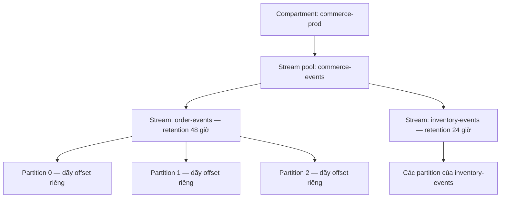

# Stream pools, streams, partitions và retention

Trong chương **Streaming và Queue** của module **CLOUD_PROVIDERS_ORACLE**, bài này tập trung vào bốn quyết định nền tảng khi triển khai OCI Streaming: gom stream vào pool nào, tách dữ liệu thành những stream nào, dùng bao nhiêu partition và giữ message bao lâu. Các quyết định đó gắn với compartment, IAM, VCN, khả năng phục hồi và chi phí vận hành trên Oracle Cloud Infrastructure.

Ví dụ xuyên suốt là một hệ thống bán hàng phát sự kiện đơn hàng. Dịch vụ thanh toán, cập nhật kho và phân tích cần đọc sự kiện theo nhịp riêng; khi một consumer ngừng hoạt động, đội vận hành cần biết dữ liệu còn đủ lâu để xử lý bù hay không.

## 1. Kết quả cần đạt

Sau bài này, người học có thể:

- Phân biệt vai trò và phạm vi cấu hình của stream pool, stream, partition và retention.
- Chọn message key phù hợp với yêu cầu thứ tự và phân bố tải.
- Ước lượng số partition từ lưu lượng ghi, nhu cầu xử lý song song và độ lệch tải.
- Chọn retention từ thời gian gián đoạn, tốc độ xử lý bù và nhu cầu replay.
- Tạo tài nguyên thử nghiệm, đọc cấu hình thực tế và quan sát kết quả phân vùng bằng OCI CLI.
- Nhận diện các thay đổi cần tạo stream mới và chuẩn bị chuyển đổi dữ liệu.

Bài sử dụng mô hình tài nguyên của **OCI Streaming** với native Streaming API và khả năng tương thích Kafka của stream pool. Các giới hạn nêu bên dưới áp dụng cho mô hình này; cần kiểm tra đúng dịch vụ đang sử dụng trước khi đưa vào thiết kế.

## 2. Bốn khái niệm và quan hệ giữa chúng

OCI Streaming lưu dữ liệu theo dạng nhật ký chỉ ghi thêm, được chia partition. Stream pool gom các stream và quản lý một số cấu hình dùng chung. Offset xác định vị trí message trong từng partition; retention quyết định cửa sổ thời gian dữ liệu còn được giữ. Xem [tổng quan OCI Streaming](https://docs.oracle.com/en-us/iaas/Content/Streaming/Concepts/streamingoverview.htm).

| Khái niệm | Vai trò | Quyết định điển hình |
| --- | --- | --- |
| Stream pool | Nhóm stream có cấu hình Kafka và bảo mật dùng chung | Pool cho môi trường thử nghiệm hay sản xuất; public hay private endpoint |
| Stream | Luồng sự kiện có định danh và cấu hình riêng | Tách sự kiện đơn hàng khỏi telemetry |
| Partition | Phần của stream dùng để phân bố dữ liệu và đọc song song | Số partition; cách chọn key để tránh dồn tải |
| Retention | Khoảng thời gian giữ message của stream | Giữ 24, 48 hoặc 72 giờ theo nhu cầu phục hồi |



Sơ đồ là một cách bố trí mẫu trong cùng compartment. Nó không có nghĩa stream pool thay thế compartment hoặc mọi stream trong pool phải có retention giống nhau. Compartment tổ chức quản trị tài nguyên; pool giải quyết việc nhóm stream và dùng chung cấu hình của Streaming.

Với hệ thống bán hàng, có thể đặt `order-events` và `inventory-events` trong cùng pool nếu chúng có cùng yêu cầu kết nối, mã hóa và quản trị. Tuy nhiên, mỗi stream vẫn cần được thiết kế theo lưu lượng và thời gian phục hồi của chính nó.

## 3. Stream pool: tổ chức stream và xác định cấu hình dùng chung

### 3.1. Pool chứa cấu hình nào?

Stream pool là nơi tổ chức các stream, xác định endpoint và lựa chọn khóa mã hóa. Khi sử dụng Kafka API, pool đóng vai trò gốc của một cụm Kafka ảo; các thao tác trên cụm được giới hạn trong pool đó. Tên stream phải duy nhất bên trong một pool. Xem [quản lý stream pool](https://docs.oracle.com/en-us/iaas/Content/Streaming/Tasks/managing-stream-pools.htm).

Ví dụ bố trí:

| Pool đề xuất | Stream mẫu | Lý do gom nhóm |
| --- | --- | --- |
| `commerce-dev` | `order-events`, `inventory-events` | Thử nghiệm tích hợp của nhóm phát triển |
| `commerce-prod` | `order-events`, `inventory-events` | Cùng quy trình vận hành sản xuất |
| `security-prod` | `access-events` | Có yêu cầu quản trị khóa và quyền truy cập riêng |

Không cần tạo một pool cho từng bảng dữ liệu hoặc từng phiên bản ứng dụng. Nên bắt đầu từ ranh giới quản trị thực tế: ai vận hành, ứng dụng kết nối bằng đường nào và nhóm dữ liệu nào được phép dùng chung chính sách bảo mật.

### 3.2. Public endpoint và private endpoint

Private endpoint được cấu hình khi tạo pool, cần VCN và private subnet có DNS phù hợp. Có thể gắn network security group theo thiết kế mạng. Public endpoint vẫn cần xác thực và phân quyền khi gọi API. Hướng dẫn cấu hình nằm trong [tạo stream pool](https://docs.oracle.com/en-us/iaas/Content/Streaming/Tasks/creating-stream-pools.htm).

Trong phương án sản xuất, đội thiết kế cần mô tả đường đi của producer và consumer:

1. Ứng dụng chạy ở đâu: Compute, OKE, mạng tại chỗ hay môi trường khác?
2. Tên endpoint được phân giải thành địa chỉ nào từ vị trí đó?
3. Route và quy tắc mạng có cho phép kết nối đến endpoint không?
4. Danh tính của ứng dụng có quyền thực hiện thao tác cần thiết không?

Một ứng dụng có IAM đúng vẫn có thể không kết nối được do DNS hoặc quy tắc mạng. Ngược lại, kết nối TCP thành công chưa chứng minh ứng dụng có quyền ghi và đọc stream.

### 3.3. Mã hóa và phạm vi ảnh hưởng

Dữ liệu Streaming được mã hóa khi truyền và khi lưu. Có thể dùng khóa do Oracle quản lý hoặc khóa do khách hàng quản lý qua OCI Vault; lựa chọn mã hóa được quản lý ở cấp pool. Xem [bảo mật stream](https://docs.oracle.com/en-us/iaas/Content/Streaming/Concepts/streamsecurity.htm).

Nếu chọn khóa do khách hàng quản lý, việc quản trị khóa trở thành một phụ thuộc vận hành của các stream liên quan. Chẳng hạn, thay đổi quyền sử dụng khóa hoặc vô hiệu hóa khóa cần được đánh giá cùng các ứng dụng đang sử dụng pool. Đây là một lý do thực tế để tách các nhóm dữ liệu có người quản trị và quy trình thay đổi khác nhau.

### 3.4. Giá trị mặc định của pool không sửa stream đã tồn tại

Pool có thể cấu hình tự tạo Kafka topic, số partition mặc định và retention mặc định cho các stream được tạo theo cơ chế đó. Việc cập nhật các giá trị mặc định không thay thế thao tác thiết kế từng stream. Xem [cập nhật stream pool](https://docs.oracle.com/en-us/iaas/Content/Streaming/Tasks/updating-stream-pools.htm).

Ví dụ: đặt retention mặc định của pool thành 72 giờ không kéo dài cửa sổ dữ liệu của `order-events` đã được tạo với retention 24 giờ. Phải đọc cấu hình của chính stream để biết giá trị đang áp dụng.

## 4. Stream: ranh giới dữ liệu và cửa sổ xử lý

### 4.1. Chọn stream theo nhu cầu sử dụng

Trong thiết kế mẫu, `order-events` có thể chứa:

```json
{
  "eventId": "evt-000123",
  "eventType": "OrderPaid",
  "schemaVersion": 1,
  "orderId": "ORD-2048",
  "sequence": 2,
  "occurredAt": "2026-11-20T03:15:00Z",
  "amount": 1250000,
  "currency": "VND"
}
```

Message key dự kiến là `ORD-2048`. Payload có `eventId` để nhận diện sự kiện và `sequence` để ứng dụng phát hiện thiếu hoặc sai thứ tự nghiệp vụ. Đây là quy ước do hệ thống bán hàng tự thiết kế; dịch vụ Streaming không tự suy ra quy tắc nghiệp vụ từ các trường JSON.

Nên cân nhắc tách stream khi các loại dữ liệu khác nhau đáng kể về:

- Chủ sở hữu và đối tượng được phép truy cập.
- Nhu cầu retention, replay hoặc xử lý bù.
- Mẫu tải, kích thước message và yêu cầu xử lý.
- Chu kỳ thay đổi hợp đồng dữ liệu.

Ví dụ, telemetry phát liên tục với lượng lớn và chỉ cần giữ ngắn có thể cần stream riêng, thay vì trộn vào luồng đơn hàng có yêu cầu phục hồi chặt hơn.

### 4.2. Đọc message không làm message biến mất

Consumer đọc đến đâu và dữ liệu còn được giữ bao lâu là hai trạng thái khác nhau. Streaming cho phép replay trong thời gian retention; xử lý thành công không tự xóa message. Cơ chế giao nhận có thể đưa cùng message đến consumer nhiều lần. Xem [đặc tính lưu giữ và giao nhận của Streaming](https://docs.oracle.com/en-us/iaas/Content/Streaming/Concepts/streamingoverview.htm).

Vì vậy, consumer ghi kết quả vào cơ sở dữ liệu nên có cách nhận biết sự kiện đã xử lý, chẳng hạn lưu `eventId` cùng giao dịch cập nhật trạng thái đơn hàng. Khi replay, ứng dụng có thể phân biệt sự kiện cũ với nghiệp vụ mới.

Không dùng retention như thời gian chờ xử lý của một tác vụ. Một consumer chạy chậm không giữ message lại vô thời hạn chỉ vì chưa xử lý xong.

## 5. Partition: phân bố tải, thứ tự và khả năng song song

### 5.1. Key xác định nhóm dữ liệu cần đi cùng nhau

Trong native Streaming API, dịch vụ ánh xạ message key đến partition; cùng key đi vào cùng partition. Nếu bỏ key, dịch vụ sinh key ngẫu nhiên. API này không nhận trực tiếp partition đích để ghi. Xem [quy tắc ghi message](https://docs.oracle.com/en-us/iaas/tools/oci-cli/latest/oci_cli_docs/cmdref/streaming/stream/message/put.html).

Với stream đơn hàng:

| Message | Key | Quan hệ cần giữ |
| --- | --- | --- |
| `OrderCreated` của ORD-2048 | `ORD-2048` | Đi cùng các sự kiện của ORD-2048 |
| `OrderPaid` của ORD-2048 | `ORD-2048` | Cùng nhóm với sự kiện tạo đơn |
| `OrderCreated` của ORD-4096 | `ORD-4096` | Có thể được phân bố độc lập |

Hai key khác nhau vẫn có thể vào cùng partition. Không xây dựng ứng dụng dựa trên giả định `ORD-2048` luôn thuộc partition 0, cũng không tự đoán thuật toán ánh xạ từ một ví dụ.

### 5.2. Thứ tự chỉ có ý nghĩa trong phạm vi phù hợp

OCI bảo đảm thứ tự trong partition. Khi dùng consumer group, tại một thời điểm mỗi partition được một thành viên của nhóm đọc; số partition vì vậy giới hạn số thành viên có thể được giao partition đồng thời. Xem [thiết kế partition và consumer group](https://docs.oracle.com/en-us/iaas/Content/Streaming/Concepts/partitioningastream.htm).

Giả sử các message được ghi như sau:

```text
Partition 0:
  offset a -> OrderCreated(ORD-2048)
  offset b -> OrderPaid(ORD-2048)

Partition 1:
  offset x -> OrderCreated(ORD-4096)
  offset y -> OrderCancelled(ORD-4096)
```

Các ký hiệu offset ở đây chỉ minh họa vị trí trong từng partition. Không dùng offset của partition 0 để so sánh trực tiếp với offset của partition 1.

Nếu cần giữ thứ tự theo đơn hàng, `orderId` là ứng viên key hợp lý. Nếu dùng một key ngẫu nhiên cho từng event, chuỗi sự kiện của cùng đơn hàng có thể bị tách sang các partition khác nhau.

Ngay cả khi key đúng, ứng dụng vẫn cần bảo đảm cách phát và xử lý phù hợp:

- Hai producer đồng thời có thể gửi sự kiện nghiệp vụ theo thứ tự khác với mong đợi.
- Consumer đưa message vào nhiều tác vụ bất đồng bộ có thể hoàn thành chúng không theo thứ tự đọc.
- Timestamp trong payload biểu diễn thời gian nghiệp vụ do ứng dụng cung cấp; không thay thế cơ chế sắp xếp của ứng dụng.

Nếu nghiệp vụ yêu cầu `OrderCreated` phải được áp dụng trước `OrderPaid`, hãy kiểm soát thứ tự phát, kiểm tra `sequence` và quy định cách xử lý khi thiếu sự kiện.

### 5.3. Chọn key để tránh hot partition

Hot partition xuất hiện khi một partition nhận tải quá lớn trong lúc các partition khác còn dư năng lực. Những key có quá ít giá trị hoặc có một giá trị chiếm phần lớn lưu lượng thường gây vấn đề này.

| Key ứng viên | Nhận xét trong ví dụ bán hàng |
| --- | --- |
| `country` | Ít giá trị; một thị trường lớn có thể chiếm phần lớn tải |
| `status` | Nhiều đơn hàng cùng trạng thái có thể dồn tải |
| `orderId` | Phù hợp khi cần thứ tự theo đơn và có nhiều đơn độc lập |
| `customerId` | Cần đánh giá khách hàng có lưu lượng đột biến |
| Key ngẫu nhiên cho từng event | Phân tán tốt hơn trong một số mẫu tải nhưng làm mất nhóm theo đơn |

Ví dụ, nếu một key tạo 1,4 MB/s thì thêm các partition khác không tự chia riêng luồng của key đó. Phải xem lại đơn vị cần giữ thứ tự hoặc điều tiết nguồn phát.

Có thể dùng key dạng `merchantId:bucket` trong một thiết kế có chủ đích để chia tải của merchant lớn. Tuy nhiên, hệ thống khi đó phải chấp nhận thứ tự theo từng bucket hoặc tự thực hiện bước kết hợp lại; đây là thay đổi hợp đồng xử lý dữ liệu.

## 6. Ước lượng số partition trước khi tạo stream

### 6.1. Bắt đầu từ lưu lượng ghi

Theo tài liệu giới hạn, mỗi partition có mức ghi tối đa 1 MB/s và tối đa 5 yêu cầu GET mỗi giây cho mỗi consumer group. Số partition của stream không đổi được sau khi tạo. Ngoài giới hạn từng partition còn có giới hạn tài nguyên của tenancy và quota áp dụng. Xem [giới hạn Streaming](https://docs.oracle.com/en-us/iaas/Content/Streaming/Concepts/streamingoverview_topic-Limits_on_Streaming_Resources.htm).

Mô hình ước lượng ban đầu:

```text
W_peak = N_peak × S

P_write = ceil(W_peak / (L_write × u))

N_peak : số message mỗi giây ở thời điểm cao điểm
S      : kích thước trung bình một message dùng để ước lượng
L_write: giới hạn ghi của một partition
u      : tỷ lệ sử dụng mục tiêu, nhỏ hơn 1
```

Giả sử bài toán có các đầu vào do nhóm phát triển đo được:

- 2.500 message/giây ở thời điểm cao điểm.
- Mỗi message trung bình 2.000 byte, đã tính phần key liên quan trong ước lượng.
- Dùng đơn vị thập phân trong phép tính: 1 MB = 1.000.000 byte.
- Mục tiêu thiết kế là dùng khoảng 65% năng lực ghi danh nghĩa.

Khi đó:

```text
W_peak  = 2.500 × 2.000
        = 5.000.000 byte/giây
        ≈ 5 MB/s

P_write = ceil(5 / (1 × 0,65))
        = 8 partition
```

Đây là ước lượng có khoảng dự phòng do người thiết kế chọn, không phải cam kết hiệu năng cho mọi phân bố key. Cần đo kích thước thực, tải burst và mức lệch giữa các key; tám partition không giúp ích đủ nếu dữ liệu tập trung vào một partition.

### 6.2. Đối chiếu với tốc độ xử lý của consumer

Giả sử mỗi instance consumer của hệ thống mẫu xử lý được 400 sự kiện/giây ở tải ổn định, bao gồm thời gian ghi cơ sở dữ liệu. Để xử lý 2.500 sự kiện/giây:

```text
Số instance theo năng lực xử lý = ceil(2.500 / 400) = 7
```

Với tám partition, nhóm consumer có thể bố trí đủ số thành viên để khai thác mức song song này. Nếu chỉ tạo hai partition rồi tăng lên bảy instance, việc phân công partition của cùng consumer group không tạo ra bảy luồng đọc độc lập.

Ngược lại, nếu consumer bị nghẽn do khóa dữ liệu trong cơ sở dữ liệu, tăng partition chưa chắc cải thiện tốc độ. Phải phân biệt nút thắt ở Streaming, CPU của ứng dụng, độ trễ mạng và tài nguyên đích.

### 6.3. Kiểm tra cả cách đọc

Số request và số byte là hai đại lượng khác nhau. Một consumer gọi GET liên tục với batch quá nhỏ có thể gặp giới hạn request dù nhận ít dữ liệu.

Nên thiết kế việc đọc theo batch và đo:

- Lượng dữ liệu nhận được trong mỗi lần đọc.
- Số lần đọc trên từng partition hoặc phần được giao.
- Thời gian xử lý batch trước khi tiếp tục.
- Lưu lượng bổ sung do replay và các nhóm consumer độc lập.

Mỗi nhóm nghiệp vụ đọc toàn bộ stream làm tăng lượng đọc của hệ thống. Vì thế, đánh giá partition cần gắn với cả sơ đồ sử dụng dữ liệu, thay vì chỉ đếm số producer.

## 7. Retention: ngân sách thời gian cho phục hồi và replay

### 7.1. Giới hạn và ý nghĩa

Khi tạo stream, retention nhận giá trị từ **24 đến 168 giờ**, mặc định **24 giờ**. Retention của stream không đổi được sau khi tạo; message hết thời gian lưu giữ sẽ bị xóa kể cả khi chưa được đọc. Xem [tham số tạo stream](https://docs.oracle.com/en-us/iaas/Content/Streaming/Tasks/creatingstreamsandstreampools_create-stream.htm) và [giới hạn retention](https://docs.oracle.com/en-us/iaas/Content/Streaming/Concepts/streamingoverview_topic-Limits_on_Streaming_Resources.htm).

Ví dụ, với retention 48 giờ, việc consumer xử lý một message sau 5 phút không làm message đó mất ngay. Ngược lại, một consumer ngừng quá lâu có thể không còn đọc lại được đoạn dữ liệu mình đã bỏ lỡ.

Trường `occurredAt` trong payload là dữ liệu ứng dụng tự gửi. Không dùng việc sửa trường này như một cách điều chỉnh thời gian lưu giữ của dịch vụ.

### 7.2. Tính thời gian xử lý bù

Một mô hình thiết kế thận trọng là dành retention cho toàn bộ khoảng gián đoạn, thời gian xử lý bù và khoảng dự phòng:

```text
T_budget = T_outage + T_catchup + T_margin
```

Giả sử một nhóm consumer có các thông số ổn định:

```text
Tốc độ sự kiện mới λ = 1.200 sự kiện/giây
Tốc độ xử lý sau phục hồi μ = 2.000 sự kiện/giây
Thời gian gián đoạn = 12 giờ
Khoảng dự phòng được chọn = 6 giờ

Backlog = 1.200 × 12 × 3.600
        = 51.840.000 sự kiện

Tốc độ giảm backlog = μ - λ
                   = 800 sự kiện/giây

T_catchup = 51.840.000 / 800
          = 64.800 giây
          = 18 giờ

T_budget = 12 + 18 + 6
         = 36 giờ
```

Theo giả định trên, nhóm có thể chọn retention 48 giờ cho thiết kế ban đầu.

Phép tính này là ngân sách tổng thể có tính dự phòng, không phải công thức mô tả chính xác thời điểm hết hạn của từng message. Dữ liệu tiếp tục già đi trong quá trình phục hồi; cần theo dõi tuổi của đoạn chưa xử lý và tốc độ tiến lên ở từng partition.

Nếu `μ <= λ`, backlog không giảm trong mô hình tải ổn định. Kéo dài retention chỉ tạo thêm thời gian trước khi dữ liệu hết hạn; phải tăng tốc xử lý hoặc giảm đầu vào để consumer bắt kịp.

### 7.3. Phân biệt giữ dữ liệu với lưu checkpoint

Checkpoint hoặc offset đã xử lý giúp xác định nơi đọc tiếp. Retention quyết định dữ liệu ở nơi đó còn tồn tại hay không.

Trong vận hành cần tách ba tình huống:

| Tình huống | Hướng xử lý |
| --- | --- |
| Dữ liệu còn, checkpoint hợp lệ | Tiếp tục từ vị trí đã ghi nhận |
| Dữ liệu còn, cần chạy lại nghiệp vụ | Chọn vị trí replay và xử lý trùng lặp |
| Dữ liệu cần đọc đã hết retention | Phục hồi từ nguồn lưu trữ khác hoặc nguồn dữ liệu gốc |

Không tự đặt lại consumer về dữ liệu mới nhất khi chưa xác định hậu quả của khoảng dữ liệu bị bỏ qua. Với sự kiện thanh toán hoặc trừ kho, khoảng trống đó có thể làm sai trạng thái nghiệp vụ.

### 7.4. Khi cần lưu lâu hơn cửa sổ Streaming

Nếu cần giữ lịch sử 30 ngày hoặc một năm, thiết kế thêm luồng lưu trữ dài hạn, chẳng hạn đưa sự kiện sang Object Storage và có quy trình nạp lại. OCI hỗ trợ dùng Connector Hub với Streaming và Object Storage; xem [tổng quan tích hợp](https://docs.oracle.com/en-us/iaas/Content/Streaming/Concepts/streamingoverview.htm).

Trong phương án này, phải quyết định định dạng lưu, phân vùng theo thời gian, kiểm tra dữ liệu thiếu và cách nhận biết sự kiện trùng khi nạp lại. Việc có bucket lưu dữ liệu chưa đủ để chứng minh có thể phục hồi đúng trạng thái ứng dụng.

## 8. IAM và vận hành theo phạm vi stream

Việc quản lý tài nguyên và việc ghi, đọc dữ liệu là các quyền khác nhau. Trong IAM của Streaming, `stream-push` phục vụ quyền phát message, `stream-pull` phục vụ quyền tiêu thụ; `read streams` dùng để đọc thông tin tài nguyên. Xem [tham chiếu IAM cho Streaming](https://docs.oracle.com/en-us/iaas/Content/Identity/Reference/streamingpolicyreference.htm).

Ví dụ chính sách cho môi trường lab, với các group đã được tạo và `StreamingLab` là tên compartment:

```text
Allow group StreamingLabAdmins to manage stream-family in compartment StreamingLab

Allow group OrderProducers to read streams in compartment StreamingLab
Allow group OrderProducers to use stream-push in compartment StreamingLab

Allow group OrderConsumers to read streams in compartment StreamingLab
Allow group OrderConsumers to use stream-pull in compartment StreamingLab
```

Ví dụ trên cấp quyền dữ liệu trong phạm vi compartment của lab. Khi có nhiều stream với đối tượng truy cập khác nhau, cần thiết kế chính sách hẹp hơn theo mô hình IAM thực tế. Với ứng dụng trên Compute hoặc OKE, có thể thiết kế danh tính workload phù hợp thay cho thông tin đăng nhập của người vận hành.

Đối với private pool hoặc khóa do khách hàng quản lý, cần bổ sung quyền liên quan đến mạng hoặc Vault theo phương án triển khai. Chỉ cấp quyền Streaming không hoàn thành toàn bộ chuỗi phụ thuộc đó.

## 9. Thực hành: tạo pool, stream và quan sát partition

Các lệnh dưới đây là **Bash**, phù hợp để chạy lần lượt trong OCI Cloud Shell hoặc môi trường tương đương. Cần có OCI CLI đã xác thực, `jq`, `base64`, compartment thử nghiệm và quyền tạo, đọc, ghi tài nguyên. Ví dụ dùng public endpoint và khóa do Oracle quản lý theo cấu hình mặc định; tài nguyên có thể phát sinh phí khi sử dụng.

Đây là hướng dẫn để người học thực hiện trên tenancy của mình, không phải kết quả của một lần triển khai sẵn.

### 9.1. Tạo stream pool

Thay OCID và region bằng giá trị của môi trường lab:

```bash
set -euo pipefail

export OCI_CLI_REGION="ap-singapore-1"
COMPARTMENT_ID="ocid1.compartment.oc1..REPLACE_ME"

POOL_ID="$(oci streaming admin stream-pool create --compartment-id "$COMPARTMENT_ID" --name "commerce-lab-pool" --query 'data.id' --raw-output)"

oci streaming admin stream-pool get --stream-pool-id "$POOL_ID"
```

Lệnh tạo tài nguyên có thể trả về khi tài nguyên còn đang khởi tạo. Chạy lại lệnh GET cho đến khi `data.lifecycle-state` là `ACTIVE`; nếu là trạng thái lỗi, đọc chi tiết và xử lý trước khi tiếp tục. Tham khảo [CLI tạo stream pool](https://docs.oracle.com/en-us/iaas/tools/oci-cli/latest/oci_cli_docs/cmdref/streaming/admin/stream-pool/create.html).

### 9.2. Tạo stream có ba partition và retention 48 giờ

```bash
STREAM_ID="$(oci streaming admin stream create --stream-pool-id "$POOL_ID" --name "order-events-lab" --partitions 3 --retention-in-hours 48 --query 'data.id' --raw-output)"

oci streaming admin stream get --stream-id "$STREAM_ID"
```

Khi đã truyền `--stream-pool-id`, không truyền thêm `--compartment-id` trong cùng lệnh tạo stream. Xem [CLI tạo stream](https://docs.oracle.com/en-us/iaas/tools/oci-cli/latest/oci_cli_docs/cmdref/streaming/admin/stream/create.html).

Chỉ tiếp tục khi stream ở trạng thái `ACTIVE`. Trong kết quả GET, đối chiếu:

| Field | Giá trị cần kiểm tra |
| --- | --- |
| `id` | Đúng stream vừa tạo |
| `stream-pool-id` | Trùng `POOL_ID` |
| `partitions` | `3` |
| `retention-in-hours` | `48` |
| `messages-endpoint` | Endpoint dùng cho thao tác dữ liệu |
| `lifecycle-state` | `ACTIVE` |

Lấy endpoint từ tài nguyên thực tế:

```bash
MESSAGES_ENDPOINT="$(oci streaming admin stream get --stream-id "$STREAM_ID" --query 'data."messages-endpoint"' --raw-output)"
```

Không tự ghép URL endpoint từ tên pool hoặc lấy endpoint từ một ví dụ ở region khác.

### 9.3. Gửi hai sự kiện có cùng key

Native API dùng Base64 cho key và value. Hai lần ghi tuần tự bên dưới sử dụng cùng key `ORD-2048`:

```bash
KEY_B64="$(printf '%s' 'ORD-2048' | base64 | tr -d '\r\n')"

for SEQ in 1 2; do
  VALUE_B64="$(printf '{"eventId":"lab-%s","orderId":"ORD-2048","sequence":%s}' "$SEQ" "$SEQ" | base64 | tr -d '\r\n')"
  MESSAGES_JSON="$(jq -nc --arg key "$KEY_B64" --arg value "$VALUE_B64" '[{key:$key,value:$value}]')"

  PUT_RESULT="$(oci streaming stream message put --endpoint "$MESSAGES_ENDPOINT" --stream-id "$STREAM_ID" --messages "$MESSAGES_JSON")"
  printf '%s\n' "$PUT_RESULT"
  printf '%s\n' "$PUT_RESULT" | jq -e '.data.failures == 0' >/dev/null
done
```

Kết quả cần quan sát: hai message được ghi thành công và có cùng partition trong các entry trả về. Không đặt trước kỳ vọng rằng partition đó phải là `0`. Xem [tham chiếu CLI ghi message](https://docs.oracle.com/en-us/iaas/tools/oci-cli/latest/oci_cli_docs/cmdref/streaming/stream/message/put.html).

Việc kiểm tra `failures` có ý nghĩa: phản hồi HTTP thành công vẫn có thể chứa lỗi ở từng message. Nếu ghi bị lỗi, cần đọc entry tương ứng trước khi quyết định retry; xem [xử lý lỗi và throttling](https://docs.oracle.com/en-us/iaas/Content/Streaming/Reference/troubleshootingstreaming.htm).

### 9.4. Đọc từ đầu cửa sổ dữ liệu của mỗi partition

```bash
for PARTITION in 0 1 2; do
  CURSOR="$(oci streaming stream cursor create-cursor --endpoint "$MESSAGES_ENDPOINT" --stream-id "$STREAM_ID" --partition "$PARTITION" --type TRIM_HORIZON --query 'data.value' --raw-output)"

  printf 'Partition %s\n' "$PARTITION"
  oci streaming stream message get --endpoint "$MESSAGES_ENDPOINT" --stream-id "$STREAM_ID" --cursor "$CURSOR" --limit 100
done
```

`TRIM_HORIZON` bắt đầu từ message cũ nhất còn trong retention của partition. `LATEST` dùng để đọc dữ liệu được thêm sau khi tạo cursor, nên không phù hợp nếu mục tiêu là tìm hai message vừa gửi trước đó. Cursor có thời hạn riêng, không tương đương với retention. Xem [CLI tạo cursor](https://docs.oracle.com/en-us/iaas/tools/oci-cli/latest/oci_cli_docs/cmdref/streaming/stream/cursor/create-cursor.html).

Lệnh trên chỉ đọc một batch cho mỗi partition để quan sát. Consumer đầy đủ phải dùng cursor tiếp theo từ phản hồi để đọc tiếp, xử lý lỗi và quản lý tiến độ. Xem [CLI đọc message](https://docs.oracle.com/en-us/iaas/tools/oci-cli/latest/oci_cli_docs/cmdref/streaming/stream/message/get.html).

Trong kết quả, value vẫn được biểu diễn bằng Base64; có thể giải mã riêng giá trị cần xem:

```bash
printf '%s' 'REPLACE_WITH_BASE64_VALUE' | base64 --decode
```

### 9.5. Hoàn thành quan sát và dọn tài nguyên

Người học cần xác nhận được:

- Hai event cùng key đã đi vào cùng partition.
- Đọc lại từ đầu cửa sổ vẫn thấy dữ liệu dù trước đó đã đọc.
- Retention vẫn là 48 giờ khi xem cấu hình của stream.
- Partition chưa có message có thể trả về danh sách dữ liệu rỗng.

Sau khi hoàn thành lab, xóa đúng stream thử nghiệm, chờ quá trình xóa hoàn tất rồi xóa pool nếu không còn tài nguyên cần giữ:

```bash
oci streaming admin stream delete --stream-id "$STREAM_ID"
```

Lệnh mặc định yêu cầu xác nhận. Sau khi xác nhận stream đã bị xóa, thực hiện:

```bash
oci streaming admin stream-pool delete --stream-pool-id "$POOL_ID"
```

Kiểm tra lại OCID và phạm vi lab trước khi xác nhận. Các lệnh dọn dẹp chỉ dành cho tài nguyên vừa tạo trong bài thực hành.

## 10. Giám sát và kiểm soát chi phí

### 10.1. Theo dõi tín hiệu dịch vụ và tiến độ nghiệp vụ

Namespace metric của Streaming là `oci_streaming`. Những metric hữu ích gồm `PutMessagesThroughput.Bytes`, `PutMessagesThrottling.Count`, `GetMessagesThroughput.Bytes` và `GetMessagesThrottling.Count`; có thể đối chiếu theo stream OCID. Xem [tham chiếu metrics](https://docs.oracle.com/en-us/iaas/Content/Streaming/Reference/metric-ref.htm).

| Tín hiệu | Điều cần kiểm tra trong thiết kế mẫu |
| --- | --- |
| Ghi bị throttling | Lưu lượng tăng, burst hoặc phân bố key lệch |
| Đọc bị throttling | Nhịp polling, kích thước batch và số luồng đọc |
| Ghi thành công nhưng backlog tăng | Consumer xử lý chậm hơn tốc độ đầu vào |
| Một nhóm đơn hàng thường xuyên chậm | Key nóng hoặc nút thắt ở xử lý nghiệp vụ |
| Tuổi dữ liệu chưa xử lý gần retention | Nguy cơ mất cửa sổ phục hồi |

Ngoài metric dịch vụ, ứng dụng nên ghi nhận tuổi của message cũ nhất chưa xử lý và tốc độ xử lý bù. Nếu dùng `occurredAt` để đo độ trễ nghiệp vụ, cần phân biệt nó với thời gian message đi vào hệ thống để tránh báo động sai do sự kiện được gửi muộn.

Ngưỡng cảnh báo nên xuất phát từ thời gian phản ứng của đội vận hành. Với stream giữ 48 giờ, một cảnh báo lúc dữ liệu chưa xử lý đã quá sát 48 giờ có thể không để lại đủ thời gian khắc phục.

### 10.2. Retention ảnh hưởng đến lượng dữ liệu đang lưu

Streaming tính phí theo dữ liệu PUT/GET và dung lượng lưu theo GB-giờ. Xem [FAQ về giá Streaming](https://www.oracle.com/cloud/streaming/faq/). Với các nhu cầu vượt giới hạn mặc định, cần kiểm tra thêm điều kiện tính mức sử dụng tối thiểu trong [bảng giá Oracle Cloud](https://www.oracle.com/cloud/price-list/).

Ví dụ ước lượng riêng cho hệ thống mẫu, bỏ qua biến động và overhead:

```text
Lưu lượng vào trung bình = 0,5 MB/s
Retention               = 48 giờ

Dung lượng cửa sổ ổn định ≈ 0,5 × 48 × 3.600
                         = 86.400 MB
                         ≈ 86,4 GB
```

Nếu giữ 168 giờ với cùng tốc độ đầu vào, dung lượng cửa sổ theo mô hình này tăng khoảng 3,5 lần. Đây là ước lượng dung lượng, không phải hóa đơn.

Ngoài retention, số nhóm đọc toàn bộ stream và các lần replay làm tăng lượng GET. Khi lập ngân sách, nên tách đầu vào thường xuyên, lượt đọc phục vụ nghiệp vụ, replay dự kiến và lưu trữ dài hạn; sau đó đối chiếu Cost Analysis với số liệu sử dụng thực tế.

## 11. Thay đổi thiết kế khi partition hoặc retention không còn phù hợp

OCI hỗ trợ chuyển stream sang pool khác hoặc cập nhật tag. Thao tác đó không biến cấu hình partition và retention thành các thuộc tính có thể sửa. Xem [cập nhật stream](https://docs.oracle.com/en-us/iaas/Content/Streaming/Tasks/updating-streams.htm).

Nếu `order-events-v1` có ba partition, retention 24 giờ nhưng yêu cầu mới cần tám partition và 48 giờ, cần lập kế hoạch tạo `order-events-v2`.

Một quy trình chuyển đổi gợi ý cho ứng dụng mẫu:

1. Tạo stream mới và kiểm tra endpoint, quyền truy cập, partition, retention.
2. Xác định mốc chuyển đổi bằng định danh sự kiện hoặc checkpoint nghiệp vụ.
3. Thiết kế cách đưa dữ liệu còn cần thiết sang luồng mới; nếu phát đồng thời hai nơi, dùng cơ chế ghi nhận bền vững để theo dõi lỗi từng đích.
4. Chuẩn bị consumer nhận biết sự kiện trùng và hỗ trợ schema hiện hành.
5. Đối soát dữ liệu và kết quả nghiệp vụ trước khi chuyển hoàn toàn.
6. Dừng nguồn ghi cũ, hoàn thành phần dữ liệu còn lại rồi mới xóa stream cũ.

Không sao chép offset cũ rồi giả định nó có cùng ý nghĩa trong stream mới. Hai stream có lịch sử và phân vùng khác nhau; cần dùng định danh dữ liệu và mốc chuyển đổi phù hợp.

Chuyển đổi cũng cần kế hoạch quay lại khi phát hiện lỗi. Nếu stream cũ vẫn nằm trong retention và producer còn có khả năng ghi lại theo kế hoạch đã xác định, việc phục hồi có thể dễ hơn so với xóa stream cũ ngay khi ứng dụng mới bắt đầu chạy.

## 12. Tính sẵn sàng và các lỗi thiết kế thường gặp

Oracle quản lý hạ tầng và sao chép dữ liệu Streaming giữa các availability domain khi region có nhiều AD, hoặc giữa các fault domain ở region một AD. Điều này không thay thế kế hoạch phục hồi ở cấp ứng dụng hoặc giữa các region. Xem [độ bền và tính sẵn sàng của Streaming](https://docs.oracle.com/en-us/iaas/Content/Streaming/Concepts/streamingoverview.htm).

Đội ứng dụng vẫn phải bảo vệ các thành phần của mình: producer, consumer, thông tin xác thực, kết nối mạng và nơi ghi kết quả. Một stream hoạt động bình thường không bảo đảm consumer đã xử lý đúng nghiệp vụ.

| Nhận định sai | Hậu quả trong thực tế | Cách thiết kế phù hợp |
| --- | --- | --- |
| Thêm pool sẽ tăng tốc stream hiện tại | Không giải quyết giới hạn từng partition | Đo tải, key và cấu hình stream |
| Thêm consumer luôn tăng tốc | Nhiều instance không có partition để đọc | Đối chiếu partition và nút thắt xử lý |
| Nhiều partition tạo thứ tự toàn stream | Sai khi ghép sự kiện từ nhiều partition | Xác định phạm vi thứ tự theo nghiệp vụ |
| Đọc xong thì message mất | Đánh giá sai khả năng replay | Tách tiến độ đọc khỏi retention |
| Giữ lâu hơn luôn giải quyết consumer chậm | Backlog vẫn tăng nếu xử lý không theo kịp | Đo tốc độ đầu vào và xử lý thực tế |
| Sửa mặc định của pool sẽ sửa stream cũ | Cấu hình thực tế vẫn không phù hợp | Kiểm tra trực tiếp stream và lập kế hoạch thay thế |
| Dữ liệu đã được sao chép nên có thể bỏ giám sát | Bỏ lỡ lỗi ứng dụng hoặc dữ liệu hết hạn | Theo dõi cả dịch vụ và tiến độ nghiệp vụ |

Khi đưa thiết kế vào triển khai, bản mô tả của nhóm nên ghi rõ: pool và đường kết nối, mục đích từng stream, key, số partition, giả định tải, retention và thời gian phục hồi được kỳ vọng. Các lệnh tạo tài nguyên hoặc cấu hình hạ tầng cần thể hiện tường minh những giá trị này để môi trường mới không vô tình dùng các mặc định khác với thiết kế.
