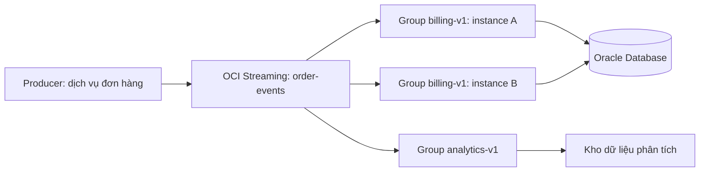

# Producers, consumer groups và quản lý offsets

## 1. Mục tiêu và phạm vi

Trong chương **Streaming và Queue** của Oracle Cloud Infrastructure (OCI), producer, consumer group và offset tạo thành cơ chế đưa sự kiện vào hệ thống, chia việc xử lý và tiếp tục công việc sau sự cố. Bài này tập trung vào **OCI Streaming với API gốc của OCI**; phần cuối chỉ ra những điểm cần phân biệt khi sử dụng lớp tương thích Kafka.

Sau bài học, bạn có thể:

- Chọn message key để cân bằng tải và giữ thứ tự cần thiết cho nghiệp vụ.
- Phân biệt nhiều consumer trong cùng group với nhiều group độc lập.
- Thiết kế vòng đọc, xử lý và commit phù hợp với khả năng xử lý lại thông điệp.
- Phục hồi consumer mà không vô tình bỏ qua sự kiện hoặc tạo tác dụng phụ lặp.
- Kết hợp IAM, endpoint, giám sát và giới hạn tài nguyên khi triển khai producer, consumer trên OCI.

Ví dụ xuyên suốt là ứng dụng bán hàng: dịch vụ đơn hàng phát sự kiện vào stream `order-events`; dịch vụ lập hóa đơn và dịch vụ phân tích đọc cùng luồng nhưng có tiến độ riêng. Consumer lập hóa đơn có thể chạy trên OCI Compute hoặc OKE và ghi kết quả vào Oracle Database/Autonomous Database.

Kiến thức nền cần có gồm khái niệm tenancy, compartment, IAM policy, stream, partition và giao dịch cơ sở dữ liệu. Không cần một Kafka cluster để thực hành API Streaming gốc.

## 2. Mô hình stream, partition và tiến độ đọc

OCI Streaming lưu thông điệp trong một log chỉ ghi nối tiếp, chia thành các partition. Thứ tự được bảo đảm trong từng partition; thông điệp đã đọc vẫn tồn tại trong thời gian retention để phục vụ đọc lại. Commit tiến độ đọc không phải thao tác xóa thông điệp. [Nguồn: Overview of Streaming](https://docs.oracle.com/en-us/iaas/Content/Streaming/Concepts/streamingoverview.htm).

| Thành phần | Vai trò | Ví dụ trong ứng dụng đơn hàng |
| --- | --- | --- |
| Producer | Gửi sự kiện vào stream | Dịch vụ đơn hàng phát `OrderConfirmed` |
| Key | Nhóm các sự kiện cần định tuyến nhất quán | `order-1001` |
| Partition | Phạm vi lưu trữ có thứ tự và đơn vị chia việc đọc | Partition `0`, `1`, `2` |
| Consumer instance | Một thành viên đang đọc, xử lý dữ liệu | `billing-pod-a` |
| Consumer group | Tập consumer cùng chia việc cho một mục đích | `billing-v1` |
| Offset | Vị trí của thông điệp trong một partition | Offset `104` thuộc partition `1` |
| Cursor | Token do dịch vụ cấp để tiếp tục đọc hoặc thao tác với group | Giá trị trả về từ `CreateGroupCursor` |



Hai instance của `billing-v1` chia partition cho nhau. `analytics-v1` đọc độc lập và không làm thay đổi checkpoint của `billing-v1`. Trong sơ đồ, các đường từ stream đến consumer biểu diễn khả năng nhận dữ liệu; chúng không có nghĩa từng thông điệp được gửi cho mọi instance trong cùng group.

## 3. Thiết kế producer

### 3.1. Hợp đồng sự kiện và danh tính ổn định

Một payload hữu ích cần cho biết sự kiện nào xảy ra, thuộc thực thể nào và có thể được nhận diện lại khi retry. Ví dụ sau là hợp đồng do ứng dụng tự thiết kế, không phải schema bắt buộc của OCI:

```json
{
  "eventId": "evt-order-1001-confirmed-v3",
  "eventType": "OrderConfirmed",
  "schemaVersion": 1,
  "aggregateId": "order-1001",
  "aggregateVersion": 3,
  "occurredAt": "2026-11-20T03:10:00Z",
  "traceId": "trace-7f21",
  "payload": {
    "orderId": "order-1001",
    "amount": 1250000,
    "currency": "VND"
  }
}
```

- `eventId` nhận diện **sự kiện nghiệp vụ**. Khi gửi lại chính sự kiện đó, producer giữ nguyên ID.
- `aggregateId` xác định đơn hàng liên quan và có thể dùng làm message key.
- `aggregateVersion` giúp phát hiện sự kiện cũ, thiếu phiên bản hoặc đến không đúng kỳ vọng nghiệp vụ.
- `schemaVersion` giúp consumer giải mã payload khi cấu trúc dữ liệu phát triển.
- `occurredAt` phục vụ đo độ trễ nghiệp vụ; cần tính đến sai lệch đồng hồ giữa các máy.

Offset được cấp sau khi thông điệp được ghi, vì vậy không thể thay thế `eventId`. Hai lần publish cùng một sự kiện có thể tạo hai bản ghi với offset khác nhau.

### 3.2. Chọn key theo yêu cầu thứ tự và phân bố tải

Với API `PutMessages` gốc, OCI quyết định partition từ key ở phía dịch vụ. Các thông điệp cùng key được đưa vào cùng partition; key rỗng được định tuyến ngẫu nhiên. API này không cho producer chỉ định trực tiếp partition đích. [Nguồn: Publishing Messages](https://docs.oracle.com/en-us/iaas/Content/Streaming/Tasks/publishing.htm).

| Cách chọn key | Tác động thiết kế | Khi phù hợp |
| --- | --- | --- |
| `orderId` | Gom chuỗi thay đổi của một đơn hàng | Xác nhận, thanh toán, hủy cùng đơn |
| `customerId` | Gom hoạt động theo khách hàng | Nghiệp vụ cần xử lý tuần tự theo khách |
| Một hằng số chung | Dồn toàn bộ tải về một partition | Chỉ dùng khi chủ động chấp nhận giới hạn này |
| Giá trị ngẫu nhiên hoặc key rỗng | Phân tán sự kiện, không giữ quan hệ theo thực thể | Sự kiện độc lập, không cần thứ tự theo đơn |

Key tốt vừa phản ánh phạm vi cần thứ tự vừa tránh tập trung quá nhiều tải vào một vài giá trị. Nhiều key khác nhau vẫn có thể cùng thuộc một partition, nên số key không phải số partition. [Nguồn: Partitioning a Stream](https://docs.oracle.com/en-us/iaas/Content/Streaming/Concepts/partitioningastream.htm).

Giả sử một khách hàng tạo 60% tổng số sự kiện. Nếu chọn `customerId`, thêm consumer có thể không giải quyết được partition nóng. Chuyển sang `orderId` chỉ hợp lý nếu nghiệp vụ cho phép bỏ yêu cầu thứ tự trên toàn bộ khách hàng đó.

Cùng key cũng không giải quyết mọi vấn đề thứ tự. Khi hai producer đồng thời phát phiên bản `3` và `4`, thứ tự chúng đến dịch vụ có thể khác thứ tự mong muốn của nghiệp vụ. Producer cần điều phối nguồn phát hoặc consumer phải kiểm tra phiên bản; consumer cũng cần giữ tuần tự khi áp dụng thay đổi lên cùng thực thể.

### 3.3. Xử lý batch và lỗi từng thông điệp

`PutMessages` có thể thành công một phần. HTTP `200` không đủ để kết luận mọi entry đều đã được ghi; producer phải đọc kết quả từng entry. Khi toàn bộ request bị throttle, dịch vụ có thể trả `429`. [Nguồn: Troubleshooting Streaming](https://docs.oracle.com/en-us/iaas/Content/Streaming/Reference/troubleshootingstreaming.htm).

Ví dụ producer gửi ba sự kiện:

| Entry | Kết quả giả định | Hành động của ứng dụng |
| --- | --- | --- |
| A | Có partition và offset | Ghi nhận đã gửi thành công |
| B | Lỗi tạm thời do quá tải | Retry riêng B với cùng `eventId` |
| C | Có partition và offset | Không gửi lại chỉ vì B thất bại |

Thuật toán producer ở mức thiết kế:

```text
pending = các sự kiện chưa được xác nhận
while pending chưa rỗng và chưa vượt ngân sách retry:
    result = PutMessages(pending)
    ghép từng kết quả với entry đầu vào tương ứng
    lưu trạng thái của các entry thành công
    giữ lại entry gặp lỗi có thể retry
    chuyển lỗi dữ liệu/quyền truy cập sang quy trình xử lý phù hợp
    chờ exponential backoff có jitter trước lần gửi tiếp
```

Nếu mất kết nối sau khi dịch vụ đã ghi nhưng trước khi producer nhận phản hồi, kết quả publish chưa rõ. Gửi lại là lựa chọn thường cần để tránh mất sự kiện, nhưng có thể tạo bản sao. Vì vậy, giữ `eventId` ổn định và xử lý trùng ở consumer vẫn cần thiết ngay cả khi chỉ retry entry thất bại.

### 3.4. Tránh khoảng trống giữa cập nhật database và publish

Ứng dụng có thể commit đơn hàng vào database rồi gặp sự cố trước khi publish. Đảo thứ tự cũng có thể phát sự kiện trong khi giao dịch đơn hàng chưa thành công. Đây là bài toán phối hợp hai hệ thống, không được giải quyết chỉ bằng retry HTTP.

Một phương án thiết kế là **transactional outbox**:

1. Trong cùng giao dịch Oracle Database, cập nhật đơn hàng và chèn một hàng outbox chứa `eventId`, key, payload.
2. Một publisher đọc outbox và gửi sang OCI Streaming.
3. Sau khi nhận kết quả thành công của từng entry, publisher đánh dấu entry tương ứng đã gửi.
4. Consumer chống trùng vì publisher có thể gặp sự cố sau publish nhưng trước khi đánh dấu outbox.

Outbox là mẫu thiết kế ứng dụng được đề xuất cho ví dụ này. Nó không biến giao dịch database và việc publish Streaming thành một giao dịch phân tán tự động.

## 4. Consumer group: chia việc và tách mục đích xử lý

### 4.1. Cùng group để chia tải, khác group để đọc độc lập

Trong một group, mỗi partition được gán cho một instance tại một thời điểm. Một instance có thể nhận nhiều partition; nếu số instance vượt số partition, một số instance không nhận dữ liệu. Dịch vụ tự cân bằng lại khi thành viên thay đổi. [Nguồn: Using Consumer Groups](https://docs.oracle.com/en-us/iaas/Content/Streaming/Tasks/using_consumer_groups.htm).

Ví dụ stream có bốn partition, các cách bố trí sau minh họa mức song song có thể đạt được; phép gán cụ thể do dịch vụ quyết định:

| Group | Số instance | Phân công minh họa |
| --- | --- | --- |
| `billing-v1` | 1 | Một instance xử lý cả bốn partition |
| `billing-v1` | 2 | Mỗi instance xử lý khoảng hai partition |
| `billing-v1` | 4 | Mỗi instance xử lý khoảng một partition |
| `billing-v1` | 6 | Tối đa bốn instance có partition, hai instance chờ |
| `analytics-v1` | 2 | Có phép phân công riêng cho cùng bốn partition |

Không tạo group mới cho mỗi replica của cùng dịch vụ lập hóa đơn. Cách đó làm mỗi replica trở thành một luồng xử lý độc lập và có thể cùng lập hóa đơn cho một sự kiện. Ngược lại, nếu dịch vụ phân tích dùng chung group với dịch vụ lập hóa đơn, chúng chia dữ liệu cho nhau, khiến từng nghiệp vụ không còn nhận đủ luồng cần xử lý.

### 4.2. Group name và instance name

`CreateGroupCursor` xác định cặp group name và instance name. Nên dùng group name ổn định cho một mục đích xử lý, còn instance name phải duy nhất giữa những thành viên chạy đồng thời. Các kiểu bắt đầu đọc của group là `TRIM_HORIZON`, `AT_TIME`, `LATEST`; kiểu này chỉ có tác dụng khi tạo group mới. Với group đã tồn tại, tiến độ đã commit được sử dụng. [Nguồn: create-group-cursor CLI Reference](https://docs.oracle.com/en-us/iaas/tools/oci-cli/latest/oci_cli_docs/cmdref/streaming/stream/cursor/create-group-cursor.html).

Gợi ý đặt tên cho ví dụ:

```text
groupName    = billing-v1
instanceName = billing-<pod-uid-hoặc-process-uuid>
```

Giữ `billing-v1` khi khởi động lại hoặc triển khai phiên bản ứng dụng mới nếu mục đích là tiếp tục cùng tiến độ. Tạo `billing-replay-20261120` khi cần một luồng đọc lại tách biệt. Không dùng cùng instance name cho nhiều tiến trình đồng thời.

| Kiểu bắt đầu | Ý nghĩa với group mới | Lựa chọn trong ví dụ |
| --- | --- | --- |
| `TRIM_HORIZON` | Đọc từ dữ liệu cũ nhất còn được giữ | Dựng lại dữ liệu từ phần lịch sử còn sẵn |
| `AT_TIME` | Bắt đầu theo mốc thời gian yêu cầu | Đọc lại khoảng thời gian cần điều tra |
| `LATEST` | Chờ dữ liệu được publish sau khi tạo cursor | Chỉ theo dõi sự kiện mới |

Không khởi động lại consumer bằng group name ngẫu nhiên và `LATEST` để tránh lỗi cursor. Cách đó thay đổi tiến độ xử lý thay vì phục hồi nó.

## 5. Offset, cursor và checkpoint

### 5.1. Offset thuộc từng partition

Một vị trí đọc cần gắn với stream và partition. Offset `104` ở partition `0` không đại diện cùng thông điệp với offset `104` ở partition `1`.

Checkpoint của group nên được hình dung như một tập tiến độ:

```text
billing-v1:
    partition 0 -> vị trí đã commit riêng
    partition 1 -> vị trí đã commit riêng
    partition 2 -> vị trí đã commit riêng
```

Offset tăng đơn điệu nhưng có thể không liên tiếp; chẳng hạn hai bản ghi liên tiếp có offset `42` và `45`. Khoảng trống không tự chứng minh đã mất thông điệp. Khi tự quản lý tiến độ bằng individual consumer, ứng dụng lưu offset đã xử lý theo partition và có thể dùng `AFTER_OFFSET` để tiếp tục. [Nguồn: Using Individual Consumers](https://docs.oracle.com/en-us/iaas/Content/Streaming/Tasks/using_a_single_consumer.htm).

Không tăng offset bằng phép cộng `+1` để tự dựng vị trí đọc tiếp. Cũng không xem chênh lệch giữa hai offset là số lượng thông điệp chính xác.

### 5.2. Cursor là token tiếp tục đọc

Quy trình API là tạo cursor, dùng cursor đó gọi `GetMessages`, rồi sử dụng `opc-next-cursor` của phản hồi cho bước tiếp theo. Token này cần được coi là giá trị opaque: không phân tích nội dung, không tự sửa và không ghép từ offset. [Nguồn: Getting Messages](https://docs.oracle.com/en-us/iaas/Content/Streaming/Tasks/get-message.htm).

Cursor và checkpoint phục vụ hai vai trò khác nhau:

- Cursor giúp một phiên đọc tiến hành request kế tiếp.
- Checkpoint đã commit giúp group khôi phục tiến độ khi thành viên gặp sự cố.

Lưu cursor vào biến cục bộ hoặc in offset ra log chưa phải đã commit. Tương tự, đọc được một thông điệp chưa có nghĩa thay đổi nghiệp vụ đã được lưu bền vững.

## 6. Thời điểm commit quyết định hành vi khi có lỗi

### 6.1. `commitOnGet=true`: đọc tiếp sau khi xử lý xong

Với API group của OCI, `commitOnGet=true` là mặc định: request `GetMessages` tiếp theo commit tiến độ của batch trước. Nếu consumer dừng trước request đó, batch chưa commit có thể được giao lại. [Nguồn: Offsets and Commits](https://docs.oracle.com/en-us/iaas/Content/Streaming/Tasks/using_consumer_groups.htm).

Ví dụ các offset dưới đây được chọn để minh họa, không hàm ý offset luôn liên tiếp:

```text
GetMessages(C0) -> batch A: 100, 103, 104; trả C1
xử lý A và chờ các giao dịch database hoàn tất
GetMessages(C1) -> commit tiến độ A, trả batch B và C2
xử lý B
...
```

Sai sót thường gặp là giao batch A cho thread pool rồi lập tức gọi `GetMessages(C1)`. Khi ấy tiến độ A có thể được commit trong lúc tác vụ vẫn đang chạy. Nếu tiến trình chết, group có thể tiếp tục sau những công việc chưa hoàn tất.

Với cơ chế này, vòng đọc tuần tự phải chờ toàn bộ công việc của batch thành công trước khi đọc tiếp. Nếu chọn xử lý bất đồng bộ, cần cơ chế theo dõi hoàn tất và quản lý commit phù hợp; việc đặt một future vào hàng chờ chưa đủ.

### 6.2. `commitOnGet=false`: commit thủ công sau xử lý

Khi tắt `commitOnGet`, ứng dụng gọi `ConsumerCommit` để xác nhận tiến độ gắn với cursor. API trả một cursor cập nhật để tiếp tục. Đây không phải API nhận tùy ý một số offset do ứng dụng tự tính. [Nguồn: Manually Committing an Offset](https://docs.oracle.com/en-us/iaas/Content/Streaming/Tasks/commit-consumer-group.htm).

Chu trình thiết kế:

```text
C0 = CreateGroupCursor(commitOnGet=false)
R  = GetMessages(C0)
C1 = R.opc-next-cursor

chờ xử lý thành công toàn bộ R.messages
C2 = ConsumerCommit(C1).cursor

GetMessages(C2)
```

Nếu một batch có nhiều thông điệp, không commit cursor đại diện cho toàn bộ batch khi vẫn còn thông điệp chưa xử lý thành công. Để giảm phạm vi phải làm lại, có thể giảm kích thước batch; đổi lại số request có thể tăng.

### 6.3. Các cửa sổ sự cố

Giả sử consumer đã nhận A, B, C và ghi kết quả vào database:

| Thời điểm sự cố | Trạng thái nghiệp vụ | Hành vi cần dự kiến |
| --- | --- | --- |
| Trước khi xử lý A | Chưa thay đổi | Batch có thể được đọc lại |
| Sau khi ghi A, trước B | A đã có tác dụng | Đọc lại có thể gặp lại A |
| Sau khi ghi cả batch, trước commit Streaming | Database đã hoàn tất | Cả batch có thể được đọc lại |
| Sau commit Streaming nhưng trước khi client nhận phản hồi | Kết quả commit chưa rõ từ phía client | Khôi phục group và dựa vào cơ chế chống trùng |
| Commit Streaming trước khi ghi database | Tiến độ có thể vượt công việc thực tế | Có nguy cơ bỏ qua xử lý nghiệp vụ |

Phân tích này dẫn tới nguyên tắc của ví dụ: **lưu bền vững kết quả xử lý trước, commit tiến độ sau, đồng thời cho phép đọc lại an toàn**. Giữa database và Streaming vẫn tồn tại cửa sổ lỗi; đổi thứ tự thao tác không tự tạo ra xử lý exactly-once xuyên hai hệ thống.

## 7. Idempotency và xử lý song song

### 7.1. Chống trùng bằng inbox trong Oracle Database

Với nghiệp vụ lập hóa đơn, có thể lưu danh tính sự kiện đã xử lý cùng giao dịch tạo hóa đơn. Schema sau minh họa phần inbox:

```sql
CREATE TABLE processed_stream_event (
    consumer_name VARCHAR2(100) NOT NULL,
    event_id      VARCHAR2(200) NOT NULL,
    processed_at  TIMESTAMP DEFAULT SYSTIMESTAMP NOT NULL,
    CONSTRAINT pk_processed_stream_event
        PRIMARY KEY (consumer_name, event_id)
);
```

Thuật toán ứng dụng đề xuất:

```text
BEGIN DATABASE TRANSACTION
    INSERT dấu đã nhận (billing-v1, eventId)
    nếu trùng đúng khóa chính của dấu đã nhận:
        kết thúc nhánh xử lý như một sự kiện đã hoàn tất trước đó
    nếu chưa có:
        cập nhật đơn hàng / tạo hóa đơn
COMMIT DATABASE TRANSACTION

khi mọi thông điệp trong batch đã hoàn tất hoặc được nhận diện là trùng:
    commit tiến độ OCI Streaming
```

Dấu đã nhận và thay đổi nghiệp vụ phải commit cùng nhau. Nếu chèn dấu rồi commit riêng, sau đó tạo hóa đơn thất bại, lần đọc lại sẽ thấy dấu đã nhận và có thể bỏ qua công việc còn thiếu. Khi giao dịch nghiệp vụ thất bại, dấu của lần xử lý đó cũng phải rollback.

Khóa gồm `consumer_name` và `event_id` để hai nghiệp vụ độc lập có thể xử lý cùng sự kiện. Khi triển khai xử lý lỗi duplicate, chỉ coi vi phạm đúng ràng buộc inbox là dấu hiệu đã xử lý; không nuốt mọi lỗi unique constraint của toàn bộ giao dịch.

Ví dụ này bảo vệ các thay đổi nằm trong cùng database transaction. Nếu còn gọi cổng thanh toán hoặc gửi email, cần cơ chế idempotency của bên nhận hoặc một outbox cho tác vụ ngoài. Cũng cần quy định thời gian giữ dấu chống trùng đủ dài cho các lần retry và replay dự kiến.

### 7.2. Không commit vượt qua phần việc còn thiếu

Giả sử ba thông điệp cùng partition có offset `80`, `84`, `89`. Chúng được giao cho ba worker:

| Offset | Trạng thái |
| --- | --- |
| 80 | Hoàn tất |
| 84 | Đang chờ database |
| 89 | Hoàn tất |

Chọn `89` làm mốc hoàn tất chỉ vì đó là số lớn nhất sẽ che khuất công việc ở `84`. Điều kiện đúng là mọi thông điệp đã nhận trước điểm commit đều đã đạt trạng thái hoàn tất theo chính sách xử lý.

Với ví dụ batch commit trong bài, hãy chờ cả batch. Nếu cần tăng song song, ưu tiên thêm consumer trong cùng group để chia partition; sau đó mới cân nhắc worker pool trong từng consumer. Xử lý theo partition hoặc theo key cần giữ thứ tự nghiệp vụ và có giới hạn hàng chờ để tránh tăng bộ nhớ vô hạn.

## 8. Timeout, heartbeat và rebalance

Cần phân biệt tuổi thọ cursor và thời gian không hoạt động của thành viên. Cursor hết hạn sau khoảng năm phút nếu không được tiếp tục sử dụng; timeout thành viên mặc định là 30 giây và có thể dẫn tới giao lại partition khi consumer không tương tác kịp. Đây là hai tình huống phục hồi khác nhau. [Nguồn: OCI Streaming FAQ](https://www.oracle.com/cloud/streaming/faq/).

### 8.1. Batch phải phù hợp tốc độ xử lý

Nếu một thông điệp mất trung bình 200 ms và batch có 300 thông điệp xử lý tuần tự, thời gian tính toán đơn giản đã khoảng 60 giây, chưa gồm I/O và biến động tải. Batch như vậy cần được thiết kế lại trước khi dựa vào timeout mặc định.

Các lựa chọn ở mức ứng dụng:

- Giảm `limit` để một batch hoàn tất với khoảng dự phòng rõ ràng.
- Tối ưu giao dịch database và giới hạn số kết nối đồng thời.
- Bổ sung heartbeat nếu công việc hợp lệ có thời gian xử lý dài.
- Giới hạn retry tại chỗ để một sự kiện không giữ consumer mãi.

`ConsumerHeartbeat` duy trì hoạt động của thành viên; phải sử dụng cursor trả về theo chuỗi phản hồi phù hợp. Heartbeat không có nghĩa công việc nghiệp vụ đã thành công và không thay thế commit. Nếu có thread heartbeat riêng, cần phối hợp quyền sở hữu cursor với vòng đọc/commit. [Nguồn: Sending a Heartbeat](https://docs.oracle.com/en-us/iaas/Content/Streaming/Tasks/send-heartbeat-consumer-group.htm).

### 8.2. Mất quyền giữ partition

Nếu consumer xử lý quá lâu, partition có thể được giao lại. Lỗi `Trying to commit unreserved partition` là một dấu hiệu cần kiểm tra timeout và rebalance. Consumer cũ không nên tiếp tục ép commit một cursor đã mất hiệu lực. [Nguồn: Troubleshooting Streaming](https://docs.oracle.com/en-us/iaas/Content/Streaming/Reference/troubleshootingstreaming.htm).

Quy trình khôi phục được đề xuất cho ứng dụng:

1. Dừng đọc thêm và đánh giá các tác vụ đang chạy của instance cũ.
2. Không coi lỗi commit là bằng chứng database đã rollback.
3. Tạo lại group cursor với **cùng group name**, để tiếp tục theo tiến độ group.
4. Cho phép các sự kiện chưa commit được xử lý lại qua cơ chế inbox.
5. Điều chỉnh batch, heartbeat hoặc thời gian xử lý để tránh lặp lại sự cố.

Khi tắt ứng dụng có kiểm soát, ngừng nhận việc mới, hoàn tất batch trong ngân sách thời gian cho phép, commit phần đã hoàn tất và đóng client. Nếu phải dừng khẩn cấp, ưu tiên giữ khả năng xử lý lại thay vì đánh dấu thành công những việc chưa xong.

## 9. Ví dụ Java: xử lý batch rồi commit

Đoạn mã sau minh họa đường đi thành công của **OCI Java SDK**, sử dụng module `oci-java-sdk-streaming`. Ứng dụng gọi phương thức với `StreamClient` đã cấu hình authentication provider và **messages endpoint của stream**, không phải endpoint quản trị tài nguyên. Cách khởi tạo SDK được mô tả trong [Java Streaming Quickstart](https://docs.oracle.com/en-us/iaas/Content/Streaming/Tasks/streaming-quickstart-oci-sdk-for-java.htm).

```java
import java.util.UUID;
import java.util.function.Consumer;

import com.oracle.bmc.streaming.StreamClient;
import com.oracle.bmc.streaming.model.CreateGroupCursorDetails;
import com.oracle.bmc.streaming.model.Message;
import com.oracle.bmc.streaming.requests.ConsumerCommitRequest;
import com.oracle.bmc.streaming.requests.CreateGroupCursorRequest;
import com.oracle.bmc.streaming.requests.GetMessagesRequest;
import com.oracle.bmc.streaming.responses.GetMessagesResponse;

public final class GroupConsumerExample {
    private GroupConsumerExample() {}

    public static void consumeBatches(
            StreamClient client,
            String streamId,
            String groupName,
            int maxPolls,
            Consumer<Message> durableHandler) throws InterruptedException {

        String cursor = client.createGroupCursor(
                CreateGroupCursorRequest.builder()
                        .streamId(streamId)
                        .createGroupCursorDetails(
                                CreateGroupCursorDetails.builder()
                                        .groupName(groupName)
                                        .instanceName("billing-" + UUID.randomUUID())
                                        .type(CreateGroupCursorDetails.Type.TrimHorizon)
                                        .commitOnGet(false)
                                        .build())
                        .build())
                .getCursor().getValue();

        for (int poll = 0; poll < maxPolls; poll++) {
            GetMessagesResponse response = client.getMessages(
                    GetMessagesRequest.builder()
                            .streamId(streamId)
                            .cursor(cursor)
                            .limit(10)
                            .build());

            String nextCursor = response.getOpcNextCursor();

            for (Message message : response.getItems()) {
                // Chỉ return khi giao dịch nghiệp vụ đã commit,
                // hoặc sự kiện được xác định là đã xử lý trước đó.
                durableHandler.accept(message);
            }

            if (response.getItems().isEmpty()) {
                cursor = nextCursor;
                Thread.sleep(500);
                continue;
            }

            cursor = client.consumerCommit(
                    ConsumerCommitRequest.builder()
                            .streamId(streamId)
                            .cursor(nextCursor)
                            .build())
                    .getCursor().getValue();
        }
    }
}
```

`ConsumerCommitResponse.getCursor()` cung cấp cursor cập nhật cho vòng tiếp theo. [Nguồn: Java SDK ConsumerCommitResponse](https://docs.oracle.com/en-us/iaas/tools/java/latest/com/oracle/bmc/streaming/responses/ConsumerCommitResponse.html).

Các điều kiện sử dụng ví dụ:

- `durableHandler` phải chờ xử lý thực sự hoàn tất; không chỉ submit một tác vụ bất đồng bộ rồi return.
- Khi handler ném exception, phương thức thoát trước commit. Lớp điều phối bên ngoài có thể khởi động lại với cùng group và chấp nhận đọc lại qua cơ chế chống trùng.
- Mẫu không cài heartbeat; toàn bộ batch cùng request commit phải hoàn thành trong thời gian hoạt động cho phép. `limit(10)` chỉ là giá trị minh họa, không bảo đảm điều kiện đó với mọi workload.
- Mẫu chưa cài chính sách phân loại lỗi, backoff, shutdown hook hoặc xử lý thông điệp lỗi vĩnh viễn; những phần này thuộc lớp vận hành của ứng dụng.
- `maxPolls` giới hạn số lượt đọc để thuận tiện thực hành. Khi group đã tồn tại, `TrimHorizon` trong lời gọi tạo cursor không tự đặt lại tiến độ group.

Trong Java SDK, `message.getValue()` là dữ liệu byte. Consumer giải mã theo hợp đồng đã thỏa thuận, chẳng hạn UTF-8 cho JSON. Không tự Base64-decode lần nữa nếu SDK đã trả byte gốc; Base64 chủ yếu xuất hiện trong biểu diễn JSON của REST/CLI.

## 10. IAM, endpoint và phạm vi truy cập trên OCI

Producer cần quyền publish; consumer cần quyền đọc và thao tác group. Có thể tách dynamic group của hai workload trong cùng compartment học tập:

```text
Allow dynamic-group OrderProducerDG to use stream-push in compartment LearningStreaming
Allow dynamic-group BillingConsumerDG to use stream-pull in compartment LearningStreaming
```

Các tên trên là ví dụ và phải khớp dynamic group/compartment thực tế. `stream-push` cho phép `PutMessages`; `stream-pull` bao gồm các thao tác như tạo cursor, đọc, commit, heartbeat và cập nhật group. Vì vậy, quyền đọc group cũng cần được quản trị cẩn thận. [Nguồn: Details for the Streaming Service](https://docs.oracle.com/en-us/iaas/Content/Identity/Reference/streamingpolicyreference.htm).

Dynamic group không phải consumer group: dynamic group xác định principal nào được IAM cho phép gọi API, còn consumer group điều phối công việc đọc stream. Tên consumer group không tự tạo ra một ranh giới phân quyền nghiệp vụ.

Ứng dụng chạy trên Compute có thể dùng instance principal khi đã được cấu hình tương ứng. Với OKE hoặc Functions, chọn cơ chế danh tính workload phù hợp môi trường thay vì sao chép khóa API cá nhân vào image.

Về kết nối, lấy messages endpoint từ thông tin stream. Nếu stream pool dùng private endpoint, workload phải có đường mạng và DNS phù hợp đến endpoint trong VCN. IAM cho phép truy cập không tự tạo ra kết nối mạng; chiều ngược lại, kết nối TCP thành công cũng không chứng minh đủ quyền. [Nguồn: Managing Streams](https://docs.oracle.com/en-us/iaas/Content/Streaming/Tasks/managingstreams.htm).

## 11. Thực hành phân công, commit và khởi động lại

### 11.1. Chuẩn bị

Sử dụng một stream học tập đang hoạt động có ba partition và retention đủ cho buổi thực hành. Ghi lại stream OCID, compartment và messages endpoint. Chuẩn bị producer có thể phát nhiều key khác nhau và một bảng kết quả kèm inbox trong database thử nghiệm.

Để quan sát việc chia tải, phát đủ nhiều sự kiện với nhiều `orderId`; một vài key có thể tình cờ cùng rơi vào một partition nên không đủ chứng minh phân bố. Mỗi bản ghi log nên có `groupName`, `instanceName`, `eventId`, partition và offset.

### 11.2. Tạo group cursor bằng OCI CLI

Các lệnh dưới đây dùng **Bash**, phù hợp với terminal đã cấu hình OCI CLI và có đường kết nối đến messages endpoint. Thay các giá trị trong dấu `<...>` trước khi chạy; đây là lệnh minh họa để người học thực hành.

```bash
export STREAM_ID='<stream_ocid>'
export MESSAGES_ENDPOINT='<messages_endpoint>'
export GROUP_NAME='billing-lab-v1'

oci streaming stream cursor create-group-cursor \
  --stream-id "$STREAM_ID" \
  --group-name "$GROUP_NAME" \
  --instance-name 'billing-cli-a' \
  --type TRIM_HORIZON \
  --commit-on-get false \
  --endpoint "$MESSAGES_ENDPOINT"
```

Lệnh trả về `data.value` là cursor ban đầu. [Nguồn: Creating a Group Cursor](https://docs.oracle.com/en-us/iaas/Content/Streaming/Tasks/create-group-cursor.htm).

Đọc một batch, thay `<cursor_from_create>` bằng giá trị vừa nhận:

```bash
oci streaming stream message get \
  --stream-id "$STREAM_ID" \
  --cursor '<cursor_from_create>' \
  --limit 10 \
  --endpoint "$MESSAGES_ENDPOINT"
```

Đọc phản hồi, lấy `opc-next-cursor`, giải mã payload theo hợp đồng và xử lý dữ liệu. Chỉ khi toàn bộ batch thành công mới commit bằng cursor tiếp theo:

```bash
oci streaming stream group commit \
  --stream-id "$STREAM_ID" \
  --cursor '<opc-next-cursor_from_get>' \
  --endpoint "$MESSAGES_ENDPOINT"
```

Lần đọc sau dùng cursor cập nhật trong phản hồi commit. Lệnh commit thao tác theo cursor của group, không nhận một giá trị `--offset` tự tính. [Nguồn: commit CLI Reference](https://docs.oracle.com/en-us/iaas/tools/oci-cli/latest/oci_cli_docs/cmdref/streaming/stream/group/commit.html).

Vòng CLI bằng tay có thể vượt timeout khi người học dừng để đọc kết quả. Dùng ví dụ Java cho các lượt chạy liên tục; không lấy một cursor đã cũ rồi cố commit khi instance không còn giữ partition.

### 11.3. Các lượt quan sát

| Lượt | Thao tác | Kết quả cần quan sát |
| --- | --- | --- |
| 1 | Chạy hai consumer cùng `billing-lab-v1`, instance khác nhau | Các partition được chia trong cùng group |
| 2 | Chạy consumer thứ tư với stream ba partition | Số consumer có việc không vượt số partition |
| 3 | Chạy group `analytics-lab-v1` từ `TRIM_HORIZON` | Group phân tích đọc lịch sử còn được giữ với tiến độ riêng |
| 4 | Dừng consumer sau database commit nhưng trước Streaming commit | Khi được giao lại, sự kiện có thể xuất hiện lần nữa; inbox ngăn tác dụng phụ lặp |
| 5 | Khởi động lại cùng group | Tiếp tục từ tiến độ đã commit, không tự quay về đầu |
| 6 | Gửi lại một sự kiện với cùng `eventId` | Có thể có bản ghi stream mới nhưng chỉ một tác dụng nghiệp vụ trong phạm vi inbox |

Ở lượt 4, chủ động đặt điểm dừng trong chương trình thử nghiệm; không thực hiện trên consumer sản xuất. Quan sát cả log giao nhận lẫn số hàng nghiệp vụ: chỉ nhìn số lần nhận thông điệp không thể kết luận tác dụng phụ có bị lặp hay không.

## 12. Replay, retention và thông điệp không xử lý được

### 12.1. Replay có mục đích

Replay hữu ích khi sửa lỗi tính toán hoặc dựng lại dữ liệu tổng hợp. Một group replay riêng giúp giữ tiến độ của luồng xử lý đang hoạt động. Trước khi replay, quyết định rõ tác dụng mong muốn:

- Nếu cần tránh tạo hóa đơn lần hai, giữ cùng định danh nghiệp vụ của cơ chế chống trùng.
- Nếu cần tính lại một bảng projection mới, ghi sang đích mới hoặc dùng phạm vi xử lý riêng có kiểm soát.
- Nếu sự kiện chứa tác vụ bên ngoài như gửi thông báo, quy định tác vụ nào được phép thực hiện lại.

`UpdateGroup` đặt lại vị trí xử lý của **tất cả instance trong group**. Đó là thao tác điều phối cả nhóm, không phải cách chỉ đưa một consumer đang lỗi về đầu stream. [Nguồn: Updating a Consumer Group](https://docs.oracle.com/en-us/iaas/Content/Streaming/Tasks/update-consumer-group.htm).

Group replay và retention là hai vấn đề độc lập: tạo group mới không mang dữ liệu đã hết retention trở lại. Nếu offset cần đọc đã nằm ngoài vùng dữ liệu còn lưu, phải xác định khoảng dữ liệu thiếu và tìm nguồn khôi phục như kho lưu trữ hoặc database nguồn; không âm thầm chuyển sang `LATEST` rồi xem như đã xử lý đầy đủ.

### 12.2. Thông điệp lỗi vĩnh viễn

Một payload không hợp lệ có thể làm batch thất bại liên tục. Với OCI Streaming, ứng dụng cần tự thiết kế cách xử lý trường hợp này thay vì mặc định có sẵn cơ chế dead-letter giống dịch vụ queue.

Ví dụ chính sách ứng dụng:

1. Phân loại lỗi: lỗi hạ tầng tạm thời, lỗi schema, lỗi nghiệp vụ không thể tự phục hồi.
2. Retry có giới hạn với lỗi tạm thời, đồng thời giữ heartbeat hoặc giảm batch phù hợp.
3. Với lỗi cần cách ly, ghi bền vững bản ghi lỗi gồm payload hoặc tham chiếu an toàn, `eventId`, stream, partition, offset và nguyên nhân.
4. Chỉ xem thông điệp đã hoàn tất theo chính sách sau khi thao tác cách ly thành công.
5. Commit batch khi các thông điệp còn lại cũng đã đạt trạng thái hoàn tất.

Nếu publish sang một stream cách ly, việc publish đó và commit stream nguồn vẫn có cửa sổ sự cố. Đích cách ly cần nhận diện bản sao bằng `eventId` kết hợp nguồn, hoặc dùng outbox trong database để điều phối việc chuyển tiếp.

## 13. Giám sát, năng lực xử lý và chi phí

OCI cung cấp metric cho độ trễ, throughput, lỗi và throttling của thao tác publish/read. Nên đặt cảnh báo theo các dấu hiệu như publish thất bại, bản ghi bị throttle và lỗi đọc tăng. [Nguồn: Streaming Metrics](https://docs.oracle.com/en-us/iaas/Content/Streaming/Reference/streamingmetrics.htm).

Ngoài metric dịch vụ, ứng dụng cần ghi nhận:

| Tín hiệu ứng dụng | Ý nghĩa | Hướng điều tra |
| --- | --- | --- |
| Độ trễ từ thời gian sự kiện đến xử lý thành công | Mức độ dữ liệu nghiệp vụ bị chậm | So sánh tốc độ vào và tốc độ xử lý |
| Thời gian xử lý batch và thời gian commit | Khả năng duy trì vòng đọc | Kiểm tra database, timeout và batch size |
| Số sự kiện trùng được inbox nhận diện | Mức độ retry/replay thực tế | Đối chiếu producer retry và consumer restart |
| Số lỗi mất quyền partition | Consumer có thể bị timeout | Kiểm tra heartbeat và tác vụ kéo dài |
| Số thông điệp bị cách ly | Dữ liệu hoặc hợp đồng có vấn đề | Nhóm theo event type và schema version |
| Số lần rebalance quan sát được | Độ ổn định của tập consumer | Kiểm tra scale, restart và kết nối mạng |

Offset không liên tiếp nên không quy đổi chênh lệch offset thành backlog thông điệp chính xác. Độ trễ theo thời gian sự kiện và các bộ đếm thực tế của ứng dụng thường giúp đánh giá tác động nghiệp vụ rõ hơn.

Ví dụ ước lượng do ứng dụng tự đặt: một consumer xử lý bền vững 100 sự kiện/giây, đầu vào 250 sự kiện/giây, tồn đọng 30.000 sự kiện. Với ba consumer và phân bố partition đủ đều, công suất lý thuyết là 300 sự kiện/giây; phần dư 50 sự kiện/giây cần khoảng `30.000 / 50 = 600 giây` để bắt kịp. Nếu chỉ hai consumer hoặc database chỉ cho phép 180 sự kiện/giây, hệ thống chưa có công suất dư để xóa tồn đọng.

Đây là mô hình ước lượng, cần đo lại bằng workload thật vì partition nóng, kích thước payload và giới hạn downstream làm thay đổi kết quả. Tăng replica vượt số partition chủ yếu tăng chi phí chạy consumer. Thêm group replay làm phát sinh thêm lượt đọc và tính toán. Retention dài hơn hỗ trợ phục hồi nhưng cần cân nhắc dung lượng và chi phí dịch vụ theo cấu hình hiện hành.

Có thể kiểm tra trạng thái group bằng `GetGroup` hoặc CLI dưới đây. Kết hợp trạng thái phân công với log ứng dụng để điều tra; không suy ra mọi tác dụng nghiệp vụ đã hoàn tất chỉ từ group còn hoạt động. [Nguồn: Getting the Current State of a Consumer Group](https://docs.oracle.com/en-us/iaas/Content/Streaming/Tasks/get-consumer-group.htm).

```bash
oci streaming stream group get \
  --stream-id "$STREAM_ID" \
  --group-name "$GROUP_NAME" \
  --endpoint "$MESSAGES_ENDPOINT"
```

## 14. Phân biệt API OCI gốc, Kafka và OCI Queue

| Nội dung | OCI Streaming API gốc | Kafka client kết nối OCI Streaming |
| --- | --- | --- |
| Gửi thông điệp | `PutMessages` | Kafka Producer API |
| Đọc dữ liệu | Cursor và `GetMessages` | `poll()` theo Kafka Consumer API |
| Xác nhận tiến độ | `commitOnGet` hoặc `ConsumerCommit` | Các API/config commit của Kafka client |
| Định tuyến partition | Dịch vụ tính theo key | Phụ thuộc cơ chế partitioning phía Kafka client |
| Cấu hình ứng dụng | OCID, messages endpoint, OCI authentication | Kafka endpoint và cấu hình bảo mật tương ứng |

Không đưa `commitOnGet` vào Kafka properties và kỳ vọng có tác dụng. Cũng không áp dụng máy móc quy tắc offset của Kafka vào token cursor của OCI.

Lớp tương thích Kafka không bao hàm toàn bộ tính năng Kafka. Tài liệu OCI hiện liệt kê transactions và idempotent production trong các tính năng chưa triển khai; vì vậy không giả định `transactional.id` hoặc `enable.idempotence=true` tạo bảo đảm exactly-once trên OCI Streaming. Khi chuyển ứng dụng Kafka hiện có, cần đối chiếu danh sách hỗ trợ với đúng dịch vụ đang dùng. [Nguồn: Using Streaming with Apache Kafka](https://docs.oracle.com/en-us/iaas/Content/Streaming/Tasks/kafkacompatibility.htm).

Trong phạm vi chương này, cần giữ rõ ranh giới: bài học dùng mô hình log, group và checkpoint của **Streaming**. OCI Queue dùng mô hình thông điệp hàng đợi với cơ chế nhận/xử lý riêng; không mang các lời gọi `CreateGroupCursor`, `ConsumerCommit` sang Queue.

## 15. Các nguyên tắc cần giữ khi triển khai

Một producer ổn định không chỉ gọi API thành công: nó phải duy trì danh tính sự kiện qua retry, kiểm tra kết quả từng entry và tránh khoảng trống publish khi dữ liệu nghiệp vụ đã commit. Một consumer ổn định không chỉ đọc đủ nhanh: nó phải ghi bền vững kết quả trước khi commit, chấp nhận xử lý lại và duy trì hoạt động trong thời gian cho phép.

Với ứng dụng đơn hàng của bài học, thiết kế hoàn chỉnh gồm key theo `orderId`, outbox phía phát, group `billing-v1` ổn định, instance name duy nhất, inbox cùng giao dịch Oracle Database và giám sát độ trễ đến khi xử lý thành công. Cách phối hợp này gắn cơ chế Streaming với mục tiêu vận hành trên OCI: phân quyền đúng, phục hồi sau lỗi, quan sát được tiến độ và dùng số lượng consumer phù hợp năng lực partition cùng database.
