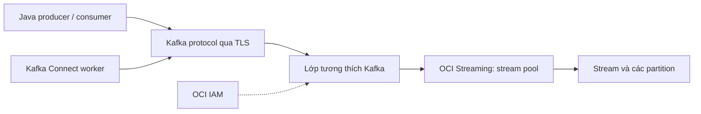
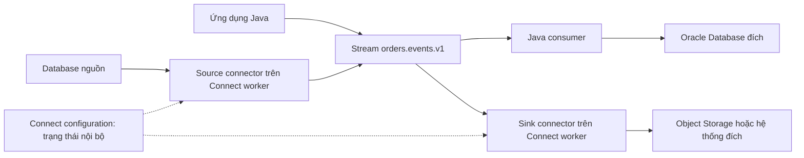

# Streaming Kafka compatibility và tích hợp hệ sinh thái Kafka

## 1. Mục tiêu và phạm vi của bài học

Trong chương **Streaming và Queue** của module **CLOUD_PROVIDERS_ORACLE**, bài học này trình bày cách sử dụng ứng dụng và công cụ Kafka với **OCI Streaming thông qua lớp tương thích Kafka**. Người học cần hiểu phần nào có thể giữ lại, phần nào phải cấu hình lại và phần nào cần thay đổi kiến trúc trước khi tích hợp.

Tình huống xuyên suốt là một hệ thống bán hàng có:

- Ứng dụng Java phát sự kiện đơn hàng.
- Một consumer cập nhật dữ liệu phân tích trong Oracle Database.
- Một tiến trình Kafka Connect chuyển dữ liệu sang hệ thống đích.
- Nhu cầu theo dõi độ trễ, xử lý lại khi lỗi và kiểm soát quyền truy cập.

Mục tiêu thực tế là tái sử dụng giao diện Kafka ở nơi phù hợp, đồng thời giữ đúng hợp đồng dữ liệu, cách xác nhận xử lý và đặc tính của dịch vụ OCI được chọn.

### Phân biệt hai dịch vụ có tên gần nhau

| Dịch vụ | Mô hình cần nhận biết |
| --- | --- |
| **OCI Streaming** | Dịch vụ streaming serverless, có lớp tương thích một phần với Kafka |
| **OCI Streaming with Apache Kafka** | Dịch vụ quản lý cụm Apache Kafka, có tài nguyên và đặc tính vận hành riêng |

Oracle phân biệt rõ hai lựa chọn trong [Overview of Streaming with Apache Kafka](https://docs.oracle.com/en-us/iaas/Content/kafka/overview.htm). Bài học tập trung vào lựa chọn thứ nhất. Không lấy cấu hình broker, ACL hoặc cam kết tính năng của lựa chọn thứ hai áp dụng sang stream pool của OCI Streaming.

Các kích thước batch, thời gian chờ và tên tài nguyên trong ví dụ là cấu hình minh họa. Những đoạn code và bài thực hành dưới đây chưa được chạy trên một tenancy thực tế.

## 2. “Tương thích Kafka” có nghĩa gì?

Kafka client giao tiếp với phía dịch vụ bằng giao thức Kafka. OCI Streaming cung cấp một lớp tiếp nhận giao thức này để producer và consumer có thể sử dụng các API quen thuộc.



Lớp tương thích không biến stream pool thành một cụm Kafka tự quản mà người dùng có toàn quyền chỉnh broker. Cần đánh giá ba mức tương thích:

1. **Giao thức:** client có kết nối, xác thực, gửi, đọc và quản lý nhóm được không?
2. **Chức năng:** ứng dụng có cần transactions, compaction hoặc API quản trị đặc biệt không?
3. **Ngữ nghĩa vận hành:** retry, thứ tự, checkpoint, giới hạn tải và phục hồi có giữ đúng yêu cầu không?

Một chương trình gửi và đọc được một chuỗi JSON mới chứng minh đường kết nối cơ bản. Nó chưa chứng minh một pipeline CDC, stateful processing hoặc connector nhiều task có thể chuyển nguyên trạng.

### Ánh xạ khái niệm

| Khái niệm Kafka | Cách nhìn trong OCI Streaming |
| --- | --- |
| Cluster nhìn từ client | Stream pool đóng vai trò phạm vi cụm ảo |
| Topic nghiệp vụ | Stream có tên tương ứng trong pool |
| Partition | Phân vùng của stream |
| Record key/value | Khóa và dữ liệu của thông điệp |
| Consumer group | Nhóm phối hợp đọc và lưu tiến độ |
| Offset | Vị trí đọc theo partition trong giao diện Kafka |
| Bootstrap servers | Địa chỉ giúp client khám phá điểm kết nối |
| Kafka broker configuration | Không mặc định là cấu hình mà người dùng OCI Streaming được chỉnh |

Tên stream phải duy nhất trong một pool. Pool còn là nơi tập hợp các thiết lập Kafka và bảo mật dùng chung. Xem [Managing Stream Pools](https://docs.oracle.com/en-us/iaas/Content/Streaming/Tasks/managing-stream-pools.htm).

Việc consumer commit offset không xóa record khỏi stream. Các consumer group độc lập vẫn có thể đọc dữ liệu còn trong retention. Đây là điểm khác với thao tác xóa sau xử lý trong một hàng đợi công việc.

## 3. Phạm vi API và các giới hạn quyết định kiến trúc

Tài liệu [Using Streaming with Apache Kafka](https://docs.oracle.com/en-us/iaas/Content/Streaming/Tasks/kafkacompatibility.htm) liệt kê các nhóm API Producer, Consumer, Connect, Admin và Group Management. Tài liệu cũng nêu những chức năng chưa được triển khai:

| Chức năng | Trạng thái trong lớp tương thích được đề cập |
| --- | --- |
| Producer, Consumer, Group Management | Có hỗ trợ theo phạm vi tài liệu |
| Kafka Connect | Có cơ chế tích hợp |
| Admin API | Có hỗ trợ; cần kiểm tra thao tác cụ thể |
| Kafka Streams | Chưa hỗ trợ |
| Compaction cho topic nghiệp vụ tùy ý | Chưa hỗ trợ |
| Kafka transactions | Chưa hỗ trợ |
| Idempotent production | Chưa hỗ trợ |
| Thêm partition động cho stream hiện có | Chưa hỗ trợ |

Từ các giới hạn trên, thiết kế trong bài chọn producer không dùng idempotence của Kafka và consumer chống lặp ở tầng ứng dụng.

### Các hệ quả cần hiểu

**Producer retry có thể tạo bản sao.** Nếu dịch vụ đã nhận record nhưng phản hồi bị mất, gửi lại có thể tạo thêm một record mang cùng sự kiện nghiệp vụ.

**Không có Kafka transaction cho vòng đọc–ghi–commit.** Không xây lời hứa nguyên tử bằng cách gọi `beginTransaction()`, phát record rồi `sendOffsetsToTransaction()` trên backend này.

**Compaction và retention giải quyết hai vấn đề khác nhau.** Giữ dữ liệu lâu hơn không tạo ra một bảng trạng thái “giữ giá trị cuối cho mỗi key”. Nếu thiết kế cần bảng trạng thái, cần chọn kho lưu hoặc nền tảng phù hợp.

**Không coi mọi thư viện nằm trong hệ sinh thái Kafka đều được bảo đảm chạy.** Một công cụ có thể dùng API Producer thông thường nhưng phần khởi động lại tạo topic compacted, mở transaction hoặc đòi thay đổi cấu hình broker.

Ba topic nội bộ của Kafka Connect configuration là trường hợp được dịch vụ chuẩn bị riêng, sẽ được trình bày ở mục 10. Không suy rộng trường hợp đó thành khả năng tạo mọi loại topic compacted.

## 4. Kiến trúc tích hợp tham chiếu



Có ba lớp cần được triển khai và vận hành độc lập:

| Lớp | Tài nguyên/trách nhiệm |
| --- | --- |
| Dịch vụ streaming | Stream pool, stream, partition, retention, endpoint và IAM |
| Runtime ứng dụng | Java process, Connect worker, connector plugin và thư viện chuyển đổi |
| Nguồn/đích dữ liệu | Quyền DB, schema, endpoint lưu trữ, khóa nghiệp vụ và cơ chế chống lặp |

Một source connector đọc từ nguồn và publish vào Streaming. Một sink connector đọc từ Streaming và ghi ra đích. Vai trò source/sink được xác định so với hệ thống streaming.

Kafka Connect configuration trên OCI không tự cài JDBC driver, không tự tạo các worker JVM và không tự cung cấp mạng tới DB nguồn. Cần chỉ rõ nơi chạy worker, cách cập nhật plugin và ai chịu trách nhiệm khi task dừng.

## 5. Chuẩn bị tài nguyên và lấy đúng thông tin kết nối

### 5.1. Chuẩn bị stream pool và stream

Trong môi trường thực hành:

1. Chọn region và compartment.
2. Tạo hoặc chọn stream pool.
3. Quyết định dùng public endpoint hay private endpoint.
4. Tạo stream `orders.events.v1` với số partition và retention đã tính.
5. Ghi nhận stream OCID, stream pool OCID và Kafka connection settings.

Không dùng stream OCID thay cho stream pool OCID trong chuỗi đăng nhập Kafka. Hai định danh này phục vụ các tài nguyên khác nhau.

Lấy chi tiết pool bằng OCI CLI:

```powershell
oci streaming admin stream-pool get --stream-pool-id "<STREAM_POOL_OCID>"
```

Đọc giá trị bootstrap server từ cấu hình pool hoặc từ mục **Kafka connection settings**. CLI trả thông tin như `kafka-settings.bootstrap-servers`; tên miền có thể có thành phần cell. Xem [Getting Details for a Stream Pool](https://docs.oracle.com/en-us/iaas/Content/Streaming/Tasks/get-stream-pool.htm).

Trong bài, topic được tạo chủ động. Không dựa vào auto-create để một lỗi đánh máy âm thầm tạo stream mới với cấu hình không đúng.

### 5.2. Các giá trị cần phân biệt

| Giá trị | Ví dụ hình thức | Nguồn lấy |
| --- | --- | --- |
| Kafka bootstrap server | `<host>:9092` | Kafka connection settings của pool |
| Stream pool OCID | `ocid1.streampool...` | Thông tin stream pool |
| Topic name | `orders.events.v1` | Tên stream đã tạo |
| SASL username | Chuỗi chứa tenancy/domain/user/pool | Chuỗi kết nối tương ứng với người dùng |
| SASL password | OCI auth token | Token của đúng người dùng |
| Native Streaming endpoint | Endpoint dùng với OCI API/SDK | Thông tin stream/API OCI |

Không đưa URL HTTPS của API OCI vào `bootstrap.servers`. Một SDK ký HTTP request bằng API key và một Kafka client dùng SASL là hai đường xác thực khác nhau.

## 6. Xác thực, IAM và kết nối mạng

### 6.1. SASL/PLAIN trên TLS

Cấu hình cơ bản sử dụng:

```properties
bootstrap.servers=<BOOTSTRAP_SERVERS_FROM_POOL>
security.protocol=SASL_SSL
sasl.mechanism=PLAIN
sasl.jaas.config=org.apache.kafka.common.security.plain.PlainLoginModule required username="<SASL_USERNAME_FROM_CONSOLE>" password="<OCI_AUTH_TOKEN>";
ssl.endpoint.identification.algorithm=https
```

Tài liệu [Using Kafka APIs](https://docs.oracle.com/en-us/iaas/Content/Streaming/Tasks/kafkacompatibility_topic-Configuration.htm) hướng dẫn auth token, SASL/PLAIN và dạng tên đăng nhập `tenancyName/domain/username/streamPoolId`. Một số ví dụ theo mô hình tài khoản khác có chuỗi ngắn hơn; hãy dùng chuỗi được cung cấp cho đúng identity domain và pool, thay vì tự bỏ thành phần domain.

Password là auth token, không phải mật khẩu đăng nhập Console. Token gắn với người dùng; quyền truy cập vẫn do policy của danh tính đó quyết định.

Các dấu `<...>` trong bài là placeholder phải được thay trước khi chạy. File Java properties không tự thay một tên biến môi trường thành giá trị bí mật.

Không ghi token vào source code hoặc commit file cấu hình đã điền token. Có thể dùng OCI Vault và cơ chế triển khai để tạo file bí mật với quyền đọc giới hạn, hoặc dùng cơ chế principal phù hợp với runtime.

### 6.2. Instance principal cho Kafka Java client

Oracle có SASL add-on cho Kafka Java client với cơ chế `OCI-RSA-SHA256` và `InstancePrincipalsLoginModule`. Tính năng này cần dependency và JAAS module tương ứng; không thể chỉ bỏ token khỏi cấu hình PLAIN rồi mong client tự dùng instance principal. Phần cấu hình chính thức nằm trong [Instance Principal Authorization for the Java SDK](https://docs.oracle.com/en-us/iaas/Content/Streaming/Tasks/kafkacompatibility_topic-Configuration.htm#Instance_Principal_Authorization_for_the_Java_SDK).

Khi chọn cách này, instance phải thuộc dynamic group đúng và được cấp policy Streaming phù hợp. Các ví dụ còn lại dùng auth token để tập trung vào cấu trúc client Kafka phổ biến.

### 6.3. Cấp quyền theo vai trò

Ví dụ policy cho các group trong identity domain `Default`:

```text
Allow group Default/OrderEventProducers to use stream-push in compartment streaming-lab
Allow group Default/OrderEventConsumers to use stream-pull in compartment streaming-lab
```

Bổ sung quyền đọc metadata cần thiết theo các thao tác thực tế của client. Tài khoản tạo stream, pool hoặc Kafka Connect configuration cần quyền quản trị tương ứng; không dùng tài khoản quản trị chung cho mọi ứng dụng.

Các resource type bao gồm `stream-push`, `stream-pull`, `stream-pools` và `connect-harness`. Đối chiếu quyền trong [Details for the Streaming Service](https://docs.oracle.com/en-us/iaas/Content/Identity/Reference/streamingpolicyreference.htm).

Policy compartment ở ví dụ có phạm vi toàn compartment. Với yêu cầu hẹp hơn, thiết kế thêm điều kiện theo tài nguyên được hỗ trợ hoặc tách tài nguyên theo compartment phù hợp.

### 6.4. Kiểm tra đường mạng riêng với kiểm tra đăng nhập

Private endpoint được cấu hình ở cấp stream pool, gắn với mạng VCN. Client cần đường định tuyến, phân giải DNS và quy tắc mạng phù hợp từ nơi chạy workload. Xem [Security Best Practices for Streaming](https://docs.oracle.com/en-us/iaas/Content/Streaming/Concepts/streamsecurity.htm).

Ví dụ kiểm tra TCP trên Windows:

```powershell
Test-NetConnection -ComputerName "<HOST_FROM_BOOTSTRAP_SERVERS>" -Port 9092
```

Kết nối TCP thành công chưa chứng minh TLS, SASL hoặc IAM thành công. Tiếp tục kiểm tra bằng một client Kafka có cấu hình hoàn chỉnh.

Với client từ hệ thống tại chỗ tới private endpoint, cần thiết kế kết nối mạng và DNS qua VPN/FastConnect hoặc kiến trúc mạng tương ứng. Không dùng một lần thử từ máy quản trị để kết luận worker trong subnet khác cũng truy cập được.

## 7. Producer Java: cấu hình rõ những mặc định có thể gây lỗi

### 7.1. Cấu hình producer minh họa

File producer dùng cấu hình kết nối ở mục 6, cộng thêm:

```properties
client.id=orders-api-producer
key.serializer=org.apache.kafka.common.serialization.StringSerializer
value.serializer=org.apache.kafka.common.serialization.StringSerializer

acks=all
enable.idempotence=false
max.in.flight.requests.per.connection=1

retries=5
retry.backoff.ms=500
request.timeout.ms=30000
delivery.timeout.ms=120000

max.request.size=900000
linger.ms=5
compression.type=none
```

Các con số trên là điểm bắt đầu cho lab, không phải bộ giá trị tối ưu chung.

Nhiều Kafka client hiện đại bật idempotence mặc định. Vì backend đang xét không triển khai idempotent production, cấu hình này đặt `enable.idempotence=false` một cách tường minh. Không khai báo `transactional.id`.

Với producer không idempotent và có retry, `max.in.flight.requests.per.connection=1` giúp tránh đảo thứ tự do nhiều batch đang chờ trên cùng kết nối. Nó không tạo thứ tự toàn cục giữa mọi producer hay mọi partition. Ngữ nghĩa cấu hình này được mô tả trong [Apache Kafka Producer Configs](https://kafka.apache.org/41/configuration/producer-configs/).

`acks=all` không thay cho idempotency. Nó liên quan tới xác nhận ghi; bản sao nghiệp vụ vẫn có thể xuất hiện khi gửi lại sau lỗi chưa rõ kết quả.

Mức `max.request.size` được chọn có biên so với giới hạn dịch vụ. Vẫn phải kiểm tra kích thước key, value và batch thực tế. Không tăng giới hạn client để cố vượt giới hạn backend.

### 7.2. Ví dụ gửi một sự kiện

Ví dụ cần Java hỗ trợ text block và dependency `org.apache.kafka:kafka-clients` được pin phiên bản trong project. Hãy chọn phiên bản đã kiểm thử cùng runtime; không dùng việc một API tồn tại trong thư viện làm bằng chứng backend hỗ trợ API đó.

File cấu hình truyền vào phải chứa cả thuộc tính kết nối và producer. Ví dụ:

```java
import java.io.Reader;
import java.nio.charset.StandardCharsets;
import java.nio.file.Files;
import java.nio.file.Path;
import java.util.Properties;

import org.apache.kafka.clients.producer.KafkaProducer;
import org.apache.kafka.clients.producer.ProducerRecord;
import org.apache.kafka.clients.producer.RecordMetadata;

public final class SendOrderEvent {
    public static void main(String[] args) throws Exception {
        if (args.length != 2) {
            throw new IllegalArgumentException(
                "Expected: <producer-properties-path> <topic-name>"
            );
        }

        Properties properties = new Properties();
        try (Reader reader = Files.newBufferedReader(
                Path.of(args[0]), StandardCharsets.UTF_8)) {
            properties.load(reader);
        }

        String event = """
            {
              "eventId": "evt-order-1042-v1",
              "schemaVersion": 1,
              "orderId": "ORD-1042",
              "eventType": "OrderAccepted",
              "totalMinorUnits": 25000000,
              "currency": "VND"
            }
            """;

        try (KafkaProducer<String, String> producer =
                new KafkaProducer<>(properties)) {
            ProducerRecord<String, String> record =
                new ProducerRecord<>(args[1], "ORD-1042", event);

            RecordMetadata metadata = producer.send(record).get();

            System.out.printf(
                "topic=%s partition=%d offset=%d%n",
                metadata.topic(),
                metadata.partition(),
                metadata.offset()
            );
        }
    }
}
```

`send()` trả về future; `get()` trong ví dụ đợi kết quả để người học quan sát lỗi. Một hệ thống tải cao thường xử lý callback/future bất đồng bộ có giới hạn lượng công việc đang chờ, thay vì chờ từng record tuần tự.

`eventId` cố định ở đây phục vụ minh họa một sự kiện. Trong hệ thống thật, tạo ID khi sự kiện nghiệp vụ được lưu, rồi giữ nguyên ID đó qua mọi lần gửi lại.

Nếu gửi timeout, kết quả có thể chưa xác định. Không tạo ID nghiệp vụ mới chỉ vì chưa nhận được phản hồi. Khi dữ liệu nguồn nằm trong DB, outbox giúp lưu ý định phát sự kiện cùng giao dịch nguồn.

## 8. Partition key, thứ tự và hợp đồng dữ liệu

Key `ORD-1042` giúp nhóm sự kiện cùng đơn hàng theo chiến lược partitioner của Kafka producer. Để dựa vào thứ tự theo đơn hàng, cần đồng thời kiểm soát:

- Cùng cách serialize key và cùng logic partitioner.
- Các producer sử dụng quy tắc phân vùng nhất quán.
- Thứ tự phát giữa những nguồn cùng tạo sự kiện cho một đơn.
- Thứ tự hoàn tất xử lý trong consumer.

Nếu vừa có producer Kafka vừa có producer dùng native OCI API, cần kiểm thử việc định tuyến vào partition. Không mặc định hai đường API luôn dùng cùng thuật toán chỉ vì key có cùng chuỗi ký tự.

Consumer cũng có thể tự làm mất thứ tự bằng cách đưa các record cùng partition vào nhiều thread rồi hoàn tất tùy ý. Đọc theo thứ tự không đồng nghĩa tác động ra DB sẽ hoàn tất theo thứ tự.

### Thiết kế sự kiện để có thể phát lại

Một envelope nên có ít nhất:

| Trường | Mục đích |
| --- | --- |
| `eventId` | Nhận diện cùng một sự kiện qua nhiều bản sao |
| `schemaVersion` | Chọn quy tắc giải mã |
| Khóa aggregate như `orderId` | Phân vùng và liên kết nghiệp vụ |
| Loại sự kiện | Phân biệt ý nghĩa xử lý |
| Thời gian nghiệp vụ nếu cần | Phân tích độ trễ và xử lý sự kiện đến muộn |
| Phiên bản aggregate nếu cần | Phát hiện sự kiện cũ hoặc thiếu thứ tự |

Schema version nằm trong payload không tự bảo đảm tương thích. Cần thống nhất trường nào được thêm, trường nào bắt buộc, cách biểu diễn tiền, timestamp và giá trị null.

Record có value `null` không nên được dùng với giả định backend sẽ compact và xóa trạng thái cũ cho key. Ý nghĩa tombstone trong một pipeline phải được kiểm chứng theo nguồn/đích cụ thể.

## 9. Consumer Java: xử lý trước, commit tiến độ sau

### 9.1. Cấu hình consumer minh họa

Dùng các thuộc tính kết nối chung và bổ sung:

```properties
client.id=orders-analytics-worker
group.id=orders-analytics-v1

key.deserializer=org.apache.kafka.common.serialization.StringDeserializer
value.deserializer=org.apache.kafka.common.serialization.StringDeserializer

enable.auto.commit=false
auto.offset.reset=earliest
max.poll.records=100
max.poll.interval.ms=300000
session.timeout.ms=30000
max.partition.fetch.bytes=1048576
```

Với client có thuộc tính `group.protocol`, có thể đặt `group.protocol=classic` làm cấu hình nền đã chọn để kiểm chứng. Việc sử dụng giao thức nhóm mới phải được đánh giá riêng, không suy ra từ việc client đã được nâng phiên bản.

`auto.offset.reset=earliest` áp dụng khi chưa có offset hợp lệ theo cơ chế của client/backend. Nó không tự đưa một group đã có tiến độ về đầu mỗi lần khởi động. Ngữ nghĩa các thuộc tính consumer được mô tả trong [Apache Kafka Consumer Configs](https://kafka.apache.org/41/configuration/consumer-configs/).

### 9.2. Commit offset kế tiếp sau một batch đã hoàn tất

Đoạn dưới là khung logic để đặt trong một lớp Java có các import tương ứng. Hàm `applyIdempotently` do ứng dụng cung cấp: chỉ trả về sau khi tác động đã commit hoặc đã nhận ra kết quả cũ hợp lệ.

```java
static void consume(
        Properties properties,
        String topic,
        java.util.function.Consumer<
            org.apache.kafka.clients.consumer.ConsumerRecord<String, String>
        > applyIdempotently) {

    try (var consumer =
            new org.apache.kafka.clients.consumer.KafkaConsumer<String, String>(
                properties)) {

        consumer.subscribe(java.util.List.of(topic));

        while (!Thread.currentThread().isInterrupted()) {
            var records = consumer.poll(java.time.Duration.ofSeconds(1));

            var completedOffsets = new java.util.HashMap<
                org.apache.kafka.common.TopicPartition,
                org.apache.kafka.clients.consumer.OffsetAndMetadata>();

            for (var partition : records.partitions()) {
                var partitionRecords = records.records(partition);

                for (var record : partitionRecords) {
                    // Exception phải thoát khỏi vòng xử lý này.
                    applyIdempotently.accept(record);
                }

                if (!partitionRecords.isEmpty()) {
                    long nextOffset = partitionRecords
                        .get(partitionRecords.size() - 1)
                        .offset() + 1;

                    completedOffsets.put(
                        partition,
                        new org.apache.kafka.clients.consumer.OffsetAndMetadata(
                            nextOffset
                        )
                    );
                }
            }

            if (!completedOffsets.isEmpty()) {
                consumer.commitSync(completedOffsets);
            }
        }
    }
}
```

Offset commit là vị trí sẽ đọc tiếp, nên một record tại offset 42 hoàn tất thì checkpoint kế tiếp là 43. Đây là ngữ nghĩa của [KafkaConsumer](https://kafka.apache.org/41/javadoc/org/apache/kafka/clients/consumer/KafkaConsumer.html).

Nếu một record lỗi, khung này thoát bằng exception và không commit batch đang xét. Những record trong batch đã tác động thành công có thể quay lại, nên `applyIdempotently` phải an toàn khi lặp.

Không sửa khung bằng cách bắt exception, ghi log rồi tiếp tục tới `commitSync()` chung. Làm vậy có thể đưa checkpoint vượt qua record chưa xử lý.

### 9.3. Khoảng hở giữa DB commit và offset commit

Luồng an toàn ở mức tác động DB:

```text
Bắt đầu transaction Oracle Database
  Chèn khóa sự kiện/thao tác vào bảng inbox có unique constraint
  Ghi hoặc cập nhật dữ liệu nghiệp vụ
  Đánh dấu kết quả
Commit DB

Sau đó commit Kafka offset
```

Nếu tiến trình dừng sau commit DB nhưng trước commit offset, sự kiện được đọc lại. Inbox cho biết tác động đã có và consumer chỉ hoàn tất checkpoint.

Nếu offset được commit trước DB, tiến trình dừng ở giữa có thể khiến tác động chưa được thực hiện nhưng group đã đi qua record đó.

Bảng inbox và dữ liệu nghiệp vụ phải ở cùng ranh giới giao dịch thực tế. Một bộ nhớ cache của worker không bảo vệ được khi đổi replica hoặc khởi động lại.

Với dịch vụ ngoài DB, cần hợp đồng idempotency hoặc đối soát của bên đích. Manual offset commit tự nó không làm một lời gọi thanh toán an toàn khi lặp.

### 9.4. Rebalance và công việc lâu

Consumer phải tiếp tục poll theo giới hạn thời gian của cấu hình. Nếu xử lý batch quá lâu, group có thể phân lại partition và việc commit có thể thất bại.

Khung trên phù hợp với xử lý đồng bộ có thời gian được giới hạn. Với xử lý dài:

- Giảm `max.poll.records` và đặt timeout cho phụ thuộc.
- Nếu tách worker thread, quản lý trạng thái theo từng partition.
- Chỉ commit tới dãy offset đã hoàn tất liên tục, không nhảy qua khoảng trống.
- Xử lý partition bị thu hồi và ngăn worker cũ tự ý xác nhận công việc.
- Giữ thao tác của `KafkaConsumer` trong mô hình thread được thư viện hỗ trợ.

Commit thất bại sau khi DB thành công là tình huống có thể phát lại, không phải lý do thực hiện bù ngay dữ liệu đã commit.

## 10. Kafka Connect configuration và Connect worker

### 10.1. Hai thành phần khác nhau

| Thành phần | Chức năng |
| --- | --- |
| OCI Kafka Connect configuration, còn gọi là harness | Tài nguyên phục vụ dữ liệu cấu hình/trạng thái nội bộ của Connect |
| Connect worker | Tiến trình chạy connector, điều phối task, serialize dữ liệu và giao tiếp nguồn/đích |
| Connector plugin | Mã tích hợp cụ thể như JDBC source, JDBC sink hoặc sink lưu trữ |
| Connector instance | Cấu hình một luồng tích hợp được đăng ký trên Connect runtime |

Tạo harness trong đúng compartment:

```powershell
oci streaming admin connect-harness create --name "orders-connect-lab" --compartment-id "<COMPARTMENT_OCID>"
```

Sau khi tạo, lấy nội dung **Kafka Connect storage topics** do Console cung cấp. Quy trình chính thức nằm trong [Creating a Kafka Connect Configuration](https://docs.oracle.com/en-us/iaas/Content/Streaming/Tasks/create-connect-harness.htm).

OCI tạo ba topic nội bộ có hậu tố `-config`, `-offset` và `-status` gắn với OCID harness. Chúng dành cho Connect, có giới hạn riêng, và configuration chỉ làm việc với stream trong cùng compartment. Xem [Using Kafka Connect](https://docs.oracle.com/en-us/iaas/Content/Streaming/Tasks/kafkacompatibility_topic-Kafka_Connect.htm).

Không gửi sự kiện đơn hàng vào các topic nội bộ này. Cũng không tạo ba stream nghiệp vụ thông thường cùng tên để thay cho harness.

### 10.2. Cấu hình worker minh họa

Dưới đây là cấu hình nền cho lab dùng chuỗi làm key/value. Thay mọi placeholder trước khi chạy và dùng đúng tên storage topic được OCI cung cấp.

```properties
bootstrap.servers=<BOOTSTRAP_SERVERS_FROM_POOL>
group.id=orders-connect-workers-lab

config.storage.topic=<HARNESS_OCID>-config
offset.storage.topic=<HARNESS_OCID>-offset
status.storage.topic=<HARNESS_OCID>-status

key.converter=org.apache.kafka.connect.storage.StringConverter
value.converter=org.apache.kafka.connect.storage.StringConverter
plugin.path=/opt/kafka/plugins

security.protocol=SASL_SSL
sasl.mechanism=PLAIN
sasl.jaas.config=org.apache.kafka.common.security.plain.PlainLoginModule required username="<SASL_USERNAME_FROM_CONSOLE>" password="<OCI_AUTH_TOKEN>";

producer.security.protocol=SASL_SSL
producer.sasl.mechanism=PLAIN
producer.sasl.jaas.config=org.apache.kafka.common.security.plain.PlainLoginModule required username="<SASL_USERNAME_FROM_CONSOLE>" password="<OCI_AUTH_TOKEN>";
producer.enable.idempotence=false
producer.acks=all
producer.max.in.flight.requests.per.connection=1
producer.max.request.size=900000

consumer.security.protocol=SASL_SSL
consumer.sasl.mechanism=PLAIN
consumer.sasl.jaas.config=org.apache.kafka.common.security.plain.PlainLoginModule required username="<SASL_USERNAME_FROM_CONSOLE>" password="<OCI_AUTH_TOKEN>";
consumer.max.partition.fetch.bytes=1048576

exactly.once.source.support=disabled
```

Worker, producer của source connector và consumer của sink connector có các vai trò client khác nhau. Phải kiểm tra cấu hình hiệu lực cho từng vai trò; chỉ cấu hình SASL ở một vị trí chưa chắc đáp ứng tất cả client mà runtime/plugin tạo ra.

Connect có cơ chế exactly-once source dựa vào transactions. Với backend đang học, lựa chọn nền là không bật cơ chế này. Các thuộc tính worker và converter được mô tả trong [Apache Kafka Connect Configs](https://kafka.apache.org/41/configuration/kafka-connect-configs/).

Cấu hình trên chưa thay thế các thiết lập vận hành như REST listener, bảo vệ REST API, thư mục lưu trữ, JVM, chứng chỉ và cơ chế nạp bí mật. Các worker cùng cluster cần thống nhất `group.id`, storage topics và bộ plugin tương thích. Hai cluster độc lập không nên dùng chung nhầm bộ topic trạng thái.

### 10.3. Đăng ký một connector nhỏ để quan sát đường đi

Trong lab một worker, có thể dùng FileStream sink nếu plugin tương ứng đã được cài vào runtime:

```http
POST /connectors
Content-Type: application/json

{
  "name": "orders-file-lab",
  "config": {
    "connector.class": "org.apache.kafka.connect.file.FileStreamSinkConnector",
    "tasks.max": "1",
    "topics": "orders.events.v1",
    "file": "/var/lib/kafka-connect-lab/orders.jsonl"
  }
}
```

Đây là request gửi tới **REST API của Connect worker**, không phải OCI Streaming API. Kiểm tra plugin bằng `GET /connector-plugins` và trạng thái bằng `GET /connectors/orders-file-lab/status` trên runtime đã triển khai.

Mục đích của sink file là quan sát dữ liệu đi qua Connect. File cục bộ phụ thuộc máy chạy task; nó không phải kho đích sẵn sàng cao và có thể chứa dòng lặp sau khi phục hồi.

Trong production, chọn connector đích phù hợp và kiểm chứng hợp đồng ghi của nó. Với nhiều worker, task có thể chuyển máy; dữ liệu đích phải tồn tại độc lập với filesystem cục bộ của một worker.

## 11. Chọn connector theo cả API lẫn hợp đồng dữ liệu

### 11.1. JDBC source và CDC

JDBC source theo kiểu polling đọc các dòng dựa trên truy vấn, timestamp hoặc cột tăng dần theo khả năng connector. CDC đọc thay đổi từ cơ chế ghi nhận thay đổi của nguồn.

Hai cách có khác biệt quan trọng:

| Tiêu chí | Polling JDBC | CDC theo log/thay đổi |
| --- | --- | --- |
| Nguồn thay đổi | Kết quả truy vấn định kỳ | Dòng thay đổi của DB theo công nghệ nguồn |
| Xóa bản ghi | Cần thiết kế riêng nếu nguồn không giữ dấu xóa | Có thể được biểu diễn bởi event xóa theo connector |
| Biên giao dịch | Không mặc nhiên bảo toàn toàn bộ transaction nguồn | Phụ thuộc format và hợp đồng CDC |
| Tải lên DB | Tải truy vấn và index | Tải/cấu hình khai thác cơ chế thay đổi |
| Vị trí phục hồi | Offset do connector quản lý | Vị trí log/checkpoint và lịch sử liên quan |

Không gọi một truy vấn “dòng có timestamp lớn hơn lần trước” là CDC đầy đủ nếu nó bỏ sót xóa hoặc cập nhật theo quy tắc nguồn.

Với Oracle Database, có thể đánh giá Oracle GoldenGate hoặc connector CDC phù hợp theo tài liệu sản phẩm, quyền DB và điều kiện cấp phép. Cần kiểm tra cả topic metadata/schema history mà connector tạo; một connector cần compaction ở nơi backend không cung cấp có thể bị chặn dù record dữ liệu gửi được.

### 11.2. JDBC sink và converter

Converter biến record giữa mô hình dữ liệu của Kafka Connect và bytes trong stream. Connector sink có thể yêu cầu schema có kiểu dữ liệu, key có cấu trúc hoặc trường khóa chính.

Trong lab ở mục 10, StringConverter coi JSON là một chuỗi. Nó không tự biến JSON thành record có schema cho JDBC sink.

Trước khi nối JDBC sink, chốt:

- Dữ liệu có schema hay là JSON schemaless.
- Cách ánh xạ key sang khóa chính.
- Kiểu tiền, ngày giờ, null và trường lồng nhau.
- Hành vi insert/upsert/delete.
- Cách chống lặp khi ghi thành công nhưng chưa lưu được tiến độ.

Ví dụ, upsert một snapshot theo `orderId` có thể an toàn hơn insert vô điều kiện. Nhưng upsert không tự giải quyết cập nhật tăng số dư hoặc trừ tồn kho; các tác động cộng dồn cần khóa thao tác và giao thức riêng.

### 11.3. Object Storage và connector giao diện S3

Một connector hỗ trợ Amazon S3 không mặc nhiên hoạt động với mọi object store có giao diện tương tự. Khi dùng OCI Object Storage qua một đường tương thích, cần kiểm chứng endpoint, kiểu địa chỉ bucket, credential, ký request, multipart và cách tạo tên object.

Chọn tên object có quy tắc ổn định theo partition/offset hoặc batch khi connector hỗ trợ giúp đối soát và giảm nguy cơ ghi trùng. Cần biết chính xác connector ghi đè, tạo object mới hay bỏ qua khi retry.

### 11.4. Schema Registry

Registry và định dạng Avro/Protobuf/JSON Schema là các thành phần bổ sung của pipeline. Không suy rằng stream pool đã bao gồm một Schema Registry chỉ vì endpoint nói giao thức Kafka.

Nếu dùng registry bên ngoài, kiểm tra:

1. Serializer/converter có truy cập được HTTP endpoint của registry không?
2. Registry lưu metadata ở backend nào?
3. Backend của registry có đòi compacted topic hoặc transactions không?
4. Consumer có dùng cùng wire format và lấy được schema không?
5. Quy trình backup/restore có giữ mapping schema ID tương ứng không?

Đây là phân tích phụ thuộc kiến trúc. Nó không phải tuyên bố rằng mọi giá trị Avro đều không thể truyền qua Streaming: bytes của payload và dịch vụ quản lý schema là hai phần khác nhau.

## 12. Spark, Kafka Streams và công cụ sao chép

### 12.1. Spark không đồng nghĩa Kafka Streams

Kafka Streams là một thư viện xử lý có các phụ thuộc như state store, repartition/changelog và ngữ nghĩa giao dịch tùy chế độ. Nó nằm trong danh sách chức năng chưa hỗ trợ của backend đang xét.

Một engine khác dùng Kafka source/sink là một đường tích hợp riêng. Oracle có hướng dẫn Spark Structured Streaming với OCI Data Flow tại [Getting Started with Spark Streaming](https://docs.oracle.com/en-us/iaas/Content/data-flow/using/streaming-get-started.htm).

Với Spark, checkpoint của query và offset consumer là những trạng thái cần quản lý đúng. Khởi động lại từ checkpoint có thể tiếp tục vị trí cũ; đổi tùy chọn bắt đầu không mặc nhiên làm query phát lại toàn bộ lịch sử. Sink vẫn phải có hợp đồng phù hợp khi một micro-batch chạy lại.

Không áp dụng cấu hình `processing.guarantee=exactly_once_v2` của Kafka Streams rồi coi pipeline đã có exactly-once trên OCI Streaming.

### 12.2. MirrorMaker và sao chép giữa môi trường

Sao chép không chỉ là đọc record rồi ghi sang topic cùng tên. Công cụ có thể còn:

- Tạo topic nội bộ và metadata đồng bộ.
- Đồng bộ cấu hình topic hoặc ACL.
- Theo dõi ánh xạ offset giữa hai phía.
- Tạo checkpoint để phục vụ chuyển consumer.
- Đòi tính năng đặc biệt từ backend đích.

Các nhóm thiết lập này có trong [Apache Kafka MirrorMaker Configs](https://kafka.apache.org/41/configuration/mirrormaker-configs/). Kết hợp chúng với giới hạn của OCI Streaming, cần đánh giá từng tính năng của phiên bản công cụ định dùng trước khi coi đây là phương án chuyển đổi sẵn dùng.

Đây là yêu cầu kiểm chứng kiến trúc, không phải chứng nhận mọi phiên bản MirrorMaker đều chạy hoặc đều không chạy. Với một cầu nối tự xây, cũng phải tự thiết kế chống lặp, checkpoint, phát hiện mất dữ liệu và đối soát.

Không sao chép nguyên con số offset nguồn sang group đích nếu chưa chứng minh được ánh xạ. Cùng một sự kiện khi publish sang môi trường khác có thể nhận vị trí vận chuyển khác.

## 13. Partition, retention và dự toán tải

Tài liệu [Limits on Streaming Resources](https://docs.oracle.com/en-us/iaas/Content/Streaming/Concepts/streamingoverview_topic-Limits_on_Streaming_Resources.htm) nêu các ràng buộc cần tính sớm: retention từ 24 giờ đến 7 ngày, tối đa 1 MB cho một thông điệp, tốc độ ghi 1 MB/giây/partition; số partition và retention của stream không đổi sau khi tạo.

Các con số phải được kiểm tra lại theo tài liệu và hạn mức tenancy tại thời điểm triển khai. Không dùng quota mặc định như một cam kết năng lực đã được cấp cho mọi tài khoản.

### 13.1. Ước lượng partition

Giả sử lưu lượng vào dự kiến là 2,4 MB/giây. Nếu chỉ muốn vận hành ở khoảng 60% giới hạn ghi công bố để có biên dao động:

```text
Năng lực hoạch định mỗi partition = 1 × 0,6 = 0,6 MB/giây
Số partition tối thiểu theo phép tính = ceil(2,4 / 0,6) = 4
```

Đây mới là phép tính tổng. Nếu hầu hết record dùng cùng key, một partition nóng vẫn có thể bị nghẽn. Cần đo phân bố key, kích thước batch và mức tăng trưởng.

Khi số partition không đổi được cho stream hiện có, phương án mở rộng có thể là tạo stream mới và chuyển luồng có kế hoạch. Chuyển stream cần xử lý thứ tự, checkpoint và khoảng giao thoa giữa hai nguồn.

### 13.2. Consumer group và mức song song

Với bốn partition, một group theo mô hình phân công partition thông thường có tối đa bốn consumer cùng sở hữu partition hữu ích. Tăng từ bốn lên tám consumer không tự nhân đôi năng lực đọc của group.

Nhiều group độc lập cùng đọc tạo thêm tải đọc và xử lý. Hai group “analytics” và “audit” không chia đôi dữ liệu theo mặc định; mỗi group có tiến độ riêng.

`tasks.max` của connector là trần số task mà connector được phép tạo, không phải cam kết sẽ có từng ấy task hoạt động hay từng ấy luồng ghi hiệu quả.

### 13.3. Retention là cửa sổ phục hồi hữu hạn

Giả sử retention là 24 giờ nhưng sink dừng 30 giờ. Record chưa đọc vẫn có thể đã hết hạn. Offset còn tồn tại không làm dữ liệu quá hạn xuất hiện lại.

Chọn retention dựa trên thời gian phát hiện, thời gian sửa lỗi, tốc độ xả backlog và nhu cầu replay. Nếu cần lưu dài hạn, thiết kế đường lưu Object Storage hoặc kho lịch sử khác cùng quy trình phục hồi.

Cần phân biệt “lưu dữ liệu nguồn đủ lâu” với “lưu idempotency history đủ lâu”. Nếu có thể replay từ kho lịch sử nhiều tuần sau, consumer phải còn cơ chế chống lặp tương ứng.

## 14. Xử lý lỗi và quan sát pipeline

### 14.1. Ma trận chẩn đoán

| Triệu chứng | Nhóm nguyên nhân cần kiểm tra | Bước xác minh |
| --- | --- | --- |
| TCP timeout | DNS, route, NSG/security list, endpoint riêng | Kiểm tra từ đúng host/subnet của workload |
| TLS handshake lỗi | Sai host, trust store, proxy, phiên bản TLS | Kiểm tra chuỗi tin cậy và endpoint |
| SASL authentication lỗi | Sai token, sai user/domain hoặc pool trong username | Đối chiếu connection string và danh tính |
| Đăng nhập được nhưng không publish/consume | Policy chưa đúng phạm vi hoặc vai trò | Kiểm tra group và quyền trên tài nguyên |
| Không tìm thấy topic | Sai pool, region hoặc tên stream | Đối chiếu OCID pool và topic name |
| Lỗi API/version khi khởi tạo producer | Client yêu cầu tính năng backend không có | Kiểm tra idempotence, transaction và config hiệu lực |
| Connect worker chạy nhưng task lỗi | Thiếu plugin/driver, converter hoặc quyền nguồn/đích | Xem status task và exception gốc |
| Record lặp trong đích | Retry hoặc dừng sau ghi trước checkpoint | Kiểm tra event ID và hợp đồng idempotency |
| Lag tăng | Sink chậm, hot partition, throttle hoặc task dừng | Phân tích tốc độ vào/ra và phân bố tải |

Các kết nối Kafka sống lâu có thể được dịch vụ tái cân bằng bằng cách ngắt rồi thiết lập lại. Oracle mô tả hành vi này trong [Using Streaming with Apache Kafka](https://docs.oracle.com/en-us/iaas/Content/Streaming/Tasks/kafkacompatibility.htm). Client cần retry hữu hạn và theo dõi kết quả gửi; không coi mọi lần ngắt kết nối là lỗi cấu hình, cũng không bỏ qua lỗi kéo dài.

### 14.2. Những gì cần đo

- Tốc độ publish thành công/thất bại và độ trễ xác nhận.
- Tốc độ xử lý thành công của consumer và độ trễ nghiệp vụ.
- Tiến độ đã commit theo partition và công việc đang chờ.
- Consumer/worker rebalance, commit failure và task restart.
- Retry, throttle, lỗi schema và bản sao bị chặn.
- Khả năng truy cập DB, registry và đích lưu trữ.
- Tuổi record chưa xử lý so với retention.

Không mặc định mọi metric của một cụm Kafka tự quản đều tồn tại trên dịch vụ tương thích. Kết hợp metric OCI công bố với metric client/JMX và metric ứng dụng thực sự thu thập được.

Lag theo số record chưa đủ đánh giá độ trễ nếu kích thước và thời gian xử lý biến động mạnh. Cần thêm tuổi sự kiện hoặc thời điểm nghiệp vụ. Tránh dùng hàng triệu `eventId` làm nhãn metric; giữ ID trong log/tracing thích hợp.

### 14.3. Retry và record không xử lý được

Record sai schema không nên làm cả partition dừng vô thời hạn mà không có cảnh báo. Có thể cách ly record và nguyên nhân vào một kho bền vững theo hợp đồng vận hành.

Vì backend không cung cấp transaction cho thao tác “ghi lỗi sang stream khác và commit offset nguồn” trong một transaction Kafka, cần xử lý khoảng hở:

1. Lưu quyết định cách ly bền vững theo khóa record/sự kiện.
2. Nếu cần phát sang stream lỗi, dùng outbox hoặc giao thức chuyển giao an toàn.
3. Chỉ đi tiếp checkpoint khi quyết định đối với record nguồn đã được lưu.
4. Chống lặp ở cả kho lỗi và consumer đích nếu thao tác được thực hiện lại.

Kho lỗi và quy trình replay là thành phần phải thiết kế, không tự xuất hiện chỉ vì client có thuộc tính retry.

## 15. Chuyển một ứng dụng Kafka hiện có sang OCI Streaming

### 15.1. Lập danh sách phụ thuộc trước khi đổi endpoint

Với mỗi producer, consumer và connector, ghi lại:

| Hạng mục | Câu trả lời cần có |
| --- | --- |
| Client/runtime | Ngôn ngữ, phiên bản client, Java và plugin |
| API sử dụng | Produce/fetch/group/admin hay có transactions |
| Dữ liệu | Key/value, converter, registry và wire format |
| Topic | Partition, retention, compaction, tên và auto-create |
| Tiến độ | Group ID, checkpoint, quyền reset và cửa sổ replay |
| Đích | Insert/upsert/side effect và cách chống lặp |
| Bảo mật | SASL, IAM, secret rotation và đường mạng |
| Vận hành | Tải, RPO/RTO, metric, cảnh báo và người xử lý |

Nếu ứng dụng bắt buộc Kafka Streams, transactions hoặc topic compacted tùy ý, cần chọn lại nền tảng hoặc điều chỉnh thiết kế trước khi chuyển dữ liệu. Đừng dùng việc producer đơn giản kết nối thành công để bỏ qua các phụ thuộc này.

### 15.2. Trình tự chuyển đổi có thể đối soát

1. Tạo tài nguyên đích với partition/retention đã hoạch định.
2. Cấu hình quyền và đường mạng từ runtime thực tế.
3. Chạy pipeline nhỏ với dữ liệu có ID và kết quả kỳ vọng.
4. Đo tải và thử các thời điểm dừng trước/sau checkpoint.
5. Xác định cách nạp dữ liệu lịch sử và vị trí bắt đầu consumer.
6. Đối chiếu theo event ID, khóa nghiệp vụ hoặc watermark nguồn.
7. Chuyển producer theo kế hoạch, ghi rõ thời điểm và ranh giới dữ liệu.
8. Theo dõi dữ liệu muộn, bản sao và các consumer chưa chuyển.
9. Giữ đường rollback với điều kiện rõ ràng, tránh hai nơi cùng tạo tác động không kiểm soát.

Dual-write sang hai hệ thống là một giao thức phân tán mới: một nơi có thể nhận trong khi nơi kia lỗi. Nếu dùng, phải có nguồn sự thật, outbox/checkpoint và đường đối soát.

Đối chiếu số record hữu ích nhưng không đủ: thiếu một record và dư một bản sao có thể cho tổng số bằng nhau. Cần kiểm tra định danh và kết quả nghiệp vụ.

## 16. Tính sẵn sàng, tự động hóa và chi phí

### 16.1. Trạng thái nào cần được bảo vệ?

Backend được quản lý không loại bỏ trách nhiệm bảo vệ:

- Cấu hình stream pool/stream và IAM.
- Image worker, plugin, JDBC driver và cấu hình converter.
- Checkpoint/group và harness phục vụ Connect.
- Dữ liệu nguồn có thể phát lại.
- Kho idempotency và dữ liệu đích.
- Secret và quy trình xoay token.
- Registry hoặc metadata ngoài hệ thống streaming.

Nhiều Connect worker giúp task có thể chuyển nơi chạy khi một worker lỗi, nếu plugin, mạng và cấu hình tương thích. Nó không biến file sink cục bộ thành dữ liệu dùng chung.

Kế hoạch khôi phục region cần nêu rõ cách tạo lại tài nguyên, lấy dữ liệu, thiết lập checkpoint và ngăn xử lý trùng. Không giả định chỉ đổi bootstrap server là giữ được offset, group và mọi record.

### 16.2. Tự động hóa có kiểm soát

Có thể quản lý pool, stream, policy và tài nguyên runtime bằng công cụ hạ tầng phù hợp. Tách thông tin không bí mật khỏi token và mật khẩu DB.

Pin phiên bản client/plugin trong cấu hình triển khai. Khi nâng cấp, kiểm tra các mặc định có thể đổi: idempotence, group protocol, giao thức bảo mật và cơ chế tạo topic nội bộ.

Không tự tạo hoặc đổi tên topic nội bộ khi khởi động worker. Tên harness và storage topic là một phần hợp đồng trạng thái; đổi nhầm có thể làm Connect mất nhận thức về cấu hình hoặc tiến độ cũ.

### 16.3. Chi phí của toàn pipeline

Ước tính chi phí cần bao gồm dịch vụ streaming và các thành phần đi kèm:

| Thành phần | Yếu tố làm tăng tiêu thụ |
| --- | --- |
| Streaming | Dữ liệu ghi/đọc, retention, số nhóm và replay theo cách tính phí hiện hành |
| Compute/OKE/Data Flow | Worker, task, JVM và thời gian xử lý |
| Database nguồn/đích | Polling, CDC, ghi lại do retry, index và connection pool |
| Object Storage | Dữ liệu lưu, request và phục hồi lịch sử |
| Mạng | Luồng giữa region, hệ thống tại chỗ và đích ngoài |
| Logging/Monitoring | Log payload, retention log và cardinality metric |
| Plugin/sản phẩm tích hợp | Điều kiện cấp phép và hỗ trợ của từng nhà cung cấp |

Tăng `tasks.max`, tăng số consumer group hoặc phát lại toàn bộ stream đều có thể tạo tải mới lên nguồn/đích. Giới hạn concurrency và tốc độ replay theo năng lực DB cùng ngân sách.

Dùng tag và compartment để phân bổ chi phí. Cảnh báo budget là công cụ quan sát; không mặc định nó tự dừng worker hoặc ngắt dữ liệu.

## 17. Bài thực hành tích hợp tối thiểu

### 17.1. Chuẩn bị

1. Tạo compartment lab, stream pool và stream `orders.events.v1`.
2. Chọn hai partition để quan sát phân công đọc; đặt retention theo cửa sổ thực hành.
3. Tạo danh tính và quyền producer/consumer.
4. Lấy connection settings, auth token và kiểm tra kết nối từ host chạy Java.
5. Tạo hai file cấu hình client riêng, không đưa bí mật vào repository.
6. Chuẩn bị bảng đích có khóa nghiệp vụ hoặc inbox chống lặp.
7. Nếu thực hành Connect, tạo harness và triển khai một worker với plugin đã chọn.

### 17.2. Các bước quan sát

| Bước | Hành động | Điều cần chứng minh |
| --- | --- | --- |
| 1 | Gửi một sự kiện có event ID cố định | Publish được xác nhận; nhận biết topic/partition/offset |
| 2 | Đọc bằng group mới | Giải mã và xử lý đúng payload |
| 3 | Khởi động lại cùng group | Tiếp tục từ tiến độ đã commit |
| 4 | Đọc bằng group độc lập | Group khác có tiến độ riêng trong cửa sổ dữ liệu |
| 5 | Gửi lại cùng sự kiện | Đích nghiệp vụ không tạo tác động lần hai |
| 6 | Dừng sau DB commit trước offset commit | Phát lại an toàn nhờ lịch sử chống lặp |
| 7 | Tạo một record sai schema | Có cảnh báo và quyết định xử lý/cách ly rõ ràng |
| 8 | Khởi động Connect sink lab | Phân biệt worker chạy, task chạy và dữ liệu thực sự tới đích |
| 9 | Dừng và chạy lại task | Quan sát khả năng lặp; không suy rằng checkpoint bằng exactly-once |
| 10 | Ngắt mạng ngắn hạn | Retry có giới hạn, phục hồi kết nối và đối chiếu kết quả |

Mỗi lần reset group hoặc đổi `group.id` phải có chủ đích. Nếu chỉ cần kiểm tra dữ liệu cũ, dùng một group lab riêng để không làm thay đổi tiến độ của consumer đang phục vụ nghiệp vụ.

Không thử các cấu hình cố ý gây lỗi trên luồng production. Lab nên có dữ liệu và tài nguyên riêng để quan sát được hậu quả mà không ảnh hưởng consumer khác.

### 17.3. Điều kiện hoàn tất lab

- Producer và consumer dùng đúng pool, topic, danh tính và TLS.
- Kết quả gửi được kiểm tra, không chỉ gọi `send()` rồi thoát.
- Consumer commit sau tác động đã lưu và an toàn khi sự kiện quay lại.
- Worker Connect cùng connector/task đều có trạng thái và log quan sát được.
- Đã phân biệt dữ liệu nghiệp vụ với topic trạng thái harness.
- Đã xác định các phụ thuộc chưa tương thích của công cụ dự kiến dùng.
- Đã dừng runtime, thu hồi token lab và xử lý tài nguyên không còn dùng.

Các bước này là hướng dẫn để người học tự triển khai và kiểm chứng. Việc tạo tài liệu không đồng nghĩa đã thực thi các thử nghiệm trên OCI.

## 18. Các quyết định kiến trúc cần ghi lại

| Quyết định | Nội dung cần chốt |
| --- | --- |
| Dịch vụ đích | OCI Streaming hay OCI Streaming with Apache Kafka |
| Phạm vi Kafka | API và tính năng ứng dụng thực sự dùng |
| Định danh tài nguyên | Pool, stream, topic, harness và consumer group |
| Bảo mật | Cơ chế SASL/principal, IAM và đường mạng |
| Định dạng dữ liệu | Serializer/converter, key, schema và registry |
| Tính đúng đắn | Thứ tự, chống lặp, commit và tác động ngoài hệ thống |
| Năng lực | Partition, hot key, batch, concurrency và retention |
| Vận hành Connect | Nơi chạy worker, plugin, task, metadata và checkpoint |
| Phục hồi | Kho lịch sử, replay, đối soát và khôi phục region |
| Chi phí | Tải mỗi thành phần, cảnh báo và trách nhiệm quản lý |

Giá trị của lớp tương thích Kafka nằm ở việc tái sử dụng giao diện, kỹ năng và thành phần tích hợp đã có. Một triển khai đáng tin cậy cần kiểm chứng thêm hợp đồng dữ liệu và những thời điểm có thể xảy ra lỗi, để việc đổi backend vẫn giữ đúng tác động nghiệp vụ và khả năng vận hành.
