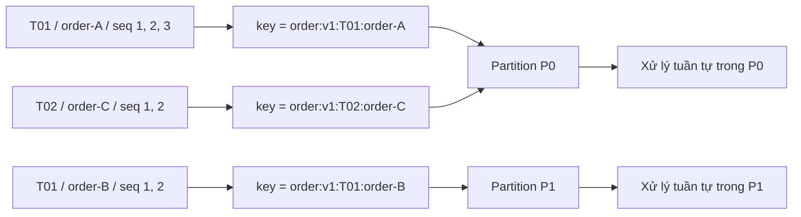

# Thiết kế partition key và bảo đảm thứ tự sự kiện

## 1. Mục tiêu và phạm vi

Trong một hệ thống xử lý đơn hàng trên Oracle Cloud Infrastructure (OCI), sự kiện `OrderCreated` cần được áp dụng trước `OrderPaid` của cùng đơn hàng. Trong khi đó, hai đơn hàng độc lập có thể được xử lý song song. Thiết kế partition key là bước quyết định những sự kiện nào phải đi cùng một luồng tuần tự và những sự kiện nào có thể phân tán để tăng thông lượng.

Bài học thuộc chương **Streaming và Queue** của module **CLOUD_PROVIDERS_ORACLE**, tập trung vào OCI Streaming dùng stream, partition và API `PutMessages`. Các lựa chọn thiết kế được đặt trong bối cảnh ứng dụng chạy trên OCI Compute hoặc OKE, lưu trạng thái nghiệp vụ trong cơ sở dữ liệu Oracle, được phân quyền bằng IAM và cần vận hành với chi phí hợp lý.

Sau bài học, người học có thể:

- Chọn khóa theo phạm vi cần giữ thứ tự của nghiệp vụ.
- Phân biệt thứ tự trong partition với thứ tự hoàn tất xử lý và thứ tự cập nhật dữ liệu.
- Thiết kế producer, retry, consumer và checkpoint để tránh bỏ sót hoặc áp dụng sai thứ tự.
- Xử lý hot key, đổi chiến lược khóa và chuyển sang stream mới.
- Nhận biết khi nào OCI Queue phù hợp và khi nào cần khả năng sắp thứ tự của OCI Streaming.

Các chính sách tuần tự hóa, outbox, chống trùng và chuyển đổi bên dưới là **đề xuất thiết kế ứng dụng**; chỉ những bảo đảm được dẫn tài liệu Oracle mới là hành vi do dịch vụ cung cấp.

## 2. Hiểu đúng bảo đảm thứ tự

OCI Streaming là nhật ký chỉ ghi nối tiếp, được chia thành các partition. Bảo đảm thứ tự nằm trong từng partition; ứng dụng không nhận được một thứ tự chung cho toàn bộ stream có nhiều partition. Xem [tổng quan OCI Streaming](https://docs.oracle.com/en-us/iaas/Content/Streaming/Concepts/streamingoverview.htm).

Cần tách bốn loại thứ tự:

| Loại thứ tự | Ý nghĩa | Thành phần phải kiểm soát |
| --- | --- | --- |
| Thứ tự nghiệp vụ | Đơn hàng chuyển từ phiên bản 1 sang 2 rồi 3 | Giao dịch dữ liệu, version hoặc sequencer |
| Thứ tự ghi vào stream | Sự kiện được append vào partition trước hay sau | Producer và dịch vụ Streaming |
| Thứ tự đọc | Consumer đọc các vị trí trong cùng partition | Cursor và cơ chế đọc của Streaming |
| Thứ tự áp dụng | Kết quả được ghi bền vững vào cơ sở dữ liệu hoặc hệ thống ngoài | Consumer, giao dịch và điều phối tác vụ |

Một consumer nhận `Created` trước `Paid` nhưng đưa cả hai vào thread pool tự do vẫn có thể hoàn tất `Paid` trước. Bảo đảm của partition không tự truyền thành bảo đảm cho tác dụng phụ của ứng dụng.

Ví dụ một partition chứa:

```text
Partition P0
offset 420: order-A, sequence 1, OrderCreated
offset 425: order-B, sequence 1, OrderCreated
offset 429: order-A, sequence 2, OrderPaid
```

Sự kiện của `order-A` có thể xen với sự kiện của `order-B`. Điều cần giữ là chuỗi phiên bản của từng đơn hàng.

**Offset là vị trí trong partition; sequence là thứ tự do nghiệp vụ định nghĩa.** Oracle lưu ý offset tăng nhưng không nhất thiết liên tiếp. Vì vậy, không dùng `offset + 1` để phát hiện sự kiện nghiệp vụ bị thiếu và không so sánh offset giữa hai partition. Xem [offset và commit trong consumer group](https://docs.oracle.com/en-us/iaas/Content/Streaming/Tasks/using_consumer_groups.htm).

Timestamp cũng không thay thế sequence: đồng hồ giữa máy có thể lệch, nhiều sự kiện có thể cùng thời điểm, và thời gian sự kiện phát sinh có thể khác thời gian producer gửi thành công.

## 3. Partition key quyết định điều gì?

Với native Streaming API, các message có cùng key đi vào cùng partition. Key khác nhau vẫn có thể cùng partition. Nếu key là `null`, dịch vụ dùng giá trị ngẫu nhiên để định tuyến; không thể dựa vào key rỗng để gom sự kiện. Xem [ánh xạ key sang partition](https://docs.oracle.com/en-us/iaas/Content/Streaming/Concepts/partitioningastream.htm).

Mô hình khái niệm:

```text
key -> cơ chế định tuyến của Streaming -> một partition trong stream
```

Đây không phải công thức để tự tính partition ID. Ứng dụng dùng native API nên cung cấp key và để dịch vụ định tuyến, thay vì tự giả định một hàm hash cụ thể.

Một ánh xạ minh họa có thể là:



Sơ đồ không dự đoán partition thực tế. Nó thể hiện rằng một key phải giữ được tính ổn định, còn nhiều key có thể chia sẻ một partition.

Hai điều thường bị nhầm:

- `eventId` định danh **một sự kiện** để chống trùng.
- Partition key định danh **nhóm sự kiện** cần giữ thứ tự.

Dùng một UUID mới cho mỗi event làm partition key sẽ phá mục đích gom các sự kiện của cùng đơn hàng.

## 4. Chọn phạm vi thứ tự nhỏ nhất đáp ứng nghiệp vụ

Bắt đầu bằng câu hỏi: “Hai sự kiện nào đổi chỗ cho nhau thì kết quả nghiệp vụ có thể sai?”

| Nghiệp vụ | Phạm vi cần thứ tự | Key gợi ý | Hệ quả cần xem xét |
| --- | --- | --- | --- |
| Vòng đời đơn hàng | Từng đơn hàng | `tenantId + orderId` | Có thể xử lý các đơn hàng độc lập song song |
| Biến động số dư | Từng tài khoản | `tenantId + accountId` | Tài khoản lưu lượng cao có thể thành hot key |
| Telemetry thiết bị | Từng thiết bị | `tenantId + deviceId` | Cần thêm cơ chế nhận biết thiết bị khởi động lại nếu sequence bị đặt lại |
| Tồn kho theo kho và mã hàng | Một cặp kho, SKU | `warehouseId + sku` | SKU bán chạy có thể chiếm nhiều tải |
| Nhật ký độc lập | Không yêu cầu thứ tự theo thực thể | Khóa phân tán phù hợp hoặc `null` | Không hứa khả năng tái dựng chuỗi theo thực thể |

Dùng riêng `tenantId` có thể gom toàn bộ khách hàng lớn vào một partition. Dùng `tenantId + orderId` thường thu hẹp phạm vi tốt hơn nếu chỉ cần thứ tự từng đơn hàng.

Tuy nhiên, nếu một thao tác chuyển tiền tác động hai tài khoản, key theo tài khoản không tạo ra giao dịch nguyên tử giữa hai partition. Thiết kế đó còn cần giao dịch ở nguồn, saga hoặc một cơ chế phối hợp phù hợp với yêu cầu nhất quán. Không giải quyết bài toán nhiều thực thể chỉ bằng cách đổi partition key.

Khóa cũng cần phản ánh định danh ổn định. Email, tên hiển thị, trạng thái đơn hàng hoặc địa chỉ giao hàng có thể thay đổi; dùng chúng làm key có thể tách một chuỗi nghiệp vụ sang các partition khác nhau.

## 5. Đánh giá phân bố tải và hot key

Số lượng key phân biệt lớn chưa đủ để kết luận phân bố tải tốt. Một triệu key với một key chiếm 60% số byte vẫn có thể tạo nghẽn.

Đo ít nhất:

- Số message và số byte mỗi giây theo key.
- Tỷ lệ tải của các key lớn nhất.
- Kích thước message ở các phân vị cao.
- Tốc độ xử lý và thời gian chờ của từng nhóm nghiệp vụ.

Theo [giới hạn OCI Streaming](https://docs.oracle.com/en-us/iaas/Content/Streaming/Concepts/streamingoverview_topic-Limits_on_Streaming_Resources.htm), mỗi partition có giới hạn ghi 1 MB/s; số partition của một stream không thay đổi được sau khi tạo. Khi lập kế hoạch thực tế phải đối chiếu tài liệu giới hạn, quota và đặc tính workload hiện hành.

Một mô hình ước lượng đơn giản:

```text
B_peak = tổng số byte ghi mỗi giây tại tải đỉnh
C_plan = dung lượng ghi dự kiến sử dụng trên một partition
P_min  = ceil(B_peak / C_plan)
```

Ví dụ giả định sau đo tải, nhóm chọn `C_plan = 750.000 byte/s` để có khoảng dự phòng. Tải đỉnh `6.000.000 byte/s` cho kết quả `P_min = 8`. Đây là cận dưới theo tổng tải, chưa chứng minh tám partition là đủ: nhiều key nặng có thể va vào cùng partition, và consumer hoặc cơ sở dữ liệu đích có thể là nút thắt.

Nếu một key tự phát sinh `1.200.000 byte/s`, thêm partition không chia nhỏ chuỗi của key đó. Các hướng xử lý gồm giảm lượng dữ liệu, gom cập nhật theo quy tắc nghiệp vụ, chuyển payload lớn ra nơi lưu trữ phù hợp, hoặc thay đổi phạm vi thứ tự.

Việc thêm hậu tố ngẫu nhiên:

```text
account-42:bucket-0
account-42:bucket-1
account-42:bucket-2
```

sẽ chia một tài khoản thành nhiều chuỗi. Chỉ dùng khi nghiệp vụ cho phép các chuỗi độc lập hoặc đã thiết kế lớp hợp nhất có sequence và trạng thái bền vững. Salting không đồng thời giữ nguyên thứ tự toàn tài khoản và loại bỏ mọi chi phí phối hợp.

## 6. Chuẩn hóa key thành một hợp đồng dữ liệu

Producer phải thống nhất cả ý nghĩa lẫn cách biểu diễn key. Ví dụ:

```text
order:v1:<tenant-id>:<order-id>
```

Một hợp đồng nên nêu rõ:

| Thuộc tính | Quy ước ví dụ |
| --- | --- |
| Phạm vi | Các sự kiện của cùng đơn hàng trong cùng tenant |
| Encoding | UTF-8 |
| Định danh | ID nội bộ bất biến |
| Phân cách | Dấu `:`; thành phần ID không chứa dấu này |
| Phân biệt hoa thường | Giữ theo quy tắc định danh đã công bố |
| Giá trị thiếu | Từ chối gửi, đưa vào luồng xử lý lỗi đầu vào |
| Đổi định dạng | Có kế hoạch chuyển đổi, không đổi tùy ý khi triển khai |

Ví dụ `order:v1:T01:O314` và `order:v1:t01:O314` là hai dãy byte khác nhau. Một producer tự chuyển chữ thường trong khi producer khác giữ nguyên có thể làm mất tính thống nhất.

Native Streaming API thực hiện partitioning ở phía dịch vụ, còn Kafka API thực hiện ở phía client. Từ khác biệt này, **khuyến nghị thiết kế** là không giả định hai đường gửi luôn chọn cùng partition chỉ vì dùng chuỗi key giống nhau; hãy thống nhất đường gửi và kiểm chứng cấu hình trước khi phối hợp chúng cho một chuỗi nghiệp vụ. Xem [Publishing Messages](https://docs.oracle.com/en-us/iaas/Content/Streaming/Tasks/publishing.htm).

Version của key là version của quy tắc định tuyến. Nó độc lập với version schema payload. Nếu chỉ thêm một field JSON tương thích, thường không cần đổi `order:v1` thành `order:v2`.

Tránh đặt dữ liệu cá nhân hoặc bí mật trực tiếp trong key. Key có thể xuất hiện trong log vận hành, công cụ chẩn đoán hoặc dữ liệu phân tích.

## 7. Envelope sự kiện và sequence nghiệp vụ

Ví dụ payload, với metadata key được gửi riêng là `order:v1:T01:O314`:

```json
{
  "eventId": "1ef3d934-0a13-4c87-b78a-394a9895e0a2",
  "eventType": "OrderPaid",
  "schemaVersion": 1,
  "tenantId": "T01",
  "aggregateType": "Order",
  "aggregateId": "O314",
  "aggregateVersion": 2,
  "occurredAt": "2026-11-20T03:15:00Z",
  "correlationId": "checkout-846",
  "data": {
    "currency": "VND",
    "amount": 250000
  }
}
```

Trong thiết kế này:

- `eventId` được tạo một lần khi ghi nhận sự kiện và giữ nguyên qua các lần retry.
- `aggregateVersion` được cấp trong giao dịch thay đổi trạng thái đơn hàng.
- `schemaVersion` giúp consumer hiểu cấu trúc payload.
- `occurredAt` phục vụ truy vết và phân tích thời gian.
- Key được xây dựng từ `tenantId` và `aggregateId`; consumer kiểm tra chúng nhất quán.

Quy tắc liên tiếp `1, 2, 3...` chỉ hợp lệ nếu đây là chuỗi phát đầy đủ cho aggregate. Nếu consumer chỉ nhận một tập con loại sự kiện, hoặc một phiên bản aggregate phát nhiều event, cần định nghĩa `eventSequence` riêng hoặc hợp đồng sequence phù hợp. Không coi một bước nhảy version là mất dữ liệu nếu mô hình nguồn không hứa tính liên tiếp.

Khi tái dựng một projection từ giữa lịch sử, phải có snapshot hoặc phiên bản khởi điểm hợp lệ. Không thể khởi tạo trạng thái rỗng rồi tùy ý áp dụng sự kiện phiên bản 48.

## 8. Producer phải tạo đúng chuỗi trước khi gửi

### 8.1. Nhiều producer cùng key

Cùng key chỉ giữ những sự kiện đó cùng partition; nó không giúp dịch vụ suy ra thứ tự nghiệp vụ giữa hai request cạnh tranh.

```text
Producer A tạo sequence 10 nhưng bị chậm mạng.
Producer B gửi sequence 11 và được ghi trước.
Producer A gửi thành công sequence 10 sau đó.

Partition có thể chứa: 11 -> 10
```

Một phương án là cấp version trong giao dịch cơ sở dữ liệu và ghi **transactional outbox** cùng giao dịch đó:

```text
BEGIN
  khóa hoặc kiểm tra version của đơn hàng
  cập nhật trạng thái và tăng version
  ghi outbox(event_id, aggregate_id, sequence, payload)
COMMIT

Relay:
  chọn sự kiện kế tiếp của từng aggregate
  gửi tới OCI Streaming
  xác nhận kết quả gửi
  đánh dấu đã phát theo chính sách khôi phục
```

Outbox tránh khoảng trống “cơ sở dữ liệu đã commit nhưng ứng dụng chết trước khi gửi”. Tuy nhiên, nhiều relay cùng đọc outbox vẫn có thể phát đảo thứ tự nếu không điều phối quyền gửi theo aggregate. Cần một owner hợp lệ cho mỗi key, hoặc thuật toán claim bảo đảm chỉ phát phiên bản kế tiếp của key đó.

Nếu relay chết sau khi dịch vụ nhận message nhưng trước khi đánh dấu đã phát, lần khôi phục có thể gửi lại. Vì vậy outbox vẫn cần consumer chống trùng.

### 8.2. Retry và lỗi một phần

Một kết quả HTTP thành công không đủ để kết luận mọi message trong batch đều được ghi. Phải kiểm tra kết quả từng entry của `PutMessages`; entry thành công cung cấp partition và offset, entry thất bại cung cấp lỗi. Xem [mô hình PutMessagesResult](https://docs.oracle.com/en-us/iaas/tools/dotnet/latest/api/Oci.StreamingService.Models.PutMessagesResult.html).

Ví dụ phản ví dụ:

```text
Gửi batch [sequence 10, sequence 11] của cùng key
10 thất bại, 11 thành công
Retry riêng 10
Kết quả có thể quan sát: 11 -> 10
```

Nếu yêu cầu thứ tự nghiêm ngặt, phương án dễ lý giải là chỉ cho một event chưa xác định kết quả của mỗi key tại một thời điểm. Chỉ phát phiên bản kế tiếp sau khi giải quyết phiên bản hiện tại. Có thể gửi song song giữa các key độc lập.

Khi timeout, producer có thể không biết dịch vụ đã nhận hay chưa. Dừng tiến trình gửi của key đó, retry cùng `eventId`, và chấp nhận khả năng bản sao. Retry cần backoff có giới hạn, jitter và phân biệt lỗi tạm thời với lỗi dữ liệu hoặc phân quyền. Hết ngưỡng retry thì ghi trạng thái lỗi bền vững và cảnh báo; không âm thầm bỏ sự kiện rồi tiếp tục key.

## 9. Ví dụ Java gửi một sự kiện có key ổn định

Đoạn mã sau dùng OCI Java SDK, giả định `StreamClient` đã được cấu hình authentication và **messages endpoint** của stream. Trong bài thực hành có thể dùng cấu hình SDK cá nhân; khi chạy trên Compute, lựa chọn instance principal cần IAM policy phù hợp. Dự án cần dependency SDK Streaming tương ứng với phiên bản SDK đang dùng.

Đây là hàm gửi một event. Caller còn chịu trách nhiệm điều phối một luồng gửi cho mỗi key, lưu outbox và giữ nguyên nội dung khi retry.

```java
import com.oracle.bmc.streaming.StreamClient;
import com.oracle.bmc.streaming.model.PutMessagesDetails;
import com.oracle.bmc.streaming.model.PutMessagesDetailsEntry;
import com.oracle.bmc.streaming.model.PutMessagesResultEntry;
import com.oracle.bmc.streaming.requests.PutMessagesRequest;
import com.oracle.bmc.streaming.responses.PutMessagesResponse;

import java.nio.charset.StandardCharsets;
import java.util.Collections;

public final class OrderEventPublisher {
    private OrderEventPublisher() {
    }

    private static void validateId(String value) {
        if (value == null || !value.matches("[A-Za-z0-9_-]{1,64}")) {
            throw new IllegalArgumentException("Invalid stable ID");
        }
    }

    public static String partitionKey(String tenantId, String orderId) {
        validateId(tenantId);
        validateId(orderId);
        return "order:v1:" + tenantId + ":" + orderId;
    }

    public static PutMessagesResultEntry publishOne(
            StreamClient client,
            String streamId,
            String tenantId,
            String orderId,
            String eventJson) {

        String key = partitionKey(tenantId, orderId);

        PutMessagesDetailsEntry message = PutMessagesDetailsEntry.builder()
                .key(key.getBytes(StandardCharsets.UTF_8))
                .value(eventJson.getBytes(StandardCharsets.UTF_8))
                .build();

        PutMessagesResponse response = client.putMessages(
                PutMessagesRequest.builder()
                        .streamId(streamId)
                        .putMessagesDetails(PutMessagesDetails.builder()
                                .messages(Collections.singletonList(message))
                                .build())
                        .build());

        if (response.getPutMessagesResult().getEntries().size() != 1) {
            throw new IllegalStateException("Unexpected result count");
        }

        PutMessagesResultEntry result =
                response.getPutMessagesResult().getEntries().get(0);

        if (result.getError() != null && !result.getError().isEmpty()) {
            throw new IllegalStateException(
                    "Publish failed: " + result.getError());
        }

        // Ghi nhận kết quả cho outbox trước khi phát event kế tiếp cùng key.
        // Không in payload hoặc thông tin nhạy cảm vào log.
        return result;
    }
}
```

Quy tắc ID trong ví dụ là lựa chọn của ứng dụng. SDK nhận key và value dưới dạng `byte[]`; không tự Base64 thêm một lần trước khi truyền vào các builder này. Đối chiếu [PutMessagesDetailsEntry.Builder](https://docs.oracle.com/en-us/iaas/tools/java/latest/com/oracle/bmc/streaming/model/PutMessagesDetailsEntry.Builder.html) và [Java Streaming Quickstart](https://docs.oracle.com/en-us/iaas/Content/Streaming/Tasks/streaming-quickstart-oci-sdk-for-java.htm).

Một lần gọi thành công chỉ xác nhận kết quả gửi event đó. Phương thức static trên không tạo khóa phân tán và không tự sắp thứ tự giữa nhiều JVM. Lỗi kết nối hoặc lỗi trả về phải được tầng relay xử lý trước khi gọi cho sequence tiếp theo.

## 10. Consumer: giữ thứ tự đến khi cập nhật dữ liệu

### 10.1. Tuần tự trong partition, song song giữa partition

Cách khởi đầu dễ vận hành là xử lý tuần tự mỗi partition và xử lý song song giữa các partition. Consumer group điều phối partition giữa các instance; một partition được gán cho một instance trong group tại một thời điểm. Xem [Streaming FAQ](https://www.oracle.com/cloud/streaming/faq/).

Không suy ra rằng thread pool bên trong instance cũng được dịch vụ điều phối. Ứng dụng phải tự bảo đảm:

```text
Đọc event A1 -> áp dụng A1 thành công -> áp dụng A2
Đọc event B1 -> áp dụng B1 độc lập với chuỗi A nếu nghiệp vụ cho phép
```

Khi cần song song theo key trong một partition, có thể thiết kế hàng đợi tuần tự cho từng key. Đổi lại, checkpoint phải chờ toàn bộ phần đầu đã đọc hoàn tất.

Ví dụ:

```text
Theo thứ tự đọc của P0:
offset 420 / key A / đang xử lý
offset 425 / key B / đã xử lý
offset 429 / key C / đã xử lý

Chưa được checkpoint vượt qua event ở offset 420.
```

“Phần đầu hoàn tất” là các message đã đọc liên tiếp theo thứ tự partition, không phải dãy số offset liên tiếp. Nếu đưa checkpoint qua một event chưa áp dụng và consumer chết, lần khôi phục có thể bỏ qua event đó.

### 10.2. Commit sau khi kết quả đã bền vững

Với native consumer group và `commitOnGet=true`, lần `GetMessages` tiếp theo commit các offset của lần đọc trước. Vì vậy vòng xử lý đơn giản phải hoàn tất batch trước khi gọi lấy batch kế tiếp. Nếu chọn `commitOnGet=false`, ứng dụng tự điều khiển commit bằng `ConsumerCommit` và dùng cursor được trả về. Xem [Using Consumer Groups](https://docs.oracle.com/en-us/iaas/Content/Streaming/Tasks/using_consumer_groups.htm).

Mã giả dưới đây minh họa trình tự cho cách đọc tuần tự với commit-on-get:

```text
cursor = tạo hoặc khôi phục group cursor

lặp:
    batch, nextCursor = GetMessages(cursor)

    cho từng event theo thứ tự trả về:
        kiểm tra envelope và key
        áp dụng idempotent trong giao dịch dữ liệu
        nếu thất bại chưa giải quyết:
            dừng tiến trình của batch, không chuyển sang lần đọc kế tiếp

    cursor = nextCursor
    // Lần GetMessages kế tiếp chỉ diễn ra sau khi batch đã xử lý xong.
```

Trong triển khai thực tế, cần giữ consumer hoạt động bằng heartbeat phù hợp khi xử lý dài; heartbeat không phải bằng chứng sự kiện đã được áp dụng. Nếu dùng prefetch hoặc xử lý bất đồng bộ, phải thiết kế riêng việc commit và quản lý cursor, thay vì giữ nguyên vòng lặp này rồi chỉ thay vòng `for` bằng thread pool.

### 10.3. Chống trùng và kiểm tra sequence trong giao dịch

Một thiết kế ứng dụng có thể lưu:

```text
processed_event(
    consumer_name,
    event_id,
    processed_at,
    UNIQUE(consumer_name, event_id)
)

order_projection(
    tenant_id,
    order_id,
    last_sequence,
    business_state,
    PRIMARY KEY(tenant_id, order_id)
)
```

Nếu `eventId` chỉ duy nhất trong từng tenant, ràng buộc chống trùng phải bao gồm `tenant_id`. Nếu nhiều projection xử lý cùng event, phạm vi `consumer_name` phải đại diện đúng projection hoặc phiên bản phép chiếu cần chống trùng.

Với hợp đồng sequence liên tiếp và điểm khởi tạo đã xác định:

```text
BEGIN
  khóa bản ghi projection hoặc dùng cập nhật có điều kiện theo version

  nếu eventId đã xử lý:
      xác nhận đây là bản sao, không lặp tác dụng phụ
      COMMIT
      kết thúc

  nếu sequence == last_sequence + 1:
      áp dụng thay đổi nghiệp vụ
      cập nhật last_sequence
      thêm eventId vào processed_event
      COMMIT

  nếu sequence > last_sequence + 1:
      ROLLBACK
      xử lý khoảng trống theo chính sách đã công bố

  nếu sequence <= last_sequence nhưng eventId chưa từng xử lý:
      ROLLBACK
      đối soát sự kiện cũ hoặc xung đột sequence
```

Trường hợp cùng sequence nhưng khác nội dung có thể là lỗi producer. Không nên gộp mọi sự kiện cũ thành bản sao chỉ dựa trên sequence rồi bỏ qua.

Dấu đã xử lý và cập nhật nghiệp vụ phải cùng một giao dịch. Nếu đánh dấu chống trùng trước rồi chết trước cập nhật, lần retry có thể bị bỏ qua dù nghiệp vụ chưa được áp dụng. Nếu cập nhật trước rồi ghi dấu bằng giao dịch khác, lần retry có thể áp dụng hai lần.

Mô hình trên tạo tính idempotent cho các thay đổi nằm trong cùng cơ sở dữ liệu. Gọi một cổng thanh toán, gửi email hoặc cập nhật hệ thống khác cần thêm idempotency key của đích, outbox tiếp theo hoặc cơ chế điều phối tương ứng; transaction cục bộ không bao phủ mọi tác dụng phụ bên ngoài.

## 11. Khôi phục, rebalance và sự kiện lỗi

### 11.1. Khi consumer chết sau khi cập nhật

Xét trình tự:

```text
1. Consumer cập nhật projection và ghi processed_event thành công.
2. Consumer chết trước khi offset được commit.
3. Consumer thay thế đọc lại event.
4. Kiểm tra eventId cho biết tác dụng phụ đã hoàn tất.
5. Bỏ qua tác dụng phụ lặp, sau đó cho phép checkpoint tiến lên.
```

Đây là tình huống thiết kế chống trùng cần xử lý. Đảm bảo bản ghi chống trùng tồn tại đủ lâu cho cửa sổ replay mà hệ thống cho phép; nếu xóa quá sớm, một lần phát lại lịch sử có thể lặp tác dụng phụ.

### 11.2. Rebalance và tác vụ còn chạy

Khi instance mất quyền xử lý, một tác vụ cũ vẫn có thể đang chạy trong ứng dụng. Với thao tác đích nhạy cảm, nên phối hợp dừng tác vụ khi mất quyền, khóa/cập nhật có điều kiện theo version và chống trùng bền vững.

Nếu cần fencing, ứng dụng có thể cấp một epoch hoặc token tăng dần từ kho điều phối nhất quán; hệ thống đích phải kiểm tra token đó mới loại được tác vụ của owner cũ. Đó là cơ chế ứng dụng bổ sung, không phải một field tự có trong event OCI Streaming.

Mục tiêu là ngăn hai lần thực thi cạnh tranh cùng thay đổi trạng thái, kể cả khi việc giao partition ở phía dịch vụ đã chuyển sang instance mới.

### 11.3. Event lỗi và “bỏ qua để chạy tiếp”

Giả sử chuỗi đơn hàng là:

```text
sequence 8: OrderCreated
sequence 9: OrderPaid       <- lỗi xử lý
sequence 10: OrderShipped
```

Ghi event 9 vào vùng lỗi rồi áp dụng ngay event 10 không giữ thứ tự nghiệp vụ. Cần chọn và công bố một chính sách:

| Chính sách ứng dụng | Giữ được gì | Đánh đổi |
| --- | --- | --- |
| Dừng partition tại event lỗi | Trình tự đơn giản của toàn partition | Các key khác cùng partition cũng bị chặn |
| Chặn riêng key, lưu bền vững toàn bộ phần đang chờ | Các key độc lập có thể tiếp tục | Cần kho pending, quản lý sequence và quy trình phục hồi |
| Bỏ qua sau quyết định nghiệp vụ có kiểm soát | Duy trì tiến độ theo quy tắc được chấp nhận | Kết quả đã thay đổi so với xử lý đầy đủ, cần audit và đối soát |

Với phương án chặn riêng key, chỉ checkpoint qua event chưa áp dụng khi cả event đó và thông tin khôi phục đã được ghi bền vững vào kho pending. Khi ấy, kho pending trở thành một phần bắt buộc của đường phục hồi; chỉ giữ message trong RAM là không đủ.

Một parking store hoặc error stream trong mô hình này do ứng dụng thiết kế. Đừng giả định native Streaming consumer group tự chuyển message lỗi nghiệp vụ sang DLQ rồi bảo toàn chuỗi thay cho consumer.

Với khoảng trống sequence, consumer có thể chờ trong giới hạn, truy vấn nguồn hoặc replay lịch sử. Hết giới hạn cần cảnh báo và quy trình giải quyết. Chờ vô hạn vừa làm tăng độ trễ vừa có nguy cơ vượt thời gian lưu dữ liệu.

## 12. Đổi key hoặc tăng partition bằng stream mới

Vì số partition của stream được cố định khi tạo, tăng dung lượng theo cách này cần một stream mới. Đổi cách xây dựng key cũng là thay đổi định tuyến, dù payload vẫn giống trước. Việc đổi tên prefix từ `order:v1` sang `order:v2` không tự phối hợp hai luồng đang hoạt động.

Một phương án chuyển đổi ứng dụng theo ranh giới sequence:

1. Tạo stream B với số partition đã tính toán; chuẩn bị IAM, endpoint và consumer.
2. Chọn một nhóm key để chuyển thử; consumer lưu rõ nguồn và thế hệ định tuyến.
3. Tạm dừng relay của từng key được chuyển, nhưng có thể tiếp tục ghi outbox tại nguồn.
4. Xác nhận mọi event tới sequence `N` đã phát thành công vào stream A.
5. Chờ projection áp dụng liên tục tới `N`; đối soát khoảng trống và lỗi đang chờ.
6. Cập nhật quyền sở hữu định tuyến, ngăn relay cũ tiếp tục phát key đó vào A.
7. Phát từ `N + 1` trở đi vào B và cho consumer mới xử lý trên cùng trạng thái version đã kiểm soát.
8. Giữ khả năng tra cứu, đối soát stream A trong cửa sổ khôi phục đã chọn rồi mới kết thúc chuyển đổi.

Không so sánh offset của A với offset của B để chứng minh thứ tự. Dùng sequence nghiệp vụ và mốc chuyển đổi đã lưu bền vững.

Dual-write vào A và B có thể tạo dữ liệu trùng và hai thứ tự quan sát khác nhau. Nếu dùng để chạy song song kiểm chứng, phải phân biệt consumer so sánh với consumer được phép tạo tác dụng phụ thật, đồng thời giữ chống trùng xuyên hai nguồn.

Rollback cũng cần mốc sequence và dừng đường phát hiện tại trước khi đổi lại. Một thay đổi cấu hình endpoint không đủ chứng minh chuỗi nghiệp vụ liên tục.

## 13. OCI Queue và giới hạn của thứ tự

OCI Queue phù hợp với mô hình giao việc cho worker. Theo [OCI Queue FAQ](https://www.oracle.com/cloud/queue/faq/), standard queue có **best-effort ordering**; không dùng nó như một hàng đợi FIFO có thứ tự nghiêm ngặt theo từng key.

Các điểm cần phân biệt:

| Nhu cầu | Hướng lựa chọn |
| --- | --- |
| Replay chuỗi sự kiện của đơn hàng theo key | OCI Streaming cùng kiểm soát sequence và consumer |
| Các tác vụ độc lập, worker cạnh tranh nhận việc | OCI Queue |
| Xử lý lại sau worker lỗi | Thiết kế idempotency cho cả hai |
| Cần FIFO nghiệp vụ trên Queue | Phải có bộ điều phối/trạng thái bổ sung hoặc xem lại lựa chọn dịch vụ |

Đặt `orderId` trong payload của Queue giúp ứng dụng biết sự kiện thuộc đơn hàng nào; nó không biến field đó thành partition key với bảo đảm như Streaming.

Channel cũng không nên được coi là cam kết FIFO. Tài liệu [OCI Queue features](https://www.oracle.com/cloud/queue/) mô tả channel phục vụ các khả năng như chọn message và điều phối công bằng. Nếu thiết kế cần thứ tự theo thực thể, ứng dụng vẫn phải giải quyết việc nhận đảo thứ tự và chạy nhiều worker.

Visibility timeout bảo vệ message trong thời gian xử lý; nó không sắp thứ tự toàn bộ chuỗi của một đơn hàng. Xóa message chỉ sau khi hoàn tất xử lý hoặc đã chuyển trách nhiệm xử lý sang một cơ chế bền vững đúng thiết kế. Xem [OCI Queue overview](https://docs.oracle.com/en-us/iaas/Content/queue/overview.htm).

Không đánh đồng OCI Queue, OCI Streaming và các cơ chế hàng đợi bên trong Oracle Database: chúng có API, mô hình xử lý và bảo đảm riêng.

## 14. Bài thực hành thiết kế trên OCI

Mục tiêu là quan sát sự khác nhau giữa “đọc đúng thứ tự” và “áp dụng đúng thứ tự”. Các bước sau là hướng dẫn thực hành, không giả định tài nguyên đã được tạo.

### 14.1. Chuẩn bị

- Một compartment dành cho bài lab và quyền IAM phù hợp.
- Một stream thử nghiệm có nhiều partition, ví dụ ba partition, với dung lượng và thời gian lưu phù hợp phạm vi lab.
- Một producer Java có stream OCID, messages endpoint và authentication đã cấu hình.
- Một consumer group cùng bảng projection/chống trùng trong cơ sở dữ liệu thử nghiệm.
- Hai tenant và một tập đơn hàng giả lập; không dùng dữ liệu nhạy cảm.

Có thể mô tả tài nguyên bằng Terraform hoặc OCI Resource Manager để lặp lại cấu hình. Tách quyền tạo tài nguyên khỏi quyền gửi và đọc dữ liệu; không cấp quyền quản trị toàn tenancy cho ứng dụng chỉ để thử gửi event.

### 14.2. Gửi chuỗi có kiểm soát

Với mỗi đơn hàng, tạo ba sự kiện:

```text
sequence 1: OrderCreated
sequence 2: OrderPaid
sequence 3: OrderShipped
```

Gửi tuần tự trong từng key, gửi song song giữa nhiều đơn hàng. Ghi lại `eventId`, key, sequence, partition và offset ở môi trường lab.

Kiểm tra các sự kiện của cùng key vào cùng partition. Đừng yêu cầu hai key khác nhau phải luôn vào hai partition khác nhau. Khi quan sát thứ tự, sắp theo offset **trong từng partition**, không theo thứ tự dòng log từ nhiều thread.

### 14.3. Quan sát các tình huống quan trọng

| Thao tác thử nghiệm | Điều cần quan sát |
| --- | --- |
| Gửi lại cùng eventId và cùng sequence | Projection không lặp tác dụng phụ |
| Cố ý gửi sequence 3 trước sequence 2 | Consumer phát hiện khoảng trống theo hợp đồng liên tiếp |
| Cho tác vụ sequence 1 xử lý chậm trong thread pool tự do | Hoàn tất có thể đảo thứ tự dù dữ liệu đọc đúng |
| Dừng consumer sau DB commit, trước checkpoint | Đọc lại không làm cập nhật nghiệp vụ lần nữa |
| Tạo lỗi nghiệp vụ cho một event | Chính sách chặn và phục hồi được thực thi đúng |
| Cho một key chiếm phần lớn tải | Thêm worker không tự loại bỏ nút thắt của chuỗi đó |
| Gửi với key null | Không được suy ra một partition cố định cho chuỗi |
| Chuyển một key sang stream mới tại sequence N | Không áp dụng N + 1 trước khi N đã hoàn tất |

Với thử nghiệm lỗi mạng, cần phân biệt lỗi chưa gửi được và lỗi không biết kết quả. Cả hai có thể trông giống timeout ở phía ứng dụng nhưng tạo khả năng trùng khác nhau.

Kết thúc lab, ghi nhận cấu hình, dữ liệu quan sát và tài nguyên cần dọn theo phạm vi đã tạo. Giữ mốc đối soát cần thiết trước khi xóa tài nguyên chứa lịch sử thử nghiệm.

## 15. Giám sát, tính sẵn sàng và chi phí

Một thiết kế giữ thứ tự có thể đúng về logic nhưng không đáp ứng vận hành nếu một key bị chặn nhiều giờ mà không ai biết.

Nên bổ sung metric ứng dụng:

| Tín hiệu | Ý nghĩa cần điều tra |
| --- | --- |
| Byte/s và event/s của các key lớn | Phát hiện hot key và lệch tải |
| Độ trễ từ thời điểm nguồn đến khi áp dụng | Đo trải nghiệm nghiệp vụ thực tế |
| Số khoảng trống sequence và thời gian chờ lâu nhất | Phát hiện lỗi producer, định tuyến hoặc mất dữ liệu ở nguồn |
| Số bản sao được chặn và số xung đột version | Phân biệt retry bình thường với lỗi dữ liệu |
| Kích thước outbox chưa phát và tuổi event cũ nhất | Phát hiện producer relay bị nghẽn |
| Số event đang chờ trong parking store | Theo dõi trách nhiệm phục hồi ngoài stream |
| Lỗi publish, throttling và độ trễ ghi DB | Xác định nút thắt dịch vụ hay ứng dụng |

Kết hợp các metric này với Monitoring và log của OCI. Không tạo nhãn metric cho mọi `orderId` vì số lượng tổ hợp có thể quá lớn; dùng thống kê tổng hợp, nhóm key lớn và truy vết chi tiết có kiểm soát.

Thời gian lưu stream cần lớn hơn cửa sổ dừng dự kiến cộng thời gian xử lý backlog, trong giới hạn dịch vụ. Replay chỉ có ý nghĩa khi dữ liệu vẫn còn hoặc đã được lưu trữ ở nguồn khác theo thiết kế.

Đặt các consumer trên nhiều vị trí lỗi phù hợp với môi trường triển khai để giảm ảnh hưởng khi một instance ngừng hoạt động. Tăng khả năng sẵn sàng không cho phép nhiều owner cùng áp dụng tự do một chuỗi; quyền sở hữu và kiểm tra version vẫn cần được giữ.

Về chi phí, chỉ tăng partition sau khi xem phân bố key, tốc độ consumer và năng lực cơ sở dữ liệu. Tăng số instance vượt khả năng song song hữu ích có thể làm chi phí tăng mà không giảm thời gian chờ. Dùng IAM theo quyền cần thiết, tách môi trường lab với production, và lưu cấu hình hạ tầng trong mã để kiểm soát thay đổi.

## 16. Tiêu chí hoàn tất thiết kế

Một bản thiết kế có thể được chuyển sang triển khai khi trả lời rõ các điểm sau:

1. Phạm vi thứ tự là đơn hàng, tài khoản hay một thực thể khác; lý do nghiệp vụ là gì?
2. Key có bất biến, biểu diễn thống nhất và phân bố tải đủ tốt không?
3. Thành phần nào cấp sequence, và sequence có thật sự liên tiếp với tập event consumer nhận không?
4. Producer xử lý gửi cạnh tranh, timeout và lỗi một phần như thế nào?
5. Consumer giữ thứ tự tới lúc ghi bền vững và chống trùng trong phạm vi nào?
6. Checkpoint có thể vượt qua phần chưa xử lý trong trường hợp nào, và trách nhiệm phục hồi nằm ở đâu?
7. Event lỗi, hot key, rebalance và chuyển stream có mốc đối soát nào?
8. Metric và cảnh báo nào phát hiện một chuỗi bị ngừng tiến triển?

Partition key là điểm bắt đầu của một chuỗi trách nhiệm: tạo thứ tự tại nguồn, giữ định tuyến ổn định, gửi có kiểm soát, áp dụng idempotent và chỉ tiến checkpoint khi trách nhiệm xử lý đã được bảo đảm bền vững.
