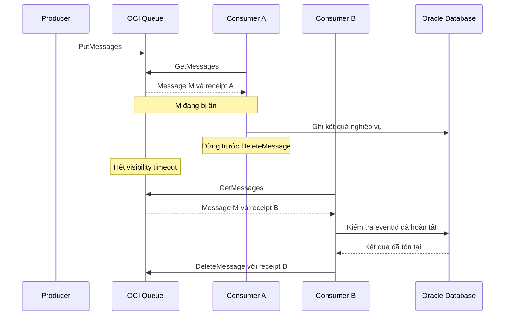

# Queue messages, visibility timeout và cơ chế nhận lại

## 1. Bối cảnh và mục tiêu

Trong chương **Streaming và Queue** của module **CLOUD_PROVIDERS_ORACLE**, bài này tập trung vào cách một consumer nhận, xử lý và xác nhận hoàn tất công việc bằng **OCI Queue**. Tình huống xuyên suốt là dịch vụ nhận yêu cầu tạo hóa đơn, đưa công việc vào queue và để các worker trên OCI Compute hoặc OKE xử lý với Oracle Database.

Giả sử worker đã ghi hóa đơn vào cơ sở dữ liệu nhưng bị dừng ngay trước khi báo hoàn tất với queue. Nếu chỉ nghĩ “đã nhận nghĩa là đã xong”, ứng dụng có thể bỏ sót công việc. Nếu nghĩ “được nhận lại nghĩa là chưa từng xử lý”, ứng dụng có thể tạo hóa đơn hai lần. Thiết kế consumer phải giải quyết cả hai khả năng.

Sau bài này, người học có thể:

- Phân biệt message đang chờ, đang được xử lý và đã bị xóa.
- Giải thích vai trò của visibility timeout, receipt và delivery count.
- Chọn thời gian ẩn message, gia hạn khi cần và chủ động cho phép nhận lại.
- Thiết kế xử lý có tính idempotent khi một công việc được giao nhiều lần.
- Thực hành nhận lại message bằng OCI CLI và xác định tín hiệu cần giám sát.

Các ví dụ dùng một queue công việc thông thường với các consumer cạnh tranh nhận việc, không bật consumer group để phát cùng sự kiện cho nhiều nhóm độc lập. Các giá trị thời gian và tên tài nguyên trong ví dụ là lựa chọn phục vụ bài học.

## 2. Message không biến mất khi được đọc

Với OCI Queue, producer gửi message bằng `PutMessages`; consumer nhận bằng `GetMessages`, thay đổi thời gian ẩn bằng `UpdateMessage` hoặc `UpdateMessages`, rồi xóa bằng `DeleteMessage` hoặc `DeleteMessages`. Nhận message không tự động xóa message. [Oracle: tổng quan OCI Queue](https://docs.oracle.com/en-us/iaas/Content/queue/overview.htm)

Có thể hình dung queue như nơi giao phiếu công việc:

1. Producer đặt một phiếu vào queue.
2. Consumer A nhận phiếu; trong một khoảng thời gian, consumer B không nhận được chính phiếu đó.
3. A thực hiện nghiệp vụ.
4. A xóa phiếu sau khi kết quả đã được lưu bền vững.
5. Nếu A không hoàn tất bước 4 đúng hạn, phiếu có thể được giao lại.

OCI Queue cung cấp cơ chế giao ít nhất một lần, trong giới hạn vòng đời message. Vì vậy, consumer phải chấp nhận khả năng nhận lặp; thứ tự giao cũng không nên được dùng làm bảo đảm FIFO nghiêm ngặt. [Oracle: các đặc tính của Queue](https://www.oracle.com/cloud/queue/)

| Trạng thái dùng trong bài | Ý nghĩa đối với ứng dụng | Hành động tiếp theo thường gặp |
| --- | --- | --- |
| Visible | Có thể được một consumer nhận | Gọi `GetMessages` |
| In-flight | Đã được nhận và đang trong khoảng thời gian ẩn | Xử lý, gia hạn hoặc xóa |
| Visible trở lại | Lần xử lý trước chưa được xác nhận hoàn tất đúng hạn | Consumer tiếp theo nhận lại |
| Trong DLQ | Message đã được cách ly theo cấu hình số lần giao | Điều tra và phục hồi có kiểm soát |
| Đã xóa hoặc hết retention | Message không còn sẵn có để xử lý từ queue đó | Đối soát bằng dữ liệu nghiệp vụ nếu cần |

Đây là mô hình giải thích vòng đời, không phải danh sách giá trị của một trường `status` trên từng message.

## 3. Ba loại thời gian cần phân biệt

| Tham số | Trả lời câu hỏi | Điểm bắt đầu có ý nghĩa |
| --- | --- | --- |
| Polling timeout | Một lần gọi nhận message chờ tối đa bao lâu khi chưa có việc? | Khi dịch vụ tiếp nhận yêu cầu polling |
| Visibility timeout | Message vừa được giao bị ẩn trong bao lâu? | Khi message được giao, hoặc khi cập nhật visibility |
| Retention | Message được giữ trong vòng đời bao lâu trước khi hết hạn? | Gắn với thời điểm xuất bản và thời hạn của message |

**Polling timeout** điều khiển thời gian chờ của yêu cầu nhận. OCI Queue hỗ trợ `timeoutInSeconds` từ 0 đến 30 giây; giá trị 0 trả về ngay. **Visibility timeout** dùng `visibilityInSeconds` để điều khiển thời gian ẩn sau khi nhận. Hai tham số giải quyết hai việc khác nhau. [Oracle: tiêu thụ message](https://docs.oracle.com/en-us/iaas/Content/queue/consume-messages.htm)

**Retention** là giới hạn tuổi thọ, không phải thời gian được phép chạy của một worker. Gia hạn visibility không được vượt qua thời hạn retention của message. [Oracle: cập nhật message](https://docs.oracle.com/en-us/iaas/Content/queue/update-messages.htm)

Ví dụ cấu hình để phân tích:

```text
polling timeout:     20 giây
visibility timeout:  60 giây
retention:           24 giờ
```

Một lời gọi nhận có thể trả về sau 2 giây vì đã có việc. Message vừa nhận vẫn được ẩn theo thời gian visibility đã chọn, chứ không chỉ còn 18 giây. Ngược lại, chờ polling đủ 20 giây và nhận danh sách rỗng không có nghĩa một message đang in-flight đã hết thời gian xử lý.

Nếu retention chỉ còn 15 giây, không thể lấy việc gia hạn thêm vài phút làm cơ sở bảo đảm message sẽ còn tồn tại. Ứng dụng cần quan sát thời hạn thực tế và có chính sách cho công việc quá hạn.

## 4. Receipt là thông tin của lần nhận hiện tại

Kết quả nhận message cung cấp nội dung, ID, receipt, delivery count và thông tin thời hạn. ID phục vụ theo dõi message; receipt là token dùng cho thao tác cập nhật hoặc xóa. Không dùng message ID thay receipt. [Oracle: mô hình GetMessage](https://docs.oracle.com/en-us/iaas/tools/go/latest/queue/index.html#GetMessage)

Ví dụ dưới đây là biểu diễn rút gọn theo tên trường của API, không phải nguyên văn đầu ra OCI CLI:

```json
{
  "id": 101,
  "content": "{\"eventId\":\"invoice-create-7301\",\"orderId\":\"ORD-7301\",\"schemaVersion\":1}",
  "receipt": "<opaque-receipt>",
  "deliveryCount": 1,
  "visibleAfter": "2026-11-20T03:01:00Z",
  "expireAfter": "2026-11-21T03:00:00Z"
}
```

Cần phân biệt ba loại định danh trong ví dụ:

| Giá trị | Ai cấp hoặc quyết định? | Mục đích |
| --- | --- | --- |
| ID của message | Dịch vụ queue | Theo dõi một message trong queue |
| Receipt | Dịch vụ queue khi nhận | Cập nhật hoặc xóa theo lần nhận |
| `eventId` | Ứng dụng producer | Nhận diện công việc nghiệp vụ xuyên suốt retry |

Sau khi thời gian ẩn hết và một consumer khác đã nhận message, consumer cũ không còn quyền cập nhật hoặc xóa bằng thông tin của lần nhận trước. Quy trình của Oracle minh họa rõ tình huống chuyển từ consumer A sang B. [Oracle: vòng đời quản lý message](https://docs.oracle.com/en-us/iaas/Content/queue/messages.htm)

Từ đó, consumer cần tuân thủ các quy tắc sau:

- Giữ receipt cùng ngữ cảnh xử lý của chính lần nhận đó.
- Dùng receipt lấy từ lần `GetMessages` hiện tại khi cập nhật hoặc xóa.
- Không suy ra receipt từ ID và không coi receipt là định danh nghiệp vụ ổn định.
- Không ghi receipt đầy đủ vào log thông thường; dùng message ID, `eventId` và request ID để đối chiếu.
- Khi không còn chắc quyền xử lý, dừng việc tạo tác động mới nếu có thể, rồi để cơ chế idempotency bảo vệ nghiệp vụ.

Receipt không thay thế IAM. Yêu cầu API vẫn phải được xác thực và có quyền phù hợp.

## 5. Nhận lại diễn ra như thế nào?

Giả sử chỉ có một message M, visibility là 30 giây, chưa hết retention và chưa chạm điều kiện chuyển DLQ.

| Thời điểm tương đối | Sự kiện | Hệ quả |
| --- | --- | --- |
| 0 giây | A nhận M | M bị ẩn; A giữ receipt của lần nhận |
| 10 giây | B gọi nhận | B chưa nhận được M |
| 18 giây | A bị dừng trước khi xóa | Queue chưa biết nghiệp vụ đã đến đâu |
| Sau hạn 30 giây | Thời gian ẩn kết thúc | M đủ điều kiện được nhận lại |
| 34 giây | B gọi nhận và được giao M | B xử lý với receipt của lần nhận mới |
| 39 giây | B hoàn tất và xóa M | M không tiếp tục quay lại |

Message trở lại trạng thái có thể nhận không có nghĩa nó được đẩy ngay vào một consumer. Vẫn cần lời gọi nhận tiếp theo và điều kiện khả dụng của dịch vụ.



Có hai tình huống đều dẫn tới nhận lại nhưng cần xử lý khác nhau:

- **A chưa ghi kết quả:** B cần thực hiện nghiệp vụ.
- **A đã commit kết quả nhưng chưa xóa message:** B cần nhận biết công việc đã hoàn tất và chỉ xác nhận với queue.

Visibility timeout không phân biệt được hai tình huống. Chính dữ liệu nghiệp vụ và thiết kế idempotency mới giúp consumer quyết định đúng.

## 6. Chọn visibility timeout theo thời gian xử lý thực tế

Một visibility quá ngắn làm công việc bị giao lại trong khi worker cũ còn chạy. Một visibility quá dài khiến công việc mắc kẹt lâu hơn khi worker chết. Cần chọn dựa trên đo đạc, không chỉ dựa vào thời gian trung bình.

Giả sử hệ thống tạo hóa đơn có các số đo do ứng dụng thu thập:

```text
p50 xử lý:                         2 giây
p95 xử lý:                         6 giây
p99 xử lý:                        12 giây
ngân sách cho commit, delete,
trễ mạng và dao động vận hành:     8 giây
```

Có thể thử visibility 25–30 giây cho nhóm công việc này, sau đó theo dõi số lần giao lại và độ trễ phục hồi. Đây là điểm bắt đầu cho tình huống minh họa, không phải mức mặc định phù hợp cho mọi hệ thống.

Một công thức lập ngân sách hữu ích là:

```text
visibility ban đầu
  > thời gian chờ trong worker
  + thời gian xử lý ở phân vị mục tiêu
  + thời gian lưu kết quả và xóa message
  + biên dao động
```

Thời gian chờ trong worker rất dễ bị bỏ quên. Nếu nhận một batch 10 message rồi xử lý tuần tự, mỗi message mất 8 giây, message cuối có thể chưa bắt đầu trước khi visibility 30 giây kết thúc.

Có thể khắc phục bằng cách:

- Chỉ nhận số message tương ứng với số chỗ xử lý đang rảnh.
- Chạy song song có giới hạn theo khả năng chịu tải của database và dịch vụ phụ thuộc.
- Gia hạn đúng từng message chưa hoàn tất.
- Tách nhóm công việc dài và ngắn nếu đặc tính xử lý khác nhau rõ rệt.

Không nên chỉ tăng số worker khi Oracle Database đã bão hòa. Khi đó, thời gian xử lý tăng có thể gây thêm nhận lại và tiếp tục tăng tải.

## 7. Gia hạn và rút ngắn thời gian ẩn

### 7.1. Gia hạn khi có tiến triển

Consumer có thể gọi `UpdateMessage` với receipt để kéo dài hoặc rút ngắn thời gian ẩn. Giá trị mới được tính tương đối từ thời điểm server nhận yêu cầu, không phải cộng thêm nguyên giá trị vào hạn cũ. [Oracle: UpdateMessageDetails](https://docs.oracle.com/en-us/iaas/tools/go/latest/queue/index.html#UpdateMessageDetails)

Ví dụ:

```text
t = 0:   nhận với visibility 60 giây
         hạn dự kiến: t = 60

t = 40:  cập nhật visibility thành 60 giây
         hạn mới xấp xỉ: t = 100
```

Ví dụ này giả sử yêu cầu cập nhật được server nhận ở gần t = 40 và được chấp nhận. Trong ứng dụng thật, nên dùng thời hạn do dịch vụ trả về làm căn cứ, có tính đến độ trễ và sai lệch đồng hồ.

Một chiến lược cho công việc dài là visibility 90 giây, kiểm tra tiến triển và thử gia hạn sau khoảng 30 giây. Cần để đủ thời gian cho retry mạng trước hạn hiện tại. Không đợi đến giây cuối mới gửi yêu cầu.

Heartbeat gia hạn phải có điều kiện dừng:

- Dừng khi nghiệp vụ hoàn tất và chuẩn bị xóa.
- Dừng khi tác vụ bị hủy hoặc không còn tiến triển trong ngân sách cho phép.
- Không gia hạn vô hạn một công việc đang treo.
- Khi gia hạn thất bại, đánh giá thời gian còn lại; không mặc nhiên coi quyền xử lý vẫn còn.
- Đồng bộ việc gia hạn và xóa để tránh một luồng tiếp tục cập nhật sau khi luồng khác đã xóa.

Visibility chỉ hạn chế giao lại từ queue trong thời gian hiệu lực. Nó không phải khóa nghiệp vụ trên bảng dữ liệu và không thể tự dừng một thread đã chạy quá hạn.

### 7.2. Cho phép nhận lại sớm

Khi biết chưa thể xử lý, consumer có thể rút ngắn visibility, kể cả về 0 ở mức message. Điều này cho phép một lần nhận tiếp theo lấy message sớm hơn. Đây là thao tác cập nhật thời gian ẩn, không phải một lời gọi NACK riêng trong các API đang dùng. [Oracle: CLI update-message](https://docs.oracle.com/en-us/iaas/tools/oci-cli/latest/oci_cli_docs/cmdref/queue/messages/update-message.html)

Không nên đưa visibility về 0 liên tục khi database đang ngừng phục vụ. Nếu mọi worker đều nhận, lỗi rồi trả lại ngay, hệ thống tạo vòng retry dày đặc mà không tăng khả năng thành công.

## 8. Retry, delivery count và DLQ

**Delivery count đếm số lần giao message**, không phải số lần ứng dụng tự retry một câu SQL trong cùng lần nhận. Ngay cả việc nhận để xem với visibility 0 cũng làm tăng delivery count. [Oracle: CLI get-messages](https://docs.oracle.com/en-us/iaas/tools/oci-cli/latest/oci_cli_docs/cmdref/queue/messages/get-messages.html)

Cần phân biệt hai tầng retry:

| Tầng | Ví dụ | Quan hệ với delivery count |
| --- | --- | --- |
| Trong cùng lần nhận | Thử lại một yêu cầu HTTP bị lỗi tạm thời | Không tạo lần giao mới chỉ vì ứng dụng retry |
| Nhận lại từ queue | Message hết visibility rồi được `GetMessages` giao tiếp | Có một lần giao mới |

Đối với retry trong cùng lần nhận, tổng thời gian thử lại phải nằm trong ngân sách visibility hoặc đi kèm gia hạn hợp lệ.

Một chính sách backoff do ứng dụng thiết kế có thể là:

```text
delay(n) = min(60 giây, 5 giây × 2^(n - 1)) + jitter từ 0 đến 3 giây
```

Khi n = 1, 2, 3, khoảng chờ nền lần lượt là 5, 10, 20 giây. Nếu dùng cập nhật visibility để trì hoãn lần nhận tiếp theo, ứng dụng phải chủ động tính và gửi giá trị. Đây không phải khẳng định OCI tự áp dụng công thức đó.

Với lỗi vĩnh viễn như payload thiếu `orderId` hoặc phiên bản schema chưa được hỗ trợ, retry tức thì thường không giúp ích. Cần ghi nhận nguyên nhân và để chính sách cách ly xử lý.

OCI Queue tạo DLQ đi kèm queue. Message được chuyển vào đó khi thỏa điều kiện số lần giao thất bại theo cấu hình; DLQ vẫn chịu retention và không phải nơi lưu vô thời hạn. [Oracle: dead letter queues](https://docs.oracle.com/en-us/iaas/Content/queue/deadletterqueues.htm)

Quy trình phục hồi nên gồm:

1. Nhận diện nguyên nhân: dữ liệu sai, quyền truy cập, lỗi triển khai hay dịch vụ phụ thuộc.
2. Sửa nguyên nhân và xác nhận phiên bản consumer có thể xử lý.
3. Kiểm tra công việc đã tạo tác động một phần hay chưa.
4. Đưa lại có giới hạn, giữ `eventId` để chống trùng.
5. Quan sát kết quả trước khi tăng tốc độ phục hồi.

Không xây quy trình vận hành dựa vào giả định “mọi message trong DLQ đều chưa từng ghi dữ liệu”. Worker có thể đã commit rồi mới thất bại ở bước xóa.

## 9. Xóa sau commit và xử lý có tính idempotent

### 9.1. Thứ tự xác nhận

Thứ tự thông thường cho công việc cập nhật dữ liệu là:

```text
Nhận message
  → kiểm tra payload
  → thực hiện nghiệp vụ và lưu dấu hoàn tất
  → commit
  → xóa message bằng receipt hiện tại
```

OCI Queue yêu cầu consumer gọi API xóa để ngăn giao lại sau khi xử lý. [Oracle: xóa message](https://docs.oracle.com/en-us/iaas/Content/queue/delete-messages.htm)

Nếu xóa trước commit, một lần dừng tiến trình có thể làm mất khả năng xử lý lại dù nghiệp vụ chưa hoàn tất. Nếu commit trước xóa, vẫn có khoảng hở dẫn đến nhận lại; vì vậy phải chống trùng.

### 9.2. Dùng khóa nghiệp vụ ổn định

Giả sử producer gửi `eventId = invoice-create-7301`. Producer phải giữ khóa đó khi gửi lại cùng một yêu cầu, kể cả khi không chắc lần gửi trước đã thành công.

Trong Oracle Database, có thể lưu dấu xử lý bằng bảng:

```sql
CREATE TABLE processed_queue_events (
    consumer_name VARCHAR2(100 CHAR) NOT NULL,
    event_id      VARCHAR2(200 CHAR) NOT NULL,
    processed_at  TIMESTAMP WITH TIME ZONE DEFAULT SYSTIMESTAMP NOT NULL,
    CONSTRAINT pk_processed_queue_events
        PRIMARY KEY (consumer_name, event_id)
);
```

Bảng này là một phương án thiết kế ứng dụng trong ví dụ. Khóa gồm tên consumer để mỗi chức năng nghiệp vụ độc lập có thể xử lý cùng sự kiện một lần theo nhu cầu.

Trong **cùng một transaction**:

1. Chèn bản ghi `(consumer_name, event_id)`.
2. Tạo hoặc cập nhật hóa đơn.
3. Commit cả dấu xử lý lẫn dữ liệu hóa đơn.

Nếu bước nghiệp vụ thất bại, rollback cả hai thay đổi. Khi cùng khóa đã tồn tại do một transaction trước đã commit thành công, lần nhận mới không tạo hóa đơn lần nữa.

Chỉ truy vấn “đã tồn tại chưa?” rồi ghi ở hai bước không được bảo vệ là chưa đủ: hai worker có thể cùng thấy chưa tồn tại. Ràng buộc duy nhất và cách xử lý transaction phải giải quyết tranh chấp đồng thời. Không được coi mọi lỗi database là dấu hiệu “đã xử lý”; chỉ xử lý nhánh trùng khóa đúng như thiết kế.

### 9.3. Không bao trùm được mọi hệ thống bằng một transaction

Gửi email, gọi cổng thanh toán hoặc ghi sang hệ thống ngoài thường không nằm trong cùng transaction Oracle Database. Bảng dấu xử lý riêng lẻ không thể tự bảo đảm các tác động đó chỉ xảy ra một lần.

Với các tác động ngoài database, cần thiết kế thêm theo tình huống:

- Truyền idempotency key cho API đích nếu API hỗ trợ.
- Dùng outbox cùng transaction nghiệp vụ để lưu yêu cầu cần chuyển tiếp.
- Có trạng thái và đối soát khi kết quả lời gọi bên ngoài chưa rõ.
- Thiết kế thao tác bù khi nghiệp vụ cho phép.

Mục tiêu là làm cho việc giao lại an toàn ở cấp nghiệp vụ, không suy ra “exactly once” chỉ từ visibility timeout.

### 9.4. Khung thuật toán consumer

Đây là mã giả theo phong cách Java. `queue`, `database` và các phương thức xử lý lỗi là lớp trừu tượng của ứng dụng, không phải chữ ký SDK OCI có thể biên dịch trực tiếp.

```java
while (!shutdownRequested()) {
    int slots = availableWorkerSlots();
    if (slots == 0) {
        awaitCapacity();
        continue;
    }

    var messages = queue.receive(
        Math.min(slots, 10),
        20,  // polling timeout
        60   // visibility timeout
    );

    for (var message : messages) {
        submitBounded(() -> {
            var lease = startCoordinatedLease(message.receipt());

            try {
                var event = parseAndValidate(message.content());

                database.applyOnceInTransaction(
                    "invoice-worker",
                    event.eventId(),
                    tx -> createInvoice(tx, event)
                );

                // Dừng heartbeat và chờ lần gia hạn đang chạy kết thúc.
                lease.stopAndJoin();

                // Chỉ xóa nếu ngữ cảnh lần nhận vẫn còn hợp lệ.
                if (lease.canAcknowledgeNow()) {
                    queue.delete(message.receipt());
                } else {
                    recordCommittedButUnacknowledged(event.eventId());
                }
            } catch (TransientFailure error) {
                lease.stopAndJoin();
                rescheduleIfReceiptStillValid(message, error);
            } catch (InvalidPayload error) {
                lease.stopAndJoin();
                recordPermanentFailureWithoutFullPayload(message.id(), error);
                // Không báo hoàn tất; áp dụng chính sách retry/DLQ đã chọn.
            } finally {
                lease.stopAndJoin();
                releaseWorkerSlot();
            }
        });
    }
}
```

Khi lời gọi xóa bị timeout, kết quả xóa có thể chưa rõ. Consumer cần ghi nhận và áp dụng retry API trong ngân sách phù hợp; không thực hiện lại nghiệp vụ chỉ vì chưa nhận được phản hồi xóa.

Khi nhận lại, `applyOnceInTransaction` phải phân biệt được hai kết quả “vừa hoàn tất” và “đã hoàn tất từ trước”. Cả hai đều có thể dẫn tới xóa message nếu receipt hiện tại còn hợp lệ.

## 10. Thực hành CLI: nhận, chờ nhận lại, gia hạn và xóa

### 10.1. Điều kiện thực hành

Dùng **OCI Cloud Shell hoặc Bash** có OCI CLI và `jq`. Các lệnh trong phần này là hướng dẫn để người học chạy trên tài nguyên thực hành.

Chuẩn bị:

- Một queue riêng đang hoạt động, ban đầu rỗng, không có consumer khác đang chạy.
- Queue không dùng channel hoặc consumer group trong bài thực hành này.
- Retention còn đủ dài cho vài phút thực hành; cấu hình số lần giao cho phép đủ các lượt nhận của bài, chẳng hạn ít nhất 5.
- Danh tính CLI có quyền gửi, nhận, cập nhật và xóa message; có thêm quyền đọc chi tiết queue nếu tự truy vấn endpoint.
- Kết nối mạng truy cập được các endpoint OCI cần dùng.

Đối với IAM, producer cần quyền qua `queue-push`, consumer cần quyền qua `queue-pull`. Thao tác đọc thông tin queue như `GetQueue` thuộc quyền đọc tài nguyên queue. Có thể giới hạn vào compartment thực hành và queue đích bằng điều kiện thích hợp, thay vì cấp quyền quản trị toàn tenancy. [Oracle: tham chiếu quyền Queue](https://docs.oracle.com/en-us/iaas/Content/queue/policy-reference.htm)

Đối với worker chạy trên OCI Compute, có thể sử dụng instance principal cùng dynamic group phù hợp. Receipt cần được bảo vệ trong tiến trình xử lý, còn quyền gọi API do IAM kiểm soát.

### 10.2. Lấy đúng messages endpoint

API quản trị queue và API thao tác message không nên bị coi là cùng một endpoint. Lấy `messagesEndpoint` của chính queue rồi dùng nó cho các lệnh gửi, nhận, cập nhật và xóa. [Oracle: messages endpoint](https://docs.oracle.com/en-us/iaas/Content/queue/messages.htm)

Thay các giá trị giữa dấu `<...>`:

```bash
set -euo pipefail

export OCI_REGION='<region-cua-queue>'
export QUEUE_ID='<ocid-cua-queue-thuc-hanh>'

export MESSAGES_ENDPOINT="$(
  oci queue queue-admin queue get \
    --region "$OCI_REGION" \
    --queue-id "$QUEUE_ID" \
    --query 'data."messages-endpoint"' \
    --raw-output
)"
```

Lệnh quản trị `queue get` nhận `--queue-id`; cách truy vấn trên dùng tên trường trong đầu ra CLI. Nếu tài khoản thực hành không được đọc chi tiết queue, quản trị viên có thể cung cấp endpoint để người học gán trực tiếp. [Oracle: CLI queue get](https://docs.oracle.com/en-us/iaas/tools/oci-cli/latest/oci_cli_docs/cmdref/queue/queue-admin/queue/get.html)

Không tự suy ra messages endpoint từ region hoặc sao chép endpoint của queue khác.

### 10.3. Gửi đúng một công việc

`content` là chuỗi, nên ví dụ dùng `jq` để tạo JSON nghiệp vụ rồi bọc vào mảng message:

```bash
PAYLOAD="$(
  jq -nc '{
    eventId: "lab-invoice-7301",
    orderId: "ORD-7301",
    schemaVersion: 1
  }'
)"

MESSAGES="$(
  jq -nc --arg content "$PAYLOAD" '[{content: $content}]'
)"

oci queue messages put-messages \
  --queue-id "$QUEUE_ID" \
  --messages "$MESSAGES" \
  --endpoint "$MESSAGES_ENDPOINT" \
  --region "$OCI_REGION"
```

`--messages` nhận một mảng JSON, không phải đối tượng ngoài chứa trường `messages`. Kiểm tra kết quả gửi thành công trước khi chuyển sang bước nhận. [Oracle: CLI put-messages](https://docs.oracle.com/en-us/iaas/tools/oci-cli/latest/oci_cli_docs/cmdref/queue/messages/put-messages.html)

### 10.4. Consumer A nhận và giữ message trong 15 giây

```bash
BATCH_A="$(
  oci queue messages get-messages \
    --queue-id "$QUEUE_ID" \
    --limit 1 \
    --timeout-in-seconds 5 \
    --visibility-in-seconds 15 \
    --endpoint "$MESSAGES_ENDPOINT" \
    --region "$OCI_REGION"
)"

RECEIPT_A="$(jq -er '.data.messages[0].receipt' <<< "$BATCH_A")"
MESSAGE_ID_A="$(jq -er '.data.messages[0].id | tostring' <<< "$BATCH_A")"

jq '.data.messages | map({
  id: .id,
  deliveryCount: .["delivery-count"],
  visibleAfter: .["visible-after"]
})' <<< "$BATCH_A"
```

Biến `RECEIPT_A` được giữ trong shell để thao tác với lần nhận này; lệnh hiển thị chỉ in các trường phục vụ quan sát, không in receipt.

Nếu nhận được danh sách rỗng, dừng chuỗi thực hành và kiểm tra lại kết quả gửi, endpoint và queue. Không tiếp tục dùng receipt rỗng. Trong một phiên Bash có `set -e`, lệnh `jq -e` ở trên giúp việc thiếu message được phát hiện sớm.

Ngay sau đó, mô phỏng B thử nhận trong khi A vẫn còn thời gian ẩn:

```bash
oci queue messages get-messages \
  --queue-id "$QUEUE_ID" \
  --limit 1 \
  --timeout-in-seconds 0 \
  --visibility-in-seconds 15 \
  --endpoint "$MESSAGES_ENDPOINT" \
  --region "$OCI_REGION" \
  --query 'data.messages'
```

Kỳ vọng: danh sách rỗng nếu vẫn trong 15 giây của A và queue không có message khác. Nếu thao tác thủ công kéo dài quá hạn, B có thể đã nhận message; khi đó cần làm lại từ đầu với một message mới và nhịp thực hiện phù hợp.

### 10.5. Không xóa ở A và chờ nhận lại

Trong luồng chạy liên tục, cố ý không xử lý hoặc xóa bằng `RECEIPT_A`, rồi chờ:

```bash
sleep 16

BATCH_B="$(
  oci queue messages get-messages \
    --queue-id "$QUEUE_ID" \
    --limit 1 \
    --timeout-in-seconds 5 \
    --visibility-in-seconds 90 \
    --endpoint "$MESSAGES_ENDPOINT" \
    --region "$OCI_REGION"
)"

RECEIPT_B="$(jq -er '.data.messages[0].receipt' <<< "$BATCH_B")"
MESSAGE_ID_B="$(jq -er '.data.messages[0].id | tostring' <<< "$BATCH_B")"

test "$MESSAGE_ID_A" = "$MESSAGE_ID_B"

jq '.data.messages | map({
  id: .id,
  deliveryCount: .["delivery-count"],
  visibleAfter: .["visible-after"]
})' <<< "$BATCH_B"
```

Kỳ vọng: cùng ID message, delivery count tăng, và B có receipt để thao tác trong lần nhận hiện tại. Không cần so sánh hoặc phân tích nội dung token receipt.

Nếu lần nhận sau vẫn rỗng, kiểm tra thời hạn thực tế, consumer khác, retention và điều kiện chuyển DLQ; không kết luận ngay là message bị mất. Có thể thực hiện lại lời gọi long polling có giới hạn sau khi xác định trạng thái bài thực hành.

Không dùng lại `RECEIPT_A` để xóa công việc B đang giữ.

### 10.6. Gia hạn trong lần nhận của B

Thực hiện trước khi thời gian ẩn của B hết:

```bash
oci queue messages update-message \
  --queue-id "$QUEUE_ID" \
  --message-receipt "$RECEIPT_B" \
  --visibility-in-seconds 90 \
  --endpoint "$MESSAGES_ENDPOINT" \
  --region "$OCI_REGION"
```

Lần cập nhật thành công đặt lại thời gian ẩn tương đối từ lúc server nhận yêu cầu. Quan sát thông tin hạn mới trong phản hồi; không tự cộng 90 giây vào thời hạn cũ. [Oracle: CLI update-message](https://docs.oracle.com/en-us/iaas/tools/oci-cli/latest/oci_cli_docs/cmdref/queue/messages/update-message.html)

Có thể cho một lượt nhận khác thử ngay để quan sát message tiếp tục bị ẩn. Không kéo dài bài thực hành đến mức bỏ lỡ hạn mới trước bước xóa.

Một thí nghiệm riêng, trên message khác, là thay 90 bằng 0 rồi gọi nhận ngay để quan sát việc trả lại sớm. Không xen thí nghiệm đó vào luồng B đang chuẩn bị xác nhận hoàn tất.

### 10.7. Xóa và xác nhận không nhận lại

Trong ứng dụng thật, chỉ xóa sau khi công việc đã hoàn tất bền vững. Trong bài thực hành này, coi việc kiểm tra payload là tác vụ minh họa đã xong:

```bash
oci queue messages delete-message \
  --queue-id "$QUEUE_ID" \
  --message-receipt "$RECEIPT_B" \
  --endpoint "$MESSAGES_ENDPOINT" \
  --region "$OCI_REGION"

oci queue messages get-messages \
  --queue-id "$QUEUE_ID" \
  --limit 1 \
  --timeout-in-seconds 0 \
  --visibility-in-seconds 15 \
  --endpoint "$MESSAGES_ENDPOINT" \
  --region "$OCI_REGION" \
  --query 'data.messages'
```

Lệnh xóa dùng `--message-receipt`, không dùng ID message. [Oracle: CLI delete-message](https://docs.oracle.com/en-us/iaas/tools/oci-cli/latest/oci_cli_docs/cmdref/queue/messages/delete-message.html)

Kỳ vọng cuối luồng: xóa thành công và lần nhận sau rỗng trên queue thực hành độc lập. Một phản hồi nhận rỗng đơn lẻ chưa đủ chứng minh đã xóa: phải kiểm tra cả kết quả API xóa, vì message còn bị ẩn cũng tạo ra quan sát tương tự.

Không purge queue để “dọn lỗi” trong khi đang kiểm chứng vòng đời message. Purge sẽ làm mất điều kiện quan sát cần thiết của thí nghiệm.

## 11. Giám sát, khả năng phục hồi và chi phí vận hành

### 11.1. Theo dõi cả queue lẫn kết quả nghiệp vụ

Queue có thể rỗng vì công việc đã thành công, vì message hết hạn, hoặc vì message đã bị cách ly. Vì vậy, số message đang chờ không thay thế được bộ đếm nghiệp vụ đã hoàn tất.

`GetStats` cung cấp số message visible, in-flight và kích thước ước lượng; có thể xem cả thống kê DLQ. Đây là số liệu gần đúng khi hệ thống vẫn liên tục gửi và xử lý. [Oracle: thống kê queue](https://docs.oracle.com/en-us/iaas/Content/queue/queue-statistics.htm)

OCI Monitoring cũng có namespace `oci_queue` cho metric của Queue. Kết hợp metric dịch vụ với số đo do consumer phát ra để tạo alarm. [Oracle: metric Queue](https://docs.oracle.com/en-us/iaas/Content/queue/metrics.htm)

| Tín hiệu | Nguồn quan sát | Cách diễn giải và hành động |
| --- | --- | --- |
| Visible tăng liên tục | Queue statistics hoặc metric dịch vụ | Kiểm tra tốc độ gửi, sức xử lý và giới hạn phụ thuộc |
| In-flight cao lâu, ít hoàn tất | Queue statistics kết hợp metric ứng dụng | Tìm worker treo, tác vụ dài hoặc chậm commit |
| Tỷ lệ nhận lại tăng | `deliveryCount` trong các lần nhận do ứng dụng ghi nhận | Kiểm tra visibility, restart, lỗi xử lý và lỗi xóa |
| Lỗi gia hạn hoặc xóa tăng | Log và metric của consumer | Kiểm tra quyền, endpoint, độ trễ và receipt lỗi thời |
| DLQ xuất hiện message | Thống kê DLQ | Điều tra sớm trước khi hết retention |
| p99 xử lý tăng | Metric ứng dụng | Đánh giá lại visibility, concurrency và tải database |
| Công việc gần hạn nhưng chưa hoàn tất | Thời hạn message kết hợp dữ liệu nghiệp vụ | Ưu tiên xử lý, đối soát hoặc kích hoạt phương án phục hồi |

Các tên mô tả như “tỷ lệ nhận lại” hay “p99 xử lý” trong bảng là số đo cần ứng dụng xây dựng, không phải khẳng định chúng là tên metric OCI có sẵn.

Một log xử lý hữu ích nên chứa `eventId`, ID message, delivery count, tên consumer, thời gian xử lý, kết quả commit và request ID của API có vấn đề. Tránh đưa toàn bộ payload chứa thông tin khách hàng hoặc receipt vào log.

### 11.2. Scale consumer theo khả năng hoàn tất

Ví dụ ứng dụng xử lý được trung bình 4 message mỗi giây trên một worker, trong khi producer gửi 30 message mỗi giây. Nếu chưa có giới hạn khác, 8 worker mới chỉ gần đủ giữ nhịp; cần thêm biên cho biến động và backlog.

Đây chỉ là phép ước lượng từ số đo giả định:

```text
số worker tối thiểu theo thông lượng
  ≈ tốc độ vào / tốc độ hoàn tất hữu ích mỗi worker
```

“Tốc độ hoàn tất hữu ích” loại trừ các lần nhận lại không tạo thêm kết quả nghiệp vụ. Nếu một công việc bị nhận ba lần, đếm ba lần nhận là tăng trưởng thông lượng sẽ gây hiểu nhầm.

Cần giới hạn concurrency theo sức chịu của Oracle Database, pool kết nối và API phụ thuộc. Có thể chạy consumer trên nhiều instance hoặc fault domain để giảm ảnh hưởng khi một tiến trình hay máy bị lỗi; cơ chế nhận lại chỉ phát huy tác dụng khi vẫn có consumer khỏe nhận việc.

Khi triển khai phiên bản mới, consumer nên ngừng nhận thêm, chờ công việc đang chạy trong ngân sách shutdown và giữ heartbeat còn cần thiết. Nếu không thể hoàn tất, dừng tạo tác động mới và để quyền xử lý hết hạn hoặc trả lại theo chính sách. Shutdown có trật tự giảm nhận lại nhưng vẫn phải duy trì idempotency cho trường hợp tiến trình dừng đột ngột.

### 11.3. Hạn chế chi phí từ retry không hữu ích

Long polling giúp giảm vòng gọi nhận rỗng khi ít việc. Batch có thể giảm số lời gọi, nhưng kích thước batch phải tương thích với năng lực xử lý và thời gian ẩn.

Nếu dùng các API batch cập nhật hoặc xóa, cần đọc kết quả từng entry và chỉ thử lại phần thất bại; không suy ra toàn batch thành công chỉ từ việc có phản hồi HTTP. OCI mô tả kết quả từng mục và bộ đếm lỗi trong các mô hình phản hồi batch. [Oracle: UpdateMessagesResult](https://docs.oracle.com/en-us/iaas/tools/go/latest/queue/index.html#UpdateMessagesResult)

Các quyết định vận hành có tác động trực tiếp đến lượng công việc thừa:

- Retry có backoff thay vì nhận lại tức thì trên toàn bộ worker.
- Chọn visibility tránh giao lại trong quá trình xử lý bình thường.
- Gia hạn có giới hạn thay vì heartbeat vô hạn.
- Không dùng Console polling để quan sát message production một cách tùy tiện.
- Chỉ log dữ liệu cần cho đối soát và điều tra.

Không cần giả định một bảng giá cụ thể để thấy tác động: nhận lại, gia hạn và ghi log lặp đều tiêu thụ thêm tài nguyên, đồng thời có thể kéo dài backlog.

## 12. Chẩn đoán các lỗi thường gặp

| Hiện tượng | Khả năng cần kiểm tra | Hướng xử lý |
| --- | --- | --- |
| Không nhận được message dù producer báo đã gửi | Sai endpoint, sai queue, message đang bị ẩn, hết retention hoặc vào DLQ | Kiểm tra đúng tài nguyên, hạn message và thống kê liên quan |
| Cùng một `eventId` xuất hiện nhiều lần | Retry producer, visibility hết, commit xong nhưng xóa chưa thành công | Dùng khóa idempotency và đối chiếu từng giai đoạn |
| Worker cũ không xóa được message | Receipt không còn hợp lệ hoặc message đã được giao lại | Dừng dùng receipt cũ; xử lý bằng lần nhận hiện tại |
| Có quyền nhận nhưng truy vấn chi tiết queue thất bại | Quyền `queue-pull` không đồng nghĩa quyền `GetQueue` | Cấp quyền đọc phù hợp hoặc cung cấp endpoint qua cấu hình |
| Message đến DLQ nhanh khi đang kiểm tra thủ công | Polling cũng tiêu thụ lượt giao | Dừng polling không cần thiết và kiểm tra delivery count |
| Nhiều worker cùng tạo tác động nghiệp vụ | Visibility quá ngắn hoặc thiếu bảo vệ đồng thời | Đo thời gian, điều chỉnh gia hạn và sửa idempotency |
| Lỗi xóa làm nghiệp vụ bị chạy lại | Ứng dụng gộp lỗi xác nhận với lỗi xử lý | Tách kết quả commit khỏi kết quả API xóa |
| In-flight không giảm trong khi worker vẫn sống | Tác vụ treo nhưng heartbeat vẫn gia hạn | Đặt giới hạn tiến triển và thời gian xử lý tối đa |
| Tăng worker nhưng backlog nặng hơn | Database hoặc API đích đã bão hòa | Hạn chế concurrency và khắc phục điểm nghẽn phụ thuộc |

Visibility timeout là khoảng thời gian để một lần xử lý có cơ hội hoàn tất. Độ an toàn của hệ thống đến từ việc phối hợp thời hạn đó với receipt hiện tại, commit bền vững, xác nhận xóa và cơ chế chống trùng ở cấp nghiệp vụ.
