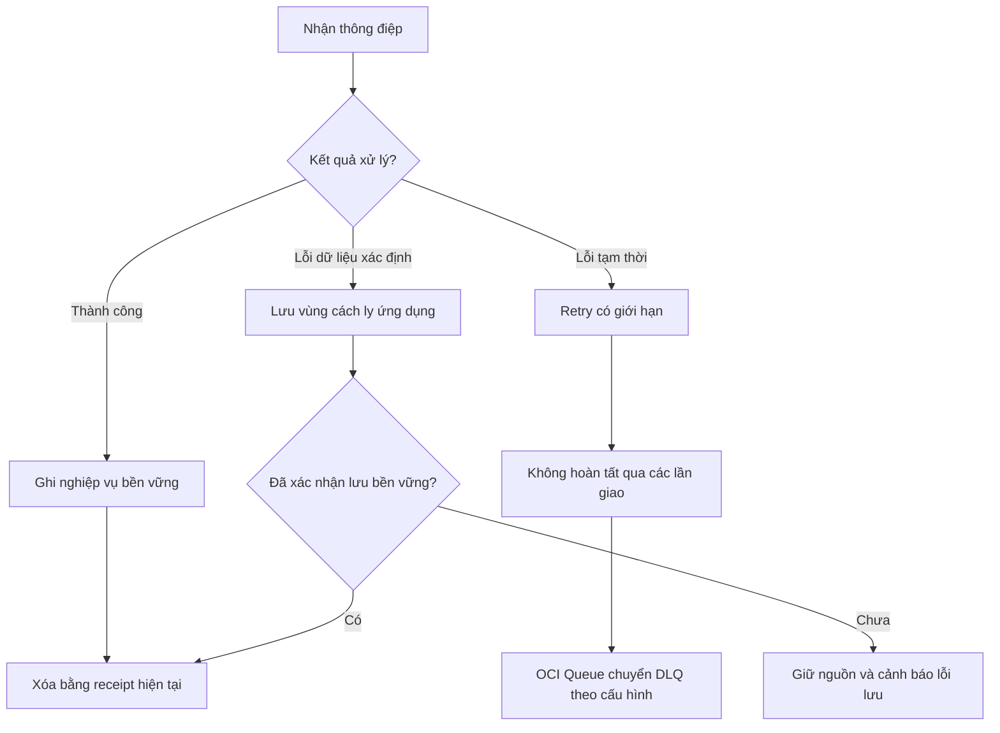

# Dead-letter queues và xử lý thông điệp lỗi

Trong một hệ thống bất đồng bộ, nhận được thông điệp chưa có nghĩa là hoàn tất công việc. Consumer có thể đọc JSON thành công nhưng không ghi được cơ sở dữ liệu; cũng có thể đã tạo hóa đơn rồi dừng trước khi xác nhận với dịch vụ messaging. Cả hai đều tạo ra một lần giao chưa hoàn tất ở phía hạ tầng, nhưng cách phục hồi nghiệp vụ rất khác nhau.

**Dead-letter queue (DLQ)** là nơi cách ly những thông điệp không được xử lý thành công theo chính sách giao của hệ thống. Mục tiêu là giữ đầu mối điều tra và bảo vệ luồng xử lý bình thường. DLQ cần đi kèm người chịu trách nhiệm, cảnh báo, thời hạn xử lý và quy trình đưa dữ liệu trở lại có kiểm soát.

Bài thuộc chương **Streaming và Queue** trong phạm vi **Oracle Cloud Infrastructure (OCI)**. Người học sẽ thiết kế vòng xử lý lỗi cho OCI Queue, phân biệt với cơ chế đọc và commit của OCI Streaming, đồng thời kết nối với IAM, compartment, Compute, lưu trữ, cơ sở dữ liệu Oracle và giám sát vận hành.

## 1. Tình huống xuyên suốt: tạo hóa đơn

Giả sử ứng dụng Java phát yêu cầu `GenerateInvoice` vào OCI Queue. Worker trên Compute nhận yêu cầu, kiểm tra dữ liệu trong Oracle Database, tạo PDF rồi lưu vào Object Storage.

```json
{
  "eventId": "evt-invoice-20261120-000042",
  "eventType": "GenerateInvoice",
  "schemaVersion": 2,
  "occurredAt": "2026-11-20T03:00:00Z",
  "correlationId": "checkout-9021",
  "payload": {
    "invoiceId": "INV-9021",
    "orderId": "ORD-9021"
  }
}
```

Đây là hợp đồng thông điệp minh họa của ứng dụng, không phải những field mà OCI tự thêm vào body.

| Field | Vai trò khi điều tra và phục hồi |
| --- | --- |
| `eventId` | Định danh ổn định của yêu cầu logic, nối các lần giao và phát lại |
| `schemaVersion` | Chọn cách giải mã và kiểm tra tương thích với consumer |
| `invoiceId` | Khóa nghiệp vụ để đối chiếu hóa đơn đã được tạo hay chưa |
| `correlationId` | Nối log producer, worker và quá trình phục hồi |
| `occurredAt` | Giữ thời điểm nghiệp vụ gốc khi phát lại |

Công việc có thể lỗi vì thiếu dữ liệu, cơ sở dữ liệu đang bảo trì, quyền ghi Object Storage sai hoặc worker mất mạng sau khi đã tạo PDF. Không nên gom tất cả vào một nhánh `catch` rồi retry giống nhau.

## 2. DLQ tích hợp của OCI Queue

### 2.1. Delivery count và việc chuyển sang DLQ

OCI Queue tự tạo DLQ khi tạo queue; channel trong queue cũng có DLQ tương ứng. Dịch vụ đếm các lần giao và chuyển thông điệp lỗi sang DLQ theo ngưỡng delivery đã cấu hình. Thông điệp trong DLQ vẫn chịu retention và bị dịch vụ xóa khi hết hạn. DLQ không phải kho lưu trữ vô thời hạn. [Oracle: Dead Letter Queues](https://docs.oracle.com/en-us/iaas/Content/queue/deadletterqueues.htm).

Cần phân biệt hai bộ đếm:

- **Delivery count của dịch vụ:** tăng khi thông điệp được lấy, kể cả thao tác polling trên Console.
- **Số lần thử nghiệp vụ:** do ứng dụng theo dõi; một lần nhận có thể gọi hệ thống đích nhiều lần hoặc chưa kịp chạy logic nào.

Exception Java không tự trở thành lý do lỗi trong Queue. Nếu consumer không xóa thông điệp, dịch vụ quan sát vòng đời giao; log ứng dụng mới giải thích nghiệp vụ thất bại vì sao. [Oracle: Consuming Messages](https://docs.oracle.com/en-us/iaas/Content/queue/consume-messages.htm).

Ví dụ, worker nhận yêu cầu rồi thử kết nối cơ sở dữ liệu ba lần. Ba lỗi kết nối trong cùng lần nhận không đồng nghĩa delivery count tăng thêm ba. Ngược lại, người vận hành polling có thể làm bộ đếm tăng dù chưa tạo hóa đơn lần nào.

### 2.2. Ba đồng hồ cần tách biệt

| Đồng hồ | Câu hỏi nó trả lời | Hệ quả thiết kế |
| --- | --- | --- |
| Visibility timeout | Sau khi giao, thông điệp được ẩn với consumer khác trong bao lâu? | Phải đủ cho một lần xử lý hoặc được gia hạn hợp lý |
| Retention | Thông điệp còn được giữ đến khi nào? | Phải xét khoảng gián đoạn và thời gian phục hồi |
| Polling timeout | Một yêu cầu nhận chờ dữ liệu tối đa bao lâu? | Điều chỉnh tần suất gọi khi queue chưa có dữ liệu |

Consumer xử lý thành công phải xóa thông điệp để ngăn giao lại. Hết visibility timeout mà chưa xóa, thông điệp có thể trở lại trạng thái nhận được. Polling timeout không cấp thêm thời gian xử lý nghiệp vụ. [Oracle: Overview of Queue](https://docs.oracle.com/en-us/iaas/Content/queue/overview.htm).

Ví dụ cấu hình ban đầu cho một workload đã đo:

```text
Thời gian xử lý thường gặp:           4 giây
Thời gian xử lý ở p99 trong phép đo:  18 giây
Visibility timeout lựa chọn:         60 giây
Polling timeout lựa chọn:            20 giây
Thời hạn retry nghiệp vụ:            hữu hạn, theo từng loại lỗi
```

Các số này là giả định minh họa, không phải mặc định hay khuyến nghị chung cho OCI. Với tác vụ kéo dài, cần gia hạn visibility theo tiến độ, đồng thời có thời hạn dừng cuối cùng. Gia hạn mãi khiến công việc kẹt khó được phát hiện.

`UpdateMessage` điều chỉnh visibility bằng receipt của lần nhận; việc gia hạn không thể kéo dài vượt retention của thông điệp. [Oracle: Updating Messages](https://docs.oracle.com/en-us/iaas/Content/queue/update-messages.htm).

Khi lập lịch điều tra DLQ, hãy xét thời điểm hết hạn thực tế. Không giả định mỗi lần đổi trạng thái đều được cộng thêm một chu kỳ lưu giữ đầy đủ.

### 2.3. Receipt khác eventId

`DeleteMessage` cần receipt được trả về từ `GetMessages`. `eventId` trong body phục vụ nghiệp vụ, không thay thế receipt trong API xóa. [Oracle: Deleting Messages](https://docs.oracle.com/en-us/iaas/Content/queue/delete-messages.htm).

Thiết kế nên giữ đồng thời:

```text
Nguồn giao:     queue / consumer group / channel
Message ID:    định danh ở tầng dịch vụ để truy vết
Receipt:       token lần nhận để cập nhật visibility hoặc xóa
Event ID:      định danh yêu cầu logic của ứng dụng
Business key:  invoiceId, orderId hoặc khóa tương đương
```

Sau khi thông điệp được giao lại, dùng thông tin của lần nhận hiện tại và kiểm tra kết quả API. Receipt không thích hợp làm khóa chống trùng nghiệp vụ lâu dài.

### 2.4. Kiểm tra cấu hình hiệu lực của consumer group

Nếu dùng consumer groups, phải ghi rõ nhóm đang tiêu thụ. Nhóm có thể đặt ngưỡng DLQ riêng hoặc dùng giá trị ở queue khi không cấu hình riêng. Trong mô hình SDK, `0` biểu thị không dùng DLQ, không có nghĩa là cách ly ngay. [Oracle: ConsumerGroup model](https://docs.oracle.com/en-us/iaas/tools/typescript/latest/modules/_queue_lib_model_consumer_group_.consumergroup.html).

Khi cập nhật nhóm, `-1` bỏ ngưỡng riêng để dùng lại giá trị ở queue. Hạ ngưỡng không hồi tố chuyển ngay các thông điệp in-flight sang DLQ. [Oracle: Update consumer group](https://docs.oracle.com/en-us/iaas/tools/oci-cli/latest/oci_cli_docs/cmdref/queue/queue-admin/consumer-group/update.html).

Không diễn giải thông số delivery thành số lần gọi `retry()` trong mã. Trong lab, ghi lại delivery count và thời điểm chuyển DLQ thực tế thay vì xây logic phụ thuộc vào suy đoán về ranh giới đếm.

## 3. Phân loại lỗi trước khi retry

Bảng sau là chính sách ứng dụng đề xuất cho ví dụ hóa đơn, không phải bộ phân loại tự động của OCI Queue.

| Nhóm lỗi | Ví dụ | Hướng xử lý |
| --- | --- | --- |
| Tạm thời, có cơ hội phục hồi | Timeout ngắn, hệ thống đích giới hạn tải | Retry có khoảng chờ và giới hạn thời gian |
| Dữ liệu không hợp lệ | JSON hỏng, thiếu `invoiceId`, schema chưa hỗ trợ | Cách ly, ghi lý do, sửa producer hoặc chuyển đổi dữ liệu |
| Cấu hình hoặc hạ tầng dùng chung | Sai IAM, sai endpoint, mất kết nối DB diện rộng | Giảm hoặc dừng nhận; khắc phục hệ thống |
| Kết quả chưa chắc chắn | Timeout sau khi gửi yêu cầu tạo hóa đơn | Đối soát bằng khóa nghiệp vụ trước khi gọi lại |
| Từ chối nghiệp vụ hợp lệ | Đơn hàng đã hủy, không được phép tạo hóa đơn | Ghi nhận kết quả từ chối theo hợp đồng nghiệp vụ |

### 3.1. Poison message

**Poison message** là thông điệp làm consumer thất bại lặp lại, chẳng hạn payload sai cấu trúc hoặc kích hoạt một lỗi xác định trong chương trình.

Retry cùng dữ liệu bằng cùng phiên bản consumer không làm lỗi cú pháp tự biến mất. Có thể cách ly sớm để bảo vệ tài nguyên, nhưng phải bảo đảm bản lỗi đã được lưu bền vững trước khi xóa nguồn.

Không kết luận thông điệp là poison chỉ vì thấy HTTP 500. Nếu mọi loại payload đều lỗi sau một lần triển khai, nguyên nhân có thể là consumer mới hoặc dịch vụ phụ thuộc.

### 3.2. Lỗi dùng chung và circuit breaker

Giả sử Oracle Database không truy cập được trong mười phút. Nếu hàng trăm worker vẫn nhận và trả lỗi thật nhanh, nhiều yêu cầu hợp lệ có thể tiêu hết ngân sách delivery rồi bị cách ly.

Một phương án vận hành:

1. Phát hiện tỷ lệ lỗi chung vượt ngưỡng trong một cửa sổ quan sát.
2. Giảm hoặc tạm dừng nhận mới; quản lý các công việc đang giữ.
3. Kiểm tra danh tính, kết nối, IAM và hệ thống đích.
4. Dùng lượng công việc nhỏ để kiểm tra phục hồi.
5. Tăng tải dần khi kết quả nghiệp vụ đã ổn định.

Circuit breaker hạn chế retry vô ích và bảo vệ dịch vụ đích. Retention vẫn tiếp tục trôi trong lúc dừng nhận, nên gián đoạn dài vẫn cần phương án lưu giữ và phục hồi.

## 4. Retry có khoảng chờ và giới hạn

Một chính sách thường dùng là exponential backoff có jitter:

```text
upperBound(n) = min(maxDelay, baseDelay × 2^(n - 1))
delay(n)      = giá trị ngẫu nhiên trong [0, upperBound(n)]
```

Đây là công thức do ứng dụng triển khai. Ví dụ `baseDelay = 2 giây`, `maxDelay = 30 giây`; không có nghĩa OCI Queue tự áp dụng chuỗi chờ này cho consumer.

Cần đặt đồng thời ba giới hạn:

- Số lần thử cho một lỗi hoặc yêu cầu logic.
- Tổng thời gian từ lần thử đầu đến khi dừng tự động.
- Số công việc đồng thời tác động lên hệ thống đích.

Nếu dùng visibility để lùi lần nhận sau, phải xử lý lỗi cập nhật visibility và kiểm tra thông điệp còn thời gian sống. Nếu giữ worker ngủ, tránh đồng thời giữ kết nối DB, transaction hoặc thread khan hiếm mà chưa có công việc hữu ích.

Với trì hoãn dài, có thể thiết kế cơ chế lập lịch hoặc queue retry riêng. Khi đó, việc chuyển giao phải bền vững và cần thêm kiểm soát retention, chống trùng, vòng lặp retry.

Retry ở nhiều lớp có thể nhân nhau. Worker thử ba lần, HTTP client thử ba lần cho mỗi lời gọi, rồi Queue giao lại nhiều lần sẽ tạo lượng yêu cầu đích lớn hơn nhiều so với số `eventId`. Ghi rõ retry ở SDK, thư viện HTTP, logic nghiệp vụ và tầng delivery để tránh nhân tải ngoài dự kiến.

Gia hạn visibility mãi không phải chính sách xử lý poison message. Trả visibility về quá ngắn rồi liên tục nhận lại cũng có thể tiêu hết delivery budget trước khi sự cố dùng chung được sửa.

## 5. DLQ tích hợp và vùng cách ly ứng dụng

### 5.1. Hai trách nhiệm khác nhau

**DLQ tích hợp** do OCI Queue sử dụng theo vòng đời delivery và ngưỡng đã cấu hình. Nó có thể giữ đầu mối cho trường hợp worker chết trước khi ghi được nguyên nhân.

**Vùng cách ly ứng dụng** là đích do ứng dụng chủ động ghi, chẳng hạn queue riêng, bảng lỗi trong Oracle Database hoặc Object Storage kèm chỉ mục điều tra. Nó giúp lưu ngay payload sai cùng lý do, phiên bản consumer và thông tin nghiệp vụ.

Một queue do ứng dụng đặt tên `invoice-errors` không tự trở thành DLQ tích hợp của `invoice-jobs`. Trong thiết kế và dashboard, phải gọi tên đủ rõ để tránh lẫn cơ chế chuyển và cách phục hồi.

### 5.2. Luồng lưu trước, xóa sau



Ghi bản cách ly và xóa nguồn là hai thao tác riêng. Worker chết giữa chúng có thể khiến lần giao lại ghi bản lỗi lần nữa. Kho cách ly cần khóa duy nhất hoặc phép ghi `storeIfAbsent` có ý nghĩa bền vững; map trong RAM của một worker không đủ.

Nếu kho cách ly không ghi được, chưa được xóa nguồn chỉ để giảm backlog. Cần giữ đường phục hồi và cảnh báo chính lỗi của hệ thống xử lý lỗi.

### 5.3. Metadata phục vụ điều tra

Một bản ghi cách ly ứng dụng có thể dùng schema:

```json
{
  "failureId": "failure-invoice-000042",
  "source": {
    "service": "OCI_QUEUE",
    "queueAlias": "invoice-jobs",
    "consumerGroupAlias": "invoice-workers",
    "channelId": "billing",
    "messageId": "service-message-id"
  },
  "originalEventId": "evt-invoice-20261120-000042",
  "businessKey": "INV-9021",
  "schemaVersion": 2,
  "failureCategory": "UNSUPPORTED_SCHEMA",
  "consumerVersion": "invoice-worker-3.4.0",
  "failedAt": "2026-11-20T03:05:00Z",
  "replayGeneration": 0,
  "originalPayloadRef": "restricted-object-reference"
}
```

Các field này do ứng dụng thiết kế. Alias phải ánh xạ được về OCID và môi trường thật; tên đơn thuần có thể trùng giữa compartment hoặc region. Nếu body hỏng đến mức không đọc được `eventId`, vẫn phải có khóa cách ly theo định danh nguồn ổn định.

Giữ dữ liệu gốc và ghi riêng mọi biến đổi sửa lỗi. Không ghi đè bản gốc rồi mất khả năng giải thích lần xử lý trước đã nhận gì.

## 6. Chống tác động trùng bằng khóa nghiệp vụ

### 6.1. Cửa sổ đã commit nhưng chưa xóa

```text
1. Worker nhận yêu cầu INV-9021.
2. Worker tạo hóa đơn và commit cơ sở dữ liệu thành công.
3. Worker dừng trước khi xóa thông điệp trên Queue.
4. Thông điệp được giao lại.
```

Nếu chỉ dựa vào việc đã xóa message để biết công việc hoàn tất, consumer có thể tạo hóa đơn thứ hai. DLQ không giải quyết cửa sổ này; replay sau nhiều giờ còn có thể làm nó xuất hiện lại.

**Idempotency** nghĩa là thực hiện lại cùng yêu cầu logic không tạo thêm tác động ngoài ý muốn. Khóa phải gắn với nghiệp vụ, không chỉ gắn với định danh của một lần publish.

### 6.2. Sổ ghi nhận trong Oracle Database

Ví dụ dùng khóa `(consumer_name, event_id)`:

```sql
CREATE TABLE processed_events (
    consumer_name VARCHAR2(100) NOT NULL,
    event_id      VARCHAR2(200) NOT NULL,
    processed_at  TIMESTAMP WITH TIME ZONE DEFAULT SYSTIMESTAMP NOT NULL,
    CONSTRAINT processed_events_pk PRIMARY KEY (consumer_name, event_id)
);
```

Nếu sổ ghi nhận và cập nhật nghiệp vụ nằm trong cùng cơ sở dữ liệu, có thể dùng một transaction:

1. Thử chèn khóa xử lý cho consumer hiện tại.
2. Thực hiện cập nhật nghiệp vụ.
3. Commit cả hai; nếu lỗi phải rollback cả hai.
4. Sau commit mới xóa thông điệp khỏi Queue.

Khi vi phạm unique constraint, ứng dụng cần kiểm tra đúng khóa đã hoàn tất và xử lý transaction phù hợp. Không biến mọi lỗi SQL thành kết luận “đã xử lý rồi”. Nếu thêm trạng thái `IN_PROGRESS`, cần phân biệt với `COMPLETED` và xử lý worker chết giữa chừng.

Marker chỉ bảo vệ được cập nhật liên quan khi được commit cùng chúng. Ghi và commit marker trước nghiệp vụ có thể khiến lần giao sau bỏ qua một hóa đơn chưa từng được tạo.

Thời gian giữ khóa chống trùng phải xét toàn bộ cửa sổ retry và replay. Nếu xóa sổ ghi nhận trước khi dữ liệu lỗi được phát lại, hệ thống có thể coi yêu cầu cũ là công việc hoàn toàn mới.

### 6.3. Tác động ngoài transaction

Tạo object, gửi email hoặc gọi cổng thanh toán không tự tham gia transaction Oracle Database. Cần phương án riêng:

| Tác động | Cách kiểm soát cần cân nhắc |
| --- | --- |
| Lưu PDF | Khóa object xác định theo hóa đơn và quy tắc cập nhật nội dung rõ ràng |
| Gọi API bên ngoài | Idempotency key nếu API hỗ trợ |
| Gửi yêu cầu sau khi cập nhật DB | Outbox ghi trong cùng transaction |
| Timeout không biết kết quả | Tra cứu và đối soát bằng khóa nghiệp vụ trước khi thử lại |

Outbox bảo vệ ý định gửi và khả năng tiếp tục sau sự cố. Nó vẫn cần xử lý gửi trùng ở ranh giới với hệ thống đích; thêm bảng outbox không tự bảo đảm mọi tác động xảy ra đúng một lần.

## 7. Cấu trúc xử lý trong Java

Đoạn dưới là **mã khung với các cổng do ứng dụng định nghĩa**, không phải chương trình OCI SDK chạy độc lập. Nó minh họa việc tách lỗi nghiệp vụ khỏi lỗi xác nhận xóa.

```java
void handleDelivery(Delivery delivery) {
    try {
        handler.executeIdempotently(delivery.body());
    } catch (InvalidPayloadException invalid) {
        // Nếu lưu thất bại, phải ném lỗi và chưa xóa nguồn.
        quarantine.storeIfAbsent(
                delivery.stableSourceKey(),
                delivery.body(),
                invalid.reasonCode());
    } catch (RetryableDependencyException temporary) {
        retryPolicy.deferUsingCurrentReceipt(delivery);
        return;
    } catch (SystemicFailureException systemic) {
        intakeControl.pauseAndAlert(systemic.reasonCode());
        return;
    }

    // Chỉ tới đây sau khi nghiệp vụ hoặc lưu cách ly đã thành công.
    try {
        queuePort.deleteUsingCurrentReceipt(delivery);
    } catch (QueueAcknowledgementException uncertain) {
        operations.recordUncertainDeletion(delivery, uncertain);
    }
}
```

Các cổng cần có hợp đồng cụ thể:

| Cổng | Hợp đồng cần triển khai |
| --- | --- |
| `executeIdempotently` | Kiểm tra schema, khóa nghiệp vụ, transaction và kết quả đã hoàn tất |
| `storeIfAbsent` | Lưu dữ liệu hoặc tham chiếu bền vững, chống ghi lặp |
| `deferUsingCurrentReceipt` | Giới hạn retry, kiểm tra deadline và lỗi cập nhật visibility |
| `pauseAndAlert` | Giảm nhận trên các worker liên quan, có điều kiện kiểm tra phục hồi |
| `deleteUsingCurrentReceipt` | Dùng receipt hiện tại và đúng nguồn giao |

Lỗi xóa sau khi nghiệp vụ thành công không được phân loại thành payload sai rồi đưa vào vùng cách ly. Lần giao lại phải dựa vào idempotency để nhận ra kết quả đã có.

Exception chưa phân loại cần được ghi nhận theo chính sách mặc định có kiểm soát. Không thêm `catch (Exception) { delete(); }` để làm queue trông sạch.

Trong lớp tích hợp OCI thực tế, sử dụng các thao tác như `GetMessages`, `UpdateMessage`, `DeleteMessage` và `PutMessages`. Client dữ liệu cần trỏ tới **messages endpoint** của queue; có thể lấy endpoint qua `GetQueue`. [Oracle: Queue Java SDK](https://docs.oracle.com/en-us/iaas/tools/java/latest/com/oracle/bmc/queue/Queue.html).

## 8. Khi nguồn là OCI Streaming

### 8.1. Không sao chép vòng nhận rồi xóa của Queue

OCI Streaming dùng partition và offset. Với consumer group có `commitOnGet=true`, lần `GetMessages` tiếp theo commit tiến độ của lần lấy trước. Có thể dùng `commitOnGet=false` và cơ chế commit thủ công khi cần kiểm soát thời điểm xác nhận. [Oracle: Streaming consumer groups](https://docs.oracle.com/en-us/iaas/Content/Streaming/Tasks/using_consumer_groups.htm).

Vì vậy, với consumer tự viết, phải thiết kế đường lỗi và checkpoint thay vì áp nguyên cấu hình DLQ của Queue. Có thể ghi bản lỗi sang stream riêng, queue cách ly hoặc kho điều tra rồi quyết định tiến tiếp vị trí đọc.

| Lựa chọn thiết kế | Lợi ích | Đổi lại |
| --- | --- | --- |
| Dừng partition, retry có giới hạn | Giữ quan hệ xử lý trước sau chặt hơn | Bản ghi phía sau có thể bị chặn |
| Lưu lỗi bền vững rồi đi tiếp | Một bản ghi lỗi không chặn mọi công việc sau | Phải xử lý sự kiện đến muộn khi phục hồi |
| Điều phối phục hồi theo khóa thực thể | Có thể bảo vệ thứ tự nghiệp vụ theo thực thể | Phức tạp hơn về trạng thái và đồng bộ |

Đây là các phương án kiến trúc của ứng dụng, không phải ba chế độ DLQ bật bằng một công tắc trong Streaming.

### 8.2. Ranh giới ghi lỗi và commit

```text
Xử lý bản ghi lỗi
    -> lưu bền vững dữ liệu lỗi và thông tin nguồn
    -> xác nhận việc lưu thành công
    -> mới tiến tiếp checkpoint/commit theo mô hình consumer
```

Commit trước rồi mới lưu lỗi tạo cửa sổ mất dấu: worker có thể chết khi vị trí đọc đã tiến mà bản cách ly chưa tồn tại. Lưu trước rồi chết trước commit có thể tạo bản lỗi trùng. Kho cách ly cần khóa theo nguồn như stream, partition, offset và đường xử lý.

Giả sử batch có A, B, C: A thành công, B lỗi và C chưa xử lý. Không được xác nhận cả batch chỉ vì đã lưu B vào vùng cách ly. Mọi bản ghi bị checkpoint vượt qua, gồm cả C, phải có kết quả bền vững tương ứng.

Với `commitOnGet=true`, không để vòng fetch lấy batch tiếp theo trong khi thread pool chưa hoàn tất batch trước. Nếu pipeline chạy song song, cơ chế xác nhận phải phản ánh công việc thực sự hoàn thành, không chỉ dữ liệu đã được đưa vào RAM.

### 8.3. Thứ tự nghiệp vụ sau replay

Giả sử `InvoiceCreated` bị cách ly nhưng `InvoiceCancelled` đã xử lý. Replay sự kiện tạo sau đó có thể làm sống lại hóa đơn đã hủy.

Consumer có thể cần kiểm tra phiên bản thực thể, trạng thái hiện hành hoặc điều kiện cập nhật hợp lệ. Giữ được bản gốc giúp truy vết; nó không tự bảo đảm tác động của sự kiện muộn vẫn hợp lệ lúc phục hồi.

## 9. Điều tra và replay có kiểm soát

**Replay** là đưa yêu cầu hoặc sự kiện đã lưu vào xử lý lại. Trước khi làm, cần xác định vì sao lần xử lý mới có cơ hội thành công và liệu nghiệp vụ còn cần tác động đó hay không.

### 9.1. Xác định phạm vi và nguyên nhân

Ghi nhận region, compartment, queue hoặc stream, consumer group, channel hoặc partition. Sau đó trả lời:

1. Có bao nhiêu yêu cầu logic lỗi, thay vì chỉ bao nhiêu lần giao?
2. Lỗi bắt đầu sau lần triển khai, thay policy hoặc đổi schema nào?
3. Thông điệp hợp lệ khác có tiếp tục được xử lý không?
4. Hệ thống đích đã có một phần hoặc toàn bộ tác động chưa?
5. Dữ liệu có sắp hết hạn và cần chuyển sang kho điều tra được phép không?

Không polling hàng nghìn message chỉ để biết backlog. Polling trên Console vẫn tác động đến visibility và delivery count. [Oracle: Consume Messages from a Consumer Group](https://docs.oracle.com/en-us/iaas/Content/queue/consume-messages-consumer-group.htm).

### 9.2. Sửa nguyên nhân trước

| Nguyên nhân đã xác minh | Điều kiện trước replay |
| --- | --- |
| Schema mới chưa được hỗ trợ | Consumer sửa đã được triển khai và thử với mẫu đại diện |
| Sai IAM hoặc đường mạng | Đúng danh tính chạy thật truy cập được tài nguyên đích |
| Payload sai | Có quy tắc sửa, giữ bản gốc và dấu vết biến đổi |
| Timeout sau tác động có thể đã thành công | Đã đối soát và xác định cách gọi lại an toàn |
| Quá tải hệ thống đích | Có giới hạn tốc độ và năng lực dành cho phục hồi |

Replay khi chưa sửa nguyên nhân thường tạo vòng lỗi mới và tăng chi phí.

### 9.3. Chuyển giao theo nguyên tắc lưu trước, bỏ sau

Một tiến trình phục hồi do ứng dụng quản lý có thể dùng trình tự:

```text
Chọn tập lỗi
    -> kiểm tra còn cần xử lý
    -> đọc dữ liệu gốc và lý do lỗi
    -> chuẩn bị khóa nghiệp vụ và đích phục hồi
    -> phát lại, xác nhận kết quả
    -> đánh dấu nguồn đã chuyển giao / xóa theo cơ chế nguồn
    -> theo dõi đến khi nghiệp vụ hoàn tất
```

Đọc hoặc xóa DLQ không đồng nghĩa đưa thông điệp về luồng chính. Với DLQ tích hợp, công cụ phục hồi phải dùng cách truy cập được tài liệu/API dịch vụ hỗ trợ; trong phương án ứng dụng phát lại, phát mới và bỏ bản lỗi vẫn là các bước riêng.

Nếu tiến trình chết sau khi phát thành công nhưng trước khi đánh dấu nguồn, có thể phát lần nữa. Giữ `originalEventId`, khóa nghiệp vụ và lịch sử chuyển giao để nhận diện tình huống đó.

Nếu cần định danh mới cho từng lần truyền, dùng thêm `replayId`. Nếu sửa ý nghĩa nghiệp vụ của payload, phải ghi rõ đó là yêu cầu sửa chữa hoặc yêu cầu mới; tái sử dụng khóa cũ mà không xác định ngữ nghĩa có thể khiến bản sửa bị cơ chế chống trùng bỏ qua.

### 9.4. Giới hạn tốc độ và phạm vi nhận

Bắt đầu bằng mẫu nhỏ đại diện cho từng nhóm nguyên nhân. Kiểm tra trạng thái cơ sở dữ liệu, object đầu ra và log rồi mới tăng tốc. Đặt giới hạn đồng thời, số lần replay và điều kiện dừng khi tỷ lệ lỗi hoặc độ trễ hệ thống đích tăng.

Duy trì sổ chuyển giao với các trạng thái như `PLANNED`, `PUBLISHED`, `COMPLETED`, `FAILED`. “Đã gửi lại” chưa có nghĩa “đã hoàn tất”.

Với Queue fan-out, thông điệp được phân phối theo attributes và filter của từng nhóm; thay filter không hồi tố đánh giá thông điệp cũ. Phát lại vào queue ban đầu có thể tác động tới nhiều nhóm. Phải xác định người nhận của lần phát mới và cân nhắc đích phục hồi riêng. [Oracle: Fan Out Messages](https://docs.oracle.com/en-us/iaas/Content/queue/fanout-top.htm).

## 10. IAM, giám sát và chi phí

### 10.1. Phân quyền theo trách nhiệm

Tách producer, worker, người xem thống kê và tiến trình replay. OCI Queue có `queue-push` cho phát, `queue-pull` cho nhận/cập nhật visibility/xóa; quyền đọc cấu hình và thống kê cần xét riêng. Có thể giới hạn consumer theo `target.consumer-group.id`. [Oracle: Queue Policies](https://docs.oracle.com/en-us/iaas/Content/queue/policy-reference.htm).

Ví dụ lab, giả định các dynamic group đã có membership đúng:

```text
Allow dynamic-group InvoiceProducers to use queue-push in compartment MessagingLab
Allow dynamic-group InvoiceWorkers to use queue-pull in compartment MessagingLab
Allow group MessagingObservers to read queues in compartment MessagingLab
```

Đây là phạm vi toàn compartment `MessagingLab`; khi có nhiều ứng dụng, cần thu hẹp theo tài nguyên hoặc nhóm phù hợp. Replay cần quyền đọc nguồn lỗi và phát đích phục hồi, không có nghĩa mọi worker cần quyền quản trị queue.

Dùng danh tính tài nguyên phù hợp cho workload trên Compute hoặc môi trường chạy khác. IAM và đường mạng là hai điều kiện độc lập: policy đúng chưa chứng minh kết nối endpoint được, còn kết nối được chưa chứng minh có quyền truy cập dữ liệu.

### 10.2. Quan sát DLQ và kết quả nghiệp vụ

OCI cung cấp thống kê gần đúng về visible messages, in-flight messages và kích thước của queue/DLQ. Các giá trị biến động khi producer và consumer hoạt động. Dùng `GetStats` để quan sát backlog phù hợp hơn nhận thử tất cả thông điệp. [Oracle: Getting Queue Statistics](https://docs.oracle.com/en-us/iaas/Content/queue/queue-statistics.htm).

| Tín hiệu | Điều cần điều tra |
| --- | --- |
| DLQ xuất hiện dữ liệu mới | Công việc đã vượt chính sách giao; cần người xử lý |
| Backlog tăng | Tốc độ phát tăng hoặc năng lực xử lý giảm |
| Nhiều in-flight, ít kết quả hoàn tất | Worker kẹt, tác vụ chậm hoặc timeout chưa hợp lý |
| Lỗi tăng trên nhiều kiểu payload | Có thể là sự cố dùng chung |
| Replay thành công ở API nhưng nghiệp vụ chưa hoàn tất | Cần theo dõi tiếp đường xử lý đích |
| DLQ giảm đột ngột | Do xử lý, chuyển kho, xóa hay hết hạn? |

Namespace metric là `oci_queue`, có các metric như `MessagesInQueueCount`, `RequestSuccess`, `RequestsLatency` và `ConsumerLag`. `ConsumerLag` đo thời gian theo phút, không phải số thông điệp. Với fan-out, `DroppedMessagesCount` giúp phát hiện dữ liệu không được nhóm nào nhận. [Oracle: Queue Metrics](https://docs.oracle.com/en-us/iaas/Content/queue/metrics.htm).

Nếu cần cảnh báo DLQ mà metric sẵn có chưa đáp ứng phạm vi mong muốn, collector có thể lấy thống kê và xuất custom metric. Không tự đặt tên một metric native rồi giả định OCI đã phát nó.

Cảnh báo cần gắn thời hạn nghiệp vụ: hóa đơn chậm bao lâu, bản lỗi sắp hết hạn khi nào, ai chịu trách nhiệm và điều kiện nào cho phép replay.

### 10.3. Kho lỗi cũng cần vòng đời dữ liệu

Thông điệp lỗi có thể chứa dữ liệu khách hàng và thông tin chẩn đoán. Hạn chế quyền đọc, che dữ liệu trong log, tránh nhân bản payload lớn ở nhiều nơi.

Nếu lưu payload trong Object Storage, thời gian giữ object phải bao phủ cửa sổ retry, điều tra và replay. Bản ghi lỗi trỏ tới object đã bị lifecycle xóa không còn đủ để phục hồi. Ngược lại, cần có thời hạn kết thúc lưu giữ thay vì để kho lỗi tăng vô hạn.

Chi phí còn gồm các lần GET, UPDATE, DELETE, phát lại, worker chạy vô ích, log và tải cơ sở dữ liệu. Khi ước lượng, tính cả hệ số retry và replay; một yêu cầu lỗi có thể tạo nhiều lời gọi hơn một yêu cầu thành công.

## 11. Thực hành trên OCI

Dùng dữ liệu giả lập trong compartment riêng. Mục tiêu là quan sát vòng đời thông điệp và kiểm chứng thiết kế xử lý lỗi.

### 11.1. Chuẩn bị queue và công cụ

Tạo queue lab, ví dụ `invoice-dlq-lab`, với retention đủ cho buổi thực hành. Có thể chọn visibility timeout 15 giây và ngưỡng delivery nhỏ, ví dụ 3, để dễ quan sát. Đây là cấu hình minh họa cho lab.

Ghi lại OCID, messages endpoint và nhóm tiêu thụ. Retention của queue không thay đổi được sau khi tạo, nên chọn ngay theo thời gian thực hành dự kiến. [Oracle: Creating a Queue](https://docs.oracle.com/en-us/iaas/Content/queue/queue-create.htm).

Ví dụ PowerShell chỉ truy vấn thống kê:

```powershell
$labQueueId = 'ocid1.queue...'
$labMessagesEndpoint = 'https://<messages-endpoint-cua-queue>'

oci queue messages get-stats `
  --queue-id $labQueueId `
  --endpoint $labMessagesEndpoint
```

Nếu dùng nhóm riêng, thêm `--consumer-group-id` tương ứng. Thao tác thống kê dùng messages endpoint của queue. [Oracle: CLI get-stats](https://docs.oracle.com/en-us/iaas/tools/oci-cli/latest/oci_cli_docs/cmdref/queue/messages/get-stats.html).

Chuẩn bị producer và worker có thể chạy chế độ thành công, lỗi dữ liệu và lỗi tạm thời.

### 11.2. Quan sát nhánh thành công

1. Phát yêu cầu có `eventId` và `invoiceId` riêng.
2. Cho worker ghi kết quả nghiệp vụ bền vững rồi xóa thông điệp.
3. Đối chiếu có đúng một kết quả nghiệp vụ.
4. Quan sát thống kê sau khi các giá trị ổn định.

API nhận trả thành công chỉ chứng minh đã lấy dữ liệu, không chứng minh hóa đơn đã tạo.

### 11.3. Quan sát redelivery và DLQ tích hợp

1. Phát một yêu cầu giả lập mới.
2. Nhận và ghi log message ID, delivery count, thời điểm nhận.
3. Cố ý không xóa và không gia hạn visibility.
4. Chờ hết visibility rồi nhận tiếp; tránh polling thêm từ cửa sổ Console khác.
5. Quan sát delivery count và thống kê DLQ theo ngưỡng dịch vụ.
6. Ghi lại hành vi thực tế, không suy luận từ số vòng lặp worker.

Lệnh nhận một thông điệp trong lab:

```powershell
oci queue messages get-messages `
  --queue-id $labQueueId `
  --endpoint $labMessagesEndpoint `
  --limit 1 `
  --visibility-in-seconds 15 `
  --timeout-in-seconds 5
```

Lệnh này tác động đến visibility và delivery count. Ngay cả `--visibility-in-seconds 0` vẫn tăng bộ đếm, nên không dùng như phép xem hoàn toàn không tác động. [Oracle: CLI get-messages](https://docs.oracle.com/en-us/iaas/tools/oci-cli/latest/oci_cli_docs/cmdref/queue/messages/get-messages.html).

### 11.4. Kiểm tra vùng cách ly ứng dụng

1. Phát payload sai schema.
2. Cho worker lưu bản lỗi và lý do vào kho cách ly.
3. Giả lập lỗi ghi kho: xác nhận chưa xóa nguồn.
4. Khôi phục kho và thử lưu thành công.
5. Dừng worker sau lưu nhưng trước xóa.
6. Nhận lại; xác nhận không sinh vô hạn bản lỗi trùng.

Phép thử này kiểm tra đường cách ly chủ động, khác phép thử vượt delivery của dịch vụ.

### 11.5. Kiểm tra đã commit nhưng chưa xóa

1. Phát một yêu cầu hợp lệ mới.
2. Cho worker commit kết quả nghiệp vụ.
3. Dừng worker trước thao tác xóa Queue.
4. Khởi động lại và để thông điệp được giao lại.
5. Xác nhận chỉ có một hóa đơn theo khóa nghiệp vụ.
6. Xác nhận lần giao sau được kết thúc hợp lệ.

Đây là bằng chứng cho idempotency qua sự cố. Hai lần chạy thành công với hai khóa khác nhau không chứng minh khả năng chống trùng.

### 11.6. Replay một mẫu nhỏ và lưu bằng chứng

Chọn lỗi đã rõ nguyên nhân và đã khắc phục. Dùng công cụ phục hồi phù hợp với nguồn lỗi, phát lại một mẫu nhỏ, giữ liên kết với yêu cầu gốc và kiểm tra kết quả cuối.

Thử cả tình huống phát thành công nhưng chưa đánh dấu nguồn: lần chạy phục hồi tiếp theo không được nhân đôi tác động. Nếu nguồn là Streaming, thêm phép thử dừng sau khi lưu lỗi nhưng trước commit để kiểm tra bản cách ly trùng và checkpoint.

| Nội dung | Bằng chứng cần giữ |
| --- | --- |
| Nguồn lỗi | Queue/stream, nhóm, channel hoặc partition, region và môi trường |
| Nguyên nhân | Mã lỗi, phiên bản consumer và thay đổi đã khắc phục |
| Phạm vi replay | Event ID hoặc điều kiện chọn, đích và giới hạn tốc độ |
| Chống trùng | Khóa nghiệp vụ và kết quả sau khi giả lập sự cố |
| Hoàn tất | Trạng thái DB, object hoặc kết quả nghiệp vụ |
| Dọn dữ liệu | Bản lỗi đã xử lý, chuyển kho hay giữ theo thời hạn nào |

Kết thúc lab, dừng producer và worker, kiểm tra dữ liệu cần giữ rồi dọn tài nguyên tạo riêng. `Purge DLQ` là xóa, không phải replay; chỉ thực hiện sau khi đã đối chiếu kết quả và giữ bằng chứng cần thiết.
