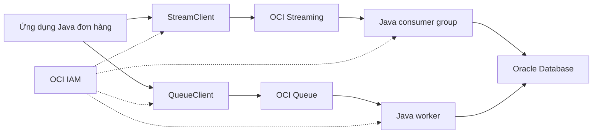

# Kết nối Streaming và Queue từ Java

## 1. Mục tiêu và phạm vi

Trong chương **Streaming và Queue** của module **CLOUD_PROVIDERS_ORACLE**, bài này hướng dẫn ứng dụng Java kết nối hai dịch vụ OCI bằng **OCI SDK for Java**. Các bước bao gồm chuẩn bị IAM và mạng, lấy đúng endpoint, tạo client, gửi dữ liệu, nhận dữ liệu và chỉ xác nhận tiến độ sau khi xử lý thành công.

Tình huống xuyên suốt là một ứng dụng đơn hàng:

- Phát sự kiện đơn hàng vào Streaming để các nhóm xử lý độc lập đọc dữ liệu.
- Gửi yêu cầu xử lý nền vào Queue để một worker thực hiện công việc.
- Ghi kết quả nghiệp vụ vào Oracle Database trong ứng dụng thực tế.

Sau bài học, người học cần tự giải thích được vì sao cùng là `GetMessages` nhưng Streaming sử dụng cursor, còn Queue sử dụng receipt và visibility timeout; đồng thời biết triển khai consumer có khả năng xử lý giao lại.

Bài tập trung vào **OCI Streaming dạng serverless và OCI Queue qua API native**. Streaming còn có đường kết nối Kafka; cấu hình Kafka SASL/auth token và bootstrap server không dùng cho các client native bên dưới. Queue còn hỗ trợ các giao thức khác, nhưng ví dụ ở đây dùng Java SDK gọi API HTTPS. Xem [Developer Guide to Streaming](https://docs.oracle.com/en-us/iaas/Content/Streaming/Tasks/developing.htm) và [Overview of Queue](https://docs.oracle.com/en-us/iaas/Content/queue/overview.htm).

Các đoạn mã là ví dụ học tập, chưa được biên dịch hoặc chạy trên tenancy thực tế trong quá trình soạn bài. Handler minh họa chỉ kiểm tra dữ liệu và ghi log; nó chưa thực hiện giao dịch cơ sở dữ liệu.

## 2. Phân biệt hai hợp đồng xử lý trước khi viết code

| Nội dung | Streaming native | Queue theo mô hình work queue trong bài |
| --- | --- | --- |
| Định danh đích | Stream OCID | Queue OCID |
| Client xử lý message | `StreamClient` | `QueueClient` |
| Dữ liệu gửi | Key/value kiểu `byte[]` | Content kiểu `String` |
| Tiến độ nhận | Cursor và offset theo partition; có consumer group | Message được nhận kèm receipt và thời hạn ẩn |
| Xác nhận xử lý | Commit tiến độ của nhóm đọc | Xóa message bằng receipt hợp lệ |
| Sau khi xác nhận | Record vẫn chịu retention của stream | Message đã xóa không còn chờ xử lý trong work queue |
| Khi consumer gặp sự cố | Có thể đọc lại từ tiến độ đã commit | Message chưa xóa có thể được giao lại |
| Thứ tự ứng dụng cần lưu ý | Thứ tự trong partition | Không xây nghiệp vụ dựa vào giả định FIFO toàn queue |

Đây là hai ví dụ độc lập về cách sử dụng dịch vụ. Gửi vào Streaming không tự động tạo một message trong Queue.



Ví dụ, `OrderAccepted` là một sự kiện đã xảy ra, phù hợp cho nhiều nhóm đọc với mục đích riêng. `GenerateInvoice` là yêu cầu thực hiện một công việc, phù hợp với một nhóm worker cạnh tranh nhận việc. Việc chọn dịch vụ bắt đầu từ nhu cầu xử lý, sau đó mới chọn API Java.

## 3. Chuẩn bị tài nguyên, IAM và mạng

### 3.1. Những giá trị cần có

Tạo sẵn một stream và một queue dành cho lab trong compartment phù hợp. Chờ tài nguyên ở trạng thái sẵn sàng trước khi chạy ứng dụng. Ghi nhận riêng từng giá trị:

| Biến môi trường dùng trong ví dụ | Nội dung |
| --- | --- |
| `OCI_STREAM_ID` | OCID của stream |
| `OCI_STREAM_MESSAGES_ENDPOINT` | Messages endpoint HTTPS của stream |
| `OCI_STREAM_GROUP` | Tên consumer group, ví dụ `orders-java-lab` |
| `OCI_STREAM_INSTANCE` | Tên duy nhất cho một consumer đang chạy |
| `OCI_QUEUE_ID` | OCID của queue |
| `OCI_QUEUE_MESSAGES_ENDPOINT` | Messages endpoint HTTPS của queue |
| `OCI_LAB_FAIL` | Cờ tùy chọn để mô phỏng handler thất bại |

Stream OCID khác stream pool OCID. Native `PutMessagesRequest.streamId(...)` nhận **stream OCID**. Queue ID cũng không thể thay cho stream ID dù hai class có tên phương thức giống nhau.

### 3.2. Quyền producer và consumer

Ví dụ policy cho các nhóm trong identity domain `Default`, với compartment lab có tên `messaging-lab`:

```text
Allow group Default/JavaStreamProducers to use stream-push in compartment messaging-lab
Allow group Default/JavaStreamConsumers to use stream-pull in compartment messaging-lab

Allow group Default/JavaQueueProducers to use queue-push in compartment messaging-lab
Allow group Default/JavaQueueConsumers to use queue-pull in compartment messaging-lab
```

Quyền Streaming được tách theo resource type `stream-push` và `stream-pull`. Quyền Queue cũng có `queue-push` và `queue-pull`; thao tác nhận, cập nhật visibility và xóa message thuộc quyền consume. Đối chiếu [Details for the Streaming Service](https://docs.oracle.com/en-us/iaas/Content/Identity/Reference/streamingpolicyreference.htm) và [Queue Policies](https://docs.oracle.com/en-us/iaas/Content/queue/policy-reference.htm).

Một tài khoản lab chạy cả producer lẫn consumer cần các quyền tương ứng. Khi triển khai thật, tách danh tính producer và consumer theo trách nhiệm.

Các policy trên không mặc nhiên cho phép ứng dụng gọi `GetStream` hoặc `GetQueue` để đọc metadata. Nếu tự khám phá endpoint lúc khởi động, bổ sung quyền đọc metadata phù hợp, ví dụ `read streams` hoặc `read queues` trong compartment cần dùng. Nếu pipeline triển khai đã cung cấp endpoint, runtime có thể chỉ cần các quyền xử lý message.

### 3.3. Mạng và bảo mật đường truyền

Các API native trong bài dùng endpoint HTTPS, thường qua cổng 443. Từ nơi thực sự chạy JVM, cần kiểm tra DNS, định tuyến, firewall, proxy và truststore TLS. Đối với Streaming dùng private endpoint, ứng dụng còn cần đường mạng và DNS tới endpoint trong VCN.

Có thể kiểm tra lớp TCP trên Windows bằng:

```powershell
Test-NetConnection -ComputerName "<HOST_CUA_MESSAGES_ENDPOINT>" -Port 443
```

Thay host bằng phần tên miền, bỏ `https://` và đường dẫn. TCP thành công mới xác nhận được một phần đường mạng; cần gọi SDK để kiểm tra chữ ký, IAM và tài nguyên.

Giữ kiểm tra chứng chỉ TLS hoạt động. Nếu doanh nghiệp có proxy hoặc CA nội bộ, cấu hình proxy/truststore theo môi trường thay vì vô hiệu hóa xác minh chứng chỉ.

## 4. Cấu hình project Java và thư viện SDK

Ví dụ sử dụng Java 17, Maven và SDK 3.x. Dùng BOM để giữ các module OCI cùng phiên bản; ứng dụng SDK 3.x cần chọn rõ HTTP transport. Bài chọn Jersey 3 theo [hướng dẫn cài đặt OCI Java SDK](https://docs.oracle.com/en-us/iaas/Content/API/SDKDocs/javasdkgettingstarted.htm).

Bản `3.94.0` dưới đây là phiên bản được ghim cho ví dụ, có trong [mã nguồn Oracle tại tag v3.94.0](https://github.com/oracle/oci-java-sdk/tree/v3.94.0). Đây không phải tuyên bố về phiên bản mới nhất hoặc bộ dependency đã được kiểm thử cho mọi ứng dụng.

Tạo project thực hành riêng với cấu hình `pom.xml`:

```xml
<project xmlns="http://maven.apache.org/POM/4.0.0"
         xmlns:xsi="http://www.w3.org/2001/XMLSchema-instance"
         xsi:schemaLocation="http://maven.apache.org/POM/4.0.0 https://maven.apache.org/xsd/maven-4.0.0.xsd">
    <modelVersion>4.0.0</modelVersion>

    <groupId>vn.example</groupId>
    <artifactId>oci-messaging-java-lab</artifactId>
    <version>1.0.0</version>

    <properties>
        <maven.compiler.release>17</maven.compiler.release>
        <project.build.sourceEncoding>UTF-8</project.build.sourceEncoding>
        <oci.sdk.version>3.94.0</oci.sdk.version>
    </properties>

    <dependencyManagement>
        <dependencies>
            <dependency>
                <groupId>com.oracle.oci.sdk</groupId>
                <artifactId>oci-java-sdk-bom</artifactId>
                <version>${oci.sdk.version}</version>
                <type>pom</type>
                <scope>import</scope>
            </dependency>
        </dependencies>
    </dependencyManagement>

    <dependencies>
        <dependency>
            <groupId>com.oracle.oci.sdk</groupId>
            <artifactId>oci-java-sdk-streaming</artifactId>
        </dependency>
        <dependency>
            <groupId>com.oracle.oci.sdk</groupId>
            <artifactId>oci-java-sdk-queue</artifactId>
        </dependency>
        <dependency>
            <groupId>com.oracle.oci.sdk</groupId>
            <artifactId>oci-java-sdk-common-httpclient-jersey3</artifactId>
        </dependency>
    </dependencies>

    <build>
        <plugins>
            <plugin>
                <groupId>org.apache.maven.plugins</groupId>
                <artifactId>maven-compiler-plugin</artifactId>
                <version>3.13.0</version>
            </plugin>
            <plugin>
                <groupId>org.codehaus.mojo</groupId>
                <artifactId>exec-maven-plugin</artifactId>
                <version>3.5.0</version>
            </plugin>
        </plugins>
    </build>
</project>
```

Đặt ba class ở các phần tiếp theo trong `src/main/java`, không khai báo package để chạy trực tiếp theo lệnh minh họa. Các class dùng chung một project.

Không import đồng thời bằng wildcard hai package `streaming.requests.*` và `queue.requests.*`: chúng cùng có tên `GetMessagesRequest`, `PutMessagesRequest`. Import rõ ràng giúp tránh gọi nhầm API hoặc lỗi tên class nhập nhằng.

## 5. Xác thực Java và tạo cấu hình dùng chung

### 5.1. Chạy từ máy phát triển bằng API signing key

Cấu hình profile `DEFAULT` trong file OCI config của người dùng:

```ini
[DEFAULT]
user=ocid1.user.oc1..<USER_ID>
fingerprint=<PUBLIC_KEY_FINGERPRINT>
tenancy=ocid1.tenancy.oc1..<TENANCY_ID>
region=<REGION_ID>
key_file=C:/Users/<WINDOWS_USER>/.oci/oci_api_key.pem
```

Trên Windows, vị trí thông thường của file config nằm trong thư mục `.oci` dưới hồ sơ người dùng. Dùng đường dẫn thực tới private key PEM; public key tương ứng phải được đăng ký cho đúng user. Thông tin các field được mô tả trong [SDK and CLI Configuration File](https://docs.oracle.com/en-us/iaas/Content/API/Concepts/sdkconfig.htm).

Đây là xác thực bằng chữ ký API request. OCI auth token dùng làm mật khẩu Kafka không thay thế file khóa cho `ConfigFileAuthenticationDetailsProvider`.

### 5.2. Class dùng chung cho ví dụ

Tạo `OciJavaLabSupport.java`:

```java
import java.io.IOException;

import com.oracle.bmc.ClientConfiguration;
import com.oracle.bmc.ConfigFileReader;
import com.oracle.bmc.auth.AuthenticationDetailsProvider;
import com.oracle.bmc.auth.ConfigFileAuthenticationDetailsProvider;

public final class OciJavaLabSupport {
    static final String EVENT_ID = "evt-order-1042-v1";

    static final String BODY = """
        {
          "eventId": "evt-order-1042-v1",
          "schemaVersion": 1,
          "eventType": "OrderAccepted",
          "orderId": "ORD-1042",
          "occurredAt": "2026-11-20T02:00:00Z"
        }
        """;

    private OciJavaLabSupport() {}

    static AuthenticationDetailsProvider auth() throws IOException {
        var config = ConfigFileReader.parseDefault();
        return new ConfigFileAuthenticationDetailsProvider(config);
    }

    static ClientConfiguration httpConfig() {
        return ClientConfiguration.builder()
                .connectionTimeoutMillis(10_000)
                .readTimeoutMillis(65_000)
                .build();
    }

    static String requiredEnv(String name) {
        String value = System.getenv(name);
        if (value == null || value.isBlank()) {
            throw new IllegalArgumentException("Missing environment variable: " + name);
        }
        return value;
    }

    static void handleForLab(String content) {
        if (content == null || content.isBlank()) {
            throw new IllegalArgumentException("Empty message content");
        }
        if ("true".equalsIgnoreCase(System.getenv("OCI_LAB_FAIL"))) {
            throw new IllegalStateException("Simulated business failure");
        }
        System.out.println("LAB handler completed");
    }
}
```

`handleForLab` cố ý chỉ là điểm thay thế handler. Khi làm ứng dụng thật, tại đây phải parse JSON, kiểm tra schema, xác định `eventId`, thực hiện nghiệp vụ và bảo đảm trạng thái đã được lưu bền trước khi hàm trả về thành công.

Payload cố định giúp quan sát việc cùng một sự kiện xuất hiện nhiều lần. Với sự kiện mới, ứng dụng phải tạo ID mới ở thời điểm ghi nhận nghiệp vụ; khi gửi lại sự kiện cũ, giữ nguyên ID cũ.

Read timeout 65 giây ở đây tạo khoảng đệm cho long polling Queue 20 giây trong ví dụ. Nó không phải giới hạn thời gian xử lý nghiệp vụ hoặc tổng thời gian của mọi lần retry.

### 5.3. Chạy trên OCI Compute bằng instance principal

Trên OCI Compute, có thể thay dòng:

```java
var auth = OciJavaLabSupport.auth();
```

bằng:

```java
var auth = com.oracle.bmc.auth.InstancePrincipalsAuthenticationDetailsProvider
        .builder()
        .build();
```

Instance cần thuộc dynamic group và dynamic group cần được cấp policy phù hợp. Dùng các resource type producer/consumer ở phần IAM với chủ thể `dynamic-group` thay cho group người dùng. Cơ chế provider được mô tả trong [Configuring the SDK, CLI, or Terraform](https://docs.oracle.com/en-us/iaas/Content/Identity/callresources/Configuring_the_SDK_CLI_or_Terraform.htm).

Không chọn instance principal cho một JVM trên laptop chỉ vì đã đặt region. Những runtime khác như Functions hoặc OKE có cơ chế danh tính phù hợp riêng; cần chọn provider theo runtime thực tế.

## 6. Lấy đúng messages endpoint

Streaming và Queue đều phân biệt API quản trị tài nguyên với API xử lý message. Dịch vụ quyết định messages endpoint của tài nguyên; không tự ghép tên miền từ region.

### 6.1. Streaming

Với một admin client đã xác thực và đặt region đúng, có thể đọc:

```java
var stream = streamAdminClient.getStream(
        com.oracle.bmc.streaming.requests.GetStreamRequest.builder()
                .streamId(streamId)
                .build()
).getStream();

String messagesEndpoint = stream.getMessagesEndpoint();
```

`streamAdminClient` là `StreamAdminClient` đã được khởi tạo ở lớp bootstrap. Giá trị `messagesEndpoint` là endpoint truyền cho `StreamClient`; đây là quy trình trong [Streaming Clients](https://docs.oracle.com/en-us/iaas/Content/Streaming/Tasks/developing.htm).

### 6.2. Queue

Tương tự với `QueueAdminClient` đã cấu hình region:

```java
var queue = queueAdminClient.getQueue(
        com.oracle.bmc.queue.requests.GetQueueRequest.builder()
                .queueId(queueId)
                .build()
).getQueue();

String messagesEndpoint = queue.getMessagesEndpoint();
```

Hai đoạn trên là phần trích minh họa khám phá metadata, không phải class thực thi độc lập. Trong lab bên dưới, lấy messages endpoint từ Console rồi truyền bằng biến môi trường để không cần quyền metadata khi ứng dụng chạy.

Queue có thể có messages endpoint khác nhau giữa các tài nguyên. Các thao tác gửi, nhận, cập nhật và xóa message phải tới đúng endpoint; xem [Message Management](https://docs.oracle.com/en-us/iaas/Content/queue/messages.htm).

Endpoint Kafka dạng `host:9092`, tên topic và stream pool OCID không phải bộ tham số kết nối của các ví dụ native này.

## 7. Streaming: gửi và đọc dữ liệu từ Java

### 7.1. Class gửi message và đọc theo consumer group

Tạo `StreamingJavaLab.java`:

```java
import java.nio.charset.StandardCharsets;
import java.util.List;

import com.oracle.bmc.streaming.StreamClient;
import com.oracle.bmc.streaming.model.CreateGroupCursorDetails;
import com.oracle.bmc.streaming.model.Message;
import com.oracle.bmc.streaming.model.PutMessagesDetails;
import com.oracle.bmc.streaming.model.PutMessagesDetailsEntry;
import com.oracle.bmc.streaming.requests.CreateGroupCursorRequest;
import com.oracle.bmc.streaming.requests.GetMessagesRequest;
import com.oracle.bmc.streaming.requests.PutMessagesRequest;

public final class StreamingJavaLab {
    public static void main(String[] args) throws Exception {
        if (args.length != 1
                || (!args[0].equals("send") && !args[0].equals("read"))) {
            throw new IllegalArgumentException("Use: send | read");
        }

        String streamId = OciJavaLabSupport.requiredEnv("OCI_STREAM_ID");
        String endpoint = OciJavaLabSupport.requiredEnv(
                "OCI_STREAM_MESSAGES_ENDPOINT");
        var auth = OciJavaLabSupport.auth();

        try (StreamClient client = StreamClient.builder()
                .endpoint(endpoint)
                .configuration(OciJavaLabSupport.httpConfig())
                .build(auth)) {
            if (args[0].equals("send")) {
                send(client, streamId);
            } else {
                read(client, streamId);
            }
        }
    }

    private static void send(StreamClient client, String streamId) {
        var record = PutMessagesDetailsEntry.builder()
                .key("ORD-1042".getBytes(StandardCharsets.UTF_8))
                .value(OciJavaLabSupport.BODY.getBytes(StandardCharsets.UTF_8))
                .build();

        var response = client.putMessages(
                PutMessagesRequest.builder()
                        .streamId(streamId)
                        .putMessagesDetails(PutMessagesDetails.builder()
                                .messages(List.of(record))
                                .build())
                        .build());

        var results = response.getPutMessagesResult().getEntries();
        if (results.size() != 1) {
            throw new IllegalStateException("Unexpected Streaming result count");
        }

        var result = results.get(0);
        if (result.getError() != null && !result.getError().isBlank()) {
            throw new IllegalStateException(
                    "Streaming publish failed: " + result.getError());
        }

        System.out.printf(
                "eventId=%s partition=%s offset=%s requestId=%s%n",
                OciJavaLabSupport.EVENT_ID,
                result.getPartition(),
                result.getOffset(),
                response.getOpcRequestId());
    }

    private static void read(StreamClient client, String streamId)
            throws InterruptedException {
        String group = OciJavaLabSupport.requiredEnv("OCI_STREAM_GROUP");
        String instance = OciJavaLabSupport.requiredEnv("OCI_STREAM_INSTANCE");

        var details = CreateGroupCursorDetails.builder()
                .groupName(group)
                .instanceName(instance)
                .type(CreateGroupCursorDetails.Type.TrimHorizon)
                .commitOnGet(true)
                .build();

        String cursor = client.createGroupCursor(
                CreateGroupCursorRequest.builder()
                        .streamId(streamId)
                        .createGroupCursorDetails(details)
                        .build())
                .getCursor()
                .getValue();

        while (!Thread.currentThread().isInterrupted()) {
            var batch = client.getMessages(
                    GetMessagesRequest.builder()
                            .streamId(streamId)
                            .cursor(cursor)
                            .limit(25)
                            .build());

            for (Message message : batch.getItems()) {
                String content = new String(
                        message.getValue(), StandardCharsets.UTF_8);

                OciJavaLabSupport.handleForLab(content);

                System.out.printf(
                        "handled partition=%s offset=%s%n",
                        message.getPartition(), message.getOffset());
            }

            // Only advance after every handler in the batch succeeds.
            cursor = batch.getOpcNextCursor();

            // Small lab pacing delay; tune polling for real throughput.
            Thread.sleep(1_000);
        }
    }
}
```

Các tên model và cách tạo request tương ứng với [SDK for Java Streaming Quickstart](https://docs.oracle.com/en-us/iaas/Content/Streaming/Tasks/streaming-quickstart-oci-sdk-for-java.htm). Ví dụ tự xử lý lỗi bằng thư viện chuẩn Java, không yêu cầu thêm thư viện tiện ích.

### 7.2. Những điểm cần hiểu ở producer

**Key và value là byte array.** Java SDK nhận dữ liệu nhị phân rồi đảm nhiệm biểu diễn trên đường truyền. Không Base64 chuỗi JSON trước khi gọi `value(...)` nếu consumer mong nhận JSON UTF-8; làm vậy sẽ thay đổi payload nghiệp vụ.

**Kết quả một batch cần được kiểm tra từng entry.** Với Streaming, một request có thể trả kết quả gồm entry thành công và entry thất bại. Ví dụ chỉ gửi một entry nên kiểm tra đúng entry đó. Nếu mở rộng thành nhiều entry, lưu ánh xạ giữa input và kết quả, chỉ gửi lại phần thất bại khi biết chắc trạng thái. Không mặc định request không ném exception nghĩa là mọi record đã được nhận.

**Key không tạo thứ tự toàn stream.** Chọn key theo thực thể, ví dụ `orderId`, khi cần gom sự kiện liên quan vào partition. Vẫn cần xử lý tình huống nhiều producer phát cùng một thực thể hoặc nghiệp vụ nhận sự kiện đến muộn.

**Offset là metadata của dịch vụ.** Nó không thay `eventId` của hệ thống đơn hàng. Đặc biệt, gửi lại cùng sự kiện có thể tạo record khác với vị trí khác.

### 7.3. Cursor, consumer group và thời điểm commit

Consumer sử dụng cursor để chỉ vị trí đọc. Sau mỗi `GetMessages`, dùng `getOpcNextCursor()` cho lần đọc tiếp theo, kể cả khi danh sách message rỗng. Không tự cộng offset để tạo cursor.

Với `commitOnGet(true)`, lần gọi `GetMessages` tiếp theo xác nhận tiến độ của lượt trước. Vì vậy thứ tự của vòng lặp phải là:

```text
Nhận batch A
→ Xử lý xong toàn bộ A
→ Dùng next cursor để gọi GetMessages
→ Tiến độ A được commit, đồng thời nhận batch B
```

Nếu handler ném lỗi ở giữa batch, class trên thoát khỏi vòng lặp. Nó không gọi lượt tiếp theo để vượt qua phần lỗi. Khi phục hồi từ tiến độ đã commit, một số message đã xử lý thành công trong batch vẫn có thể xuất hiện lại.

Đừng gọi `GetMessages` tiếp theo ngay sau khi đưa batch vào executor nếu các task chưa hoàn tất. Khi đó commit có thể đi trước việc lưu kết quả nghiệp vụ. Hãy giữ một ranh giới hoàn tất rõ ràng cho batch hoặc triển khai cơ chế commit thủ công phù hợp.

Theo [Using Consumer Groups](https://docs.oracle.com/en-us/iaas/Content/Streaming/Tasks/using_consumer_groups.htm), group hiện có tiếp tục theo offset đã commit; đổi `TrimHorizon` trong request không tự đưa group đó về đầu. Mỗi instance đang chạy trong cùng group cần tên riêng. Group còn có thời hạn hoạt động và cursor có thời hạn sử dụng; không lưu cursor như một checkpoint vĩnh viễn.

### 7.4. Xử lý lâu, phục hồi và dừng ứng dụng

Ví dụ giả định handler nhanh. Nếu thời gian xử lý batch vượt thời gian giữ partition của instance, dịch vụ có thể giao partition cho instance khác. Khi công việc kéo dài, cần giảm batch, cải thiện thời gian xử lý hoặc tổ chức `ConsumerHeartbeat` đúng vòng đời.

Nếu cần quyết định commit ngay sau khi hoàn tất batch, có thể dùng `commitOnGet(false)` kết hợp `ConsumerCommit`. API commit trả cursor cập nhật và kéo dài thời gian giữ các partition liên quan. Xem [Manually Committing an Offset](https://docs.oracle.com/en-us/iaas/Content/Streaming/Tasks/commit-consumer-group.htm). Cần phối hợp cursor, heartbeat và quyền sở hữu partition; không thêm một lệnh commit rời rạc vào nhiều thread cùng lúc.

Khi dừng, ngừng nhận thêm batch, chờ phần đang xử lý tới giới hạn cho phép và đóng client. Với chế độ commit-on-get, batch cuối có thể chưa được commit khi tiến trình dừng; thiết kế handler để xử lý lại an toàn. Cursor hết hạn hoặc lỗi membership cần được xử lý bằng cách tái tham gia group đúng danh tính, không tự đổi group name để bỏ qua lỗi.

## 8. Queue: gửi, nhận và xóa message từ Java

### 8.1. Class producer và worker

Tạo `QueueJavaLab.java`:

```java
import java.util.List;

import com.oracle.bmc.queue.QueueClient;
import com.oracle.bmc.queue.model.GetMessage;
import com.oracle.bmc.queue.model.PutMessagesDetails;
import com.oracle.bmc.queue.model.PutMessagesDetailsEntry;
import com.oracle.bmc.queue.requests.DeleteMessageRequest;
import com.oracle.bmc.queue.requests.GetMessagesRequest;
import com.oracle.bmc.queue.requests.PutMessagesRequest;

public final class QueueJavaLab {
    public static void main(String[] args) throws Exception {
        if (args.length != 1
                || (!args[0].equals("send") && !args[0].equals("work"))) {
            throw new IllegalArgumentException("Use: send | work");
        }

        String queueId = OciJavaLabSupport.requiredEnv("OCI_QUEUE_ID");
        String endpoint = OciJavaLabSupport.requiredEnv(
                "OCI_QUEUE_MESSAGES_ENDPOINT");
        var auth = OciJavaLabSupport.auth();

        try (QueueClient client = QueueClient.builder()
                .endpoint(endpoint)
                .configuration(OciJavaLabSupport.httpConfig())
                .build(auth)) {
            if (args[0].equals("send")) {
                send(client, queueId);
            } else {
                work(client, queueId);
            }
        }
    }

    private static void send(QueueClient client, String queueId) {
        var response = client.putMessages(
                PutMessagesRequest.builder()
                        .queueId(queueId)
                        .putMessagesDetails(PutMessagesDetails.builder()
                                .messages(List.of(
                                        PutMessagesDetailsEntry.builder()
                                                .content(OciJavaLabSupport.BODY)
                                                .build()))
                                .build())
                        .build());

        var published = response.getPutMessages().getMessages();
        if (published.size() != 1) {
            throw new IllegalStateException("Unexpected Queue result count");
        }

        System.out.printf(
                "eventId=%s queueMessageId=%s requestId=%s%n",
                OciJavaLabSupport.EVENT_ID,
                published.get(0).getId(),
                response.getOpcRequestId());
    }

    private static void work(QueueClient client, String queueId) {
        while (!Thread.currentThread().isInterrupted()) {
            var response = client.getMessages(
                    GetMessagesRequest.builder()
                            .queueId(queueId)
                            .limit(1)
                            .timeoutInSeconds(20)
                            .visibilityInSeconds(60)
                            .build());

            for (GetMessage message : response.getGetMessages().getMessages()) {
                try {
                    OciJavaLabSupport.handleForLab(message.getContent());

                    client.deleteMessage(
                            DeleteMessageRequest.builder()
                                    .queueId(queueId)
                                    .messageReceipt(message.getReceipt())
                                    .build());

                    System.out.printf(
                            "completed queueMessageId=%s deliveryCount=%s%n",
                            message.getId(), message.getDeliveryCount());
                } catch (RuntimeException error) {
                    System.err.printf(
                            "not confirmed queueMessageId=%s errorType=%s%n",
                            message.getId(), error.getClass().getSimpleName());
                    // No delete on failure: the message may be delivered again.
                }
            }
        }
    }
}
```

Class Queue dùng content dạng chuỗi. Kết quả gửi là danh sách message đã publish, với ID do Queue cấp; nó không dùng `getPutMessagesResult().getEntries()` của Streaming. Cấu trúc này được mô tả trong [Queue PutMessages](https://docs.oracle.com/en-us/iaas/tools/java/latest/com/oracle/bmc/queue/model/PutMessages.html) và [PutMessage](https://docs.oracle.com/en-us/iaas/tools/java/latest/com/oracle/bmc/queue/model/PutMessage.html).

Payload dùng lại fixture sự kiện để dễ so sánh API. Khi xây worker tạo hóa đơn thật, hãy định nghĩa message yêu cầu như `GenerateInvoice`, cùng schema và ID công việc rõ ràng.

### 8.2. Long polling khác visibility timeout

Hai tham số của request nhận message có mục đích riêng:

| Tham số | Ý nghĩa trong ví dụ |
| --- | --- |
| `timeoutInSeconds(20)` | Khi chưa có message, dịch vụ có thể chờ tối đa 20 giây để trả response |
| `visibilityInSeconds(60)` | Message đã nhận được ẩn khỏi các consumer khác trong khoảng thời gian xử lý này |
| `limit(1)` | Yêu cầu tối đa một message trong lượt nhận, giúp đơn giản hóa quản lý thời gian xử lý |

Long polling có thể trả sớm khi có dữ liệu. Response rỗng sau thời gian chờ là trạng thái bình thường. Không cần thêm vòng retry chạy liên tục khi queue rỗng.

Queue cho phép polling timeout từ 0 đến 30 giây, và một response nhận tối đa 20 message theo tài liệu [Consuming Messages](https://docs.oracle.com/en-us/iaas/Content/queue/consume-messages.htm). Ví dụ dùng batch nhỏ để minh họa; tăng batch cần tính cả thời gian một message chờ các message trước trong cùng batch xử lý.

Read timeout HTTP phải lớn hơn thời gian long polling kèm khoảng đệm. Ngược lại, tăng read timeout không kéo dài visibility của message.

### 8.3. Receipt là quyền thao tác cho lần nhận cụ thể

Queue trả `receipt` khi giao message. Dùng receipt hợp lệ cho thao tác xóa hoặc cập nhật visibility của lần nhận đó. `messageId` là định danh để quan sát; nó không thay receipt trong `DeleteMessageRequest`.

Sau khi visibility hết hạn và message được giao lại, consumer cũ không được giả định receipt cũ vẫn sử dụng được. Worker phải theo dõi thời hạn xử lý và dùng thông tin của lần giao hiện tại. Không ghi receipt vào log phổ biến hoặc dùng làm ID nghiệp vụ. Tham số xóa được mô tả trong [DeleteMessageRequest.Builder](https://docs.oracle.com/en-us/iaas/tools/java/latest/com/oracle/bmc/queue/requests/DeleteMessageRequest.Builder.html).

Thứ tự xử lý là:

```text
Nhận message và receipt
→ Kiểm tra hợp đồng dữ liệu
→ Thực hiện và lưu bền kết quả nghiệp vụ
→ DeleteMessage bằng receipt
```

Không đặt `deleteMessage` trong `finally`. Nếu handler thất bại mà vẫn xóa message, worker đã làm mất cơ hội xử lý lại công việc đó.

Trong ví dụ, lỗi handler hoặc lỗi delete đều được ghi nhận là chưa xác nhận. Nếu delete thất bại sau khi nghiệp vụ đã lưu thành công, message có thể được giao lại; vì vậy việc chống lặp vẫn cần thiết.

### 8.4. Gia hạn visibility khi công việc kéo dài

Ví dụ đoạn trích bên dưới áp dụng trong lúc worker còn nắm message, trước khi visibility hết hạn:

```java
client.updateMessage(
        com.oracle.bmc.queue.requests.UpdateMessageRequest.builder()
                .queueId(queueId)
                .messageReceipt(message.getReceipt())
                .updateMessageDetails(
                        com.oracle.bmc.queue.model.UpdateMessageDetails.builder()
                                .visibilityInSeconds(120)
                                .build())
                .build());
```

`client`, `queueId` và `message` là các biến của worker đang xử lý. Đây không phải một chương trình độc lập hoặc bộ lập lịch tự động.

Giá trị 120 giây thiết lập visibility mới tính tương đối từ thời điểm server nhận request, theo [UpdateMessageDetails.Builder](https://docs.oracle.com/en-us/iaas/tools/java/latest/com/oracle/bmc/queue/model/UpdateMessageDetails.Builder.html). Nó không có nghĩa cộng 120 giây vào hạn cũ.

Nếu dùng scheduler gia hạn, phải dừng scheduler khi công việc kết thúc, thất bại hoặc mất quyền xử lý. Xử lý lỗi gia hạn một cách rõ ràng, vì worker khác có thể nhận cùng công việc sau khi hết hạn. Không gia hạn vô thời hạn cho một tác vụ đã treo.

Message liên tục thất bại cần được cô lập qua cấu hình dead letter queue và quy trình điều tra. Đừng xóa message lỗi chỉ để làm số lượng message chờ trông đẹp hơn.

## 9. Chống lặp và ranh giới giao dịch với Oracle Database

### 9.1. Vì sao xác nhận của dịch vụ chưa đủ?

Hai tình huống thường gặp:

| Diễn biến | Hệ quả cần xử lý |
| --- | --- |
| Producer gửi thành công ở server nhưng mất response | Producer không biết kết quả chắc chắn; gửi lại có thể tạo bản sao |
| Consumer commit DB thành công nhưng chưa commit stream hoặc chưa delete queue | Sau sự cố, dữ liệu đã xử lý có thể được giao lại |
| Consumer xác nhận trước khi commit DB | Nếu tiến trình chết, công việc có thể không còn được xử lý lại đúng cách |
| Hai worker xử lý cùng sự kiện ở các thời điểm chồng lấn | Kiểm tra trùng chỉ trong bộ nhớ không bảo vệ được dữ liệu |

Không có một transaction Java cục bộ tự động gộp commit Oracle Database với commit Streaming hoặc delete Queue thành một hành động nguyên tử.

Thiết kế nên ưu tiên xử lý lại an toàn: sau khi DB commit mà xác nhận dịch vụ thất bại, consumer có thể nhận lại và nhận biết rằng tác động nghiệp vụ đã hoàn thành.

### 9.2. Inbox với khóa nghiệp vụ bền vững

Một mẫu bảng minh họa trong Oracle Database:

```sql
CREATE TABLE consumed_event (
    consumer_name VARCHAR2(100 CHAR) NOT NULL,
    event_id      VARCHAR2(200 CHAR) NOT NULL,
    processed_at  TIMESTAMP WITH TIME ZONE DEFAULT SYSTIMESTAMP NOT NULL,
    CONSTRAINT pk_consumed_event PRIMARY KEY (consumer_name, event_id)
);
```

Khóa có `consumer_name` để các handler độc lập vẫn được xử lý cùng sự kiện cho mục đích của mình. Ví dụ `invoice-worker` và `analytics-projector` không được vô tình chặn lẫn nhau chỉ vì cùng `eventId`.

Luồng xử lý trong **một transaction DB**:

1. Parse và kiểm tra message, lấy `eventId`.
2. Insert khóa `(consumer_name, event_id)` vào inbox.
3. Thực hiện thay đổi nghiệp vụ, ví dụ tạo hóa đơn.
4. Commit cả inbox và thay đổi nghiệp vụ.
5. Sau đó mới cho phép commit tiến độ Streaming hoặc delete message Queue.

Nếu khóa inbox đã tồn tại do một lần xử lý trước đã commit, xác minh đó là bản ghi hợp lệ rồi coi sự kiện đã xử lý. Chỉ bắt đúng lỗi vi phạm khóa dự kiến; các lỗi DB khác vẫn phải được báo thất bại.

Không thực hiện kiểu `SELECT` thấy chưa có rồi tạo hóa đơn mà thiếu ràng buộc unique. Hai worker có thể cùng vượt qua phép kiểm tra. Ràng buộc dữ liệu và transaction mới quyết định tính đúng đắn khi có cạnh tranh.

### 9.3. Tác động ra ngoài DB và outbox

Inbox không tự chống lặp cho mọi tác động bên ngoài. Nếu handler gọi một cổng thanh toán hoặc gửi email, cần thiết kế thêm idempotency key, trạng thái tác vụ hoặc cơ chế đối soát cho hệ thống đích.

Ở phía phát, nếu ứng dụng vừa cập nhật đơn hàng vừa phải gửi message, cân nhắc transactional outbox:

```text
Transaction DB:
    lưu đơn hàng + lưu bản ghi outbox cùng eventId

Relay Java:
    đọc outbox chưa hoàn tất
    → gửi message
    → kiểm tra kết quả
    → đánh dấu đã gửi
```

Relay có thể gửi lại khi chết sau bước gửi nhưng trước bước đánh dấu. Giữ nguyên `eventId` để consumer chống lặp. Outbox thu hẹp khoảng hở giữa lưu nghiệp vụ và phát sự kiện; nó vẫn cần cơ chế xử lý bản sao.

Các mẫu inbox/outbox ở mục này là đề xuất thiết kế ứng dụng cho tình huống đơn hàng, không phải tính năng tự bật bởi việc tạo `StreamClient` hoặc `QueueClient`.

## 10. Retry, exception và vòng đời client

### 10.1. Phân loại lỗi trước khi thử lại

| Dấu hiệu | Hướng kiểm tra |
| --- | --- |
| `UnknownHostException` hoặc lỗi kết nối | Endpoint, DNS, định tuyến, proxy, VCN |
| `SSLHandshakeException` | Chuỗi chứng chỉ, truststore, CA/proxy, đồng hồ máy |
| HTTP 401 | Provider, key/fingerprint/user, token nếu có, lệch thời gian |
| HTTP 403 hoặc `NotAuthorizedOrNotFound` | IAM, compartment, OCID, region và khả năng tài nguyên không tồn tại |
| HTTP 400 | Request, giới hạn payload/batch, cursor hoặc receipt không hợp lệ |
| HTTP 429 | Throttle; giảm áp lực, backoff và kiểm tra giới hạn |
| Lỗi 5xx hoặc timeout | Sự cố tạm thời hoặc kết quả gửi chưa rõ; đánh giá retry theo thao tác |
| Handler lỗi lặp lại với một payload | Schema, dữ liệu nghiệp vụ, tương thích phiên bản; cân nhắc DLQ/quarantine |

Không giải quyết lỗi quyền bằng cách tăng timeout. Không lặp vô hạn một request sai tham số. Với lỗi phụ thuộc trạng thái như cursor/receipt hết hạn, chỉ gửi lại request cũ có thể không giúp phục hồi.

Ở lớp gọi SDK, có thể lấy metadata từ `BmcException` để ghi log:

```java
catch (com.oracle.bmc.model.BmcException error) {
    System.err.printf(
            "status=%d serviceCode=%s requestId=%s%n",
            error.getStatusCode(),
            error.getServiceCode(),
            error.getOpcRequestId());
    throw error;
}
```

Đây là phần `catch` để ghép với `try` bao quanh lời gọi API, không phải class độc lập. Tránh ghi private key, receipt, thông tin xác thực hoặc toàn bộ dữ liệu nhạy cảm vào log.

### 10.2. Phối hợp retry SDK và retry ứng dụng

OCI Java SDK có cấu hình retry và circuit breaker. Hành vi mặc định phụ thuộc thao tác và phiên bản; cần đối chiếu API đang dùng. Các cơ chế và vòng đời client được trình bày trong [Java SDK Concepts](https://docs.oracle.com/en-us/iaas/Content/API/SDKDocs/javasdkconcepts.htm).

Khi bổ sung retry ứng dụng:

- Đặt giới hạn số lần hoặc deadline tổng.
- Dùng backoff có jitter cho lỗi tạm thời và throttle.
- Giữ `eventId` qua các lần thử.
- Với Streaming batch đã có kết quả, tách entry lỗi khỏi entry thành công.
- Với timeout chưa biết kết quả, ghi nhận trạng thái không chắc chắn và dựa vào cơ chế chống lặp.
- Theo dõi cả retry bên SDK để tránh nhân số lần gọi ngoài dự kiến.

Không giả định đặt cùng `opcRequestId` sẽ giúp dịch vụ tự loại mọi lần gửi trùng. Request ID phục vụ truy vết; idempotency nghiệp vụ là hợp đồng riêng.

### 10.3. Dùng lại client và giới hạn lượng công việc đang chờ

Khởi tạo client một lần cho vòng đời ứng dụng hoặc thành phần sử dụng nó; tránh tạo TLS connection pool mới cho từng message. Hoàn tất cấu hình endpoint trước khi cho nhiều thread dùng client và đóng client khi thành phần dừng.

Với ứng dụng web Java, đặt lời gọi đồng bộ vào thread xử lý thích hợp hoặc dùng client async theo kiến trúc ứng dụng. Không để một vòng consumer vô hạn chặn thread phục vụ request.

Đối với Streaming, giữ ranh giới hoàn tất/commit khi tăng song song. Đối với Queue, giới hạn số message đang xử lý theo năng lực worker và khoảng visibility. Thread pool không giới hạn dễ làm message hết hạn khi vẫn còn chờ trong bộ nhớ.

## 11. Chạy lab và quan sát kết quả

### 11.1. Thiết lập môi trường PowerShell

Thay toàn bộ placeholder bằng thông tin tài nguyên thực:

```powershell
$env:OCI_STREAM_ID = "<STREAM_OCID>"
$env:OCI_STREAM_MESSAGES_ENDPOINT = "<STREAM_MESSAGES_ENDPOINT_HTTPS>"
$env:OCI_STREAM_GROUP = "orders-java-lab"
$env:OCI_STREAM_INSTANCE = "orders-java-lab-worker-1"

$env:OCI_QUEUE_ID = "<QUEUE_OCID>"
$env:OCI_QUEUE_MESSAGES_ENDPOINT = "<QUEUE_MESSAGES_ENDPOINT_HTTPS>"
$env:OCI_LAB_FAIL = "false"
```

Trong project lab, chạy producer Streaming:

```powershell
mvn compile exec:java "-Dexec.mainClass=StreamingJavaLab" "-Dexec.args=send"
```

Sau đó chạy consumer:

```powershell
mvn compile exec:java "-Dexec.mainClass=StreamingJavaLab" "-Dexec.args=read"
```

Lần đầu tạo group dùng `TrimHorizon` nên có thể đọc message đã gửi trước đó nếu vẫn còn trong retention. Khi dùng lại group, vị trí đã commit quyết định điểm tiếp tục. Để so sánh hai nhóm đọc độc lập, chọn tên group lab thứ hai; để tăng số instance trong cùng group, giữ tên group và đổi tên instance.

Chạy producer Queue rồi worker:

```powershell
mvn compile exec:java "-Dexec.mainClass=QueueJavaLab" "-Dexec.args=send"
mvn compile exec:java "-Dexec.mainClass=QueueJavaLab" "-Dexec.args=work"
```

Các lệnh consumer chạy liên tục. Dừng tiến trình khi hoàn tất quan sát. Biến môi trường được kế thừa tại thời điểm khởi động JVM; đổi biến ở cửa sổ PowerShell khác không tự cập nhật một JVM đang chạy.

### 11.2. Những dấu hiệu cần thấy

| Bước | Quan sát mong đợi |
| --- | --- |
| Streaming send | Có partition, offset và request ID, không có entry lỗi |
| Streaming read | Handler chạy và log partition/offset |
| Queue send | Có Queue message ID và request ID |
| Queue work thành công | Handler chạy trước thao tác delete; log completed sau khi delete trả thành công |
| Queue rỗng | Long polling trả danh sách rỗng, worker tiếp tục chờ |
| Gửi lại fixture | Cùng eventId có thể xuất hiện ở nhiều record/message của dịch vụ |

Log `LAB handler completed` chỉ xác nhận handler minh họa đã trả về. Nó không chứng minh có một hóa đơn được ghi vào Oracle Database.

### 11.3. Thử lỗi để hiểu giao lại

**Streaming:** dừng consumer, đặt `OCI_LAB_FAIL=true` và chạy lại cùng group. Nếu có dữ liệu chưa commit, handler ném lỗi và consumer dừng. Sau đó đặt cờ về `false`, chạy lại để quan sát dữ liệu từ tiến độ đã commit. Chuẩn bị thêm message mới nếu group đã đọc hết.

**Queue:** trong queue thử nghiệm, gửi một message, đặt cờ lỗi và chạy worker. Message không bị delete khi handler thất bại. Sau khoảng visibility, nó có thể được giao lại với delivery count tăng. Dừng worker, sửa cờ và khởi động lại để quan sát xử lý thành công. Tránh để lỗi chạy kéo dài nếu chỉ muốn xem một lần giao lại, vì message có thể đi vào DLQ theo cấu hình.

**Khoảng hở sau commit DB:** khi đã thay handler bằng nghiệp vụ thật, mô phỏng tiến trình dừng sau commit DB và trước xác nhận dịch vụ. Lần giao lại phải không tạo thêm tác động nghiệp vụ nhờ inbox hoặc khóa idempotency.

Console polling Queue cũng có thể ảnh hưởng việc giao nhận và delivery count. Khi kiểm tra worker, tránh để một phiên Console cùng nhận message mà không theo dõi.

## 12. Đưa kết nối Java vào môi trường vận hành

### 12.1. Giám sát điều có ý nghĩa với nghiệp vụ

Theo dõi đồng thời ba lớp:

| Lớp | Thông tin nên quan sát |
| --- | --- |
| Kết nối và SDK | Latency, timeout, lỗi xác thực/quyền, throttle, retry, request ID |
| Luồng xử lý | Tốc độ gửi/nhận, lỗi handler, bản sao bị chặn, thời gian xử lý |
| Kết quả nghiệp vụ | Đơn hàng chưa tạo hóa đơn, thời gian chờ, backlog và tuổi công việc |

Với Streaming, đo độ trễ xử lý theo thời gian sự kiện hoặc thời gian publish và tiến độ nhóm đọc. Offset không nhất thiết liên tiếp, nên phép trừ offset đơn thuần không luôn bằng số record còn lại.

Với Queue, quan sát message đang chờ, message đang xử lý, delivery count, DLQ và thời gian xử lý so với visibility. Việc số message visible bằng 0 chưa chứng minh tất cả công việc đã hoàn tất; có thể còn message đang in-flight.

### 12.2. Tính sẵn sàng và chi phí

Chạy nhiều instance khi cần chịu lỗi, đồng thời áp dụng idempotency ở kho dữ liệu chung. Consumer Streaming cùng group được phân phối partition; thêm instance vượt số partition không tạo thêm khả năng đọc song song cho group đó. Worker Queue tăng số lượng theo áp lực công việc và năng lực của hệ thống đích.

Đặt retention và chiến lược replay theo nhu cầu khôi phục. Khi triển khai qua nhiều region, endpoint, OCID, IAM và trạng thái dữ liệu phải được quản lý theo kế hoạch riêng; một client Java không tự tạo sao chép liên vùng.

Dùng batch hợp lý và long polling để giảm request rỗng. Cảnh báo retry tăng bất thường, vì retry vừa làm tăng tải vừa có thể khuếch đại bản sao. Sau lab, dừng worker, thu hồi tài nguyên thử nghiệm theo quy trình của môi trường và bảo vệ file khóa còn dùng.

Một kết nối đạt yêu cầu khi ứng dụng chứng minh được đủ đường đi: đúng danh tính và endpoint, gửi được dữ liệu, xử lý được dữ liệu, xác nhận đúng thời điểm và phục hồi được khi message xuất hiện lại.
