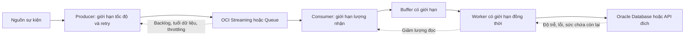

# Backpressure, throughput và theo dõi độ trễ xử lý

Trong chương **Streaming và Queue** của module **CLOUD_PROVIDERS_ORACLE**, bài này giải quyết một tình huống vận hành phổ biến: producer vẫn gửi dữ liệu thành công nhưng consumer xử lý ngày càng chậm. Khi đó, tăng số lần đọc hoặc thêm worker có thể làm cơ sở dữ liệu phía sau quá tải hơn.

Mục tiêu là thiết kế một luồng xử lý trên Oracle Cloud Infrastructure có giới hạn tải rõ ràng, đo được năng lực thực tế và phát hiện sớm nguy cơ vi phạm thời gian xử lý. Các quyết định phải gắn với OCI Streaming hoặc OCI Queue, IAM, mạng kết nối, tài nguyên Compute/OKE và dịch vụ đích như Oracle Database hoặc Autonomous Database.

Ví dụ xuyên suốt là hệ thống tiếp nhận sự kiện đơn hàng, xử lý nghiệp vụ và ghi kết quả bền vững vào cơ sở dữ liệu. Các số liệu trong ví dụ là giả định để tính toán, không phải cam kết hiệu năng của OCI.

## 1. Phân biệt ba vấn đề cần quan sát

### 1.1. Throughput: hệ thống thực hiện được bao nhiêu công việc?

Throughput là lượng công việc hoàn thành trong một đơn vị thời gian. Trong luồng bất đồng bộ, cần ghi rõ đang đo tại bước nào:

| Đại lượng | Đơn vị thường dùng | Ý nghĩa |
| --- | --- | --- |
| Tốc độ phát sinh | Sự kiện/giây | Nhu cầu nghiệp vụ tạo ra ở nguồn |
| Tốc độ nhận vào dịch vụ | Message/giây, byte/giây | Dữ liệu được Streaming hoặc Queue chấp nhận |
| Tốc độ đọc | Message/giây, byte/giây | Dữ liệu consumer nhận từ dịch vụ |
| Tốc độ xử lý hữu ích | Sự kiện duy nhất/giây | Nghiệp vụ đã hoàn tất và lưu bền vững |
| Tốc độ xác nhận | Message/giây hoặc batch/giây | Tiến độ delete/commit sau xử lý |

Ví dụ, một consumer đọc 1.500 message/giây nhưng chỉ hoàn tất 900 sự kiện mới mỗi giây vì phần còn lại là retry hoặc đọc trước. Nếu chỉ nhìn tốc độ GET, đội vận hành có thể kết luận sai rằng hệ thống đáp ứng được đầu vào 1.200 sự kiện/giây.

Cần đo cả byte/giây. Khi kích thước trung bình tăng từ 2 KB lên 8 KB, số message mỗi giây giữ nguyên vẫn có thể làm tải mạng và dung lượng đọc ghi tăng khoảng bốn lần.

### 1.2. Latency: một công việc mất bao lâu để hoàn tất?

Latency là thời gian của một công việc hoặc một thao tác cụ thể. Phải xác định điểm bắt đầu và kết thúc:

| Phép đo | Điểm bắt đầu → kết thúc | Phát hiện điều gì? |
| --- | --- | --- |
| Publish API latency | Bắt đầu gọi API → nhận phản hồi | Độ trễ giao tiếp với dịch vụ |
| Thời gian từ nguồn đến consumer | Tạo sự kiện → consumer nhận | Chậm ở nguồn, đường truyền hoặc backlog |
| Thời gian chờ cục bộ | Consumer nhận → worker bắt đầu | Buffer hoặc worker trong ứng dụng bị nghẽn |
| Processing latency | Worker bắt đầu → ghi kết quả bền vững | CPU, cơ sở dữ liệu hoặc API phụ thuộc chậm |
| Confirmation latency | Hoàn tất nghiệp vụ → xác nhận delete/commit | Chậm ở bước ghi nhận tiến độ |
| End-to-end latency | Tạo sự kiện → hoàn tất nghiệp vụ | Người dùng chờ bao lâu để có kết quả |

Publish API trả lời nhanh không chứng minh sự kiện được xử lý nhanh. Ngược lại, GET có thời gian chờ dài trong chế độ long polling có thể là hành vi bình thường khi queue ít dữ liệu.

### 1.3. Backpressure: hệ thống phản ứng thế nào khi không theo kịp?

Backpressure là cơ chế truyền tín hiệu thiếu năng lực xử lý về phía trước để điều chỉnh lượng công việc được nhận thêm.

Một consumer có buffer đầy có thể giảm hoặc tạm dừng lấy message. Nếu lượng tồn trong dịch vụ vẫn tăng đến ngưỡng không chấp nhận được, hệ thống có thể giảm tốc producer, hạn chế một số nguồn phát hoặc trả lại tín hiệu bận cho bên gọi.

Backpressure cần một chính sách cụ thể: chờ có giới hạn, giảm tốc, lưu công việc vào nơi bền vững hoặc từ chối rõ ràng. Một bộ nhớ đệm tăng vô hạn chỉ trì hoãn thời điểm quá tải xuất hiện.

## 2. Mô hình backlog và thời gian xử lý bù

### 2.1. So sánh tốc độ đầu vào với năng lực hoàn tất

Đặt:

```text
λ = tốc độ sự kiện mới đi vào, sự kiện/giây
μ = tốc độ hoàn tất hữu ích, sự kiện/giây
B = số sự kiện còn cần xử lý
```

Trong mô hình đơn giản, không có dữ liệu hết hạn, bỏ qua hoặc chuyển sang luồng lỗi:

```text
Mức thay đổi backlog mỗi giây ≈ λ - μ
```

- Nếu `λ < μ`, hệ thống có năng lực xử lý bù lượng tồn.
- Nếu `λ = μ`, hệ thống theo kịp đầu vào mới nhưng không có dư địa giảm backlog cũ.
- Nếu `λ > μ`, backlog tiếp tục tăng.

Cần dùng cùng phạm vi dữ liệu và cùng cửa sổ đo. Với nhiều consumer group độc lập của Streaming, backlog của từng nhóm là một vấn đề riêng; không cộng lượt đọc của các nhóm thành năng lực hoàn tất của một nghiệp vụ.

### 2.2. Ví dụ tải tăng trong 10 phút

Giả sử hệ thống có:

```text
Đầu vào trong đợt cao điểm: 1.200 sự kiện/giây
Năng lực hoàn tất:           900 sự kiện/giây
Thời gian cao điểm:          600 giây

Backlog tăng thêm = (1.200 - 900) × 600
                 = 180.000 sự kiện
```

Sau đó đầu vào giảm về 600 sự kiện/giây, còn năng lực hoàn tất vẫn là 900:

```text
Tốc độ giảm backlog = 900 - 600
                   = 300 sự kiện/giây

Thời gian xử lý bù ≈ 180.000 / 300
                  = 600 giây
                  = 10 phút
```

Nếu tính `180.000 / 900 = 200 giây`, kết quả đã bỏ qua công việc mới tiếp tục đi vào. Phép chia đó chỉ phù hợp với giả định không còn đầu vào mới và tốc độ xử lý giữ nguyên.

Mô hình thực tế còn phải tính retry, dữ liệu lỗi, biến động kích thước message và phụ thuộc phía sau. Dùng phép tính để lập giả thuyết, rồi so với số liệu đo được.

### 2.3. Số lượng tồn và tuổi dữ liệu bổ sung cho nhau

Một backlog lớn gồm các message mới có thể là burst ngắn và vẫn đáp ứng thời gian xử lý. Một backlog nhỏ có một message bị kẹt lâu lại có thể vi phạm yêu cầu nghiệp vụ.

Vì vậy nên theo dõi đồng thời:

- Số công việc chưa hoàn tất.
- Tốc độ tăng hoặc giảm của lượng tồn.
- Tuổi công việc cũ nhất chưa hoàn tất.
- Phân bố độ trễ của các công việc đã hoàn tất.
- Số lượng lỗi, retry và công việc bị cách ly.

Không quy đổi chênh lệch offset thành số message chính xác. Tài liệu OCI Streaming nêu offset tăng đơn điệu nhưng có thể có khoảng trống; xem [đặc điểm offset](https://docs.oracle.com/en-us/iaas/Content/Streaming/Tasks/using_a_single_consumer.htm).

## 3. Thiết kế đường truyền backpressure



### 3.1. Giới hạn cả số message và dung lượng

Một cấu hình mẫu có thể đặt:

```text
Tối đa 1.000 message đang được ứng dụng giữ
Tối đa 64 tác vụ nghiệp vụ đồng thời
Ngưỡng giảm đọc: 800 message
Ngưỡng cho đọc trở lại: 300 message
Giới hạn byte của buffer: xác định theo ngân sách bộ nhớ
```

Hai ngưỡng khác nhau tạo khoảng ổn định, tránh việc vừa dừng lại tiếp tục đọc ngay khi chỉ giải phóng được một chỗ.

Giới hạn phải tính cả message đang xử lý và message chờ trong ứng dụng. Một queue nội bộ có giới hạn nhưng hàng nghìn tác vụ bất đồng bộ đã được tạo bên ngoài queue vẫn có thể làm cạn bộ nhớ.

Cần đo kích thước sau giải mã và tạo object. Payload 16 KB không đồng nghĩa chỉ chiếm đúng 16 KB trong heap; parser, metadata và các bản sao làm dung lượng thực lớn hơn.

### 3.2. Đặt giới hạn trước khi đọc

Trình tự nên là:

1. Xác định số chỗ còn trống trong ngân sách xử lý.
2. Giữ trước số chỗ dành cho batch sắp nhận.
3. Yêu cầu một batch không vượt sức chứa đó.
4. Trả lại phần chỗ đã giữ nhưng không sử dụng.
5. Giải phóng chỗ khi công việc chuyển sang trạng thái xử lý được kiểm soát.

Nếu đọc trước một batch lớn rồi mới chờ worker rảnh, dữ liệu đã nằm trong ứng dụng. Với Queue, thời gian visibility đã bắt đầu trôi; với Streaming, consumer có thể gặp vấn đề về tiến độ và quyền sở hữu partition.

Một phép chờ phải có deadline và cơ chế shutdown. Các hoạt động duy trì phiên, heartbeat hoặc gia hạn lease cần được bố trí để không bị treo chung với worker đang đợi cơ sở dữ liệu.

### 3.3. Truyền tín hiệu lên producer

Khi hệ thống đích chậm kéo dài, có thể áp dụng:

| Tình huống | Phản ứng đề xuất |
| --- | --- |
| Burst ngắn, còn dư retention và dung lượng | Để dịch vụ giữ phần tồn, giới hạn buffer cục bộ |
| Một khách hàng tạo tải vượt phần được phân bổ | Giới hạn tốc độ theo khách hàng |
| API đích lỗi liên tục | Mở circuit breaker, giảm nhận thêm công việc |
| Không còn khả năng hoàn tất trong thời hạn nghiệp vụ | Báo bận hoặc từ chối trước khi nhận trách nhiệm |
| Công việc đã được chấp nhận nhưng chưa thể phát | Theo dõi bằng outbox hoặc cơ chế lưu bền vững phù hợp |

Giảm tốc producer cần đi kèm cách xử lý yêu cầu đang chờ. Ví dụ, nếu API đã xác nhận nhận đơn hàng, không được âm thầm bỏ sự kiện chỉ vì buffer phát message đầy.

## 4. Áp dụng cho OCI Streaming

### 4.1. Phân biệt năng lực dịch vụ và năng lực consumer

Giới hạn ghi của Streaming gắn với partition; tài liệu hiện hành nêu 1 MB/s mỗi partition và 5 GET/giây mỗi partition cho mỗi consumer group. Retention và số partition của stream không đổi được sau khi tạo. Xem [giới hạn tài nguyên Streaming](https://docs.oracle.com/en-us/iaas/Content/Streaming/Concepts/streamingoverview_topic-Limits_on_Streaming_Resources.htm).

Nếu producer bị throttling vì một partition nhận tải quá lớn, thêm worker xử lý nghiệp vụ không giải quyết được giới hạn ghi đó.

Trong cùng consumer group, mỗi partition được giao cho một thành viên tại một thời điểm; tăng số instance vượt số partition không tạo thêm partition để đọc. Key lệch tải cũng có thể khiến chỉ một phần hệ thống bị nghẽn. Xem [thiết kế phân vùng](https://docs.oracle.com/en-us/iaas/Content/Streaming/Concepts/partitioningastream.htm).

Khi phân tích throughput, cần phân biệt ít nhất ba trường hợp:

- **Producer bị giới hạn:** dữ liệu khó đi vào stream.
- **Consumer đọc bị giới hạn:** tốc độ lấy dữ liệu không đủ.
- **Nghiệp vụ bị giới hạn:** dữ liệu đã đọc nhưng chưa ghi xong vào hệ thống đích.

Chỉ trường hợp phù hợp mới được giải quyết bằng việc tăng số consumer.

### 4.2. Giảm đọc nhưng giữ đúng thời điểm commit

Với native Streaming consumer group và `commitOnGet=true`, lần GET tiếp theo có thể commit tiến độ của batch nhận trước đó. Nếu đưa batch vào worker bất đồng bộ rồi lập tức GET tiếp, tiến độ có thể được ghi nhận trước khi nghiệp vụ hoàn tất. Xem [cơ chế commit của consumer group](https://docs.oracle.com/en-us/iaas/Content/Streaming/Tasks/using_consumer_groups.htm).

Một vòng lặp tuần tự dễ kiểm soát hơn:

```text
Đọc một batch vừa sức xử lý
→ xử lý và lưu bền vững toàn bộ batch
→ chỉ khi thành công mới tiến sang lần GET tiếp theo
```

Nếu cần pipeline bất đồng bộ, phải thiết kế cơ chế commit riêng phù hợp, bao gồm chế độ `commitOnGet=false`, cursor và thứ tự hoàn tất. Đây không phải thay đổi chỉ cần thêm một executor.

Ví dụ, một partition có ba message được nhận theo thứ tự A, B, C. Worker hoàn tất A và C nhưng B thất bại. Không được ghi tiến độ vượt qua B như thể cả ba đã hoàn tất.

API commit làm việc theo cursor và trạng thái của consumer group; phải sử dụng cursor đúng ngữ nghĩa, không suy ra rằng có thể tùy ý gửi một offset đã tính toán. Xem [commit thủ công](https://docs.oracle.com/en-us/iaas/Content/Streaming/Tasks/commit-consumer-group.htm).

### 4.3. Chờ quá lâu có thể làm mất quyền sở hữu partition

Khi việc xử lý batch hoặc tạm ngừng đọc kéo dài, consumer có thể hết thời gian duy trì thành viên và bị rebalance. OCI cung cấp ConsumerHeartbeat để duy trì trạng thái phù hợp. Xem [gửi heartbeat](https://docs.oracle.com/en-us/iaas/Content/Streaming/Tasks/send-heartbeat-consumer-group.htm).

Không để luồng heartbeat phụ thuộc vào cùng executor đã bị bão hòa bởi tác vụ nghiệp vụ. Khi có rebalance hoặc lỗi commit, cần dừng việc giả định mình còn sở hữu partition, xử lý cursor theo cơ chế client và dự kiến khả năng nhận lại dữ liệu.

Nếu dùng Kafka client với OCI Streaming, cơ chế poll, heartbeat, pause/resume và commit chịu thêm quy tắc của Kafka client. Không áp dụng nguyên xi cấu hình native API cho Kafka client.

### 4.4. Retention là giới hạn thời gian phục hồi

Giảm đọc giúp bảo vệ hệ thống đích nhưng dữ liệu trong stream vẫn tiếp tục già đi. Message hết retention có thể không còn để xử lý bù.

Theo dõi tuổi phần dữ liệu chưa xử lý và ước lượng thời gian phục hồi trước khi quyết định để backlog tích lũy lâu. Nếu cần replay ngoài cửa sổ đó, phải có nguồn lưu trữ và quy trình phục hồi riêng.

## 5. Áp dụng cho OCI Queue

Các ví dụ ở phần này dùng mô hình các consumer cạnh tranh xử lý một queue. Nếu bật thêm consumer groups hoặc channels, cần xác định đúng phạm vi thống kê và phạm vi công việc phải hoàn tất.

### 5.1. Visible, in-flight và hoàn tất là các trạng thái khác nhau

Một message có thể đang sẵn sàng để nhận, đã được consumer nhận nhưng chưa xóa, hoặc đã hoàn tất xử lý và được xóa. Visibility timeout điều khiển khoảng thời gian message đã nhận không hiển thị cho consumer khác. Xem [tổng quan OCI Queue](https://docs.oracle.com/en-us/iaas/Content/queue/overview.htm).

Nếu visible giảm nhưng in-flight tăng nhanh, có thể consumer đang lấy dữ liệu vào bộ nhớ nhanh hơn tốc độ xử lý. Đây chưa phải bằng chứng backlog nghiệp vụ đã được giải quyết.

Thống kê visible và in-flight của Queue là số gần đúng. Dùng chuỗi quan sát theo thời gian để tìm xu hướng thay vì đòi hỏi từng mẫu số liệu khớp tuyệt đối; xem [thống kê queue](https://docs.oracle.com/en-us/iaas/Content/queue/queue-statistics.htm).

### 5.2. Visibility phải bao phủ cả thời gian chờ cục bộ

Giả sử message sau khi nhận phải chờ trong ứng dụng 20 giây rồi xử lý thêm 15 giây. Nếu visibility chỉ là 30 giây, message có thể được giao lại trước khi worker ban đầu hoàn thành.

Ngân sách visibility cần xét:

```text
Thời gian chờ trong ứng dụng
+ thời gian xử lý
+ thời gian xác nhận xóa
+ khoảng dự phòng
```

Đây là ngân sách dự kiến, không phải bảo đảm tác vụ luôn kết thúc đúng hạn. Với tác vụ dài, cần gia hạn visibility có kiểm soát và giám sát cả lỗi gia hạn. OCI cho phép thay đổi visibility khi nhận hoặc cập nhật message; nếu không xóa hoặc gia hạn kịp, message có thể quay lại để được giao tiếp. Xem [tiêu thụ message](https://docs.oracle.com/en-us/iaas/Content/queue/consume-messages.htm).

Không giải quyết mọi vấn đề bằng cách tăng visibility rất lớn. Nếu worker chết thật, một thời gian dài mới có thể xử lý lại cũng làm tăng độ trễ phục hồi.

### 5.3. Chỉ xóa sau khi kết quả nghiệp vụ đã bền vững

Trình tự mẫu:

```text
Nhận message
→ kiểm tra định danh chống xử lý trùng
→ thực hiện giao dịch nghiệp vụ
→ lưu kết quả và trạng thái đã xử lý
→ xóa message bằng receipt tương ứng
```

Nếu ứng dụng chết sau khi ghi cơ sở dữ liệu nhưng trước khi xóa message, sự kiện có thể được nhận lại. Do đó consumer cần tính idempotent hoặc cơ chế chống áp dụng nghiệp vụ hai lần.

Ví dụ, lưu `eventId` có ràng buộc duy nhất trong cùng giao dịch cập nhật đơn hàng. Khi nhận lại sự kiện đã hoàn tất, consumer xác minh trạng thái rồi thực hiện bước xác nhận cần thiết mà không lặp thao tác trừ kho.

Các chi tiết giao dịch phụ thuộc mô hình dữ liệu; không tự coi việc gọi API và cập nhật cơ sở dữ liệu là một giao dịch nguyên tử.

### 5.4. Mã giả consumer có giới hạn sức chứa

Đoạn dưới là mã giả về kiểm soát tải, không phải tên hàm của OCI SDK:

```text
while running:
    if downstreamCircuitIsOpen():
        waitUntilProbeOrShutdown()
        continue

    reserved = reserveAvailableSlots(upTo = configuredBatchLimit)
    if reserved == 0:
        waitForCapacityOrShutdown()
        continue

    try:
        messages = receiveQueueMessages(limit = reserved)
    catch receiveError:
        releaseSlots(reserved)
        recordFailureAndApplyBoundedBackoff()
        continue

    releaseSlots(reserved - size(messages))

    for message in messages:
        submitToBoundedWorker(message):
            try:
                keepVisibilityValidWhileOwned(message)
                persistBusinessResultIdempotently(message)
                deleteUsingReceipt(message)
                recordConfirmedCompletion(message)
            catch processingOrConfirmationError:
                recordFailureAndRetryState(message)
                doNotDeleteAsIfProcessingSucceeded()
            finally:
                stopVisibilityRenewalForThisAttempt()
                releaseSlots(1)
```

Việc `submitToBoundedWorker` cũng phải xử lý lỗi giao tác vụ, shutdown và tác vụ bị từ chối. Nếu không thể giao cho worker, ứng dụng vẫn phải theo dõi message đã nhận và trả lại sức chứa đúng cách.

Pseudocode chỉ mô tả giới hạn số message trong ứng dụng. Một triển khai đầy đủ còn cần deadline, giới hạn byte, quản lý receipt, vòng đời tác vụ gia hạn và chính sách retry. Khi cơ sở dữ liệu lỗi kéo dài, circuit breaker giúp tránh tiếp tục nhận rồi tích lũy thêm message in-flight.

### 5.5. DLQ không chứng minh hệ thống đã xử lý xong

OCI Queue chuyển message sang dead letter queue khi vượt cấu hình số lần giao không thành công. Việc nhận message làm tăng delivery count; DLQ giúp cách ly dữ liệu lỗi để điều tra. Xem [dead letter queue](https://docs.oracle.com/en-us/iaas/Content/queue/deadletterqueues.htm).

Nếu queue chính giảm trong khi DLQ tăng, hệ thống có thể đang chuyển công việc chưa hoàn tất sang nơi khác. Dashboard phải thể hiện phần công việc này thay vì chỉ báo queue chính đã sạch.

Khi phát lại từ DLQ, cần giới hạn tốc độ, giữ định danh sự kiện và xác nhận nguyên nhân lỗi đã được xử lý.

## 6. Batch, concurrency và retry phải cùng nằm trong ngân sách tải

### 6.1. Batch lớn có đánh đổi

Batch giúp giảm overhead trên mỗi message nhưng có thể tăng thời gian chờ gom batch, bộ nhớ và thời gian xử lý toàn batch.

Đối với producer có yêu cầu độ trễ thấp, nên có cả:

- Giới hạn số message hoặc byte trong batch.
- Thời gian chờ tối đa trước khi gửi một batch chưa đầy.

Đối với consumer, chọn batch đủ nhỏ để hoàn tất trong ngân sách xử lý và duy trì trạng thái sở hữu cần thiết. Một batch rất lớn có thể làm p99 tăng dù throughput trung bình tốt hơn.

### 6.2. Tăng concurrency có thể làm giảm throughput

Giả sử consumer có 64 worker nhưng connection pool của cơ sở dữ liệu chỉ có 20 connection phục vụ nhóm này. Thêm worker lên 256 có thể chỉ tạo thêm tác vụ chờ connection và tăng thời gian giữ message.

Năng lực hoàn tất phải được đo sau khi tính:

- CPU, bộ nhớ và thời gian garbage collection.
- Connection pool, khóa dữ liệu và thời gian commit.
- Giới hạn số lần gọi API phụ thuộc.
- Tranh chấp trên cùng đơn hàng hoặc cùng tài khoản.
- Độ trễ và lỗi của đường kết nối mạng.

Nếu trung bình một tác vụ mất 50 ms và có 20 vị trí xử lý thực sự độc lập, phép tính lý tưởng là `20 / 0,05 = 400 tác vụ/giây`. Đây chỉ là mô hình ban đầu; tranh chấp và đuôi độ trễ có thể làm năng lực hữu ích thấp hơn.

### 6.3. Retry cũng tiêu thụ năng lực

Nếu 1.000 sự kiện mới/giây tạo trung bình 0,2 lần thử lại cho mỗi sự kiện, tầng xử lý có thể phải chịu khoảng 1.200 lượt thử/giây.

Thiết kế retry cần:

- Phân loại lỗi tạm thời, lỗi dữ liệu và lỗi cấu hình.
- Backoff có giới hạn, thêm jitter để các client không retry đồng loạt.
- Giới hạn tổng thời gian và số lần thử.
- Hạch toán retry vào cùng ngân sách concurrency và tốc độ.
- Giữ định danh sự kiện qua các lần thử.

Không retry dồn dập lỗi thiếu IAM, endpoint sai hoặc dữ liệu không hợp lệ. Các lỗi này cần sửa cấu hình hoặc dữ liệu.

Với OCI Streaming, request có thể trả HTTP 200 nhưng có lỗi từng entry; throttling toàn request có thể trả 429. Phải kiểm tra kết quả từng phần trước khi quyết định phát lại. Xem [lỗi và throttling của Streaming](https://docs.oracle.com/en-us/iaas/Content/Streaming/Reference/troubleshootingstreaming.htm).

Timeout khi phát cũng có thể để lại kết quả không chắc chắn từ góc nhìn client. Giữ nguyên định danh nghiệp vụ và xử lý trùng lặp thay vì mặc định mọi timeout đều có nghĩa dịch vụ chưa nhận dữ liệu.

## 7. Đo độ trễ xử lý trong ứng dụng

### 7.1. Ghi các mốc thời gian có ngữ nghĩa rõ ràng

Một envelope mẫu do ứng dụng thiết kế:

```json
{
  "eventId": "evt-order-2048-paid",
  "eventType": "OrderPaid",
  "occurredAt": "2026-11-20T03:15:00Z",
  "publishedAt": "2026-11-20T03:15:01Z",
  "schemaVersion": 1,
  "orderId": "ORD-2048"
}
```

Consumer bổ sung các mốc quan sát:

```text
receivedAt  : ứng dụng nhận message
startedAt   : worker bắt đầu xử lý
completedAt : kết quả nghiệp vụ đã được lưu bền vững
confirmedAt : delete hoặc commit được xác nhận
```

`publishedAt` trong ví dụ là thời điểm ứng dụng bắt đầu gửi, không phải timestamp do dịch vụ chứng thực. Không đặt trước một timestamp rồi gọi nó là thời điểm dịch vụ chấp nhận.

Các phép đo:

```text
Local wait       = startedAt - receivedAt
Processing       = completedAt - startedAt
Business E2E     = completedAt - occurredAt
Confirmation gap = confirmedAt - completedAt
```

Để đo thời lượng trong cùng tiến trình, dùng đồng hồ đơn điệu. Khi lấy hiệu timestamp giữa các máy, cần đồng bộ đồng hồ và xử lý dữ liệu thời gian bất thường.

Một sự kiện được gửi muộn từ nguồn có thể có Business E2E lớn dù consumer đang khỏe. Phân tách độ trễ ở nguồn, độ trễ nhận dữ liệu và thời gian xử lý giúp xác định đúng nơi cần can thiệp.

### 7.2. Theo dõi phân bố và phần dữ liệu chưa hoàn tất

Một yêu cầu dịch vụ mẫu có thể là:

```text
Trong cửa sổ 15 phút:
95% sự kiện hợp lệ hoàn tất trong 30 giây kể từ occurredAt.
```

Đây là mục tiêu minh họa do hệ thống bán hàng đặt ra. Cần thống nhất cách tính sự kiện gửi muộn, sự kiện lỗi và công việc được phát lại.

Nên quan sát p50, p95, p99 cùng số mẫu. Không lấy trung bình p95 của các instance rồi coi đó là p95 của toàn hệ thống. Muốn tổng hợp phân bố, cần dữ liệu histogram hoặc cơ chế đo hỗ trợ gộp phù hợp.

Đặc biệt, histogram của các sự kiện đã hoàn tất không thể hiện đầy đủ những sự kiện đang kẹt. Khi consumer dừng hoàn toàn, dashboard có thể không có mẫu độ trễ mới; cần thêm tuổi dữ liệu chưa xử lý và heartbeat của ứng dụng.

### 7.3. Tách metric, log và trace

Một bộ metric ứng dụng đề xuất có thể gồm:

| Tên đề xuất | Loại dữ liệu | Mục đích |
| --- | --- | --- |
| `business_completed_total` | Counter | Số sự kiện duy nhất đã hoàn tất |
| `processing_duration_seconds` | Histogram | Phân bố thời gian xử lý |
| `business_e2e_duration_seconds` | Histogram | Độ trễ nghiệp vụ |
| `local_buffer_messages` | Gauge | Số message đang giữ trong ứng dụng |
| `local_buffer_bytes` | Gauge | Ngân sách bộ nhớ dữ liệu |
| `oldest_uncompleted_age_seconds` | Gauge | Phát hiện công việc mắc kẹt |
| `retry_attempts_total` | Counter | Tải bổ sung do retry |

Đây là tên do bài đề xuất, không phải metric có sẵn của OCI. Cần instrument và xuất dữ liệu vào hệ thống quan sát được chọn.

Chọn dimension có số giá trị được kiểm soát như môi trường, ứng dụng và loại kết quả. Đặt `eventId`, `orderId` và thông tin điều tra từng sự kiện trong log hoặc trace thay vì tạo một chuỗi metric cho mỗi đơn hàng.

## 8. Dùng metric OCI cùng metric ứng dụng

### 8.1. OCI Streaming

Namespace: `oci_streaming`.

| Metric | Đọc theo mục đích |
| --- | --- |
| `PutMessagesThroughput.Bytes` | Lưu lượng byte ghi vào stream |
| `GetMessagesThroughput.Bytes` | Lưu lượng byte được đọc |
| `PutMessagesThrottling.Count` | Phát hiện message ghi bị throttling |
| `GetMessagesThrottling.Count` | Phát hiện yêu cầu đọc bị throttling |
| `PutMessagesLatency.Time` | Độ trễ thao tác ghi, tài liệu dùng ms |
| `GetMessagesLatency.Time` | Độ trễ thao tác đọc, tài liệu dùng giây |

Lọc đúng `resourceId` và region; kiểm tra đơn vị trước khi đặt ngưỡng. Tham khảo [Streaming Metrics Reference](https://docs.oracle.com/en-us/iaas/Content/Streaming/Reference/metric-ref.htm).

Các metric này không thay thế phép đo hoàn tất nghiệp vụ. Ví dụ, GET byte/giây tăng có thể phản ánh replay; nó không chứng minh có thêm đơn hàng mới được xử lý thành công.

### 8.2. OCI Queue

Namespace: `oci_queue`.

| Metric | Đơn vị và ý nghĩa |
| --- | --- |
| `ConsumerLag` | Phút; tuổi message cũ nhất trong queue theo tài liệu |
| `MessagesInQueueCount` | Số message; có dimension `isVisible` |
| `QueueSize` | Byte trong queue |
| `MessagesCount` | Số message truyền, phân biệt theo `operation` |
| `RequestsLatency` | ms; độ trễ request theo `operation` |
| `RequestsThroughput` | Byte truyền theo `operation` |

Tham khảo [Queue Metrics](https://docs.oracle.com/en-us/iaas/Content/queue/metrics.htm). `ConsumerLag` không phải p95 end-to-end của sự kiện đã hoàn tất.

Khi đọc biểu đồ Queue, kiểm tra dimension và phép tổng hợp. Không cộng lặp các chuỗi đã biểu diễn những phần dữ liệu chồng nhau, cũng không coi throughput GET là số công việc duy nhất đã hoàn tất.

### 8.3. Gauge và counter cần cách tổng hợp khác nhau

Với một gauge như độ tuổi, giá trị lớn nhất trong khoảng đo giúp thấy trường hợp xấu. Với một chuỗi đếm theo khoảng thời gian, tổng các giá trị có thể trả lời số lần xuất hiện trong khoảng.

Không coi mọi metric có hậu tố `Count` là counter tích lũy từ khi khởi động. Đọc định nghĩa metric và cách dịch vụ phát mẫu trước khi đổi sang tốc độ mỗi giây.

Ngoài ra, không suy ra p95 xử lý nghiệp vụ từ metric latency đã được tổng hợp của lời gọi API. Hai phép đo có phạm vi khác nhau.

## 9. Truy vấn Monitoring và đọc thống kê bằng CLI

### 9.1. Ví dụ MQL

Với namespace `oci_queue`, truy vấn tuổi message lớn nhất được quan sát trong mỗi khoảng một phút:

```text
ConsumerLag[1m]{resourceId="REPLACE_WITH_QUEUE_OCID"}.max()
```

Một biểu thức ngưỡng minh họa:

```text
ConsumerLag[1m]{resourceId="REPLACE_WITH_QUEUE_OCID"}.max() > 2
```

Ngưỡng `2` ở đây là **2 phút** theo đơn vị metric. Đây là ngưỡng minh họa, cần điều chỉnh theo yêu cầu nghiệp vụ.

Với namespace `oci_streaming`, kiểm tra hiện tượng throttling ghi:

```text
PutMessagesThrottling.Count[1m]{resourceId="REPLACE_WITH_STREAM_OCID"}.sum() > 0
```

MQL cho phép chọn interval, dimension, statistic và predicate; xem [tham chiếu MQL](https://docs.oracle.com/en-us/iaas/Content/Monitoring/Reference/mql.htm).

Tần suất phát metric phải phù hợp interval và điều kiện alarm. Đặt thời gian duy trì điều kiện để phân biệt burst ngắn với lỗi kéo dài; thêm cảnh báo mất tín hiệu khi cần, vì không có dữ liệu không đồng nghĩa không có lỗi.

### 9.2. Truy vấn dữ liệu metric của queue

Các lệnh sau là **Bash**, dành cho OCI Cloud Shell hoặc môi trường có OCI CLI đã cấu hình và công cụ `date` tương thích GNU. Cần quyền IAM đọc metric và thông tin tài nguyên trong compartment tương ứng.

```bash
set -euo pipefail

export OCI_CLI_REGION="ap-singapore-1"
COMPARTMENT_ID="ocid1.compartment.oc1..REPLACE_ME"
QUEUE_ID="ocid1.queue.oc1..REPLACE_ME"

START_TIME="$(date -u -d '30 minutes ago' +%Y-%m-%dT%H:%M:%SZ)"
END_TIME="$(date -u +%Y-%m-%dT%H:%M:%SZ)"
QUEUE_QUERY="$(printf 'ConsumerLag[1m]{resourceId="%s"}.max()' "$QUEUE_ID")"

oci monitoring metric-data summarize-metrics-data --compartment-id "$COMPARTMENT_ID" --namespace oci_queue --query-text "$QUEUE_QUERY" --start-time "$START_TIME" --end-time "$END_TIME"
```

Tham số và kiểu thời gian được mô tả trong [CLI summarize-metrics-data](https://docs.oracle.com/en-us/iaas/tools/oci-cli/latest/oci_cli_docs/cmdref/monitoring/metric-data/summarize-metrics-data.html).

Nếu kết quả rỗng, kiểm tra region, compartment, OCID, thời gian, quyền IAM và khả năng metric đã có mẫu. Không diễn giải kết quả rỗng thành độ trễ bằng 0.

### 9.3. Đọc visible, in-flight và DLQ

Lấy endpoint từ chính queue:

```bash
oci queue queue-admin queue get --queue-id "$QUEUE_ID"

QUEUE_ENDPOINT="$(oci queue queue-admin queue get --queue-id "$QUEUE_ID" --query 'data."messages-endpoint"' --raw-output)"

oci queue messages get-stats --queue-id "$QUEUE_ID" --endpoint "$QUEUE_ENDPOINT"
```

GetStats sử dụng Messages endpoint và trả thống kê của queue cùng DLQ. Xem [CLI get-stats](https://docs.oracle.com/en-us/iaas/tools/oci-cli/latest/oci_cli_docs/cmdref/queue/messages/get-stats.html).

Các lệnh trên đọc thông tin và thống kê. Việc dùng GET message hoặc Console polling để “xem thử” lại có thể thay đổi delivery count và trạng thái visibility; không dùng thao tác nhận message như một công cụ giám sát thụ động. Xem [hành vi polling queue](https://docs.oracle.com/en-us/iaas/Content/queue/consume-messages-queue.htm).

## 10. Autoscaling theo năng lực hữu ích và thời gian phục hồi

### 10.1. Ước lượng số worker cần thiết

Đặt:

```text
B = backlog cần xử lý
T = thời gian mong muốn để xử lý bù, giây
λ = tốc độ sự kiện mới, sự kiện/giây
r = tốc độ hữu ích đo được của một worker

μ_required = λ + B / T

Worker_required ≈ ceil(μ_required / r)
```

Ví dụ:

```text
B = 180.000 sự kiện
T = 300 giây
λ = 600 sự kiện/giây
r = 100 sự kiện/giây/worker

μ_required = 600 + 180.000 / 300
           = 1.200 sự kiện/giây

Worker_required ≈ 12
```

Kết quả giả định các worker mở rộng gần tuyến tính và hệ thống đích chịu được tải. Cần đo lại khi tăng số worker, thay vì dùng mãi năng lực đơn lẻ đã đo lúc ít tải.

Worker ở đây là đơn vị xử lý trong mô hình tính toán, không tự động đồng nghĩa một pod hay một consumer instance. Với Streaming, số instance nhận partition còn bị ràng buộc bởi cấu trúc stream.

### 10.2. Đặt trần theo phụ thuộc phía sau

Một chính sách scale trên Compute hoặc OKE nên xét:

- Tuổi dữ liệu và xu hướng backlog.
- Số partition có thể khai thác trong Streaming.
- CPU, bộ nhớ và sức chứa buffer.
- Connection pool, latency và lỗi của cơ sở dữ liệu.
- Giới hạn tài nguyên và thời gian khởi động instance/pod.
- Trần chi phí được chấp nhận trong tình huống sự cố.

Không scale liên tục chỉ vì backlog tăng trong lúc cơ sở dữ liệu đã bão hòa. Khi đó cần bảo vệ phụ thuộc và điều tiết đầu vào.

Scale down cũng phải có trình tự: dừng nhận mới, hoàn tất hoặc bàn giao công việc, ghi nhận tiến độ đúng cách rồi kết thúc. Xóa instance đang giữ nhiều message mà không có shutdown phù hợp có thể gây một đợt xử lý lại.

### 10.3. Tính cả retry và phục hồi vào chi phí

Tăng concurrency làm tăng tài nguyên ứng dụng và có thể tăng tải lên dịch vụ đích. Polling dồn dập, retry không giới hạn và replay diện rộng cũng tạo thêm sử dụng dịch vụ.

Trước khi tự động hóa, nên ghi rõ mức tối đa của worker, tốc độ replay và thời gian cho phép scale cao. Gắn tag tài nguyên và theo dõi chi phí theo môi trường để đối chiếu hiệu quả: chi phí tăng phải đi cùng tốc độ hoàn tất hữu ích hoặc khả năng phục hồi tốt hơn.

## 11. Thực hành đo dưới tải có kiểm soát

Bài thực hành này yêu cầu một luồng thử nghiệm đã có producer, consumer và nơi ghi kết quả. Chỉ dùng dữ liệu giả trong môi trường lab có giới hạn tải; không coi các con số dưới đây là cấu hình áp dụng mặc định.

### 11.1. Chuẩn bị phép đo

Trước khi phát tải, cấu hình:

1. Định danh sự kiện và dấu thời gian có ngữ nghĩa rõ ràng.
2. Counter đầu vào mới và counter hoàn tất hữu ích.
3. Histogram processing và end-to-end latency.
4. Gauge buffer, số tác vụ đang chạy và tuổi công việc chưa hoàn tất.
5. Biểu đồ metric dịch vụ, lỗi downstream và lượng retry.
6. Giới hạn đầu vào, giới hạn worker và điều kiện dừng đợt thử.

Giữ nguyên chính sách delete/commit đúng đắn trong suốt phép thử. Việc xử lý nhanh bằng cách xác nhận sớm làm kết quả throughput mất ý nghĩa.

### 11.2. Chạy từng giai đoạn và ghi nhận

| Giai đoạn | Điều chỉnh | Điều cần quan sát |
| --- | --- | --- |
| Nền ổn định | Đầu vào thấp hơn năng lực consumer | Buffer ổn định, latency và retry ở mức nền |
| Burst | Tăng đầu vào trong thời gian hữu hạn | Backlog tăng có kiểm soát, bộ nhớ không tăng vô hạn |
| Downstream chậm | Tăng độ trễ giả lập ở nơi xử lý | Lượng đọc giảm khi sức chứa cạn |
| Phục hồi | Khôi phục tốc độ xử lý | Throughput hữu ích lớn hơn đầu vào và backlog giảm |
| Lỗi consumer | Dừng một instance theo kịch bản | Có thể xử lý lại nhưng không lặp tác động nghiệp vụ |

Thay đổi một yếu tố mỗi lần để dễ nhận diện nguyên nhân. Nếu thay đồng thời batch, số worker, kích thước message và tải nguồn, kết quả sẽ khó giải thích.

Đối với Streaming, quan sát thêm rebalance và commit khi consumer chậm. Đối với Queue, quan sát in-flight, thời gian visibility, delivery count và DLQ.

### 11.3. Đánh giá khả năng kiểm soát

Một kết quả đạt mục tiêu của thiết kế cần thể hiện:

- Lượng message và byte trong ứng dụng nằm trong ngân sách đã đặt.
- Khi downstream chậm, lượng nhận mới được điều chỉnh.
- Dữ liệu đã chấp nhận có trạng thái theo dõi rõ ràng, không bị bỏ âm thầm.
- Tiến độ chỉ được xác nhận sau khi kết quả cần thiết đã bền vững.
- Sau phục hồi, backlog thực sự giảm và thời gian xử lý bù phù hợp số liệu.
- Độ trễ được đo cả ở dữ liệu đã hoàn tất lẫn phần còn đang mắc kẹt.

Nếu không đạt, ghi rõ nút thắt và giới hạn bị chạm. Không chỉ ghi một con số message/giây cao nhất rồi kết luận hệ thống đủ khả năng vận hành.

## 12. Chẩn đoán theo tổ hợp tín hiệu

| Tín hiệu quan sát | Giả thuyết cần kiểm tra | Hành động tiếp theo |
| --- | --- | --- |
| Publish latency thấp, tuổi dữ liệu tăng | Consumer hoặc downstream không theo kịp | So sánh tốc độ đầu vào và hoàn tất hữu ích |
| GET throughput cao, hoàn tất thấp | Đọc trước quá nhiều, replay hoặc retry | Kiểm tra buffer, định danh trùng và thời gian xử lý |
| Visible giảm, in-flight tăng | Công việc chuyển vào consumer nhưng chưa xong | Giảm prefetch và kiểm tra ngân sách visibility |
| Backlog tăng, CPU thấp | Đợi DB, mạng, khóa hoặc connection | Xem latency phụ thuộc và thời gian chờ pool |
| Backlog tăng, throttling tăng | Chạm giới hạn dịch vụ hoặc tải lệch | Kiểm tra mức tải và phạm vi giới hạn |
| Thêm instance không cải thiện | Thiếu partition hoặc downstream đã bão hòa | Đánh giá phân vùng và năng lực phụ thuộc |
| Retry và DLQ cùng tăng | Dữ liệu lỗi hoặc visibility không phù hợp | Phân loại nguyên nhân trước khi phát lại |
| p95 đẹp nhưng dữ liệu cũ còn tồn | Chỉ đo công việc hoàn tất | Bổ sung tuổi chưa hoàn tất và kiểm tra mất tín hiệu |
| Consumer thường xuyên rebalance | Xử lý lâu hoặc duy trì phiên không phù hợp | Giảm batch, kiểm tra heartbeat và commit |
| Queue giảm nhưng kết quả nghiệp vụ thiếu | Xác nhận sớm, hết hạn hoặc chuyển sang luồng lỗi | Đối soát theo định danh và trạng thái cuối cùng |

Trong một đợt sự cố, ưu tiên bảo vệ hệ thống đích, xác định công việc đã được chấp nhận và giữ khả năng phục hồi. Sau đó mới tăng công suất hoặc replay theo tốc độ có kiểm soát.

Bản thiết kế vận hành nên ghi rõ định nghĩa hoàn tất, đơn vị throughput, các mốc đo latency, ngân sách buffer, giới hạn concurrency, thời điểm delete/commit, chính sách retry và ngưỡng cần can thiệp. Những giá trị đó cần hiện diện trong cấu hình triển khai và dashboard để đội vận hành có thể kiểm chứng khi tải thay đổi.
