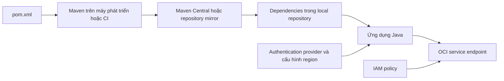

# Cài đặt OCI Java SDK và quản lý dependencies với Maven

## 1. Mục tiêu và phạm vi

Trong chương **OCI SDK và REST API với Java**, bước đầu tiên là tạo được một ứng dụng Java có bộ thư viện OCI nhất quán, biên dịch được và nạp đúng HTTP client khi chạy. Cài SDK trong bài này có nghĩa là khai báo dependencies cho ứng dụng; bạn không cần cài một dịch vụ SDK lên tenancy hoặc đưa SDK vào từng máy chủ OCI cần quản lý.

OCI Java SDK cung cấp các client, request và response có kiểu dữ liệu Java để gọi API Oracle Cloud Infrastructure. Ứng dụng vẫn phải xác thực với OCI và chịu sự kiểm soát của IAM, mạng và region như khi gọi REST API trực tiếp. SDK không cấp thêm quyền truy cập tài nguyên. [Nguồn: SDK for Java](https://docs.oracle.com/en-us/iaas/Content/API/SDKDocs/javasdk.htm).

Sau bài học, bạn có thể:

- Chuẩn bị JDK và Maven cho một ứng dụng sử dụng OCI Java SDK 3.x.
- Import BOM để quản lý phiên bản các module SDK ở một nơi.
- Chọn HTTP implementation phù hợp thay vì dựa vào dependency tình cờ xuất hiện.
- Phân biệt dependency dùng khi biên dịch, khi chạy và plugin phục vụ build.
- Chạy kiểm tra classpath cục bộ, sau đó gọi một API chỉ đọc để kiểm tra cấu hình kết nối.
- Điều tra xung đột dependencies và giữ cấu hình build có thể dùng lại trong CI.

Ví dụ chính sử dụng Object Storage vì chỉ cần một module dịch vụ và có API đọc namespace để kiểm tra đường đi từ Java đến OCI. Sau khi hiểu cấu trúc này, bạn có thể thêm module cho Compute, VCN, Monitoring hoặc quản lý dịch vụ database theo nhu cầu của ứng dụng hạ tầng.

## 2. Chuẩn bị JDK, Maven và hai đường kết nối khác nhau

### 2.1. Cấu hình của bài thực hành

Bài dùng các lựa chọn cụ thể sau để dễ tái hiện:

| Thành phần | Lựa chọn trong ví dụ | Mục đích |
| --- | --- | --- |
| JDK | JDK 17 | Biên dịch và chạy ứng dụng với cùng mức Java |
| Công cụ build | Maven 3.9.x | Quản lý dependency và thực hiện các goal |
| OCI Java SDK | `3.102.0` | Phiên bản cố định, đồng bộ qua một property |
| HTTP implementation | `oci-java-sdk-common-httpclient-jersey3` | Cung cấp transport Jersey 3 cho SDK |
| Dịch vụ minh họa | `oci-java-sdk-objectstorage` | Gọi `GetNamespace` |

`3.102.0` là phiên bản đã có bản phát hành chính thức của Oracle, được chọn làm mốc cho cấu hình mẫu; không dùng giá trị `LATEST` hoặc coi con số này là phiên bản mới nhất mãi mãi. Khi nâng phiên bản, kiểm tra release notes của phiên bản đích. [Nguồn: OCI Java SDK release 3.102.0](https://github.com/oracle/oci-java-sdk/releases/tag/v3.102.0).

Kiểm tra công cụ bằng các lệnh sau trong terminal:

```text
java -version
javac -version
mvn -version
```

Đọc cả đường dẫn Java và phiên bản Java mà `mvn -version` báo. Nếu IDE dùng JDK 17 nhưng Maven dùng một JDK khác, kết quả trong IDE và terminal có thể khác nhau. JDK dùng để chạy Maven, mức `release` của compiler và JDK chạy ứng dụng là ba cấu hình cần phối hợp.

Ví dụ lỗi `release version 17 not supported` thường xuất hiện khi compiler thực tế quá cũ. Cách xử lý là kiểm tra JDK mà Maven đang dùng trước khi sửa dependencies của OCI.

### 2.2. Phân biệt tải thư viện và gọi API



Có hai đường kết nối cần kiểm tra riêng:

1. **Đường build:** Maven truy cập repository để lấy POM, JAR và plugin. Đường này chịu cấu hình proxy, mirror, chứng thư và credentials của repository.
2. **Đường ứng dụng:** Java gọi endpoint OCI qua HTTP transport của SDK. Đường này chịu cấu hình danh tính OCI, DNS, TLS, routing, region và IAM.

Maven tải dependencies thành công không chứng minh ứng dụng có quyền đọc bucket. Ngược lại, OCI Console mở được cũng chưa chứng minh Maven có thể tải JAR qua proxy doanh nghiệp.

## 3. Hiểu cấu trúc dependencies của OCI Java SDK

### 3.1. Module dịch vụ và thư viện dùng chung

Không cần đưa toàn bộ SDK vào một ứng dụng chỉ sử dụng một hoặc hai dịch vụ. Các artifact thường gặp có cùng `groupId` là `com.oracle.oci.sdk`:

| Artifact | Vai trò | Ví dụ sử dụng |
| --- | --- | --- |
| `oci-java-sdk-bom` | Quản lý phiên bản của các artifact SDK | Import trong `dependencyManagement` |
| `oci-java-sdk-common` | Kiểu dùng chung và authentication provider | Đọc profile, cấu hình client |
| `oci-java-sdk-common-httpclient` | Các abstraction của HTTP transport | Tham chiếu `HttpProvider` trong ví dụ cục bộ |
| `oci-java-sdk-common-httpclient-jersey` | HTTP implementation theo Jersey 2 | Hệ sinh thái JAX-RS tương ứng |
| `oci-java-sdk-common-httpclient-jersey3` | HTTP implementation theo Jersey 3 | Transport được chọn trong bài |
| `oci-java-sdk-objectstorage` | Client và model Object Storage | Namespace, bucket, object |
| `oci-java-sdk-core` | API Compute, Networking và các tài nguyên core | Instance, VCN, volume |
| `oci-java-sdk-database` | API quản lý dịch vụ database | Quản lý tài nguyên database trên OCI |
| `oci-java-sdk-monitoring` | API Monitoring | Làm việc với metric |

Tên `core` không có nghĩa đó là dependency thay thế cho mọi module dịch vụ. Ví dụ, muốn dùng `ObjectStorageClient` thì khai báo module Object Storage. SDK quản lý database cũng không thay thế JDBC driver khi ứng dụng cần chạy SQL trực tiếp trong Oracle Database.

### 3.2. Dependency trực tiếp và dependency bắc cầu

Khi ứng dụng thêm module Object Storage, Maven sẽ giải quyết các thư viện phụ thuộc bắc cầu từ POM của module đó. Tuy nhiên, nếu mã nguồn ứng dụng trực tiếp import một API dùng chung, nên khai báo dependency tương ứng một cách rõ ràng.

Ví dụ trong bài trực tiếp dùng:

- `ConfigFileAuthenticationDetailsProvider` từ module common.
- `HttpProvider` từ module common HTTP client.
- `ObjectStorageClient` và request/response từ module Object Storage.

Vì vậy, POM sẽ liệt kê các module này. Cách khai báo làm rõ nhu cầu của ứng dụng và giảm việc phụ thuộc vào một nhánh bắc cầu có thể thay đổi khi nâng SDK.

### 3.3. BOM quản lý phiên bản, không tự thêm thư viện

Một BOM là POM được import trong `dependencyManagement` để cung cấp thông tin quản lý dependencies. Bạn vẫn cần khai báo module muốn dùng trong `dependencies`. Maven cũng có quy tắc chọn phiên bản khi nhiều nhánh kéo cùng artifact; không nên giả định phiên bản lớn nhất luôn được chọn. [Nguồn: Maven Dependency Mechanism](https://maven.apache.org/guides/introduction/introduction-to-dependency-mechanism.html).

Hình dung hai phần của POM như sau:

```text
dependencyManagement:
    Nếu ứng dụng cần artifact X, phiên bản do cấu hình quản lý quyết định.

dependencies:
    Ứng dụng thực sự cần artifact X ở classpath phù hợp.
```

BOM của OCI `3.102.0` liệt kê các module common, HTTP implementation và module dịch vụ ở cùng phiên bản SDK. [Nguồn: OCI SDK BOM 3.102.0](https://github.com/oracle/oci-java-sdk/blob/v3.102.0/bmc-bom/pom.xml).

Đặt một phiên bản riêng trên module dịch vụ có thể ghi đè sự đồng bộ mong muốn. Ví dụ, BOM quản lý `3.102.0` nhưng ứng dụng ghim riêng một module ở phiên bản khác sẽ tạo cấu hình cần điều tra, chứ không được BOM tự sửa lại.

## 4. Chọn HTTP implementation trước khi chạy

OCI Java SDK 3.x cho phép thay HTTP client và **không tự chọn implementation mặc định** cho ứng dụng. Bạn cần thêm một trong các artifact `oci-java-sdk-common-httpclient-jersey` hoặc `oci-java-sdk-common-httpclient-jersey3`. Chỉ thêm abstraction `oci-java-sdk-common-httpclient` chưa đủ để gửi request. [Nguồn: OCI SDK 3.x README](https://github.com/oracle/oci-java-sdk/blob/v3.102.0/README.md).

| Lựa chọn | Hệ API liên quan | Điều cần kiểm tra khi tích hợp |
| --- | --- | --- |
| Jersey 2 | Nhánh JAX-RS dùng namespace `javax.ws.rs` | Khả năng tương thích với stack hiện có |
| Jersey 3 | Nhánh JAX-RS dùng namespace `jakarta.ws.rs` | Tính nhất quán của các thư viện Jersey/Jakarta |

Không chọn chỉ vì số `3` lớn hơn `2`. Với dự án có framework hoặc application server, cần xem runtime đã cung cấp các API và thư viện nào. Ứng dụng độc lập trong bài chọn Jersey 3 để có một cấu hình nhất quán từ đầu.

POM của HTTP implementation Jersey 3 có phần quản lý các dependencies Jersey và Jakarta liên quan. Mẫu của bài import cả BOM SDK và POM quản lý của HTTP implementation theo cấu trúc ví dụ Jersey 3 chính thức của Oracle. [Nguồn: Jersey 3 example POM](https://github.com/oracle/oci-java-sdk/blob/v3.102.0/bmc-other-examples/bmc-jersey3-examples/pom.xml).

Hai khai báo cùng tên artifact trong POM dưới đây có mục đích khác nhau:

- Trong `dependencyManagement`, `type=pom` và `scope=import` đưa quy tắc quản lý dependency vào project.
- Trong `dependencies`, artifact HTTP client đưa implementation thực tế vào classpath.

Chỉ import POM quản lý không khiến HTTP provider xuất hiện khi chạy. Cũng không thêm cả hai implementation để xử lý lỗi thiếu provider; hãy chọn một implementation rồi kiểm tra classpath.

## 5. Tạo dự án Maven với POM đầy đủ

### 5.1. Cấu trúc dự án mẫu

Trong một thư mục thực hành riêng, tạo cấu trúc:

```text
oci-sdk-maven-demo/
├── pom.xml
└── src/
    └── main/
        └── java/
            └── vn/
                └── example/
                    └── oci/
                        └── SdkCheck.java
```

Các đường dẫn và file trong phần thực hành là những thành phần người học tạo khi làm bài. Không cần cài OCI CLI để Maven sử dụng được OCI Java SDK; CLI chỉ là công cụ độc lập có thể dùng chung định dạng cấu hình danh tính trong trường hợp phù hợp.

### 5.2. Nội dung `pom.xml`

```xml
<?xml version="1.0" encoding="UTF-8"?>
<project xmlns="http://maven.apache.org/POM/4.0.0"
         xmlns:xsi="http://www.w3.org/2001/XMLSchema-instance"
         xsi:schemaLocation="http://maven.apache.org/POM/4.0.0 https://maven.apache.org/xsd/maven-4.0.0.xsd">
    <modelVersion>4.0.0</modelVersion>

    <groupId>vn.example</groupId>
    <artifactId>oci-sdk-maven-demo</artifactId>
    <version>1.0.0-SNAPSHOT</version>

    <properties>
        <project.build.sourceEncoding>UTF-8</project.build.sourceEncoding>
        <maven.compiler.release>17</maven.compiler.release>
        <oci.sdk.version>3.102.0</oci.sdk.version>
        <exec.mainClass>vn.example.oci.SdkCheck</exec.mainClass>
    </properties>

    <dependencyManagement>
        <dependencies>
            <dependency>
                <groupId>com.oracle.oci.sdk</groupId>
                <artifactId>oci-java-sdk-bom</artifactId>
                <version>${oci.sdk.version}</version>
                <type>pom</type>
                <scope>import</scope>
            </dependency>
            <dependency>
                <groupId>com.oracle.oci.sdk</groupId>
                <artifactId>oci-java-sdk-common-httpclient-jersey3</artifactId>
                <version>${oci.sdk.version}</version>
                <type>pom</type>
                <scope>import</scope>
            </dependency>
        </dependencies>
    </dependencyManagement>

    <dependencies>
        <dependency>
            <groupId>com.oracle.oci.sdk</groupId>
            <artifactId>oci-java-sdk-common</artifactId>
        </dependency>
        <dependency>
            <groupId>com.oracle.oci.sdk</groupId>
            <artifactId>oci-java-sdk-common-httpclient</artifactId>
        </dependency>
        <dependency>
            <groupId>com.oracle.oci.sdk</groupId>
            <artifactId>oci-java-sdk-objectstorage</artifactId>
        </dependency>
        <dependency>
            <groupId>com.oracle.oci.sdk</groupId>
            <artifactId>oci-java-sdk-common-httpclient-jersey3</artifactId>
            <scope>runtime</scope>
        </dependency>
    </dependencies>

    <build>
        <plugins>
            <plugin>
                <groupId>org.apache.maven.plugins</groupId>
                <artifactId>maven-compiler-plugin</artifactId>
                <version>3.14.1</version>
            </plugin>
            <plugin>
                <groupId>org.apache.maven.plugins</groupId>
                <artifactId>maven-dependency-plugin</artifactId>
                <version>3.11.0</version>
            </plugin>
            <plugin>
                <groupId>org.apache.maven.plugins</groupId>
                <artifactId>maven-help-plugin</artifactId>
                <version>3.6.0</version>
            </plugin>
            <plugin>
                <groupId>org.codehaus.mojo</groupId>
                <artifactId>exec-maven-plugin</artifactId>
                <version>3.7.0</version>
            </plugin>
        </plugins>
    </build>
</project>
```

Các phiên bản plugin được ghim để các lệnh kiểm tra trong bài có cấu hình xác định; phiên bản plugin không cần trùng số với phiên bản SDK. Không thêm `<repositories>` nếu Maven Central hoặc mirror hiện có đã cung cấp đủ artifact.

`maven.compiler.release=17` yêu cầu compiler tạo mã cho mức Java 17 và giới hạn API nền tảng tương ứng. Nó không cài JDK và không thay đổi JDK đang chạy Maven. [Nguồn: Maven Guide to Targeting a Java Version](https://maven.apache.org/guides/mini/guide-java-target.html).

### 5.3. Vì sao HTTP implementation dùng scope `runtime`?

Mã Java của ví dụ chỉ trực tiếp dùng interface `HttpProvider`, không import lớp implementation của Jersey 3. Vì thế abstraction có mặt ở compile classpath, còn implementation được đưa vào runtime classpath.

Nếu ứng dụng trực tiếp import một configurator dành riêng cho Jersey 3, cần khai báo module cung cấp lớp đó với scope cho phép biên dịch, thay vì giữ mọi dependency transport ở `runtime` một cách máy móc.

| Scope | Tác động chính | Cách dùng trong ứng dụng OCI |
| --- | --- | --- |
| `compile` hoặc không ghi scope | Có khi biên dịch và chạy | Module dịch vụ, API common được import trực tiếp |
| `runtime` | Có khi chạy, không phục vụ import lúc biên dịch | HTTP implementation được nạp qua provider |
| `test` | Chỉ cho mã kiểm thử | Thư viện test hoặc mock |
| `provided` | Có khi biên dịch, runtime phải cung cấp | Chỉ dùng khi môi trường chạy thực sự cung cấp dependency |
| `import` | Import dependency management của POM | BOM, không phải scope của JAR ứng dụng |

Không đặt HTTP implementation là `test` chỉ vì chương trình chạy được trong IDE khi IDE vô tình đưa test dependencies vào classpath. Cũng không dùng `provided` nếu image hoặc application server không có bộ thư viện tương ứng.

## 6. Kiểm tra classpath và gọi API bằng cùng một chương trình

### 6.1. Nội dung `SdkCheck.java`

Chương trình có hai chế độ: `--local` chỉ nạp HTTP provider, còn `--oci` đọc profile và gọi API namespace. Chế độ cục bộ giúp tách lỗi dependency khỏi lỗi cấu hình tài khoản.

```java
package vn.example.oci;

import com.oracle.bmc.ClientConfiguration;
import com.oracle.bmc.auth.ConfigFileAuthenticationDetailsProvider;
import com.oracle.bmc.http.client.HttpProvider;
import com.oracle.bmc.model.BmcException;
import com.oracle.bmc.objectstorage.ObjectStorageClient;
import com.oracle.bmc.objectstorage.requests.GetNamespaceRequest;
import com.oracle.bmc.objectstorage.responses.GetNamespaceResponse;

public final class SdkCheck {
    private SdkCheck() {}

    public static void main(String[] args) throws Exception {
        if (args.length != 1
                || !("--local".equals(args[0]) || "--oci".equals(args[0]))) {
            throw new IllegalArgumentException(
                    "Dung mot tham so: --local hoac --oci");
        }

        HttpProvider httpProvider = HttpProvider.getDefault();
        System.out.println("HTTP provider: "
                + httpProvider.getClass().getName());

        if ("--local".equals(args[0])) {
            System.out.println("Classpath local: OK");
            return;
        }

        String profile = System.getenv("OCI_SDK_PROFILE");
        if (profile == null || profile.isBlank()) {
            profile = "DEFAULT";
        }

        ConfigFileAuthenticationDetailsProvider auth =
                new ConfigFileAuthenticationDetailsProvider(profile);

        if (auth.getRegion() == null) {
            throw new IllegalStateException("Profile chua co region hop le");
        }

        ClientConfiguration configuration = ClientConfiguration.builder()
                .connectionTimeoutMillis(5000)
                .readTimeoutMillis(30000)
                .build();

        try (ObjectStorageClient client = ObjectStorageClient.builder()
                .configuration(configuration)
                .build(auth)) {
            client.setRegion(auth.getRegion());

            GetNamespaceResponse response = client.getNamespace(
                    GetNamespaceRequest.builder().build());

            System.out.println("Object Storage namespace: "
                    + response.getValue());
        } catch (BmcException error) {
            System.err.println("OCI request failed; requestId="
                    + error.getOpcRequestId());
            throw error;
        }
    }
}
```

SDK tìm HTTP provider qua cơ chế `ServiceLoader`. Do đó, provider JAR và metadata dịch vụ phải còn trong runtime classpath. Kiểm tra `--local` không đọc profile và không chủ động gọi API OCI. [Nguồn: HttpProvider của SDK 3.102.0](https://github.com/oracle/oci-java-sdk/blob/v3.102.0/bmc-common-httpclient/src/main/java/com/oracle/bmc/http/client/HttpProvider.java).

`ConfigFileAuthenticationDetailsProvider(profile)` đọc profile từ vị trí cấu hình mặc định. Nếu cần file cấu hình riêng, SDK cũng có constructor nhận đường dẫn file và profile. [Nguồn: ConfigFileAuthenticationDetailsProvider](https://docs.oracle.com/en-us/iaas/tools/java/latest/com/oracle/bmc/auth/ConfigFileAuthenticationDetailsProvider.html).

### 6.2. Biên dịch và kiểm tra cục bộ

Từ thư mục chứa POM, chạy:

```text
mvn compile
mvn exec:java -Dexec.args=--local
```

Kết quả mong đợi là tên lớp HTTP provider thuộc implementation Jersey 3 và dòng `Classpath local: OK`. Thông tin tên lớp cụ thể có thể thay đổi theo phiên bản; mục tiêu là provider được nạp thành công từ transport đã chọn.

`exec:java` chạy main class với dependencies của project; không cần tự ghép một chuỗi classpath dài bằng tay. [Nguồn: Exec Maven Plugin](https://www.mojohaus.org/exec-maven-plugin/java-mojo.html).

`--local` không chứng minh toàn bộ transport đã hoạt động qua mạng, chứng thư hợp lệ hay IAM đúng. Nó xác nhận được một phần quan trọng: mã đã biên dịch và provider có thể được nạp trong cách khởi chạy hiện tại.

## 7. Cấu hình tối thiểu để gọi OCI từ máy phát triển

### 7.1. Profile nằm ngoài mã nguồn

Với phương án API signing key dùng cục bộ, chuẩn bị user OCID, tenancy OCID, fingerprint, region và đường dẫn private key. Public key tương ứng phải được đăng ký cho user trong OCI. API signing key là cặp khóa riêng cho xác thực API, không phải mặc nhiên là SSH key truy cập Compute. [Nguồn: Required Keys and OCIDs](https://docs.oracle.com/en-us/iaas/Content/API/Concepts/apisigningkey.htm).

Ví dụ cấu hình minh họa:

```ini
[DEFAULT]
user=ocid1.user.oc1..<user_unique_id>
tenancy=ocid1.tenancy.oc1..<tenancy_unique_id>
fingerprint=<fingerprint_cua_public_key>
key_file=C:/Users/YourName/.oci/oci_api_key.pem
region=ap-singapore-1
```

Thay tất cả placeholder bằng thông tin thực tế. Trên Linux/macOS, thay `key_file` bằng đường dẫn phù hợp, chẳng hạn `/home/yourname/.oci/oci_api_key.pem`. Region phải là region hợp lệ mà ứng dụng dự định dùng, không cần giữ nguyên region trong ví dụ.

Vị trí config thông dụng là `~/.oci/config`; trên Windows tương ứng thư mục `.oci` bên dưới user profile. Đây là file danh tính OCI, khác với `.m2/settings.xml` dùng cho Maven. [Nguồn: SDK and CLI Configuration File](https://docs.oracle.com/en-us/iaas/Content/API/Concepts/sdkconfig.htm).

Không đặt private key hoặc file config có thông tin tài khoản vào `src/main/resources`, POM, image hoặc Git. Khi chuyển sang workload trên OCI, chọn authentication provider phù hợp như instance principal hoặc resource principal thay cho việc sao chép khóa của máy phát triển.

### 7.2. Chạy chế độ kết nối OCI

Với profile `DEFAULT`:

```text
mvn exec:java -Dexec.args=--oci
```

Nếu dùng profile tên `LEARNING`, chương trình trong bài đọc tên profile từ biến môi trường **do chính chương trình quy định** là `OCI_SDK_PROFILE`.

PowerShell:

```powershell
$env:OCI_SDK_PROFILE = 'LEARNING'
mvn exec:java '-Dexec.args=--oci'
```

Bash:

```bash
export OCI_SDK_PROFILE=LEARNING
mvn exec:java -Dexec.args=--oci
```

`OCI_SDK_PROFILE` trong ví dụ không được trình bày như một cơ chế tự động của mọi OCI client. Nếu ứng dụng khác không đọc biến này, việc đặt biến sẽ không chọn profile cho ứng dụng đó.

Kết quả mong đợi là chuỗi namespace Object Storage của tenancy hiện tại. `GetNamespace` khi không truyền `compartmentId` trả namespace của caller và không yêu cầu cấp thêm permission cho thao tác này; nếu dùng tham số tùy chọn để lấy namespace tenancy khác thì có yêu cầu quyền riêng. Bài không truyền tham số đó. [Nguồn: Object Storage Policy Reference](https://docs.oracle.com/en-us/iaas/Content/Identity/Reference/objectstoragepolicyreference.htm).

Vì vậy, gọi thành công namespace kiểm tra được một đường xác thực và kết nối cụ thể, nhưng chưa chứng minh user có quyền liệt kê bucket, đọc object, quản lý Compute hoặc quản lý database. Khi mở rộng sang các API đó, cấp quyền theo đúng compartment và tác vụ cần làm.

## 8. Đọc dependency tree và effective POM

### 8.1. Xem những gì Maven thực sự chọn

Chạy lệnh dưới đây sau khi đã có POM:

```text
mvn dependency:tree
mvn dependency:tree "-Dincludes=com.oracle.oci.sdk:*" -Dverbose
```

Goal `dependency:tree` hiển thị đồ thị dependencies của project và hỗ trợ lọc theo artifact. Chế độ verbose hữu ích khi cần xem thông tin các nhánh bị loại khỏi kết quả chọn cuối cùng. [Nguồn: Maven Dependency Plugin — tree](https://maven.apache.org/plugins/maven-dependency-plugin/tree-mojo.html).

Trong kết quả, kiểm tra:

- Các module `com.oracle.oci.sdk` mà ứng dụng dùng được đồng bộ về phiên bản đã chọn.
- Có implementation Jersey 3 ở runtime classpath.
- Không vô tình có thêm implementation Jersey 2 hoặc module SDK legacy từ thư viện khác.
- Module dịch vụ cần dùng xuất hiện ở scope phù hợp.

Các ký hiệu `omitted for conflict` hoặc `omitted for duplicate` mô tả quá trình giải quyết graph; chúng không tự chứng minh ứng dụng đã hỏng. Cần xem artifact nào thắng và runtime có dùng đúng phiên bản đó hay không.

Ví dụ sơ đồ rút gọn, không phải bản sao toàn bộ output của một lần build:

```text
oci-sdk-maven-demo
├── oci-java-sdk-common:3.102.0
├── oci-java-sdk-common-httpclient:3.102.0
├── oci-java-sdk-objectstorage:3.102.0
└── oci-java-sdk-common-httpclient-jersey3:3.102.0 [runtime]
    └── các thư viện HTTP/Jersey/Jakarta liên quan
```

### 8.2. Xem cấu hình sau khi kế thừa và import

POM bạn viết có thể chỉ là một phần cấu hình hiệu lực, nhất là khi ứng dụng dùng parent POM doanh nghiệp hoặc framework. Để xem kết quả tổng hợp:

```text
mvn help:effective-pom -Dverbose
```

Goal này hiển thị effective POM sau khi xét cấu hình project và active profiles; verbose có thể bổ sung nguồn gốc của phần cấu hình. [Nguồn: Maven Help Plugin — effective-pom](https://maven.apache.org/plugins/maven-help-plugin/effective-pom-mojo.html).

Nếu một dependency không nhận phiên bản như dự kiến, lần theo:

1. Project có khai báo version trực tiếp cho dependency đó không?
2. Parent POM có quản lý cùng artifact không?
3. Có BOM khác hoặc active profile thay đổi cấu hình không?
4. Lệnh chạy có ghi đè property qua `-D` không?
5. IDE đã đồng bộ lại Maven project sau khi sửa POM chưa?

Không giải quyết xung đột bằng cách đổi thứ tự import BOM liên tục rồi chỉ dựa vào lần compile thành công. Hãy đọc kết quả hiệu lực và ghi rõ quyết định quản lý phiên bản trong project.

### 8.3. Khi nào cần xem nhóm thư viện ngoài OCI?

Nếu lỗi liên quan Jackson, Jersey, Jakarta/JAX-RS hoặc logging, lọc thêm các nhóm tương ứng:

```text
mvn dependency:tree "-Dincludes=com.fasterxml.jackson.core:*,com.fasterxml.jackson.datatype:*" -Dverbose
mvn dependency:tree "-Dincludes=org.glassfish.jersey.core:*,org.glassfish.jersey.inject:*,jakarta.ws.rs:*,javax.ws.rs:*" -Dverbose
mvn dependency:tree "-Dincludes=org.slf4j:*" -Dverbose
```

BOM OCI chủ yếu đồng bộ các artifact của SDK; không nên mặc định rằng nó quyết định mọi thư viện bắc cầu trong toàn ứng dụng. Parent của framework hoặc dependency management riêng vẫn có thể ảnh hưởng Jackson, logging hay HTTP libraries.

Khi mã nguồn import trực tiếp một API ngoài OCI, quản lý dependency đó theo hợp đồng của chính thư viện và chính sách project. Không sao chép toàn bộ danh sách JAR bắc cầu thành dependencies trực tiếp chỉ để làm cây phẳng hơn.

## 9. Phân loại và xử lý lỗi cài đặt

### 9.1. Dựa vào giai đoạn lỗi

| Dấu hiệu | Nhóm nguyên nhân thường gặp | Việc nên kiểm tra trước |
| --- | --- | --- |
| Không tìm thấy artifact hoặc không tải được POM | Sai tọa độ, version, mirror, proxy, repository | Artifact/version và đường build đến repository |
| `package com.oracle.bmc... does not exist` | Thiếu module hoặc scope sai | Dependency chứa lớp đang import |
| Không tìm thấy HTTP provider | Thiếu implementation lúc chạy | Runtime dependency Jersey đã chọn |
| `ClassNotFoundException` / `NoClassDefFoundError` | Thiếu lớp trong runtime hoặc đóng gói sai | Runtime classpath và nội dung artifact triển khai |
| `NoSuchMethodError` / `AbstractMethodError` | Phiên bản compile và runtime không tương thích | Dependency tree và class thực tế được nạp |
| `UnsupportedClassVersionError` | JDK chạy thấp hơn mức bytecode yêu cầu | JDK trên máy/container chạy ứng dụng |
| Không đọc được config hoặc private key | Đường dẫn/profile/quyền file sai | User chạy tiến trình và file cấu hình tương ứng |
| Lỗi TLS, DNS, connect timeout | Mạng hoặc trust configuration | Endpoint, proxy runtime, DNS và chứng thư |
| OCI trả lỗi xác thực hoặc phân quyền | Danh tính, chữ ký, region/tài nguyên, IAM | Mã lỗi dịch vụ, request ID và cấu hình tài khoản |

Các nhóm này có thể chồng lấn; đọc exception gốc và chuỗi nguyên nhân trước khi sửa. Không phải mọi `ClassNotFoundException` đều là thiếu một dependency, cũng không phải mọi request thất bại đều do POM.

`BmcException` cung cấp request ID, thông tin timeout, lỗi phía client và mã lỗi dịch vụ khi có phản hồi tương ứng. Request ID hữu ích khi đối chiếu log hoặc làm việc với hỗ trợ; với lỗi phía client hoặc timeout, không nên diễn giải status code như một phản hồi HTTP chắc chắn đã nhận. [Nguồn: BmcException Java API](https://docs.oracle.com/en-us/iaas/tools/java/latest/com/oracle/bmc/model/BmcException.html).

### 9.2. HTTP provider thiếu hoặc trộn hai implementation

Nếu `--local` thất bại vì không có provider, kiểm tra đúng hai phần:

1. Dependency HTTP implementation nằm trong `dependencies`, không chỉ trong `dependencyManagement`.
2. Dependency đó được đưa vào cách khởi chạy hiện tại, không chỉ có ở test classpath hoặc máy phát triển.

Nếu một thư viện khác kéo implementation Jersey 2 trong khi ứng dụng chọn Jersey 3, xác định nhánh mang nó vào. Có thể dùng exclusion có phạm vi hẹp trên dependency gây ra nhánh đó, sau khi xác nhận thư viện vẫn hoạt động với cấu hình transport mong muốn.

Exclusion chỉ loại một dependency bắc cầu; nó không bổ sung implementation thay thế và không chứng minh tương thích nhị phân. Không loại hàng loạt Jersey, Jakarta hoặc Jackson chỉ để làm biến mất lỗi trùng.

### 9.3. Logging có cảnh báo không đồng nghĩa kết nối OCI hỏng

POM mẫu chưa chọn một logging backend cho toàn ứng dụng. Tùy dependency graph, SDK có thể phát cảnh báo SLF4J về việc thiếu binding/provider và dùng logger không ghi ra đâu. Điều này cần được phân biệt với lỗi nạp HTTP provider. Chọn một backend tương thích với phiên bản SLF4J API đang có, tránh nhiều backend cùng lúc. [Nguồn: SLF4J Manual](https://slf4j.org/manual.html).

Trong ứng dụng có framework, thường nên sử dụng hệ logging mà framework đang quản lý. Không thêm một phiên bản `slf4j-simple` bất kỳ chỉ để xóa cảnh báo rồi bỏ qua việc kiểm tra cây dependencies.

### 9.4. Maven tải không được qua mạng doanh nghiệp

Maven cho phép cấu hình local repository, mirror, proxy và credentials repository trong `settings.xml`. Đây là cấu hình môi trường build, nên được tách khỏi POM chia sẻ cho mọi người. [Nguồn: Maven Settings Reference](https://maven.apache.org/settings.html).

Quy trình điều tra phù hợp:

1. Kiểm tra tọa độ artifact và phiên bản đã phát hành.
2. Kiểm tra repository mirror có đồng bộ artifact đó không.
3. Kiểm tra thông báo lỗi proxy, authentication repository hoặc truststore.
4. So sánh JDK và settings Maven giữa máy phát triển với CI.
5. Sau khi sửa nguyên nhân, thực hiện lại build theo chính sách repository của nhóm.

Không thêm repository HTTP ngẫu nhiên hoặc tắt xác minh TLS để thay cho việc sửa proxy/chứng thư. OCI signing key không dùng để đăng nhập Maven Central; hai hệ credentials có mục đích khác nhau.

## 10. Runtime classpath và đóng gói triển khai

### 10.1. Compile thành công chưa phải một gói triển khai đầy đủ

Với cấu hình packaging JAR thông thường, `mvn package` tạo JAR của ứng dụng; không mặc định nhúng mọi dependency vào cùng JAR đó. Các phase `compile`, `test`, `package`, `verify` cũng là các bước khác nhau trong lifecycle. [Nguồn: Maven Build Lifecycle](https://maven.apache.org/guides/introduction/introduction-to-the-lifecycle.html).

POM mẫu chưa cấu hình executable fat JAR hoặc main manifest để chạy trực tiếp bằng `java -jar`. Trong bài, có thể dùng `exec:java`, hoặc tạo một thư mục runtime dependencies và chạy với classpath rõ ràng.

### 10.2. Chạy Java ngoài Maven với thư mục dependencies

Từ thư mục project, thực hiện:

```text
mvn compile dependency:copy-dependencies -DincludeScope=runtime -DoutputDirectory=target/dependency
```

`dependency:copy-dependencies` sao chép các artifact đã giải quyết vào thư mục được chỉ định. `includeScope=runtime` lấy các dependency cần cho runtime, gồm cả những dependency compile được dùng khi chạy. Trong ví dụ đã chỉ định rõ thư mục đích để các lệnh sau thống nhất. [Nguồn: Maven Dependency Plugin — copy-dependencies](https://maven.apache.org/plugins/maven-dependency-plugin/copy-dependencies-mojo.html).

PowerShell trên Windows:

```powershell
java -cp 'target/classes;target/dependency/*' vn.example.oci.SdkCheck --local
```

Bash trên Linux/macOS:

```bash
java -cp 'target/classes:target/dependency/*' vn.example.oci.SdkCheck --local
```

Windows dùng dấu `;` để ngăn cách các mục classpath; Linux/macOS dùng `:`. Khi `--local` chạy được ở cả Maven và lệnh Java trực tiếp, thay bằng `--oci` nếu muốn kiểm tra cấu hình danh tính trên chính môi trường runtime đó.

Sau khi nâng dependencies, tạo lại thư mục runtime từ build sạch để tránh giữ cả JAR cũ và mới trong wildcard classpath. Với container, sao chép đúng bộ artifact đã build, không dựa vào local repository có sẵn trên laptop.

### 10.3. Khi cần fat JAR hoặc shaded artifact

Nếu gom nhiều JAR thành một JAR, metadata trùng tên cần được xử lý đúng. Đặc biệt, `META-INF/services` dùng cho `ServiceLoader` phải được giữ và hợp nhất; Maven Shade Plugin có `ServicesResourceTransformer` cho loại tài nguyên này. Bỏ metadata có thể khiến provider biến mất dù các file `.class` vẫn nằm trong gói. [Nguồn: Maven Shade Resource Transformers](https://maven.apache.org/plugins/maven-shade-plugin/examples/resource-transformers.html).

Đóng gói executable JAR của framework, tự dùng Shade Plugin và sử dụng artifact `oci-java-sdk-shaded-full` là những phương án khác nhau. Artifact shaded đầy đủ có thể giúp cô lập một số dependencies bằng relocation, nhưng có phạm vi lớn và cần đọc hướng dẫn riêng; không thêm nó song song với bộ module rời chỉ để thử vận may. [Nguồn: OCI Java SDK Getting Started](https://docs.oracle.com/en-us/iaas/Content/API/SDKDocs/javasdkgettingstarted.htm).

Bài ưu tiên module theo dịch vụ để nhu cầu dependency rõ ràng và gói ứng dụng chỉ mang các dịch vụ cần dùng. Khi quyết định đóng gói, luôn kiểm tra artifact thực tế bằng cách chạy nó trong điều kiện gần môi trường triển khai.

## 11. Quản lý dependencies khi project lớn dần

### 11.1. Thêm module theo tính năng

Giả sử ứng dụng cần đọc thông tin Compute và gửi metric sau khi đã dùng Object Storage. Thêm các dependency dưới đây vào `dependencies`, giữ nguyên property phiên bản và BOM hiện có:

```xml
<dependency>
    <groupId>com.oracle.oci.sdk</groupId>
    <artifactId>oci-java-sdk-core</artifactId>
</dependency>
<dependency>
    <groupId>com.oracle.oci.sdk</groupId>
    <artifactId>oci-java-sdk-monitoring</artifactId>
</dependency>
```

Không ghim một version riêng cho từng dòng. Sau khi thêm, kiểm tra dependency tree và quyền IAM cho các API mới. Một module xuất hiện trong classpath không tự làm phát sinh tài nguyên OCI; chi phí sử dụng dịch vụ liên quan đến những thao tác và tài nguyên ứng dụng thực sự dùng.

Với SDK database, tiếp tục phân biệt **API quản lý hạ tầng database** và **kết nối SQL bằng JDBC**. Chúng có thư viện, endpoint và cơ chế cấp quyền khác nhau; thêm module `oci-java-sdk-database` không cung cấp tự động driver hay tài khoản SQL.

### 11.2. Parent POM và module ứng dụng

Trong hệ thống nhiều module, có thể đặt `oci.sdk.version` và import BOM ở parent POM mà các module ứng dụng thực sự kế thừa. Mỗi module con khai báo dependency dịch vụ cần dùng. Phần quyết định transport nên thuộc ứng dụng chạy cuối cùng, thay vì một thư viện dùng chung ép mọi ứng dụng phải dùng cùng HTTP implementation.

Ví dụ phân chia trách nhiệm đề xuất:

```text
parent-pom
    quản lý phiên bản SDK và phiên bản plugin chung

cloud-storage-library
    phụ thuộc API Object Storage mà thư viện trực tiếp dùng

inventory-application
    phụ thuộc thư viện nội bộ và chọn HTTP implementation cho runtime
```

Project aggregation và POM inheritance là hai khái niệm khác nhau. Chỉ liệt kê module trong reactor không có nghĩa module đó tự kế thừa dependency management của aggregator. Maven reactor chịu trách nhiệm thu thập và sắp thứ tự build các module. [Nguồn: Maven Multiple Modules Guide](https://maven.apache.org/guides/mini/guide-multiple-modules.html).

### 11.3. Phát hiện xung đột sớm

Trong CI của ứng dụng thực tế, có thể dùng Maven Enforcer với quy tắc `dependencyConvergence` để phát hiện các đường dependency yêu cầu phiên bản khác nhau cho cùng artifact. Quy tắc này hỗ trợ kiểm soát graph; nó không chứng minh mọi API tương thích về hành vi. [Nguồn: Maven Enforcer Dependency Convergence](https://maven.apache.org/enforcer/enforcer-rules/dependencyConvergence.html).

Các kiểm tra có mục đích khác nhau:

| Kiểm tra | Phát hiện được gì | Chưa kết luận được gì |
| --- | --- | --- |
| Dependency tree/effective POM | Phiên bản và scope đã được chọn | Hành vi API dịch vụ sau nâng cấp |
| Compile | Mã nguồn khớp API có trên compile classpath | Runtime đóng gói đủ dependency |
| `--local` | Nạp được provider với cách khởi chạy hiện tại | Xác thực, IAM và mạng OCI |
| `GetNamespace` | Một API chỉ đọc gọi thành công bằng danh tính hiện tại | Quyền truy cập mọi tài nguyên |
| Chạy artifact triển khai | Classpath và entry point thực tế hoạt động | Toàn bộ nghiệp vụ ứng dụng đúng |

## 12. Nâng phiên bản và vận hành build trong CI

### 12.1. Nâng SDK như một thay đổi có phạm vi rõ

Quy trình đề xuất cho ứng dụng:

1. Đọc release notes, đặc biệt các thay đổi phá vỡ tương thích và thay đổi dependencies.
2. Đổi `oci.sdk.version` ở một nơi để các import POM và module SDK đi cùng nhau.
3. Xem lại dependency tree, kể cả các thư viện ngoài `com.oracle.oci.sdk`.
4. Biên dịch và chạy kiểm tra cục bộ bằng đúng JDK dự định triển khai.
5. Chạy các kiểm tra tích hợp chỉ đọc trong môi trường có quyền giới hạn, sau đó kiểm tra các chức năng dịch vụ ứng dụng thực sự sử dụng.
6. Kiểm tra artifact/container cuối cùng; giữ khả năng quay lại bộ artifact trước nếu có lỗi.

Không chỉ thay version của một module để sửa một lỗi runtime mà chưa kiểm tra các module SDK còn lại. Cũng không tự nâng độc lập mọi dependency bắc cầu lên số lớn nhất vì có thể phá vỡ tập thư viện tương thích mà ứng dụng đang dùng.

Nếu một thư viện ngoài OCI cần cập nhật riêng, ghi nhận nguyên nhân, phạm vi ảnh hưởng và cách kiểm tra tương thích. BOM hỗ trợ đồng bộ, nhưng không thay thế việc đánh giá một thay đổi phiên bản.

### 12.2. Tách build khỏi credentials OCI

Một pipeline hữu ích có thể tách thành ba giai đoạn:

- **Build không gọi cloud:** tải dependencies, compile, kiểm tra mã và đóng gói. Giai đoạn này không cần API signing key OCI chỉ để biên dịch.
- **Kiểm tra runtime cục bộ:** chạy chế độ tương tự `--local` trên artifact đã đóng gói để phát hiện lỗi provider hoặc classpath.
- **Tích hợp có danh tính giới hạn:** gọi các API cần thiết trong tenancy/compartment thử nghiệm, dùng cơ chế danh tính phù hợp của môi trường CI.

Ghim phiên bản JDK/Maven hoặc dùng Maven Wrapper theo quy ước nhóm giúp giảm khác biệt giữa máy phát triển và CI. Cache local repository giúp giảm thời gian tải, nhưng cache không thay thế khai báo dependency chính xác và không được dùng để che việc artifact chưa có ở repository mà nhóm sử dụng.

Tải toàn bộ SDK, thêm nhiều transport hoặc giữ JAR dư trong image làm tăng dung lượng và công việc bảo trì. Trong ứng dụng tự động hóa hạ tầng trên OCI, dependency gọn và nhất quán giúp giảm thời gian khởi động triển khai và giảm rủi ro lỗi classpath khi cần phục hồi hệ thống.

## 13. Trình tự thực hành và tiêu chí hoàn thành

Thực hiện các bước sau trong project thực hành đã tạo:

| Bước | Thao tác | Kết quả cần quan sát |
| --- | --- | --- |
| 1 | Kiểm tra `java`, `javac`, `mvn` | Maven chạy bằng JDK đã chọn |
| 2 | Tạo POM và `SdkCheck.java` theo bài | Module dịch vụ và transport được khai báo rõ |
| 3 | Chạy `mvn compile` | Mã nguồn biên dịch được |
| 4 | Chạy `mvn dependency:tree` | Các module OCI đồng bộ, chỉ chọn transport dự kiến |
| 5 | Chạy `--local` qua Maven | Nạp được HTTP provider mà chưa cần OCI config |
| 6 | Chuẩn bị profile và chạy `--oci` | Nhận namespace của tenancy hiện tại |
| 7 | Sao chép runtime dependencies rồi chạy lệnh `java -cp` | Cùng chương trình hoạt động ngoài launcher Maven |
| 8 | Đọc effective POM | Giải thích được nguồn quản lý version và scope |

Bạn đã đạt mục tiêu cài đặt khi có thể chỉ ra **module nào cung cấp API đang import, BOM nào quản lý phiên bản và implementation nào phục vụ HTTP lúc chạy**. Kết quả namespace chỉ là bước xác minh kết nối ban đầu; trước khi tự động hóa Compute, VCN, storage hoặc database trên OCI, tiếp tục xác định quyền IAM và endpoint cho từng API cụ thể.
