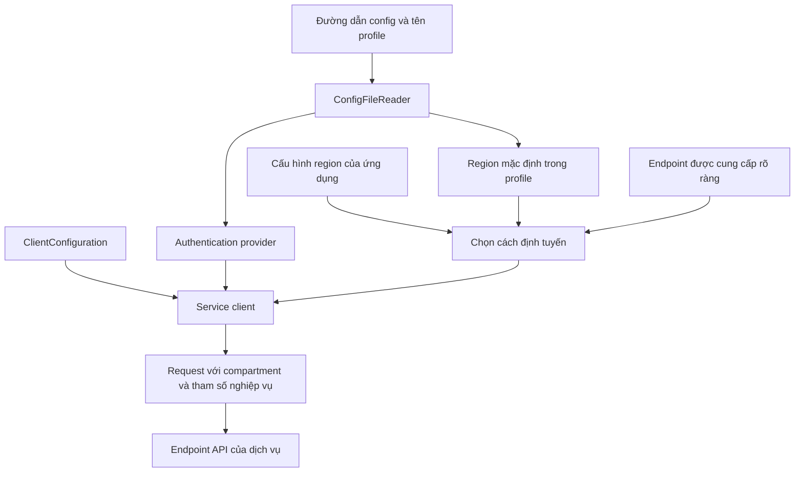

# Cấu hình clients, regions, endpoints và profiles

## 1. Bối cảnh và mục tiêu

Trong chương **OCI SDK và REST API với Java** của module **CLOUD_PROVIDERS_ORACLE**, cấu hình client là bước nối danh tính OCI, vị trí triển khai và lời gọi API trong chương trình Java. Một đoạn mã có thể biên dịch đúng nhưng vẫn gọi nhầm tenancy, sai region hoặc endpoint không phù hợp nếu các quyết định này bị trộn lẫn.

Tình huống xuyên suốt là ứng dụng Java đọc danh sách bucket để kiểm tra kết nối OCI. Lập trình viên chạy bằng profile phát triển trên máy cá nhân; khi triển khai lên OCI Compute, ứng dụng có thể chuyển sang danh tính của máy và vẫn giữ cách cấu hình client rõ ràng. Các nguyên tắc tương tự áp dụng khi quản lý Compute, VCN hoặc dịch vụ cơ sở dữ liệu, nhưng mỗi dịch vụ cần client và endpoint tương ứng.

Sau bài này, người học có thể:

- Phân biệt profile, authentication provider, service client, region và endpoint.
- Đọc đúng profile, hiểu cơ chế kế thừa và tránh chọn nhầm môi trường.
- Khởi tạo client bằng builder với cấu hình HTTP phù hợp.
- Chọn giữa endpoint do SDK xác định từ region và endpoint được chỉ định trực tiếp.
- Tái sử dụng client, quản lý vòng đời và chẩn đoán lỗi theo từng lớp.
- Thực hành kiểm tra cấu hình bằng lời gọi chỉ đọc, không cần tạo tài nguyên.

Ví dụ Java dùng JDK 17 và OCI Java SDK 3.x. Phần dependency cố định một phiên bản để người học có điểm xuất phát cụ thể; không coi số phiên bản đó là cam kết về bản mới nhất.

## 2. Năm khái niệm cần tách rõ

| Khái niệm | Câu hỏi được giải quyết | Ví dụ |
| --- | --- | --- |
| Profile | Đọc bộ giá trị cấu hình nào? | `DEV`, `DR`, `PROD` |
| Authentication provider | Ký hoặc xác thực yêu cầu bằng danh tính nào? | API signing key từ config, instance principal |
| Service client | Gọi API của dịch vụ nào? | `ObjectStorageClient`, `ComputeClient` |
| Region | Chọn vị trí dịch vụ nào khi định tuyến theo region? | `ap-singapore-1` |
| Endpoint | Yêu cầu HTTP thực sự được gửi tới đâu? | Base URL của API dịch vụ |

Trong OCI Java SDK, thông tin xác thực được đóng gói qua các authentication provider, còn các lựa chọn HTTP được cấu hình qua `ClientConfiguration`. Đây là hai phần khác nhau của việc khởi tạo client. [Oracle: cấu hình SDK cho Java](https://docs.oracle.com/en-us/iaas/Content/API/SDKDocs/javasdkgettingstarted.htm)

Không đồng nhất các khái niệm trong bảng:

- Profile tên `PROD` không tự cấp quyền quản trị.
- Đổi region không đổi user hay tenancy trong bộ thông tin xác thực.
- Đổi endpoint không tự di chuyển tài nguyên sang nơi khác.
- Tạo client thành công chưa chứng minh API đã xác thực hoặc có quyền truy cập.
- Một client Object Storage không trở thành client Compute bằng cách thay URL.

Compartment là phạm vi tổ chức và phân quyền tài nguyên. Nó thường được truyền trong request của API liên quan, thay vì là một lựa chọn region của client. Với `ListBuckets`, request có `namespaceName` và `compartmentId` để xác định phạm vi liệt kê. [Oracle: ListBucketsRequest.Builder](https://docs.oracle.com/en-us/iaas/tools/java/latest/com/oracle/bmc/objectstorage/requests/ListBucketsRequest.Builder.html)



## 3. Cấu hình profile cho môi trường phát triển

### 3.1. Cấu trúc file OCI config

Với xác thực bằng API signing key, file config chứa các giá trị như user OCID, tenancy OCID, fingerprint, đường dẫn private key và region. Vị trí quen thuộc là `~/.oci/config`; trên Windows, cần hiểu vị trí đó theo thư mục người dùng đang chạy JVM. Private key dùng định dạng PEM. [Oracle: SDK and CLI Configuration File](https://docs.oracle.com/en-us/iaas/Content/API/Concepts/sdkconfig.htm)

Ví dụ minh họa, mọi giá trị giữa dấu `<...>` phải được thay bằng giá trị hợp lệ của môi trường thực hành:

```ini
[DEFAULT]
user=<ocid-user-phat-trien>
tenancy=<ocid-tenancy-phat-trien>
fingerprint=<fingerprint-khoa-phat-trien>
key_file=C:/Users/YourName/.oci/dev_api_key.pem
region=ap-singapore-1

[DEV]
region=ap-singapore-1

[DR]
region=ap-tokyo-1

[PROD]
user=<ocid-user-san-xuat>
tenancy=<ocid-tenancy-san-xuat>
fingerprint=<fingerprint-khoa-san-xuat>
key_file=C:/Users/YourName/.oci/prod_api_key.pem
region=ap-singapore-1
```

Ví dụ giữ profile `DEFAULT` và viết đầy đủ các trường danh tính của `PROD` để người học dễ nhận diện ranh giới môi trường. Việc tồn tại profile `PROD` không phải lý do dùng khóa sản xuất để thực hành.

Trong đường dẫn Java trên Windows, có thể dùng dấu `/` như ví dụ để giảm nhầm lẫn với chuỗi có ký tự escape. Đường dẫn trong file INI không phải chuỗi Java; nếu đưa đường dẫn dùng backslash vào Java source, phải tuân thủ quy tắc escape của Java.

Không giả định biến môi trường của shell được nội suy trong mọi trường config. Để bài thực hành dễ tái hiện, ưu tiên đường dẫn tuyệt đối hợp lệ thay vì phụ thuộc vào thư mục làm việc hoặc cú pháp riêng của shell.

### 3.2. Kế thừa từ DEFAULT

Trong `ConfigFileReader.ConfigFile`, khi lấy một key, SDK ưu tiên giá trị của profile đang chọn; nếu profile đó không có key, SDK lấy từ `DEFAULT`; nếu cả hai đều không có thì trả về `null`. [Oracle: ConfigFile.get](https://docs.oracle.com/en-us/iaas/tools/java/latest/com/oracle/bmc/ConfigFileReader.ConfigFile.html)

Với file minh họa:

| Profile được chọn | Danh tính hiệu lực | Region từ config |
| --- | --- | --- |
| `DEFAULT` | User và tenancy phát triển | Singapore |
| `DEV` | Kế thừa danh tính phát triển | Singapore |
| `DR` | Kế thừa danh tính phát triển | Tokyo |
| `PROD` | Các trường sản xuất được ghi riêng | Singapore |

Điểm dễ sai nằm ở tên profile. `DR` trong ví dụ chỉ đổi region và vẫn dùng danh tính phát triển; nó chưa tạo một môi trường dự phòng hoàn chỉnh. Tương tự, nếu chỉ thêm `[PROD]` với một dòng region, các trường danh tính còn thiếu có thể tiếp tục kế thừa từ `DEFAULT`.

Nếu cần tách môi trường chặt chẽ hơn, có thể dùng file config riêng cho từng môi trường và truyền đường dẫn cụ thể cho ứng dụng. Đây là lựa chọn tổ chức cấu hình, không phải tính năng tự động suy ra từ tên profile.

### 3.3. Chọn profile bằng Java một cách tường minh

```java
import com.oracle.bmc.ConfigFileReader;
import com.oracle.bmc.auth.ConfigFileAuthenticationDetailsProvider;

ConfigFileReader.ConfigFile config =
        ConfigFileReader.parse(
                "C:/Users/YourName/.oci/config",
                "DEV"
        );

ConfigFileAuthenticationDetailsProvider provider =
        new ConfigFileAuthenticationDetailsProvider(config);
```

`ConfigFileReader` có các biến thể đọc đường dẫn được chỉ định hoặc vị trí mặc định. Trong ví dụ này, cả đường dẫn lẫn tên profile đều được truyền rõ ràng. [Oracle: ConfigFileReader](https://docs.oracle.com/en-us/iaas/tools/java/latest/com/oracle/bmc/ConfigFileReader.html)

`ConfigFileAuthenticationDetailsProvider` có constructor nhận `ConfigFile` và cung cấp cả thông tin xác thực lẫn region đọc được từ cấu hình. [Oracle: ConfigFileAuthenticationDetailsProvider](https://docs.oracle.com/en-us/iaas/tools/java/latest/com/oracle/bmc/auth/ConfigFileAuthenticationDetailsProvider.html)

Tên profile phải khớp cấu hình. Trong phiên bản SDK dùng ở ví dụ, chỉ định một profile không tồn tại sẽ gây lỗi thay vì âm thầm chọn một profile khác. Cơ chế kế thừa các key không đồng nghĩa với việc mọi tên profile đều được chấp nhận. [Oracle: mã nguồn ConfigFileReader 3.99.0](https://github.com/oracle/oci-java-sdk/blob/v3.99.0/bmc-common/src/main/java/com/oracle/bmc/ConfigFileReader.java)

Không dùng thành công của OCI CLI làm bằng chứng rằng chương trình Java đang dùng cùng file và profile. Hai tiến trình có thể được chạy bởi tài khoản hệ điều hành khác nhau hoặc nhận tham số khác nhau.

## 4. Region quyết định gì?

### 4.1. Định tuyến client theo vị trí dịch vụ

SDK có lớp `Region` để biểu diễn các region đã biết; builder của client theo region hỗ trợ chọn bằng đối tượng `Region` hoặc chuỗi region ID. Không phải dịch vụ nào cũng hiện diện trong mọi region. [Oracle: Region](https://docs.oracle.com/en-us/iaas/tools/java/latest/com/oracle/bmc/Region.html), [Oracle: RegionalClientBuilder](https://docs.oracle.com/en-us/iaas/tools/java/latest/com/oracle/bmc/common/RegionalClientBuilder.html)

Ví dụ:

```java
import com.oracle.bmc.Region;
import com.oracle.bmc.objectstorage.ObjectStorageClient;

ObjectStorageClient client =
        ObjectStorageClient.builder()
                .region(Region.fromRegionId("ap-singapore-1"))
                .build(provider);
```

Trong đoạn này, `provider` là đối tượng xác thực đã tạo ở phần trước. Builder được yêu cầu chọn endpoint Object Storage cho region Singapore.

Region ID như `ap-singapore-1` khác với:

- Tên hiển thị cho người đọc.
- Tên availability domain.
- Tên fault domain.
- OCID của compartment.
- Tên profile do người dùng tự đặt.

Không truyền các giá trị đó thay cho region ID.

### 4.2. Region trong profile và region của ứng dụng

Có hai nhu cầu hợp lệ:

1. Ứng dụng chạy đúng region đã khai báo trong profile.
2. Ứng dụng dùng cùng danh tính nhưng chủ động nhắm tới một region khác.

Để tránh đoán cấu hình, bài này dùng chính sách do **ứng dụng** định nghĩa:

```text
Khi không chỉ định endpoint trực tiếp:
  app.oci.region có giá trị → dùng region đó
  nếu không                → dùng region trong profile
  thiếu cả hai             → dừng với lỗi cấu hình
```

Đây là quy tắc của mã mẫu ở phần thực hành, không phải mô tả một chuỗi ưu tiên chung cho tất cả OCI SDK, CLI và framework.

Một khóa truy cập có thể được dùng để ký yêu cầu đến nhiều region phù hợp. Việc API có được phép thực hiện còn phụ thuộc IAM, dịch vụ, tenancy và region đích. Không cần tạo khóa mới chỉ vì đổi region.

### 4.3. Đổi region không phải cơ chế failover dữ liệu

Giả sử một bucket chỉ tồn tại ở Singapore. Tạo client nhắm Tokyo không làm bucket đó xuất hiện tại Tokyo.

Để ứng dụng có khả năng hoạt động ở region dự phòng, cần chuẩn bị riêng các yếu tố liên quan:

- Dịch vụ và quyền truy cập ở region đích.
- Tài nguyên hoặc dữ liệu đã sao chép theo phương án của dịch vụ.
- OCID, tên tài nguyên và tham số request đúng với đích.
- Mạng, cấu hình ứng dụng và quy trình chuyển đổi.

Tương tự, kết nối quản trị dịch vụ Database qua SDK không thay thế kết nối JDBC tới cơ sở dữ liệu. Endpoint REST phục vụ quản lý tài nguyên và địa chỉ kết nối ứng dụng là hai lớp khác nhau.

## 5. Endpoint là đích HTTP thực tế

### 5.1. Dùng region khi không cần override

Trong trường hợp thông thường, để SDK xác định endpoint dịch vụ từ region sẽ giảm việc hardcode hostname. Client cũng có API đặt endpoint trực tiếp khi cần đích cụ thể. [Oracle: ObjectStorageClient](https://docs.oracle.com/en-us/iaas/tools/java/latest/com/oracle/bmc/objectstorage/ObjectStorageClient.html)

Ví dụ chọn một trong hai cách khi tạo client:

```java
// Cách A: để SDK chọn endpoint từ region.
ObjectStorageClient regionalClient =
        ObjectStorageClient.builder()
                .region(Region.fromRegionId("ap-singapore-1"))
                .build(provider);

// Cách B: dùng endpoint đã được xác định cho đúng dịch vụ.
ObjectStorageClient explicitEndpointClient =
        ObjectStorageClient.builder()
                .endpoint("https://<hostname-object-storage-hop-le>")
                .build(provider);
```

Cách B là mẫu có placeholder, không phải URL chạy được nguyên trạng. Sau khi dùng xong, phải đóng cả hai client; trong ứng dụng thật thường chỉ cần tạo client phù hợp với cách định tuyến đã chọn.

Base endpoint không phải URL của một tài nguyên cụ thể. Với Object Storage, namespace, tên bucket và tên object thuộc request; không tự nối chúng vào base endpoint rồi vẫn gọi API SDK như bình thường.

### 5.2. Không trộn các lớp endpoint

Một số dịch vụ có endpoint quản trị và endpoint thao tác dữ liệu khác nhau. Ví dụ OCI Queue cung cấp `messagesEndpoint` gắn với queue; ứng dụng có thể lấy qua `GetQueue` để gửi và nhận message. [Oracle: Messages Endpoint](https://docs.oracle.com/en-us/iaas/Content/queue/messages.htm)

Vì vậy, trước khi đặt endpoint cần xác định:

| Câu hỏi | Ý nghĩa |
| --- | --- |
| Đây là dịch vụ nào? | Chọn đúng loại client |
| Endpoint phục vụ quản trị hay dữ liệu? | Chọn đúng nhóm thao tác |
| Endpoint thuộc region hoặc realm nào? | Tránh dùng mẫu hostname sai môi trường |
| Endpoint lấy từ đâu? | Từ tài liệu, Console hoặc API discovery của dịch vụ |
| Mạng hiện tại có tới được endpoint không? | Kiểm tra DNS, định tuyến và TLS |
| Tài nguyên đích là gì? | Kiểm tra OCID, namespace và tham số request |

Không suy ra mọi endpoint bằng cách thay tên region trong một chuỗi URL. Với môi trường thuộc realm khác, endpoint riêng hoặc cơ chế discovery của dịch vụ, cách suy đoán đó có thể không phù hợp.

### 5.3. Region và endpoint cần một quyết định rõ ràng

Các API như `setRegion` hoặc `setEndpoint` có thể thay đổi đích của client. Chúng không nên được gọi xen kẽ theo từng request trên client dùng chung.

Trong thiết kế của bài này:

```text
Có app.oci.endpoint:
  chọn nhánh endpoint trực tiếp
  region trong profile chỉ còn là thông tin cấu hình tham chiếu

Không có app.oci.endpoint:
  chọn nhánh region
  SDK xác định endpoint của dịch vụ
```

Mã không dựa vào thứ tự gọi nhiều setter để ngầm quyết định nơi gửi yêu cầu. Sau khi build, quan sát `getEndpoint()` để biết endpoint thực tế của client.

Nếu có endpoint trực tiếp trỏ Tokyo nhưng profile ghi Singapore, chỉ nhìn region của profile sẽ dẫn đến kết luận sai. Khi điều tra, cần ghi nhận cả chế độ định tuyến và endpoint đã resolve.

## 6. Cấu hình HTTP và vòng đời client

### 6.1. Timeout phải khớp loại công việc

```java
import com.oracle.bmc.ClientConfiguration;

ClientConfiguration httpConfig =
        ClientConfiguration.builder()
                .connectionTimeoutMillis(5_000)
                .readTimeoutMillis(30_000)
                .build();
```

`ClientConfiguration` có các tùy chọn timeout kết nối, timeout đọc và cấu hình liên quan đến retry. Các giá trị trên là lựa chọn minh họa. [Oracle: ClientConfiguration](https://docs.oracle.com/en-us/iaas/tools/java/latest/com/oracle/bmc/ClientConfiguration.html)

Cần hiểu các giới hạn khi lập ngân sách:

- Timeout kết nối giới hạn giai đoạn thiết lập kết nối theo cơ chế của HTTP transport.
- Timeout đọc không đồng nghĩa toàn bộ nghiệp vụ phải hoàn tất trong đúng khoảng đó.
- Retry có thể khiến tổng thời gian lời gọi vượt thời gian của một lần thử.
- API tạo tài nguyên có thể trả về trước khi tài nguyên đạt trạng thái mong muốn; chờ lifecycle là bài toán khác.

Ví dụ một endpoint không tới được không nên khiến luồng kiểm tra sức khỏe chờ kéo dài không kiểm soát. Ngược lại, đặt timeout quá ngắn cho một API có độ trễ bình thường cao sẽ tạo lỗi và retry không hữu ích.

### 6.2. Tái sử dụng sau khi khởi tạo

Oracle mô tả client có thể dùng đồng thời sau khi đã được khởi tạo và đặt endpoint; có thể tái sử dụng cho nhiều request. Bảo đảm threading được nêu trong tài liệu gắn với cách triển khai Jersey mặc định, nên transport thay thế cần được đánh giá riêng. [Oracle: threading model của SDK Java](https://docs.oracle.com/en-us/iaas/Content/API/SDKDocs/javasdkconcepts.htm)

Trong dịch vụ Java chạy lâu:

- Tạo client khi khởi động hoặc khi cần một cấu hình đích mới.
- Hoàn tất chọn region hoặc endpoint trước khi chia sẻ client.
- Inject client vào lớp nghiệp vụ thay vì tạo lại cho mỗi request.
- Đóng client khi ứng dụng dừng, sau khi xử lý xong các tác vụ đang dùng nó.
- Nếu đổi cấu hình, tạo client mới rồi chuyển việc sử dụng có kiểm soát.

Không dùng một client chung rồi đổi qua lại Singapore và Tokyo từ nhiều thread. Hai request có thể bị gửi tới đích khác với dự kiến.

Một cách tổ chức là quản lý client theo bộ cấu hình:

```text
dịch vụ + danh tính + chế độ định tuyến + đích + cấu hình transport
```

Đối với ứng dụng truy cập nhiều tenancy, danh tính phải là một phần của việc phân tách client. Tên region riêng lẻ không đủ để làm khóa phân loại.

## 7. Thực hành: kiểm tra cấu hình bằng Object Storage client

### 7.1. Chuẩn bị và giới hạn bài thực hành

Ví dụ thực hiện hai thao tác đọc:

1. Lấy namespace Object Storage của danh tính hiện tại.
2. Đọc tối đa một trang gồm 5 bucket trong compartment được chỉ định.

Cần có JDK 17, Maven, file OCI config hợp lệ, khóa tương ứng đã đăng ký và quyền IAM cho các API được gọi. Compartment phải thuộc phạm vi danh tính được phép truy cập. Mạng cần phân giải DNS và kết nối TLS tới endpoint dịch vụ.

Mẫu này sử dụng API signing key đọc từ config. Nếu khóa có passphrase, cần cấu hình cơ chế cung cấp passphrase lúc chạy phù hợp với SDK; không đưa passphrase thật vào source hoặc log.

Các đoạn `pom.xml` và Java dưới đây là nội dung để người học tạo trong một dự án thực hành riêng. Việc kiểm tra cấu hình không cần quyền tạo bucket, Compute instance hoặc database.

### 7.2. Dependency đồng bộ theo phiên bản

Dùng BOM để đồng bộ module OCI, đồng thời khai báo một HTTP transport Jersey 3. Mẫu chính thức của Oracle có cấu trúc import BOM SDK và POM quản lý dependency của transport tương ứng. [Oracle: ví dụ Maven Jersey 3 tại tag 3.99.0](https://github.com/oracle/oci-java-sdk/blob/v3.99.0/bmc-other-examples/bmc-jersey3-examples/pom.xml)

```xml
<project xmlns="http://maven.apache.org/POM/4.0.0"
         xmlns:xsi="http://www.w3.org/2001/XMLSchema-instance"
         xsi:schemaLocation="
           http://maven.apache.org/POM/4.0.0
           https://maven.apache.org/xsd/maven-4.0.0.xsd">
    <modelVersion>4.0.0</modelVersion>

    <groupId>example.oci</groupId>
    <artifactId>oci-client-config-demo</artifactId>
    <version>1.0.0</version>

    <properties>
        <maven.compiler.release>17</maven.compiler.release>
        <project.build.sourceEncoding>UTF-8</project.build.sourceEncoding>
        <oci.sdk.version>3.99.0</oci.sdk.version>
    </properties>

    <dependencyManagement>
        <dependencies>
            <dependency>
                <groupId>com.oracle.oci.sdk</groupId>
                <artifactId>oci-java-sdk-bom</artifactId>
                <version>${oci.sdk.version}</version>
                <type>pom</type>
                <scope>import</scope>
            </dependency>
            <dependency>
                <groupId>com.oracle.oci.sdk</groupId>
                <artifactId>oci-java-sdk-common-httpclient-jersey3</artifactId>
                <version>${oci.sdk.version}</version>
                <type>pom</type>
                <scope>import</scope>
            </dependency>
        </dependencies>
    </dependencyManagement>

    <dependencies>
        <dependency>
            <groupId>com.oracle.oci.sdk</groupId>
            <artifactId>oci-java-sdk-objectstorage</artifactId>
        </dependency>
        <dependency>
            <groupId>com.oracle.oci.sdk</groupId>
            <artifactId>oci-java-sdk-common-httpclient-jersey3</artifactId>
        </dependency>
    </dependencies>

    <build>
        <plugins>
            <plugin>
                <groupId>org.apache.maven.plugins</groupId>
                <artifactId>maven-compiler-plugin</artifactId>
                <version>3.13.0</version>
            </plugin>
            <plugin>
                <groupId>org.apache.maven.plugins</groupId>
                <artifactId>maven-dependency-plugin</artifactId>
                <version>3.7.1</version>
            </plugin>
        </plugins>
    </build>
</project>
```

Phiên bản 3.99.0 là bản phát hành có thật được chọn cho ví dụ. Khi thay phiên bản trong dự án, cập nhật các module liên quan đồng bộ và đối chiếu release notes. [Oracle: phát hành SDK 3.99.0](https://github.com/oracle/oci-java-sdk/releases/tag/v3.99.0)

Trong SDK 3.x, cần khai báo HTTP client implementation; thiếu transport có thể gây lỗi lúc chạy dù lớp client dịch vụ đã có trên classpath. Tránh đưa cả hai họ Jersey 2 và Jersey 3 vào dự án chỉ để thử khắc phục lỗi dependency. [Oracle: kho mã nguồn OCI Java SDK](https://github.com/oracle/oci-java-sdk)

### 7.3. Quy tắc cấu hình của chương trình

Chương trình dùng các Java system property do bài học tự đặt:

| Property | Giá trị mặc định | Ý nghĩa |
| --- | --- | --- |
| `app.oci.config` | `user.home/.oci/config` | File config cần đọc |
| `app.oci.profile` | `DEV` | Profile được chọn |
| `app.oci.region` | Region trong profile | Region khi chạy ở chế độ region |
| `app.oci.endpoint` | Không có | Chọn chế độ endpoint trực tiếp |
| `app.oci.compartment` | Không có, bắt buộc truyền | Phạm vi request liệt kê bucket |

Các tên `app.oci.*` không phải biến chuẩn mà OCI SDK tự tìm. Mã Java chủ động đọc chúng bằng `System.getProperty`. Vì chương trình truyền đường dẫn config cụ thể vào `ConfigFileReader.parse`, việc lựa chọn file không dựa vào chuỗi tìm vị trí mặc định của SDK.

Với `app.oci.config`, dùng đường dẫn cụ thể nếu truyền từ ngoài; chương trình không tự mở rộng dấu `~` trong giá trị property đó. Khi không truyền, đường dẫn được tạo từ `user.home` của JVM.

### 7.4. Mã Java hoàn chỉnh

Đặt lớp sau trong `src/main/java/OciClientConfigDemo.java` của dự án thực hành:

```java
import com.oracle.bmc.ClientConfiguration;
import com.oracle.bmc.ConfigFileReader;
import com.oracle.bmc.Region;
import com.oracle.bmc.auth.ConfigFileAuthenticationDetailsProvider;
import com.oracle.bmc.model.BmcException;
import com.oracle.bmc.objectstorage.ObjectStorageClient;
import com.oracle.bmc.objectstorage.requests.GetNamespaceRequest;
import com.oracle.bmc.objectstorage.requests.ListBucketsRequest;

import java.net.URI;
import java.nio.file.Files;
import java.nio.file.Path;
import java.util.UUID;

public final class OciClientConfigDemo {

    public static void main(String[] args) throws Exception {
        Path defaultConfig = Path.of(
                System.getProperty("user.home"), ".oci", "config"
        );

        String explicitConfig = optionalProperty("app.oci.config");
        Path configPath = explicitConfig == null
                ? defaultConfig
                : Path.of(explicitConfig);
        configPath = configPath.toAbsolutePath().normalize();

        if (!Files.isRegularFile(configPath)
                || !Files.isReadable(configPath)) {
            throw new IllegalArgumentException(
                    "OCI config must be a readable regular file"
            );
        }

        String profile = optionalProperty("app.oci.profile");
        if (profile == null) {
            profile = "DEV";
        }

        String compartmentId = requiredProperty("app.oci.compartment");

        ConfigFileReader.ConfigFile config =
                ConfigFileReader.parse(configPath.toString(), profile);

        ConfigFileAuthenticationDetailsProvider provider =
                new ConfigFileAuthenticationDetailsProvider(config);

        String regionHint = optionalProperty("app.oci.region");
        if (regionHint == null) {
            regionHint = config.get("region");
        }

        String endpointOverride = optionalProperty("app.oci.endpoint");

        ClientConfiguration httpConfig =
                ClientConfiguration.builder()
                        .connectionTimeoutMillis(5_000)
                        .readTimeoutMillis(30_000)
                        .build();

        ObjectStorageClient.Builder builder =
                ObjectStorageClient.builder()
                        .configuration(httpConfig);

        final String routingMode;
        if (endpointOverride != null) {
            builder.endpoint(validateObjectStorageBaseEndpoint(
                    endpointOverride
            ));
            routingMode = "EXPLICIT_ENDPOINT";
        } else {
            if (regionHint == null || regionHint.isBlank()) {
                throw new IllegalArgumentException(
                        "A region is required in regional routing mode"
                );
            }
            builder.region(Region.fromRegionId(regionHint.trim()));
            routingMode = "REGION";
        }

        try (ObjectStorageClient client = builder.build(provider)) {
            System.out.printf(
                    "profile=%s routing=%s regionHint=%s endpoint=%s%n",
                    profile,
                    routingMode,
                    regionHint,
                    client.getEndpoint()
            );

            String namespace = client.getNamespace(
                    GetNamespaceRequest.builder().build()
            ).getValue();

            var response = client.listBuckets(
                    ListBucketsRequest.builder()
                            .namespaceName(namespace)
                            .compartmentId(compartmentId)
                            .limit(5)
                            .opcClientRequestId(UUID.randomUUID().toString())
                            .build()
            );

            System.out.printf(
                    "itemsInPage=%d hasNextPage=%s opcRequestId=%s%n",
                    response.getItems().size(),
                    response.getOpcNextPage() != null,
                    response.getOpcRequestId()
            );
        } catch (BmcException error) {
            System.err.printf(
                    "status=%d serviceCode=%s opcRequestId=%s%n",
                    error.getStatusCode(),
                    error.getServiceCode(),
                    error.getOpcRequestId()
            );
            throw error;
        }
    }

    private static String optionalProperty(String name) {
        String value = System.getProperty(name);
        return value == null || value.isBlank() ? null : value.trim();
    }

    private static String requiredProperty(String name) {
        String value = optionalProperty(name);
        if (value == null) {
            throw new IllegalArgumentException(
                    "Missing Java system property: " + name
            );
        }
        return value;
    }

    private static String validateObjectStorageBaseEndpoint(
            String value
    ) {
        URI uri = URI.create(value);
        String path = uri.getPath();

        if (!"https".equalsIgnoreCase(uri.getScheme())
                || uri.getHost() == null
                || uri.getUserInfo() != null
                || uri.getQuery() != null
                || uri.getFragment() != null
                || (path != null
                    && !path.isEmpty()
                    && !"/".equals(path))) {
            throw new IllegalArgumentException(
                    "Expected an HTTPS Object Storage base endpoint"
            );
        }

        return uri.toString();
    }
}
```

Hàm kiểm tra endpoint chỉ xác nhận hình thức URL phù hợp với base endpoint của ví dụ Object Storage. Nó không chứng minh hostname thuộc Oracle, dịch vụ có thể truy cập hay danh tính có quyền. Endpoint thực tế phải đến từ cấu hình triển khai đáng tin cậy hoặc cơ chế discovery đúng dịch vụ; không lấy trực tiếp từ tham số của một HTTP request bên ngoài.

`regionHint` trong log là thông tin cấu hình tham chiếu. Khi `routing=EXPLICIT_ENDPOINT`, đích cần kiểm tra là giá trị `endpoint`, không suy ra từ `regionHint`.

Phản hồi `ListBuckets` có danh sách items, request ID và token trang tiếp theo. Mẫu chỉ đọc một trang nên `itemsInPage` không phải tổng số bucket trong compartment. [Oracle: ListBucketsResponse](https://docs.oracle.com/en-us/iaas/tools/java/latest/com/oracle/bmc/objectstorage/responses/ListBucketsResponse.html)

`BmcException` cung cấp HTTP status, service code và request ID để phục vụ chẩn đoán. Lỗi trước khi gọi dịch vụ có thể chưa có request ID phía server. [Oracle: BmcException](https://docs.oracle.com/en-us/iaas/tools/java/latest/com/oracle/bmc/model/BmcException.html)

### 7.5. Biên dịch và chạy

Các lệnh sau dành cho **dự án thực hành riêng của người học**. Maven chỉ chuẩn bị mã và dependency; lời gọi dịch vụ xảy ra khi chạy lớp Java.

```bash
mvn -q compile dependency:copy-dependencies
```

Trên Bash, dùng dấu `:` để phân tách classpath:

```bash
java \
  -cp "target/classes:target/dependency/*" \
  -Dapp.oci.profile=DEV \
  -Dapp.oci.region=ap-singapore-1 \
  -Dapp.oci.compartment=<ocid-compartment-thuc-hanh> \
  OciClientConfigDemo
```

Trước khi chạy lệnh Bash, thay toàn bộ `<ocid-compartment-thuc-hanh>` bằng OCID thật; không giữ dấu `<` và `>`, vì shell có thể hiểu chúng là toán tử chuyển hướng.

Trên Windows PowerShell, dùng dấu `;` trong classpath và có thể chạy một dòng:

```powershell
java -cp "target/classes;target/dependency/*" "-Dapp.oci.profile=DEV" "-Dapp.oci.region=ap-singapore-1" "-Dapp.oci.compartment=<ocid-compartment-thuc-hanh>" OciClientConfigDemo
```

Nếu file config ở vị trí riêng, thêm property trước tên lớp:

```text
-Dapp.oci.config=C:/Users/YourName/.oci/config
```

Kết quả minh họa, không phải đầu ra đã chạy trên một tenancy cụ thể:

```text
profile=DEV routing=REGION regionHint=ap-singapore-1 endpoint=<endpoint-da-resolve>
itemsInPage=2 hasNextPage=false opcRequestId=<request-id>
```

Có thể xuất hiện thông báo của logging framework nếu dự án chưa cấu hình binding logging. Cần phân biệt thông báo logging với lỗi transport hoặc lỗi API; khi tích hợp vào ứng dụng thật, dùng cấu hình logging thống nhất của ứng dụng.

### 7.6. Các phép quan sát cấu hình

Thực hiện trên tài nguyên được phép truy cập, mỗi lần thay một yếu tố:

| Thay đổi | Kết quả cần quan sát |
| --- | --- |
| Bỏ `app.oci.region` | Chương trình dùng region lấy từ profile |
| Chọn profile `DR`, không truyền region override | Vẫn danh tính phát triển; đích theo region của `DR` |
| Truyền region override khác profile | Log cho biết region được ứng dụng chọn và endpoint mới |
| Truyền endpoint hợp lệ của Object Storage | Chuyển sang `EXPLICIT_ENDPOINT` |
| Truyền profile không tồn tại | Lỗi cấu hình trước khi chạy chuỗi API |
| Truyền compartment không được phép đọc | Có thể thất bại ở API liệt kê dù client đã build |
| Dùng compartment hợp lệ nhưng chưa có bucket ở region đó | Có thể thành công với trang kết quả rỗng |

Để quan sát nhánh endpoint mà chưa thay đổi đích, trước tiên chạy theo region, lấy endpoint đã resolve của đúng client rồi truyền lại endpoint đó ở lần chạy sau. Cách này giúp tách việc kiểm tra nhánh cấu hình khỏi việc đổi tài nguyên hoặc môi trường.

Một danh sách rỗng không chứng minh toàn bộ cấu hình đúng theo ý định nghiệp vụ. Phải đối chiếu profile, region hoặc endpoint, compartment và tài nguyên mẫu dự kiến.

## 8. Từ máy phát triển đến ứng dụng chạy trên OCI

### 8.1. Tách lựa chọn danh tính khỏi lựa chọn đích

Trên máy phát triển, API signing key trong profile là một cách thực hành thuận tiện. Trên OCI Compute, ứng dụng có thể dùng instance principal để tránh phân phối khóa người dùng vào máy chạy ứng dụng.

Ví dụ thay phần tạo provider khi ứng dụng chạy trong môi trường hỗ trợ:

```java
import com.oracle.bmc.auth.InstancePrincipalsAuthenticationDetailsProvider;

var instanceProvider =
        InstancePrincipalsAuthenticationDetailsProvider.builder()
                .build();

try (ObjectStorageClient client =
             ObjectStorageClient.builder()
                     .configuration(httpConfig)
                     .region(Region.fromRegionId("ap-singapore-1"))
                     .build(instanceProvider)) {
    // Thực hiện API đã được IAM cho phép.
}
```

Đây là đoạn thay thế trong ngữ cảnh đã có `httpConfig`, không phải chương trình độc lập. Instance principal cần cấu hình danh tính tài nguyên và policy phù hợp; nó không tự có quyền đọc mọi tài nguyên. Các cách xác thực OCI Java khác nhau được Oracle mô tả trong tài liệu SDK. [Oracle: các khái niệm xác thực và client Java](https://docs.oracle.com/en-us/iaas/Content/API/SDKDocs/javasdkconcepts.htm)

Tách thành hai quyết định giúp chuyển môi trường mà không làm rối định tuyến:

```text
Danh tính:
  máy phát triển → provider từ config
  Compute        → provider instance principal

Đích:
  region hoặc endpoint đã được cấu hình cho môi trường
```

Không tự động fallback sang một profile có quyền rộng khi instance principal thất bại. Nếu danh tính của môi trường không khởi tạo được, ứng dụng nên báo lỗi rõ để người vận hành sửa cấu hình.

### 8.2. Các lớp nên chịu trách nhiệm gì?

| Lớp hoặc thành phần | Trách nhiệm |
| --- | --- |
| Đọc cấu hình ứng dụng | Lấy profile, region, endpoint, timeout và tham số môi trường |
| Tạo authentication provider | Chọn cơ chế xác thực của môi trường |
| Factory hoặc cấu hình dependency injection | Tạo client đúng dịch vụ và đích |
| Lớp nghiệp vụ | Tạo request với compartment, OCID và dữ liệu nghiệp vụ |
| Quản lý vòng đời ứng dụng | Đóng client sau khi ngừng tiếp nhận công việc |

Khi mở rộng sang Compute hoặc Database, áp dụng cùng cách phân chia nhưng dùng module và client dịch vụ tương ứng. Không tạo một client Object Storage duy nhất rồi cho lớp nghiệp vụ thay endpoint theo tên dịch vụ.

Trong ứng dụng có nhiều region, có thể giữ các client riêng theo cấu hình cố định. Nếu cần chuyển sang đích mới, tạo client mới, kiểm tra thao tác đọc phù hợp, chuyển lưu lượng và đóng client cũ khi không còn tác vụ sử dụng.

## 9. Chẩn đoán theo thứ tự cấu hình, mạng và API

### 9.1. Dấu hiệu lỗi thuộc các lớp khác nhau

| Dấu hiệu | Khả năng cần kiểm tra | Hành động phù hợp |
| --- | --- | --- |
| Không đọc được config | Sai đường dẫn, JVM chạy dưới user khác hoặc quyền file thiếu | Kiểm tra đường dẫn hiệu lực và tài khoản chạy tiến trình |
| Không tìm thấy profile | Tên không khớp hoặc dùng nhầm file | Kiểm tra tên profile được truyền |
| Không đọc được private key | `key_file` sai, quyền file hoặc định dạng không phù hợp | Kiểm tra nguồn khóa và cơ chế đọc khóa |
| Không tạo được region | Region ID nhập sai hoặc SDK chưa biết region đó | Kiểm tra ID và khả năng hỗ trợ của SDK |
| Lỗi không tìm thấy HTTP provider | Thiếu module transport lúc chạy | Kiểm tra dependency và classpath |
| `ClassNotFoundException` hoặc `NoSuchMethodError` | Module lệch phiên bản hoặc xung đột dependency | Kiểm tra BOM và dependency tree |
| Không phân giải được hostname | Endpoint sai hoặc cấu hình DNS có vấn đề | Kiểm tra hostname đã resolve từ client |
| Timeout kết nối hoặc lỗi TLS | Định tuyến mạng, proxy, firewall hoặc trust store | Điều tra ở lớp kết nối trước khi sửa IAM |
| API trả lỗi xác thực | Khóa, fingerprint, user, chữ ký hoặc thời gian hệ thống | Đối chiếu danh tính và thông tin lỗi |
| API không cho thấy tài nguyên | Sai đích, OCID, compartment hoặc quyền IAM | Kiểm tra kết hợp mã lỗi và cấu hình hiệu lực |

Không suy ra “tài nguyên không tồn tại” chỉ từ một lỗi không truy cập được. Tùy API, phản hồi có thể không phân biệt chi tiết tài nguyên không tồn tại với trường hợp không được phép nhìn thấy.

Không dùng tăng timeout hoặc thêm retry làm phản ứng đầu tiên với profile sai, endpoint sai hay quyền thiếu. Các thay đổi đó thường chỉ kéo dài thời gian thất bại.

### 9.2. Thông tin nên ghi nhận

Khi khởi động hoặc khi một lời gọi thất bại, cần đủ dữ kiện để xác định đích mà không lộ bí mật:

- Tên dịch vụ và phiên bản ứng dụng.
- Tên profile hoặc loại authentication provider.
- Chế độ định tuyến theo region hay endpoint trực tiếp.
- Region được cấu hình và endpoint thực tế.
- Thao tác API, thời gian xử lý và kết quả.
- Request ID cùng service code nếu đã có phản hồi dịch vụ.

Không log private key, passphrase, security token hoặc toàn bộ file config. Ngay cả `ConfigFile.toString()` cũng không nên được dùng như cách tiện lợi để in toàn bộ cấu hình, vì nó có thể xuất các giá trị không cần công khai.

Với compartment hoặc OCID trong log, chọn mức chi tiết theo nhu cầu vận hành và quy định của hệ thống. Thông tin chẩn đoán nên đủ để tìm ra cấu hình bị nhầm, không cần sao chép mọi tham số request.

## 10. Liên hệ với vận hành, tính sẵn sàng và chi phí

Cấu hình client quyết định chương trình đang tác động vào môi trường nào. Khi chương trình có quyền tạo Compute instance, volume hoặc database, nhầm profile hay region có thể tạo tài nguyên ngoài kế hoạch dù API vẫn trả thành công.

Một cách triển khai dễ kiểm soát gồm:

1. Tách bộ cấu hình phát triển, kiểm thử và sản xuất.
2. Chọn danh tính có quyền vừa đủ cho tác vụ.
3. Xác định region hoặc endpoint trước khi chia sẻ client.
4. Ghi nhận cấu hình định tuyến đã resolve ở thời điểm khởi động.
5. Kiểm tra bằng thao tác đọc phù hợp trước khi bật luồng tạo hoặc sửa tài nguyên.
6. Theo dõi lỗi, độ trễ và số lần gọi lại theo dịch vụ và đích.

Tái sử dụng client giúp tránh việc lặp lại khởi tạo tài nguyên HTTP cho mỗi request. Timeout và retry có ngân sách giúp giới hạn thời gian chờ và số yêu cầu thừa, nhưng không thay thế việc sửa cấu hình sai.

Region dự phòng chỉ có ích khi dữ liệu, quyền, mạng và tài nguyên ở đó đã được chuẩn bị. Đổi một chuỗi region trong cấu hình Java là thao tác định tuyến; khả năng phục hồi của ứng dụng còn phụ thuộc phương án hạ tầng và dữ liệu phía sau endpoint đó.
