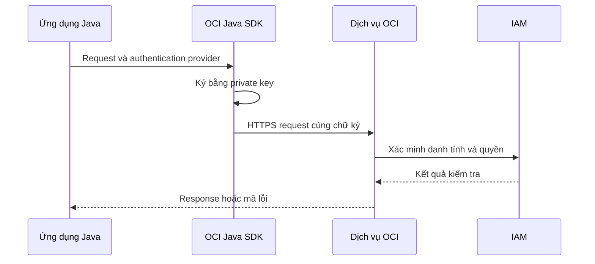

# Xác thực Java SDK bằng API signing key và session token

## 1. Mục tiêu và bối cảnh

Ứng dụng Java muốn đọc danh sách OCI Compute instances, tạo VCN hoặc thao tác với dịch vụ lưu trữ phải chứng minh danh tính gọi API trước khi OCI kiểm tra quyền truy cập. Chọn đúng cơ chế xác thực giúp việc phát triển, vận hành và tự động hóa hạ tầng có thể kiểm soát được.

Bài học thuộc chương **OCI SDK và REST API với Java** trong module **CLOUD_PROVIDERS_ORACLE**. Nội dung tập trung vào hai phương thức xác thực theo danh tính người dùng: **API signing key** và **session token**. Ví dụ dùng một thao tác đọc Compute trong compartment dành cho thực hành, phù hợp với mục tiêu triển khai OCI có IAM, giám sát và kiểm soát chi phí.

Sau bài học, người học có thể:

- Giải thích vai trò của private key, public key, fingerprint, OCID và session token.
- Chuẩn bị profile OCI riêng cho từng phương thức.
- Chọn đúng authentication provider của Java SDK.
- Gọi thử một API đọc tài nguyên mà không cần tạo Compute instance.
- Phân biệt lỗi xác thực, lỗi phân quyền và lỗi kết nối.
- Quản lý vòng đời credential, refresh token và đóng tài nguyên Java đúng cách.

Xác thực các API quản trị dịch vụ OCI khác với đăng nhập SQL qua JDBC vào Oracle Database. API signing key không thay thế tài khoản cơ sở dữ liệu, wallet hoặc cơ chế xác thực dữ liệu mà dịch vụ cơ sở dữ liệu yêu cầu.

## 2. Xác thực và phân quyền là hai bước khác nhau

Một request cần vượt qua ít nhất ba nhóm kiểm tra:

| Nhóm kiểm tra | Câu hỏi | Ví dụ |
| --- | --- | --- |
| Kết nối và endpoint | Có đến đúng dịch vụ, đúng region qua HTTPS không? | DNS, proxy, TLS và endpoint Compute |
| Xác thực | Request được ký bởi danh tính hợp lệ không? | Key đúng cặp, token còn hiệu lực, thời gian máy chính xác |
| Phân quyền | Danh tính đó được thực hiện thao tác này trên tài nguyên nào? | IAM policy cho phép đọc instances trong compartment lab |

Đăng nhập Console thành công không có nghĩa mọi API đều được phép. Tương tự, tạo được authentication provider trong Java chưa chứng minh request thực tế sẽ được dịch vụ chấp nhận.

Với hai cơ chế trong bài, quyền nghiệp vụ vẫn dựa trên người dùng và chính sách IAM liên quan. Thay API signing key bằng session token không tự cấp thêm quyền quản trị. Xem [các phương thức xác thực OCI SDK](https://docs.oracle.com/en-us/iaas/Content/API/Concepts/sdk_authentication_methods.htm).

Các định danh cần phân biệt:

- **Tenancy OCID** xác định tenancy của danh tính.
- **User OCID** xác định người dùng gắn với API signing key.
- **Compartment OCID** xác định phạm vi tài nguyên của request ví dụ.
- **Region** xác định vị trí gọi dịch vụ; đây không phải một IAM permission.
- **Fingerprint** giúp nhận diện public key đã đăng ký; nó không phải private key.

Không dùng tenancy OCID thay compartment OCID chỉ vì cả hai đều là chuỗi bắt đầu bằng `ocid1`.

## 3. Hai phương thức ký request

### 3.1. API signing key

API signing key là một cặp khóa bất đối xứng. Public key được đăng ký cho người dùng OCI; private key được giữ tại máy hoặc môi trường chạy ứng dụng. SDK dùng private key để tạo chữ ký của request. OCI xác minh chữ ký bằng public key tương ứng.

Oracle yêu cầu cặp khóa RSA dạng PEM, tối thiểu 2048 bit. Không dùng nguyên khóa SSH để đăng nhập Compute như một API signing key. Xem [Security Credentials](https://docs.oracle.com/en-us/iaas/Content/General/Concepts/credentials.htm).



Private key không được gửi lên OCI để xác thực mỗi request. Chỉ public key được đăng ký và chữ ký được gửi theo giao thức.

Một API signing key không phải chuỗi “API key” dùng trực tiếp như mật khẩu trong header. Fingerprint cũng không được đưa vào `Bearer` header.

### 3.2. Session token

Session token biểu diễn một phiên xác thực tạm thời của người dùng. Trong quy trình có trình duyệt, OCI CLI mở luồng đăng nhập; người dùng hoàn tất xác thực theo cấu hình của tenancy và identity provider, sau đó CLI tạo dữ liệu phiên tại máy.

Java SDK đọc token cùng private key tương ứng của phiên và vẫn ký request. Chỉ có file token mà thiếu đúng private key không đủ cho cơ chế này.

```text
Đăng nhập qua OCI CLI
        |
        v
Profile + security_token_file + key_file của phiên
        |
        v
SessionTokenAuthenticationDetailsProvider
        |
        v
Request OCI được ký bằng credential của phiên
```

Không đồng nhất session token với **OCI auth token** dùng cho một số giao thức hoặc dịch vụ khác. Không thay field `security_token_file` bằng một chuỗi auth token lấy từ mục quản lý credential. Phân loại credential được Oracle mô tả trong [Managing User Credentials](https://docs.oracle.com/en-us/iaas/Content/Identity/Tasks/managingcredentials.htm).

### 3.3. Chọn theo môi trường sử dụng

| Tiêu chí | API signing key | Session token |
| --- | --- | --- |
| Provider chính trong bài | `ConfigFileAuthenticationDetailsProvider` | `SessionTokenAuthenticationDetailsProvider` |
| Dữ liệu cục bộ trọng yếu | Private key và profile nhận diện key | Token, private key của phiên và profile |
| Vòng đời | Cần chính sách xoay vòng và thu hồi key | Cần theo dõi hết hạn và giới hạn gia hạn phiên |
| Tình huống phù hợp | Công cụ cần danh tính người dùng được quản lý bằng key | Phát triển và thao tác tương tác theo phiên đăng nhập |
| Vấn đề vận hành | Phân phối và bảo vệ khóa tồn tại lâu | Token hết hạn, refresh và yêu cầu đăng nhập lại |
| Quyền tài nguyên | Theo IAM của người dùng | Theo IAM của người dùng |

Đây là hướng chọn thiết kế, không phải yêu cầu phải dùng cùng một phương thức ở mọi môi trường. Với workload chạy lâu trên Compute, Functions hoặc nền tảng hỗ trợ danh tính workload, nên đánh giá instance principal hoặc resource principal phù hợp thay vì phụ thuộc vào phiên đăng nhập cá nhân.

## 4. Chuẩn bị IAM và môi trường thực hành

Ví dụ trong bài gọi `ListInstances` theo compartment và region. Không cần tạo mới instance để kiểm tra xác thực; danh sách rỗng vẫn là một kết quả hợp lệ.

Chuẩn bị:

1. Người dùng OCI có thể quản lý credential của chính mình theo quy định tenancy.
2. Một compartment thực hành đã có OCID.
3. Nhóm IAM chứa người dùng và policy phù hợp cho thao tác đọc Compute.
4. JDK và OCI Java SDK tương thích; ví dụ phụ thuộc bên dưới dùng SDK 3.x.
5. OCI CLI nếu thực hành session token.
6. HTTPS đến các endpoint liên quan; máy có đồng hồ được đồng bộ.

Ví dụ policy có phạm vi compartment:

```text
Allow group JavaSdkReaders to read instances in compartment JavaSdkLab
```

Thay tên nhóm và compartment bằng định danh thực tế. Với tenancy sử dụng identity domains, tham chiếu nhóm cần đúng cách định danh domain/group của môi trường.

Chọn `read instances` vì bảng quyền Core Services quy định `ListInstances` cần `INSTANCE_READ`; chỉ `inspect instances` chưa đủ cho thao tác này. Xem [Details for the Core Services](https://docs.oracle.com/en-us/iaas/Content/Identity/Reference/corepolicyreference.htm).

Quyền đọc instances có thể cho phép thấy metadata của instance. Phạm vi lab nên đủ nhỏ và không chứa dữ liệu nhạy cảm. Khi mở rộng ví dụ sang VCN, Object Storage hoặc API quản trị cơ sở dữ liệu, phải đối chiếu quyền của từng thao tác thay vì cấp `manage all-resources` để xử lý mọi lỗi.

## 5. Khai báo dependency cho Java SDK

SDK 3.x yêu cầu lựa chọn HTTP client implementation. Ví dụ dưới đây dùng Jersey 3 và đồng bộ version các module bằng BOM, theo [hướng dẫn bắt đầu với Java SDK](https://docs.oracle.com/en-us/iaas/Content/API/SDKDocs/javasdkgettingstarted.htm).

Đây là phần cấu hình Maven để tích hợp vào dự án Java thực hành, không phải một yêu cầu thay đổi project đang có. Phiên bản `3.98.0` là một mốc cụ thể cho ví dụ; khi chọn phiên bản khác, cần giữ các module đồng bộ và đối chiếu API của phiên bản đó.

```xml
<properties>
    <oci.sdk.version>3.98.0</oci.sdk.version>
</properties>

<dependencyManagement>
    <dependencies>
        <dependency>
            <groupId>com.oracle.oci.sdk</groupId>
            <artifactId>oci-java-sdk-bom</artifactId>
            <version>${oci.sdk.version}</version>
            <type>pom</type>
            <scope>import</scope>
        </dependency>
    </dependencies>
</dependencyManagement>

<dependencies>
    <dependency>
        <groupId>com.oracle.oci.sdk</groupId>
        <artifactId>oci-java-sdk-core</artifactId>
    </dependency>
    <dependency>
        <groupId>com.oracle.oci.sdk</groupId>
        <artifactId>oci-java-sdk-common-httpclient-jersey3</artifactId>
    </dependency>
</dependencies>
```

Không trộn tùy tiện nhiều version của `oci-java-sdk-common`, service module và HTTP client. Nếu dự án đã chọn Jersey 2 hoặc một cấu hình phụ thuộc có chủ đích, giữ cấu hình tương thích thay vì thêm Jersey 3 song song.

## 6. Chuẩn bị API signing key và profile

### 6.1. Tạo khóa và đăng ký public key

Một quy trình thực hành:

1. Tạo cặp khóa trong Console hoặc bằng công cụ hỗ trợ theo hướng dẫn Oracle.
2. Lưu private key ngoài repository và bảo vệ quyền đọc file.
3. Đăng ký **public key** cho đúng người dùng.
4. Sao chép fingerprint và các OCID từ cấu hình tương ứng.
5. Kiểm tra private key đang dùng thực sự khớp public key đã đăng ký.

Nếu dùng OpenSSL, ví dụ sau tạo private key có passphrase và xuất public key:

```text
openssl genrsa -aes128 -out dev_api_key.pem 2048
openssl rsa -pubout -in dev_api_key.pem -out dev_api_key_public.pem
```

Nhập passphrase qua lời nhắc của công cụ. Không đưa private key vào trường upload public key. Các bước và định dạng được mô tả trong [Required Keys and OCIDs](https://docs.oracle.com/en-us/iaas/Content/API/Concepts/apisigningkey.htm).

Các tên file trên là tên minh họa. Khi thực hành, chọn thư mục credential của riêng người dùng, tránh sinh khóa tại thư mục nguồn hoặc thư mục được đồng bộ công khai.

### 6.2. Profile API key

Ví dụ nội dung trong file cấu hình OCI riêng của người dùng:

```ini
[DEV_API_KEY]
user=ocid1.user.oc1..REPLACE_WITH_USER_OCID
fingerprint=REPLACE_WITH_PUBLIC_KEY_FINGERPRINT
tenancy=ocid1.tenancy.oc1..REPLACE_WITH_TENANCY_OCID
region=ap-singapore-1
key_file=C:/Users/<windows-user>/.oci/keys/dev_api_key.pem
```

Đổi region theo region đã đăng ký và nơi cần gọi Compute. Trên Linux hoặc macOS, dùng đường dẫn thực tế tương ứng. Trong Java, dùng đường dẫn tuyệt đối hoặc quy ước `~` được SDK hỗ trợ; đừng giả định chuỗi `$env:USERPROFILE` hay `%USERPROFILE%` bên trong file INI sẽ được Java tự mở rộng như shell.

Ý nghĩa các field:

| Field | Vai trò |
| --- | --- |
| `user` | Người dùng đã đăng ký public key |
| `fingerprint` | Public key nào của người dùng được chọn |
| `tenancy` | Tenancy của danh tính |
| `region` | Region mặc định cho client |
| `key_file` | Đường dẫn private key, không phải public key |
| `security_token_file` | Không cần cho profile API signing key này |

Với file cấu hình chung có nhiều profile, việc kế thừa từ `DEFAULT` có thể khiến giá trị thiếu được lấy từ profile khác. Chọn rõ profile và kiểm tra cả bộ credential thay vì chỉ nhìn tên section. Xem [SDK and CLI Configuration File](https://docs.oracle.com/en-us/iaas/Content/API/Concepts/sdkconfig.htm).

### 6.3. Passphrase của private key

Nếu private key được mã hóa, provider cần passphrase để giải mã. Cấu hình ở trên cố ý không chứa passphrase. Oracle đánh dấu field `pass_phrase` trong file cấu hình là deprecated và khuyến nghị truyền bí mật lúc chạy; không đặt passphrase thật vào ví dụ cấu hình hoặc source code.

Với khóa có passphrase, có thể dựng `SimpleAuthenticationDetailsProvider` thay cho provider đọc toàn bộ thông tin từ file. Đoạn mã minh họa này nhận `config` đã parse và `passphrase` là `char[]` lấy từ cơ chế nhập hoặc kho bí mật của ứng dụng:

```java
AuthenticationDetailsProvider provider =
        SimpleAuthenticationDetailsProvider.builder()
                .tenantId(config.get("tenancy"))
                .userId(config.get("user"))
                .fingerprint(config.get("fingerprint"))
                .privateKeySupplier(
                        new SimplePrivateKeySupplier(config.get("key_file")))
                .passphraseCharacters(passphrase)
                .build();
```

Các lớp đều thuộc `com.oracle.bmc.auth`. Provider này vẫn thực hiện xác thực bằng API signing key; việc thay cách lấy passphrase không đổi danh tính IAM. Xem [SimpleAuthenticationDetailsProvider builder](https://docs.oracle.com/en-us/iaas/tools/java/latest/com/oracle/bmc/auth/SimpleAuthenticationDetailsProvider.SimpleAuthenticationDetailsProviderBuilder.html).

Không xóa mảng passphrase khi client vẫn còn cần dùng nó để ký request. Giới hạn thời gian giữ bí mật trong bộ nhớ theo vòng đời của provider và ứng dụng. Nếu dùng `System.console().readPassword()`, cần xử lý trường hợp không có console trong IDE hoặc môi trường chạy tự động.

## 7. Tạo session token bằng OCI CLI

### 7.1. Đăng nhập với trình duyệt

Ví dụ lệnh PowerShell, dùng một profile riêng:

```powershell
$ociConfig = Join-Path $env:USERPROFILE '.oci\config'
oci session authenticate --config-file "$ociConfig" --region ap-singapore-1 --profile-name DEV_SESSION
```

Hoàn tất đăng nhập trong trình duyệt, bao gồm MFA hoặc bước xác thực của IdP nếu môi trường yêu cầu. CLI tạo hoặc cập nhật dữ liệu phiên và profile theo lựa chọn của người dùng.

Chạy lệnh này là một bước thực hành của người học; ứng dụng Java không tự mở trình duyệt chỉ vì khởi tạo session token provider.

Luồng và các tùy chọn được mô tả trong [CLI session authenticate](https://docs.oracle.com/en-us/iaas/tools/oci-cli/latest/oci_cli_docs/cmdref/session/authenticate.html).

### 7.2. Nhận diện profile của phiên

Cấu trúc minh họa:

```ini
[DEV_SESSION]
tenancy=ocid1.tenancy.oc1..REPLACE_WITH_TENANCY_OCID
region=ap-singapore-1
key_file=C:/Users/<windows-user>/.oci/sessions/DEV_SESSION/oci_api_key.pem
security_token_file=C:/Users/<windows-user>/.oci/sessions/DEV_SESSION/token
```

Giữ các đường dẫn và dữ liệu mà CLI thực tế tạo. Không chép token trực tiếp vào file INI hoặc thay private key của phiên bằng một API private key bất kỳ. Thư mục và tên file thực tế có thể khác ví dụ tùy tùy chọn CLI.

Token và private key là một bộ credential cần được quản lý cùng nhau. File cấu hình chủ yếu trỏ đến chúng; sao chép riêng section INI sang máy khác không đảm bảo đã có đủ dữ liệu để xác thực.

### 7.3. Kiểm tra phiên bằng CLI

```powershell
oci session validate --config-file "$ociConfig" --profile DEV_SESSION --auth security_token
```

CLI cần `--auth security_token` để sử dụng kiểu xác thực này cho các lệnh liên quan. Flag đó không thay đổi cách chọn provider trong Java; mã Java vẫn phải dùng `SessionTokenAuthenticationDetailsProvider`.

Kiểm tra phiên hợp lệ và gọi API tài nguyên là hai phép kiểm tra khác nhau. Một phiên hợp lệ vẫn có thể thiếu quyền đọc instances. Xem [Token-based Authentication for the CLI](https://docs.oracle.com/en-us/iaas/Content/API/SDKDocs/clitoken.htm).

## 8. Ví dụ Java chọn provider tường minh

Ví dụ sau dùng cùng một thao tác đọc cho cả hai phương thức. Tên lớp minh họa là `OciAuthenticationProbe`; tích hợp mã vào dự án Java thực hành có dependency ở phần trước.

Chương trình nhận bốn tham số:

```text
<api-key|session-token> <config-file> <profile> <compartment-ocid>
```

Điều kiện sử dụng:

- `api-key`: profile chứa credential API signing key. Với private key mã hóa, thay nhánh tạo provider bằng cách cấp passphrase lúc chạy ở phần 6.3.
- `session-token`: profile do CLI tạo có token còn hợp lệ và đúng private key.
- Compartment OCID là compartment lab được IAM cho phép đọc.
- Ví dụ chỉ đọc một trang kết quả, không phải chương trình kiểm kê toàn bộ tenancy.

```java
import com.oracle.bmc.ClientConfiguration;
import com.oracle.bmc.ConfigFileReader;
import com.oracle.bmc.auth.AuthenticationDetailsProvider;
import com.oracle.bmc.auth.ConfigFileAuthenticationDetailsProvider;
import com.oracle.bmc.auth.SessionTokenAuthenticationDetailsProvider;
import com.oracle.bmc.core.ComputeClient;
import com.oracle.bmc.core.requests.ListInstancesRequest;
import com.oracle.bmc.core.responses.ListInstancesResponse;
import com.oracle.bmc.model.BmcException;

public final class OciAuthenticationProbe {
    private OciAuthenticationProbe() {
    }

    public static void main(String[] args) throws Exception {
        if (args.length != 4) {
            throw new IllegalArgumentException(
                    "Usage: <api-key|session-token> "
                            + "<config-file> <profile> <compartment-ocid>");
        }

        String mode = args[0];
        String configPath = args[1];
        String profileName = args[2];
        String compartmentId = args[3];

        ConfigFileReader.ConfigFile config =
                ConfigFileReader.parse(configPath, profileName);

        String regionId = config.get("region");
        if (regionId == null || regionId.isEmpty()) {
            throw new IllegalArgumentException("Profile must define region");
        }

        AuthenticationDetailsProvider provider;
        SessionTokenAuthenticationDetailsProvider sessionProvider = null;

        if ("api-key".equals(mode)) {
            provider = new ConfigFileAuthenticationDetailsProvider(config);
        } else if ("session-token".equals(mode)) {
            sessionProvider =
                    new SessionTokenAuthenticationDetailsProvider(config);
            provider = sessionProvider;
        } else {
            throw new IllegalArgumentException("Unsupported auth mode");
        }

        boolean success;
        try {
            success = readOnePage(provider, regionId, compartmentId);
        } finally {
            if (sessionProvider != null) {
                sessionProvider.close();
            }
        }

        if (!success) {
            System.exit(2);
        }
    }

    private static boolean readOnePage(
            AuthenticationDetailsProvider provider,
            String regionId,
            String compartmentId) throws Exception {

        ClientConfiguration clientConfig = ClientConfiguration.builder()
                .connectionTimeoutMillis(5000)
                .readTimeoutMillis(30000)
                .build();

        try (ComputeClient client = ComputeClient.builder()
                .configuration(clientConfig)
                .build(provider)) {

            client.setRegion(regionId);

            ListInstancesResponse response = client.listInstances(
                    ListInstancesRequest.builder()
                            .compartmentId(compartmentId)
                            .limit(5)
                            .build());

            System.out.printf(
                    "OCI request succeeded: count=%d, requestId=%s, hasNextPage=%s%n",
                    response.getItems().size(),
                    response.getOpcRequestId(),
                    response.getOpcNextPage() != null);

            return true;
        } catch (BmcException exception) {
            System.err.printf(
                    "OCI request failed: status=%d, code=%s, requestId=%s%n",
                    exception.getStatusCode(),
                    exception.getServiceCode(),
                    exception.getOpcRequestId());

            return false;
        }
    }
}
```

Hai provider đều nhận `ConfigFileReader.ConfigFile`, nhưng cách xác thực khác nhau. API key provider dùng thông tin key của người dùng; session provider xử lý token của phiên. Không chọn provider dựa vào sự tồn tại tình cờ của một file trên máy.

Đối chiếu constructor ở [ConfigFileAuthenticationDetailsProvider](https://docs.oracle.com/en-us/iaas/tools/java/latest/com/oracle/bmc/auth/ConfigFileAuthenticationDetailsProvider.html) và [SessionTokenAuthenticationDetailsProvider](https://docs.oracle.com/en-us/iaas/tools/java/latest/com/oracle/bmc/auth/SessionTokenAuthenticationDetailsProvider.html).

### 8.1. Đặt tham số khi chạy từ IDE

Cấu hình program arguments, ví dụ:

```text
api-key "C:/Users/<windows-user>/.oci/config" DEV_API_KEY ocid1.compartment.oc1..REPLACE_WITH_LAB_OCID
```

Để chuyển sang phiên đăng nhập:

```text
session-token "C:/Users/<windows-user>/.oci/config" DEV_SESSION ocid1.compartment.oc1..REPLACE_WITH_LAB_OCID
```

Các chuỗi `<windows-user>` và `REPLACE_WITH_...` là placeholder, phải được thay trước khi chạy. Không truyền private key hoặc token nguyên văn qua program arguments.

Đường dẫn config trong ví dụ được truyền tường minh để tránh phụ thuộc vào working directory của IDE, tài khoản chạy JVM hoặc vị trí mặc định khác nhau giữa máy.

### 8.2. Diễn giải kết quả

Ví dụ đầu ra:

```text
OCI request succeeded: count=0, requestId=<oracle-request-id>, hasNextPage=false
```

Kết quả này cho thấy request đọc cụ thể đã được dịch vụ chấp nhận. `count=0` có thể chỉ vì compartment và region được chọn không có instance phù hợp; không cần tạo instance để biến số đếm thành khác không.

Nếu `hasNextPage=true`, đây mới là trang đầu. Khi phát triển công cụ kiểm kê, dùng pagination hoặc paginator của SDK. Trong bài này, một trang đủ để kiểm tra đường xác thực và quyền của thao tác mẫu.

`opc-request-id` giúp liên hệ một lần gọi với log và quá trình hỗ trợ kỹ thuật. Các field response được mô tả tại [ListInstancesResponse](https://docs.oracle.com/en-us/iaas/tools/java/latest/com/oracle/bmc/core/responses/ListInstancesResponse.html).

Chương trình không in provider, private key, token hoặc toàn bộ response. Không cần ghi instance metadata để chứng minh xác thực thành công.

## 9. Session token: hết hạn, nạp lại và gia hạn

### 9.1. Token có thời hạn, phiên có giới hạn riêng

Theo tài liệu CLI, token mặc định hết hạn sau một giờ; phiên tạo qua luồng có trình duyệt có thể được refresh trong thời gian hợp lệ với giới hạn tổng được tài liệu nêu là 24 giờ. Luồng `--no-browser` có ràng buộc riêng và không được mặc định xem là tương đương phiên trình duyệt. Xem [vòng đời CLI session token](https://docs.oracle.com/en-us/iaas/Content/API/SDKDocs/clitoken.htm).

Vì vậy, có ba mốc cần phân biệt:

| Mốc | Ý nghĩa đối với ứng dụng |
| --- | --- |
| Hạn của token hiện tại | Token phải còn hợp lệ khi dịch vụ xác thực request |
| Giới hạn gia hạn phiên | Không thể cứ refresh mãi để thay việc đăng nhập lại |
| Vòng đời provider trong JVM | Provider có trạng thái token và có thể có tác vụ nền |

Chọn thời hạn ngắn không có nghĩa có thể bỏ qua việc bảo vệ file. Trong thời gian hiệu lực, credential phiên vẫn cho phép hành động theo quyền của danh tính đó.

Không xây dựng một dịch vụ sản xuất chạy nhiều ngày dựa trên giả định người phát triển sẽ luôn đăng nhập lại đúng lúc.

### 9.2. Refresh trong Java SDK

Ở SDK `3.98.0` dùng làm mốc cho bài, constructor thông thường của `SessionTokenAuthenticationDetailsProvider` thiết lập lịch refresh nền: lần đầu bắt đầu ngay, sau đó theo chu kỳ mặc định 55 phút và dừng lịch sau 24 giờ. Đây là hành vi của implementation cụ thể, không phải lời hứa mọi phiên đều được gia hạn thành công. Xem [mã nguồn provider tại tag v3.98.0](https://github.com/oracle/oci-java-sdk/blob/v3.98.0/bmc-common/src/main/java/com/oracle/bmc/auth/SessionTokenAuthenticationDetailsProvider.java).

Điểm quan trọng khi thiết kế:

- Provider không hoàn tất đăng nhập tương tác thay người dùng.
- Refresh có thể thất bại vì phiên không còn hợp lệ hoặc không kết nối được dịch vụ xác thực.
- Client gọi Compute thành công một lần chưa chứng minh endpoint refresh luôn truy cập được.
- Không tạo mới provider cho mỗi request: cách đó làm phức tạp quản lý credential và tác vụ nền.
- Cần theo dõi lỗi refresh cùng lỗi gọi API, thay vì chỉ chờ request nghiệp vụ đầu tiên thất bại.

Ví dụ chính thức của Oracle có cả cấu hình lịch refresh và yêu cầu đóng provider sau sử dụng: [SessionTokenExample.java](https://github.com/oracle/oci-java-sdk/blob/master/bmc-examples/src/main/java/SessionTokenExample.java).

### 9.3. Phân biệt các thao tác mang tên “refresh”

| Thao tác | Công việc chính |
| --- | --- |
| `oci session refresh` | CLI yêu cầu refresh phiên theo credential và profile được chọn |
| `provider.refresh()` | Provider nạp lại token từ file đã cấu hình |
| `provider.refreshSessionToken()` | Provider gọi dịch vụ Identity để yêu cầu token mới |
| Đăng nhập lại qua `oci session authenticate` | Tạo lại phiên theo quy trình xác thực người dùng |

Ví dụ CLI:

```powershell
oci session refresh --config-file "$ociConfig" --profile DEV_SESSION --auth security_token
oci session validate --config-file "$ociConfig" --profile DEV_SESSION --auth security_token
```

Nạp lại cùng một file chưa được cập nhật không làm token hết hạn trở nên hợp lệ. Một tiến trình Java đã giữ token trong bộ nhớ cũng không thể được giả định luôn đọc lại file sau mọi lần CLI ghi token.

Ý nghĩa hai method của provider được nêu trong [Java SDK session token provider API](https://docs.oracle.com/en-us/iaas/tools/java/latest/com/oracle/bmc/auth/SessionTokenAuthenticationDetailsProvider.html). Khi ứng dụng tự chọn cơ chế refresh, phải thống nhất thành phần chịu trách nhiệm để tránh nhiều tiến trình cùng sửa một file phiên.

Nếu đăng nhập lại sinh cả key mới và token mới, nên dựng lại provider và client theo bộ credential mới. Đừng chỉ thay file token trong khi JVM vẫn dùng private key khác.

### 9.4. Đóng provider và HTTP client

Client dịch vụ và session provider là hai tài nguyên có vòng đời riêng:

```text
Khởi tạo provider
    -> khởi tạo client
    -> thực hiện các request
    -> đóng client
    -> đóng session provider
```

Trong ví dụ, `ComputeClient` được đóng bằng try-with-resources, còn `sessionProvider.close()` nằm trong `finally`. Phải bảo đảm đóng provider ngay cả khi gọi API thất bại.

`close()` dừng lịch refresh của provider; không có nghĩa đã thu hồi phiên trên dịch vụ. Xóa file cục bộ cũng không phải bằng chứng mọi bản sao credential ở nơi khác đã bị vô hiệu hóa.

## 10. Private key có passphrase và giới hạn của ví dụ

Khóa được mã hóa bằng passphrase giảm tác hại khi chỉ file key bị lộ, nhưng yêu cầu ứng dụng có cách lấy passphrase lúc ký. Với API signing key, phần 6.3 minh họa provider nhận passphrase lúc chạy. Với session token, provider và CLI cũng cần cấu hình phù hợp nếu private key của phiên được mã hóa.

Nhánh `api-key` của chương trình mẫu dùng provider từ file để làm rõ lựa chọn cơ chế. Nó không tự hỏi passphrase và không tự đọc một kho bí mật. Vì vậy:

- Với khóa không mã hóa, bảo vệ file bằng quyền hệ điều hành phù hợp và dùng trong phạm vi lab đã chấp nhận.
- Với khóa mã hóa, tích hợp nguồn passphrase lúc chạy trước khi dùng mã mẫu.
- Không giải quyết lỗi bằng cách ghi passphrase vào repository hoặc bỏ mã hóa mọi khóa đang có.
- Không dùng passphrase của khóa API key cho một khóa phiên khác chỉ vì hai file cùng có tên `oci_api_key.pem`.

Cách cấp passphrase là một phần cấu hình bảo mật của ứng dụng. Khi đưa vào framework Java hoặc nền tảng triển khai, cần xác định rõ nguồn bí mật, thời điểm nạp và vòng đời sử dụng.

## 11. Chẩn đoán lỗi theo thứ tự

### 11.1. Trước khi gửi request

Kiểm tra tuần tự:

1. Đúng mode và profile được chọn.
2. Đường dẫn config tồn tại và tài khoản chạy JVM đọc được.
3. Đường dẫn `key_file` trỏ tới private key dạng phù hợp.
4. Nếu dùng session token, file token tồn tại và thuộc đúng cặp credential.
5. Nếu private key mã hóa, passphrase được cấp đúng.
6. Region và compartment thuộc môi trường muốn thao tác.
7. Đồng hồ máy, proxy, DNS và TLS hoạt động bình thường.

Chỉ kiểm tra metadata cần thiết của file. Không in nội dung private key hoặc token để xác nhận chúng tồn tại.

### 11.2. Phân loại lỗi thường gặp

| Hiện tượng | Hướng kiểm tra |
| --- | --- |
| Không đọc được file hoặc profile | Đường dẫn, tên profile, user chạy JVM và quyền đọc |
| Lỗi parse hoặc giải mã private key | Định dạng PEM, key đúng loại, passphrase và file có bị hỏng không |
| `401 NotAuthenticated` | Credential, chữ ký, hiệu lực token và thời gian máy |
| `404 NotAuthorizedOrNotFound` | IAM policy, compartment, resource và region |
| `403` | Đọc thêm service error code; có thể là hạn chế thao tác hoặc region |
| TLS, DNS hoặc connection timeout | Đường mạng, proxy và trust store trước khi thay credential |
| Chạy CLI được nhưng Java lỗi | Java chọn provider, profile, config path và cặp key/token nào |
| Gọi được lúc đầu rồi thất bại | Thời hạn phiên, refresh, thay file credential hoặc thay quyền |

Oracle mô tả `401 NotAuthenticated` là thông tin xác thực thiếu hoặc không chính xác, còn `404 NotAuthorizedOrNotFound` có thể che cả việc thiếu quyền lẫn tài nguyên không tồn tại. Không coi mọi `404` là bằng chứng resource đã bị xóa. Xem [OCI API Errors](https://docs.oracle.com/en-us/iaas/Content/API/References/apierrors.htm).

Đối với chữ ký request, Oracle nêu thời gian máy lệch quá năm phút có thể gây `401`. Hãy đồng bộ thời gian thay vì tạo lại key liên tục. Xem [Request Signatures](https://docs.oracle.com/en-us/iaas/Content/API/Concepts/signingrequests.htm).

### 11.3. Không khắc phục lỗi bằng cách tăng quyền tùy tiện

Nếu request dùng sai người dùng, thêm policy cho nhóm dự kiến không sửa được danh tính đang ký. Nếu token hết hạn, cấp thêm quyền không làm token sống lại. Nếu endpoint không truy cập được, đổi fingerprint cũng không sửa đường mạng.

Một trình tự xử lý hợp lý:

```text
Xác định credential thực tế đang dùng
    -> xác minh request được xác thực
    -> đối chiếu operation và IAM permission
    -> kiểm tra compartment, region, resource
    -> kiểm tra yêu cầu riêng của dịch vụ
```

Sau thay đổi IAM, cần tính đến thời gian lan truyền chính sách và kiểm tra lại bằng thao tác có phạm vi rõ ràng. Không bật quyền quản trị toàn tenancy chỉ để che một lỗi cấu hình.

## 12. Bảo vệ credential và xoay vòng

### 12.1. Những gì cần bảo vệ

- Private key, token file và passphrase là bí mật.
- File config có thể không chứa private key trực tiếp nhưng vẫn chứa danh tính, đường dẫn credential hoặc giá trị nhạy cảm khác.
- Không đóng gói thư mục credential vào JAR, container image, artifact build hoặc bản sao dự án.
- Trên Windows, kiểm tra ACL của file và thư mục credential; `chmod` trong một môi trường khác không tự chứng minh ACL Windows đã đúng.
- Không đẩy file lên Git rồi chỉ thêm vào `.gitignore`: thao tác đó không xóa credential khỏi lịch sử hoặc các bản sao đã phát tán.

Nếu nghi ngờ lộ credential, thực hiện quy trình thu hồi hoặc xử lý phiên đúng loại, rồi cấp lại và kiểm tra hoạt động liên quan. Xóa file trên máy phát triển chỉ xử lý một bản sao.

### 12.2. Xoay vòng API signing key có kiểm soát

Một quy trình thiết kế cho ứng dụng dùng API key:

1. Tạo cặp key mới và đăng ký public key mới cho đúng danh tính.
2. Lưu private key mới vào cơ chế phân phối bí mật đã chọn.
3. Cập nhật đồng bộ `key_file` và fingerprint của profile.
4. Nạp lại provider/client hoặc triển khai lại theo cơ chế ứng dụng.
5. Kiểm tra request đọc bằng key mới.
6. Thu hồi public key cũ khi các nơi sử dụng đã được chuyển.
7. Kiểm tra không còn workload phụ thuộc key cũ.

Giữ giai đoạn chuyển đổi đủ để tránh gián đoạn nhưng có thời điểm kết thúc rõ. Không mặc định provider đang chạy sẽ tự nạp private key và fingerprint mới ngay khi file config thay đổi.

### 12.3. Vận hành nhiều môi trường

Dùng profile riêng, chẳng hạn `DEV_API_KEY`, `DEV_SESSION` và profile production có cơ chế triển khai riêng. Tên profile chỉ là nhãn cấu hình; phải kiểm tra danh tính và tenancy thực tế bên trong.

Mỗi ứng dụng cần ghi nhận đủ thông tin vận hành để đối soát: loại xác thực, tên môi trường, operation, độ trễ, mã lỗi và request ID. Không ghi raw token, chữ ký hoặc toàn bộ header `Authorization`.

Với workload cần tính sẵn sàng cao, credential phải có vòng đời phù hợp thời gian chạy và cơ chế phục hồi rõ. Đây là lý do cần đánh giá danh tính workload khi chuyển từ công cụ tương tác sang dịch vụ chạy liên tục.

## 13. Thực hành theo một đường kiểm tra có phạm vi nhỏ

Bài thực hành sau giúp tách lỗi cấu hình khỏi quyền tài nguyên:

1. Chuẩn bị compartment lab và policy đọc instances.
2. Tạo hoặc chọn API signing key được phép dùng cho lab.
3. Cấu hình profile API key, bao gồm nguồn passphrase nếu key mã hóa.
4. Chạy chương trình với mode `api-key`; ghi nhận kết quả và request ID.
5. Tạo profile session bằng CLI, xác nhận phiên hợp lệ.
6. Chạy cùng chương trình với mode `session-token` và cùng compartment.
7. So sánh kết quả hai lần gọi; nếu khác, đối chiếu người dùng, region và quyền thực tế.
8. Quan sát provider được đóng và tiến trình có thể kết thúc sau thao tác.
9. Theo dõi hoặc kiểm tra luồng hết hạn/refresh theo thời hạn phiên, không sửa nội dung token.
10. Kết thúc lab theo quy trình quản lý credential của môi trường.

Các tình huống nên tự kiểm tra trong lab:

| Tình huống | Kết quả cần hiểu |
| --- | --- |
| Compartment không có instance | Request thành công vẫn có thể trả danh sách rỗng |
| Profile không tồn tại | Lỗi cấu hình xuất hiện trước khi gọi tài nguyên |
| API key profile trỏ nhầm public key file | Provider không thể dùng file đó như private key ký request |
| Token hết hiệu lực | Phải xử lý vòng đời phiên, không chỉ retry nghiệp vụ |
| Danh tính thiếu quyền đọc compartment đích | Kiểm tra IAM và phạm vi tài nguyên |
| CLI có `--auth security_token` nhưng Java dùng API key provider | Flag của CLI không điều khiển provider Java |
| Key và token lấy từ hai phiên khác nhau | Bộ credential không còn nhất quán |

Đây là hướng dẫn thực hành, không phải kết quả kiểm thử đã chạy. Việc xác thực trong bài dùng thao tác đọc để tránh phải tạo tài nguyên tính phí chỉ nhằm kiểm tra credential.

## 14. Ghi nhớ khi triển khai

Thiết kế hoàn chỉnh cần trả lời được: ứng dụng đang dùng danh tính nào, chọn credential từ đâu, ký request theo phương thức nào, có quyền trên compartment nào, và sẽ làm gì khi credential không còn hợp lệ.

API signing key đòi hỏi quản lý khóa và xoay vòng. Session token đòi hỏi quản lý thời hạn phiên, refresh và đăng nhập lại. Với cả hai, Java SDK hỗ trợ ký request; ứng dụng vẫn chịu trách nhiệm lựa chọn provider, bảo vệ bí mật, giới hạn quyền IAM và quan sát lỗi trong quá trình vận hành.
