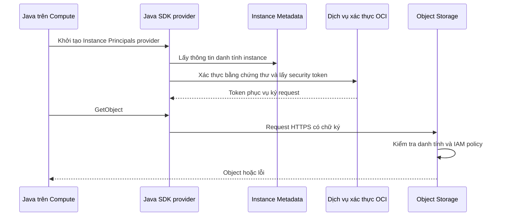
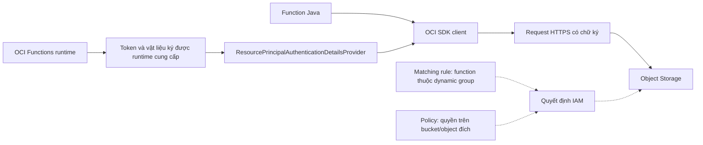

# Xác thực ứng dụng bằng Instance Principals và Resource Principals

## 1. Mục tiêu và tình huống sử dụng

Trong chương **OCI SDK và REST API với Java** của module **CLOUD_PROVIDERS_ORACLE**, bài này hướng dẫn ứng dụng sử dụng danh tính của tài nguyên OCI để gọi API, thay cho việc phân phối API signing key của một người dùng đến từng workload.

Tình huống xuyên suốt gồm hai ứng dụng cùng đọc một object cấu hình:

- Một tiến trình Java chạy trên OCI Compute sử dụng **Instance Principals**.
- Một hàm Java chạy trên OCI Functions sử dụng **Resource Principals**.

Hai ứng dụng chỉ được đọc object thử nghiệm trong một bucket riêng tư. Người học sẽ cấu hình dynamic group, cấp quyền IAM cho đúng tài nguyên đích, tạo authentication provider và gọi Object Storage bằng Java SDK.

Sau bài học, người học cần phân biệt được ba câu hỏi:

1. Workload đang chứng minh danh tính nào?
2. Policy nào cho phép danh tính đó thực hiện thao tác cụ thể?
3. Runtime có đường mạng tới các endpoint cần thiết không?

Việc dựng được authentication provider chưa đủ để kết luận ứng dụng đã được phép đọc dữ liệu. Ví dụ và bài thực hành dưới đây chưa được biên dịch hoặc chạy trên một tenancy thực tế trong quá trình soạn bài.

## 2. Những khái niệm nền tảng

### 2.1. Principal, authentication và authorization

**Principal** là chủ thể gửi request tới OCI. Chủ thể có thể là một IAM user, một Compute instance hoặc một tài nguyên được nền tảng hỗ trợ cơ chế resource principal.

**Authentication**, hay xác thực, chứng minh request đến từ principal nào. Trong Java SDK, authentication provider cung cấp thông tin để SDK ký request bằng cơ chế tương ứng.

**Authorization**, hay phân quyền, quyết định principal được phép làm gì trên tài nguyên nào. Trong ví dụ này, IAM policy cho dynamic group quyết định quyền đọc Object Storage.

| Thành phần | Câu hỏi nó giải quyết | Ví dụ |
| --- | --- | --- |
| Authentication provider | SDK lấy vật liệu ký request từ đâu? | Instance metadata hoặc môi trường runtime của Functions |
| Dynamic group matching rule | Tài nguyên nào thuộc nhóm chủ thể? | Compute instance có OCID cụ thể |
| IAM policy | Nhóm đó được thực hiện thao tác nào? | Đọc object trong bucket đã chỉ định |
| Region và endpoint | Request được gửi tới đâu? | Object Storage ở region chứa bucket |
| VCN, DNS, route, TLS | Runtime có thực hiện được kết nối không? | Kết nối HTTPS tới endpoint dịch vụ |

Các lớp này cần được kiểm tra riêng. Chẳng hạn, mở kết nối TCP thành công không chứng minh IAM policy đã đúng; nhận lỗi quyền cũng không tự chứng minh provider đang dùng đúng danh tính mà người triển khai mong muốn.

### 2.2. Instance Principals

Mỗi OCI Compute instance có danh tính riêng. OCI cung cấp và luân chuyển chứng thư phục vụ cơ chế này. SDK dùng thông tin danh tính instance để lấy security token và ký các request gọi dịch vụ. Ứng dụng không phải mang theo API key dài hạn của IAM user.

Provider Java tương ứng là:

```java
var provider =
        com.oracle.bmc.auth.InstancePrincipalsAuthenticationDetailsProvider
                .builder()
                .build();
```

Cơ chế, dynamic group và policy được mô tả trong [Calling Services from an Instance](https://docs.oracle.com/en-us/iaas/Content/Identity/Tasks/callingservicesfrominstances.htm).

Đơn vị được cấp quyền ở đây là **instance**. Hai ứng dụng cùng chạy trên một VM và có khả năng tiếp cận nguồn thông tin danh tính của VM có thể cùng sử dụng quyền instance. Cơ chế này không tự tạo danh tính riêng cho từng JVM, Linux user hoặc container trên máy.

### 2.3. Resource Principals

Resource Principals cho phép tài nguyên OCI được hỗ trợ sử dụng danh tính của chính nó để gọi dịch vụ khác. Bài dùng OCI Functions làm ví dụ cụ thể: function sử dụng resource principal session token, thường viết tắt là **RPST**, cùng vật liệu ký do runtime cung cấp.

Provider Java là:

```java
var provider =
        com.oracle.bmc.auth.ResourcePrincipalAuthenticationDetailsProvider
                .builder()
                .build();
```

Với Functions, cần đưa function vào dynamic group và cấp policy cho group đó. Cách sử dụng được mô tả trong [Accessing Other Oracle Cloud Infrastructure Resources from Running Functions](https://docs.oracle.com/en-us/iaas/Content/Functions/Tasks/functionsaccessingociresources.htm).

Không phải mọi chương trình Java chạy trên OCI đều có sẵn môi trường Resource Principals. Phải kiểm tra dịch vụ và loại runtime có hỗ trợ, rồi chọn provider theo hợp đồng của runtime đó.

### 2.4. Những loại danh tính dễ bị nhầm lẫn

| Trường hợp | Cách chọn |
| --- | --- |
| Java trên OCI Compute, dùng quyền của VM | Instance Principals |
| Java trong OCI Functions, dùng quyền của function | Resource Principals |
| Java trên laptop | Cơ chế xác thực người dùng dành cho phát triển hoặc kiểm thử riêng |
| Pod trên OKE cần quyền theo workload | Xem cơ chế OKE workload identity |
| Người dùng gọi HTTP vào ứng dụng | Xác thực người dùng ở lớp ứng dụng hoặc gateway |
| Ứng dụng đăng nhập Oracle Database bằng JDBC | Cơ chế xác thực DB được hỗ trợ và quyền trong DB |

OKE workload identity có provider và policy riêng theo cluster, namespace và service account. Tài liệu [Granting Workloads Access to OCI Resources](https://docs.oracle.com/en-us/iaas/Content/ContEng/Tasks/contenggrantingworkloadaccesstoresources.htm) mô tả điều kiện sử dụng và cấu hình. Không mặc định cho mọi pod dùng instance principal của worker node khi cần tách quyền từng ứng dụng.

Danh tính function cũng không mặc nhiên trở thành danh tính của người gọi function. Nếu API Gateway xác thực người dùng rồi gọi function, lời gọi Object Storage bằng resource principal vẫn sử dụng quyền của function; kiểm tra quyền nghiệp vụ của người dùng cần được thiết kế ở lớp ứng dụng.

## 3. Luồng xác thực và nơi áp dụng IAM

### 3.1. Luồng Instance Principals



Đây là sơ đồ khái niệm. SDK quản lý các chi tiết trao đổi chứng thư, khóa phiên, token và refresh; ứng dụng không cần tự triển khai quy trình federation.

Có ít nhất hai đường kết nối khác nhau: đường lấy thông tin danh tính và đường gọi dịch vụ đích. Một VM truy cập được Object Storage nhưng không tiếp cận được endpoint phục vụ xác thực vẫn có thể thất bại khi tạo hoặc làm mới provider.

### 3.2. Luồng Resource Principals trong Functions



Runtime cấp vật liệu xác thực, còn IAM policy cấp quyền trên tài nguyên đích. Đưa tên dynamic group vào biến môi trường của function không làm function trở thành thành viên group.

### 3.3. Token không thay thế policy và mạng

Token ngắn hạn giúp giảm nhu cầu tự phân phối khóa người dùng dài hạn. Nó không tự cấp quyền quản trị tenancy, không tự tạo route mạng và không mở truy cập DB.

Ví dụ, một service Java có thể được phép đọc một secret từ Vault nhưng vẫn cần quyền đăng nhập và truy vấn trong Oracle Database. Quyền OCI để quản lý tài nguyên database và quyền SQL bên trong database là các hợp đồng cần cấu hình riêng.

## 4. Thiết kế bài thực hành và phạm vi quyền

### 4.1. Tài nguyên dùng trong lab

Chuẩn bị các tài nguyên thử nghiệm sau:

| Tài nguyên | Vai trò |
| --- | --- |
| Compartment `app-runtime` | Chứa VM và function chạy ứng dụng |
| Compartment `app-data` | Chứa bucket dữ liệu |
| Compute instance thử nghiệm | Principal thứ nhất |
| Function Java thử nghiệm | Principal thứ hai |
| Bucket riêng tư `principal-lab-input` | Đích được phép đọc |
| Object nhỏ `auth-probe.txt` | Dữ liệu kiểm tra, không chứa thông tin nhạy cảm |
| Dynamic group `principal-lab-vms` | Chứa VM được chọn |
| Dynamic group `principal-lab-functions` | Chứa function được chọn |

Tên là ví dụ và phải thay theo môi trường thực. Mỗi placeholder `<...>` cần được điền bằng giá trị thật trước khi dùng.

Với lab cơ bản, chọn object ở lớp Standard và cấu hình mã hóa do Oracle quản lý để tập trung vào principal và IAM. Nếu dùng customer-managed key hoặc các ràng buộc bảo mật bổ sung, cần cấu hình thêm quyền liên quan theo tài liệu dịch vụ.

Bucket cần là private và không sử dụng pre-authenticated request URL trong bài. Nếu tài nguyên công khai, phép thử đọc thành công có thể không chứng minh được policy principal mà ta muốn kiểm tra.

### 4.2. Phân biệt compartment của principal và compartment của đích

```text
app-runtime:
    Compute instance / Function
    → Matching rule kiểm tra danh tính tài nguyên nguồn

app-data:
    Bucket principal-lab-input / object auth-probe.txt
    → IAM policy cấp quyền lên tài nguyên đích
```

Trong matching rule, compartment nguồn quyết định nhóm có những tài nguyên nào. Trong policy `in compartment app-data`, compartment đích giới hạn nơi áp dụng quyền đọc.

Đặt cả hai tài nguyên trong cùng compartment không làm chúng tự được phép gọi nhau. Đặt chúng ở hai compartment cũng không ngăn cấp quyền hợp lệ nếu policy được đặt trong phạm vi quản trị phù hợp.

## 5. Tạo dynamic group với matching rule rõ ràng

### 5.1. Nhóm cho một Compute instance

Đối với lab, dùng quy tắc theo OCID cụ thể:

```text
instance.id = '<COMPUTE_INSTANCE_OCID>'
```

Nếu muốn kết hợp cả instance và compartment:

```text
ALL {
    instance.id = '<COMPUTE_INSTANCE_OCID>',
    instance.compartment.id = '<RUNTIME_COMPARTMENT_OCID>'
}
```

`ALL` yêu cầu mọi điều kiện cùng đúng. Khi VM chuyển khỏi compartment được chỉ định, phải đánh giá lại membership và chính sách triển khai.

Nếu dùng `instance.compartment.id` đơn lẻ, các instance phù hợp trong compartment đó có thể trở thành thành viên, bao gồm instance được tạo sau này. Cần kiểm soát ai được tạo hoặc chuyển instance vào compartment này.

### 5.2. Nhóm cho một function

Với Functions, dùng resource OCID của **function**:

```text
ALL {
    resource.type = 'fnfunc',
    resource.id = '<FUNCTION_OCID>'
}
```

Không điền application OCID thay cho function OCID. Application và function là hai tài nguyên khác nhau.

Khi cần bao gồm mọi function trong một compartment chuyên dụng, có thể dùng:

```text
ALL {
    resource.type = 'fnfunc',
    resource.compartment.id = '<RUNTIME_COMPARTMENT_OCID>'
}
```

Chỉ chọn một quy tắc phù hợp với mục đích. Không thêm một quy tắc rộng bên cạnh quy tắc hẹp rồi giả định quy tắc hẹp vẫn giới hạn toàn bộ membership.

### 5.3. Quy tắc theo defined tag

Với nhóm instance thay đổi theo triển khai, ví dụ minh họa có thể dùng:

```text
ALL {
    instance.compartment.id = '<RUNTIME_COMPARTMENT_OCID>',
    tag.workload.role.value = 'principal-lab-reader'
}
```

`workload` và `role` ở đây là defined tag namespace/key đã được tạo. Free-form tag không thay được defined tag trong quy tắc này.

Cú pháp `ALL`, `ANY`, biến cho instance/resource và tag được mô tả trong [Writing Matching Rules to Define Dynamic Groups](https://docs.oracle.com/en-us/iaas/Content/Identity/dynamicgroups/Writing_Matching_Rules_to_Define_Dynamic_Groups.htm).

Tag trở thành một phần của điều kiện cấp quyền. Người được sửa tag hoặc tạo tài nguyên đáp ứng rule có thể ảnh hưởng tới membership, nên quyền quản trị tag và tài nguyên nguồn cũng cần phù hợp với thiết kế truy cập.

### 5.4. Lưu ý về cập nhật membership

Dynamic group không đòi hỏi ứng dụng Java tự đăng ký vào group ở mỗi lần khởi động. Membership được quyết định từ rule và thuộc tính tài nguyên.

Oracle hướng dẫn cho phép khoảng một giờ để thay đổi matching rule có hiệu lực, bao gồm tác động của đổi tag tới membership. Xem [Managing Dynamic Groups](https://docs.oracle.com/en-us/iaas/Content/Identity/Tasks/managingdynamicgroups.htm).

Không dùng một lần gọi ngay sau thay đổi làm bằng chứng rằng rule mới sai. Đồng thời, không thiết kế quy trình thu hồi khẩn cấp dựa trên giả định thay đổi membership sẽ có hiệu lực ngay lập tức.

## 6. Cấp IAM policy cho đúng thao tác

### 6.1. Policy lab theo dynamic group OCID

Ví dụ cấp quyền đọc đúng object cho từng principal:

```text
Allow dynamic-group id <VM_DYNAMIC_GROUP_OCID> to read objects in compartment app-data where all {target.bucket.name = 'principal-lab-input', target.object.name = 'auth-probe.txt', request.permission = 'OBJECT_READ'}

Allow dynamic-group id <FUNCTION_DYNAMIC_GROUP_OCID> to read objects in compartment app-data where all {target.bucket.name = 'principal-lab-input', target.object.name = 'auth-probe.txt', request.permission = 'OBJECT_READ'}
```

Policy dùng OCID của dynamic group, không phải OCID của VM hoặc function. Việc chỉ định dynamic group bằng OCID cũng giúp tránh nhập nhằng tên identity domain; cú pháp này được Oracle minh họa trong [hướng dẫn dynamic group và policy cho OKE](https://docs.oracle.com/en-us/iaas/Content/ContEng/Tasks/contengdynamicgrouppolicyforselfmanagednodes.htm).

Policy cần được tạo ở cấp có thể bao phủ compartment đích, chẳng hạn tenancy hoặc ancestor phù hợp. Quyền tạo/sửa dynamic group và policy thuộc về người quản trị triển khai, không cần đưa các quyền đó vào runtime của ứng dụng đọc object.

### 6.2. Vì sao ví dụ gọi GetObject trực tiếp?

Trong Object Storage, `GetObject` sử dụng quyền `OBJECT_READ`; việc liệt kê object dùng quyền khác. Các biến `target.bucket.name` và `target.object.name` cho phép giới hạn tài nguyên đích. Tham khảo [Details for Object Storage and Archive Storage](https://docs.oracle.com/en-us/iaas/Content/Identity/Reference/objectstoragepolicyreference.htm).

Code ở phần sau được truyền sẵn namespace, bucket và object name nên không cần tự gọi `ListBuckets`, `ListObjects` hoặc `GetNamespace` để tìm tài nguyên. Nếu ứng dụng cần thêm một API, xác định quyền của API đó và bổ sung có chủ đích.

Không kết luận principal lỗi chỉ vì một lệnh liệt kê thất bại trong khi policy chủ ý chỉ cho phép đọc object đã biết. Chính thao tác nghiệp vụ được cấp quyền mới là phép kiểm tra thích hợp.

Điều kiện trên là các ràng buộc trong một **allow policy**. Để kết luận workload thực sự chỉ có phạm vi này, cần kiểm tra cả những allow policy và dynamic group khác áp dụng cho cùng principal. Một policy hẹp không thu hồi quyền đã được cấp qua policy khác.

### 6.3. Cấp quyền theo tài nguyên khác

Khi chuyển ví dụ sang Streaming, Queue, Vault hoặc dịch vụ database control plane, phần thay đổi là service client, request và policy của dịch vụ đích. Authentication provider vẫn phải được chọn theo nguồn danh tính của runtime.

Ví dụ, một principal được phép đọc object không mặc nhiên được phép đọc secret hoặc gọi API quản trị database. Việc tái sử dụng provider thuận tiện cho code nhưng không làm các phạm vi quyền hợp nhất.

## 7. Chuẩn bị Java SDK

Ví dụ sử dụng Java 17, Maven và OCI Java SDK 3.x. Dùng BOM để các module OCI cùng phiên bản và chọn rõ HTTP transport. SDK 3.x yêu cầu ứng dụng khai báo transport theo [Getting Started with OCI SDK for Java](https://docs.oracle.com/en-us/iaas/Content/API/SDKDocs/javasdkgettingstarted.htm).

Cấu hình `pom.xml` cho project lab:

```xml
<project xmlns="http://maven.apache.org/POM/4.0.0"
         xmlns:xsi="http://www.w3.org/2001/XMLSchema-instance"
         xsi:schemaLocation="http://maven.apache.org/POM/4.0.0 https://maven.apache.org/xsd/maven-4.0.0.xsd">
    <modelVersion>4.0.0</modelVersion>

    <groupId>vn.example</groupId>
    <artifactId>oci-principal-auth-lab</artifactId>
    <version>1.0.0</version>

    <properties>
        <maven.compiler.release>17</maven.compiler.release>
        <project.build.sourceEncoding>UTF-8</project.build.sourceEncoding>
        <oci.sdk.version>3.94.0</oci.sdk.version>
    </properties>

    <dependencyManagement>
        <dependencies>
            <dependency>
                <groupId>com.oracle.oci.sdk</groupId>
                <artifactId>oci-java-sdk-bom</artifactId>
                <version>${oci.sdk.version}</version>
                <type>pom</type>
                <scope>import</scope>
            </dependency>
        </dependencies>
    </dependencyManagement>

    <dependencies>
        <dependency>
            <groupId>com.oracle.oci.sdk</groupId>
            <artifactId>oci-java-sdk-objectstorage</artifactId>
        </dependency>
        <dependency>
            <groupId>com.oracle.oci.sdk</groupId>
            <artifactId>oci-java-sdk-common-httpclient-jersey3</artifactId>
        </dependency>
    </dependencies>

    <build>
        <plugins>
            <plugin>
                <groupId>org.apache.maven.plugins</groupId>
                <artifactId>maven-compiler-plugin</artifactId>
                <version>3.13.0</version>
            </plugin>
            <plugin>
                <groupId>org.codehaus.mojo</groupId>
                <artifactId>exec-maven-plugin</artifactId>
                <version>3.5.0</version>
            </plugin>
        </plugins>
    </build>
</project>
```

Phiên bản `3.94.0` được ghim để ví dụ xác định rõ bộ SDK; có thể đối chiếu [mã nguồn Oracle tại tag v3.94.0](https://github.com/oracle/oci-java-sdk/tree/v3.94.0). Đây không phải tuyên bố về phiên bản mới nhất hoặc một bộ thư viện đã được kiểm thử cho mọi ứng dụng.

Đặt các class tiếp theo trong `src/main/java` của project lab, không khai báo package để chạy trực tiếp bằng lệnh minh họa. Khi tích hợp project thật, thêm package và cơ chế quản lý vòng đời của framework.

## 8. Tạo provider tường minh trong Java

### 8.1. Factory dành cho hai runtime của bài

Tạo `OciPrincipalProviders.java`:

```java
import java.util.Locale;

import com.oracle.bmc.auth.BasicAuthenticationDetailsProvider;
import com.oracle.bmc.auth.InstancePrincipalsAuthenticationDetailsProvider;
import com.oracle.bmc.auth.ResourcePrincipalAuthenticationDetailsProvider;

public final class OciPrincipalProviders {
    private OciPrincipalProviders() {}

    public static BasicAuthenticationDetailsProvider fromEnvironment() {
        String mode = requiredEnv("APP_AUTH_MODE")
                .trim()
                .toUpperCase(Locale.ROOT);

        return switch (mode) {
            case "INSTANCE" ->
                    InstancePrincipalsAuthenticationDetailsProvider
                            .builder()
                            .build();
            case "RESOURCE" ->
                    ResourcePrincipalAuthenticationDetailsProvider
                            .builder()
                            .build();
            default -> throw new IllegalArgumentException(
                    "APP_AUTH_MODE must be INSTANCE or RESOURCE");
        };
    }

    public static String requiredEnv(String name) {
        String value = System.getenv(name);
        if (value == null || value.isBlank()) {
            throw new IllegalArgumentException(
                    "Missing environment variable: " + name);
        }
        return value;
    }
}
```

Hai provider đều thực hiện giao diện `BasicAuthenticationDetailsProvider`, phù hợp để truyền vào builder của SDK client. Xem API [InstancePrincipalsAuthenticationDetailsProvider](https://docs.oracle.com/en-us/iaas/tools/java/latest/com/oracle/bmc/auth/InstancePrincipalsAuthenticationDetailsProvider.html) và [ResourcePrincipalAuthenticationDetailsProvider](https://docs.oracle.com/en-us/iaas/tools/java/latest/com/oracle/bmc/auth/ResourcePrincipalAuthenticationDetailsProvider.html).

`APP_AUTH_MODE` là cấu hình do ứng dụng tự định nghĩa để chọn nhánh. Biến này không làm laptop có danh tính instance và cũng không tự cấp RPST cho một container bất kỳ.

Factory cố ý không bắt lỗi provider rồi chuyển sang file config của người dùng. Trong môi trường triển khai, cấu hình sai cần được phát hiện bằng chính danh tính dự kiến. Nếu âm thầm chuyển sang API key của một tài khoản mạnh hơn, phép thử có thể thành công nhưng ứng dụng đang dùng sai quyền.

### 8.2. Local development là một cấu hình riêng

Trên laptop, dùng provider phù hợp với luồng phát triển được tổ chức cho phép, chẳng hạn profile API signing key hoặc session-based authentication. Luồng đó chứng minh quyền của danh tính người phát triển, không chứng minh quyền VM hay function.

Unit test logic nghiệp vụ có thể tách phần gọi SDK ra sau một interface để không cần principal thật. Integration test cho Instance Principals phải chạy ở môi trường Compute phù hợp; integration test cho Functions Resource Principals phải chạy trong runtime function có cấp vật liệu xác thực.

Không sao chép RPST hoặc private key tạm thời từ môi trường thật về laptop để biến môi trường phát triển thành một bản giả của runtime sản xuất.

## 9. Gọi Object Storage bằng provider đã chọn

### 9.1. Lớp đọc object dùng chung

Tạo `PrincipalObjectReader.java`:

```java
import java.io.IOException;
import java.io.InputStream;
import java.io.OutputStream;

import com.oracle.bmc.ClientConfiguration;
import com.oracle.bmc.Region;
import com.oracle.bmc.auth.BasicAuthenticationDetailsProvider;
import com.oracle.bmc.objectstorage.ObjectStorageClient;
import com.oracle.bmc.objectstorage.requests.GetObjectRequest;

public final class PrincipalObjectReader implements AutoCloseable {
    private final ObjectStorageClient client;

    public PrincipalObjectReader(
            BasicAuthenticationDetailsProvider provider,
            String regionId) {
        client = ObjectStorageClient.builder()
                .region(Region.fromRegionId(regionId))
                .configuration(ClientConfiguration.builder()
                        .connectionTimeoutMillis(10_000)
                        .readTimeoutMillis(30_000)
                        .build())
                .build(provider);
    }

    public ProbeResult readProbe(
            String namespace,
            String bucketName,
            String objectName) throws IOException {
        var response = client.getObject(
                GetObjectRequest.builder()
                        .namespaceName(namespace)
                        .bucketName(bucketName)
                        .objectName(objectName)
                        .build());

        long bytes;
        try (InputStream body = response.getInputStream()) {
            bytes = body.transferTo(OutputStream.nullOutputStream());
        }

        return new ProbeResult(
                bytes,
                response.getETag(),
                response.getOpcRequestId());
    }

    @Override
    public void close() {
        client.close();
    }

    public record ProbeResult(
            long bytes,
            String etag,
            String requestId) {}
}
```

Lớp này đọc hết object qua stream rồi bỏ nội dung, chỉ trả metadata phục vụ phép thử. Nó không ghi dữ liệu xuống ổ đĩa và không in nội dung object ra log. Chỉ sử dụng một object nhỏ trong lab để thời gian và lưu lượng kiểm tra dễ quan sát.

Request sử dụng namespace, bucket name và object name, không nhận bucket OCID thay cho tên bucket. Cấu trúc request/response nằm trong [GetObjectRequest.Builder](https://docs.oracle.com/en-us/iaas/tools/java/latest/com/oracle/bmc/objectstorage/requests/GetObjectRequest.Builder.html) và [GetObjectResponse](https://docs.oracle.com/en-us/iaas/tools/java/latest/com/oracle/bmc/objectstorage/responses/GetObjectResponse.html).

Region trong constructor là region của dịch vụ đích mà ứng dụng muốn gọi. Nó không tạo hoặc thay đổi principal. Với môi trường dùng endpoint đặc biệt, realm khác hoặc private endpoint theo dịch vụ, cấu hình endpoint theo tài liệu của môi trường thay vì tự ghép tên miền.

Các giá trị timeout là điểm bắt đầu cho lab. Chúng áp dụng cho client dịch vụ ở đây; không nên hiểu rằng chúng đặt một deadline tổng cho cả quá trình khởi tạo provider, lấy token và mọi lần retry.

### 9.2. Chương trình chạy trên Compute

Tạo `PrincipalReadProbe.java`:

```java
import com.oracle.bmc.model.BmcException;

public final class PrincipalReadProbe {
    public static void main(String[] args) throws Exception {
        String region = OciPrincipalProviders.requiredEnv("APP_OCI_REGION");
        String namespace = OciPrincipalProviders.requiredEnv(
                "APP_OBJECT_NAMESPACE");
        String bucket = OciPrincipalProviders.requiredEnv("APP_OBJECT_BUCKET");
        String object = OciPrincipalProviders.requiredEnv("APP_OBJECT_NAME");

        var provider = OciPrincipalProviders.fromEnvironment();

        try (var reader = new PrincipalObjectReader(provider, region)) {
            var result = reader.readProbe(namespace, bucket, object);

            System.out.printf(
                    "authMode=%s readBytes=%d etag=%s requestId=%s%n",
                    OciPrincipalProviders.requiredEnv("APP_AUTH_MODE"),
                    result.bytes(),
                    result.etag(),
                    result.requestId());
        } catch (BmcException error) {
            System.err.printf(
                    "status=%d serviceCode=%s requestId=%s%n",
                    error.getStatusCode(),
                    error.getServiceCode(),
                    error.getOpcRequestId());
            throw error;
        }
    }
}
```

Provider được tạo một lần cho lần chạy, rồi client sử dụng provider đó để ký `GetObject`. Một lỗi khởi tạo provider xảy ra trước request Object Storage cần được phân loại khác lỗi trả về từ Object Storage.

Ví dụ biến môi trường trên một **OCI Compute instance chạy Windows PowerShell**:

```powershell
$env:APP_AUTH_MODE = "INSTANCE"
$env:APP_OCI_REGION = "<BUCKET_REGION_ID>"
$env:APP_OBJECT_NAMESPACE = "<OBJECT_STORAGE_NAMESPACE>"
$env:APP_OBJECT_BUCKET = "principal-lab-input"
$env:APP_OBJECT_NAME = "auth-probe.txt"

mvn compile exec:java "-Dexec.mainClass=PrincipalReadProbe"
```

Nếu VM chạy Linux, cấu hình các biến tương ứng bằng shell hoặc hệ thống quản lý tiến trình của môi trường. Chạy JVM bằng đúng OS account và môi trường của workload cần kiểm tra.

Kết quả mong đợi là số byte của fixture, ETag và request ID. Thành công của lệnh trên laptop dùng cấu hình khác không thay cho kết quả này.

### 9.3. Tích hợp vào Java Function

Trong project Java được tạo bằng template OCI Functions, giữ cấu hình FDK và cách build/deploy của project đó, thêm dependency OCI và các lớp cần dùng ở trên. Handler minh họa:

```java
import com.oracle.bmc.auth.ResourcePrincipalAuthenticationDetailsProvider;

public final class PrincipalProbeFunction {
    private final PrincipalObjectReader reader;

    public PrincipalProbeFunction() {
        var provider = ResourcePrincipalAuthenticationDetailsProvider
                .builder()
                .build();

        reader = new PrincipalObjectReader(
                provider,
                OciPrincipalProviders.requiredEnv("APP_OCI_REGION"));
    }

    public String handleRequest(String ignored) throws Exception {
        var result = reader.readProbe(
                OciPrincipalProviders.requiredEnv("APP_OBJECT_NAMESPACE"),
                OciPrincipalProviders.requiredEnv("APP_OBJECT_BUCKET"),
                OciPrincipalProviders.requiredEnv("APP_OBJECT_NAME"));

        return "readBytes=" + result.bytes()
                + "; requestId=" + result.requestId();
    }
}
```

Handler chọn Resource Principals trực tiếp. Cấu hình command/handler của Java FDK tới `PrincipalProbeFunction::handleRequest`; nếu đã đặt package, dùng tên class đầy đủ theo package.

Đặt các biến cấu hình ứng dụng `APP_OCI_REGION`, `APP_OBJECT_NAMESPACE`, `APP_OBJECT_BUCKET`, `APP_OBJECT_NAME` trong cấu hình function. Không cần `APP_AUTH_MODE` cho handler này vì provider đã được chọn tường minh trong constructor.

Sau khi function được triển khai và được đưa đúng vào dynamic group, gọi function bằng công cụ phù hợp, chẳng hạn:

```bash
fn invoke <FUNCTIONS_APPLICATION_NAME> <FUNCTION_NAME>
```

Danh tính của người chạy lệnh phải có quyền invoke function. Quyền invoke và quyền function đọc Object Storage là hai quan hệ phân quyền độc lập.

Lớp giữ client theo vòng đời handler. Với ứng dụng hoặc framework có shutdown hook, tích hợp đóng client vào vòng đời đó; không đóng client dùng chung sau từng invocation rồi tiếp tục tái sử dụng nó.

Phần Maven ở mục trước phục vụ chương trình Java lab. Để chạy handler trên Functions, vẫn cần project Java FDK, image, application, function và cấu hình triển khai theo template; riêng một lệnh `mvn exec:java` trên laptop không tạo môi trường Resource Principals.

## 10. Token, refresh và vòng đời của provider

### 10.1. Instance Principals: giữ provider thay vì chụp token

Provider Instance Principals quản lý dữ liệu xác thực dựa trên chứng thư và token. API có hỗ trợ refresh; ứng dụng nên sử dụng provider qua SDK thay vì lấy một chuỗi token rồi giữ cố định trong biến toàn cục.

Trong service Java chạy lâu, khởi tạo provider/client theo vòng đời thành phần và tái sử dụng cho nhiều request. Tạo mới provider cho từng thao tác có thể làm tăng số lần gọi metadata/xác thực, tăng latency và áp lực lên các endpoint đó.

Nếu cấu hình refresh hoặc retry riêng, kiểm tra hành vi của đúng SDK version. Không gọi refresh vô hạn mỗi khi gặp lỗi quyền: làm mới token không tự bổ sung IAM policy còn thiếu.

### 10.2. Resource Principals: phụ thuộc hợp đồng runtime

Trong mô hình Resource Principals 2.2 của Functions, runtime thường cung cấp các biến sau:

| Biến do runtime cung cấp | Vai trò |
| --- | --- |
| `OCI_RESOURCE_PRINCIPAL_VERSION` | Chọn giao thức/phiên bản resource principal |
| `OCI_RESOURCE_PRINCIPAL_REGION` | Thông tin region tương ứng |
| `OCI_RESOURCE_PRINCIPAL_RPST` | Giá trị hoặc vị trí chứa session token theo hợp đồng |
| `OCI_RESOURCE_PRINCIPAL_PRIVATE_PEM` | Giá trị hoặc vị trí chứa khóa ký theo hợp đồng |

Bảng mô tả đầu vào của provider, không phải hướng dẫn tự tạo hoặc tự export token. Oracle có ví dụ Java dành riêng cho runtime Functions trong [FunctionsEphemeralResourcePrincipalAuthenticationDetailsProviderExample](https://github.com/oracle/oci-java-sdk/blob/master/bmc-examples/src/main/java/FunctionsEphemeralResourcePrincipalAuthenticationDetailsProviderExample.java).

Với chế độ 2.2, provider có thể đọc token từ file được runtime cập nhật. Nếu truyền RPST thô trực tiếp qua biến môi trường, tài liệu provider nêu rằng token đó không thể được làm mới theo cách đọc file này. Không được suy rằng một token sao chép cố định sẽ dùng được mãi cho một service Java dài hạn. Chi tiết có trong [ResourcePrincipalAuthenticationDetailsProvider](https://docs.oracle.com/en-us/iaas/tools/java/latest/com/oracle/bmc/auth/ResourcePrincipalAuthenticationDetailsProvider.html).

Ứng dụng không nên chụp nội dung file token lúc khởi động rồi tự tái sử dụng vô hạn. Để provider và runtime phối hợp luân chuyển vật liệu xác thực theo cơ chế được hỗ trợ.

Không hardcode phiên bản resource principal chỉ để làm lỗi môi trường biến mất. Nếu SDK không hiểu phiên bản mà runtime cung cấp, giải quyết tương thích SDK/runtime.

### 10.3. Thay đổi IAM có thể chưa được thấy ngay

Tài liệu Functions nêu token được cache trong 15 phút, vì vậy thay đổi policy hoặc dynamic group có thể cần chờ trước khi thấy tác động. Đây là đặc điểm được mô tả cho Functions trong [hướng dẫn truy cập tài nguyên từ function](https://docs.oracle.com/en-us/iaas/Content/Functions/Tasks/functionsaccessingociresources.htm), không phải thời gian sống chung cho mọi loại principal.

Phân biệt cache token của runtime với độ trễ cập nhật matching rule. Các mốc thời gian từ hai tài liệu không tạo thành cam kết rằng mọi thay đổi chắc chắn hiệu lực tại một giây cụ thể.

Khi kiểm tra thu hồi quyền, ghi lại thời điểm sửa rule/policy, runtime đang chạy, thời điểm gọi lại và kết quả thực tế. Restart ứng dụng có thể giúp quan sát quá trình khởi tạo nhưng không bảo đảm bỏ qua mọi cache hoặc thời gian lan truyền phía dịch vụ.

## 11. Kiểm tra đường mạng và môi trường chạy

### 11.1. Compute: xác nhận metadata từ đúng runtime

Trên chính Compute instance, có thể kiểm tra một metadata field không phải credential bằng PowerShell:

```powershell
$metadataHeaders = @{ Authorization = "Bearer Oracle" }

Invoke-RestMethod -Uri "http://169.254.169.254/opc/v2/instance/id" -Headers $metadataHeaders -TimeoutSec 5
```

Kết quả giúp đối chiếu OCID của instance với matching rule. Chạy lệnh từ laptop không kiểm tra được metadata của VM.

IMDSv2 dùng endpoint `/opc/v2` và yêu cầu header `Authorization: Bearer Oracle`. Header này là quy ước truy cập metadata, không phải OAuth access token để gọi Object Storage. Chi tiết nằm trong [Getting Instance Metadata](https://docs.oracle.com/en-us/iaas/Content/Compute/Tasks/gettingmetadata.htm).

Một số lỗi thực tế:

- Proxy cố chuyển tiếp địa chỉ link-local thay vì truy cập trực tiếp.
- Host firewall hoặc cơ chế cô lập container chặn đường tới metadata.
- Ứng dụng cũ còn dùng IMDSv1 trong khi instance chỉ cho phép IMDSv2.
- SDK hoặc HTTP transport không tương thích với cấu hình runtime.
- Metadata và dịch vụ xác thực gặp lỗi tạm thời, khiến tạo/refresh token thất bại.

Chỉ truy vấn field cần kiểm tra. Không dump endpoint chứa credential hoặc vật liệu ký vào log để xử lý lỗi.

### 11.2. Functions: kiểm tra môi trường được cấp bởi nền tảng

Nếu chọn Resource Principals nhưng runtime không cung cấp thông tin cần thiết, provider có thể lỗi ngay lúc khởi tạo. Kiểm tra ứng dụng có thực sự đang chạy dưới OCI Functions hoặc runtime hỗ trợ tương ứng không.

Không in toàn bộ environment để tìm lỗi. Chỉ ghi nhận việc có/không có biến cần thiết hoặc giá trị phiên bản không nhạy cảm khi cần. Tránh đưa token, private PEM, nội dung file xác thực và HTTP authorization header vào output function.

Vật liệu runtime được cấp khi thực thi, không phải một phần cố định của image build. Việc đóng gói class thành công không chứng minh image có thể tạo resource principal provider ngoài runtime đó.

### 11.3. Subnet riêng, DNS và endpoint dịch vụ

Ứng dụng cần đường kết nối tới các endpoint phục vụ xác thực/làm mới token và endpoint dịch vụ đích. Trong subnet riêng, kiểm tra route, DNS, egress rule, gateway hoặc proxy theo kiến trúc.

Service gateway chỉ phục vụ các dịch vụ/đích được hỗ trợ trong cấu hình tương ứng. Không suy rằng có service gateway nghĩa là mọi endpoint OCI đều đã truy cập được. Đánh giá riêng các đích mà provider và service client sử dụng.

Giữ TLS verification hoạt động. Nếu có CA nội bộ hoặc proxy doanh nghiệp, cấu hình truststore và proxy phù hợp. Tăng IAM permissions không sửa được lỗi DNS, truststore hoặc route.

Đồng hồ hệ thống cũng cần đồng bộ. Token và chữ ký có thông tin thời gian; sai lệch thời gian có thể làm lỗi xác thực xuất hiện dù matching rule và policy đúng.

## 12. Thực hành xác nhận đúng danh tính và đúng phạm vi

### 12.1. Kiểm tra thành công trên Compute

1. Xác nhận OCID của VM trong rule và runtime thực tế trùng nhau.
2. Kiểm tra bucket private, object fixture tồn tại ở region đã chọn.
3. Đặt biến ứng dụng với `APP_AUTH_MODE=INSTANCE`.
4. Chạy `PrincipalReadProbe` từ VM.
5. Đối chiếu số byte của fixture và lưu request ID phục vụ truy vết.

Không đặt API signing key của người dùng vào image chỉ để làm bài thực hành vượt qua. Factory trong bài phải sử dụng đúng nhánh Instance Principals.

### 12.2. Kiểm tra thành công trên Functions

1. Dùng OCID của function đã triển khai trong matching rule.
2. Cấp policy cho dynamic group function theo tài nguyên đích.
3. Đặt bốn biến cấu hình đích mà handler yêu cầu.
4. Invoke function và đối chiếu kết quả đọc fixture.
5. Kiểm tra caller có quyền invoke riêng, nếu lỗi xảy ra trước khi handler chạy.

Lỗi invoke function và lỗi handler gọi Object Storage nằm ở hai chặng khác nhau. Cần xem function có bắt đầu thực thi không trước khi sửa policy đọc object.

### 12.3. Kiểm tra trường hợp ngoài phạm vi

Thực hiện trên các fixture riêng tư và chỉ bằng tài nguyên thử nghiệm:

| Phép thử | Mong đợi khi principal chỉ có policy lab |
| --- | --- |
| Đọc `principal-lab-input/auth-probe.txt` | Thành công |
| Đọc object khác đã tồn tại trong cùng bucket | Bị từ chối do điều kiện object name |
| Đọc object trong bucket private khác | Bị từ chối do điều kiện bucket |
| Thực hiện API tạo/sửa/xóa không được cấp | Không được phép |
| Chạy ứng dụng trên VM/function ngoài rule | Không được cấp quyền đọc từ dynamic group lab |

Với thử nghiệm này, không cần thực sự xóa dữ liệu để chứng minh quyền tối thiểu. Có thể đối chiếu policy và dùng một thao tác kiểm tra được thiết kế an toàn trong môi trường lab.

Đảm bảo fixture ngoài phạm vi thực sự tồn tại và không public. Một lỗi “không tìm thấy hoặc không được phép” trên tên object gõ sai không đủ để kết luận rule bảo mật hoạt động đúng.

Nếu phép thử ngoài phạm vi vẫn thành công, xem lại toàn bộ quyền hiệu lực: group khác, rule khác, policy từ ancestor, trạng thái public hoặc đường truy cập không sử dụng principal đang kiểm tra.

### 12.4. Kiểm tra vòng đời dài hơn một lần gọi

Một lần cold start thành công chỉ kiểm tra được đường khởi tạo tại thời điểm đó. Với service chạy lâu hoặc function được tái sử dụng, cần quan sát việc gọi API sau thời gian idle và sau khi vật liệu xác thực được luân chuyển.

Theo dõi riêng latency tạo provider, latency service call, số lần lỗi xác thực và khả năng phục hồi. Với Functions, giới hạn kiểm tra theo vòng đời invocation và cách runtime quản lý container; không kéo dài invocation chỉ để chờ token hết hạn.

## 13. Chẩn đoán lỗi theo từng chặng

| Chặng | Dấu hiệu | Hướng kiểm tra |
| --- | --- | --- |
| Chọn provider | Cấu hình mode không hợp lệ | Giá trị `APP_AUTH_MODE`, runtime triển khai |
| Khởi tạo Instance Principals | Timeout hoặc lỗi lấy metadata/certificate/token | Có chạy trên Compute không, IMDS, proxy, mạng xác thực |
| Khởi tạo Resource Principals | Thiếu biến/file hoặc phiên bản không được hỗ trợ | Runtime, cách mount/cấp vật liệu, SDK version |
| Kết nối dịch vụ | DNS, connect timeout, TLS handshake | Endpoint, region, route, truststore |
| Gọi API bị 401 | Token/chữ ký không hợp lệ | Refresh, đồng hồ, nguồn credential, thay đổi request sau ký |
| Gọi API bị 403 hoặc `NotAuthorizedOrNotFound` | Quyền hoặc tài nguyên không phù hợp | Principal, rule, policy, compartment đích, namespace/bucket/object |
| Gọi API bị 404 | Tài nguyên hoặc đường gọi có vấn đề | Tên tài nguyên, region, endpoint; đồng thời xét cách dịch vụ che giấu quyền |
| Lỗi chỉ xuất hiện sau thời gian chạy | Refresh hoặc nguồn vật liệu không còn dùng được | Mạng refresh, file token/khóa do runtime quản lý, cache |
| Lỗi 429 hoặc 5xx | Throttle hoặc lỗi tạm thời | Retry có giới hạn, backoff, lượng provider/client được tạo |

HTTP status và service code là đầu mối, không phải phép ánh xạ duy nhất. Luôn ghi lại lỗi ở chặng provider hay chặng service API.

Không mở quyền thành `manage all-resources in tenancy` để thử sửa mọi loại lỗi. Bắt đầu từ principal dự kiến, thao tác cụ thể và tài nguyên thực tế, rồi đối chiếu policy cần thiết.

### 13.1. Trình tự kiểm tra gợi ý

```text
Xác nhận runtime
→ Xác nhận nhánh provider
→ Xác nhận provider khởi tạo được
→ Xác nhận region và tham số đích
→ Xác nhận đường kết nối
→ Đối chiếu matching rule và quyền API
→ Xét cache/độ trễ thay đổi
→ Kiểm tra request ID và log phù hợp
```

Nếu provider chưa tạo được, sửa policy Object Storage chưa chắc giúp ích. Nếu provider đã tạo nhưng gọi `GetObject` bị từ chối, đọc metadata thành công cũng chưa chứng minh membership và authorization đã đúng.

### 13.2. Retry đúng loại lỗi

Retry có giới hạn và backoff phù hợp cho lỗi tạm thời. Không lặp nhanh vô hạn khi thiếu environment variable, chọn sai provider hoặc thiếu quyền.

Trong hệ thống có retry ở SDK và retry ở ứng dụng, kiểm soát tổng deadline và số lần gọi. Refresh token nhiều lần không thay thế được thay đổi policy.

Ví dụ trong bài chỉ đọc object. Khi áp dụng cùng provider cho API ghi hoặc tạo tài nguyên, thiết kế idempotency theo API và nghiệp vụ trước khi thêm retry. Danh tính ngắn hạn không làm mọi thao tác tự trở thành idempotent.

## 14. Log, quan sát và ranh giới bảo mật

### 14.1. Thông tin nên ghi

Ghi nhận các dữ liệu đủ để chẩn đoán:

- Auth mode đã chọn và phiên bản ứng dụng/SDK.
- Runtime hoặc resource OCID từ cấu hình triển khai đáng tin cậy khi phù hợp.
- Region, tên thao tác, thời gian và latency.
- HTTP status, service error code và request ID.
- Loại lỗi khởi tạo provider, không kèm credential.

Không log private key, certificate key material, RPST, token JWT đầy đủ, nội dung file xác thực hoặc authorization header. Hash/giá trị metadata khác cũng cần được đánh giá theo dữ liệu thực tế; fixture của lab nên không nhạy cảm.

### 14.2. Chọn đúng Audit hoặc service log

Audit chỉ ghi các API/loại sự kiện được hỗ trợ. Đặc biệt, tài liệu [Overview of Audit](https://docs.oracle.com/en-us/iaas/Content/Audit/Concepts/auditoverview.htm) phân biệt Object Storage bucket events với object events; không kỳ vọng mọi `GetObject` đều xuất hiện trong Audit.

Để quan sát thao tác đọc object của lab, bật loại **Read Access Events** trên bucket qua OCI Logging và đối chiếu log ứng dụng/request ID khi các trường tương ứng có sẵn. Các loại log và đặc điểm phân phối được mô tả trong [Logging details for Object Storage](https://docs.oracle.com/en-us/iaas/Content/Logging/Reference/details_for_object_storage.htm).

Không thấy một object read trong Audit không đủ để kết luận request chưa xảy ra. Kiểm tra đúng loại log, region, compartment, khoảng thời gian và trạng thái bật log; lưu ý log dịch vụ có tính chất phân phối được mô tả trong tài liệu.

### 14.3. Instance principal và quyền trên hệ điều hành

Instance principal cấp danh tính cho instance; việc bảo vệ host, quyền SSH, khả năng truy cập metadata và những tiến trình cùng máy ảnh hưởng trực tiếp tới an toàn của quyền đó.

Hạn chế metadata access theo thiết kế của môi trường và kiểm tra IMDSv2 trước khi loại bỏ phụ thuộc IMDSv1. Oracle trình bày các biện pháp bảo vệ metadata trong [Securing Compute](https://docs.oracle.com/en-us/iaas/Content/Security/Reference/compute_security.htm).

Một ứng dụng có SSRF hoặc có khả năng chạy mã không tin cậy trên host có thể làm tăng rủi ro đối với danh tính workload. Giới hạn quyền principal và cô lập workload theo mức tin cậy. Nếu hai ứng dụng cần phạm vi quyền khác nhau, xem xét tách runtime/danh tính thay vì chỉ tách tên process.

### 14.4. Resource principal và chuỗi triển khai

Quyền cập nhật code hoặc image của function có ý nghĩa bảo mật: code mới được triển khai có thể sử dụng quyền resource principal của function đó. Quyền invoke, quyền deploy, quyền sửa config và quyền sửa IAM cần được phân công theo trách nhiệm.

Không cho phép một request đầu vào không tin cậy chọn tùy ý auth mode, token file, endpoint xác thực hoặc tài nguyên đích ngoài phạm vi nghiệp vụ. Cấu hình provider nên do hệ thống triển khai kiểm soát.

Trong ứng dụng phục vụ nhiều tenant khách hàng, một principal chung có quyền rộng không tự bảo đảm cách ly dữ liệu giữa khách hàng. Lớp nghiệp vụ cần ràng buộc đúng tenant, tài nguyên đích và thao tác trước khi gọi SDK.

## 15. Áp dụng vào một service Java thực tế

Khi chuyển lab thành service:

1. Khởi tạo đúng provider trong giai đoạn bootstrap của môi trường.
2. Tạo service client một lần và hoàn tất region/endpoint trước khi cho nhiều luồng sử dụng.
3. Tái sử dụng client theo vòng đời thành phần; đóng response stream sau mỗi lần đọc.
4. Giữ policy theo API và tài nguyên thực sự cần.
5. Quan sát cả khởi tạo, refresh và lỗi API; giữ log không chứa credential.
6. Kiểm tra lại quyền khi thay VM, thay function, đổi compartment, đổi tag hoặc đổi pipeline triển khai.

OCI Java SDK mô tả khả năng tái sử dụng và mô hình thread của client Jersey trong [Java SDK Concepts](https://docs.oracle.com/en-us/iaas/Content/API/SDKDocs/javasdkconcepts.htm). Việc dùng dependency injection hoặc singleton phải đi kèm vòng đời đúng; không thay region/endpoint của một client đang dùng chung để phục vụ các request khác nhau.

Nếu cần gọi REST API ngoài các model SDK sẵn có, authentication provider không tự biến `java.net.http.HttpClient` thành client OCI đã ký request. Cần tích hợp cơ chế request signing phù hợp, xử lý các header và nội dung được ký theo [Request Signatures](https://docs.oracle.com/en-us/iaas/Content/API/Concepts/signingrequests.htm), hoặc chọn cơ chế raw request được SDK hỗ trợ cho trường hợp tương ứng. Không lấy RPST rồi gửi như một bearer token tùy ý đến API đích.

Instance Principals và Resource Principals giảm việc tự quản lý credential người dùng cho workload. Tính đúng đắn của triển khai vẫn phụ thuộc vào việc chọn đúng danh tính runtime, định nghĩa membership, giới hạn IAM theo tài nguyên đích và duy trì được vòng đời xác thực khi ứng dụng chạy.
