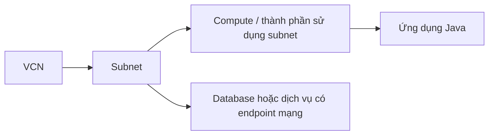

# Đọc, tạo và quản lý OCI resources bằng Java SDK

Oracle Cloud Infrastructure (OCI) Java SDK cho phép chương trình Java gọi các API quản lý hạ tầng bằng các lớp request, response và model có kiểu dữ liệu. Thay vì tự dựng từng HTTP request và chữ ký, ứng dụng cấu hình danh tính, chọn service client rồi gọi thao tác phù hợp.

Trong chương **OCI SDK và REST API với Java**, bài này tập trung vào vòng đời tài nguyên: tìm tài nguyên trong đúng phạm vi, đọc chi tiết, tạo mới, chờ sẵn sàng, cập nhật có kiểm soát và dọn tài nguyên đã tạo. Ví dụ xuyên suốt là một VCN lab trong compartment riêng; cách tổ chức có thể mở rộng sang Compute, lưu trữ và các dịch vụ cơ sở dữ liệu Oracle.

Mục tiêu không chỉ là gọi được `create...`. Một chương trình quản lý hạ tầng cần giải thích được nó đang dùng danh tính nào, thao tác ở region và compartment nào, có thể chạy lại ra sao, và dựa vào bằng chứng nào để kết luận thay đổi đã hoàn tất.

## 1. Từ nhu cầu quản lý đến lời gọi SDK

Giả sử nhóm phát triển muốn tự động tạo môi trường thực hành Java:

1. Liệt kê mạng hiện có trong compartment lab.
2. Tạo VCN dành cho một lượt thực hành.
3. Lưu OCID của VCN vừa tạo.
4. Đọc trạng thái cho đến khi tài nguyên dùng được.
5. Cập nhật tên và tag để ghi nhận tiến độ.
6. Khi kết thúc, xóa đúng VCN đó sau khi kiểm tra quan hệ phụ thuộc.

Trong SDK, các bước thường có hình dạng:

```text
Authentication provider
    -> Service client với region/endpoint đã cấu hình
    -> Request chứa OCID, tham số và Details model nếu cần
    -> Response chứa model, request ID và metadata liên quan
    -> Đọc lại / waiter / work request để xác minh kết quả
```

| Thành phần | Vai trò trong ví dụ |
| --- | --- |
| Authentication provider | Cung cấp danh tính và thông tin để ký request |
| `VirtualNetworkClient` | Gọi API Networking quản lý VCN |
| `ListVcnsRequest`, `GetVcnRequest` | Chọn phạm vi danh sách hoặc VCN cụ thể |
| `CreateVcnDetails` | Mô tả VCN muốn tạo |
| `CreateVcnRequest` | Bao gói dữ liệu tạo và retry token |
| Response | Chứa VCN trả về cùng metadata của lời gọi |

Danh tính hợp lệ chưa đồng nghĩa có quyền với mọi compartment. Region đúng cũng chưa đồng nghĩa một OCID bất kỳ thuộc phạm vi mà chương trình được phép sửa.

## 2. Xác định phạm vi trước khi thao tác

### 2.1. Phân biệt tenancy, compartment, region và OCID

| Khái niệm | Cách dùng trong chương trình |
| --- | --- |
| Tenancy | Ngữ cảnh tổ chức và danh tính OCI |
| Compartment | Phạm vi logic chứa tài nguyên và áp dụng policy |
| Region | Nơi client gửi lời gọi tới dịch vụ tương ứng |
| Resource OCID | Định danh tài nguyên cụ thể trong các thao tác get/update/delete |
| Display name | Nhãn giúp con người đọc; không dùng thay OCID |

Đối với VCN, nên giữ một bộ cấu hình gồm region, compartment OCID, VCN OCID và mã lượt lab. Đọc chi tiết bằng OCID rồi so sánh compartment thực tế sẽ rõ ràng hơn việc tìm tên và chọn kết quả đầu tiên.

Display name của VCN có thể trùng. Một chương trình “tìm tên rồi xóa phần tử đầu tiên” có thể tác động sai tài nguyên khi có nhiều lượt chạy hoặc nhiều người thực hành.

### 2.2. IAM tối thiểu cho phạm vi lab

Ví dụ người học thuộc nhóm `JavaSdkLearners` trong identity domain mặc định, compartment lab tên `JavaSdkLab`:

```text
Allow group default/JavaSdkLearners to manage virtual-network-family in compartment JavaSdkLab
```

Policy này thuận tiện cho lab mạng vì bao phủ các thành phần Networking trong compartment. Với ứng dụng thực tế, cần tách quyền đọc, tạo, sửa và xóa theo công việc; không mở rộng sang toàn tenancy chỉ để giải quyết một lỗi truy cập. Cú pháp domain và đường dẫn compartment phải khớp môi trường thật. [Oracle: Policy Syntax](https://docs.oracle.com/en-us/iaas/Content/Identity/Concepts/policysyntax.htm).

Khi chạy trên Compute bằng instance principal, policy áp dụng cho dynamic group chứa instance thay vì nhóm người dùng. Đổi authentication provider không tự tạo membership hoặc quyền IAM tương ứng.

### 2.3. IAM và kết nối mạng là hai điều kiện riêng

Ứng dụng cần vừa có quyền gọi API vừa có đường kết nối HTTPS tới endpoint dịch vụ. Nếu chạy trong private subnet, phải kiểm tra DNS, định tuyến, proxy hoặc phương thức truy cập dịch vụ phù hợp với kiến trúc mạng.

Timeout kết nối không được giải quyết bằng cách cấp thêm quyền quản trị. Ngược lại, kết nối TLS thành công chưa chứng minh được phép tạo VCN trong compartment đích.

## 3. Chuẩn bị dependency và danh tính

### 3.1. Chọn một phiên bản SDK nhất quán

Ví dụ trong bài dùng Java 17 và cố định OCI Java SDK ở `3.102.0`, một phiên bản đã có bản phát hành chính thức. Đây là mốc của ví dụ, không phải yêu cầu luôn sử dụng đúng phiên bản này. [Oracle: Release 3.102.0](https://github.com/oracle/oci-java-sdk/releases/tag/v3.102.0).

Trong project Maven đã cấu hình compiler Java 17, thêm các khối dependency sau vào `pom.xml`:

```xml
<properties>
    <oci.sdk.version>3.102.0</oci.sdk.version>
</properties>

<dependencyManagement>
    <dependencies>
        <dependency>
            <groupId>com.oracle.oci.sdk</groupId>
            <artifactId>oci-java-sdk-bom</artifactId>
            <version>${oci.sdk.version}</version>
            <type>pom</type>
            <scope>import</scope>
        </dependency>
    </dependencies>
</dependencyManagement>

<dependencies>
    <dependency>
        <groupId>com.oracle.oci.sdk</groupId>
        <artifactId>oci-java-sdk-common-httpclient-jersey3</artifactId>
    </dependency>
    <dependency>
        <groupId>com.oracle.oci.sdk</groupId>
        <artifactId>oci-java-sdk-core</artifactId>
    </dependency>
</dependencies>
```

BOM giúp căn chỉnh phiên bản các module. Với SDK dòng 3, cần chọn rõ HTTP client, chẳng hạn Jersey 2 hoặc Jersey 3; SDK không mặc định chọn giúp ứng dụng. Ví dụ dùng Jersey 3 và module Core cho Networking. [Oracle: Getting Started with Java SDK](https://docs.oracle.com/en-us/iaas/Content/API/SDKDocs/javasdkgettingstarted.htm).

Không đưa cả hai HTTP client vào chỉ để thử sửa lỗi classpath. Khi dùng framework đã có Jakarta/Jersey, hãy kiểm tra dependency tree và chọn biến thể tương thích. Đây là đoạn cấu hình dependency, không phải toàn bộ project Maven.

### 3.2. Máy phát triển: profile cấu hình OCI

Profile minh họa tại vị trí cấu hình OCI mặc định:

```ini
[DEFAULT]
user=ocid1.user...
tenancy=ocid1.tenancy...
fingerprint=AA:BB:...
key_file=/duong-dan-den-khoa/oci_api_key.pem
region=ap-singapore-1
```

Các giá trị cần thay bằng thông tin của môi trường. Public key tương ứng phải được đăng ký cho danh tính sử dụng; private key nằm ở nơi được bảo vệ, không đưa vào source hoặc log.

Provider đọc profile mặc định có thể được tạo như sau:

```java
var auth = new ConfigFileAuthenticationDetailsProvider("DEFAULT");
```

Constructor nhận tên profile dùng file cấu hình ở vị trí mặc định; SDK cũng có constructor nhận đường dẫn file và profile riêng. [Oracle: ConfigFileAuthenticationDetailsProvider](https://docs.oracle.com/en-us/iaas/tools/java/latest/com/oracle/bmc/auth/ConfigFileAuthenticationDetailsProvider.html).

### 3.3. Workload trên OCI: instance principal

Với workload chạy trên OCI Compute đã được cấu hình dynamic group và policy phù hợp:

```java
var auth = InstancePrincipalsAuthenticationDetailsProvider.builder()
        .build();
```

Provider này sử dụng danh tính instance để xác thực; không cần nhúng API private key của người phát triển vào chương trình. Nó phụ thuộc vào môi trường Compute tương ứng, không phải cách thay thế dùng được trên mọi laptop. [Oracle: InstancePrincipalsAuthenticationDetailsProvider](https://docs.oracle.com/en-us/iaas/tools/java/latest/com/oracle/bmc/auth/InstancePrincipalsAuthenticationDetailsProvider.html).

Ví dụ chính bên dưới dùng config profile để dễ thực hành. Khi thay provider, vẫn cần giữ chính xác region, compartment và phạm vi tài nguyên.

## 4. Đọc tài nguyên: danh sách khác với chi tiết

### 4.1. List cần xử lý hết các trang

Một lời gọi list không nhất thiết trả toàn bộ tài nguyên. Với `ListVcnsResponse`, `getOpcNextPage()` cung cấp token để lấy trang tiếp theo; `getItems()` là dữ liệu của trang hiện tại. [Oracle: ListVcnsResponse](https://docs.oracle.com/en-us/iaas/tools/java/latest/com/oracle/bmc/core/responses/ListVcnsResponse.html).

Quy tắc vòng lặp:

```text
Gọi List với compartment và page hiện tại
    -> xử lý items
    -> lấy next-page token
    -> tiếp tục khi token còn tồn tại
```

Không tự tính số trang bằng tổng tài nguyên chia cho `limit`. Không kết luận hết dữ liệu chỉ vì một trang có ít phần tử hơn mong đợi khi response vẫn có token tiếp tục.

List trong một compartment không phải phép kiểm kê tự động toàn tenancy. Nếu cần nhiều compartment hoặc region, chương trình phải có danh sách phạm vi rõ ràng, quyền tương ứng và cơ chế điều phối riêng.

### 4.2. Get để đọc đúng tài nguyên và ETag

`GetVcn` nhận VCN OCID và trả về model cùng ETag. ETag là thông tin dùng cho kiểm soát cập nhật đồng thời, không phải định danh thay thế cho VCN. [Oracle: GetVcnResponse](https://docs.oracle.com/en-us/iaas/tools/java/latest/com/oracle/bmc/core/responses/GetVcnResponse.html).

Một bước đọc trước cập nhật nên thu được:

- OCID và compartment thực tế.
- Trạng thái vòng đời.
- Các thuộc tính đang có, gồm tags nếu sẽ sửa tags.
- ETag của phiên bản vừa đọc.
- Request ID để truy vết lời gọi.

Danh sách có thể phục vụ hiển thị hoặc tìm ứng viên; thao tác sửa nên đọc lại đúng OCID trước khi quyết định.

## 5. Ví dụ Java quản lý vòng đời một VCN lab

Đoạn dưới là một lớp Java có các chế độ `list`, `get`, `create`, `update`, `delete`. Chạy từng chế độ bằng tham số của `main` trong IDE hoặc cấu hình chạy của project có dependency đã nêu.

Mẫu dùng SDK đồng bộ, VCN riêng chưa gắn subnet/gateway do người học tạo thêm, và chỉ cập nhật/xóa khi compartment cùng tag sở hữu của lượt lab khớp. Các tag là hàng rào logic của ví dụ; IAM vẫn là cơ chế phân quyền thực tế.

```java
import com.oracle.bmc.ClientConfiguration;
import com.oracle.bmc.Region;
import com.oracle.bmc.auth.ConfigFileAuthenticationDetailsProvider;
import com.oracle.bmc.core.VirtualNetworkClient;
import com.oracle.bmc.core.model.CreateVcnDetails;
import com.oracle.bmc.core.model.UpdateVcnDetails;
import com.oracle.bmc.core.model.Vcn;
import com.oracle.bmc.core.requests.*;
import com.oracle.bmc.core.responses.*;
import com.oracle.bmc.model.BmcException;
import com.oracle.bmc.waiter.FixedTimeDelayStrategy;
import com.oracle.bmc.waiter.MaxTimeTerminationStrategy;

import java.util.HashMap;
import java.util.List;
import java.util.Map;

public class VcnCrudLab {
    private static final String MANAGED_BY = "java-sdk-lesson";

    public static void main(String[] args) throws Exception {
        String action = args.length == 0 ? "list" : args[0];
        String compartmentId = requiredEnv("OCI_COMPARTMENT_ID");
        String regionId = requiredEnv("OCI_REGION");
        String profile = System.getenv().getOrDefault("OCI_PROFILE", "DEFAULT");

        var auth = new ConfigFileAuthenticationDetailsProvider(profile);
        var configuration = ClientConfiguration.builder()
                .connectionTimeoutMillis(10_000)
                .readTimeoutMillis(60_000)
                .build();

        try (var client = VirtualNetworkClient.builder()
                .configuration(configuration)
                .build(auth)) {
            client.setRegion(Region.fromRegionId(regionId));

            switch (action) {
                case "list" -> listAll(client, compartmentId);
                case "get" -> {
                    var response = readScoped(
                            client, compartmentId, requiredEnv("OCI_VCN_ID"));
                    printVcn(response.getVcn());
                    System.out.println("requestId=" + response.getOpcRequestId());
                }
                case "create" -> create(
                        client,
                        compartmentId,
                        requiredEnv("OCI_LAB_RUN_ID"),
                        requiredEnv("OCI_CREATE_RETRY_TOKEN"));
                case "update" -> update(
                        client,
                        compartmentId,
                        requiredEnv("OCI_VCN_ID"),
                        requiredEnv("OCI_LAB_RUN_ID"));
                case "delete" -> delete(
                        client,
                        compartmentId,
                        requiredEnv("OCI_VCN_ID"),
                        requiredEnv("OCI_LAB_RUN_ID"));
                default -> throw new IllegalArgumentException(
                        "Action: list | get | create | update | delete");
            }
        } catch (BmcException error) {
            System.err.printf(
                    "status=%d serviceCode=%s timeout=%s requestId=%s%n",
                    error.getStatusCode(),
                    error.getServiceCode(),
                    error.isTimeout(),
                    error.getOpcRequestId());
            throw error;
        }
    }

    private static void listAll(
            VirtualNetworkClient client, String compartmentId) {
        String page = null;
        do {
            var response = client.listVcns(ListVcnsRequest.builder()
                    .compartmentId(compartmentId)
                    .limit(50)
                    .page(page)
                    .build());
            response.getItems().forEach(VcnCrudLab::printVcn);
            page = response.getOpcNextPage();
        } while (page != null && !page.isBlank());
    }

    private static GetVcnResponse readScoped(
            VirtualNetworkClient client,
            String compartmentId,
            String vcnId) {
        var response = client.getVcn(GetVcnRequest.builder()
                .vcnId(vcnId)
                .build());
        if (!compartmentId.equals(response.getVcn().getCompartmentId())) {
            throw new IllegalStateException("VCN is outside the lab compartment");
        }
        return response;
    }

    private static GetVcnResponse readOwned(
            VirtualNetworkClient client,
            String compartmentId,
            String vcnId,
            String runId) {
        var response = readScoped(client, compartmentId, vcnId);
        Map<String, String> tags = response.getVcn().getFreeformTags();
        if (tags == null
                || !MANAGED_BY.equals(tags.get("managed-by"))
                || !runId.equals(tags.get("run-id"))) {
            throw new IllegalStateException("VCN ownership does not match this run");
        }
        return response;
    }

    private static void create(
            VirtualNetworkClient client,
            String compartmentId,
            String runId,
            String retryToken) throws Exception {
        var details = CreateVcnDetails.builder()
                .compartmentId(compartmentId)
                .displayName("sdk-vcn-" + runId)
                .cidrBlocks(List.of("10.42.0.0/16"))
                .freeformTags(Map.of(
                        "managed-by", MANAGED_BY,
                        "run-id", runId))
                .build();

        var response = client.createVcn(CreateVcnRequest.builder()
                .createVcnDetails(details)
                .opcRetryToken(retryToken)
                .build());

        String vcnId = response.getVcn().getId();
        System.out.printf(
                "createdVcnId=%s requestId=%s%n",
                vcnId, response.getOpcRequestId());

        var ready = client.getWaiters().forVcn(
                GetVcnRequest.builder().vcnId(vcnId).build(),
                Vcn.LifecycleState.Available,
                new MaxTimeTerminationStrategy(120_000L),
                new FixedTimeDelayStrategy(2_000L))
                .execute();

        printVcn(ready.getVcn());
    }

    private static void update(
            VirtualNetworkClient client,
            String compartmentId,
            String vcnId,
            String runId) {
        var before = readOwned(client, compartmentId, vcnId, runId);
        Map<String, String> tags =
                new HashMap<>(before.getVcn().getFreeformTags());
        tags.put("lab-stage", "updated");

        var response = client.updateVcn(UpdateVcnRequest.builder()
                .vcnId(vcnId)
                .ifMatch(before.getEtag())
                .updateVcnDetails(UpdateVcnDetails.builder()
                        .displayName("sdk-vcn-updated-" + runId)
                        .freeformTags(tags)
                        .build())
                .build());

        System.out.println("updateRequestId=" + response.getOpcRequestId());
        printVcn(readScoped(client, compartmentId, vcnId).getVcn());
    }

    private static void delete(
            VirtualNetworkClient client,
            String compartmentId,
            String vcnId,
            String runId) {
        var before = readOwned(client, compartmentId, vcnId, runId);
        var response = client.deleteVcn(DeleteVcnRequest.builder()
                .vcnId(vcnId)
                .ifMatch(before.getEtag())
                .build());

        System.out.printf(
                "deleteRequestedFor=%s requestId=%s%n",
                vcnId, response.getOpcRequestId());
    }

    private static void printVcn(Vcn vcn) {
        System.out.printf(
                "id=%s name=%s state=%s%n",
                vcn.getId(), vcn.getDisplayName(), vcn.getLifecycleState());
    }

    private static String requiredEnv(String name) {
        String value = System.getenv(name);
        if (value == null || value.isBlank()) {
            throw new IllegalArgumentException("Missing environment variable: " + name);
        }
        return value.trim();
    }
}
```

Các thao tác trên tương ứng với API của `VirtualNetworkClient`. Client được tạo bằng builder và đóng bằng try-with-resources khi chương trình kết thúc. [Oracle: VirtualNetworkClient](https://docs.oracle.com/en-us/iaas/tools/java/latest/com/oracle/bmc/core/VirtualNetworkClient.html).

CIDR trong ví dụ là dữ liệu lab, cần điều chỉnh theo kế hoạch địa chỉ của môi trường. Dùng `cidrBlocks(...)`; thuộc tính cũ `cidrBlock(...)` đã được đánh dấu deprecated trong model tạo VCN. Tạo VCN bằng API không tự dựng đầy đủ subnet, gateway và đường ra Internet như một wizard cấu hình mạng. [Oracle: CreateVcnDetails](https://docs.oracle.com/en-us/iaas/tools/java/latest/com/oracle/bmc/core/model/CreateVcnDetails.Builder.html), [Oracle: Creating a VCN](https://docs.oracle.com/en-us/iaas/Content/Network/Tasks/create_vcn.htm).

### 5.1. Cấu hình biến môi trường cho một lượt chạy

Ví dụ PowerShell:

```powershell
$env:OCI_PROFILE = 'DEFAULT'
$env:OCI_REGION = 'ap-singapore-1'
$env:OCI_COMPARTMENT_ID = 'ocid1.compartment...'
$env:OCI_LAB_RUN_ID = 'sdk-lab-20261120-a'
$env:OCI_CREATE_RETRY_TOKEN = [guid]::NewGuid().ToString()
```

Region và OCID phải được thay bằng đích thực hành. Mã lượt lab là định danh do ứng dụng quy ước; nó không tự cấp quyền và không tạo một compartment mới.

Tạo retry token **một lần cho thao tác tạo mới**. Nếu cần chạy lại chính thao tác đó sau timeout, giữ nguyên token và dữ liệu tạo, không chạy lại dòng sinh GUID. Với một VCN mới khác, dùng token mới.

Sau khi chế độ `create` in `createdVcnId`, lưu giá trị vào cấu hình chạy tiếp theo:

```powershell
$env:OCI_VCN_ID = 'ocid1.vcn...'
```

Trong công cụ triển khai thực tế, lưu các thông tin này vào sổ trạng thái bền vững thay vì chỉ dựa vào lịch sử terminal.

### 5.2. Chạy từng thao tác có chủ đích

| Tham số `main` | Tác động | Bằng chứng cần xem |
| --- | --- | --- |
| `list` | Đọc hết các trang trong compartment | OCID, tên, trạng thái các VCN |
| `get` | Đọc đúng `OCI_VCN_ID` | Compartment và trạng thái thực tế |
| `create` | Tạo VCN lab rồi chờ `Available` | OCID tạo được và kết quả waiter |
| `update` | Đổi tên, thêm tag của lượt lab | Dữ liệu đọc lại và request ID |
| `delete` | Gửi yêu cầu xóa đúng VCN được kiểm tra | Request ID và xác minh hoàn tất sau đó |

Ví dụ không tự gọi `delete` trong `finally`. Nếu quá trình tạo thành công nhưng waiter timeout, OCID đã in ra vẫn cần được điều tra hoặc dọn sau; lỗi phía client không chứng minh tài nguyên chưa được tạo.

## 6. Tạo mới: retry token và khả năng chạy lại

### 6.1. Timeout không chứng minh tạo thất bại

Tình huống thường gặp:

```text
Java gửi CreateVcn
    -> OCI tạo tài nguyên
    -> response không về kịp
    -> Java nhận timeout
```

Nếu chương trình lập tức tạo request mới với token mới, có thể sinh thêm tài nguyên dù ý định ban đầu chỉ là một VCN.

`CreateVcnRequest` hỗ trợ `opcRetryToken` để thử lại cùng yêu cầu tạo khi gặp timeout hoặc lỗi máy chủ mà tránh thực hiện lại cùng hành động. Token có thời hạn hiệu lực và có thể bị vô hiệu trước hạn bởi thao tác xung đột; nó không phải khóa chống trùng vĩnh viễn của ứng dụng. [Oracle: CreateVcnRequest](https://docs.oracle.com/en-us/iaas/tools/java/latest/com/oracle/bmc/core/requests/CreateVcnRequest.Builder.html).

### 6.2. Retry token khác mã lượt triển khai

| Giá trị | Trách nhiệm |
| --- | --- |
| Retry token | Nối các lần thử của một yêu cầu API có hỗ trợ cơ chế này |
| Run ID | Nối tài nguyên và log của một lượt triển khai |
| Resource OCID | Chỉ chính xác tài nguyên đã tạo |
| ETag | Bảo vệ thao tác trên phiên bản tài nguyên đã đọc |

Một lượt triển khai nhiều tài nguyên thường có nhiều thao tác tạo, vì vậy không dùng cùng token cho mọi loại request. Với mỗi bước, lưu ý định, token, kết quả và OCID tương ứng.

Sau khoảng gián đoạn vượt cửa sổ bảo vệ của token, cần đối soát trạng thái trước khi tạo lại. Tìm theo tên hoặc tag chỉ giúp tìm ứng viên; phải kiểm tra thuộc tính và phạm vi trước khi nhận một tài nguyên có sẵn là kết quả của lượt chạy.

### 6.3. Tách retry kỹ thuật khỏi reconcile

Retry kỹ thuật gửi lại cùng thao tác trong điều kiện được API hỗ trợ. **Reconcile** đọc trạng thái hiện có rồi quyết định có cần thao tác mới để đạt trạng thái mong muốn hay không.

Ví dụ VCN đã tồn tại với đúng OCID và CIDR nhưng thiếu một tag: reconcile có thể cập nhật tag. Nó không cần tạo thêm VCN chỉ vì tiến trình Java trước đó đã thoát lỗi.

## 7. Chờ tài nguyên và theo dõi tác vụ dài

### 7.1. Client đồng bộ không có nghĩa tài nguyên đã sẵn sàng

Lời gọi SDK đồng bộ chờ kết quả của HTTP request. Việc cấp phát tài nguyên ở phía OCI có thể tiếp tục sau khi response đã trả về.

Mẫu tạo VCN in OCID trước khi chờ. Như vậy, nếu bước chờ bị gián đoạn, vẫn có định danh để đọc lại thay vì phải đoán tài nguyên đã được tạo hay chưa.

Waiter của service client nhận `Get...Request`, trạng thái đích và tùy chọn giới hạn thời gian/khoảng polling. Đây là cơ chế đọc lại trạng thái, không phải transaction giữ khóa toàn bộ quá trình triển khai. [Oracle: VirtualNetwork waiters](https://docs.oracle.com/en-us/iaas/tools/java/latest/com/oracle/bmc/core/VirtualNetworkWaiters.html).

Trong ví dụ:

- `120_000L` là giới hạn chờ minh họa tính bằng mili giây.
- `2_000L` là khoảng chờ minh họa giữa các lần polling.
- Timeout của waiter kết thúc việc chờ phía client, không tự hủy VCN ở OCI.

Đơn vị của hai strategy là mili giây. Các giá trị cần điều chỉnh theo tài nguyên và mục tiêu vận hành. [Oracle: MaxTimeTerminationStrategy](https://docs.oracle.com/en-us/iaas/tools/java/latest/com/oracle/bmc/waiter/MaxTimeTerminationStrategy.html), [Oracle: FixedTimeDelayStrategy](https://docs.oracle.com/en-us/iaas/tools/java/latest/com/oracle/bmc/waiter/FixedTimeDelayStrategy.html).

### 7.2. Work request phải được xử lý theo dịch vụ

Một số thao tác dài trả work request ID để theo dõi tiến độ. Khi API có cơ chế này, lưu ID, gọi API theo dõi tương ứng và xem lỗi hoặc log nếu tác vụ thất bại. Cấu trúc và trạng thái work request khác nhau giữa các dịch vụ. [Oracle: Asynchronous Work Requests](https://docs.oracle.com/en-us/iaas/Content/API/Concepts/workrequests.htm).

Không giả định mọi response tạo tài nguyên đều có cùng field work request, hoặc mọi service dùng chung một client theo dõi. Với VCN của ví dụ, chương trình kiểm tra trực tiếp trạng thái bằng `GetVcn`.

### 7.3. Trạng thái hạ tầng khác khả năng phục vụ ứng dụng

Một Compute instance đã chạy chưa chứng minh ứng dụng Java đã khởi động xong. Một cơ sở dữ liệu đã sẵn sàng ở tầng quản lý chưa chứng minh schema ứng dụng đã được migrate.

Khi mở rộng công cụ triển khai, tách các hậu điều kiện:

```text
API chấp nhận
    -> tài nguyên đạt lifecycle mong muốn
    -> kết nối dữ liệu hoạt động
    -> cấu hình ứng dụng hoàn tất
    -> kiểm tra nghiệp vụ tối thiểu thành công
```

Mỗi bước cần cách xác minh riêng và thời hạn rõ ràng.

## 8. Cập nhật bằng ETag để tránh ghi đè thay đổi khác

### 8.1. Vấn đề đọc rồi sửa khi có nhiều người thao tác

Giả sử chương trình đọc VCN có tags A và B. Một người vận hành thêm tag C. Nếu chương trình dùng dữ liệu cũ và gửi lại bản đồ chỉ có A, B, D, nó có thể làm mất thay đổi vừa thêm.

Trong mẫu, chương trình:

1. Đọc VCN và ETag hiện tại.
2. Kiểm tra compartment cùng tag sở hữu.
3. Sao chép tags đang có rồi thêm `lab-stage`.
4. Gửi `ifMatch` với ETag vừa đọc.

`UpdateVcnRequest.ifMatch(...)` chỉ cho phép cập nhật khi ETag cung cấp khớp phiên bản hiện tại của tài nguyên. [Oracle: UpdateVcnRequest](https://docs.oracle.com/en-us/iaas/tools/java/latest/com/oracle/bmc/core/requests/UpdateVcnRequest.Builder.html).

### 8.2. Không biến lỗi cạnh tranh thành retry mù

Khi gặp lỗi không khớp ETag, cần đọc lại và đánh giá thay đổi mới. Không chỉ lấy ETag mới rồi gửi nguyên dữ liệu cũ, vì cách đó vẫn có thể ghi đè ý định của người khác.

Đối với trường bản đồ hoặc danh sách, hãy đọc hợp đồng update của API: gửi giá trị có nghĩa bổ sung, thay thế hay xóa? Không suy ra mọi thao tác update đều là merge patch.

Ví dụ chỉ sửa display name và freeform tags mà model `UpdateVcnDetails` hỗ trợ. Việc đổi CIDR hoặc quan hệ mạng phải dùng thao tác dành cho thuộc tính đó; không phải thuộc tính tạo nào cũng nằm trong model update. [Oracle: UpdateVcnDetails](https://docs.oracle.com/en-us/iaas/tools/java/latest/com/oracle/bmc/core/model/UpdateVcnDetails.Builder.html).

Với cấu hình mạng, thay đổi đúng kỹ thuật vẫn có thể làm gián đoạn workload. Công cụ cần kiểm tra trạng thái mong muốn và tác động tới các tài nguyên liên quan trước khi áp dụng.

## 9. Xóa tài nguyên và xử lý quan hệ phụ thuộc

### 9.1. Xóa đúng định danh và đúng phạm vi

Chế độ `delete` trong mẫu kiểm tra compartment, `managed-by`, `run-id`, rồi gửi OCID cùng ETag. `DeleteVcnRequest` hỗ trợ `ifMatch` cho kiểm soát đồng thời. [Oracle: DeleteVcnRequest](https://docs.oracle.com/en-us/iaas/tools/java/latest/com/oracle/bmc/core/requests/DeleteVcnRequest.Builder.html).

Tag có thể bị thay đổi bởi người có quyền, nên kiểm tra này chỉ bổ sung cho IAM và quy trình sở hữu tài nguyên. Khi lưu manifest triển khai, nên giữ cả loại tài nguyên, OCID, region, compartment và quan hệ tạo ra nó.

Không viết một vòng lặp xóa mọi tài nguyên có tên bắt đầu bằng `sdk-` trong toàn tenancy. Tên giúp nhận diện; manifest và các điều kiện phạm vi mới làm cho việc dọn tài nguyên có thể kiểm tra được.

### 9.2. DeleteVcn không tương đương Delete All trên Console

API `DeleteVcn` không tự thực hiện toàn bộ quy trình quét và dọn tài nguyên liên quan như chức năng Delete All của Console. Subnet còn workload hoặc gateway/quan hệ mạng còn tồn tại có thể chặn việc xóa VCN. [Oracle: Deleting a VCN](https://docs.oracle.com/en-us/iaas/Content/Network/Tasks/delete_vcn.htm).

Vì vậy, ví dụ chỉ dùng VCN lab riêng chưa được gắn thêm tài nguyên. Nếu đã tạo subnet, Compute, load balancer hoặc thành phần khác, phải khảo sát quan hệ thực tế và dọn theo thứ tự phù hợp; không cố tăng quyền rồi lặp lại lệnh xóa.

Một quy trình nhiều tài nguyên có thể dùng đồ thị:



Sơ đồ minh họa quan hệ triển khai, không phải danh sách đầy đủ tài nguyên OCI. Khi dọn môi trường, xử lý các thành phần phụ thuộc trước tài nguyên nền; mỗi bước phải xét dữ liệu cần giữ và tài nguyên dùng chung.

### 9.3. Gửi yêu cầu xóa chưa phải xác nhận đã xóa xong

Mẫu in `deleteRequestedFor`, không in “deleted successfully”. Cần đọc lại trạng thái hoặc dùng cơ chế theo dõi mà API hỗ trợ để xác nhận hoàn tất.

Nếu đọc lại gặp `NotAuthorizedOrNotFound`, chưa thể chỉ dựa vào mã này kết luận chắc chắn tài nguyên không tồn tại. Cần đối chiếu cùng danh tính, region, OCID, quyền và lịch sử yêu cầu xóa.

Trong job có thể chạy lại, “tài nguyên đã được xóa ở lần trước” có thể là trạng thái hoàn tất hợp lệ. Điều đó cần được xác lập bằng ngữ cảnh và bằng chứng, không phải bằng việc nuốt mọi lỗi 404.

## 10. Xử lý lỗi, timeout và giới hạn API

### 10.1. Ghi đủ thông tin từ BmcException

`BmcException` cung cấp HTTP status, service code, cờ timeout, request ID và thông tin phân biệt lỗi phía client. Không phải mọi lỗi đều có response HTTP hoàn chỉnh hoặc request ID từ dịch vụ. [Oracle: BmcException](https://docs.oracle.com/en-us/iaas/tools/java/latest/com/oracle/bmc/model/BmcException.html).

Log cho mỗi thao tác nên nối được:

```text
runId, stepId, operation
region, compartmentId, resourceId nếu đã biết
opcRequestId, workRequestId nếu API có
thời điểm bắt đầu, thời gian thực hiện, kết quả
retryAttempt và loại lỗi
```

Không log private key, passphrase hoặc toàn bộ cấu hình xác thực. Khi dùng log tập trung, giới hạn payload và tags được ghi vì chúng có thể chứa dữ liệu ngoài dự kiến.

### 10.2. Phân loại lỗi bằng cả status và service code

| Dấu hiệu | Hướng xử lý ban đầu |
| --- | --- |
| `400 InvalidParameter` | Sửa dữ liệu hoặc cấu trúc request |
| `401 NotAuthenticated` | Kiểm tra danh tính, khóa, chữ ký và đồng hồ |
| `404 NotAuthorizedOrNotFound` | Đối chiếu quyền, OCID và region |
| `409` | Đọc service code; `Conflict` khác `IncorrectState` |
| `412 NoEtagMatch` | Đọc lại và đánh giá thay đổi đồng thời |
| `429`, lỗi máy chủ có thể thử lại | Backoff có giới hạn theo hợp đồng API |

Không phân loại retry chỉ bằng một dải HTTP status; OCI có các service code với hướng xử lý khác nhau. [Oracle: API Errors](https://docs.oracle.com/en-us/iaas/Content/API/References/apierrors.htm).

### 10.3. Retry ở đúng lớp

Java SDK có cơ chế retry cho những thao tác và lỗi nhất định; cấu hình có thể ở client hoặc request. Kiểm tra mô tả thao tác để biết hành vi mặc định. Không mặc định mọi API đều được retry giống nhau. [Oracle: Java SDK Concepts — Retries](https://docs.oracle.com/en-us/iaas/Content/API/SDKDocs/javasdkconcepts.htm#javasdkconcepts_topic_Retries).

Ở tầng ứng dụng, cần đặt ngân sách tổng gồm:

- Thời gian kết nối và đọc của một lần gọi.
- Số lần và khoảng chờ retry.
- Thời gian waiter hoặc theo dõi work request.
- Deadline của cả bước triển khai.

Trong mẫu, timeout kết nối 10 giây và đọc 60 giây chỉ là cấu hình minh họa cho lời gọi. Chúng không tự tạo deadline 60 giây cho toàn bộ chương trình.

Nếu tầng job, SDK và thư viện HTTP đều retry độc lập, thời gian chờ và số request có thể nhân lên. Với thao tác tạo, retry phải giữ đúng danh tính của yêu cầu; với cập nhật ETag, cần đánh giá lại trạng thái thay vì lặp dữ liệu cũ.

### 10.4. Quản lý client và mức đồng thời

Tạo client theo vòng đời ứng dụng hoặc tác vụ, thay vì tạo mới trong mỗi phần tử danh sách. Đóng client khi không dùng nữa để giải phóng tài nguyên phía HTTP.

Khi dùng chung client giữa nhiều tác vụ, cố định region/endpoint trước khi xử lý. Không để hai luồng luân phiên đổi region trên một client dùng chung. Nếu cần quản lý nhiều region, giữ client riêng cho từng cấu hình và có giới hạn số tác vụ đồng thời.

Không tăng thread vô hạn để làm cho một lượt kiểm kê nhanh hơn. Throttling và tải API cần được đưa vào thiết kế: phân trang, giới hạn đồng thời, backoff và ghi nhận thao tác nào đã hoàn tất.

## 11. Từ script lab đến công cụ quản lý hạ tầng

### 11.1. Tách trạng thái mong muốn khỏi lời gọi API

Một cấu trúc ứng dụng có thể gồm:

```text
CLI / job / API nội bộ
    -> kiểm tra đầu vào và phạm vi
    -> so sánh trạng thái mong muốn với hiện tại
    -> tạo kế hoạch thay đổi
    -> bộ thực thi dùng OCI SDK
    -> theo dõi hậu điều kiện và lưu kết quả
```

Đây là cách tổ chức ứng dụng đề xuất. OCI SDK cung cấp lời gọi dịch vụ; nó không tự trở thành hệ thống lưu trạng thái triển khai cho chương trình của bạn.

Ví dụ trạng thái mong muốn:

```yaml
kind: Vcn
region: ap-singapore-1
compartmentId: ocid1.compartment...
runId: sdk-lab-20261120-a
desired:
  displayName: sdk-vcn-sdk-lab-20261120-a
  cidrBlocks:
    - 10.42.0.0/16
  tags:
    managed-by: java-sdk-lesson
    run-id: sdk-lab-20261120-a
```

Đây là schema minh họa của công cụ ứng dụng, không phải định dạng request chuẩn mà Java SDK tự đọc.

### 11.2. Lưu trạng thái triển khai bền vững

| Dữ liệu cần giữ | Lý do |
| --- | --- |
| Ý định và đầu vào của bước | Giải thích thao tác muốn thực hiện |
| Retry token của thao tác tạo | Tiếp tục cùng yêu cầu trong cửa sổ API hỗ trợ |
| OCID sau khi tạo | Tránh tìm lại bằng tên |
| Region và compartment | Đọc và dọn đúng phạm vi |
| Trạng thái bước | Phân biệt chưa gửi, đã gửi, đã sẵn sàng, thất bại |
| Request/work request ID | Điều tra lỗi và tiến độ |
| Quan hệ phụ thuộc | Tiếp tục hoặc dọn khi triển khai một phần |

Nếu VCN tạo thành công nhưng bước tạo subnet thất bại, đừng giả định toàn bộ lượt triển khai đã rollback. Cần quyết định tiếp tục, giữ để điều tra hay bù trừ tài nguyên mới tạo theo chính sách của công cụ.

Bù trừ không phải transaction xuyên mọi dịch vụ OCI. Một số thay đổi không đảo ngược đơn giản, và dữ liệu đã phát sinh có thể cần giữ trước khi dọn.

### 11.3. Mở rộng sang dịch vụ khác

| Phạm vi | Client thường gặp | Điều phải bổ sung vào quy trình |
| --- | --- | --- |
| Networking | `VirtualNetworkClient` | CIDR, subnet, route, quan hệ phụ thuộc |
| Compute | `ComputeClient` | Shape, image, placement, boot volume và trạng thái ứng dụng |
| Object Storage | `ObjectStorageClient` | Namespace, bucket/object, điều kiện ghi và vòng đời dữ liệu |
| Database | `DatabaseClient` | Loại dịch vụ DB, network, cấu hình cấp phát và tác vụ dài |

Các client này không có chung một phương thức `createResource`. Chọn module, model và thao tác đúng theo tài nguyên cụ thể.

Quản lý một dịch vụ cơ sở dữ liệu bằng OCI SDK khác với thao tác bảng nghiệp vụ qua JDBC. Tạo hoặc cấu hình DB không tự tạo schema ứng dụng hay chạy câu SQL của chương trình Java.

Khi mở rộng sang Compute hoặc Database, phải đưa kích thước tài nguyên, dung lượng, bản sao lưu và thời hạn tồn tại vào kế hoạch chi phí. Tag giúp truy vết và tổ chức, không tự giới hạn chi tiêu. Việc tạo nhiều tài nguyên cũng không tự hình thành tính sẵn sàng cao; vẫn cần thiết kế phân bố, khả năng phục hồi và kiểm tra ứng dụng.

## 12. Thực hành kiểm chứng vòng đời tài nguyên

Đây là hướng dẫn để người học thực hiện trong môi trường lab có quyền phù hợp. Các ví dụ không biểu thị rằng tài nguyên OCI đã được tạo trong quá trình đọc bài.

### 12.1. Kiểm tra đọc trước

1. Chọn đúng config profile, region và compartment lab.
2. Chạy chế độ `list`.
3. Đối chiếu danh sách bằng Console trong cùng phạm vi.
4. Chọn một OCID được phép đọc rồi chạy `get`.
5. Kiểm tra region, compartment và lifecycle state.

Để quan sát phân trang, có thể giảm `limit` trong mã lab và kiểm tra toàn bộ trang được xử lý. Không cần tạo nhiều tài nguyên chỉ để làm danh sách dài.

### 12.2. Tạo và chờ

1. Chọn một Run ID mới.
2. Sinh một retry token cho thao tác tạo này và giữ lại.
3. Chạy `create`.
4. Lưu OCID được in trước bước waiter.
5. Kiểm tra trạng thái `Available`, CIDR và tag đúng mong muốn.
6. Kiểm tra không có thêm VCN ngoài ý định.

Nếu bước chờ timeout, dùng OCID đã lưu để đọc lại. Chỉ tạo thao tác mới sau khi đã đối soát trạng thái.

### 12.3. Cập nhật và quan sát ETag

1. Đặt `OCI_VCN_ID` về VCN vừa tạo.
2. Giữ Run ID tương ứng.
3. Chạy `update`.
4. Đọc lại để kiểm tra tên mới, tag mới và tags sở hữu còn đủ.
5. Trong phép thử cạnh tranh có kiểm soát, giữ một ETag cũ rồi thay đổi tài nguyên bằng phiên làm việc khác.
6. Gửi update với ETag cũ và quan sát lỗi không khớp thay vì ghi đè.

Sau lỗi cạnh tranh, đọc lại, so sánh trạng thái và quyết định cách kết hợp thay đổi. Không vô hiệu `ifMatch` chỉ để thử nghiệm trông thành công.

### 12.4. Xóa và xác minh

1. Kiểm tra VCN là tài nguyên lab của đúng Run ID.
2. Xác nhận chưa gắn thêm workload hoặc quan hệ phụ thuộc cần giữ.
3. Chạy `delete` và lưu request ID.
4. Theo dõi trạng thái/kết quả đọc lại trong cùng phạm vi.
5. Đối chiếu danh sách và Console khi dịch vụ đã hoàn tất xóa.
6. Cập nhật sổ trạng thái của lượt thực hành.

Nếu có tài nguyên phụ thuộc được tạo thêm ngoài ví dụ, xác định và dọn chúng theo quan hệ thực tế trước khi tiếp tục. Một lỗi xóa cần được giữ lại để xử lý; không đổi trạng thái job thành hoàn tất chỉ vì request đã được gửi.

### 12.5. Bằng chứng cần giữ sau lab

| Kiểm chứng | Kết quả cần có |
| --- | --- |
| Phạm vi | Danh tính/profile, region và compartment đúng |
| Đọc | Phân trang hoàn chỉnh và get đúng OCID |
| Tạo | Token gắn với một ý định, lưu OCID, đạt trạng thái mong muốn |
| Cập nhật | Giữ các thuộc tính cần bảo toàn, có kiểm soát ETag |
| Lỗi | Có status/service code/request ID và cách xử lý phù hợp |
| Xóa | Đúng tài nguyên, xử lý phụ thuộc và xác minh kết thúc |
| Chi phí | Có danh sách tài nguyên còn giữ và thời hạn dọn |

Giữ lại cấu hình không chứa bí mật, mã lượt lab, OCID và các request ID cần thiết để giải thích toàn bộ vòng đời. Với công cụ tự động hóa, khả năng đọc lại trạng thái và tiếp tục sau sự cố là một phần của chức năng quản lý tài nguyên.
