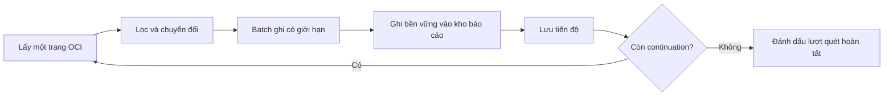

# Pagination, filtering và xử lý tập kết quả lớn

Trong chương **OCI SDK và REST API với Java** của module **CLOUD_PROVIDERS_ORACLE**, bài này hướng dẫn đọc dữ liệu OCI theo từng phần, lọc đúng phạm vi và xử lý danh sách lớn mà không giữ toàn bộ kết quả trong bộ nhớ.

Ví dụ xuyên suốt là một tác vụ kiểm kê hạ tầng: liệt kê Compute instance theo compartment và region, chọn các instance cần báo cáo, đồng thời lập danh mục object trong một bucket. Kết quả có thể được ghi vào Oracle Database, Autonomous Database hoặc một kho báo cáo. Tác vụ cần có phân quyền phù hợp, đo được tiến độ, tiếp tục được sau lỗi và kiểm soát lượng gọi API.

## 1. Mục tiêu và ba quyết định nền tảng

Sau bài này, người học có thể:

- Đọc đủ các trang của một API thay vì chỉ lấy trang đầu.
- Phân biệt page token của phần lớn List API với cơ chế riêng của Object Storage ListObjects.
- Kết hợp bộ lọc phía dịch vụ với điều kiện xử lý trong Java.
- Dùng paginator của SDK khi phù hợp và tự quản lý trang khi cần checkpoint.
- Ghi dữ liệu theo batch, giới hạn concurrency và tránh tích lũy toàn bộ kết quả.
- Phân biệt quét hoàn tất, kết quả một phần và quét bị lỗi.

Ba quyết định cần tách riêng:

| Quyết định | Câu hỏi cần trả lời |
| --- | --- |
| Phạm vi | Đang đọc tài nguyên nào, ở region và compartment nào, bằng danh tính nào? |
| Điều kiện chọn | Dịch vụ hỗ trợ lọc gì, ứng dụng còn phải lọc thêm gì? |
| Cách tiêu thụ | Xử lý từng bản ghi, từng trang hay gom toàn bộ? |

Đọc hết các trang trong một compartment không đồng nghĩa đã kiểm kê toàn tenancy. Tương tự, một danh sách rỗng chưa đủ chứng minh không có tài nguyên nếu request đang trỏ sai region hoặc chưa bao phủ đúng phạm vi được giao.

## 2. Hiểu đúng contract phân trang của OCI

### 2.1. Phần lớn List API dùng continuation token

Với nhiều List API của OCI:

1. Request đầu tiên không đặt `page`.
2. Response có thể trả header `opc-next-page`.
3. Request tiếp theo truyền nguyên giá trị đó vào `page`.
4. Tiếp tục đến khi không còn token trang sau.

`limit` là số phần tử tối đa của một trang, không phải tổng số phần tử được phép lấy trong toàn bộ vòng quét. Một trang có thể ít hơn limit, thậm chí rỗng, trong khi vẫn còn token để đọc tiếp. Xem [quy tắc List Pagination của REST API](https://docs.oracle.com/en-us/iaas/Content/API/Concepts/usingapi.htm).

Minh họa giao thức:

```http
GET /20160918/instances?compartmentId=ENCODED_COMPARTMENT_OCID&limit=100
Host: iaas.REGION.oraclecloud.com

HTTP/1.1 200 OK
opc-next-page: TOKEN_A
opc-request-id: REQUEST_ID_A

[ ... ]
```

Trang sau:

```http
GET /20160918/instances?compartmentId=ENCODED_COMPARTMENT_OCID&limit=100&page=ENCODED_TOKEN_A
Host: iaas.REGION.oraclecloud.com
```

Ví dụ lược bỏ header xác thực và các trường không liên quan. Khi tự gọi REST, phải mã hóa tham số query đúng cách và ký request thực tế, bao gồm request target hiện tại; không tái sử dụng chữ ký của trang trước sau khi thay URL. Xem [Request Signatures](https://docs.oracle.com/en-us/iaas/Content/API/Concepts/signingrequests.htm).

### 2.2. Token không phải số trang hay offset

Không tự chuyển `page` thành `1`, `2`, `3`. Cũng không giải mã, cắt bớt, trim hoặc sửa token theo suy đoán.

Nên coi token là giá trị do dịch vụ quản lý, gắn với lượt truy vấn đang thực hiện. Trong một chuỗi phân trang, giữ ổn định:

- Region và endpoint.
- Compartment hoặc phạm vi tài nguyên tương ứng.
- Bộ lọc và thứ tự sắp xếp.
- Các tham số định hình kết quả.
- Page size đã chọn cho chuỗi request.

Nếu thay bộ lọc, hãy bắt đầu một lượt truy vấn mới. Không ghép token của kết quả cũ với điều kiện mới.

### 2.3. Không dừng chỉ vì trang rỗng hoặc trang ngắn

Giả sử quan sát được:

| Trang | Số phần tử dịch vụ trả | Token tiếp theo |
| --- | ---: | --- |
| 1 | 100 | Có |
| 2 | 0 | Có |
| 3 | 17 | Không |

Dừng ở trang 2 sẽ bỏ sót 17 phần tử của trang 3. Với ListInstances, contract của response chỉ ra còn trang khi có `opc-next-page`; xem [ListInstancesResponse](https://docs.oracle.com/en-us/iaas/tools/java/latest/com/oracle/bmc/core/responses/ListInstancesResponse.html).

Cũng không dừng vì sau khi lọc cục bộ một trang không còn phần tử nào. Điều đó chỉ mô tả nội dung đã thấy của trang hiện tại.

Quy tắc cuối cùng phải dựa trên tài liệu của operation cụ thể. Không tạo một helper áp đặt duy nhất cơ chế kết thúc cho mọi dịch vụ chỉ vì các operation cùng có tên bắt đầu bằng `List`.

## 3. Filtering: lọc ở đâu và theo ngữ nghĩa nào?

### 3.1. Ưu tiên điều kiện dịch vụ thực sự hỗ trợ

Lọc phía dịch vụ giúp giảm lượng dữ liệu trả về và công việc xử lý phía ứng dụng. Tuy nhiên, mỗi operation có tập tham số riêng.

Với Compute ListInstances, request hỗ trợ các tham số như compartment, availability domain, lifecycle state và display name. Trong đó, `displayName` là bộ lọc khớp chính xác, không phải glob hoặc phép tìm theo prefix. Xem [ListInstancesRequest](https://docs.oracle.com/en-us/iaas/tools/java/latest/com/oracle/bmc/core/requests/ListInstancesRequest.html).

Ví dụ nhu cầu:

| Nhu cầu | Cách tiếp cận |
| --- | --- |
| Instance RUNNING trong compartment A | Đặt compartment và lifecycle state trong request |
| Instance có display name đúng bằng `app-api-01` | Dùng bộ lọc display name của API |
| Display name bắt đầu bằng `app-` | Lọc cục bộ nếu operation không có tham số prefix phù hợp |
| Điều kiện nghiệp vụ kết hợp nhiều thuộc tính | Lọc phần được hỗ trợ ở server, phần còn lại trong Java |
| Tìm trên nhiều loại tài nguyên theo thuộc tính được lập chỉ mục | Cân nhắc OCI Resource Search |

Không truyền `displayName("app-*")` rồi kỳ vọng dịch vụ hiểu đó là tất cả tên bắt đầu bằng `app-`.

### 3.2. Lọc cục bộ không giảm lượng đã tải

Giả sử một lượt quét đọc 50.000 instance summary nhưng chỉ 2% khớp quy tắc của ứng dụng. Kết quả cuối cùng là 1.000 bản ghi, trong khi ứng dụng vẫn phải nhận và kiểm tra 50.000 bản ghi nếu điều kiện đó không được đẩy xuống dịch vụ.

Cần phân biệt các số liệu:

```text
received : số bản ghi dịch vụ đã trả
matched  : số bản ghi vượt qua bộ lọc cục bộ
written  : số bản ghi đã được lưu thành công
```

Một tỷ lệ `matched / received` rất thấp là tín hiệu để xem lại phạm vi quét hoặc cách tổ chức dữ liệu. Nó không tự chứng minh thuật toán lọc Java có lỗi.

### 3.3. Resource Search có contract riêng

OCI Resource Search cho phép tìm trên các loại tài nguyên và thuộc tính được hỗ trợ, bằng truy vấn có điều kiện. Đây là một API riêng, không phải tham số SQL có thể gắn vào mọi List request. Xem [ngôn ngữ truy vấn Search](https://docs.oracle.com/en-us/iaas/Content/Search/Concepts/querysyntax.htm).

Kết quả Search có tập thuộc tính và phạm vi hỗ trợ riêng. Khi cần thông tin chi tiết để đưa ra quyết định, có thể phải gọi API của dịch vụ sở hữu tài nguyên. Xem [tổng quan Search](https://docs.oracle.com/en-us/iaas/Content/Search/Concepts/queryoverview.htm).

Không mở rộng quyền IAM toàn tenancy chỉ để một request lọc được ít kết quả hơn. Thiết kế phạm vi truy vấn và quyền truy cập cùng nhau.

## 4. Java: tự quản lý trang với Compute ListInstances

### 4.1. Điều kiện chạy ví dụ

Ví dụ sử dụng các kiểu trong OCI Java SDK:

- `com.oracle.bmc.core.Compute`.
- `ListInstancesRequest`, `ListInstancesResponse`.
- `com.oracle.bmc.core.model.Instance`.

Dự án cần module SDK Core và HTTP client phù hợp với phiên bản SDK đang dùng. Các dependency của OCI SDK nên được quản lý cùng phiên bản tương thích.

Client `Compute` được truyền vào hàm phải đã cấu hình xác thực, region và timeout. Người gọi sở hữu vòng đời client, đóng client sau khi toàn bộ tác vụ hoàn tất. Ví dụ không thay đổi tài nguyên trên OCI.

### 4.2. Quét tuần tự, lọc từng bản ghi và chuyển cho sink

```java
import com.oracle.bmc.core.Compute;
import com.oracle.bmc.core.model.Instance;
import com.oracle.bmc.core.requests.ListInstancesRequest;
import com.oracle.bmc.core.responses.ListInstancesResponse;

import java.util.Objects;
import java.util.function.Consumer;

public final class ComputeInventoryScan {

    private ComputeInventoryScan() {
    }

    public static long scanRunningApplicationInstances(
            Compute compute,
            String compartmentId,
            String requiredNamePrefix,
            int maxPages,
            Consumer<Instance> sink) {

        Objects.requireNonNull(compute, "compute");
        Objects.requireNonNull(compartmentId, "compartmentId");
        Objects.requireNonNull(requiredNamePrefix, "requiredNamePrefix");
        Objects.requireNonNull(sink, "sink");

        if (maxPages < 1) {
            throw new IllegalArgumentException("maxPages must be positive");
        }

        ListInstancesRequest base = ListInstancesRequest.builder()
                .compartmentId(compartmentId)
                .lifecycleState(Instance.LifecycleState.Running)
                .limit(100)
                .build();

        String pageToken = null;
        int pageCount = 0;
        long matchedCount = 0;

        do {
            if (pageCount >= maxPages) {
                throw new IllegalStateException(
                        "Scan stopped at maxPages; result is incomplete");
            }

            ListInstancesRequest request = base.toBuilder()
                    .page(pageToken)
                    .build();

            ListInstancesResponse response = compute.listInstances(request);
            pageCount++;

            for (Instance instance : response.getItems()) {
                String displayName = instance.getDisplayName();

                if (displayName != null
                        && displayName.startsWith(requiredNamePrefix)) {
                    sink.accept(instance);
                    matchedCount++;
                }
            }

            String next = response.getOpcNextPage();

            if (next != null && next.equals(pageToken)) {
                throw new IllegalStateException(
                        "Pagination did not advance");
            }

            pageToken = next;
        } while (pageToken != null && !pageToken.isEmpty());

        return matchedCount;
    }
}
```

Phần khai báo request và phương thức đọc token được đối chiếu với [ListInstancesRequest.Builder](https://docs.oracle.com/en-us/iaas/tools/java/latest/com/oracle/bmc/core/requests/ListInstancesRequest.Builder.html) và [ListInstancesResponse](https://docs.oracle.com/en-us/iaas/tools/java/latest/com/oracle/bmc/core/responses/ListInstancesResponse.html).

Các điểm cần hiểu trong ví dụ:

- `limit(100)` giới hạn từng trang.
- Lifecycle state được lọc phía dịch vụ.
- Prefix tên được lọc phía ứng dụng.
- Trang không có item vẫn được đi tiếp nếu còn token.
- Mỗi item được đưa sang `sink`, không gom toàn bộ vào một danh sách.
- Lỗi của API hoặc sink được truyền ra; hàm không trả một số đếm rồi che giấu rằng quá trình đã thất bại.

Giới hạn `maxPages` là cơ chế bảo vệ do ví dụ đặt ra. Chạm giới hạn phải được coi là chưa hoàn tất, không phải đã đọc hết tài nguyên. Kiểm tra token lặp chỉ phát hiện trường hợp không tiến lên trực tiếp; giới hạn số trang còn giúp chặn các vòng lặp dài hơn.

Hàm chưa triển khai checkpoint, retry của sink hoặc deadline toàn job. Những phần đó cần được thiết kế khi đưa vào tác vụ vận hành.

### 4.3. Sink quyết định tác vụ có thật sự tiết kiệm bộ nhớ hay không

Lời gọi kiểu này vẫn làm bộ nhớ tăng theo toàn bộ kết quả:

```java
// Không phù hợp với tập kết quả không có giới hạn rõ ràng.
List<Instance> all = new ArrayList<>();

ComputeInventoryScan.scanRunningApplicationInstances(
        compute, compartmentId, "app-", 10_000, all::add);
```

Dù vòng phân trang chỉ giữ từng trang, `all::add` lại giữ mọi instance đã khớp. Với tập lớn, nên dùng sink ghi xuống nơi lưu trữ hoặc gom một batch nhỏ có giới hạn rồi flush.

Số đếm trả về trong ví dụ là số lần sink đã chấp nhận thành công. Nếu sink chỉ đẩy vào queue nội bộ, số đó chưa chắc là số bản ghi đã được lưu bền vững. Cần định nghĩa rõ contract của sink.

## 5. Java SDK paginator: giảm mã điều khiển nhưng vẫn cần kiểm soát

Compute client cung cấp paginator cho ListInstances với hai dạng:

- `listInstancesRecordIterator`: duyệt từng `Instance`.
- `listInstancesResponseIterator`: duyệt từng response của operation.

Iterable sẽ lấy thêm dữ liệu từ server khi cần. Xem [ComputePaginators](https://docs.oracle.com/en-us/iaas/tools/java/latest/com/oracle/bmc/core/ComputePaginators.html).

### 5.1. Record iterator

```java
ListInstancesRequest request = ListInstancesRequest.builder()
        .compartmentId(compartmentId)
        .lifecycleState(Instance.LifecycleState.Running)
        .limit(100)
        .build();

Iterable<Instance> instances = compute.getPaginators()
        .listInstancesRecordIterator(request);

for (Instance instance : instances) {
    String name = instance.getDisplayName();

    if (name != null && name.startsWith("app-")) {
        sink.accept(instance);
    }
}
```

Đoạn này dùng cùng các import Compute request và model ở ví dụ trước. Nó phù hợp khi muốn xử lý tuần tự từng tài nguyên và không cần tự quản lý token.

Việc tạo iterable chưa có nghĩa toàn bộ quá trình đã thành công. Lỗi mạng có thể xuất hiện khi vòng lặp đang tiến sang trang sau; xử lý lỗi phải bao quanh toàn bộ giai đoạn tiêu thụ iterable.

Nếu cần dừng theo giới hạn công việc hoặc deadline, hãy thể hiện trạng thái dừng rõ ràng. Một vòng lặp `break` sau 100 item không còn là thao tác lấy toàn bộ danh sách.

### 5.2. Response iterator

```java
Iterable<ListInstancesResponse> pages = compute.getPaginators()
        .listInstancesResponseIterator(request);

long received = 0;

for (ListInstancesResponse page : pages) {
    received += page.getItems().size();

    // Có thể ghi log thống kê trang và opc-request-id ở đây.
    // Xử lý xong dữ liệu trang trước khi đi tiếp.
    for (Instance instance : page.getItems()) {
        sink.accept(instance);
    }
}
```

Response iterator hữu ích khi cần đo latency xử lý trang, số item mỗi response hoặc request ID để điều tra lỗi. Tự quản lý vòng gọi API thường rõ ràng hơn khi cần lưu checkpoint và điều phối lại sau khi tiến trình khởi động lại.

Không mặc định biến iterable thành một Java parallel stream để tăng tốc. Chuỗi page token có quan hệ phụ thuộc và việc duyệt một iterator không đồng nghĩa có thể gọi nhiều trang tùy ý song song.

## 6. Object Storage ListObjects là trường hợp khác

### 6.1. Dùng nextStartWith với start

Object Storage ListObjects trả giá trị tiếp nối `nextStartWith` trong body. Đọc trang sau bằng cách truyền giá trị đó vào `start`; không tìm `opc-next-page` như trong ví dụ Compute. Xem [ListObjects](https://docs.oracle.com/en-us/iaas/tools/java/latest/com/oracle/bmc/objectstorage/model/ListObjects.html).

Các tham số có ý nghĩa khác nhau:

| Tham số | Ý nghĩa |
| --- | --- |
| `prefix` | Chọn object có tên bắt đầu bằng chuỗi chỉ định |
| `start` | Chọn từ tên lớn hơn hoặc bằng mốc theo thứ tự từ điển |
| `startAfter` | Chọn tên lớn hơn mốc, không gồm mốc |
| `end` | Chọn tên nhỏ hơn mốc kết thúc |
| `delimiter` | Gom kết quả theo prefix thay vì liệt kê phẳng mọi object |
| `fields` | Chọn các trường summary bổ sung cần trả về |

Danh sách object mặc định chỉ có trường tên; nếu cần size hoặc ETag phải yêu cầu qua `fields`. Xem [ListObjectsRequest](https://docs.oracle.com/en-us/iaas/tools/java/latest/com/oracle/bmc/objectstorage/requests/ListObjectsRequest.html).

Không thay `start(nextStartWith)` thành `startAfter(nextStartWith)` theo cảm tính. `nextStartWith` là mốc bắt đầu trang sau, dùng mốc đó theo cách loại trừ có thể bỏ qua object cần đọc.

### 6.2. Quét phẳng theo prefix với bộ nhớ có giới hạn

Ví dụ sau dùng module Object Storage của cùng bộ OCI Java SDK:

```java
import com.oracle.bmc.objectstorage.ObjectStorage;
import com.oracle.bmc.objectstorage.model.ListObjects;
import com.oracle.bmc.objectstorage.model.ObjectSummary;
import com.oracle.bmc.objectstorage.requests.ListObjectsRequest;

import java.util.Objects;
import java.util.function.Consumer;

public final class ObjectInventoryScan {

    private ObjectInventoryScan() {
    }

    public static long scanPrefix(
            ObjectStorage storage,
            String namespace,
            String bucket,
            String prefix,
            int maxPages,
            Consumer<ObjectSummary> sink) {

        Objects.requireNonNull(storage, "storage");
        Objects.requireNonNull(namespace, "namespace");
        Objects.requireNonNull(bucket, "bucket");
        Objects.requireNonNull(prefix, "prefix");
        Objects.requireNonNull(sink, "sink");

        if (maxPages < 1) {
            throw new IllegalArgumentException("maxPages must be positive");
        }

        ListObjectsRequest base = ListObjectsRequest.builder()
                .namespaceName(namespace)
                .bucketName(bucket)
                .prefix(prefix)
                .fields("name,size,etag,timeCreated")
                .limit(500)
                .build();

        String start = null;
        int pages = 0;
        long count = 0;

        do {
            if (pages >= maxPages) {
                throw new IllegalStateException(
                        "Object scan stopped before completion");
            }

            ListObjects result = storage.listObjects(
                    base.toBuilder().start(start).build())
                    .getListObjects();

            pages++;

            for (ObjectSummary object : result.getObjects()) {
                sink.accept(object);
                count++;
            }

            String next = result.getNextStartWith();

            if (next != null && next.equals(start)) {
                throw new IllegalStateException(
                        "Object pagination did not advance");
            }

            start = next;
        } while (start != null && !start.isEmpty());

        return count;
    }
}
```

Ví dụ không đặt `delimiter`, vì mục tiêu là duyệt phẳng các object khớp prefix. Nếu đặt delimiter, response có thể trả các prefix nhóm; chỉ đọc `getObjects()` sẽ không tương đương đi qua mọi object bên dưới các prefix đó. Xem [ListObjectsRequest.Builder](https://docs.oracle.com/en-us/iaas/tools/java/latest/com/oracle/bmc/objectstorage/requests/ListObjectsRequest.Builder.html).

`ObjectSummary.getSize()` biểu diễn kích thước byte và có kiểu `Long`; những trường không được yêu cầu hoặc không có dữ liệu cần được xử lý phù hợp, không tự mặc định thành số đo hợp lệ. Xem [ObjectSummary](https://docs.oracle.com/en-us/iaas/tools/java/latest/com/oracle/bmc/objectstorage/model/ObjectSummary.html).

### 6.3. Tổ chức tên giúp lọc sớm

Giả sử bucket dùng quy ước:

```text
orders/2026/11/20/part-0001.json
orders/2026/11/20/part-0002.json
orders/2026/11/21/part-0001.json
audit/2026/11/20/part-0001.json
```

Prefix `orders/2026/11/20/` xác định trực tiếp phần dữ liệu cần quét. Nếu thời gian chỉ nằm trong nội dung JSON, thao tác liệt kê tên không tự hiểu điều kiện nghiệp vụ đó.

Việc liệt kê metadata khác với tải nội dung object. Nếu chỉ cần tên và kích thước, không gọi GetObject cho từng item chỉ để lấy lại thông tin đã có thể yêu cầu trong summary.

## 7. Xử lý tập lớn mà không biến pagination thành tải toàn bộ

### 7.1. Ước lượng bộ nhớ theo dữ liệu đang giữ

Giả sử có 250.000 bản ghi, mỗi bản ghi được ước lượng 4 KB dữ liệu trước khi xét thêm overhead object Java:

```text
Gom toàn bộ ≈ 250.000 × 4 KB
            ≈ 1 GB dữ liệu
```

Nếu xử lý từng trang 100 bản ghi:

```text
Dữ liệu một trang ≈ 100 × 4 KB
                  ≈ 400 KB
```

Heap thực tế còn chứa object, chuỗi, buffer giải mã, batch ghi và tác vụ đang chạy. Mô hình cần theo dõi là:

```text
Bộ nhớ đang giữ
≈ dữ liệu trang hiện tại
+ batch của sink
+ công việc đang xử lý hoặc chờ
+ cache và cấu trúc đối soát
```

Một `Set` chứa mọi OCID để loại trùng hoặc một map chứa mọi kết quả cũng có thể tăng theo toàn bộ tập dữ liệu. Nếu cần chống trùng ở quy mô lớn, cân nhắc ràng buộc duy nhất hoặc bảng trạng thái trong nơi lưu trữ.

### 7.2. Ghi theo batch và gây backpressure về phía đọc



Với phiên bản tuần tự, sink xử lý chậm làm lượt đọc tiếp theo chờ theo. Đây là cách đơn giản để tránh đọc nhanh hơn khả năng ghi.

Nếu cần tách luồng đọc và luồng ghi:

- Dùng queue có giới hạn số phần tử và byte.
- Giới hạn số batch đang xử lý đồng thời.
- Chờ khi sink hết sức chứa.
- Thu thập lỗi worker trước khi xác nhận trang hoàn tất.
- Không lưu checkpoint vượt qua dữ liệu chưa được ghi bền vững.

Chỉ đặt `newFixedThreadPool` không tự bảo đảm giới hạn hàng đợi của mọi cách triển khai. Cần kiểm tra cả cấu trúc lưu tác vụ đang chờ.

### 7.3. Tránh mẫu N+1 request

Nếu đã đọc 50.000 summary, rồi gọi một Get API cho từng item dù không cần, tổng lượng request có thể tăng rất lớn.

Trước khi enrich từng tài nguyên, xác định:

1. Trường cần thiết đã có trong List response hay chưa?
2. Có tham số chọn trường hoặc API phù hợp hơn không?
3. Có thể lọc bỏ item trước khi gọi Get không?
4. Có cần tất cả chi tiết hay chỉ một nhóm nhỏ?
5. Các lời gọi bổ sung có giới hạn concurrency và retry không?

Số request thấp hơn thường giúp giảm thời gian, nguy cơ throttling và tài nguyên ứng dụng cần giữ. Không mặc định mọi API List/Get có cùng cách tính phí; chi phí còn phụ thuộc dịch vụ và công việc phát sinh.

### 7.4. Tổng hợp theo dòng khi có thể

Các phép đếm, tính tổng hoặc phân nhóm có số nhóm hữu hạn thường có thể cập nhật dần. Không cần giữ tất cả bản ghi chỉ để đếm số instance theo lifecycle state.

Ngược lại, sắp xếp từng trang rồi nối các trang không tạo ra thứ tự toàn cục. Nếu cần báo cáo sắp xếp trên toàn bộ dữ liệu, có thể:

- Sử dụng thứ tự được API hỗ trợ và hiểu đúng phạm vi bảo đảm.
- Ghi xuống kho báo cáo rồi truy vấn sắp xếp ở đó.
- Dùng thuật toán top-K có giới hạn bộ nhớ nếu chỉ cần K phần tử lớn nhất.

Không suy ra thứ tự toàn tenancy từ từng danh sách riêng theo compartment hoặc region.

## 8. Checkpoint và khả năng tiếp tục sau lỗi

### 8.1. Checkpoint phải gắn với định nghĩa truy vấn

Một trạng thái tác vụ do ứng dụng thiết kế có thể chứa:

```json
{
  "jobId": "inventory-2026-11-20-001",
  "operation": "ListInstances",
  "region": "ap-singapore-1",
  "scopeId": "ocid1.compartment.oc1..example",
  "queryFingerprint": "hash-of-scope-filters-and-sort",
  "nextPageToken": "opaque-service-value",
  "completed": false,
  "pagesCommitted": 12,
  "recordsWritten": 845
}
```

Đây là schema gợi ý của ứng dụng, không phải cấu trúc checkpoint có sẵn của OCI SDK. Với ListObjects, phải lưu mốc tiếp nối và các tham số tương ứng với operation đó.

Không chỉ lưu token rồi bỏ qua region, bucket, compartment hoặc bộ lọc. Khi khởi động lại, đối chiếu trạng thái tác vụ với cấu hình định chạy.

Giá trị `null` của token cần được phân biệt với trạng thái chưa bắt đầu hoặc đã hoàn tất. Trường `completed` giúp tránh việc một tác vụ đã hết dữ liệu bị hiểu nhầm thành phải chạy lại từ đầu.

### 8.2. Lưu kết quả trước, tiến độ sau

Trình tự cơ bản:

```text
Đọc trang với token P
→ xử lý và ghi toàn bộ kết quả cần giữ của trang
→ xác nhận dữ liệu đã bền vững
→ lưu token trang tiếp theo cùng trạng thái tiến độ
```

Nếu tiến trình chết sau khi ghi dữ liệu nhưng trước khi lưu checkpoint, trang có thể được xử lý lại. Sink nên hỗ trợ upsert hoặc chống trùng theo khóa phù hợp.

Ví dụ, một bảng inventory theo lần quét có thể dùng khóa `(job_id, resource_id)`. Với dữ liệu object, khóa cần phản ánh namespace, bucket và tên, thêm định danh phiên bản nếu bài toán kiểm kê phiên bản yêu cầu.

Không lưu token trang sau trước khi biết dữ liệu trang hiện tại đã được lưu. Nếu chết ở khoảng giữa, lần chạy tiếp theo có thể bỏ qua dữ liệu chưa ghi.

### 8.3. Không giả định page token là checkpoint vĩnh viễn

Token được trả cho quá trình truy vấn; không nên tự suy ra token có thể dùng lại sau thời gian tùy ý hoặc khi tham số đã đổi.

Nếu token bị dịch vụ từ chối, tác vụ cần chính sách rõ ràng: dừng để điều tra, tạo lượt quét mới hoặc quét lại phần phạm vi với sink idempotent. Không âm thầm bỏ token rồi báo lần chạy cũ đã hoàn tất.

Checkpoint hỗ trợ phục hồi tiến trình. Nó không tự tạo ra một snapshot nhất quán của tài nguyên OCI.

## 9. Dữ liệu có thể thay đổi trong lúc đang phân trang

Trong thời gian quét, instance có thể đổi trạng thái, object có thể được tạo thêm hoặc tài nguyên bị xóa. Không mặc định một chuỗi List request là giao dịch đọc nhất quán tại một thời điểm.

Các biện pháp thiết kế gợi ý:

- Ghi `scanStartedAt` và `scanFinishedAt` cho toàn bộ job.
- Gắn `observedAt` cho dữ liệu đã quan sát nếu cần đối soát.
- Lưu trạng thái hoàn tất theo từng region và compartment.
- Upsert theo định danh ổn định thay vì thứ tự xuất hiện.
- Chạy đối soát lại khi yêu cầu báo cáo cần độ đầy đủ cao hơn.

Ví dụ, một lượt inventory báo chi phí tiềm năng nên phân biệt dữ liệu quan sát trong khoảng thời gian quét với số liệu tính phí chính thức. Không suy ra tổng hóa đơn từ một lần liệt kê tài nguyên.

Nếu tác vụ sau khi liệt kê sẽ sửa hoặc xóa tài nguyên, cần kiểm tra lại trạng thái cần thiết tại thời điểm thao tác và áp dụng cơ chế kiểm soát đồng thời của API liên quan. Dữ liệu summary đã đọc trước đó có thể không còn là trạng thái hiện tại.

## 10. Retry, timeout và phạm vi chạy song song

### 10.1. Lỗi trang không có nghĩa đã hết dữ liệu

Một request trang tiếp theo bị timeout, 429 hoặc lỗi server không phải tín hiệu kết thúc danh sách.

OCI Java SDK hỗ trợ cấu hình retry ở mức client và request; cấu hình cụ thể cần đối chiếu operation và phiên bản đang dùng. Xem [khái niệm Java SDK và retry](https://docs.oracle.com/en-us/iaas/Content/API/SDKDocs/javasdkconcepts.htm).

Đối với lỗi tạm thời:

1. Giữ nguyên token của request chưa hoàn tất.
2. Retry có giới hạn và có backoff phù hợp.
3. Không cập nhật checkpoint sang trang sau khi chưa có kết quả hợp lệ.
4. Báo tác vụ thất bại hoặc tạm dừng khi hết ngân sách retry.

Không tạo thêm vòng retry vô hạn bên ngoài SDK mà không xét số lần thử bên trong. Retry của API và retry ghi sink là hai vấn đề khác nhau.

### 10.2. Đặt deadline cho toàn bộ job

Timeout từng request không giới hạn tổng thời gian quét. Một job có hàng nghìn trang vẫn có thể kéo dài lâu dù từng request đều trả lời trong timeout.

Nên quy định:

- Timeout kết nối và đọc response.
- Ngân sách retry của từng request.
- Số trang hoặc số bản ghi tối đa cho một lượt tác vụ.
- Deadline toàn job.
- Trạng thái khi dừng trước khi hết dữ liệu.

Giới hạn bảo vệ phải tạo trạng thái `PARTIAL`, `FAILED` hoặc trạng thái tương đương của ứng dụng. Không gắn nhãn `COMPLETE` cho kết quả bị cắt.

### 10.3. Song song hóa theo các phạm vi độc lập

Trong một chuỗi continuation token, phải có response trước mới biết token của trang sau. Không tự tạo page token cho các trang chưa đọc.

Có thể chia tác vụ theo các phạm vi độc lập được xác định trước, chẳng hạn các cặp region–compartment hoặc các prefix object không chồng nhau. Mỗi phần việc có checkpoint và trạng thái riêng.

Cần giới hạn tổng request đồng thời, số connection và khả năng ghi của sink. Không dùng một builder hoặc biến token có thể thay đổi chung cho nhiều worker.

Ví dụ chia prefix chỉ đúng khi các prefix thật sự không chồng lấn. Chạy đồng thời `orders/` và `orders/2026/` rồi cộng kết quả sẽ đếm lặp phần dữ liệu bên dưới `orders/2026/`.

## 11. Khi xây API của ứng dụng trên dữ liệu OCI

### 11.1. Trang của ứng dụng khác trang của OCI

Giả sử API của ứng dụng cần trả 20 item đã qua điều kiện nghiệp vụ. Một trang OCI trả 100 item nhưng chỉ 3 item khớp. Trả 3 item có thể là thiết kế hợp lệ nếu contract ứng dụng cho phép, nhưng không được mặc định rằng đã hết dữ liệu.

Nếu ứng dụng muốn lấp đầy trang 20 item, có thể cần đọc nhiều trang OCI. Phải đặt ngân sách thời gian và số trang dịch vụ được phép đọc cho mỗi request của người dùng.

Ngược lại, nếu một trang OCI có 30 item khớp mà API chỉ trả 20, ứng dụng còn 10 item chưa trả. Chỉ đưa token của trang OCI tiếp theo cho client sẽ bỏ qua phần dư đó.

Có thể giải quyết bằng cursor ứng dụng giữ trạng thái phần dư, lưu kết quả trung gian hoặc phân trang trên bảng inventory đã tạo. Không dùng một token OCI như thể nó tự mô tả vị trí bên trong danh sách đã lọc của ứng dụng.

### 11.2. Cursor ứng dụng phải gắn với quyền truy cập

Nếu cung cấp cursor cho client, ràng buộc nó với người dùng hoặc phạm vi được phép, điều kiện truy vấn và thời hạn của phiên duyệt. Kiểm tra lại authorization khi nhận request tiếp theo.

Không cho client đổi compartment hoặc bộ lọc trong khi tiếp tục dùng cùng cursor mà không xác định lại phạm vi. Cũng không cho phép cursor trở thành cách bỏ qua kiểm tra quyền trên tài nguyên.

Khi người dùng cần tổng số kết quả chính xác hoặc nhảy tùy ý đến trang số N, cần đánh giá việc tạo tập kết quả trong kho báo cáo. API dùng continuation token không tự cung cấp các khả năng đó.

## 12. Quan sát và thực hành trong môi trường lab

### 12.1. Log và metric cần có

Một lượt quét nên ghi:

| Tín hiệu | Mục đích |
| --- | --- |
| Operation, region, scope, job ID | Xác định phạm vi tác vụ |
| Số trang đã đọc | Theo dõi tiến độ và giới hạn |
| Received, matched, written | Tách khối lượng tải, chọn và lưu |
| Latency API và latency sink | Xác định điểm nghẽn |
| Retry và throttling | Điều chỉnh tốc độ request |
| Buffer và số batch đang chạy | Kiểm soát bộ nhớ |
| Thời điểm checkpoint gần nhất | Đánh giá phần việc có thể phải chạy lại |
| Trạng thái cuối cùng từng phạm vi | Phân biệt hoàn tất với kết quả một phần |

Dùng `opc-request-id` của response để hỗ trợ điều tra request cụ thể. Không log toàn bộ thông tin xác thực hoặc token chỉ để đếm số trang.

Một tỷ lệ `written < matched` sau khi tác vụ đã báo hoàn tất cần có lời giải thích rõ ràng, chẳng hạn dữ liệu được gộp theo khóa hoặc đã tồn tại. Không để lỗi sink bị biến thành kết quả thiếu mà không có trạng thái lỗi.

### 12.2. Bài thực hành Compute

Trong một compartment thử nghiệm mà người học có quyền liệt kê:

1. Khởi tạo Compute client ở region xác định.
2. Chọn page size nhỏ, chẳng hạn 2, để dễ quan sát nhiều request nếu có đủ tài nguyên.
3. Chạy vòng quét thủ công với bộ lọc lifecycle state cố định.
4. Ghi số item mỗi trang, có hay không token và request ID.
5. Lọc thêm prefix tên ở phía Java.
6. Đối chiếu số received với số matched.
7. Dùng record iterator thực hiện cùng phạm vi và so sánh cách tiêu thụ.

Nếu compartment có quá ít tài nguyên, có thể không xuất hiện nhiều trang. Không tạo kết luận rằng code phân trang sai chỉ vì lượt thử có một trang.

### 12.3. Bài thực hành Object Storage

Với một bucket lab có nhiều tên object dưới các prefix khác nhau:

1. Chọn prefix hẹp và page size nhỏ.
2. Yêu cầu rõ các trường summary cần dùng.
3. Quan sát `nextStartWith` rồi truyền vào `start`.
4. Ghi metadata từng trang vào một sink có giới hạn.
5. So sánh kết quả không đặt delimiter với kết quả có delimiter.
6. Xác nhận rằng danh sách prefix nhóm không phải danh sách đầy đủ object bên dưới.

Các ví dụ trong bài là mã hướng dẫn để tích hợp vào dự án lab. Việc chạy thực tế cần đúng dependency, xác thực, region và quyền IAM của môi trường người học.

### 12.4. Các tình huống cần xác minh khi triển khai

| Tình huống | Hành vi mong đợi |
| --- | --- |
| Trang ít item hơn limit nhưng còn token | Tiếp tục đọc |
| Trang rỗng nhưng còn token theo contract operation | Không dừng nhầm |
| Lọc cục bộ làm trang không còn item | Vẫn xét continuation của dịch vụ |
| API lỗi ở trang giữa | Không báo hoàn tất |
| Sink lỗi sau khi ghi một phần trang | Không checkpoint vượt dữ liệu; xử lý lại an toàn |
| Chạm maxPages hoặc deadline | Thể hiện kết quả chưa đầy đủ |
| Khởi động lại từ checkpoint | Giữ đúng phạm vi và điều kiện truy vấn |
| Tiến trình chết trước khi lưu checkpoint | Có thể chạy lại trang mà không tạo dữ liệu trùng sai |
| Nhiều scope chạy song song | Giới hạn concurrency và theo dõi trạng thái từng scope |

Một thiết kế hoàn chỉnh cần chứng minh được hai điều riêng: có thể đi hết tập kết quả theo contract API, và có thể lưu kết quả đúng trong giới hạn bộ nhớ, thời gian cùng phạm vi quyền truy cập. Các chỉ số tiến độ và trạng thái kết thúc phải thể hiện được cả hai điều đó.
