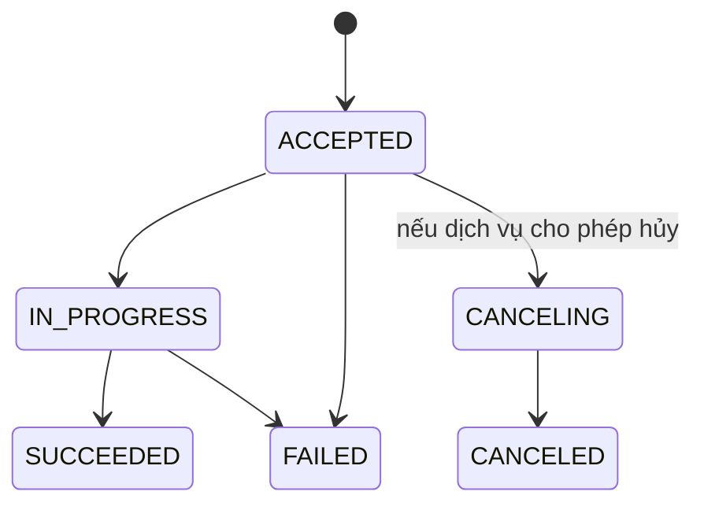
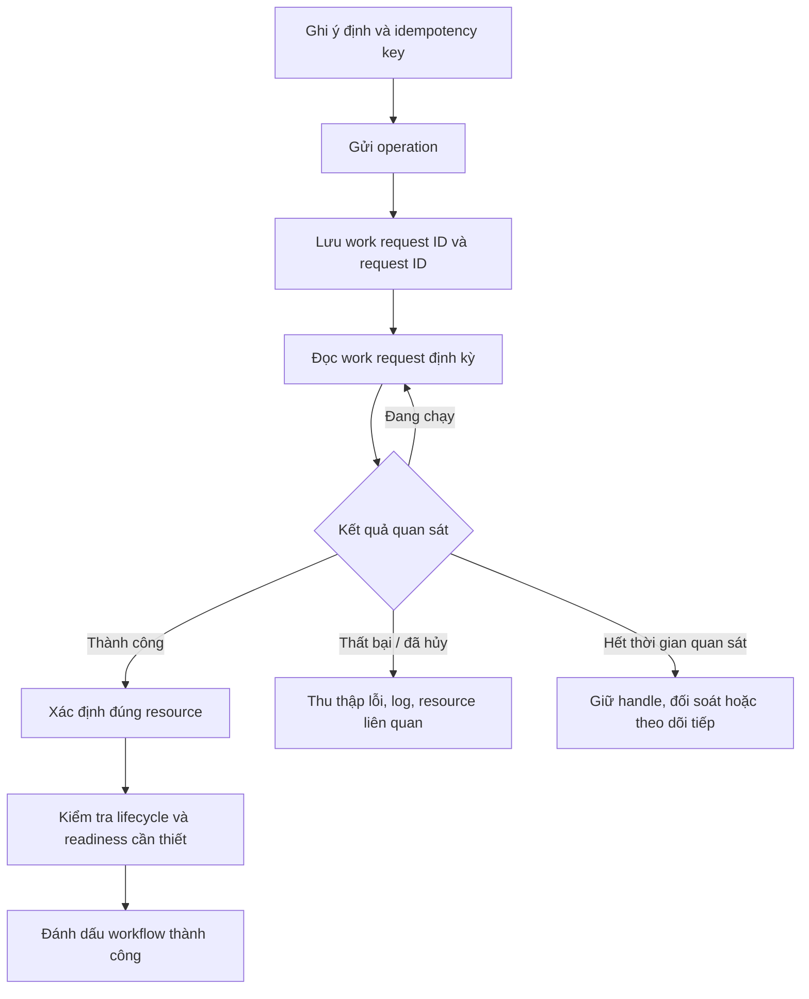

# Work requests, waiters và thao tác bất đồng bộ

## 1. Mục tiêu và bối cảnh

Một công cụ Java gửi yêu cầu tạo tài nguyên OCI có thể nhận response chỉ sau vài giây, trong khi dịch vụ còn cần nhiều phút để hoàn tất việc cấp phát. Nếu công cụ lập tức chạy bước phụ thuộc hoặc báo triển khai thành công, kết quả có thể sai dù request HTTP ban đầu không có lỗi.

Bài học thuộc chương **OCI SDK và REST API với Java** trong module **CLOUD_PROVIDERS_ORACLE**. Nội dung giải thích cách theo dõi thao tác dài hạn bằng work request, sử dụng waiter của SDK và xây dựng luồng tự động hóa có thể khôi phục sau gián đoạn. Các quyết định được đặt trong bối cảnh OCI có tenancy, compartment, IAM, giám sát, tính sẵn sàng và kiểm soát chi phí.

Ví dụ Java dùng Kubernetes Engine (OKE) để giữ nhất quán tên client và model. Nguyên tắc theo dõi kết quả cũng áp dụng khi thao tác với Compute, lưu trữ hoặc dịch vụ cơ sở dữ liệu Oracle, nhưng phải đối chiếu API và trạng thái riêng của từng dịch vụ.

Sau bài học, người học có thể:

- Phân biệt HTTP request hoàn tất với thao tác hạ tầng hoàn tất.
- Lưu và dùng đúng work request ID, resource OCID và request ID.
- Chọn waiter theo work request hoặc theo lifecycle của tài nguyên.
- Xử lý lỗi, timeout, retry, hủy và khôi phục tiến trình.
- Thiết kế polling có giới hạn cùng dữ liệu theo dõi bền vững.

## 2. Ba khái niệm “bất đồng bộ” cần tách riêng

| Khái niệm | Diễn ra ở đâu? | Tín hiệu hoàn tất nói lên điều gì? |
| --- | --- | --- |
| Thao tác bất đồng bộ của OCI | Phía dịch vụ | Công việc quản trị tài nguyên đã kết thúc theo hợp đồng dịch vụ |
| Lời gọi Java SDK async | Phía ứng dụng và HTTP client | Request API cụ thể đã có response hoặc lỗi |
| Waiter | Cơ chế quan sát ở phía SDK | Điều kiện chờ đã được quan sát hoặc việc chờ kết thúc bằng lỗi |

Một lời gọi `createCluster` bằng synchronous client vẫn có thể khởi động thao tác dài hạn phía OCI. Ngược lại, dùng asynchronous client để gọi một API đọc không làm phát sinh công việc cấp phát hạ tầng.

Do đó:

```text
HTTP response nhận được
    khác với work request đã thành công
    khác với tài nguyên đã đáp ứng điều kiện sử dụng của ứng dụng
```

Ví dụ Compute có trạng thái quản trị phù hợp chưa chứng minh cloud-init đã hoàn tất. Tương tự, một cơ sở dữ liệu đã được cấp phát còn cần đúng đường mạng, credential và phép kiểm tra kết nối mà ứng dụng yêu cầu.

Theo [tổng quan Work Requests](https://docs.oracle.com/en-us/iaas/Content/General/Concepts/workrequestoverview.htm), work request cung cấp khả năng quan sát thao tác dài hạn, các tài nguyên liên quan, log và lỗi. Nó không phải một thread Java hay một `Future` được lưu trên máy client.

## 3. Work request: handle theo dõi một thao tác

### 3.1. Ba loại định danh

| Định danh | Ví dụ nguồn lấy | Dùng để làm gì? |
| --- | --- | --- |
| Work request ID | Header `opc-work-request-id` | Theo dõi một thao tác bất đồng bộ |
| Resource OCID | Response tài nguyên hoặc danh sách resources của work request | Gọi API đọc/cập nhật tài nguyên |
| Request ID | Header `opc-request-id` | Truy vết một lần gọi API và hỗ trợ chẩn đoán |

Một resource có thể trải qua nhiều thao tác và nhiều work request theo thời gian. Một work request cũng có thể liên quan nhiều resource. Không dùng work request ID làm cluster OCID khi gọi `GetCluster`.

Trong Java, response tạo cluster phân biệt rõ `getOpcWorkRequestId()` và `getOpcRequestId()`. Xem [CreateClusterResponse](https://docs.oracle.com/en-us/iaas/tools/java/latest/com/oracle/bmc/containerengine/responses/CreateClusterResponse.html).

Nên lưu thêm region và tên dịch vụ cùng ID. Một bộ theo dõi chỉ giữ chuỗi OCID nhưng không biết API nào sở hữu nó sẽ khó khôi phục đúng client và endpoint.

### 3.2. Không phải dịch vụ nào cũng dùng cùng Work Requests API

OCI có cả API work request dùng chung và API work request thuộc từng dịch vụ. Không suy ra rằng mọi ID đều có thể được tra cứu bằng `com.oracle.bmc.workrequests.WorkRequestClient`.

Ví dụ:

| Trường hợp | Client/model phải chọn |
| --- | --- |
| Thao tác được tài liệu xác nhận dùng Work Requests API chung | `com.oracle.bmc.workrequests.WorkRequestClient` và các model cùng package dịch vụ |
| Work request của OKE trong bài | `ContainerEngineClient`, model trong `com.oracle.bmc.containerengine.model` |

Tên method `GetWorkRequest` giống nhau không làm các endpoint và model trở thành tương đương. Xem [Asynchronous Work Requests](https://docs.oracle.com/en-us/iaas/Content/API/Concepts/workrequests.htm) và [WorkRequestClient](https://docs.oracle.com/en-us/iaas/tools/java/latest/com/oracle/bmc/workrequests/WorkRequestClient.html).

### 3.3. Trạng thái kết thúc chưa chắc là thành công

Với OKE, các trạng thái gồm:

| Giá trị REST | Enum Java | Cách diễn giải |
| --- | --- | --- |
| `ACCEPTED` | `Accepted` | Đã nhận, chưa kết luận đã chạy xong |
| `IN_PROGRESS` | `InProgress` | Đang xử lý |
| `SUCCEEDED` | `Succeeded` | Thao tác thành công |
| `FAILED` | `Failed` | Thao tác thất bại |
| `CANCELING` | `Canceling` | Đang xử lý yêu cầu hủy |
| `CANCELED` | `Canceled` | Đã hủy |

Đối chiếu [WorkRequestStatus của OKE](https://docs.oracle.com/en-us/iaas/tools/java/latest/com/oracle/bmc/containerengine/model/WorkRequestStatus.html). SDK còn có `UnknownEnumValue` khi giá trị trả về không được phiên bản SDK nhận diện.

Mô hình khái niệm:



Sơ đồ chỉ minh họa cách phân loại trạng thái; không phải cam kết mọi dịch vụ cho phép mọi chuyển đổi. Một số dịch vụ có thêm trạng thái hoặc tên khác. Dùng enum và tài liệu của API đang gọi, không viết một bảng trạng thái toàn cục rồi áp dụng tùy tiện.

Ứng dụng cần phân biệt:

- **Thành công:** đã xác nhận trạng thái thành công của đúng thao tác.
- **Thất bại hoặc đã hủy:** có kết quả kết thúc nhưng không đạt mục tiêu.
- **Chưa biết:** timeout quan sát, mất kết nối, thiếu quyền đọc hoặc trạng thái SDK chưa hiểu.

“Chưa biết” không được tự đổi thành “thất bại” hay “thành công”.

## 4. Quan sát luồng REST

Với ví dụ tạo cluster, Oracle mô tả response ban đầu là HTTP `202`, kèm work request ID. Các lần `GET` tiếp theo có thể trả HTTP `200` dù trạng thái công việc vẫn chưa hoàn tất. Xem [chuỗi request/response bất đồng bộ](https://docs.oracle.com/en-us/iaas/Content/API/Concepts/workrequests.htm).

Minh họa rút gọn:

```http
HTTP/1.1 202 Accepted
opc-work-request-id: <work-request-ocid>
opc-request-id: <submission-request-id>
```

Tiếp theo, gọi endpoint work request của đúng dịch vụ và region:

```http
GET /20180222/workRequests/<work-request-ocid> HTTP/1.1
Host: containerengine.<region>.oraclecloud.com
Authorization: <chữ ký do OCI signer tạo>
```

Một response quan sát có thể chứa:

```json
{
  "id": "<work-request-ocid>",
  "operationType": "CLUSTER_CREATE",
  "status": "IN_PROGRESS",
  "compartmentId": "<compartment-ocid>",
  "timeAccepted": "2026-11-20T03:00:00Z",
  "timeStarted": "2026-11-20T03:00:03Z",
  "timeFinished": null,
  "resources": []
}
```

Đây là dữ liệu minh họa, không phải kết quả từ một deployment đã chạy. Các phần header, body và chữ ký đầy đủ phải theo hợp đồng API thực tế.

HTTP `200` của `GetWorkRequest` có nghĩa đã đọc được thông tin work request. Kết quả của công việc nằm ở body, chẳng hạn `status`.

Không phải mọi API tạo/cập nhật đều có cùng status code, response body hoặc work request header. Luôn đọc tài liệu operation trước khi quyết định theo dõi bằng work request hay lifecycle của tài nguyên.

## 5. Một quy trình tự động hóa có thể khôi phục

Thiết kế sau là đề xuất ở tầng ứng dụng:



Ghi bền vững handle trước khi xác nhận với người gọi rằng yêu cầu đã được đưa vào cơ chế theo dõi của ứng dụng. Nếu chỉ giữ ID trong biến Java rồi tiến trình chết, ứng dụng có thể mất đường liên kết với thao tác OCI vẫn đang chạy.

Một bản ghi theo dõi có thể gồm:

```json
{
  "operationId": "deploy-846",
  "service": "containerengine",
  "region": "ap-singapore-1",
  "compartmentId": "<compartment-ocid>",
  "operationType": "CREATE_CLUSTER",
  "retryToken": "<stable-token-for-this-logical-operation>",
  "workRequestId": "<work-request-ocid>",
  "submissionRequestId": "<opc-request-id>",
  "remoteStatus": "IN_PROGRESS",
  "localStatus": "OBSERVING",
  "nextCheckAt": "2026-11-20T03:01:00Z",
  "observationDeadline": "2026-11-20T03:30:00Z",
  "version": 3
}
```

Các field `operationId`, `localStatus`, deadline và version ở đây do ứng dụng tự thiết kế, không phải field mặc định của OCI.

Nếu mất response ngay khi gửi operation, ứng dụng có thể chưa có work request ID. Đây là nhánh “chưa biết kết quả gửi”; cần dùng cơ chế idempotency và đối soát của operation thay vì tự kết luận dịch vụ chưa nhận request.

## 6. Java: chờ work request rồi kiểm tra kết quả

### 6.1. Điều kiện và phạm vi ví dụ

Dự án cần module `oci-java-sdk-containerengine`, common dependencies cùng version và HTTP client implementation phù hợp với SDK 3.x. Authentication provider, region, compartment và quyền IAM được cấu hình trước khi gọi các hàm dưới đây.

Ví dụ dùng `ContainerEngineClient` đã khởi tạo và một work request ID có sẵn. Hàm chờ chỉ quan sát, không tạo cluster. Mốc SDK `3.98.0` được dùng khi giải thích implementation của waiter; khi dùng phiên bản khác, đối chiếu Javadoc tương ứng.

### 6.2. Waiter không đồng nghĩa với “require success”

```java
import com.oracle.bmc.containerengine.ContainerEngineClient;
import com.oracle.bmc.containerengine.model.WorkRequest;
import com.oracle.bmc.containerengine.model.WorkRequestStatus;
import com.oracle.bmc.containerengine.requests.GetWorkRequestRequest;
import com.oracle.bmc.containerengine.responses.GetWorkRequestResponse;
import com.oracle.bmc.waiter.FixedTimeDelayStrategy;
import com.oracle.bmc.waiter.MaxTimeTerminationStrategy;

import java.time.Duration;

public final class OkeWorkRequestWaiter {
    private OkeWorkRequestWaiter() {
    }

    public static WorkRequest waitForSuccess(
            ContainerEngineClient client,
            String workRequestId) throws Exception {

        GetWorkRequestRequest request = GetWorkRequestRequest.builder()
                .workRequestId(workRequestId)
                .build();

        GetWorkRequestResponse response = client.getWaiters()
                .forWorkRequest(
                        request,
                        new MaxTimeTerminationStrategy(
                                Duration.ofMinutes(20).toMillis()),
                        new FixedTimeDelayStrategy(
                                Duration.ofSeconds(10).toMillis()))
                .execute();

        WorkRequest work = response.getWorkRequest();

        if (work.getStatus() != WorkRequestStatus.Succeeded) {
            throw new IllegalStateException(
                    "Work request did not succeed: id="
                            + workRequestId + ", status=" + work.getStatus());
        }

        return work;
    }
}
```

Trong implementation OKE waiter tại mốc SDK đã nêu, điều kiện kết thúc là `timeFinished != null`. Vì vậy, `execute()` trả về bình thường vẫn phải được nối tiếp bằng kiểm tra `Succeeded`. Xem [ContainerEngineWaiters tại tag v3.98.0](https://github.com/oracle/oci-java-sdk/blob/v3.98.0/bmc-containerengine/src/main/java/com/oracle/bmc/containerengine/ContainerEngineWaiters.java).

Các tham số thời gian ở ví dụ là lựa chọn minh họa của ứng dụng, không phải SLA của Oracle. `MaxTimeTerminationStrategy` và `FixedTimeDelayStrategy` nhận thời gian theo millisecond. Xem [termination strategy](https://docs.oracle.com/en-us/iaas/tools/java/latest/com/oracle/bmc/waiter/MaxTimeTerminationStrategy.html) và [delay strategy](https://docs.oracle.com/en-us/iaas/tools/java/latest/com/oracle/bmc/waiter/FixedTimeDelayStrategy.html).

Hàm khai báo `throws Exception` để không che lỗi từ waiter. Tầng workflow phải phân loại lỗi quan sát, hết ngân sách chờ và kết quả remote, thay vì bắt mọi exception rồi báo “cluster creation failed”.

### 6.3. Lấy work request ID từ thao tác tạo

Đoạn mã tích hợp sau giả định `details` đã được chuẩn bị đúng và việc tạo cluster thuộc phạm vi thực hành đã cho phép:

```java
CreateClusterResponse submitted = client.createCluster(
        CreateClusterRequest.builder()
                .createClusterDetails(details)
                .opcRetryToken(stableRetryToken)
                .build());

String workRequestId = submitted.getOpcWorkRequestId();
String submissionRequestId = submitted.getOpcRequestId();

// Lưu hai ID cùng operationId và region vào kho trạng thái của workflow.
// Chỉ sau đó mới để worker tiếp tục theo dõi work request.
```

`CreateClusterRequest` thuộc package `com.oracle.bmc.containerengine.requests`; response thuộc `com.oracle.bmc.containerengine.responses`.

Nếu operation được kỳ vọng trả work request ID nhưng header vắng mặt, ghi nhận response bất thường để đối soát. Không tự báo thành công, không thay ID bằng request ID và không gửi lại operation mù quáng.

## 7. Chẩn đoán kết quả và chọn đúng tài nguyên

### 7.1. Đọc lỗi của work request

Khi trạng thái remote là `Failed`, đọc lỗi riêng của work request thay vì chỉ giữ thông báo “wait failed”.

Ví dụ OKE:

```java
ListWorkRequestErrorsResponse errors = client.listWorkRequestErrors(
        ListWorkRequestErrorsRequest.builder()
                .compartmentId(compartmentId)
                .workRequestId(workRequestId)
                .build());

for (WorkRequestError error : errors.getItems()) {
    System.err.printf(
            "workRequestId=%s, code=%s, time=%s%n",
            workRequestId,
            error.getCode(),
            error.getTimestamp());

    // Đưa message chi tiết vào kênh chẩn đoán có kiểm soát sau khi rà dữ liệu.
}
```

Các lớp request, response và model thuộc package `containerengine` tương ứng. `WorkRequestError` cung cấp code, message và timestamp; xem [model lỗi của OKE](https://docs.oracle.com/en-us/iaas/tools/java/latest/com/oracle/bmc/containerengine/model/WorkRequestError.html).

Giữ nguyên lỗi remote ngay cả khi một lần đọc log bổ sung thất bại. Thiếu quyền xem log không biến thao tác thất bại thành thành công và cũng không thay thế nguyên nhân ban đầu.

API đọc log, lỗi và pagination khác nhau giữa các dịch vụ. Đừng gắn `opc-next-page` hoặc tham số `page` vào mọi API chỉ vì một API liệt kê khác có hỗ trợ.

### 7.2. Không lấy tùy tiện resources[0]

Sau thành công, `work.getResources()` có thể giúp xác định tài nguyên liên quan. OKE resource entry có các thông tin như `entityType`, `actionType` và `identifier`. Xem [WorkRequestResource](https://docs.oracle.com/en-us/iaas/tools/java/latest/com/oracle/bmc/containerengine/model/WorkRequestResource.html).

Quy tắc lựa chọn nên dựa trên loại operation và resource mong đợi:

```text
Tạo cluster
    -> tìm entry có entityType tương ứng cluster
    -> đối chiếu actionType với thao tác tạo
    -> xác nhận identifier là resource cần theo dõi
    -> xử lý rõ nếu thiếu hoặc có nhiều kết quả không phân biệt được
```

Không dùng vị trí phần tử trong danh sách như một giao ước không được tài liệu đảm bảo. Với operation cập nhật, resource có thể đã tồn tại từ trước; “lấy resource mới đầu tiên” không còn là cách hiểu phù hợp.

## 8. Waiter theo lifecycle của tài nguyên

Work request trả lời câu hỏi “thao tác này đã kết thúc thế nào?”. Resource waiter trả lời câu hỏi “tài nguyên hiện đang ở trạng thái nào?”. Hai phép quan sát có thể cùng cần thiết nhưng không thay thế nhau trong mọi workflow.

Ví dụ chờ cluster đạt `Active`, đồng thời dừng nếu quan sát `Failed`:

```java
GetClusterResponse observed = client.getWaiters()
        .forCluster(
                GetClusterRequest.builder()
                        .clusterId(clusterId)
                        .build(),
                new MaxTimeTerminationStrategy(
                        Duration.ofMinutes(10).toMillis()),
                new FixedTimeDelayStrategy(
                        Duration.ofSeconds(10).toMillis()),
                ClusterLifecycleState.Active,
                ClusterLifecycleState.Failed)
        .execute();

if (observed.getCluster().getLifecycleState()
        != ClusterLifecycleState.Active) {
    throw new IllegalStateException("Cluster did not become Active");
}
```

Import thêm `GetClusterRequest`, `GetClusterResponse` và `ClusterLifecycleState` từ package OKE tương ứng. Overload của `forCluster` cho phép truyền nhiều trạng thái đích; waiter trả về khi gặp một trong số đó. Xem [ContainerEngineWaiters](https://docs.oracle.com/en-us/iaas/tools/java/latest/com/oracle/bmc/containerengine/ContainerEngineWaiters.html).

Nếu chỉ chờ `Active`, một tài nguyên đã đi vào trạng thái lỗi có thể làm công cụ tiếp tục chờ đến hết timeout. Chờ cả trạng thái lỗi giúp phân biệt thất bại sớm với quá trình vẫn đang chạy.

Đối với thao tác update, một lần đọc thấy resource còn `Active` ngay sau khi gửi request không chứng minh update vừa gửi đã hoàn tất: đó có thể là trạng thái trước thay đổi. Ưu tiên theo dõi đúng work request của operation nếu API cung cấp, rồi đối soát resource và các thuộc tính mong đợi.

Với delete, cần đọc quy tắc của waiter/API về trạng thái đã xóa và response không còn tài nguyên. Không áp dụng chung quy tắc “mọi HTTP 404 đều là xóa thành công”, vì lỗi đó còn có thể liên quan quyền, endpoint hoặc ID.

Sau lifecycle waiter, readiness check của ứng dụng có thể gồm:

- Compute: tác vụ khởi tạo hệ điều hành và dịch vụ ứng dụng đã hoàn tất.
- Cơ sở dữ liệu: đường mạng và phép kết nối bằng credential phù hợp hoạt động.
- OKE: các thành phần cần cho workload thực sự đáp ứng điều kiện triển khai.
- Lưu trữ: kết quả thao tác có thể đọc theo cách ứng dụng sẽ sử dụng.

Chỉ đánh dấu workflow thành công khi các điều kiện đã định nghĩa cho đúng use case đều đạt.

## 9. Async client và callback của Java SDK

### 9.1. Future của lời gọi tạo chưa phải Future của hạ tầng

Ví dụ sau là đoạn tích hợp, giả định `asyncClient` và `createRequest` đã được chuẩn bị. `createRequest` phải dùng retry token ổn định của operation nếu áp dụng cơ chế này.

```java
Future<CreateClusterResponse> httpFuture = asyncClient.createCluster(
        createRequest,
        new AsyncHandler<CreateClusterRequest, CreateClusterResponse>() {
            @Override
            public void onSuccess(
                    CreateClusterRequest request,
                    CreateClusterResponse response) {
                System.out.println(
                        "Submission response received; workRequestId="
                                + response.getOpcWorkRequestId());
            }

            @Override
            public void onError(
                    CreateClusterRequest request,
                    Throwable error) {
                System.err.println(
                        "Submission response failed; reconcile outcome");
            }
        });

CreateClusterResponse submission =
        httpFuture.get(30, TimeUnit.SECONDS);

String workRequestId = submission.getOpcWorkRequestId();

// Lưu handle bền vững rồi giao cho thành phần theo dõi operation.
// Không đánh dấu tài nguyên sẵn sàng chỉ vì httpFuture đã hoàn tất.
```

Các kiểu `Future`, `TimeUnit` thuộc `java.util.concurrent`; `AsyncHandler` thuộc `com.oracle.bmc.responses`. Client bất đồng bộ là `ContainerEngineAsyncClient`. Xem [ContainerEngineAsync](https://docs.oracle.com/en-us/iaas/tools/java/latest/com/oracle/bmc/containerengine/ContainerEngineAsync.html).

`onSuccess` ở đây báo thành công của lời gọi API tạo, chưa nói work request đã `Succeeded`. Nếu `get(30, ...)` hết thời gian chờ, remote operation vẫn có thể đã được chấp nhận.

Không giữ client trong một try-with-resources rồi rời block ngay sau khi khởi động request async. Client và các dependency cần sống đủ lâu để request và callback hoàn tất.

### 9.2. Waiter cũng có dạng thực thi bất đồng bộ

Interface `Waiter` có hai cách thực thi:

| Cách gọi | Hành vi |
| --- | --- |
| `execute()` | Chặn thread gọi cho đến khi waiter kết thúc hoặc ném lỗi |
| `execute(asyncHandler)` | Trả `Future<Void>`; response hoặc lỗi được chuyển qua handler |

Đối chiếu [Waiter API](https://docs.oracle.com/en-us/iaas/tools/java/latest/com/oracle/bmc/waiter/Waiter.html).

`Future<Void>` của waiter không chứa trực tiếp response work request. Handler vẫn phải kiểm tra trạng thái remote theo cùng quy tắc với cách gọi blocking.

Dùng callback không tự tạo độ bền cho workflow. Nếu JVM dừng, callback và Future trong bộ nhớ cũng mất. Các thông tin cần khôi phục phải nằm trong kho trạng thái bền vững.

Với ứng dụng web, không nên giữ thread xử lý HTTP trong nhiều phút để chờ cấp phát. Một thiết kế ứng dụng có thể trả operation ID nội bộ, sau đó để worker theo dõi và cung cấp endpoint truy vấn tiến độ cho người dùng.

## 10. Polling, retry và ngân sách thời gian

### 10.1. Polling khác retry

- **Polling:** lần đọc trước thành công nhưng công việc chưa kết thúc; ứng dụng đợi rồi đọc trạng thái mới.
- **Retry:** một lần gọi API lỗi theo cách có thể thử lại; ứng dụng thử lại trong giới hạn.
- **Gửi lại operation:** có thể tạo thêm tác dụng phụ nếu không kiểm soát idempotency.

Ba vòng này không được lồng vô hạn vào nhau. Chẳng hạn 20 lần polling, mỗi lần có nhiều HTTP retry, cộng thời gian ngủ có thể vượt xa timeout mà người viết ban đầu dự tính.

### 10.2. Ba mức thời gian

| Mức thời gian | Phạm vi |
| --- | --- |
| Connection/read timeout | Một lần trao đổi HTTP |
| Ngân sách quan sát | Tổng thời gian poll và retry mà worker dành cho một lượt theo dõi |
| Deadline nghiệp vụ | Thời điểm workflow phải có kết quả hoặc được chuyển xử lý theo chính sách |

`MaxTimeTerminationStrategy` giới hạn vòng chờ của waiter theo cơ chế kiểm tra của nó. Nó không nên được hiểu là cơ chế cưỡng bức cắt mọi HTTP request chính xác tại cùng một millisecond. Một request đang chạy, HTTP retry và delay cần được tính trong thiết kế thời gian tổng thể.

Ví dụ lựa chọn của ứng dụng:

```text
Connection timeout: 5 giây
Read timeout:       30 giây
Delay polling:     khoảng 10 đến 30 giây
Lượt quan sát:     20 phút
Deadline nghiệp vụ và cách theo dõi tiếp: cấu hình riêng
```

Các giá trị phải dựa vào thời gian thao tác thực tế, yêu cầu vận hành và giới hạn dịch vụ. Không dùng một timeout rất ngắn cho mọi tác vụ tạo tài nguyên dài hạn.

### 10.3. Thiết kế polling có giới hạn

Khi waiter có sẵn đáp ứng đúng điều kiện, nên dùng nó để giảm mã điều phối. Khi cần checkpoint từng lần đọc, lịch poll bền vững hoặc logic trạng thái đặc thù, có thể thiết kế poller riêng.

Mã giả:

```text
nạp handle đã lưu

trong ngân sách quan sát:
    nếu thread bị yêu cầu dừng:
        lưu trạng thái có thể tiếp tục
        thoát

    gọi GetWorkRequest với timeout và retry có giới hạn

    nếu đọc thành công:
        lưu remoteStatus, thời điểm quan sát và request ID
        nếu thành công:
            kiểm tra các bước tiếp theo của workflow
            kết thúc lượt quan sát
        nếu thất bại hoặc đã hủy:
            lưu kết quả, thu thập chẩn đoán
            kết thúc lượt quan sát
        nếu trạng thái chưa hiểu:
            lưu trường hợp cần đối soát, không coi là thành công

    nếu lỗi có thể thử lại:
        tăng backoff trong giới hạn còn lại
    nếu lỗi cấu hình hoặc quyền:
        lưu lỗi quan sát và chuyển xử lý phù hợp

    chờ delay có jitter rồi lặp

hết ngân sách:
    lưu OBSERVATION_TIMED_OUT
    giữ workRequestId để tiếp tục đối soát
```

Dùng đồng hồ đơn điệu như `System.nanoTime()` để tính khoảng thời gian trong một tiến trình. Với deadline cần qua lần khởi động lại, lưu timestamp UTC và xác định ngân sách còn lại khi worker khởi động.

Nếu gặp `InterruptedException`, tầng xử lý cần tôn trọng tín hiệu dừng; khi bắt mà không truyền tiếp thì khôi phục cờ interrupt bằng `Thread.currentThread().interrupt()`. Đừng nuốt interrupt rồi tiếp tục poll vô hạn.

### 10.4. Tránh đồng loạt gọi API

Nếu có 600 operation và mỗi operation poll 10 giây một lần, riêng đọc trạng thái tạo tải trung bình khoảng 60 request/s. Các lần đọc log hoặc retry còn làm tải tăng thêm. Đây là phép tính minh họa, không phải quota mặc định của OCI.

Các biện pháp thiết kế:

- Thêm jitter để các worker không cùng thức dậy tại một thời điểm.
- Tăng khoảng chờ cho thao tác chạy lâu theo chính sách có giới hạn.
- Tôn trọng chỉ dẫn retry của dịch vụ nếu response cung cấp.
- Giới hạn tổng số lượt poll chạy đồng thời.
- Chia sẻ kết quả quan sát giữa các màn hình thay vì mỗi màn hình mở một poller.

Một async callback vẫn có thể dùng thread nền để chờ; vì vậy “API async” không tự chứng minh ứng dụng hỗ trợ vô hạn thao tác đồng thời.

## 11. Retry operation và idempotency

### 11.1. Mất response sau khi gửi

Một tình huống điển hình:

```text
Ứng dụng gửi CreateCluster
OCI nhận và tạo work request
Kết nối bị ngắt trước khi ứng dụng nhận response
Ứng dụng chưa biết work request ID
```

Nếu gửi lại với một ý định mới, có nguy cơ phát sinh thao tác hoặc tài nguyên ngoài dự kiến.

`CreateClusterRequest` hỗ trợ `opcRetryToken` để nhận diện request khi thử lại. Cùng một operation logic phải dùng token ổn định, body và ngữ cảnh nhất quán trong phạm vi hợp đồng API. Xem [CreateClusterRequest.Builder](https://docs.oracle.com/en-us/iaas/tools/java/latest/com/oracle/bmc/containerengine/requests/CreateClusterRequest.Builder.html).

Ví dụ cách tổ chức:

```text
tạo retry token một lần
lưu token cùng ý định cấp phát
gửi request
nếu cần thử lại chính request đó:
    dùng lại token đã lưu
    không sinh UUID mới trong mỗi vòng retry
```

Retry token có thời hạn và giới hạn theo API; nó không phải bảo đảm idempotency vĩnh viễn. Khi quá thời hạn hoặc thay đổi nội dung yêu cầu, phải đối soát tài nguyên và ý định ban đầu trước khi chọn hành động mới.

### 11.2. Timeout quan sát không cho phép tạo lại

Nếu đã có work request ID, tiếp tục quan sát đúng ID là hướng khôi phục chính. Không tạo thêm cluster chỉ vì waiter hết 20 phút.

Tương tự, khi OCI báo work request `Failed`, bước tiếp theo là đọc lỗi và kiểm tra tài nguyên đã tạo một phần. Không mặc định mọi tài nguyên đều được rollback, cũng không mặc định có thể chạy lại toàn bộ chuỗi mà không kiểm tra xung đột.

Đối với update, còn cần xét concurrency control như ETag hoặc version nếu operation hỗ trợ. Retry một thay đổi trên dữ liệu đã bị người khác sửa có thể cần quyết định nghiệp vụ khác.

### 11.3. Phân loại lỗi quan sát

Theo [OCI API Errors](https://docs.oracle.com/en-us/iaas/Content/API/References/apierrors.htm), các mã lỗi có ý nghĩa và khả năng retry khác nhau. Với poller, nên phân loại:

| Lỗi khi đọc trạng thái | Hành động ứng dụng |
| --- | --- |
| `429 TooManyRequests` hoặc lỗi dịch vụ tạm thời phù hợp | Backoff, jitter, giữ ngân sách tổng |
| Authentication không hợp lệ | Sửa hoặc refresh credential theo cơ chế đã chọn |
| Thiếu quyền hoặc sai compartment/region | Kiểm tra IAM và định tuyến |
| `404 NotAuthorizedOrNotFound` | Đối soát ID, quyền, endpoint và vòng đời dữ liệu |
| Mạng không ổn định | Retry có giới hạn; giữ handle |
| Giá trị trạng thái SDK chưa hiểu | Ghi nhận và kiểm tra tương thích SDK/API |

Lỗi của `GetWorkRequest` mô tả việc quan sát; không tự chứng minh công việc remote đã thất bại. Lưu riêng hai loại thông tin này trong log và kho trạng thái.

## 12. Khôi phục sau khi JVM hoặc worker dừng

Một hệ thống có tính sẵn sàng cần phục hồi từ dữ liệu bền vững, không chỉ phục hồi thread pool.

Khi worker khởi động lại:

1. Tìm các operation nội bộ chưa có kết quả cuối.
2. Nạp service, region, work request ID và resource ID nếu đã biết.
3. Dựng đúng client bằng danh tính được phép.
4. Đọc trạng thái hiện tại từ OCI.
5. Cập nhật kết quả hoặc lập lịch lần kiểm tra tiếp theo.
6. Chỉ chạy bước phụ thuộc khi điều kiện thành công đã được xác nhận.

Để nhiều worker không xử lý cùng operation một cách cạnh tranh, ứng dụng có thể dùng lease, khóa giao dịch hoặc cập nhật có điều kiện theo version. Khi lease hết hạn, worker mới đọc lại trạng thái từ OCI; không dùng việc owner cũ mất kết nối làm bằng chứng cần tạo tài nguyên mới.

Các bước phụ thuộc cũng cần idempotency. Nếu worker đã cấu hình bước tiếp theo rồi chết trước khi đánh dấu hoàn tất, việc tiếp tục workflow không được gây cấu hình lặp hoặc mất dữ liệu.

Work request là dữ liệu quan sát của dịch vụ, không phải kho audit vô hạn do ứng dụng toàn quyền quản lý. Đối chiếu thời gian lưu của dịch vụ và lưu kết quả quan trọng, mã lỗi, mốc thời gian theo nhu cầu vận hành trước khi dữ liệu quan sát không còn sẵn.

## 13. Hủy chờ, hủy Future và hủy thao tác

| Hành động | Điều có thể kết luận |
| --- | --- |
| Ngừng polling | Client không tiếp tục quan sát |
| Waiter timeout | Điều kiện chưa được xác nhận trong lượt chờ |
| `Future.cancel(...)` | Yêu cầu hủy thực thi cục bộ theo semantics của Future và implementation |
| API hủy work request của dịch vụ | Đã yêu cầu dịch vụ hủy theo khả năng operation hỗ trợ |
| Quan sát trạng thái `Canceled` | Dịch vụ báo công việc đã hủy |

Không suy ra một thao tác OCI đã dừng chỉ vì Java thread bị interrupt, Future bị cancel hoặc client HTTP bị đóng.

Khả năng hủy là riêng từng API. Chẳng hạn API `deleteWorkRequest` của OKE được mô tả là hủy work request chưa bắt đầu; không phải công cụ chung để dừng mọi thao tác đang chạy. Xem [ContainerEngineAsync](https://docs.oracle.com/en-us/iaas/tools/java/latest/com/oracle/bmc/containerengine/ContainerEngineAsync.html).

Ngay cả sau khi hủy thành công, cần đối soát tài nguyên và tác dụng phụ theo hợp đồng dịch vụ. “Đã hủy” không tự hứa rollback toàn bộ workflow gồm nhiều bước.

Nếu cần dọn tài nguyên đã tạo, đó là một chuỗi thao tác quản trị riêng có quyền, điều kiện và kết quả phải được theo dõi. Việc hết timeout không tự cấp quyền xóa những tài nguyên khác đang dùng chung.

## 14. IAM, giám sát và kiểm soát chi phí

### 14.1. Phân quyền đúng các bước

Cần kiểm tra quyền cho operation gốc, đọc work request, xem lỗi/log và đọc resource đích. Cách liên hệ quyền giữa các thao tác khác nhau theo dịch vụ.

Với OKE, đối chiếu [Details for Kubernetes Engine](https://docs.oracle.com/en-us/iaas/Content/Identity/policyreference/contengpolicyreference.htm). Không sao chép một policy work request của dịch vụ khác rồi giả định sẽ có cùng hiệu lực.

Lưu đúng compartment của work request; đừng tự thay bằng compartment tài nguyên hiện tại nếu operation có thể di chuyển tài nguyên và tài liệu quy định khác.

Credential của worker phải phù hợp với thời gian workflow chạy. Một phiên người dùng hết hạn trong lúc poll làm mất khả năng quan sát, dù thao tác OCI vẫn tiếp tục. Với workload chạy trên OCI, cần chọn cơ chế danh tính phù hợp môi trường triển khai.

### 14.2. Thông tin cần ghi nhận

Một log có ích nên liên kết:

```text
operationId nội bộ
service và region
workRequestId
resourceId nếu đã xác định
requestId của lần gửi và lần quan sát
remoteStatus
localStatus
thời gian gửi, quan sát gần nhất và deadline
số lần poll, retry và mã lỗi gần nhất
```

Giới hạn dữ liệu nhạy cảm trong log; không ghi token, private key hoặc header chữ ký.

Metric ứng dụng nên theo dõi:

- Thời gian từ lúc gửi đến kết quả remote.
- Thời gian từ kết quả remote đến khi ứng dụng thực sự sẵn sàng.
- Số operation đang theo dõi và số quá deadline.
- Tỷ lệ lỗi quan sát, throttling và credential hết hiệu lực.
- Số workflow cần đối soát hoặc có tài nguyên tồn dư.

Cảnh báo cho thao tác lâu hơn ngưỡng đã chọn nên kèm handle để điều tra. Đừng chỉ báo “timeout” mà bỏ mất work request ID.

### 14.3. Chi phí và khả năng sẵn sàng

Ngừng chờ không đồng nghĩa tài nguyên đã ngừng tính phí. Một cluster, instance, volume hoặc cơ sở dữ liệu đã được tạo vẫn có vòng đời riêng.

Gắn nhãn hoặc tag theo quy ước dự án để hỗ trợ truy vết các tài nguyên thuộc workflow. Theo dõi thao tác tạo một phần và lập kế hoạch dọn theo đúng ownership, tránh để tài nguyên tồn dư sau một lần tạo lại.

Tối ưu tần suất poll và số worker theo tải thực tế. Poll quá dày có thể tăng throttling và chi phí vận hành mà không rút ngắn thời gian OCI cấp phát.

## 15. Bài thực hành: theo dõi một operation có sẵn

Để tập trung vào cơ chế quan sát, có thể dùng work request của một thao tác lab đã được tạo theo quy trình riêng. Không cần tạo một cluster mới chỉ để chạy hàm chờ.

Chuẩn bị:

- Work request ID OKE, region và compartment phù hợp.
- Client Java được xác thực và có quyền đọc cần thiết.
- Nơi lưu trạng thái lab để thực hành tiếp tục sau khi dừng tiến trình.
- Resource OCID nếu đã xác định được từ thao tác trước.

Các bước:

1. Đọc work request một lần; ghi status, thời gian và request ID.
2. Chạy waiter có timeout và delay được cấu hình.
3. Kiểm tra trạng thái thành công tường minh sau khi waiter trả về.
4. Nếu thất bại, đọc lỗi và resource liên quan.
5. Nếu thành công, đối soát đúng resource và điều kiện sử dụng tiếp theo.
6. Nếu chưa có kết quả trong lượt quan sát, lưu handle để tiếp tục.
7. Dừng rồi khởi động lại chương trình để kiểm tra có thể nạp handle và đọc lại trạng thái.

Các tình huống cần quan sát:

| Tình huống | Kết quả mong đợi của thiết kế |
| --- | --- |
| Work request đang chạy | Tiếp tục quan sát trong giới hạn |
| Work request đã thành công từ trước | Có thể kết luận sau lần đọc phù hợp, không gửi lại operation |
| Work request thất bại | Không chạy bước phụ thuộc; giữ lỗi chẩn đoán |
| Waiter trả về với trạng thái đã hủy | Không báo triển khai thành công |
| Deadline quan sát rất ngắn | Giữ handle, không kết luận remote đã dừng |
| Credential mất hiệu lực | Phân loại lỗi quan sát và xử lý danh tính |
| Resource còn Active trong lúc một update mới đang chạy | Không coi đó là bằng chứng update mới hoàn tất |
| Nhiều entry resource | Chọn theo hợp đồng operation, không theo vị trí đầu tiên |
| JVM dừng sau khi OCI đã nhận request | Có đường phục hồi qua handle hoặc idempotency/đối soát |

Đây là hướng dẫn thực hành, không phải xác nhận các request đã được chạy. Chỉ dùng tài nguyên lab đúng phạm vi và dọn các tài nguyên do bài thực hành thực sự tạo theo quy trình của môi trường.

## 16. Tiêu chí hoàn tất một luồng bất đồng bộ

Một workflow đủ rõ để triển khai cần trả lời được:

1. Operation trả resource trực tiếp hay work request ID, và API nào sở hữu handle?
2. Trạng thái nào là thành công, thất bại, đã hủy hoặc chưa xác định?
3. ID được lưu ở đâu để tiếp tục sau khi worker dừng?
4. Waiter kết thúc theo điều kiện gì và có kiểm tra kết quả remote sau đó không?
5. Timeout HTTP, ngân sách quan sát và deadline nghiệp vụ liên hệ thế nào?
6. Khi mất response hoặc retry, cơ chế nào ngăn tác dụng phụ lặp?
7. Readiness của tài nguyên và quyền thực hiện bước tiếp theo được xác minh ra sao?
8. Ai chịu trách nhiệm đối soát tài nguyên tồn dư, lỗi và chi phí sau gián đoạn?

Một thao tác OCI bất đồng bộ được quản lý tốt khi ứng dụng giữ được handle, hiểu đúng kết quả, tiếp tục được sau gián đoạn và chỉ chạy bước phụ thuộc trên bằng chứng thành công phù hợp.
