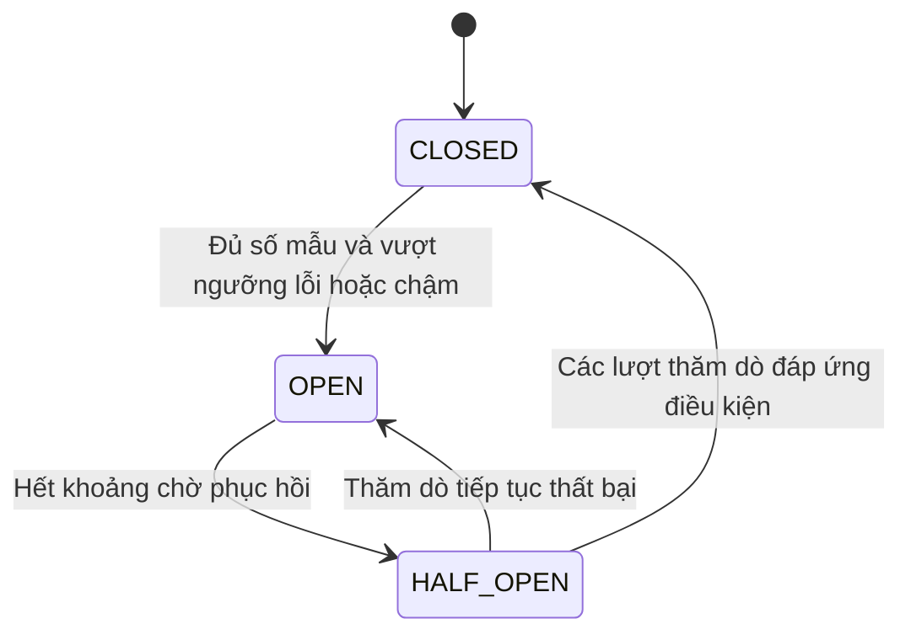

# Retry, timeout, circuit breaker và connection pooling

## 1. Bối cảnh và mục tiêu

Trong chương **OCI SDK và REST API với Java** của module **CLOUD_PROVIDERS_ORACLE**, một lời gọi API đáng tin cậy cần nhiều hơn thông tin xác thực và region đúng. Ứng dụng còn phải quyết định chờ bao lâu, khi nào thử lại, lúc nào tạm ngừng gọi một dịch vụ đang lỗi và cách sử dụng lại kết nối HTTP.

Tình huống xuyên suốt là dịch vụ Java chạy trên OCI Compute, đọc metadata từ Object Storage và tải tệp phục vụ xử lý nghiệp vụ. Ứng dụng cũng có thể gọi API quản lý Compute hoặc cơ sở dữ liệu. Khi lưu lượng tăng, độ trễ mạng và lỗi tạm thời có thể làm cạn thread hoặc connection dù CPU chưa cao.

Sau bài này, người học có thể:

- Phân biệt timeout của kết nối, đọc dữ liệu, chờ connection từ pool và deadline nghiệp vụ.
- Cấu hình retry có giới hạn, backoff và jitter bằng OCI Java SDK.
- Nhận diện thao tác cần idempotency trước khi retry.
- Giải thích trạng thái circuit breaker và chọn phạm vi bảo vệ phù hợp.
- Cấu hình HTTP connection pool và đóng response stream đúng vòng đời.
- Quan sát và kiểm chứng hành vi khi dịch vụ chậm, quá tải hoặc kết nối bị giữ quá lâu.

Ví dụ dùng **JDK 17, OCI Java SDK 3.99.0 và HTTP transport Jersey 3 với Apache Connector**. Phiên bản được cố định để giải thích các API cụ thể, không mang ý nghĩa đây là bản mới nhất. Các con số timeout, pool size và ngưỡng lỗi trong bài là cấu hình minh họa cần điều chỉnh bằng số đo thực tế.

## 2. Bốn cơ chế giải quyết bốn vấn đề khác nhau

| Cơ chế | Vấn đề chính | Quyết định được đưa ra | Không thay thế được |
| --- | --- | --- | --- |
| Timeout | Một giai đoạn chờ quá lâu | Khi nào ngừng chờ giai đoạn đó | Idempotency và tổng deadline |
| Retry | Một lần thử thất bại tạm thời | Có thử lại không, thử khi nào và bao nhiêu lần | Sửa quyền IAM hoặc payload sai |
| Circuit breaker | Dịch vụ liên tục thất bại | Tạm chặn lời gọi mới để giảm áp lực | Hủy yêu cầu đang chạy hoặc tự sửa dịch vụ |
| Connection pooling | Tạo kết nối nhiều lần và quản lý kết nối đồng thời | Tái sử dụng connection, giới hạn số connection | Giới hạn toàn bộ công việc nghiệp vụ |

Một ví dụ phối hợp:

1. Ứng dụng có một vị trí xử lý còn trống.
2. Một lần thử lấy connection từ pool.
3. Nếu chưa có connection, chỉ chờ trong ngân sách dành cho việc mượn connection.
4. Nếu cần kết nối mới, áp dụng timeout kết nối.
5. Khi chờ dữ liệu, áp dụng timeout đọc của transport.
6. Nếu thất bại thuộc loại có thể retry, còn số lần thử và còn ngân sách, chờ backoff rồi thử tiếp.
7. Nếu circuit breaker đã mở, lời gọi có thể bị từ chối sớm mà không gửi thêm yêu cầu đến dịch vụ.

Các bước này là mô hình để phân tích tài nguyên và thời gian. Thứ tự wrap cụ thể giữa retry, breaker và HTTP transport phụ thuộc cách triển khai của SDK.

Cần phân biệt hai đơn vị đo:

- **Lời gọi logic:** một lần nghiệp vụ muốn lấy danh sách bucket hoặc đọc một object.
- **Attempt:** một lượt thực hiện trong cơ chế retry của lời gọi đó.

Một lời gọi logic thành công ở attempt thứ ba vẫn tạo tải khác với lời gọi thành công ngay từ đầu. Nếu chỉ đo tỷ lệ thành công cuối cùng, hệ thống có thể bỏ qua áp lực retry đang tăng.

## 3. Timeout và deadline: chờ ở đâu, hết hạn ở đâu?

### 3.1. Các loại thời gian

| Loại | Đang chờ điều gì? | Nơi cấu hình trong ví dụ |
| --- | --- | --- |
| Pool acquisition timeout | Mượn connection từ connection manager | Apache `RequestConfig` |
| Connect timeout | Thiết lập kết nối đến đích theo transport | `ClientConfiguration` và Apache `RequestConfig` |
| Read/socket timeout | Chờ dữ liệu trên kết nối | `ClientConfiguration` và Apache `RequestConfig` |
| Backoff delay | Đợi trước attempt tiếp theo | `RetryConfiguration` |
| Deadline nghiệp vụ | Toàn bộ thao tác phải trả kết quả trong ngân sách | Lớp điều phối của ứng dụng |
| Thời gian chờ lifecycle | Tài nguyên OCI đạt trạng thái mong muốn | Waiter hoặc cơ chế theo dõi trạng thái |

`ClientConfiguration` của SDK có `connectionTimeoutMillis` và `readTimeoutMillis`. Cấu hình số thread bất đồng bộ không phải cấu hình kích thước HTTP pool của Apache Connector. [Oracle: ClientConfiguration tại SDK 3.99.0](https://github.com/oracle/oci-java-sdk/blob/v3.99.0/bmc-common/src/main/java/com/oracle/bmc/ClientConfiguration.java)

Ở Apache HttpClient 4.x, `connectionRequestTimeout` là thời gian xin connection từ manager; `socketTimeout` liên quan thời gian chờ dữ liệu, không phải giới hạn tổng thời gian tải toàn bộ response. [Apache: RequestConfig](https://hc.apache.org/httpcomponents-client-4.5.x/current/httpclient/apidocs/org/apache/http/client/config/RequestConfig.html)

Do đó, cấu hình connect timeout 2 giây không giải quyết trực tiếp việc 50 thread đang đợi một pool chỉ có vài connection rảnh.

### 3.2. Một timeout không bao trùm toàn bộ lời gọi

Mô hình ngân sách:

```text
Tổng thời gian một lời gọi logic
  = thời gian chờ của ứng dụng
  + tổng thời gian các attempt
  + tổng backoff giữa các attempt
  + thời gian xử lý response cần thiết
  + chi phí phụ trợ liên quan
```

Trong mỗi attempt có thể phát sinh chờ pool, DNS, thiết lập kết nối, TLS, chờ phản hồi và đọc dữ liệu. Không nên coi một giá trị timeout là giới hạn tuyệt đối cho tất cả các giai đoạn đó.

Ví dụ số đo giả định:

```text
Attempt 1:     2,0 giây rồi lỗi tạm thời
Backoff 1:     0,7 giây
Attempt 2:     2,0 giây rồi lỗi tạm thời
Backoff 2:     1,3 giây
Attempt 3:     0,4 giây và thành công
Tổng đã đo:    6,4 giây, chưa tính chi phí ngoài chuỗi trên
```

Nếu API của ứng dụng phải trả trong 5 giây, “mỗi attempt có timeout 2 giây” vẫn chưa đáp ứng được yêu cầu.

Khi chọn thông số, bắt đầu từ deadline mà bên gọi chấp nhận, dành một phần cho xử lý nội bộ và phản hồi, rồi mới phân bổ cho số lần thử. Với deadline ngắn, một hoặc hai attempt có thể phù hợp hơn nhiều lần thử.

### 3.3. Timeout đọc không phải thời gian tải tệp tối đa

Một response stream có thể tiếp tục cung cấp dữ liệu từng phần. Nếu mỗi phần đến trước khi socket timeout xảy ra, tổng thời gian tải có thể dài hơn nhiều giá trị timeout đọc.

Ứng dụng cần xác định riêng:

- Có giới hạn tổng thời gian tải hay không.
- Kích thước dự kiến và tốc độ tối thiểu có ý nghĩa vận hành.
- Cách hủy và đóng stream khi bên gọi không còn cần kết quả.
- Cách xử lý dữ liệu đã ghi một phần khi tải thất bại.

Không coi `Future.get(timeout)` hoặc một timer của framework là bằng chứng rằng mọi hoạt động I/O bên dưới đã dừng. Việc hủy, ngắt thread, abort HTTP và giải phóng stream cần được kiểm chứng với transport đang dùng.

## 4. Retry phải có điều kiện, giới hạn và tính an toàn

### 4.1. Phân loại lỗi trước khi thử lại

| Tình huống | Hướng xử lý thông thường |
| --- | --- |
| HTTP 429 do gửi quá nhanh | Backoff, giảm tốc độ hoặc concurrency |
| HTTP 500, 502, 503, 504 | Cân nhắc retry có giới hạn nếu thao tác an toàn |
| HTTP 409 với service code tạm thời như `IncorrectState` | Theo hướng dẫn của API và trạng thái tài nguyên |
| Sai payload hoặc thiếu tham số | Sửa request trước khi gọi lại |
| Không có quyền hoặc cấu hình xác thực sai | Sửa IAM hoặc danh tính |
| Timeout sau khi đã gửi thao tác ghi | Xem kết quả là chưa rõ; kiểm tra idempotency và đối soát |
| Hết thời gian chờ connection từ pool | Điều tra tải hoặc rò rỉ connection; tránh retry dồn dập |
| Circuit breaker từ chối lời gọi | Giảm áp lực, trả lỗi hoặc xử lý fallback được thiết kế |

OCI phân biệt lỗi có thể retry theo cả HTTP status và service code. Không áp dụng quy tắc “mọi 409” hay “mọi lỗi đều thử lại”. [Oracle: tham chiếu lỗi API](https://docs.oracle.com/en-us/iaas/Content/API/References/apierrors.htm)

`DefaultRetryCondition` ở phiên bản 3.99.0 nhận diện các lỗi như 429, 500, 502, 503, 504, một số lỗi phía client và cặp 409/`IncorrectState`. Nó cũng phân biệt lỗi do circuit breaker chặn. [Oracle: DefaultRetryCondition 3.99.0](https://github.com/oracle/oci-java-sdk/blob/v3.99.0/bmc-common/src/main/java/com/oracle/bmc/retrier/DefaultRetryCondition.java)

Việc SDK nhận diện một lỗi là có thể retry không tự chứng minh rằng toàn bộ nghiệp vụ của ứng dụng có thể thực hiện lặp an toàn.

### 4.2. Attempts bao gồm lần gọi đầu tiên

```java
import com.oracle.bmc.retrier.DefaultRetryCondition;
import com.oracle.bmc.retrier.RetryConfiguration;
import com.oracle.bmc.waiter.ExponentialBackoffDelayStrategyWithJitter;
import com.oracle.bmc.waiter.MaxAttemptsTerminationStrategy;

RetryConfiguration retryConfig =
        RetryConfiguration.builder()
                .terminationStrategy(
                        new MaxAttemptsTerminationStrategy(3)
                )
                .delayStrategy(
                        new ExponentialBackoffDelayStrategyWithJitter(2_000)
                )
                .retryCondition(new DefaultRetryCondition())
                .build();
```

`MaxAttemptsTerminationStrategy(3)` cho phép tối đa 3 attempt ở lớp retry này: lần đầu và tối đa 2 lần thử lại. Nó không có nghĩa là thêm 3 retry sau lần đầu. [Oracle: MaxAttemptsTerminationStrategy](https://docs.oracle.com/en-us/iaas/tools/java/latest/com/oracle/bmc/waiter/MaxAttemptsTerminationStrategy.html)

Backoff tăng khoảng đợi giữa các lần thử; jitter làm các client lệch thời điểm thử lại, giảm khả năng cùng dồn yêu cầu vào một thời điểm.

Có một chi tiết quan trọng trong mã nguồn 3.99.0: `ExponentialBackoffDelayStrategyWithJitter` cộng jitter tối đa khoảng 1.000 ms sau phần delay nền. Vì vậy, tham số 2.000 ms ở ví dụ không phải trần cứng 2.000 ms cho toàn bộ khoảng chờ. [Oracle: mã nguồn chiến lược jitter](https://github.com/oracle/oci-java-sdk/blob/v3.99.0/bmc-common/src/main/java/com/oracle/bmc/waiter/ExponentialBackoffDelayStrategyWithJitter.java)

Để giảng giải nguyên lý, có thể viết công thức tổng quát:

```text
khoảng chờ = backoff có giới hạn + thành phần ngẫu nhiên
```

Nếu hệ thống cần trần thời gian rất chặt, phải xét đúng thuật toán và ngân sách thực tế, không suy ra từ tên constructor.

### 4.3. Cấu hình retry ở đúng phạm vi

Có thể cấu hình retry cho toàn SDK, cho một client hoặc cho một request. Trong phiên bản dùng ở bài, cấu hình request được chọn trước client; client được chọn trước mặc định do ứng dụng đặt. Khi không có các cấu hình này, môi trường và đặc tả operation còn có thể ảnh hưởng hành vi mặc định. [Oracle: Retriers 3.99.0](https://github.com/oracle/oci-java-sdk/blob/v3.99.0/bmc-common/src/main/java/com/oracle/bmc/retrier/Retriers.java)

Một cách dễ kiểm soát:

- Đặt chính sách chung cho nhóm API trên client.
- Override ở request khi một operation có yêu cầu khác.
- Hạn chế thay mặc định toàn JVM trong một thư viện dùng chung.

Ví dụ request chỉ thực hiện một attempt ở lớp retry SDK:

```java
var request =
        ListBucketsRequest.builder()
                .namespaceName(namespace)
                .compartmentId(compartmentId)
                .limit(5)
                .retryConfiguration(
                        RetryConfiguration.NO_RETRY_CONFIGURATION
                )
                .build();
```

Đoạn này cần các biến và import tương ứng trong chương trình. Nó không tắt mọi hoạt động lặp ở framework, tầng transport hoặc hạ tầng xác thực.

Không đồng nhất ba điều:

| Cấu hình | Ý nghĩa cần hiểu |
| --- | --- |
| Không truyền retry configuration | Cho phép cơ chế chọn mặc định của operation và SDK |
| `RetryConfiguration.builder().build()` trong 3.99.0 | Cấu hình builder mặc định chỉ có một attempt |
| `NO_RETRY_CONFIGURATION` | Cách diễn đạt rõ ý định không retry ở lớp SDK |

Mã nguồn `RetryConfiguration` tách cấu hình builder một attempt khỏi cấu hình mặc định SDK có nhiều attempt. Vì thế, tạo một object cấu hình rỗng có thể khác việc không truyền cấu hình. [Oracle: RetryConfiguration 3.99.0](https://github.com/oracle/oci-java-sdk/blob/v3.99.0/bmc-common/src/main/java/com/oracle/bmc/retrier/RetryConfiguration.java)

### 4.4. Tránh nhân số lần thử qua nhiều tầng

Giả sử:

```text
Lớp nghiệp vụ: tối đa 3 lần gọi logic
SDK:          tối đa 3 attempt cho mỗi lần gọi
Transport:    có thể còn chính sách retry riêng
```

Chỉ hai tầng đầu đã có thể tạo 9 attempt. Nếu một worker nhận lại công việc từ queue, tổng số thực hiện còn có thể tăng theo số lần giao công việc.

Chọn rõ tầng chịu trách nhiệm retry cho mỗi loại lỗi. Nếu framework đã điều phối retry toàn thao tác, cân nhắc giảm retry của SDK hoặc ngược lại. Đếm attempt thật thay vì chỉ đọc một cấu hình.

Trong mã mẫu ở phần sau, Apache retry handler được đặt rõ với số retry bằng 0, còn retry API do SDK quản lý. Apache phân biệt `retryCount` với số attempt ban đầu; 0 ở handler này có nghĩa không tự retry tại lớp đó. [Apache: DefaultHttpRequestRetryHandler](https://hc.apache.org/httpcomponents-client-4.5.x/current/httpclient/apidocs/org/apache/http/impl/client/DefaultHttpRequestRetryHandler.html)

### 4.5. Retry thao tác ghi và kết quả chưa rõ

Xét yêu cầu tạo Compute instance:

```text
Ứng dụng gửi yêu cầu tạo
  → OCI tiếp nhận và thực hiện
  → phản hồi bị mất trên đường về
  → ứng dụng nhận timeout
```

Timeout ở client không chứng minh yêu cầu chưa được thực hiện. Nếu tạo request mới với định danh nghiệp vụ hoặc retry token mới, ứng dụng có thể yêu cầu một thao tác khác ngoài ý định ban đầu.

Một số API hỗ trợ `opcRetryToken`; chẳng hạn `LaunchInstanceRequest.Builder` có trường này để hỗ trợ retry cùng thao tác trong phạm vi hiệu lực mà API quy định. [Oracle: LaunchInstanceRequest.Builder](https://docs.oracle.com/en-us/iaas/tools/java/latest/com/oracle/bmc/core/requests/LaunchInstanceRequest.Builder.html)

Nguyên tắc ứng dụng:

- Giữ token ổn định cho cùng một ý định khi API có hỗ trợ.
- Không tự thêm `opcRetryToken` vào một API không có contract đó.
- Phân biệt request ID phục vụ truy vết với token phục vụ chống thực hiện lặp.
- Lưu trạng thái yêu cầu và đối soát khi kết quả chưa rõ.
- Xử lý request body có stream theo khả năng phát lại của nó.

Một stream upload đã bị đọc một phần không mặc nhiên có thể dùng lại từ đầu. SDK có cơ chế hỗ trợ phát lại stream trong một số đường đi, nhưng ứng dụng vẫn cần xét nguồn dữ liệu, bộ nhớ và contract của operation. [Oracle: Retriers và xử lý stream](https://docs.oracle.com/en-us/iaas/tools/java/latest/com/oracle/bmc/retrier/Retriers.html)

## 5. Circuit breaker: tạm chặn khi lỗi kéo dài

### 5.1. Ba trạng thái



| Trạng thái | Hành vi cần hiểu |
| --- | --- |
| CLOSED | Cho phép gọi và ghi nhận kết quả |
| OPEN | Từ chối lời gọi mới được breaker bảo vệ |
| HALF_OPEN | Cho một số lượt thăm dò để đánh giá khả năng phục hồi |

Circuit breaker giúp client giảm yêu cầu khi lỗi đạt ngưỡng. Tài liệu OCI mô tả cấu hình theo tỷ lệ thất bại, số mẫu tối thiểu và thời gian chờ mở lại; hành vi mặc định còn phụ thuộc client và loại client đồng bộ hay bất đồng bộ. [Oracle: circuit breaker trong SDK Java](https://docs.oracle.com/en-us/iaas/Content/API/SDKDocs/javasdkconcepts.htm)

Trong bài này, ví dụ dùng client đồng bộ và cấu hình breaker rõ ràng. Không suy từ đó rằng mọi async client tự có cùng hành vi.

### 5.2. Số mẫu tối thiểu quan trọng không kém tỷ lệ

Giả sử cấu hình:

```text
Cửa sổ quan sát:               60 giây
Số lượt tối thiểu:             10
Ngưỡng tỷ lệ thất bại:         50%
Thời gian OPEN:                20 giây
Lượt thăm dò HALF_OPEN:         2
```

Trong mô hình này:

- Một lỗi duy nhất chưa đủ kết luận dịch vụ lỗi 100% theo điều kiện mở breaker.
- Khi đã có đủ số mẫu, tỷ lệ lỗi được xét trong cửa sổ tương ứng.
- Nếu breaker mở, các lời gọi bị chặn không chứng minh đã phát sinh thêm lỗi HTTP từ OCI.
- Hết 20 giây không có nghĩa dịch vụ chắc chắn đã hồi phục; vẫn cần lượt thăm dò.

Ở triển khai 3.99.0, breaker sử dụng cửa sổ dựa trên thời gian; vì vậy `slidingWindowSize(60)` trong ví dụ mang ý nghĩa 60 giây. Không áp cách hiểu này cho mọi thư viện circuit breaker khác. [Oracle: OciCircuitBreakerImpl 3.99.0](https://github.com/oracle/oci-java-sdk/blob/v3.99.0/bmc-circuitbreaker/src/main/java/com/oracle/bmc/circuitbreaker/internal/resilience4j/OciCircuitBreakerImpl.java)

### 5.3. Cấu hình lỗi và lời gọi chậm

```java
import com.oracle.bmc.circuitbreaker.CircuitBreakerConfiguration;
import java.time.Duration;

CircuitBreakerConfiguration breakerConfig =
        CircuitBreakerConfiguration.builder()
                .failureRateThreshold(50)
                .minimumNumberOfCalls(10)
                .slidingWindowSize(60)
                .waitDurationInOpenState(Duration.ofSeconds(20))
                .permittedNumberOfCallsInHalfOpenState(2)
                .slowCallDurationThreshold(Duration.ofSeconds(4))
                .slowCallRateThreshold(90)
                .build();
```

SDK cung cấp riêng ngưỡng lỗi, ngưỡng tỷ lệ lời gọi chậm và thời gian xác định lời gọi chậm. [Oracle: CircuitBreakerConfiguration builder](https://docs.oracle.com/en-us/iaas/tools/java/latest/com/oracle/bmc/circuitbreaker/CircuitBreakerConfiguration.CircuitBreakerConfigurationBuilder.html)

Một lời gọi có thể thành công nhưng vẫn chậm hơn 4 giây. Với cấu hình minh họa, tỷ lệ lời gọi chậm cũng có thể làm breaker mở sau khi đạt điều kiện. Đây là quyết định chủ động của ví dụ, không phải chỉ theo dõi lỗi HTTP.

Cần phối hợp slow-call threshold với timeout. Nếu mọi lời gọi đã bị ngắt trước ngưỡng chậm, nhánh đánh giá lời gọi chậm không có tác dụng như dự định. Ngoài ra, với API trả stream, thời gian được breaker ghi nhận không nhất thiết bao gồm toàn bộ thời gian ứng dụng tiêu thụ stream.

### 5.4. Phạm vi breaker phải khớp phạm vi lỗi

Không nên gộp toàn bộ dịch vụ OCI vào một breaker do ứng dụng tự tạo. Nếu Object Storage gặp lỗi mà breaker đó cũng chặn API Compute đang khỏe, ứng dụng tạo thêm phạm vi ảnh hưởng.

Các phạm vi có thể cần tách gồm:

- Dịch vụ.
- Region hoặc endpoint.
- Nhóm tác vụ có đặc tính và quyền truy cập khác nhau.
- Danh tính hoặc môi trường nếu cách tổ chức ứng dụng yêu cầu.

SDK có thể tạo breaker từ cấu hình; ứng dụng cũng có thể tạo một đối tượng `OciCircuitBreaker` qua `CircuitBreakerFactory` và đưa vào client configuration. [Oracle: CircuitBreakerFactory 3.99.0](https://github.com/oracle/oci-java-sdk/blob/v3.99.0/bmc-circuitbreaker/src/main/java/com/oracle/bmc/circuitbreaker/CircuitBreakerFactory.java)

Nếu cùng một instance breaker được chia sẻ cho nhiều client, trạng thái của nó cũng được chia sẻ. Cần quyết định điều đó có phù hợp với các đích được bảo vệ hay không.

Tạo client và breaker mới cho từng request cũng có vấn đề: lịch sử quan sát bị chia nhỏ hoặc liên tục bắt đầu lại, làm giảm tác dụng bảo vệ. Tái sử dụng chúng theo vòng đời ứng dụng và cấu hình đích cố định.

### 5.5. Khi breaker mở, ứng dụng phải trả lời được

Lỗi bị breaker chặn cần được phân biệt với lỗi server:

- Trả lỗi tạm thời rõ ràng cho bên gọi khi không có kết quả thay thế.
- Có thể dùng dữ liệu cache nếu nghiệp vụ chấp nhận dữ liệu cũ.
- Có thể trì hoãn công việc bất đồng bộ nếu hệ thống có cơ chế lưu việc.
- Không trả một kết quả thành công giả khi thao tác tạo tài nguyên chưa được xác nhận.

Retry liên tục lỗi “không được gọi vì breaker đang mở” có thể giữ thread và kéo dài thời gian chờ mà không tăng khả năng thành công. Chính sách của ví dụ dùng `DefaultRetryCondition`; không cố ép mọi lỗi bị breaker chặn thành lỗi retry được.

Breaker không tự chuyển request sang region khác. Chuyển vùng cần chuẩn bị tài nguyên, dữ liệu, quyền và quy trình định tuyến tương ứng.

## 6. Connection pooling: dung lượng, thời gian giữ và quyền sở hữu

### 6.1. Pool tái sử dụng kết nối HTTP

Với Apache Connector, pool giúp dùng lại connection thay vì tạo kết nối mới cho mỗi request. Các giới hạn gồm tổng số connection và số connection theo route. Route thường gắn với đích cùng các thuộc tính đường đi như proxy. [Apache: PoolingHttpClientConnectionManager](https://hc.apache.org/httpcomponents-client-4.5.x/current/httpclient/apidocs/org/apache/http/impl/conn/PoolingHttpClientConnectionManager.html)

Ví dụ:

```text
Tổng pool:             tối đa 24 connection
Mỗi route:            tối đa 12 connection
Tác vụ HTTP đồng thời: giới hạn ở lớp ứng dụng theo nhu cầu
```

Nếu mọi request tới một route, mức 12 có thể là giới hạn trực tiếp dù tổng pool còn chỗ. Tăng tổng lên 200 mà vẫn giữ mỗi route là 12 không tự cho phép 200 kết nối tới cùng đích đó.

HTTP connection pool của SDK khác với JDBC connection pool dùng để truy cập Oracle Database. `HikariCP` hoặc UCP không cấu hình pool HTTP của `DatabaseClient` hay `ObjectStorageClient`.

### 6.2. Ước lượng theo thời gian giữ connection

Phép ước lượng từ lưu lượng ổn định:

```text
Số connection đang dùng trung bình
  ≈ số HTTP attempt mỗi giây × thời gian giữ connection trung bình
```

Ví dụ do bài học đặt ra:

```text
100 attempt/giây × 0,08 giây = khoảng 8 connection đang dùng
```

Nếu cùng lưu lượng đó nhưng mỗi response stream bị giữ 2 giây, nhu cầu trung bình có thể lên khoảng 200 connection. Tăng tốc độ xử lý CPU chưa chắc giải quyết được vì yếu tố quyết định là thời gian giữ connection.

Phép tính trên là ước lượng, không phải bảo đảm sizing. Cần tính đến burst, phân bố độ trễ, retry, nhiều route, số replica và giới hạn của dịch vụ.

### 6.3. Chờ pool phải có timeout riêng

```java
import org.apache.http.client.config.RequestConfig;

RequestConfig apacheRequestConfig =
        RequestConfig.custom()
                .setConnectionRequestTimeout(500)
                .setConnectTimeout(2_000)
                .setSocketTimeout(5_000)
                .setContentCompressionEnabled(false)
                .setExpectContinueEnabled(false)
                .build();
```

Ví dụ dành tối đa 500 ms cho việc mượn connection; các timeout kết nối và đọc được đặt cùng giá trị với cấu hình SDK ở chương trình đầy đủ. Hai tùy chọn cuối giữ lựa chọn tắt compression và expect-continue khi thay object request config của transport.

Cấu hình theo transport cần dùng property đúng họ thư viện. OCI Java SDK 3.x cho phép khai báo HTTP implementation và các property riêng của implementation đó; không dùng import Jersey 2 cho chương trình đang chọn Jersey 3. [Oracle: thay đổi cấu hình HTTP trong SDK 3](https://docs.oracle.com/en-us/iaas/Content/API/SDKDocs/javasdk3.htm)

Các property Jersey 3 của ví dụ gồm connection manager, request config, retry handler và cờ quản lý vòng đời connection manager. [Oracle: ApacheClientProperties cho Jersey 3](https://github.com/oracle/oci-java-sdk/blob/v3.99.0/bmc-common-httpclient-choices/bmc-common-httpclient-jersey3/src/main/java/com/oracle/bmc/http/client/jersey3/ApacheClientProperties.java)

Hết thời gian mượn pool thường là tín hiệu phía client đang thiếu năng lực hoặc giữ tài nguyên quá lâu. Cần đo trước khi tăng pool; retry tức thì có thể chỉ tạo thêm người đợi.

### 6.4. Response stream giữ connection cho đến khi được giải phóng

Với `GetObject`, nhận response object chưa đồng nghĩa connection đã được trả lại pool. Nếu ứng dụng không đọc hết hoặc không đóng stream, các lời gọi sau có thể bị kẹt chờ connection. Oracle nêu đây là một nguyên nhân chương trình treo khi dùng Apache Connector. [Oracle: xử lý chương trình bị treo do stream](https://docs.oracle.com/en-us/iaas/Content/API/SDKDocs/javasdktroubleshooting.htm)

Cách dùng trong một phương thức tải tệp, với `client`, `request` và `stagingPath` đã được chuẩn bị:

```java
var response = client.getObject(request);

try (var input = response.getInputStream();
     var output = java.nio.file.Files.newOutputStream(stagingPath)) {
    input.transferTo(output);
}

// Sau bước xác minh dữ liệu của ứng dụng mới công bố tệp hoàn chỉnh.
```

Thứ tự khai báo resource bảo đảm input được đóng kể cả khi mở output thất bại. Nếu chỉ cần đọc một phần response, vẫn phải đóng input khi rời phạm vi sử dụng.

Không tự động append dữ liệu tải lại vào tệp dở dang. Khi tải thất bại giữa chừng, ứng dụng phải có chính sách tải lại từ đầu hoặc resume được kiểm soát bằng range, phiên bản và điều kiện phù hợp của object.

Cũng cần phân biệt thời điểm lỗi:

```text
Lỗi khi gọi getObject để lấy response:
  có thể nằm trong chuỗi retry của API

Lỗi khi ứng dụng đang đọc input stream sau khi API đã trả về:
  cần logic xử lý tải của ứng dụng
```

Không cho rằng mọi lỗi phát sinh trong `input.transferTo` sẽ được SDK tự động tải lại và khôi phục output.

### 6.5. Ai đóng pool?

Có hai cách tổ chức chính:

| Cách | Chủ sở hữu pool | Yêu cầu về vòng đời |
| --- | --- | --- |
| Pool riêng do HTTP client quản lý | Client | Đóng client khi không còn tác vụ |
| Pool do ứng dụng cung cấp và quản lý | Ứng dụng | Đóng sau khi các client và stream sử dụng đã kết thúc |

Ở ví dụ tiếp theo, `CONNECTION_MANAGER_SHARED=true` thể hiện HTTP client không tự sở hữu việc shutdown manager. Ứng dụng đóng pool ở resource scope bên ngoài. Cờ này không bắt buộc phải có nhiều client dùng chung; mẫu chỉ gắn pool vào một client.

Nếu triển khai custom TLS context hoặc trust store, phải bảo đảm custom connection manager dùng cấu hình TLS tương thích. Việc truyền một connection manager riêng cũng chuyển thêm trách nhiệm cấu hình cho ứng dụng.

## 7. Ví dụ cấu hình chung cho một client đồng bộ

### 7.1. Dependency và phạm vi ví dụ

Chương trình dùng profile có sẵn, chọn region rõ ràng, gọi `GetNamespace` rồi `ListBuckets`. Không tạo hoặc xóa tài nguyên. Cần danh tính có quyền thực hiện các thao tác đọc tương ứng, compartment hợp lệ và mạng truy cập được OCI.

Dự án cần một HTTP implementation được khai báo rõ trong SDK 3.x. Các dependency dưới đây giữ cùng phiên bản SDK; Apache HttpClient được sử dụng trực tiếp vì mã mẫu tạo connection manager và request config.

Một `pom.xml` cho dự án thực hành riêng:

```xml
<project xmlns="http://maven.apache.org/POM/4.0.0"
         xmlns:xsi="http://www.w3.org/2001/XMLSchema-instance"
         xsi:schemaLocation="
           http://maven.apache.org/POM/4.0.0
           https://maven.apache.org/xsd/maven-4.0.0.xsd">
    <modelVersion>4.0.0</modelVersion>

    <groupId>example.oci</groupId>
    <artifactId>oci-resilience-demo</artifactId>
    <version>1.0.0</version>

    <properties>
        <maven.compiler.release>17</maven.compiler.release>
        <project.build.sourceEncoding>UTF-8</project.build.sourceEncoding>
        <oci.sdk.version>3.99.0</oci.sdk.version>
    </properties>

    <dependencyManagement>
        <dependencies>
            <dependency>
                <groupId>com.oracle.oci.sdk</groupId>
                <artifactId>oci-java-sdk-bom</artifactId>
                <version>${oci.sdk.version}</version>
                <type>pom</type>
                <scope>import</scope>
            </dependency>
            <dependency>
                <groupId>com.oracle.oci.sdk</groupId>
                <artifactId>oci-java-sdk-common-httpclient-jersey3</artifactId>
                <version>${oci.sdk.version}</version>
                <type>pom</type>
                <scope>import</scope>
            </dependency>
        </dependencies>
    </dependencyManagement>

    <dependencies>
        <dependency>
            <groupId>com.oracle.oci.sdk</groupId>
            <artifactId>oci-java-sdk-objectstorage</artifactId>
        </dependency>
        <dependency>
            <groupId>com.oracle.oci.sdk</groupId>
            <artifactId>oci-java-sdk-circuitbreaker</artifactId>
        </dependency>
        <dependency>
            <groupId>com.oracle.oci.sdk</groupId>
            <artifactId>oci-java-sdk-common-httpclient-jersey3</artifactId>
        </dependency>
        <dependency>
            <groupId>org.apache.httpcomponents</groupId>
            <artifactId>httpclient</artifactId>
        </dependency>
    </dependencies>

    <build>
        <plugins>
            <plugin>
                <groupId>org.apache.maven.plugins</groupId>
                <artifactId>maven-compiler-plugin</artifactId>
                <version>3.13.0</version>
            </plugin>
            <plugin>
                <groupId>org.apache.maven.plugins</groupId>
                <artifactId>maven-dependency-plugin</artifactId>
                <version>3.7.1</version>
            </plugin>
        </plugins>
    </build>
</project>
```

Cấu trúc import BOM và lựa chọn Jersey 3 có thể đối chiếu với ví dụ chính thức tại cùng tag SDK. [Oracle: dependency của ví dụ Jersey 3](https://github.com/oracle/oci-java-sdk/blob/v3.99.0/bmc-other-examples/bmc-jersey3-examples/pom.xml)

Không ghép tùy tiện module SDK 2.x, SDK 3.x, Jersey 2 và Jersey 3. Khi thay phiên bản, đối chiếu release notes và khả năng hỗ trợ của transport thay vì chỉ sửa import cho hết lỗi biên dịch.

### 7.2. Mã Java

Đặt mã sau trong `src/main/java/OciResilienceDemo.java` của dự án thực hành:

```java
import com.oracle.bmc.ClientConfiguration;
import com.oracle.bmc.ConfigFileReader;
import com.oracle.bmc.Region;
import com.oracle.bmc.auth.ConfigFileAuthenticationDetailsProvider;
import com.oracle.bmc.circuitbreaker.CircuitBreakerConfiguration;
import com.oracle.bmc.circuitbreaker.CircuitBreakerFactory;
import com.oracle.bmc.circuitbreaker.OciCircuitBreaker;
import com.oracle.bmc.http.client.StandardClientProperties;
import com.oracle.bmc.http.client.jersey3.ApacheClientProperties;
import com.oracle.bmc.http.client.jersey3.Jersey3ClientProperties;
import com.oracle.bmc.model.BmcException;
import com.oracle.bmc.objectstorage.ObjectStorageClient;
import com.oracle.bmc.objectstorage.requests.GetNamespaceRequest;
import com.oracle.bmc.objectstorage.requests.ListBucketsRequest;
import com.oracle.bmc.retrier.DefaultRetryCondition;
import com.oracle.bmc.retrier.RetryConfiguration;
import com.oracle.bmc.waiter.ExponentialBackoffDelayStrategyWithJitter;
import com.oracle.bmc.waiter.MaxAttemptsTerminationStrategy;

import org.apache.http.client.config.RequestConfig;
import org.apache.http.impl.client.DefaultHttpRequestRetryHandler;
import org.apache.http.impl.conn.PoolingHttpClientConnectionManager;

import java.time.Duration;
import java.util.UUID;
import java.util.concurrent.TimeUnit;

public final class OciResilienceDemo {

    public static void main(String[] args) throws Exception {
        if (args.length != 4) {
            throw new IllegalArgumentException(
                    "Usage: OciResilienceDemo "
                    + "<configPath> <profile> <regionId> <compartmentId>"
            );
        }

        var config = ConfigFileReader.parse(args[0], args[1]);
        var provider = new ConfigFileAuthenticationDetailsProvider(config);
        Region region = Region.fromRegionId(args[2]);
        String compartmentId = args[3];

        RetryConfiguration retryConfig =
                RetryConfiguration.builder()
                        .terminationStrategy(
                                new MaxAttemptsTerminationStrategy(3)
                        )
                        .delayStrategy(
                                new ExponentialBackoffDelayStrategyWithJitter(
                                        2_000
                                )
                        )
                        .retryCondition(new DefaultRetryCondition())
                        .build();

        CircuitBreakerConfiguration breakerConfig =
                CircuitBreakerConfiguration.builder()
                        .failureRateThreshold(50)
                        .minimumNumberOfCalls(10)
                        .slidingWindowSize(60)
                        .waitDurationInOpenState(Duration.ofSeconds(20))
                        .permittedNumberOfCallsInHalfOpenState(2)
                        .slowCallDurationThreshold(Duration.ofSeconds(4))
                        .slowCallRateThreshold(90)
                        .build();

        OciCircuitBreaker breaker =
                CircuitBreakerFactory.build(breakerConfig);

        ClientConfiguration sdkConfig =
                ClientConfiguration.builder()
                        .connectionTimeoutMillis(2_000)
                        .readTimeoutMillis(5_000)
                        .retryConfiguration(retryConfig)
                        .circuitBreaker(breaker)
                        .build();

        RequestConfig apacheConfig =
                RequestConfig.custom()
                        .setConnectionRequestTimeout(500)
                        .setConnectTimeout(2_000)
                        .setSocketTimeout(5_000)
                        .setContentCompressionEnabled(false)
                        .setExpectContinueEnabled(false)
                        .build();

        // Ứng dụng sở hữu pool và đóng sau client.
        try (var pool = new PoolingHttpClientConnectionManager(
                2, TimeUnit.MINUTES
        )) {
            pool.setMaxTotal(24);
            pool.setDefaultMaxPerRoute(12);
            pool.setValidateAfterInactivity(1_000);

            try (ObjectStorageClient client =
                         ObjectStorageClient.builder()
                                 .region(region)
                                 .configuration(sdkConfig)
                                 .additionalClientConfigurator(http -> {
                                     http.property(
                                             Jersey3ClientProperties
                                                     .USE_APACHE_CONNECTOR,
                                             true
                                     );
                                     http.property(
                                             StandardClientProperties
                                                     .BUFFER_REQUEST,
                                             false
                                     );
                                     http.property(
                                             ApacheClientProperties
                                                     .CONNECTION_MANAGER,
                                             pool
                                     );
                                     http.property(
                                             ApacheClientProperties
                                                     .CONNECTION_MANAGER_SHARED,
                                             true
                                     );
                                     http.property(
                                             ApacheClientProperties
                                                     .REQUEST_CONFIG,
                                             apacheConfig
                                     );
                                     http.property(
                                             ApacheClientProperties
                                                     .RETRY_HANDLER,
                                             new DefaultHttpRequestRetryHandler(
                                                     0, false
                                             )
                                     );
                                 })
                                 .build(provider)) {

                System.out.printf(
                        "region=%s endpoint=%s%n",
                        args[2], client.getEndpoint()
                );

                long startedNanos = System.nanoTime();

                String namespace = client.getNamespace(
                        GetNamespaceRequest.builder().build()
                ).getValue();

                var response = client.listBuckets(
                        ListBucketsRequest.builder()
                                .namespaceName(namespace)
                                .compartmentId(compartmentId)
                                .limit(5)
                                .opcClientRequestId(
                                        UUID.randomUUID().toString()
                                )
                                .build()
                );

                long elapsedMillis = TimeUnit.NANOSECONDS.toMillis(
                        System.nanoTime() - startedNanos
                );

                System.out.printf(
                        "itemsInPage=%d sequenceElapsedMs=%d "
                        + "breakerState=%s opcRequestId=%s%n",
                        response.getItems().size(),
                        elapsedMillis,
                        breaker.getState(),
                        response.getOpcRequestId()
                );

                printPoolStats(pool);
            } catch (BmcException error) {
                System.err.printf(
                        "status=%d serviceCode=%s "
                        + "timeout=%s clientSide=%s "
                        + "breakerState=%s opcRequestId=%s%n",
                        error.getStatusCode(),
                        error.getServiceCode(),
                        error.isTimeout(),
                        error.isClientSide(),
                        breaker.getState(),
                        error.getOpcRequestId()
                );
                printPoolStats(pool);
                throw error;
            }
        }
    }

    private static void printPoolStats(
            PoolingHttpClientConnectionManager pool
    ) {
        var stats = pool.getTotalStats();
        System.out.printf(
                "poolLeased=%d poolPending=%d "
                + "poolAvailable=%d poolMax=%d%n",
                stats.getLeased(),
                stats.getPending(),
                stats.getAvailable(),
                stats.getMax()
        );
    }
}
```

Các điểm cần đọc cùng mã:

- `additionalClientConfigurator` bổ sung cấu hình transport trong quá trình tạo client.
- Property `Jersey3ClientProperties.USE_APACHE_CONNECTOR` chọn đúng connector phục vụ cấu hình Apache của bài. [Oracle: Jersey3ClientProperties](https://github.com/oracle/oci-java-sdk/blob/v3.99.0/bmc-common-httpclient-choices/bmc-common-httpclient-jersey3/src/main/java/com/oracle/bmc/http/client/jersey3/Jersey3ClientProperties.java)
- Retry ở Apache handler bị tắt rõ ràng; SDK có tối đa 3 attempt cho mỗi lời gọi API trong ví dụ.
- Hai API `GetNamespace` và `ListBuckets` là hai lời gọi logic riêng, không cùng chia một bộ đếm 3 attempt.
- `sequenceElapsedMs` đo cả chuỗi hai API; nó không phải metric riêng của `ListBuckets`.
- Breaker là một instance được cấp cho một client; không chia sẻ instance đó cho dịch vụ khác trong mẫu.
- Client được đóng trước pool. Nếu build client thất bại, resource scope bên ngoài vẫn đóng pool.
- Chương trình chưa triển khai deadline tổng, giới hạn concurrency hoặc cơ chế retry nghiệp vụ.

Thời gian sống 2 phút của connection manager là TTL connection, không phải deadline của một request. Kiểm tra connection sau thời gian không hoạt động cũng không thay thế timeout đọc hoặc timeout mượn pool.

Mẫu chỉ đọc một trang bucket. `itemsInPage` không phải tổng số bucket của tenancy, và một kết quả rỗng không tự chứng minh đã chọn đúng compartment theo ý định.

### 7.3. Chạy trên dự án thực hành

Trong thư mục dự án riêng của người học:

```bash
mvn -q compile dependency:copy-dependencies
```

Trên Bash:

```bash
java -cp "target/classes:target/dependency/*" \
  OciResilienceDemo \
  "$HOME/.oci/config" \
  DEV \
  ap-singapore-1 \
  "REPLACE_WITH_COMPARTMENT_OCID"
```

Trên Windows PowerShell:

```powershell
java -cp "target/classes;target/dependency/*" OciResilienceDemo "$env:USERPROFILE/.oci/config" DEV ap-singapore-1 "REPLACE_WITH_COMPARTMENT_OCID"
```

Thay `REPLACE_WITH_COMPARTMENT_OCID` bằng OCID thật. Nếu file hoặc profile khác, truyền đúng giá trị của môi trường thực hành. Chương trình dùng API signing key từ config; các lựa chọn về khóa và passphrase phải được chuẩn bị theo cơ chế xác thực đang dùng.

Các lệnh này không tự tạo tài nguyên OCI. Chúng vẫn cần quyền IAM và kết nối mạng phù hợp để các lời gọi đọc thành công.

## 8. Connection pool không phải cơ chế giới hạn toàn bộ tải

Giả sử ứng dụng nhận 1.000 yêu cầu đồng thời nhưng pool chỉ phục vụ 12 connection tới một route. Nếu không có giới hạn ở lớp ứng dụng, nhiều thread vẫn có thể đợi pool, timeout rồi retry.

Có thể bổ sung **bulkhead**, tức giới hạn số tác vụ cùng sử dụng một nhóm tài nguyên. Ví dụ rút gọn sau minh họa giới hạn 8 lời gọi đang thực hiện và chờ thêm tối đa 100 ms để được tiếp nhận:

```java
private final java.util.concurrent.Semaphore permits =
        new java.util.concurrent.Semaphore(8);

public Object executeBounded(
        java.util.concurrent.Callable<Object> action
) throws Exception {
    boolean acquired = permits.tryAcquire(
            100, java.util.concurrent.TimeUnit.MILLISECONDS
    );

    if (!acquired) {
        throw new java.util.concurrent.RejectedExecutionException(
                "OCI operation capacity is exhausted"
        );
    }

    try {
        return action.call();
    } finally {
        permits.release();
    }
}
```

Đây là mã ứng dụng minh họa, không phải API OCI. Nếu `action` trả response chứa stream để nơi khác đọc tiếp, release permit ngay khi `action.call()` trả về có thể quá sớm. Phạm vi permit nên bao trùm phần công việc thực sự đang chiếm tài nguyên cần bảo vệ.

Đối với client đồng bộ, permit bao quanh lời gọi logic cũng bao gồm khoảng đợi backoff. Điều này có thể hữu ích để hạn chế số nghiệp vụ cùng retry, nhưng phải được tính vào dung lượng xử lý.

Trong ứng dụng có executor, còn cần queue có giới hạn và chính sách từ chối hoặc trì hoãn rõ ràng. Virtual thread cũng không tạo thêm connection hoặc tăng giới hạn dịch vụ OCI.

Nếu chạy 10 replica, mỗi replica cho phép 8 tác vụ, tổng lượng đồng thời có thể lên tới 80. Sizing cần xét cả cụm, không chỉ một JVM.

## 9. Kiểm chứng từng cơ chế trong môi trường thực hành

Không dùng việc “client build thành công” để xác nhận cơ chế phục hồi hoạt động. Cần tạo điều kiện quan sát được và tách từng biến. Các tình huống dưới đây dành cho tài nguyên kiểm thử, HTTP stub hoặc cơ chế gây lỗi có kiểm soát trong dự án thực hành.

### 9.1. Luồng bình thường

Chạy ví dụ với profile và compartment hợp lệ:

- API đọc thành công.
- Breaker không mở chỉ vì đã tạo client.
- Sau khi response đã được xử lý, connection không còn bị giữ bởi công việc đã xong.
- Pool có thể giữ connection rảnh để dùng lại; đó không phải rò rỉ.
- Số item của một trang không dùng làm bằng chứng về toàn bộ tài nguyên.

Đầu ra minh họa:

```text
region=ap-singapore-1 endpoint=<endpoint-cua-dich-vu>
itemsInPage=3 sequenceElapsedMs=280 breakerState=CLOSED opcRequestId=<request-id>
poolLeased=0 poolPending=0 poolAvailable=1 poolMax=24
```

Các số chỉ để minh họa cách đọc log, không phải kết quả đã chạy trên tenancy cụ thể.

### 9.2. Retry một lỗi tạm thời

Trong harness với một operation đọc, mô phỏng hai lần 503 rồi một lần thành công:

1. Giữ cùng client và một lời gọi logic.
2. Ghi số attempt ở vị trí quan sát đúng lớp HTTP hoặc retry.
3. Đo khoảng cách giữa các attempt.
4. Đối chiếu kết quả cuối và tổng thời gian.

Kỳ vọng với chính sách 3 attempt: có thể thành công ở lần thứ ba nếu các điều kiện khác cho phép. Khoảng chờ có jitter không cần trùng tuyệt đối giữa các lần chạy.

Ở bài quan sát riêng này, cần giữ breaker chưa đủ điều kiện mở hoặc cấu hình tách nó khỏi biến đang kiểm tra. Không dùng một vòng retry ứng dụng bên ngoài rồi kết luận số request quan sát được là số attempt SDK.

### 9.3. Lỗi không giải quyết được bằng retry

Dùng một request kiểm thử sai tham số hoặc không được cấp quyền, rồi quan sát:

- Mã lỗi và service code.
- Số attempt thực tế.
- Việc thay retry count có làm sửa được lỗi hay không.

Kết quả cần học là loại lỗi đó đòi hỏi sửa cấu hình hoặc request. Không biến một lỗi quyền truy cập thành hàng chục yêu cầu lặp giống nhau.

### 9.4. Pool cạn do giữ response stream

Trong harness đọc object thử nghiệm có response đủ lớn để quan sát streaming:

1. Giới hạn pool theo route ở mức nhỏ, chẳng hạn 2.
2. Nhận hai response stream và tạm giữ chúng chưa đọc hết.
3. Gọi thao tác tiếp theo tới cùng route.
4. Quan sát trạng thái leased, pending và lỗi chờ pool.
5. Đóng mọi stream trong `finally`.
6. Thử lại khi pool đã có connection rảnh.

Để đo riêng timeout mượn pool, đặt request không retry tại lớp SDK và bảo đảm harness không retry ở tầng khác. Nếu vẫn dùng cấu hình 3 attempt của chương trình đầy đủ, tổng thời gian thất bại có thể gồm nhiều lần chờ pool và backoff, không chỉ 500 ms.

Giữ luồng thực hành có giới hạn và giải phóng tài nguyên ngay sau quan sát. Tăng pool trước khi đóng stream bị giữ sẽ che triệu chứng trong một thời gian mà không sửa nguyên nhân.

### 9.5. Mở và phục hồi circuit breaker

Harness cần giữ cùng client và cùng breaker qua nhiều lời gọi; không khởi động lại JVM sau mỗi request.

Quy trình:

1. Cho operation nhận lỗi tạm thời có kiểm soát, chẳng hạn 503.
2. Dùng request một attempt để dễ tách số lời gọi khỏi số retry.
3. Ghi trạng thái và số mẫu đến khi breaker đủ điều kiện mở.
4. Quan sát các lời gọi bị từ chối mà không tạo thêm request tới stub.
5. Chờ thời gian OPEN đã cấu hình.
6. Chuyển stub sang trạng thái khỏe và quan sát lượt thăm dò.
7. Đối chiếu thời điểm breaker phục hồi.

Không yêu cầu “cứ đúng 10 thao tác nghiệp vụ thì phải mở”. Số mẫu mà breaker ghi nhận phải được hiểu theo vị trí tích hợp và lượng attempt thực tế. Quan sát request được gửi, request bị chặn và chuyển trạng thái giúp xác nhận đúng hành vi.

### 9.6. Phân biệt chậm phản hồi với chậm đọc stream

Có thể dùng hai tình huống riêng:

| Tình huống | Quan sát mong muốn |
| --- | --- |
| Dịch vụ không cung cấp dữ liệu trong thời gian dài | Timeout đọc có thể xảy ra |
| Dữ liệu đến liên tục từng phần nhưng tổng tệp lớn | Thời gian tổng có thể vượt read timeout mà không có khoảng chờ đủ dài để kích hoạt nó |

Đo cả thời điểm API trả response và thời điểm đọc stream xong. Nếu chỉ đo thời gian phương thức SDK trả về, có thể bỏ sót phần lớn thời gian giữ connection.

## 10. Giám sát và chẩn đoán trong vận hành

### 10.1. Đo riêng thành công cuối cùng và lượng công việc thừa

| Số đo ứng dụng | Câu hỏi được giải quyết |
| --- | --- |
| Số lời gọi logic và kết quả cuối | Nghiệp vụ có thành công không? |
| Số attempt SDK hoặc HTTP được quan sát | Một lời gọi đang tạo bao nhiêu lượt thực hiện? |
| Số retry và tổng thời gian backoff | Bao nhiêu thời gian bị dùng để chờ thử lại? |
| Độ trễ p50, p95, p99 của lời gọi logic | Bên gọi thực sự chờ bao lâu? |
| Tỷ lệ timeout theo giai đoạn | Kẹt ở pool, kết nối hay đọc dữ liệu? |
| Trạng thái breaker và số lời gọi bị chặn | Client đang tự bảo vệ hay dịch vụ vẫn nhận request? |
| Leased, pending, available của pool | Connection đang bị giữ hay chỉ thiếu giới hạn dung lượng? |
| Thời gian giữ response stream | Công việc nào chiếm connection lâu? |
| Số tác vụ bị bulkhead từ chối | Ứng dụng đã đạt giới hạn tiếp nhận chưa? |

Đây là các số đo cần ứng dụng hoặc hệ thống telemetry thu thập; không phải tên metric OCI mặc định.

Một tỷ số hữu ích:

```text
Hệ số attempt
  = tổng attempt đo được / tổng lời gọi logic tương ứng
```

Nếu có 1.000 lời gọi logic và 1.800 attempt, hệ số 1,8 cho thấy lượng thực hiện cao hơn số ý định ban đầu. Tỷ lệ thành công cuối cùng vẫn có thể đẹp trong khi chi phí tài nguyên và độ trễ đã tăng.

Phải giữ mẫu số và tử số cùng phạm vi. Không chia tổng HTTP gồm cả xác thực và nhiều API cho số request của một operation duy nhất rồi coi đó là hệ số retry của operation đó.

### 10.2. Log đủ để phân biệt nguồn lỗi

Một bản ghi lỗi nên giúp tìm được:

- Dịch vụ, region hoặc endpoint và operation.
- Mã HTTP, service code, timeout flag và nguyên nhân lỗi liên quan.
- Request ID nếu đã có phản hồi từ dịch vụ.
- Tổng thời gian lời gọi và thông tin attempt nếu được đo.
- Trạng thái breaker cùng số liệu pool tại thời điểm có vấn đề.

Khi breaker chặn hoặc không lấy được connection, có thể chưa có request ID do OCI cấp cho lần cố gắng đó. Không bịa request ID và không xem việc thiếu nó là lỗi logging.

Dùng request ID hoặc business correlation ID trong log/tracing. Với metric, ưu tiên nhãn có số giá trị hữu hạn như dịch vụ, operation và region; tránh tạo một chuỗi metric riêng cho mỗi request ID.

Không log private key, token, chữ ký yêu cầu hoặc payload nhạy cảm khi bật chẩn đoán transport.

### 10.3. Bảng tìm nguyên nhân

| Hiện tượng | Nguyên nhân cần kiểm tra | Hành động đầu tiên |
| --- | --- | --- |
| Thread tăng, CPU thấp, pending pool cao | Tác vụ giữ connection hoặc concurrency quá lớn | Đo thời gian giữ và kiểm tra đóng stream |
| Leased chạm giới hạn và không giảm khi hết tải | Response stream chưa được giải phóng hoặc tác vụ chưa kết thúc | Tìm owner của stream và đường đi exception |
| Tổng pool còn chỗ nhưng request cùng đích vẫn đợi | Giới hạn mỗi route đã đạt | Kiểm tra thống kê theo route |
| Thời gian thất bại dài hơn connect timeout | Chờ pool, read timeout, retry hoặc backoff | Tách thời gian theo giai đoạn |
| Lỗi 429 tăng sau khi tăng số replica | Tổng lượng yêu cầu của cụm vượt khả năng cho phép | Giảm concurrency hoặc tốc độ trước khi tăng retry |
| Breaker OPEN trong khi CPU bình thường | Lỗi hoặc độ trễ dịch vụ đạt ngưỡng | Xem nguyên nhân mở và lượt thăm dò |
| Tỷ lệ thành công ổn nhưng p99 tăng | Thành công nhờ nhiều retry | Theo dõi hệ số attempt và thời gian backoff |
| `Connection pool shutdown` | Pool hoặc client bị đóng trong khi còn dùng | Sửa quyền sở hữu và thứ tự shutdown |
| Tải tệp thất bại sau khi API đã trả response | Lỗi trong giai đoạn đọc stream | Xử lý tệp dở và chính sách tải lại |
| Tài nguyên được tạo ngoài dự kiến sau timeout | Thử lại thao tác ghi mà chưa quản lý ý định ổn định | Đối soát và sửa idempotency |

Một pool timeout không tự chứng minh OCI đang lỗi. Một breaker mở cũng không tự chứng minh nguyên nhân nằm ngoài ứng dụng: cấu hình timeout quá chặt, mạng của ứng dụng hoặc lỗi quản lý tài nguyên đều cần được điều tra.

## 11. Chọn chính sách theo loại công việc

| Loại công việc | Hướng chọn timeout và retry | Điều cần bảo vệ thêm |
| --- | --- | --- |
| API đồng bộ phục vụ người dùng | Ngân sách ngắn, ít attempt, trả kết quả rõ khi quá hạn | Deadline và giới hạn tiếp nhận |
| Worker xử lý nền | Có thể chờ lâu hơn nhưng vẫn có giới hạn | Trạng thái công việc, idempotency và nhận lại |
| Tải object lớn | Timeout đọc theo đặc tính stream, thời gian tổng riêng | Đóng stream, tệp dở và giới hạn tải đồng thời |
| Tạo hoặc sửa hạ tầng | Xét retry token và trạng thái tài nguyên | Đối soát kết quả chưa rõ, tránh tạo trùng |
| Polling trạng thái tài nguyên | Phân biệt lần gọi HTTP với khoảng chờ giữa các lần poll | Tổng thời gian theo dõi và tốc độ polling |

Trong OCI, tăng số attempt, pool size và số replica cùng lúc có thể làm tăng tải API, số connection và tài nguyên ứng dụng mà không cải thiện khả năng hoàn tất. Khi thao tác ghi bị lặp ngoài ý định, còn có thể phát sinh tài nguyên hạ tầng cần quản lý và chi phí ngoài kế hoạch.

Trình tự điều chỉnh có căn cứ là xác định deadline, phân loại lỗi và độ an toàn khi retry, đo thời gian giữ connection, đặt giới hạn concurrency, rồi điều chỉnh breaker theo phạm vi lỗi cần bảo vệ. Sau mỗi thay đổi, đối chiếu kết quả cuối cùng, p99, hệ số attempt và tình trạng pool để biết khả năng phục hồi có thực sự tốt hơn.
