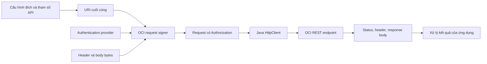

# Gọi OCI REST API và hiểu cơ chế request signing

## 1. Mục tiêu và phạm vi

Trong chương **OCI SDK và REST API với Java** của module **CLOUD_PROVIDERS_ORACLE**, bài này giải thích cách một ứng dụng Java tạo request REST tới OCI, ký request và đọc kết quả trả về.

Tình huống thực hành là một chương trình liệt kê tối đa mười object trong một bucket thử nghiệm riêng tư. Chương trình chủ động tạo URI và sử dụng `java.net.http.HttpClient` để gửi HTTP; phần chữ ký được giao cho signer của OCI Java SDK. Cách tách này giúp quan sát rõ ranh giới giữa tạo request, xác thực, phân quyền và xử lý response.

Sau bài học, người học cần:

- Nhận diện đúng endpoint, method, path, query và body của một API.
- Giải thích được signing string và header `Authorization: Signature ...`.
- Phân biệt hash body, chữ ký RSA và mã hóa Base64.
- Giữ nguyên URI, header đã ký và body bytes khi gửi.
- Chẩn đoán được lỗi request signing trước khi sửa IAM hoặc tăng retry.

Ví dụ tập trung vào API native của OCI qua HTTPS. Các giao thức như Kafka, cơ chế S3 compatibility hoặc pre-authenticated request URL có hợp đồng xác thực riêng. Không áp dụng một mẫu chữ ký cho mọi giao diện chỉ vì chúng cùng được cung cấp trên OCI.

Code và bài thực hành dưới đây chưa được biên dịch hoặc chạy trên tenancy thực tế trong quá trình soạn bài.

## 2. Gọi REST trực tiếp khác gì dùng service client của SDK?

| Cách gọi | Phần ứng dụng tự quản lý |
| --- | --- |
| Service client, ví dụ `ObjectStorageClient` | Chọn provider, cấu hình client và tạo request model |
| HTTP client riêng kết hợp OCI signer | URI, header, body, gửi HTTP, đọc lỗi, pagination và retry |
| Tự tạo chữ ký bằng Java Cryptography Architecture | Toàn bộ phần trên, cùng việc chuẩn hóa request và xử lý khóa |

Service client của SDK vẫn gọi API của dịch vụ. Khi chuyển sang HTTP client riêng, ứng dụng phải đảm nhận những việc mà service client thường đã xử lý.

Trong ví dụ của bài, OCI signer giúp tạo các header xác thực. Nó không tự gửi request, không parse JSON response và không làm mọi lỗi mạng trở thành retry an toàn.



Nếu API đã có service client phù hợp, dùng service client thường giảm lượng code tích hợp phải duy trì. Việc gọi REST trực tiếp hữu ích khi cần hiểu request thực tế, tích hợp HTTP stack riêng hoặc làm việc với API chưa có model phù hợp trong bộ SDK đang dùng.

## 3. Đọc hợp đồng API trước khi ký

### 3.1. Những thành phần phải xác định

Trước mỗi lời gọi, lấy thông tin từ tài liệu API của đúng dịch vụ:

| Thành phần | Cần biết |
| --- | --- |
| Endpoint | Host theo region, realm và cấu hình endpoint của dịch vụ |
| Method | `GET`, `POST`, `PUT`, `PATCH`, `DELETE` hoặc method được hỗ trợ |
| Path | Resource path và path parameter |
| Query | Tên, giá trị, cách phân trang và giá trị mặc định |
| Header | Header API, xác thực, conditional request hoặc idempotency nếu có |
| Body | Schema, content type và byte encoding |
| Response | Status thành công, body, request ID và lỗi |
| IAM | Permission của thao tác trên tài nguyên đích |

Không tự thêm `/20160918` vào mọi URL. Một số dịch vụ có API version trong path; Object Storage có cách tổ chức đường dẫn riêng.

Tài liệu [REST APIs](https://docs.oracle.com/en-us/iaas/Content/API/Concepts/usingapi.htm) trình bày giao thức chung, còn schema và endpoint cụ thể phải theo [API Reference and Endpoints](https://docs.oracle.com/en-us/iaas/api/).

### 3.2. Request dùng trong bài

Ví dụ hình thức của một lời gọi `ListObjects`:

```http
GET /n/<NAMESPACE>/b/<BUCKET_NAME>/o?limit=10&prefix=reports%2F2026%2011%2F HTTP/1.1
Host: <OBJECT_STORAGE_HOST>
Accept: application/json
Date: <HTTP_DATE>
Authorization: Signature ...
```

- Namespace là Object Storage namespace, không phải tenancy display name.
- Bucket là tên bucket, không phải bucket OCID.
- `prefix` lọc tên object bắt đầu bằng chuỗi đã chọn.
- `limit=10` giới hạn trang kết quả trong ví dụ.
- Đây là request liệt kê, không tải nội dung object.

Các tham số được mô tả trong [ListObjectsRequest](https://docs.oracle.com/en-us/iaas/tools/java/latest/com/oracle/bmc/objectstorage/requests/ListObjectsRequest.html). Có thể đối chiếu thao tác trong [Listing Object Storage Objects in a Bucket](https://docs.oracle.com/en-us/iaas/Content/Object/Tasks/managingobjects_topic-To_list_objects_in_a_bucket.htm).

## 4. Credential, chữ ký và IAM là ba phần khác nhau

### 4.1. API signing key của IAM user

Với API signing key, các giá trị cơ bản gồm:

| Giá trị | Vai trò |
| --- | --- |
| Tenancy OCID | Định danh tenancy |
| User OCID | Định danh IAM user |
| Public key fingerprint | Nhận diện public key đã đăng ký cho user |
| Private key | Ký request ở phía client |
| Region/endpoint | Chọn nơi gửi request, độc lập với quyền của user |

Cặp khóa RSA API signing phải có định dạng phù hợp và public key được đăng ký cho đúng user. Oracle yêu cầu RSA tối thiểu 2048 bit; đây không phải SSH key dùng để đăng nhập VM. Xem [Required Keys and OCIDs](https://docs.oracle.com/en-us/iaas/Content/API/Concepts/apisigningkey.htm).

Private key không được gửi trong HTTP request. Server dùng thông tin định danh khóa và public key đã đăng ký để kiểm tra chữ ký.

### 4.2. Key identifier

Trong trường hợp API key của user, `keyId` có dạng:

```text
<TENANCY_OCID>/<USER_OCID>/<PUBLIC_KEY_FINGERPRINT>
```

Đây là định danh khóa, không phải một chuỗi bí mật thay được private key. Biết `keyId` không đủ để tạo chữ ký hợp lệ.

Instance Principals, Resource Principals và các cơ chế session token có cách cung cấp danh tính/khóa khác. Khi dùng chúng, để authentication provider và signer tạo đúng thông tin, không tự ghép `keyId` theo mẫu user API key.

### 4.3. Policy của thao tác lab

Với một group lab trong identity domain `Default`, ví dụ:

```text
Allow group Default/JavaRestReaders to inspect objects in compartment api-lab where target.bucket.name = 'rest-signing-lab'
```

IAM user dùng trong bài cần thuộc group phù hợp. `ListObjects` sử dụng quyền `OBJECT_INSPECT`; quyền đọc nội dung object và quyền quản trị bucket là các quyền khác. Đối chiếu [Details for Object Storage and Archive Storage](https://docs.oracle.com/en-us/iaas/Content/Identity/Reference/objectstoragepolicyreference.htm).

Ứng dụng được truyền sẵn namespace và bucket nên không cần liệt kê bucket để tìm tài nguyên. Bucket nên là private, chứa dữ liệu thử nghiệm và không sử dụng đường truy cập PAR để phép thử phản ánh đúng xác thực đang học.

Chữ ký hợp lệ chỉ giải quyết việc chứng minh request. Quyền IAM vẫn có thể từ chối thao tác sau khi request được xác thực.

## 5. Cơ chế request signing phiên bản 1

### 5.1. Server xác minh điều gì?

Có thể nhìn quy trình dưới dạng:

```text
Request cuối cùng
→ Chọn các thành phần cần ký
→ Ghép thành signing string
→ Ký bằng private key
→ Base64 chữ ký nhị phân
→ Đưa chữ ký và metadata vào Authorization
```

Phía server dựng lại signing string từ request nhận được, lấy public key hoặc thông tin danh tính tương ứng và kiểm tra chữ ký. Nếu request bị thay đổi ở thành phần đã ký, kết quả xác minh không còn khớp.

Đối với signature version 1 được mô tả trong [Request Signatures](https://docs.oracle.com/en-us/iaas/Content/API/Concepts/signingrequests.htm), OCI dùng scheme `Signature`, thuật toán `rsa-sha256` và metadata chữ ký trong `Authorization`.

Không gửi `Authorization: Bearer <API_PRIVATE_KEY>`. API signing key không phải OAuth bearer token.

### 5.2. Ba nhóm dữ liệu khác nhau

| Dữ liệu | Cách tạo | Mục đích |
| --- | --- | --- |
| Body digest | SHA-256 trên body bytes | Biểu diễn nội dung body trong request được ký |
| Chữ ký | RSA-SHA256 trên signing string | Gắn request với private key của principal |
| Base64 | Mã hóa nhị phân thành chuỗi văn bản | Đưa digest/chữ ký vào header |

Base64 không mã hóa bảo mật dữ liệu. Hash body cũng không thay chữ ký: bất kỳ ai có body đều có thể tính hash, nhưng không thể tạo chữ ký của principal nếu không có vật liệu ký tương ứng.

Request signing bảo vệ các thành phần đã ký. HTTPS/TLS vẫn cần thiết để bảo vệ đường truyền và kiểm tra endpoint; request signature không tự mã hóa payload hoặc ký mọi response trả về.

### 5.3. Header cần ký

Với GET/DELETE không có body, tập tối thiểu gồm:

```text
(request-target)
host
date hoặc x-date
```

Đối với PUT/POST theo trường hợp thông thường có nội dung, cần thêm nhóm header body:

```text
x-content-sha256
content-type
content-length
```

Kể cả body rỗng, vẫn phải xử lý các header bắt buộc theo hợp đồng của method/API. SDK chuẩn còn có cấu hình cho PATCH và HEAD; cấu hình theo method có thể đối chiếu trong [Constants của OCI Java SDK](https://github.com/oracle/oci-java-sdk/blob/v3.94.0/bmc-common/src/main/java/com/oracle/bmc/http/signing/internal/Constants.java).

Có ngoại lệ riêng cho Object Storage `PutObject` và `UploadPart`. Khi áp dụng ngoại lệ, phải theo đúng phần Object Storage trong tài liệu signing; không dùng nó làm quy tắc bỏ body hash cho mọi API PUT.

### 5.4. Signing string cụ thể cho GET

Giả sử request có host và ngày minh họa như sau:

```text
(request-target): get /n/labnamespace/b/rest-signing-lab/o?limit=10&prefix=reports%2F2026%2011%2F
host: objectstorage.ap-singapore-1.oraclecloud.com
date: Fri, 20 Nov 2026 02:00:00 GMT
```

Ba dòng được nối bằng ký tự LF `\n`, không chèn dòng rỗng sau cùng. Tên thành phần trong signing string dùng chữ thường. Method trong `(request-target)` là `get`, dù HTTP request thực tế sử dụng `GET`.

`(request-target)` là thành phần tổng hợp dành cho việc ký, không phải header cần gửi trên mạng. Nó chứa method cùng raw path và raw query; không gồm `https://`, host hoặc fragment `#...`.

Nếu thứ tự trong signing string là `(request-target)`, `host`, `date`, tham số `headers` phải phản ánh cùng thứ tự. HTTP header xuất hiện trên đường truyền không cần nằm theo đúng thứ tự hiển thị của signing string.

Cách xây dựng chuỗi header và thành phần tổng hợp dựa trên [draft-cavage-http-signatures-08](https://datatracker.ietf.org/doc/html/draft-cavage-http-signatures-08), cùng các yêu cầu riêng của OCI. Đây là định dạng OCI đang được giải thích, không phải hướng dẫn thay bằng một định dạng HTTP message signing khác.

Ngày trong ví dụ cố định để đọc cấu trúc. Khi gọi thật, dùng thời gian hiện tại của client đã đồng bộ.

### 5.5. Authorization header

Header tương ứng có hình thức:

```http
Authorization: Signature version="1",keyId="<TENANCY_OCID>/<USER_OCID>/<FINGERPRINT>",algorithm="rsa-sha256",headers="(request-target) host date",signature="<BASE64_SIGNATURE>"
```

`headers` liệt kê những thành phần đã ký, còn `signature` là kết quả ký nhị phân đã được Base64. Chuỗi ví dụ trên là placeholder, không phải credential có thể sử dụng.

SDK có thể chọn thứ tự header khác nhưng vẫn hợp lệ nếu signing string và danh sách `headers` nhất quán. Không so sánh hai chữ ký chỉ dựa vào việc các trường `Authorization` trông giống nhau.

Về thao tác JCA, nếu đã có `PrivateKey privateKey` và signing string, phần ký cốt lõi có thể minh họa bằng:

```java
var rsa = java.security.Signature.getInstance("SHA256withRSA");
rsa.initSign(privateKey);
rsa.update(signingString.getBytes(java.nio.charset.StandardCharsets.UTF_8));
String signatureBase64 =
        java.util.Base64.getEncoder().encodeToString(rsa.sign());
```

Đây là đoạn trích giải thích, chưa bao gồm đọc PEM, xử lý passphrase, chọn header và tạo request. API Java được mô tả trong [Signature](https://docs.oracle.com/en/java/javase/17/docs/api/java.base/java/security/Signature.html); ánh xạ tên thuật toán OCI/JVM có thể đối chiếu trong [Algorithm của OCI Java SDK](https://github.com/oracle/oci-java-sdk/blob/v3.94.0/bmc-common/src/main/java/com/oracle/bmc/http/signing/internal/Algorithm.java).

## 6. URI và body phải được chốt trước khi ký

### 6.1. Ký đúng URL sẽ gửi

Một request có query:

```text
?limit=10&prefix=reports%2F2026%2011%2F
```

và request:

```text
?prefix=reports%2F2026%2011%2F&limit=10
```

có thể cùng ý nghĩa đối với bộ lọc API, nhưng raw request-target khác nhau. Nếu ký URL thứ nhất rồi HTTP layer gửi URL thứ hai, chữ ký không còn mô tả đúng request.

Các thao tác sau cũng có thể gây khác biệt:

- Đổi `%20` thành `+`.
- Decode `%2F` rồi ghép lại dưới dạng khác.
- Encode thêm một lần khiến `%2F` thành `%252F`.
- Thêm hoặc bỏ dấu `/` cuối path.
- Thay host, thêm port hoặc đổi endpoint sau khi ký.

Không tự chuẩn hóa lại URI sau bước signing. Trong Java, `getRawPath()` và `getRawQuery()` giữ dạng đã escape, khác với các accessor đã decode; xem [java.net.URI](https://docs.oracle.com/en/java/javase/17/docs/api/java.base/java/net/URI.html).

### 6.2. Percent-encoding theo component

Trong ví dụ, input nghiệp vụ là chuỗi prefix:

```text
reports/2026 11/
```

Giá trị query được encode thành:

```text
reports%2F2026%2011%2F
```

Encode từng path parameter hoặc query value; giữ các dấu phân cách cấu trúc như `/`, `?`, `&`, `=` ở lớp dựng URL.

Theo [RFC 3986](https://www.rfc-editor.org/rfc/rfc3986), nhóm ký tự unreserved gồm chữ, số và `-._~`. Hàm minh họa ở phần Java sẽ giữ nhóm đó, còn các byte UTF-8 khác chuyển thành percent-encoding. Input của hàm là chuỗi chưa encode.

Không dùng trực tiếp cách encode form URL như một quy tắc chung cho mọi URI. Đặc biệt, cách biểu diễn dấu cách cần phù hợp với chính request-target đã ký và được gửi.

### 6.3. Body là một dãy byte

Hai JSON sau có thể tương đương khi parse:

```json
{"displayName":"lab"}
```

```json
{ "displayName": "lab" }
```

Nhưng chúng không có cùng byte sequence. Hash của body phải dựa trên đúng dãy byte sẽ gửi, không dựa trên JSON đã parse rồi serialize lại theo một cấu hình khác.

Một cách tổ chức an toàn là serialize một lần ra `byte[]`, tính hash và độ dài từ mảng đó, rồi dùng cùng mảng để tạo body publisher.

Với dữ liệu tiếng Việt, `String.length()` không phải số byte UTF-8. `content-length` phải phản ánh byte count của payload.

```java
byte[] bodyBytes = json.getBytes(java.nio.charset.StandardCharsets.UTF_8);

String contentSha256 = java.util.Base64.getEncoder().encodeToString(
        java.security.MessageDigest.getInstance("SHA-256")
                .digest(bodyBytes));

String contentLength = Integer.toString(bodyBytes.length);
```

Đoạn này minh họa digest và độ dài, không gửi một API tạo tài nguyên. `MessageDigest` được mô tả trong [Java MessageDigest](https://docs.oracle.com/en/java/javase/17/docs/api/java.base/java/security/MessageDigest.html).

Với PUT/POST body rỗng, hash của mảng rỗng vẫn là một giá trị SHA-256 xác định; không mặc nhiên bỏ hash hoặc độ dài nếu API yêu cầu. Nếu dùng streaming/chunked upload, hãy chọn chiến lược được API và transport hỗ trợ thay vì giả định ví dụ body nhỏ áp dụng nguyên trạng.

## 7. Chuẩn bị project Java cho request REST

Ví dụ sử dụng Java 17 và Maven. Chỉ dùng module common của OCI SDK cùng HTTP transport; không cần Object Storage service client vì request được gửi bằng Java HttpClient.

```xml
<project xmlns="http://maven.apache.org/POM/4.0.0"
         xmlns:xsi="http://www.w3.org/2001/XMLSchema-instance"
         xsi:schemaLocation="http://maven.apache.org/POM/4.0.0 https://maven.apache.org/xsd/maven-4.0.0.xsd">
    <modelVersion>4.0.0</modelVersion>

    <groupId>vn.example</groupId>
    <artifactId>oci-rest-signing-lab</artifactId>
    <version>1.0.0</version>

    <properties>
        <maven.compiler.release>17</maven.compiler.release>
        <project.build.sourceEncoding>UTF-8</project.build.sourceEncoding>
        <oci.sdk.version>3.94.0</oci.sdk.version>
    </properties>

    <dependencyManagement>
        <dependencies>
            <dependency>
                <groupId>com.oracle.oci.sdk</groupId>
                <artifactId>oci-java-sdk-bom</artifactId>
                <version>${oci.sdk.version}</version>
                <type>pom</type>
                <scope>import</scope>
            </dependency>
        </dependencies>
    </dependencyManagement>

    <dependencies>
        <dependency>
            <groupId>com.oracle.oci.sdk</groupId>
            <artifactId>oci-java-sdk-common</artifactId>
        </dependency>
        <dependency>
            <groupId>com.oracle.oci.sdk</groupId>
            <artifactId>oci-java-sdk-common-httpclient-jersey3</artifactId>
        </dependency>
    </dependencies>

    <build>
        <plugins>
            <plugin>
                <groupId>org.apache.maven.plugins</groupId>
                <artifactId>maven-compiler-plugin</artifactId>
                <version>3.13.0</version>
            </plugin>
            <plugin>
                <groupId>org.codehaus.mojo</groupId>
                <artifactId>exec-maven-plugin</artifactId>
                <version>3.5.0</version>
            </plugin>
        </plugins>
    </build>
</project>
```

BOM và transport được cấu hình theo cách cài đặt SDK 3.x trong [Getting Started](https://docs.oracle.com/en-us/iaas/Content/API/SDKDocs/javasdkgettingstarted.htm). Phiên bản `3.94.0` được ghim cho ví dụ để có bộ dependency xác định; đây không phải tuyên bố về phiên bản mới nhất hoặc kết quả kiểm thử môi trường thật.

Transport Jersey trong dependency phục vụ các thành phần SDK cần HTTP provider. Request REST của ví dụ vẫn được gửi bởi `java.net.http.HttpClient`.

`DefaultRequestSigner` là helper mà Oracle cung cấp cho trường hợp gọi REST trực tiếp, nhưng mã nguồn đánh dấu `@InternalSdk` và nêu khả năng thay đổi. Vì vậy ví dụ ghim SDK version; ứng dụng cần kiểm tra tương thích khi nâng phiên bản. Xem [DefaultRequestSigner](https://github.com/oracle/oci-java-sdk/blob/v3.94.0/bmc-common/src/main/java/com/oracle/bmc/http/signing/DefaultRequestSigner.java). Với API đã có service client, cân nhắc service client để giảm phụ thuộc vào helper này.

## 8. Cấu hình credential cho ví dụ

Ví dụ đọc profile `DEFAULT` của file OCI config thuộc người dùng chạy JVM:

```ini
[DEFAULT]
user=ocid1.user.oc1..<USER_ID>
fingerprint=<PUBLIC_KEY_FINGERPRINT>
tenancy=ocid1.tenancy.oc1..<TENANCY_ID>
region=<REGION_ID>
key_file=C:/Users/<WINDOWS_USER>/.oci/oci_api_key.pem
```

Thay placeholder bằng giá trị thật; file private key phải thuộc user có public key đã đăng ký. Trên Windows, config thường nằm trong thư mục `.oci` dưới hồ sơ người dùng. Các field và vị trí được mô tả trong [SDK and CLI Configuration File](https://docs.oracle.com/en-us/iaas/Content/API/Concepts/sdkconfig.htm).

Giữ private key ngoài source code, repository và image dùng chung. Nếu key được mã hóa bằng passphrase, chọn cơ chế cung cấp passphrase phù hợp với provider và môi trường triển khai.

Endpoint đích được đặt riêng bằng biến `APP_OCI_REST_ENDPOINT`. Trong chương trình HTTP trực tiếp, field `region` của config không tự xây dựng URI thay cho ứng dụng.

## 9. Java: tạo URI mà không làm thay đổi dữ liệu đã encode

Đặt hai class ở mục này và mục tiếp theo trong `src/main/java` của project lab. Không khai báo package để dùng trực tiếp theo lệnh chạy minh họa.

Tạo `OciRestUris.java`:

```java
import java.net.URI;
import java.nio.charset.StandardCharsets;
import java.util.Locale;

public final class OciRestUris {
    private static final char[] HEX = "0123456789ABCDEF".toCharArray();

    private OciRestUris() {}

    public static URI listObjects(
            String endpoint,
            String namespace,
            String bucket,
            String prefix) {
        URI base = URI.create(endpoint);
        String host = base.getHost();
        String path = base.getRawPath();

        if (!"https".equals(base.getScheme())
                || host == null
                || !host.equals(host.toLowerCase(Locale.ROOT))
                || base.getPort() != -1
                || base.getRawUserInfo() != null
                || base.getRawQuery() != null
                || base.getRawFragment() != null
                || !(path.isEmpty() || path.equals("/"))) {
            throw new IllegalArgumentException(
                    "Use an HTTPS root endpoint with lowercase host and no port");
        }

        String resourcePath = "/n/" + encodeComponent(namespace)
                + "/b/" + encodeComponent(bucket)
                + "/o";

        String query = "limit=10&prefix=" + encodeComponent(prefix);

        return URI.create("https://" + host + resourcePath + "?" + query);
    }

    public static String encodeComponent(String value) {
        byte[] bytes = value.getBytes(StandardCharsets.UTF_8);
        StringBuilder result = new StringBuilder();

        for (byte raw : bytes) {
            int ch = raw & 0xff;
            boolean unreserved =
                    (ch >= 'a' && ch <= 'z')
                    || (ch >= 'A' && ch <= 'Z')
                    || (ch >= '0' && ch <= '9')
                    || ch == '-'
                    || ch == '.'
                    || ch == '_'
                    || ch == '~';

            if (unreserved) {
                result.append((char) ch);
            } else {
                result.append('%');
                result.append(HEX[ch >>> 4]);
                result.append(HEX[ch & 0x0f]);
            }
        }

        return result.toString();
    }
}
```

Hàm nhận namespace, bucket và prefix ở dạng chưa encode, dựng URI đúng một lần. Dấu `/` trong prefix là dữ liệu query nên được encode, còn các dấu `/` tạo cấu trúc path do hàm thêm vẫn giữ nguyên.

Ví dụ không nhận endpoint có port, user-info, query hoặc path sẵn. Giới hạn đó giúp việc đối chiếu Host giữa signer và Java HttpClient rõ ràng trong lab; nó không mô tả tất cả dạng endpoint mà OCI có thể hỗ trợ.

Endpoint phải lấy từ cấu hình triển khai đáng tin cậy của đúng dịch vụ/region. Trong ứng dụng phục vụ người dùng, không cho request đầu vào chọn một URL tùy ý để chương trình ký và gửi bằng credential của mình.

## 10. Java: ký rồi gửi GET bằng HttpClient

Tạo `OciSignedRestGet.java`:

```java
import java.io.IOException;
import java.net.URI;
import java.net.http.HttpClient;
import java.net.http.HttpRequest;
import java.net.http.HttpResponse;
import java.nio.charset.StandardCharsets;
import java.time.Duration;
import java.util.List;
import java.util.Map;
import java.util.TreeMap;
import java.util.UUID;

import com.oracle.bmc.ConfigFileReader;
import com.oracle.bmc.auth.ConfigFileAuthenticationDetailsProvider;
import com.oracle.bmc.http.signing.DefaultRequestSigner;
import com.oracle.bmc.http.signing.RequestSigner;

public final class OciSignedRestGet {
    public static void main(String[] args) throws Exception {
        URI uri = OciRestUris.listObjects(
                requiredEnv("APP_OCI_REST_ENDPOINT"),
                requiredEnv("APP_OBJECT_NAMESPACE"),
                requiredEnv("APP_OBJECT_BUCKET"),
                requiredEnv("APP_OBJECT_PREFIX"));

        var provider = new ConfigFileAuthenticationDetailsProvider(
                ConfigFileReader.parseDefault());

        RequestSigner signer =
                DefaultRequestSigner.createRequestSigner(provider);

        HttpClient http = HttpClient.newBuilder()
                .version(HttpClient.Version.HTTP_1_1)
                .connectTimeout(Duration.ofSeconds(10))
                .followRedirects(HttpClient.Redirect.NEVER)
                .build();

        HttpResponse<String> response = sendOnce(http, signer, uri);

        String requestId = response.headers()
                .firstValue("opc-request-id")
                .orElse("<not-present>");

        System.out.printf(
                "status=%d requestId=%s responseBytes=%d%n",
                response.statusCode(),
                requestId,
                response.body().getBytes(StandardCharsets.UTF_8).length);

        if (response.statusCode() != 200) {
            throw new IOException(
                    "OCI ListObjects failed; status=" + response.statusCode()
                            + "; requestId=" + requestId);
        }

        // Display only fixture names from the private lab bucket.
        System.out.println(response.body());
    }

    private static HttpResponse<String> sendOnce(
            HttpClient http,
            RequestSigner signer,
            URI uri) throws IOException, InterruptedException {
        Map<String, List<String>> originalHeaders = Map.of(
                "accept", List.of("application/json"),
                "opc-client-request-id", List.of(UUID.randomUUID().toString()));

        Map<String, String> signedHeaders =
                signer.signRequest(uri, "GET", originalHeaders, null);

        Map<String, String> outgoing =
                new TreeMap<>(String.CASE_INSENSITIVE_ORDER);

        originalHeaders.forEach((name, values) ->
                outgoing.put(name, values.get(0)));
        outgoing.putAll(signedHeaders);

        HttpRequest.Builder request = HttpRequest.newBuilder(uri)
                .version(HttpClient.Version.HTTP_1_1)
                .timeout(Duration.ofSeconds(30))
                .GET();

        for (var header : outgoing.entrySet()) {
            if (header.getKey().equalsIgnoreCase("host")) {
                if (!header.getValue().equals(uri.getRawAuthority())) {
                    throw new IllegalStateException(
                            "Signed host differs from request authority");
                }
                // Java HttpClient generates Host from this same URI.
                continue;
            }
            request.header(header.getKey(), header.getValue());
        }

        return http.send(
                request.build(),
                HttpResponse.BodyHandlers.ofString(StandardCharsets.UTF_8));
    }

    private static String requiredEnv(String name) {
        String value = System.getenv(name);
        if (value == null || value.isBlank()) {
            throw new IllegalArgumentException(
                    "Missing environment variable: " + name);
        }
        return value;
    }
}
```

### 10.1. Những việc signer đảm nhiệm

`signRequest(...)` nhận URI, method, header và body. Kết quả chứa `Authorization` cùng các header mà signer yêu cầu dùng khi gửi.

Ứng dụng phải giữ đúng các giá trị trả về. Chỉ sao chép `Authorization` nhưng bỏ `date` do signer tạo là một lỗi tích hợp. Hợp đồng này được mô tả trong [RequestSigner](https://docs.oracle.com/en-us/iaas/tools/java/latest/com/oracle/bmc/http/signing/RequestSigner.html).

Ví dụ truyền body là `null` vì GET không có request body. Nó không truyền một chuỗi JSON rỗng hoặc một Java object cần serialize.

Signer của SDK quản lý việc lấy vật liệu ký từ authentication provider. Chương trình không tự đọc PEM, không tự tính fingerprint và không in header xác thực.

### 10.2. Vì sao không đặt Host bằng request.header?

Java HttpClient quản lý một số header và có thể từ chối header do người dùng đặt trực tiếp. Cơ chế này được mô tả trong [HttpRequest.Builder](https://docs.oracle.com/en/java/javase/17/docs/api/java.net.http/java/net/http/HttpRequest.Builder.html).

Ví dụ giới hạn URI là HTTPS root endpoint có host chữ thường và không có port tường minh. Khi signer trả về `host`, code xác minh nó bằng authority rồi để Java HttpClient tạo Host từ chính URI đó.

Đây là một xử lý có điều kiện rõ ràng cho header do transport quản lý, không phải quy tắc bỏ mọi header đã ký. Nếu đổi sang transport hoặc URI dạng khác, phải xác minh lại giá trị Host thực tế.

Ví dụ dùng HTTP/1.1 để giữ việc quan sát request line và Host đơn giản. Chữ ký vẫn dựa trên các thành phần logic của request, không dựa trên thứ tự đóng gói TCP.

### 10.3. Vì sao tắt redirect?

Một chữ ký cho host/path ban đầu không tự xác thực host/path mới. Tự động theo redirect còn có thể khiến header xác thực đi tới đích không mong muốn, tùy cách client xử lý.

Với response 3xx, kiểm tra endpoint và hợp đồng API. Nếu thực sự cần gửi request đến URI mới, đánh giá URI đích rồi tạo và ký một request mới. Đừng mang nguyên request đã ký sang địa chỉ khác.

Tùy chọn redirect và khả năng tái sử dụng client được mô tả trong [Java HttpClient](https://docs.oracle.com/en/java/javase/17/docs/api/java.net.http/java/net/http/HttpClient.html).

### 10.4. Những việc ví dụ chưa tự thực hiện

Đây là một lời gọi `ListObjects` lấy một trang kết quả. Chương trình chưa có vòng pagination, retry ứng dụng, parser lỗi JSON hoặc logic kiểm kê đầy đủ.

Lỗi HTTP không tự trở thành `BmcException` khi gửi bằng Java HttpClient. Ứng dụng phải kiểm tra status và body của `HttpResponse`. Lỗi ký trước khi gửi cũng khác với lỗi 401 do OCI trả về.

Mọi lần gọi `sendOnce` đều yêu cầu signer tạo header cho lần gửi đó. Không lưu một `HttpRequest` có chữ ký cũ rồi dùng lại suốt nhiều giờ.

## 11. Chạy ví dụ và đọc kết quả

### 11.1. Chuẩn bị fixture

Trong một bucket private mang tên lab, tạo sẵn một vài object nhỏ có tên như:

```text
reports/2026 11/a.txt
reports/2026 11/b.txt
notes/readme.txt
```

Có thể thêm tên chứa tiếng Việt để quan sát việc encode query theo UTF-8. Không dùng dữ liệu sản xuất hoặc tên object có thông tin nhạy cảm cho phần in JSON minh họa.

Xác nhận user có quyền `ListObjects`, config đọc đúng private key và endpoint là endpoint Object Storage của region chứa bucket.

### 11.2. Đặt biến môi trường PowerShell

```powershell
$env:APP_OCI_REST_ENDPOINT = "<OBJECT_STORAGE_ROOT_ENDPOINT_HTTPS>"
$env:APP_OBJECT_NAMESPACE = "<OBJECT_STORAGE_NAMESPACE>"
$env:APP_OBJECT_BUCKET = "rest-signing-lab"
$env:APP_OBJECT_PREFIX = "reports/2026 11/"

mvn compile exec:java "-Dexec.mainClass=OciSignedRestGet"
```

Endpoint placeholder phải được thay bằng endpoint thật lấy từ tài liệu/cấu hình của dịch vụ. Không thêm dấu `<...>` vào giá trị khi chạy.

Kết quả mong đợi:

- Status 200.
- Có request ID để truy vết khi dịch vụ trả header đó.
- JSON chỉ chứa các object phù hợp với prefix của trang hiện tại.
- Không có private key hoặc `Authorization` trong output.

Trang kết quả rỗng có thể là kết quả hợp lệ nếu không có tên object khớp prefix. Không coi số object bằng 0 là lỗi signing.

### 11.3. Hiểu ranh giới của phép thử

Thành công của ví dụ chứng minh request GET cụ thể đã được gửi và được dịch vụ chấp nhận với danh tính/quyền hiện tại. Nó chưa chứng minh API POST, upload streaming, pagination hoặc mọi endpoint OCI đã được tích hợp đúng.

Để kiểm tra mã hóa URI, thay prefix bằng chuỗi có dấu cách, dấu `+`, ký tự tiếng Việt hoặc `/`. Đối chiếu URL được dựng trước khi ký với giá trị query mong muốn, không sửa URI sau khi ký để “làm đẹp” log.

## 12. Mở rộng sang API có body

### 12.1. Chốt một biểu diễn payload

Trước khi gửi JSON:

```text
Đối tượng nghiệp vụ
→ Serialize một lần
→ byte[] UTF-8
→ Tính content-length và x-content-sha256
→ Tạo signing string và Authorization
→ Gửi đúng byte[] đã dùng
```

Không để signer hash một Java object bằng serializer A rồi transport serialize object đó lại bằng serializer B. Khác biệt về thứ tự field, khoảng trắng, newline hoặc escape đều có thể tạo body bytes khác.

Khi dùng OCI signer cho body nhỏ, cần kiểm tra loại body mà signer của SDK version đó hỗ trợ và cách transport gửi dữ liệu. Cách đọc body/tính header của bản SDK dùng trong bài có thể xem ở [RequestSignerImpl](https://github.com/oracle/oci-java-sdk/blob/v3.94.0/bmc-common/src/main/java/com/oracle/bmc/http/signing/internal/RequestSignerImpl.java).

Ví dụ Java GET ở trên không phải một hàm gửi POST/PUT tổng quát. Để mở rộng, phải thêm xử lý method, body publisher, content type, content length và chiến lược ký theo API.

### 12.2. Content-Length và transport

JDK HttpClient có thể tự quản lý `Content-Length` theo body publisher. Không chỉ bỏ một header bắt buộc khỏi phần ký vì builder từ chối đặt nó thủ công.

Với body nhỏ, chọn publisher có độ dài xác định và đối chiếu độ dài transport gửi với độ dài đã ký. Ví dụ `BodyPublishers.ofByteArray(bodyBytes)` tạo publisher từ đúng dãy byte đã chốt. Nếu thư viện chuyển sang chunked transfer hoặc biến đổi body, phải giải quyết sự khác biệt đó trước khi gửi.

Không bật tùy chọn cho phép mọi restricted header chỉ để vượt qua một lỗi chưa hiểu. Mục tiêu là giá trị header thực tế khớp hợp đồng ký, không phải làm builder chấp nhận chuỗi tùy ý.

### 12.3. Ngoại lệ Object Storage PUT

Một số thao tác upload Object Storage có quy tắc signing riêng để hỗ trợ tình huống upload. Điều đó không có nghĩa tự do bỏ header body trên mọi lời gọi Object Storage hoặc mọi HTTP PUT.

Với file lớn, multipart, stream không thể đọc lại hoặc nội dung chưa biết độ dài, dùng service client/upload API phù hợp hoặc thiết kế transport theo đúng tài liệu thao tác. Không hash hết một stream rồi quên rằng stream đã được đọc trước khi gửi.

Nếu thư viện cung cấp chiến lược loại body khỏi chữ ký, chỉ chọn nó khi API cụ thể hỗ trợ. Không dùng nó như cách chung để che lỗi serialize body.

## 13. Đọc response đúng hợp đồng API

### 13.1. Status, body và request ID

Một response cần được đánh giá theo API cụ thể:

| Thành phần | Ý nghĩa |
| --- | --- |
| HTTP status | Kết quả của lời gọi HTTP hiện tại |
| Error JSON | Service code và mô tả lỗi khi có |
| `opc-request-id` | Định danh hỗ trợ truy vết lời gọi |
| ETag | Phiên bản/định danh representation theo hợp đồng tài nguyên |
| Header/body pagination | Dấu hiệu còn dữ liệu cần lấy |
| Work request ID | Theo dõi thao tác bất đồng bộ khi API sử dụng |

Trong code lab, status khác 200 làm chương trình thất bại. Đó là quy tắc của ví dụ `ListObjects`, không phải mọi API thành công đều trả 200.

Một request được ký đúng có thể vẫn bị từ chối vì IAM, input không hợp lệ, tài nguyên sai region hoặc xung đột trạng thái. Chẩn đoán cần kết hợp status, service code, request ID và thao tác đã gọi.

Nếu viết parser lỗi JSON, giữ thông tin có ích nhưng không mặc định toàn bộ body lỗi an toàn để ghi log. Body có thể chứa tên tài nguyên hoặc giá trị tham số.

### 13.2. Pagination: mỗi trang là request mới

Nhiều OCI List API dùng `opc-next-page` rồi nhận lại `page` trong query. Không áp dụng máy móc cho mọi dịch vụ.

Object Storage `ListObjects` có `nextStartWith` trong body khi còn dữ liệu; sử dụng giá trị đó cho tham số `start` của lượt tiếp theo. Cơ chế này được mô tả trong [Get-OCIObjectstorageObjectsList](https://docs.oracle.com/en-us/iaas/tools/powershell/latest/articles/Get-OCIObjectstorageObjectsList.html).

Luồng phân trang cho ví dụ có thể tổ chức như sau:

```text
start = chưa có

Lặp:
    dựng URI từ namespace, bucket, prefix, limit và start
    ký URI mới với header hiện tại
    gửi GET
    kiểm tra status và parse response
    xử lý objects
    lấy nextStartWith
    nếu không còn nextStartWith: dừng
    start = nextStartWith
```

Giữ nguyên filter nghiệp vụ giữa các trang. Giá trị token/tên bắt đầu trang cần được encode như một query value; không nối nguyên chuỗi chưa encode vào URL.

Không tái sử dụng `Authorization` của trang đầu cho trang tiếp theo vì query đã thay đổi. Cũng không kết luận “đã lấy hết” chỉ vì một trang có ít item; dùng điều kiện kết thúc của API.

### 13.3. Thao tác bất đồng bộ

API khởi tạo thay đổi hạ tầng có thể trả về trước khi tài nguyên sẵn sàng. Nếu API cung cấp `opc-work-request-id`, theo dõi bằng API work request tương ứng của dịch vụ.

Một response tiếp nhận thành công không thay cho việc xác nhận trạng thái cuối của Compute, VCN hoặc database. Mỗi lần poll trạng thái vẫn là một request cần được ký đúng.

Các service có thể dùng Work Requests API chung hoặc API riêng; xem [Asynchronous Work Requests](https://docs.oracle.com/en-us/iaas/Content/API/Concepts/workrequests.htm). Chọn đúng endpoint, permission và trạng thái kết thúc thay vì hardcode một quy tắc chung cho mọi tài nguyên.

## 14. Retry và chữ ký mới

### 14.1. Ký lại theo mỗi lần gửi

Với retry ứng dụng:

1. Giữ ngữ nghĩa thao tác, payload và idempotency token nếu API hỗ trợ.
2. Tạo lại các header thời gian cho lần gửi mới.
3. Ký lại đúng URI và body bytes của lần gửi đó.
4. Gửi request và ghi nhận kết quả của lần thử.

Dùng lại một chữ ký cũ sau thời gian dài có thể làm request hết cửa sổ thời gian được chấp nhận. Đồng hồ client lệch quá năm phút có thể bị trả 401 theo [Maximum Allowed Client Clock Skew](https://docs.oracle.com/en-us/iaas/Content/API/Concepts/usingapi.htm#clock).

Không sửa `date` trong request nhưng giữ nguyên `Authorization`: giá trị thời gian là một phần của dữ liệu đã ký. Nếu cả `date` và `x-date` xuất hiện, phải xử lý nhất quán theo quy tắc OCI; ví dụ của bài chỉ để signer tạo `date`.

### 14.2. Chữ ký khác idempotency

Ký lại xác thực một lần gửi mới. Nó không bảo đảm một thao tác tạo tài nguyên chỉ diễn ra một lần.

| Giá trị | Mục đích |
| --- | --- |
| Signature | Chứng minh request với credential phù hợp |
| `opc-request-id` | Truy vết request do dịch vụ nhận |
| `opc-client-request-id` khi API hỗ trợ | Truy vết do client cung cấp |
| `opc-retry-token` khi API hỗ trợ | Cơ chế retry/idempotency theo hợp đồng của API |
| Business operation ID | Nhận diện công việc nghiệp vụ của ứng dụng |

Trong ví dụ GET, trace ID mới không tạo hoặc chống bản sao dữ liệu. Nếu chuyển sang API tạo VCN hay database, đọc rõ cơ chế retry token, thời hạn và các trường hợp token mất hiệu lực.

Không đổi token idempotency chỉ vì bị timeout mà chưa biết server đã thực hiện thao tác hay chưa. Cần xử lý trạng thái chưa xác định theo hợp đồng API và kế hoạch đối soát.

### 14.3. Lỗi nào cần backoff?

Các lỗi tạm thời như throttle hoặc một số lỗi 5xx có thể phù hợp với retry có giới hạn. Dùng backoff, jitter và deadline tổng để tránh dồn tải.

Lỗi sai schema, key fingerprint, chữ ký do URI thay đổi hoặc thiếu IAM không được sửa bằng cách lặp nhanh request cũ.

Một ứng dụng dùng HTTP client riêng phải thiết kế retry rõ ràng. Việc gọi một helper signer không tự mang theo toàn bộ retry/circuit breaker của OCI service client.

## 15. Chẩn đoán lỗi signing theo bằng chứng

### 15.1. Phân biệt các nhóm lỗi

| Dấu hiệu | Những gì cần kiểm tra |
| --- | --- |
| Lỗi trước khi gửi HTTP | File config, private key, passphrase, provider, URI không hợp lệ |
| DNS/connect timeout | Endpoint, DNS, proxy, route, firewall |
| TLS handshake thất bại | CA/truststore, hostname, proxy TLS, đồng hồ |
| 401 `NotAuthenticated` | Khóa, fingerprint, keyId, thời gian, header và signing string |
| 403 hoặc 404 liên quan quyền | Policy, principal, compartment, region và tài nguyên |
| 400 | Schema, path/query, body và các header nghiệp vụ |
| 405 | Method không được API hỗ trợ |
| 412 | Điều kiện ETag không còn khớp |
| 429 hoặc lỗi tạm thời | Backoff và kiểm soát tải sau khi phân loại |

OCI có thể dùng 404 `NotAuthorizedOrNotFound` để phản ánh cả trường hợp không thấy tài nguyên lẫn không có quyền. Không mặc định mọi lỗi quyền phải là 403. Các mã lỗi được mô tả trong [API Errors](https://docs.oracle.com/en-us/iaas/Content/API/References/apierrors.htm).

### 15.2. Trình tự kiểm tra khi gặp 401

```text
Provider/khóa đúng?
→ Public key đã đăng ký đúng user?
→ Fingerprint và keyId đúng?
→ Đồng hồ/thời gian header đúng?
→ Method, raw path và raw query đúng?
→ Host thực tế khớp host đã ký?
→ Header value đã ký có bị đổi?
→ Body digest và byte length có khớp body gửi?
→ Thứ tự signing string khớp tham số headers?
```

Không bắt đầu bằng việc cấp quyền quản trị toàn tenancy. Quyền rộng hơn không làm chữ ký sai trở thành hợp lệ.

Khi dùng signer SDK, so sánh **đầu vào signer** với **request mà HTTP layer thực sự gửi**. Nếu đầu vào đúng nhưng request đi qua interceptor, middleware hoặc proxy thay đổi thành phần đã ký, kiểm tra ở lớp đó.

### 15.3. Các lỗi khó nhìn bằng mắt

| Khác biệt | Vì sao có thể làm hỏng xác thực |
| --- | --- |
| LF thành CRLF trong signing string tự dựng | Byte sequence được ký khác |
| Thêm newline cuối signing string | Đổi dữ liệu đầu vào chữ ký |
| `%20` thành `+` | Raw query khác |
| Query bị sort sau ký | Request-target khác |
| Thêm `:443` vào một phía | Host đã ký và Host gửi có thể khác |
| Body UTF-8 nhưng length tính bằng ký tự | Content length và dữ liệu không khớp |
| Serialize lại JSON sau hash | Digest không mô tả body mới |
| Thay `Content-Type` đã ký | Header value không còn khớp |
| Chỉ copy `Authorization` từ kết quả signer | Thiếu các header mà chữ ký đang tham chiếu |

HTTP header name không phân biệt hoa thường trên giao thức, nhưng signing string có cách chuẩn hóa tên riêng. Không vì vậy mà chuyển cả header **value** sang chữ thường, đặc biệt với giá trị có ý nghĩa theo byte hoặc phân biệt hoa thường.

Khi tự dựng chữ ký để học, dùng các giá trị kiểm tra công khai trong tài liệu Oracle và kiểm tra bằng public key tương ứng. Chữ ký tự xác minh được ở máy local mới chứng minh cặp khóa và signing string local nhất quán; nó chưa chứng minh HTTP request đến OCI giống signing string đó.

## 16. Principal khác, HTTP contract vẫn phải giữ

Ví dụ dùng API key để làm rõ thành phần user/tenancy/fingerprint. Trên OCI Compute hoặc Functions, có thể chọn provider tương ứng trước khi tạo signer:

```java
var provider =
        com.oracle.bmc.auth.InstancePrincipalsAuthenticationDetailsProvider
                .builder()
                .build();

var signer = DefaultRequestSigner.createRequestSigner(provider);
```

Hoặc trong runtime hỗ trợ Resource Principals:

```java
var provider =
        com.oracle.bmc.auth.ResourcePrincipalAuthenticationDetailsProvider
                .builder()
                .build();

var signer = DefaultRequestSigner.createRequestSigner(provider);
```

Hai đoạn là lựa chọn thay thế, không khai báo đồng thời trong cùng scope. Runtime cần cung cấp danh tính và principal cần được cấp IAM phù hợp. Không tự ép `keyId` của các provider này về dạng user API key.

Cần đặc biệt chú ý vòng đời token: signer kết hợp Java HttpClient không tự động có toàn bộ cơ chế refresh-on-error của service client. Đối chiếu hành vi provider/SDK đang dùng, kiểm tra lỗi 401 và refresh có giới hạn theo cơ chế được hỗ trợ; không lưu token/key material thành bản sao cố định trong ứng dụng.

## 17. Vận hành một tích hợp REST có thể bảo trì

### 17.1. Giữ request nhất quán qua các lớp

Tổ chức code theo trình tự:

```text
Cấu hình đích đáng tin cậy
→ Tạo URI và body cuối cùng
→ Tạo header nghiệp vụ
→ Sign
→ Gửi ngay bằng transport không làm đổi dữ liệu đã ký
→ Đọc status/header/body
→ Quyết định pagination, retry hoặc trạng thái nghiệp vụ
```

Một interceptor chỉnh URI hoặc body nên chạy trước signer. Nếu một lớp buộc phải thay đổi thành phần đã ký, request phải được ký lại sau thay đổi đó.

Giữ HTTP client và provider theo vòng đời phù hợp để tận dụng connection pool và quản lý credential. Không chia sẻ một request builder có thể thay đổi giữa nhiều thread; mỗi lần gửi nên có trạng thái request riêng.

### 17.2. Log đủ để điều tra, tránh lộ credential

Nên ghi method, tên thao tác, region/host đã kiểm soát, HTTP status, service code, latency và request ID. Với URL/query hoặc response body, đánh giá dữ liệu nhạy cảm trước khi đưa vào log.

Không log private key, passphrase, session token hoặc toàn bộ `Authorization`. Signing string tự dựng cũng có thể chứa path/query có thông tin nghiệp vụ; chỉ quan sát có kiểm soát với fixture.

Không dùng chế độ wire/debug logging có credential rồi đẩy toàn bộ vào hệ thống log dùng chung. Khi cần điều tra production, thu thập ít dữ liệu nhất đủ xác định lớp đã làm thay đổi request.

### 17.3. Kiểm soát thay đổi thư viện

Khi nâng SDK hoặc JDK, cần xác minh lại ranh giới giữa signer và transport: header được SDK trả về, header do JDK quản lý, URI raw, body publisher và hành vi redirect/retry.

Tách logic tạo URI, chọn provider và gửi HTTP để việc đối chiếu dễ thực hiện. Với API đã ổn định trong SDK, cân nhắc chuyển sang service client thay vì mở rộng mã REST tự quản lý quá nhiều trường hợp.

Một tích hợp đạt yêu cầu khi ứng dụng ký đúng request thực sự được gửi, dùng đúng danh tính và IAM, đọc đúng hợp đồng response, đồng thời giữ được các thuộc tính đó khi phân trang, thử lại và luân chuyển credential.
