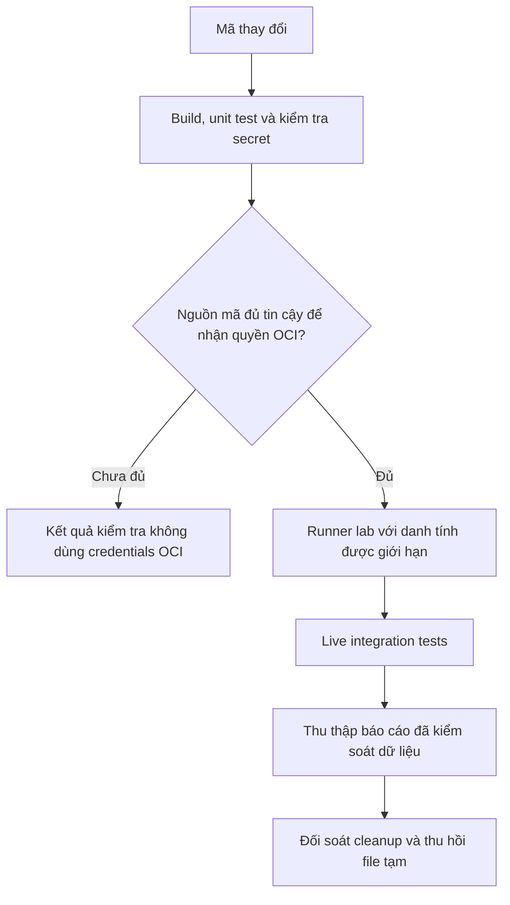

# Kiểm thử tích hợp SDK và bảo vệ credentials trong mã nguồn

Trong chương **OCI SDK và REST API với Java** của module **CLOUD_PROVIDERS_ORACLE**, bài này hướng dẫn kiểm thử ứng dụng Java khi gọi dịch vụ OCI thật, đồng thời quản lý credentials để không đưa bí mật vào mã nguồn, log hoặc artifact của quá trình build.

Ví dụ xuyên suốt là ứng dụng sử dụng OCI Java SDK để đọc thông tin bucket, ghi một object thử nghiệm, đọc lại và dọn tài nguyên. Cách tiếp cận này cũng áp dụng cho các tích hợp với Compute, cơ sở dữ liệu và các dịch vụ OCI khác, nhưng mỗi dịch vụ cần kịch bản và quyền IAM riêng.

Kết quả kiểm thử cần trả lời hai câu hỏi: ứng dụng có hoạt động đúng với OCI trong môi trường được giao hay không, và nó có sử dụng danh tính với phạm vi quyền cùng cách cấp credentials phù hợp hay không.

## 1. Phân biệt các tầng kiểm thử

### 1.1. Unit test, kiểm thử adapter và kiểm thử tích hợp thật

| Tầng kiểm thử | Thành phần thật | Giá trị chính | Giới hạn |
| --- | --- | --- | --- |
| Unit test | Logic nghiệp vụ Java | Kiểm tra quy tắc, chuyển đổi dữ liệu, nhánh lỗi | Không chứng minh có thể gọi OCI |
| Kiểm thử adapter với fake hoặc mock | Mã tích hợp của ứng dụng, dependency giả | Kiểm tra cách xây request và ánh xạ response | Không xác minh chữ ký, IAM hoặc mạng thật |
| Kiểm thử tích hợp OCI | SDK, HTTP client, xác thực và dịch vụ thật | Xác minh đường gọi API và hành vi được cấp phép | Phụ thuộc môi trường, tài nguyên và chi phí |
| Kiểm thử luồng ứng dụng | Nhiều thành phần triển khai cùng nhau | Xác minh kết quả nghiệp vụ đầu cuối | Khó cô lập nguyên nhân hơn |

Mock một client rồi trả response mẫu không kiểm tra được private key có tương ứng với public key đã đăng ký hay không. Ngược lại, chỉ gọi OCI thành công cũng chưa chứng minh ứng dụng xử lý đúng lỗi hoặc dữ liệu thiếu.

Nên đặt một adapter do ứng dụng sở hữu giữa nghiệp vụ và SDK. Unit test tập trung vào logic của ứng dụng; bộ kiểm thử tích hợp nhỏ tập trung vào những giả định phải xác minh với OCI thật.

### 1.2. Chọn assertion theo hành vi cần chứng minh

Một assertion có giá trị phải gắn với yêu cầu cụ thể:

- Đọc được metadata của đúng bucket trong đúng compartment.
- Payload đọc lại trùng nội dung đã ghi.
- Danh tính chỉ đọc không thể ghi vào tài nguyên đã chuẩn bị.
- Mã tích hợp xử lý đúng response phân trang của operation đang dùng.
- Tài nguyên thử nghiệm được dọn hoặc được ghi nhận để xử lý tiếp.

Việc chỉ xác nhận response khác `null` thường chưa đủ. Tương tự, việc in ra “connected” sau một lời gọi API không chứng minh có quyền thực hiện toàn bộ các thao tác ứng dụng cần.

## 2. Xác định đúng loại credentials và phạm vi bảo vệ

### 2.1. Không đồng nhất mọi giá trị cấu hình với bí mật

| Thành phần | Bản chất | Cách xử lý |
| --- | --- | --- |
| Private key ký API | Bí mật dùng để tạo chữ ký | Không commit; giới hạn người và tiến trình được đọc |
| Public key và fingerprint | Thông tin liên quan đến khóa công khai | Không thay thế được private key; vẫn quản lý metadata theo quy định nội bộ |
| User OCID, tenancy OCID, compartment OCID | Định danh tài nguyên hoặc danh tính | Không tự cấp quyền; tránh công bố metadata môi trường không cần thiết |
| Auth token hoặc session token | Credentials theo cơ chế tương ứng | Không log hoặc đưa vào fixture công khai |
| Customer secret key | Credentials cho trường hợp hỗ trợ tương ứng | Không dùng thay cho private key của API signing |
| Config file | Tập cấu hình, có thể chứa đường dẫn khóa hoặc dữ liệu nhạy cảm | Giữ config thật ngoài repository |
| Region, tên bucket lab, cờ bật test | Cấu hình vận hành | Có thể dùng giá trị mẫu; tách khỏi bí mật |

OCI có nhiều loại credentials phục vụ các cách truy cập khác nhau. Cần bảo vệ chúng theo đúng vai trò và vòng đời; xem [hướng dẫn bảo vệ IAM credentials](https://docs.oracle.com/en-us/iaas/Content/Security/Reference/iam_security_topic-IAM_Credentials.htm).

Mã hóa Base64 một private key không biến nó thành dữ liệu an toàn để commit. Mã hóa khóa bằng passphrase cũng không phải lý do để phân phối khóa thật trong repository.

### 2.2. Bí mật có thể rò ngoài file Java

Các vị trí thường cần kiểm tra gồm:

- `src/main/resources` và `src/test/resources`.
- File cấu hình IDE hoặc launch configuration.
- Script chạy test, Dockerfile và file cấu hình CI.
- Log HTTP, stack trace có dữ liệu tùy biến, dump biến môi trường.
- Báo cáo test, file đính kèm lỗi và artifact của CI.
- Nội dung image, layer cũ và cache build.
- Lịch sử Git, branch cũ và bản sao repository.

Đặc biệt, file trong resources có thể được đóng gói vào JAR hoặc test JAR. Một khóa chỉ xuất hiện trong thư mục test vẫn có thể bị phân phối ngoài ý muốn.

## 3. Chọn danh tính cho từng môi trường kiểm thử

### 3.1. Phát triển cục bộ

Có thể sử dụng profile trong config file bên ngoài repository. Config cần các thông tin như user, tenancy, fingerprint, đường dẫn private key và region theo phương thức xác thực được chọn. Xem [SDK and CLI Configuration File](https://docs.oracle.com/en-us/iaas/Content/API/Concepts/sdkconfig.htm).

Ví dụ minh họa chỉ chứa placeholder:

```ini
[SDK_IT]
user=REPLACE_WITH_TEST_USER_OCID
fingerprint=REPLACE_WITH_PUBLIC_KEY_FINGERPRINT
tenancy=REPLACE_WITH_TEST_TENANCY_OCID
region=ap-singapore-1
key_file=/absolute/path/outside-repository/oci_api_key.pem
```

Không đặt private key vào chuỗi Java hoặc sao chép file thật vào resources để “tiện chạy test”. Nếu khóa được bảo vệ bằng passphrase, chọn cách truyền passphrase lúc chạy phù hợp với provider; không thêm passphrase thật vào config mẫu.

### 3.2. Runner trên OCI Compute

Instance principal cho phép workload trên Compute gọi OCI bằng danh tính instance, kết hợp dynamic group và IAM policy, thay vì phân phối user API key đến runner. Xem [Calling Services from an Instance](https://docs.oracle.com/en-us/iaas/Content/Identity/Tasks/callingservicesfrominstances.htm).

Runner đó vẫn là một môi trường có quyền truy cập. Mã chạy trên runner có thể sử dụng danh tính được cấp, nên cần kiểm soát nguồn mã được phép thực thi tại đây.

### 3.3. Môi trường hỗ trợ resource principal hoặc workload identity

Resource principal chỉ hoạt động trong môi trường cung cấp contract xác thực tương ứng. Không mặc định một container bất kỳ hoặc một runner CI bên ngoài OCI tự có resource principal.

Với môi trường cung cấp resource principal, Java SDK có provider đọc các thông tin runtime theo cơ chế hỗ trợ. Xem [ResourcePrincipalAuthenticationDetailsProvider](https://docs.oracle.com/en-us/iaas/tools/java/latest/com/oracle/bmc/auth/ResourcePrincipalAuthenticationDetailsProvider.html).

Nếu nền tảng hỗ trợ cơ chế danh tính workload hoặc liên kết danh tính khác, cần chọn đúng provider và thiết lập trust cho môi trường đó. Tên cơ chế xác thực không thay thế được việc cấu hình IAM.

### 3.4. CI bên ngoài OCI

Nếu phải dùng API signing key:

1. Lưu credentials trong hệ thống quản lý secret của CI hoặc nơi lưu bí mật được chọn.
2. Chỉ cấp cho job cần chạy kiểm thử OCI.
3. Tạo file cấu hình và file khóa tạm ngoài vùng sẽ được đóng gói.
4. Giới hạn quyền đọc theo tài khoản chạy job.
5. Thu hồi file tạm khi job kết thúc và có cơ chế dọn runner.
6. Không đưa secret vào cache hoặc artifact.

Biến môi trường là một phương thức truyền dữ liệu lúc chạy, không phải một kho bí mật hoàn chỉnh. Không dump toàn bộ môi trường để chẩn đoán lỗi và không mặc định cơ chế che log sẽ nhận ra mọi dạng biến đổi của secret.

## 4. Thiết kế môi trường lab và quyền IAM

### 4.1. Tài nguyên nhỏ, có chủ sở hữu và dễ dọn

Ví dụ Object Storage trong bài dùng:

- Compartment lab riêng.
- Một bucket thử nghiệm đã được cấp trước.
- Namespace và region xác định.
- Prefix object `sdk-it/`.
- Tên object có UUID riêng cho mỗi lần chạy.
- Payload nhỏ, không chứa dữ liệu thật.

Bucket lab dùng cho ví dụ ghi/xóa cần được chuẩn bị theo quy trình kiểm thử, không có retention rule ngăn cleanup và không bật versioning cho kịch bản đơn giản này. Nếu bài toán cần kiểm thử versioning, phải quản lý và xóa đúng version thay vì dùng nguyên kịch bản dưới đây.

Đối với các test tạo Compute hoặc dịch vụ cơ sở dữ liệu, cần thêm giới hạn shape, thời gian tồn tại và ngân sách tài nguyên. Không dùng một lời gọi tạo tài nguyên đắt tiền làm smoke test mặc định.

### 4.2. Quyền theo operation, giới hạn vào bucket lab

Ví dụ policy cho một user group đã được tạo, trong compartment tên `SdkIntegrationLab`:

```text
Allow group SdkIntegrationTests to read buckets in compartment SdkIntegrationLab where target.bucket.name = 'sdk-it-bucket'

Allow group SdkIntegrationTests to manage objects in compartment SdkIntegrationLab where target.bucket.name = 'sdk-it-bucket'
```

Dòng đầu phục vụ đọc metadata bucket; dòng sau cho phép vòng ghi, đọc và xóa object trong bucket đã giới hạn. `manage objects` vẫn là quyền rộng trên các object của bucket đó, vì vậy bucket cần dành riêng cho lab.

Nếu dùng instance principal, policy tương ứng dùng dynamic group phù hợp thay vì user group. Đối chiếu verb, operation và biến điều kiện trong [Object Storage policy reference](https://docs.oracle.com/en-us/iaas/Content/Identity/Reference/objectstoragepolicyreference.htm).

Không cấp `manage all-resources in tenancy` chỉ để xử lý nhanh một test bị lỗi quyền. Hãy xác định operation đang thất bại và quyền cần thiết của nó.

### 4.3. Cấu hình sai phải dừng sớm

Trước một test có ghi dữ liệu, kiểm tra tối thiểu:

- Cờ bật kiểm thử tích hợp đã được đặt.
- Region, namespace và bucket có giá trị.
- Bucket thực tế thuộc compartment lab mong đợi.
- Cờ cho phép test ghi đã được đặt nếu chạy vòng ghi/xóa.
- Danh tính sử dụng đúng mode xác thực đã chọn.

Các cờ trong mã chỉ giảm rủi ro chạy nhầm; ranh giới quyền thực sự vẫn là IAM và tài nguyên được cấp. Nếu toàn bộ cấu hình bị đổi sang production cùng lúc, một phép so sánh dựa trên chính cấu hình sai không tự bảo vệ được môi trường.

## 5. Tách bộ kiểm thử bằng Maven và JUnit

### 5.1. Quy ước tổ chức

Một bố cục gợi ý:

```text
src/main/java/.../OciObjectStore.java
src/test/java/.../OciObjectStoreTest.java
src/test/java/.../OciObjectStorageIT.java
src/test/java/.../OciTestClients.java
src/test/resources/fixtures/sample-object.txt
```

Fixture chỉ chứa dữ liệu giả. Credentials được cung cấp khi chạy, không nằm trong cây thư mục này.

Maven Surefire phù hợp với unit test; Failsafe dành cho integration test và kiểm tra kết quả ở phase `verify`. Nên gọi `mvn verify` để đi qua đầy đủ vòng đời liên quan. Xem [Maven Failsafe](https://maven.apache.org/surefire/maven-failsafe-plugin/index.html).

### 5.2. Dependency cho ví dụ

Các đoạn XML dưới đây là phần cấu hình đưa vào một dự án Maven Java 17 đã có compiler phù hợp. Phiên bản được ghim để ví dụ có cấu hình rõ ràng; khi tích hợp vào dự án, quản lý chúng theo bộ dependency đã được lựa chọn của dự án.

```xml
<properties>
    <oci.sdk.version>3.102.0</oci.sdk.version>
    <junit.version>5.11.4</junit.version>
    <test.plugin.version>3.6.1</test.plugin.version>
</properties>

<dependencyManagement>
    <dependencies>
        <dependency>
            <groupId>com.oracle.oci.sdk</groupId>
            <artifactId>oci-java-sdk-bom</artifactId>
            <version>${oci.sdk.version}</version>
            <type>pom</type>
            <scope>import</scope>
        </dependency>
    </dependencies>
</dependencyManagement>

<dependencies>
    <dependency>
        <groupId>com.oracle.oci.sdk</groupId>
        <artifactId>oci-java-sdk-objectstorage</artifactId>
    </dependency>
    <dependency>
        <groupId>com.oracle.oci.sdk</groupId>
        <artifactId>oci-java-sdk-common-httpclient-jersey3</artifactId>
    </dependency>
    <dependency>
        <groupId>org.junit.jupiter</groupId>
        <artifactId>junit-jupiter</artifactId>
        <version>${junit.version}</version>
        <scope>test</scope>
    </dependency>
</dependencies>
```

OCI Java SDK cần lựa chọn HTTP client phù hợp; không mặc định việc khai báo một module dịch vụ đã chọn sẵn HTTP client cho ứng dụng. Xem [cấu hình Java SDK](https://docs.oracle.com/en-us/iaas/Content/API/SDKDocs/javasdkgettingstarted.htm).

### 5.3. Chỉ kích hoạt Failsafe trong profile dành cho OCI

```xml
<build>
    <plugins>
        <plugin>
            <groupId>org.apache.maven.plugins</groupId>
            <artifactId>maven-surefire-plugin</artifactId>
            <version>${test.plugin.version}</version>
            <configuration>
                <excludes>
                    <exclude>**/*IT.java</exclude>
                </excludes>
            </configuration>
        </plugin>
    </plugins>
</build>

<profiles>
    <profile>
        <id>oci-it</id>
        <build>
            <plugins>
                <plugin>
                    <groupId>org.apache.maven.plugins</groupId>
                    <artifactId>maven-failsafe-plugin</artifactId>
                    <version>${test.plugin.version}</version>
                    <configuration>
                        <includes>
                            <include>**/*IT.java</include>
                        </includes>
                        <failIfNoTests>true</failIfNoTests>
                    </configuration>
                    <executions>
                        <execution>
                            <goals>
                                <goal>integration-test</goal>
                                <goal>verify</goal>
                            </goals>
                        </execution>
                    </executions>
                </plugin>
            </plugins>
        </build>
    </profile>
</profiles>
```

Mẫu tên và cấu hình include của Failsafe được mô tả trong [failsafe:integration-test](https://maven.apache.org/surefire/maven-failsafe-plugin/integration-test-mojo.html).

Hai đường chạy:

```bash
mvn test
mvn -Poci-it verify
```

Lệnh thứ hai chỉ chạy live test khi điều kiện runtime của lớp test cũng được bật. `failIfNoTests` không thay thế việc kiểm tra test có bị disabled hoặc skipped hay không.

## 6. Tạo client mà không hard-code credentials

### 6.1. Contract biến môi trường của ví dụ

| Biến | Vai trò |
| --- | --- |
| `OCI_RUN_LIVE_TESTS` | Giá trị `true` để cho phép lớp live test chạy |
| `OCI_IT_ALLOW_WRITE` | Giá trị `true` để cho phép test ghi/xóa |
| `OCI_IT_AUTH` | Một trong `config`, `instance`, `resource` |
| `OCI_IT_REGION` | Region dùng cho test |
| `OCI_IT_NAMESPACE` | Namespace Object Storage |
| `OCI_IT_BUCKET` | Bucket lab |
| `OCI_IT_COMPARTMENT_ID` | Compartment lab mong đợi |
| `OCI_IT_CONFIG_PATH` | Đường dẫn config ngoài repo, dùng với mode config |
| `OCI_IT_PROFILE` | Profile dùng với mode config |

Các tên `OCI_IT_*` là contract do ví dụ tự định nghĩa. Java SDK không tự động diễn giải toàn bộ các biến đó; mã bên dưới đọc và truyền chúng rõ ràng.

### 6.2. Factory đặt trong test source

```java
import com.oracle.bmc.ClientConfiguration;
import com.oracle.bmc.Region;
import com.oracle.bmc.auth.AbstractAuthenticationDetailsProvider;
import com.oracle.bmc.auth.ConfigFileAuthenticationDetailsProvider;
import com.oracle.bmc.auth.InstancePrincipalsAuthenticationDetailsProvider;
import com.oracle.bmc.auth.ResourcePrincipalAuthenticationDetailsProvider;
import com.oracle.bmc.objectstorage.ObjectStorageClient;

import java.io.IOException;

final class OciTestClients {

    private OciTestClients() {
    }

    static ObjectStorageClient create() throws IOException {
        String mode = required("OCI_IT_AUTH");
        Region region = Region.fromRegionId(required("OCI_IT_REGION"));

        AbstractAuthenticationDetailsProvider provider = switch (mode) {
            case "config" ->
                    new ConfigFileAuthenticationDetailsProvider(
                            required("OCI_IT_CONFIG_PATH"),
                            required("OCI_IT_PROFILE"));
            case "instance" ->
                    InstancePrincipalsAuthenticationDetailsProvider
                            .builder().build();
            case "resource" ->
                    ResourcePrincipalAuthenticationDetailsProvider
                            .builder().build();
            default -> throw new IllegalArgumentException(
                    "Unsupported OCI_IT_AUTH mode");
        };

        ClientConfiguration configuration = ClientConfiguration.builder()
                .connectionTimeoutMillis(3_000)
                .readTimeoutMillis(15_000)
                .build();

        return ObjectStorageClient.builder()
                .region(region)
                .configuration(configuration)
                .build(provider);
    }

    static String required(String name) {
        String value = System.getenv(name);

        if (value == null || value.isBlank()) {
            throw new IllegalStateException(
                    "Missing required configuration: " + name);
        }

        return value;
    }
}
```

Constructor đọc config được mô tả trong [ConfigFileAuthenticationDetailsProvider](https://docs.oracle.com/en-us/iaas/tools/java/latest/com/oracle/bmc/auth/ConfigFileAuthenticationDetailsProvider.html); instance principal có provider tương ứng trong [Java SDK](https://docs.oracle.com/en-us/iaas/tools/java/latest/com/oracle/bmc/auth/InstancePrincipalsAuthenticationDetailsProvider.html).

Factory chọn một mode tường minh. Nó không âm thầm chuyển từ instance principal thất bại sang API key của người phát triển, vì cách fallback đó có thể làm test chạy bằng danh tính khác với dự định.

Timeout từng request không giới hạn tổng thời gian suite khi SDK retry hoặc khi có nhiều operation. Job CI cần thêm deadline tổng thể và chính sách retry được quản lý.

## 7. Ví dụ kiểm thử thật với Object Storage

### 7.1. Điều kiện của ví dụ

Hai lớp Java trong bài đặt cùng package của test source. Ví dụ dưới đây sử dụng bucket lab đã chuẩn bị, payload nhỏ và tên object riêng.

Lớp test có một smoke test chỉ đọc cùng một test round-trip có ghi/xóa. Điều kiện JUnit giúp việc bật test trở nên tường minh. Xem [điều kiện theo biến môi trường của JUnit](https://junit.org/junit5/docs/current/user-guide/junit-user-guide-5.11.4.pdf).

```java
import com.oracle.bmc.objectstorage.ObjectStorageClient;
import com.oracle.bmc.objectstorage.requests.DeleteObjectRequest;
import com.oracle.bmc.objectstorage.requests.GetBucketRequest;
import com.oracle.bmc.objectstorage.requests.GetObjectRequest;
import com.oracle.bmc.objectstorage.requests.PutObjectRequest;

import org.junit.jupiter.api.AfterAll;
import org.junit.jupiter.api.BeforeAll;
import org.junit.jupiter.api.Tag;
import org.junit.jupiter.api.Test;
import org.junit.jupiter.api.condition.EnabledIfEnvironmentVariable;

import java.io.ByteArrayInputStream;
import java.io.InputStream;
import java.nio.charset.StandardCharsets;
import java.util.UUID;

import static org.junit.jupiter.api.Assertions.assertArrayEquals;
import static org.junit.jupiter.api.Assertions.assertEquals;
import static org.junit.jupiter.api.Assertions.assertFalse;
import static org.junit.jupiter.api.Assertions.assertNotNull;

@Tag("oci-integration")
@EnabledIfEnvironmentVariable(
        named = "OCI_RUN_LIVE_TESTS", matches = "true")
class OciObjectStorageIT {

    private static ObjectStorageClient client;
    private static String namespace;
    private static String bucket;

    @BeforeAll
    static void setUp() throws Exception {
        namespace = OciTestClients.required("OCI_IT_NAMESPACE");
        bucket = OciTestClients.required("OCI_IT_BUCKET");

        String expectedCompartment =
                OciTestClients.required("OCI_IT_COMPARTMENT_ID");

        client = OciTestClients.create();

        var response = client.getBucket(GetBucketRequest.builder()
                .namespaceName(namespace)
                .bucketName(bucket)
                .build());

        assertEquals(expectedCompartment,
                response.getBucket().getCompartmentId(),
                "Bucket must belong to the configured lab compartment");
    }

    @AfterAll
    static void closeClient() throws Exception {
        if (client != null) {
            client.close();
        }
    }

    @Test
    void canReadConfiguredBucket() {
        var response = client.getBucket(GetBucketRequest.builder()
                .namespaceName(namespace)
                .bucketName(bucket)
                .build());

        assertEquals(bucket, response.getBucket().getName());
        assertNotNull(response.getOpcRequestId());
        assertFalse(response.getOpcRequestId().isBlank());
    }

    @Test
    @EnabledIfEnvironmentVariable(
            named = "OCI_IT_ALLOW_WRITE", matches = "true")
    void canWriteAndReadOwnTestObject() throws Exception {
        String objectName = "sdk-it/" + UUID.randomUUID() + "/probe.txt";
        byte[] expected = "oci-sdk-integration-test"
                .getBytes(StandardCharsets.UTF_8);

        boolean uploadConfirmed = false;
        Throwable primaryFailure = null;

        try {
            client.putObject(PutObjectRequest.builder()
                    .namespaceName(namespace)
                    .bucketName(bucket)
                    .objectName(objectName)
                    .ifNoneMatch("*")
                    .contentType("text/plain; charset=utf-8")
                    .contentLength((long) expected.length)
                    .putObjectBody(new ByteArrayInputStream(expected))
                    .build());

            uploadConfirmed = true;

            var response = client.getObject(GetObjectRequest.builder()
                    .namespaceName(namespace)
                    .bucketName(bucket)
                    .objectName(objectName)
                    .build());

            try (InputStream body = response.getInputStream()) {
                byte[] actual = body.readNBytes(expected.length + 1);
                assertArrayEquals(expected, actual);
            }
        } catch (Exception | AssertionError failure) {
            primaryFailure = failure;
            throw failure;
        } finally {
            if (uploadConfirmed) {
                try {
                    client.deleteObject(DeleteObjectRequest.builder()
                            .namespaceName(namespace)
                            .bucketName(bucket)
                            .objectName(objectName)
                            .build());
                } catch (RuntimeException cleanupFailure) {
                    if (primaryFailure != null) {
                        primaryFailure.addSuppressed(cleanupFailure);
                    } else {
                        throw cleanupFailure;
                    }
                }
            }
        }
    }
}
```

Thông tin bucket được lấy bằng [GetBucketRequest](https://docs.oracle.com/en-us/iaas/tools/java/latest/com/oracle/bmc/objectstorage/requests/GetBucketRequest.Builder.html). Với PutObject, `ifNoneMatch("*")` yêu cầu thao tác thất bại nếu object đã tồn tại; xem [PutObjectRequest.Builder](https://docs.oracle.com/en-us/iaas/tools/java/latest/com/oracle/bmc/objectstorage/requests/PutObjectRequest.Builder.html).

### 7.2. Ví dụ đã kiểm tra được gì?

Smoke test kiểm tra việc đọc đúng bucket và có request ID để theo dõi. Test round-trip kiểm tra chuỗi ghi/đọc với payload biết trước cùng việc cleanup khi upload đã được xác nhận.

Một số lựa chọn có chủ đích:

- UUID tránh các lần chạy dùng chung tên.
- Prefix riêng giúp nhận diện dữ liệu của bộ test.
- Payload giả và nhỏ giúp giới hạn dữ liệu cùng chi phí.
- Đọc tối đa độ dài dự kiến cộng một byte giúp phát hiện nội dung khác mà không tải dữ liệu không giới hạn.
- InputStream được đóng sau khi đọc.
- Cleanup failure không che mất exception hoặc assertion failure ban đầu.
- Nếu phần nghiệp vụ đã thành công nhưng cleanup thất bại, test vẫn thất bại.

Ví dụ không khẳng định ứng dụng có quyền với mọi bucket, mọi compartment hoặc mọi dịch vụ OCI. Nó chỉ chứng minh các operation được chạy bằng danh tính và cấu hình hiện tại.

### 7.3. Giới hạn cleanup phải được nhìn thấy

Nếu upload timeout, client có thể chưa biết dịch vụ đã ghi object hay chưa. Khi đó `uploadConfirmed` vẫn là false và ví dụ không tự xóa theo giả định upload đã thành công.

Một triển khai CI hoàn chỉnh nên ghi nhận object name và run ID trước khi thử ghi, rồi có quy trình đối soát tài nguyên của run. Thông tin này là manifest vận hành có kiểm soát, không chứa credentials.

Ngoài ra, `finally` không bảo đảm chạy khi runner bị hủy đột ngột hoặc tiến trình bị kill. Cần một tác vụ dọn tài nguyên cũ theo chủ sở hữu và thời gian, chỉ trong bucket/prefix lab đã xác định.

Với bucket có versioning, xóa theo tên chưa chắc loại bỏ mọi version đã tạo. DeleteObject hỗ trợ `versionId`; kịch bản kiểm thử versioning phải theo dõi version và cleanup phù hợp. Xem [DeleteObjectRequest.Builder](https://docs.oracle.com/en-us/iaas/tools/java/latest/com/oracle/bmc/objectstorage/requests/DeleteObjectRequest.Builder.html).

## 8. Chạy local và đưa vào CI

### 8.1. Ví dụ chạy local bằng Bash

Các đường dẫn và định danh sau là placeholder. File config thật cùng private key phải được chuẩn bị ngoài repository:

```bash
export OCI_RUN_LIVE_TESTS=true
export OCI_IT_AUTH=config
export OCI_IT_REGION=ap-singapore-1
export OCI_IT_NAMESPACE=REPLACE_WITH_TEST_NAMESPACE
export OCI_IT_BUCKET=sdk-it-bucket
export OCI_IT_COMPARTMENT_ID=REPLACE_WITH_LAB_COMPARTMENT_OCID
export OCI_IT_CONFIG_PATH=/absolute/path/outside-repository/oci-config
export OCI_IT_PROFILE=SDK_IT

mvn -Poci-it verify
```

Lần chạy trên chỉ bật phần đọc. Khi môi trường lab đã được chuẩn bị cho vòng ghi/xóa:

```bash
export OCI_IT_ALLOW_WRITE=true
mvn -Poci-it verify
```

Đây là lệnh hướng dẫn để người học thực hiện trong môi trường của mình, không phải kết quả một lần gọi OCI đã được thực hiện sẵn.

Không đưa private key hoặc passphrase vào tham số dòng lệnh Maven. Một số hệ thống có thể lưu command line vào lịch sử, log hoặc thông tin tiến trình.

### 8.2. Pipeline phân tách theo mức tin cậy của mã



Job chạy mã từ nguồn không tin cậy không được nhận credentials có quyền OCI. Điều này vẫn đúng nếu runner dùng instance principal thay cho secret dạng file: mã chạy trên runner có thể dùng quyền của runner.

Tùy nền tảng CI, cần cấu hình các nhánh, loại sự kiện và môi trường được phép chạy job có quyền. Không chỉ dựa vào việc một tên biến môi trường không được in ra màn hình.

### 8.3. Test skipped khác với test passed

Trong ví dụ, thiếu `OCI_RUN_LIVE_TESTS=true` làm lớp test bị disabled. Thiếu cờ ghi làm test round-trip bị disabled. Đây là hành vi có chủ đích để việc chạy local không tự động gọi OCI.

Đối với job CI có nhiệm vụ xác minh tích hợp thật, cần kiểm tra:

- Các cờ cần thiết đã được đặt trước khi khởi chạy Maven.
- Số test được discover và số test thực sự chạy.
- Số failure, error và skipped.
- Kết quả cleanup và các tài nguyên còn lại.
- Bộ test có chạy đúng danh tính, region và phạm vi lab không.

Sau khi đã chủ động bật live test, thiếu cấu hình phải làm setup thất bại, không chuyển thành một assumption để bỏ qua toàn bộ bài kiểm tra. Báo cáo “build xanh” nhưng không có live test nào chạy không đáp ứng mục tiêu tích hợp.

## 9. Kiểm thử lỗi và quyền bị từ chối

### 9.1. Kiểm thử âm bằng fixture đã biết

Để kiểm tra thiếu quyền, chuẩn bị một tài nguyên lab mà đội quản trị biết chắc tồn tại và một danh tính không được phép thực hiện operation mục tiêu.

Ví dụ:

| Kịch bản | Điều cần chứng minh |
| --- | --- |
| Danh tính chỉ đọc thử PutObject | Quyền ghi không được cấp |
| Sai region hoặc endpoint | Ứng dụng phân loại lỗi môi trường phù hợp |
| Object không tồn tại | Adapter ánh xạ lỗi không tìm thấy đúng contract |
| Dữ liệu trả về thiếu trường tùy chọn | Nghiệp vụ không phát sinh lỗi ngoài dự kiến |
| Lỗi tạm thời hoặc timeout | Retry và trạng thái kết quả không chắc chắn được xử lý |

Không gọi một tên bucket ngẫu nhiên rồi kết luận lỗi 404 chứng minh IAM đã chặn đúng. Tùy operation và cơ chế bảo vệ thông tin tài nguyên, lỗi không tìm thấy và lỗi không được phép có thể cần diễn giải theo ngữ cảnh.

Những lỗi như timeout chính xác tại một thời điểm hoặc một chuỗi 429 thường dễ kiểm tra ổn định hơn ở tầng adapter với dependency được điều khiển. Live test chỉ nên kiểm tra điều mà môi trường thật có thể tái lập và có giá trị xác minh rõ ràng.

### 9.2. Retry không che lỗi cấu hình

Thiếu quyền, config sai hoặc private key không hợp lệ cần được phân loại khác với lỗi dịch vụ tạm thời.

Không retry vô hạn chỉ để hy vọng test sẽ chuyển xanh. Đặt ngân sách retry theo operation, giữ deadline suite và ghi request ID khi có. Với thao tác ghi bị timeout, đánh giá khả năng thao tác đã thành công trước khi phát lại hoặc cleanup.

Không tắt TLS verification để xử lý một test lỗi kết nối. Cần kiểm tra trust store, chứng chỉ, proxy, DNS, route và endpoint của môi trường kiểm thử.

## 10. Ngăn credentials đi vào repository và artifact

### 10.1. Giữ cấu hình thật ngoài cây mã nguồn

Một `.gitignore` gợi ý cho các thư mục local đặt tại root repository:

```gitignore
/.oci/
/.secrets/
/.env
/.env.*
!/.env.example
/target/
```

File `.env.example` chỉ chứa tên biến và placeholder, không sao chép dữ liệu thật rồi kỳ vọng người khác tự xóa.

Quy tắc ignore là lớp hỗ trợ cho file chưa được theo dõi. Nó không loại bỏ dữ liệu đã tracked hoặc xóa lịch sử commit; xem [tài liệu gitignore](https://git-scm.com/docs/gitignore).

Không dùng việc đổi đuôi file khóa thành `.txt` hoặc đặt trong thư mục `fixtures` như một biện pháp bảo vệ. Nội dung và khả năng sử dụng credentials mới là điều cần quản lý.

### 10.2. Kiểm soát các lớp đóng gói

Trước khi phát hành, cần xác định file nào đi vào:

- JAR ứng dụng và test JAR.
- Container image và các layer.
- Artifact cùng báo cáo CI.
- Cache dependency hoặc cache workspace.
- File chẩn đoán, heap dump và snapshot môi trường.

Nếu một file secret đã được copy vào image ở một layer rồi bị xóa ở layer sau, cần xem xét khả năng dữ liệu vẫn còn trong lịch sử layer. Cách thiết kế phù hợp là cấp secret lúc chạy hoặc dùng cơ chế secret mount của hệ thống build khi thực sự cần, với phạm vi rõ ràng.

Không xuất toàn bộ workspace CI làm artifact để tiện điều tra. Chỉ thu thập các báo cáo đã được lựa chọn và kiểm soát dữ liệu.

### 10.3. Secret scanning có nhiều điểm kiểm tra

Một quy trình gợi ý:

1. Kiểm tra thay đổi trước khi commit.
2. Quét nội dung commit hoặc pull request trong CI.
3. Quét lịch sử và các vị trí lưu mã theo khả năng công cụ.
4. Có cảnh báo cùng người xử lý rõ ràng.
5. Hạn chế ngoại lệ cho fixture thật sự giả và được ghi nhận.

Công cụ cần nhận diện private key và các loại token liên quan, đồng thời tránh đưa nguyên secret vào log báo cáo. Không coi một lần quét không phát hiện gì là bằng chứng tuyệt đối rằng không có credentials.

Các dịch vụ quản lý mã có thể cung cấp secret scanning và cảnh báo. Ví dụ, GitHub mô tả cơ chế phát hiện cùng xử lý secret trong [Secret scanning](https://docs.github.com/en/code-security/concepts/secret-security/secret-scanning).

### 10.4. Log theo danh sách trường được phép

Một log lỗi kiểm thử hữu ích có thể chứa:

```text
test=objectRoundTrip
operation=GetObject
region=ap-singapore-1
runId=ci-run-example
httpStatus=RESPONSE_STATUS
serviceCode=SERVICE_ERROR_CODE
opcRequestId=SERVICE_REQUEST_ID
```

Không log:

- Private key, passphrase hoặc token.
- Toàn bộ auth provider hoặc config object.
- Toàn bộ biến môi trường.
- Header Authorization.
- Nội dung request/response nhạy cảm chỉ vì đang bật DEBUG.

Nếu cần log tên object hoặc OCID để điều tra, đánh giá metadata đó theo quy định của môi trường. Các assertion failure cũng cần được xem xét vì test runner có thể tự lưu giá trị expected và actual vào XML report.

## 11. Khi credentials đã xuất hiện trong commit

Xóa chuỗi bí mật ở commit mới không làm credentials cũ mất hiệu lực. Cần xử lý cả quyền sử dụng credentials lẫn các bản sao dữ liệu.

Một trình tự ứng phó gợi ý:

1. Xác định loại credentials, chủ sở hữu và phạm vi quyền bị ảnh hưởng.
2. Thu hồi hoặc thay thế credentials bị lộ theo mức độ khẩn cấp.
3. Cấp bản thay thế cho workload hợp lệ qua kênh runtime được quản lý.
4. Kiểm tra hoạt động liên quan trong log và audit phù hợp.
5. Xử lý bản sao trong lịch sử Git, artifact, cache hoặc image theo quy trình phối hợp.
6. Xác minh workload dùng credentials mới và credentials cũ không còn dùng được.

Với API signing key của user OCI, xóa API key đã đăng ký trong IAM làm key đó không còn hợp lệ để gửi request; xóa riêng file private key trên máy phát triển không thu hồi được bản đã bị sao chép. Xem [xóa API signing key](https://docs.oracle.com/en-us/iaas/Content/Identity/access/to_delete_an_API_signing_key.htm).

Nếu credentials đang bị khai thác, không chờ hoàn thành việc sửa lịch sử Git mới thu hồi. Việc rewrite lịch sử cần phối hợp vì có thể ảnh hưởng người đã clone repository; hướng dẫn của GitHub cũng ưu tiên revoke hoặc rotate secret trước khi xử lý dữ liệu đã lưu. Xem [removing sensitive data](https://docs.github.com/en/authentication/keeping-your-account-and-data-secure/removing-sensitive-data-from-a-repository).

Sau sự cố, bổ sung biện pháp tương ứng với nguyên nhân: nguồn credentials lúc chạy, quyền IAM quá rộng, artifact thu thập quá nhiều hoặc thiếu kiểm tra secret. Không chỉ thêm một dòng ignore rồi coi sự cố đã được giải quyết.

## 12. Đánh giá chất lượng bộ kiểm thử

| Tiêu chí | Dấu hiệu đáp ứng |
| --- | --- |
| Phạm vi rõ ràng | Biết test nào dùng mock, test nào gọi OCI thật |
| Danh tính đúng | Mode xác thực được chọn tường minh, không fallback âm thầm |
| Quyền phù hợp | Chỉ thao tác trong tài nguyên lab cần thiết |
| Assertion có giá trị | Kiểm tra metadata và dữ liệu nghiệp vụ cần chứng minh |
| Tái lập | Dependency, fixture và điều kiện runtime được mô tả |
| Chi phí được kiểm soát | Payload nhỏ, tài nguyên giới hạn và deadline rõ ràng |
| Cleanup quan sát được | Lỗi dọn tài nguyên làm thất bại hoặc được báo theo contract |
| Không che việc bỏ qua test | Phân biệt passed, skipped, failed và chưa chạy |
| Credentials được bảo vệ | Không nằm trong source, log hoặc artifact phát hành |
| Phục hồi được | Có cách xử lý kết quả ghi chưa chắc chắn và tài nguyên sót |

Khi đưa bài thực hành vào một dự án Java thực tế, cần ghi lại loại danh tính, phạm vi lab, các operation được kiểm thử, cách cấp cấu hình và người sở hữu cleanup. Một bộ kiểm thử tích hợp hữu ích phải cung cấp bằng chứng về hành vi ứng dụng với OCI mà vẫn giữ credentials cùng quyền truy cập trong phạm vi đã thiết kế.
