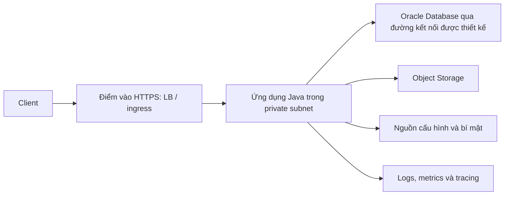

# Lựa chọn Compute, OKE, Container Instances và Functions cho Java

Một ứng dụng Java có thể chạy trên nhiều dịch vụ OCI, nhưng mỗi lựa chọn tạo ra một cách triển khai, mở rộng và vận hành khác nhau. Chạy được một JAR hoặc container mới là điều kiện ban đầu; quyết định còn phụ thuộc vào vòng đời tiến trình, trạng thái dữ liệu, độ trễ, khả năng phục hồi và năng lực của nhóm.

Bài mở đầu chương **Triển khai Java và Spring Boot**, tập trung vào bốn lựa chọn trong Oracle Cloud Infrastructure: **Compute**, **Oracle Kubernetes Engine (OKE)**, **Container Instances** và **Functions**. Người học sẽ gắn quyết định với tenancy, compartment, IAM, VCN, cơ sở dữ liệu Oracle, lưu trữ, giám sát và kiểm soát chi phí.

Một hệ thống có thể dùng nhiều nền tảng: API Spring Boot chạy trên OKE, công cụ cũ chạy trên Compute, một job container chạy trên Container Instances và tác vụ phản ứng sự kiện chạy trên Functions. Hãy chọn theo từng workload, sau đó đánh giá chi phí vận hành của toàn hệ thống.

## 1. Mô tả workload trước khi chọn dịch vụ

Giả sử hệ thống bán hàng có bốn thành phần:

| Thành phần Java | Đặc điểm cần giữ khi triển khai |
| --- | --- |
| API đặt hàng Spring Boot | HTTP thường trực, JDBC connection pool, cần độ trễ ổn định |
| Worker tạo hóa đơn | Nhận việc bất đồng bộ, có retry, cần chống tạo trùng |
| Job đối soát | Chạy hữu hạn theo lịch, thời gian phụ thuộc lượng dữ liệu |
| Tác vụ xử lý object mới | Phản ứng theo sự kiện, công việc có đầu vào và kết thúc rõ ràng |

Đừng chỉ ghi “ứng dụng Java có lưu lượng cao”. Một hồ sơ workload hữu ích cần trả lời:

1. **Vòng đời:** tiến trình phục vụ liên tục hay mỗi lần gọi xử lý một công việc hữu hạn?
2. **Tải:** đều đặn, theo giờ, tăng đột biến hay thường xuyên không có việc?
3. **Độ trễ:** đo trung bình hay p95/p99; lần đầu sau thời gian nhàn rỗi có quan trọng không?
4. **Trạng thái:** session, file, tiến độ job và dữ liệu nghiệp vụ đang nằm ở đâu?
5. **Phụ thuộc:** cần kết nối DB, Vault, Object Storage, queue hoặc hệ thống ngoài như thế nào?
6. **Vận hành:** ai vá hệ điều hành, cập nhật runtime, xử lý lỗi, rollback và trực sự cố?
7. **Khôi phục:** mất một tiến trình, một node hoặc một miền lỗi thì được phép gián đoạn bao lâu?

Ví dụ đầu vào để so sánh:

```text
Workload: API đặt hàng Spring Boot
Mô hình: HTTP thường trực, stateless ở tầng ứng dụng
Dữ liệu: Oracle Database và Object Storage
Mục tiêu độ trễ: p95 dưới ngưỡng do nhóm nghiệp vụ đặt
Triển khai: cần cập nhật phiên bản mà vẫn duy trì phục vụ
Đội ngũ: biết container, chưa có quy trình vận hành Kubernetes
Điểm cần đo: RAM JVM, thời gian khởi động, DB pool, tải giờ cao điểm
```

Các yêu cầu và số đo của workload phải đi trước quyết định về nền tảng.

## 2. Hiểu bốn mô hình chạy ứng dụng

| Tiêu chí | Compute | OKE | Container Instances | Functions |
| --- | --- | --- | --- | --- |
| Đơn vị triển khai chính | VM hoặc bare metal, tiến trình hoặc container do nhóm quản lý | Workload Kubernetes như Deployment và Job | Một container instance chứa một hoặc nhiều container | Function được gọi theo mô hình invocation |
| Cách Java thường chạy | JAR với JVM, application server hoặc container | Container chứa ứng dụng Java | Container chứa ứng dụng Java | Handler tương thích runtime/FDK |
| Vòng đời phù hợp | Tiến trình dài hạn hoặc job | Dịch vụ dài hạn và job có điều phối | Dịch vụ hoặc job container không cần Kubernetes | Công việc hữu hạn theo từng lần gọi |
| Quyền can thiệp hệ điều hành | Cao | Phụ thuộc loại node; ứng dụng theo mô hình Kubernetes | Không quản lý host để chạy container | Không quản lý host của invocation |
| Điều phối cần thiết kế | Supervisor, instance pool, rollout, health check | Manifest, controller, scheduling, rollout | Vòng đời instance, health, nhân bản và cập nhật | Trigger, timeout, concurrency và kết quả invocation |
| Khi nên xem xét sớm | Cần kiểm soát OS hoặc đưa ứng dụng cũ lên cloud | Cần khả năng điều phối Kubernetes và có năng lực vận hành | Có image và muốn giảm phần quản lý máy chủ | Tác vụ theo sự kiện, theo yêu cầu hoặc lịch |
| Điểm dễ đánh giá thiếu | Vá máy, cấu hình trôi, thay thế VM lỗi | Công việc vận hành cluster, node và add-on | Cách thay thế instance lỗi và phân phối tải | Cold start, giới hạn thực thi và tải lên hệ thống đích |

Đây là bảng định hướng thiết kế. Các khả năng cụ thể cần đối chiếu tài liệu dịch vụ, region và loại tài nguyên sẽ dùng.

Hai nhãn cần hiểu đúng:

- **Container** là cách đóng gói/chạy ứng dụng; nó không tự cung cấp Kubernetes, autoscaling hoặc tính sẵn sàng cao.
- **Serverless** mô tả việc giảm quản lý hạ tầng chạy; ứng dụng vẫn phải thiết kế IAM, mạng, dữ liệu, giới hạn tài nguyên và phục hồi.

## 3. Compute: kiểm soát môi trường chạy

OCI Compute cung cấp VM và bare metal để triển khai theo nhu cầu tính toán. Với Java, VM thường là điểm bắt đầu khi nhóm muốn chủ động hệ điều hành, JDK, agent và cách chạy tiến trình. [Oracle: Compute Overview](https://docs.oracle.com/en-us/iaas/Content/Compute/Concepts/computeoverview.htm).

### 3.1. Phù hợp khi nào?

Compute đáng xem xét khi:

- Đưa một ứng dụng JAR hoặc application server hiện có lên OCI với ít thay đổi mô hình chạy.
- Cần thư viện native, gói OS, cấu hình host hoặc công cụ chẩn đoán đặc thù.
- Có tiến trình dài hạn, tác vụ quản trị hoặc thành phần chưa phù hợp đóng gói container.
- Nhóm đã có quy trình quản lý Linux/Windows, bản vá, image và triển khai VM.

Lệnh minh họa cho một ứng dụng đã đóng gói:

```bash
java -XX:MaxRAMPercentage=65 -jar /opt/orders/app.jar
```

Lệnh chỉ thể hiện cách khởi động JVM. Để phục vụ ổn định, cần thêm process supervisor, cấu hình restart, log, kiểm tra sức khỏe, giới hạn quyền và quy trình cập nhật. Giá trị 65% là giả định ban đầu để đo, không phải cấu hình bộ nhớ dùng chung cho mọi ứng dụng.

### 3.2. Trách nhiệm cần tính vào quyết định

Nếu cài JDK trực tiếp trên VM, nhóm phải quản lý cả JDK và hệ điều hành. Nếu chạy container trên VM, nhóm vẫn quản lý host, container runtime và vòng đời image ứng dụng.

Các câu hỏi cụ thể:

| Vấn đề | Thiết kế cần có |
| --- | --- |
| Java chết | Supervisor phát hiện và khởi động lại có giới hạn |
| VM lỗi | Tạo lại từ image/cấu hình và đưa vào phục vụ |
| Đổi phiên bản | Chuyển lưu lượng, xác nhận health và có đường rollback |
| Cấu hình trôi | Khai báo cấu hình, quản lý image và tự động hóa |
| Dữ liệu nằm trên máy | Phân loại dữ liệu bền vững và dữ liệu tạm |

Một VM đang chạy không chứng minh API đã hoạt động. Sau cấp phát cần kiểm tra tiến trình, cổng ứng dụng, health và một giao dịch tối thiểu.

### 3.3. Khi cần mở rộng

Instance pool cho phép quản lý nhiều instance từ instance configuration và tích hợp với load balancer. OCI có autoscaling theo metric hoặc lịch cho instance pool. [Oracle: Instance Pools](https://docs.oracle.com/en-us/iaas/Content/Compute/Concepts/instance-pools.htm), [Oracle: Compute Autoscaling](https://docs.oracle.com/en-us/iaas/Content/Compute/Tasks/autoscalinginstancepools.htm).

Điều này vẫn đòi hỏi ứng dụng khởi động lại được từ cấu hình đã khai báo. Một VM được chỉnh tay nhiều lần sẽ khó nhân bản và khó thay thế an toàn khi tăng tải.

Nếu có session hoặc file quan trọng chỉ nằm trên từng VM, phải xử lý chúng trước khi kỳ vọng scale-out hoặc thay máy không ảnh hưởng người dùng.

## 4. OKE: điều phối Kubernetes cho ứng dụng Java

OKE phù hợp khi cần mô hình Kubernetes: khai báo workload, điều phối replica, triển khai có kiểm soát, service discovery và tích hợp hệ sinh thái Kubernetes. Tính phù hợp phụ thuộc cả ứng dụng lẫn năng lực quản lý nền tảng của nhóm. [Oracle: OKE Overview](https://docs.oracle.com/en-us/iaas/Content/ContEng/Concepts/contengoverview.htm).

### 4.1. Khi lợi ích điều phối đủ lớn

OKE đáng xem xét khi nhóm có nhiều dịch vụ, cần chuẩn hóa cách triển khai và có khả năng vận hành Kubernetes hoặc dùng một nền tảng nội bộ đã được quản lý.

Ví dụ:

- Nhiều API Spring Boot cần rollout, probes và cấu hình thống nhất.
- Các workload có nhu cầu tài nguyên khác nhau và cần scheduling.
- Cần quản lý riêng API, worker và job trong một mô hình khai báo.
- Muốn dùng controller, operator hoặc công cụ vốn dựa vào Kubernetes API.

Số lượng microservice không phải tiêu chí duy nhất. Một workload có yêu cầu đặc biệt có thể cần Kubernetes; ngược lại, vài API đơn giản chưa chắc cần một cluster riêng.

### 4.2. Managed nodes và virtual nodes khác trách nhiệm

Managed nodes chạy trên Compute trong tenancy với trách nhiệm vận hành được chia sẻ. Virtual nodes giảm phần quản lý hạ tầng node, nhưng có khác biệt và giới hạn tính năng cần kiểm tra trước khi chọn workload. [Oracle: Managed Nodes](https://docs.oracle.com/en-us/iaas/Content/ContEng/Tasks/contengworkingwithmanagednodes.htm), [Oracle: Comparing Node Types](https://docs.oracle.com/en-us/iaas/Content/ContEng/Tasks/contengcomparingvirtualwithmanagednodes_topic.htm).

“Dùng OKE” chưa đủ mô tả phương án. Bản thiết kế cần ghi loại node, cách nâng cấp, nơi giữ log, thành phần ingress, nguồn metric và người xử lý node hoặc pod lỗi.

Với managed nodes, nhóm vẫn phải tham gia cập nhật, giám sát và thay thế node không khỏe. Control plane được quản lý không làm mất trách nhiệm với workload và data plane. [Oracle: Shared Responsibilities](https://docs.oracle.com/en-us/iaas/Content/ContEng/Concepts/contengsupportsharedresponsibilities.htm).

### 4.3. Phân biệt mở rộng pod và mở rộng node

Horizontal Pod Autoscaler điều chỉnh replica theo cấu hình và nguồn metric. Cluster Autoscaler điều chỉnh số node trong các node pool được hỗ trợ; nó không tạo thêm pod. [Oracle: HPA](https://docs.oracle.com/en-us/iaas/Content/ContEng/Tasks/contengusinghorizontalpodautoscaler.htm), [Oracle: Cluster Autoscaler](https://docs.oracle.com/en-us/iaas/Content/ContEng/Tasks/contengusingclusterautoscaler.htm).

Ví dụ, HPA tăng API từ hai lên sáu replica nhưng pod mới có thể chưa được xếp lịch nếu cluster thiếu RAM. Phải có năng lực node hoặc cơ chế cấp phát phù hợp, đồng thời đặt requests/limits có căn cứ.

Không sao chép cấu hình autoscaler cho managed nodes sang virtual nodes mà chưa đối chiếu hỗ trợ. Lựa chọn loại node ảnh hưởng trực tiếp tới cách mở rộng và công cụ quan sát.

## 5. Container Instances: chạy container mà không quản lý host

OCI Container Instances cho phép chạy một hoặc nhiều container, chọn tài nguyên, mạng và các tùy chọn vòng đời mà không quản lý máy chủ bên dưới. Dịch vụ phù hợp với workload container không cần nền tảng điều phối như Kubernetes. [Oracle: Container Instances Overview](https://docs.oracle.com/en-us/iaas/Content/container-instances/overview-of-container-instances.htm).

### 5.1. Phù hợp với nhu cầu nào?

Container Instances là ứng viên khi:

- Đã có image Java chạy được và muốn triển khai API hoặc worker.
- Có job container hữu hạn, môi trường dev/test hoặc công cụ tự động hóa.
- Muốn giảm công việc quản lý OS mà chưa cần Kubernetes API và controller.
- Phạm vi ứng dụng đủ đơn giản để quản lý trực tiếp vòng đời các container instance.

Một API Spring Boot có thể giữ nguyên mô hình HTTP server trong container. Nó vẫn cần cấu hình cổng, bind address, tài nguyên, truy cập DB và kiểm tra sẵn sàng.

### 5.2. Một container instance không phải một cluster Kubernetes

Cần mô tả riêng phương án:

| Nhu cầu | Việc cần làm rõ |
| --- | --- |
| Có nhiều bản sao API | Tạo bao nhiêu container instance và phân bố ở đâu? |
| Phân phối traffic | Backend nào được đăng ký, kiểm tra health và loại khỏi phục vụ? |
| Triển khai image mới | Thay thế, chuyển traffic và quay lại bản cũ thế nào? |
| Instance không phục hồi được | Thành phần nào phát hiện và tạo lại? |
| Tải tăng | Dựa vào metric nào, ai điều chỉnh số instance và tài nguyên? |

Không suy ra có controller kiểu Kubernetes chỉ từ việc dịch vụ chạy container. Nếu lựa chọn này yêu cầu viết thêm quá nhiều logic điều phối, hãy so sánh chi phí đó với một phương án OKE đã được quản lý tốt.

Đặt nhiều container trong cùng container instance có thể phù hợp với ứng dụng và thành phần phụ trợ đi cùng. Điều đó không tương đương nhiều bản sao độc lập ở các miền lỗi khác nhau.

### 5.3. Restart policy phải khớp vòng đời công việc

Container Instances có các lựa chọn restart như `Always`, `Never` và `On failure`. Web server thường cần chạy liên tục; một job hoàn tất thành công có thể cần dừng. Registry phải truy cập được từ subnet, đồng thời có phương thức cấp quyền pull image phù hợp. [Oracle: Creating a Container Instance](https://docs.oracle.com/en-us/iaas/Content/container-instances/creating-a-container-instance.htm).

Nếu job thành công nhưng cấu hình luôn restart, nó có thể chạy lại công việc ngoài ý muốn. Nếu API thoát mà không có chính sách phục hồi, endpoint có thể ngừng phục vụ.

Tách ba mốc kiểm tra: container instance đã được tạo, image đã pull/chạy, ứng dụng đã sẵn sàng. Một trạng thái hạ tầng đang hoạt động chưa đủ chứng minh endpoint nghiệp vụ dùng được.

## 6. Functions: công việc theo từng lần gọi

OCI Functions phù hợp với chức năng có đầu vào và kết thúc rõ ràng, được gọi trực tiếp hoặc qua tích hợp được cấu hình. Điểm xuất phát là hợp đồng invocation và handler, thay vì một HTTP server do ứng dụng giữ chạy thường trực. [Oracle: Functions Overview](https://docs.oracle.com/en-us/iaas/Content/Functions/Concepts/functionsoverview.htm).

### 6.1. Những ứng viên điển hình

Có thể cân nhắc Functions cho:

- Xử lý metadata khi có một object mới.
- Chuyển đổi hoặc kiểm tra một payload.
- Tác vụ tự động hóa cloud có phạm vi và thời gian thực thi rõ ràng.
- Một bước hữu hạn của quy trình xử lý bất đồng bộ.

Nguồn sự kiện, luật gọi, danh tính và quyền phải được cấu hình. Tạo một function không tự làm nó nhận mọi sự kiện từ Object Storage hoặc tự biến nó thành consumer thường trú của queue.

Với queue, cần xác định thành phần gọi function, kích thước lô công việc, xác nhận hoàn tất, retry và khả năng xử lý trùng. Nếu thiết kế cần một tiến trình nhận liên tục không có điểm kết thúc, hãy đánh giá Compute, OKE hoặc Container Instances cho vai trò đó.

### 6.2. Hai cách đóng gói Java hiện có

Functions hỗ trợ cả mô hình image và code-only. Oracle công bố khả năng code-only cho Java cùng các runtime khác vào ngày 24/09/2026. Vì vậy, khi đánh giá hiện tại, không nên chỉ xét cách triển khai bằng image. [Oracle: Code-only Functions Release](https://docs.oracle.com/en-us/iaas/releasenotes/functions/functions-code-only-functions.htm).

| Mô hình | Artifact | Trách nhiệm cần xét |
| --- | --- | --- |
| Image-based | Container image tương thích cách chạy Functions | Base image, runtime, dependency và quy trình build image |
| Code-only | Archive Java đúng cấu trúc và runtime được hỗ trợ | Đóng gói code/dependency, handler, cấu hình và kiểm thử runtime |

Với Java code-only, Oracle yêu cầu uber/fat JAR hoặc ZIP có đúng một uber/fat JAR ở gốc, cùng handler hợp lệ. Cần kiểm tra cấu trúc archive và dependency, không chỉ đổi đuôi file. [Oracle: Java Code-only Functions](https://docs.oracle.com/en-us/iaas/Content/Functions/Tasks/functions-codeonly-java.htm).

Ví dụ giá trị handler:

```text
com.example.ObjectMetadataFunction::handleRequest
```

Runtime được chọn phải tương thích bytecode và các thư viện đi kèm. Danh sách runtime hỗ trợ và phạm vi cung cấp cần được kiểm tra theo môi trường triển khai. [Oracle: Languages Supported by Functions](https://docs.oracle.com/en-us/iaas/Content/Functions/Tasks/languagessupportedbyfunctions.htm).

Một Spring Boot executable JAR có cấu trúc đóng gói và cách bootstrap riêng. Nó không tự trở thành function hợp lệ chỉ vì cũng là một JAR lớn có dependency. Muốn tái sử dụng logic Spring, cần thiết kế handler, cách khởi tạo context và đóng gói tương thích; phải đo chi phí khởi động.

### 6.3. Cold start, bộ nhớ và concurrency

Lần gọi đầu sau thời gian chưa có môi trường sẵn có thể chịu thêm thời gian chuẩn bị hạ tầng và khởi tạo ứng dụng. Với Java, còn có tải class, dependency injection, kết nối và công việc lúc startup.

OCI có provisioned concurrency để giảm độ trễ khởi đầu bằng cách chuẩn bị năng lực cho một số lần gọi đồng thời. Cần đưa cấu hình này vào cả phép đo độ trễ và tính chi phí. [Oracle: Provisioned Concurrency](https://docs.oracle.com/en-us/iaas/Content/Functions/Tasks/functionsusingprovisionedconcurrency.htm).

Không cam kết SLO chỉ bằng cách đo nhiều lần gọi nóng liên tiếp. Hãy đo ít nhất lần gọi sau nhàn rỗi, lúc tăng concurrency và khi hệ thống đích chậm.

Concurrency tăng cũng có thể mở thêm nhiều kết nối Oracle Database. Nền tảng mở rộng được không có nghĩa cơ sở dữ liệu chịu được mọi mức song song.

### 6.4. Timeout đồng bộ và detached không giống nhau

Tài liệu cấu hình OCI hiện nêu timeout thực thi đồng bộ tối đa 300 giây và detached tối đa 3.600 giây. Detached cho phép kiểu gọi bất đồng bộ với thời gian thực thi dài hơn; đây vẫn là công việc có giới hạn. [Oracle: Function Timeout Settings](https://docs.oracle.com/en-us/iaas/Content/Functions/Tasks/functionscustomizing.htm).

Thời gian client chờ, timeout của gateway và thời gian function được phép chạy cần được xét riêng. Chọn detached thay đổi cách nhận và theo dõi kết quả, không chỉ tăng một con số timeout. [Oracle: Invoking Functions](https://docs.oracle.com/en-us/iaas/Content/Functions/Tasks/functionsinvokingfunctions.htm).

Một job thường chạy vài giờ cần phương án khác hoặc chia thành các bước có checkpoint. Không dựa vào thread chạy nền tiếp tục sau khi handler đã trả kết quả.

## 7. Chuẩn bị ứng dụng Spring Boot để so sánh công bằng

Để so sánh Compute, OKE và Container Instances, nên giữ cùng một phiên bản ứng dụng, hợp đồng HTTP và cách truy cập dữ liệu. Chỉ thay đổi nền tảng chạy và phần tích hợp cần thiết.

### 7.1. Container hóa với runtime rõ ràng

Dockerfile minh họa dưới đây dùng một image Java runtime đã được nhóm lựa chọn. `JAVA_RUNTIME_IMAGE` là build argument bắt buộc, nên cung cấp một image tương thích Java, kiến trúc CPU và được cố định theo phiên bản hoặc digest.

```dockerfile
ARG JAVA_RUNTIME_IMAGE
FROM ${JAVA_RUNTIME_IMAGE}

WORKDIR /app
COPY --chown=10001:10001 app.jar /app/app.jar

USER 10001:10001
EXPOSE 8080
ENTRYPOINT ["java", "-jar", "/app/app.jar"]
```

Đây là mẫu đóng gói một HTTP server Java, không phải image function hoàn chỉnh. File `app.jar` phải là artifact đã build cho ứng dụng.

Image chạy được trên x86 chưa chứng minh chạy được trên Arm nếu có thư viện native. Cần kiểm tra kiến trúc image, JDK và dependency trên đúng shape dự kiến. Gắn một tag dễ thay đổi như `latest` khiến việc đối chiếu kết quả và rollback khó hơn; giữ digest của artifact đã kiểm chứng.

### 7.2. Tách cấu hình và dữ liệu khỏi artifact

| Loại dữ liệu | Cách xử lý cần có |
| --- | --- |
| URL và tên môi trường | Cấu hình theo môi trường, không build lại code chỉ để đổi đích |
| Mật khẩu, token, khóa | Cơ chế cung cấp bí mật phù hợp với nền tảng và IAM |
| PDF, ảnh, file khách hàng | Kho bền vững như Object Storage hoặc giải pháp phù hợp |
| Session | Stateless hoặc kho session chung nếu nghiệp vụ yêu cầu |
| File tạm | Có giới hạn dung lượng và chấp nhận mất khi thay tiến trình |
| Tiến độ job | Checkpoint ở nơi bền vững, có khóa chống xử lý trùng |

Ngay cả trên Compute có volume bền vững, việc đặt mọi dữ liệu cùng máy vẫn ảnh hưởng khả năng nhân bản và thay thế. Với container hoặc function, tuyệt đối không dùng filesystem tạm như bằng chứng duy nhất rằng một công việc quan trọng đã hoàn tất.

### 7.3. Liveness, readiness và graceful shutdown

Ứng dụng có Spring Boot Actuator có thể cấu hình health probes trên cổng ứng dụng:

```yaml
server:
  port: 8080
  shutdown: graceful

spring:
  lifecycle:
    timeout-per-shutdown-phase: 30s

management:
  endpoints:
    web:
      exposure:
        include: health
  endpoint:
    health:
      show-details: never
      probes:
        enabled: true
```

Hai đường dẫn thường dùng là `/actuator/health/liveness` và `/actuator/health/readiness`. Liveness phản ánh khả năng sống của tiến trình; readiness phục vụ quyết định nhận traffic. Không đưa tình trạng DB dùng chung vào liveness khiến mọi bản sao restart theo một sự cố DB. [Spring: Health Probes](https://docs.spring.io/spring-boot/reference/actuator/endpoints.html#actuator.endpoints.kubernetes-probes).

Cần cài dependency Actuator và cấu hình bảo mật để health checker thực sự truy cập được. Chỉ mở các endpoint cần thiết theo đường mạng được thiết kế.

Health mặc định không chứng minh mọi hành vi nghiệp vụ đã sẵn sàng. Nếu thêm kiểm tra phụ thuộc vào readiness, phải đánh giá trường hợp tất cả bản sao cùng trở thành unready và cách hệ thống trả lỗi hoặc giảm chức năng.

Graceful shutdown cho phép xử lý các request đang chạy trong thời hạn cấu hình. Nền tảng phải gửi tín hiệu dừng đúng cách và dành đủ thời gian trước khi buộc kết thúc tiến trình. `timeout-per-shutdown-phase` là thời hạn theo phase, không phải bảo đảm toàn bộ quá trình luôn kết thúc trong đúng 30 giây. [Spring: Graceful Shutdown](https://docs.spring.io/spring-boot/reference/web/graceful-shutdown.html).

### 7.4. Một mẫu khai báo OKE để nhìn thấy phần điều phối

Đây là mẫu rút gọn cho Deployment HTTP trên môi trường OKE dùng managed nodes. Phải thay image placeholder và có registry authorization, namespace, mạng cùng ứng dụng Actuator đã cấu hình. Các giá trị tài nguyên và thời gian là giả định lab.

```yaml
apiVersion: apps/v1
kind: Deployment
metadata:
  name: orders-api
spec:
  replicas: 2
  selector:
    matchLabels:
      app: orders-api
  strategy:
    type: RollingUpdate
    rollingUpdate:
      maxUnavailable: 0
      maxSurge: 1
  template:
    metadata:
      labels:
        app: orders-api
    spec:
      terminationGracePeriodSeconds: 45
      containers:
        - name: orders-api
          image: "<registry>/<team>/orders@sha256:<digest>"
          ports:
            - name: http
              containerPort: 8080
          resources:
            requests:
              cpu: "500m"
              memory: "1Gi"
            limits:
              cpu: "1"
              memory: "1Gi"
          startupProbe:
            httpGet:
              path: /actuator/health/liveness
              port: http
            periodSeconds: 5
            failureThreshold: 30
          readinessProbe:
            httpGet:
              path: /actuator/health/readiness
              port: http
            periodSeconds: 5
          livenessProbe:
            httpGet:
              path: /actuator/health/liveness
              port: http
            periodSeconds: 10
---
apiVersion: v1
kind: Service
metadata:
  name: orders-api
spec:
  type: ClusterIP
  selector:
    app: orders-api
  ports:
    - port: 80
      targetPort: http
```

Startup probe bảo vệ giai đoạn khởi động trước khi liveness/readiness được áp dụng theo vòng đời probe. Readiness và liveness có hệ quả khác nhau; không thay chúng bằng cùng một kiểm tra tùy tiện. [Kubernetes: Probes](https://kubernetes.io/docs/tasks/configure-pod-container/configure-liveness-readiness-startup-probes/).

Service ở đây là ClusterIP. Đường truy cập bên ngoài cần ingress/load balancer và thiết kế TLS riêng. Mẫu chưa thể hiện phân bố replica theo node/fault domain, autoscaling hoặc mọi biện pháp bảo vệ workload.

Hai replica và `maxUnavailable: 0` chưa phải cam kết không gián đoạn. Rollout còn cần chỗ cho pod mới, thời gian readiness, drain kết nối và đủ năng lực ở DB. Ngân sách dừng phải bao phủ cả thời gian drain và các phase shutdown thực tế.

## 8. Thiết kế mạng, danh tính và dữ liệu cho cả bốn lựa chọn

Một đường đi minh họa cho API Spring Boot:



Đây là sơ đồ logic, không có nghĩa mọi dịch vụ trong hình có cùng loại endpoint hoặc cùng cách định tuyến. Với Functions, đường vào có thể là invocation hoặc tích hợp sự kiện thay cho HTTP server thường trực.

### 8.1. Bốn đường kết nối cần kiểm tra

1. **Lấy artifact:** registry hoặc Object Storage chứa image/archive.
2. **Nhận yêu cầu:** từ load balancer, ingress, client hoặc nguồn gọi function.
3. **Truy cập dữ liệu:** DB, queue, Object Storage và dịch vụ ngoài.
4. **Vận hành:** log, metric, cấu hình và lấy bí mật.

Ứng dụng nằm trong private subnet vẫn cần đường hợp lệ cho các kết nối đó. Không nhầm service gateway với một đường truy cập Internet tổng quát; chọn tuyến theo endpoint thực tế.

### 8.2. Tách quyền triển khai khỏi quyền lúc chạy

Người hoặc pipeline tạo tài nguyên có thể cần quyền quản lý Compute/OKE/Container Instances/Functions. Ứng dụng chỉ cần quyền dữ liệu phù hợp, chẳng hạn đọc object của một phạm vi nhất định.

Chọn cơ chế danh tính SDK được nền tảng hỗ trợ và kiểm chứng với workload thật. Quyền pull image, quyền đọc bí mật và quyền ghi dữ liệu là các việc khác nhau; một bước thành công không chứng minh các bước còn lại được cấp đúng.

Với Oracle Database, OCI IAM cho quyền quản lý dịch vụ không tự thay thế mọi thông tin xác thực và quyền SQL của ứng dụng. Phải thiết kế kết nối JDBC, TLS/wallet nếu cấu hình yêu cầu và quyền schema phù hợp.

## 9. Tài nguyên JVM, mở rộng và tính sẵn sàng

### 9.1. Heap chỉ là một phần bộ nhớ

Ước lượng bộ nhớ cho Java cần xét:

```text
RAM tiến trình Java
    ≈ heap
    + metaspace và code cache
    + thread stacks
    + direct buffers
    + thư viện native và phần JVM khác
```

Nếu đặt heap bằng toàn bộ memory limit, tiến trình vẫn có thể bị kết thúc vì phần ngoài heap. Nếu dùng sidecar hoặc nhiều container chung một đơn vị tài nguyên, tính cả bộ nhớ của chúng và phần dự phòng cần thiết.

Đo dưới tải thực tế: RSS, heap sau GC, tần suất/thời gian GC, số thread, direct memory và mức CPU. Đừng suy kích thước production từ kết quả ứng dụng chỉ vừa khởi động.

### 9.2. Mở rộng ứng dụng phải đi cùng ngân sách DB

Giả sử mỗi replica Spring Boot có pool tối đa 10 kết nối:

```text
12 replica × 10 kết nối = tối đa 120 kết nối từ nhóm ứng dụng
```

Đây mới là một phần ngân sách. Cần cộng worker, migration, công cụ vận hành, các dịch vụ khác và phần tăng thêm trong rollout.

Nếu nền tảng tăng số replica hoặc invocation nhanh hơn năng lực DB, hệ thống có thể tăng lỗi dù CPU ứng dụng còn thấp. Hãy đặt giới hạn số bản sao, concurrency, pool và timeout theo năng lực toàn chuỗi.

### 9.3. Hai bản sao phải khác miền lỗi cần bảo vệ

| Nền tảng | Điều cần xác minh cho phục hồi |
| --- | --- |
| Compute | Có nhiều instance, phân bố phù hợp, health check và cơ chế thay thế |
| OKE | Replica được xếp lịch phân tán, đủ node/capacity, probes và rollout đúng |
| Container Instances | Các instance độc lập, phân bố phù hợp, có health/traffic/replacement |
| Functions | Concurrency/giới hạn, đường retry, trạng thái bền vững và phụ thuộc có khả năng phục hồi |

Phân bố theo availability domain và fault domain phải phù hợp region và khả năng của dịch vụ. Không giả định mọi region đều có cùng số availability domain.

Nhiều bản sao ứng dụng vẫn có thể cùng phụ thuộc một DB hoặc một cấu hình lỗi. Tính sẵn sàng cần xét end-to-end, bao gồm dữ liệu, đường vào và quy trình phục hồi.

Với worker hoặc function có thể được gọi lại, dùng khóa nghiệp vụ và ghi nhận kết quả bền vững để chống tác động trùng. Restart hoặc retry chỉ giúp tiếp tục xử lý; chúng không tự bảo đảm nghiệp vụ xảy ra đúng một lần.

## 10. So sánh chi phí trên cùng điều kiện

Không có lựa chọn luôn rẻ nhất cho mọi ứng dụng Java. Chi phí phụ thuộc thời gian hoạt động, tài nguyên, số bản sao, kiểu tải và phần dịch vụ phụ trợ.

| Phương án | Thành phần cần đưa vào ước lượng |
| --- | --- |
| Compute | CPU/RAM, volume, bản sao dự phòng, LB và công quản lý máy |
| OKE | Loại cluster/node, tài nguyên workload và hệ thống, storage, LB, add-on và vận hành |
| Container Instances | Tài nguyên cấp cho instance, thời gian chạy, bản sao, mạng và điều phối bổ sung |
| Functions | Invocation, tài nguyên/thời gian thực thi, provisioned concurrency nếu dùng, dịch vụ gọi và lưu kết quả |

Dùng bảng giá hiện hành, đơn vị tài nguyên đúng và điều khoản của môi trường khi tính. CPU theo OCPU, vCPU hoặc request Kubernetes cần được quy đổi cẩn thận theo kiến trúc; không so các con số tên gọi khác nhau như thể chúng bằng nhau. [Oracle: OCI Price List](https://www.oracle.com/cloud/price-list/).

### 10.1. Giữ các giả định so sánh nhất quán

Một phép tính nên dùng cùng:

- Lưu lượng trung bình, đỉnh tải và phân bố thời gian nhàn rỗi.
- SLO độ trễ và khả năng chịu gián đoạn.
- RAM/CPU đã đo cho workload.
- Số bản sao và chiến lược phục hồi.
- Dữ liệu, log, mạng và đường vào tương đương.
- Tần suất triển khai, rollback và công vận hành.

So một VM đơn lẻ với một cluster có dự phòng rồi kết luận OKE đắt hơn là so hai mức phục vụ khác nhau. Tương tự, một phép đo Functions chỉ có warm invocation chưa phản ánh yêu cầu độ trễ sau nhàn rỗi.

### 10.2. Serverless không đồng nghĩa chỉ trả theo request

Container Instances có tài nguyên được cấp cho vòng đời instance. Một API không có request nhưng vẫn chạy cần được tính theo mô hình tài nguyên của nó. Với Functions, nếu bật provisioned concurrency, phải đưa năng lực chuẩn bị trước vào chi phí.

Tắt một phần compute cũng chưa chắc dừng mọi khoản phí: volume, load balancer, registry, log và lưu trữ có vòng đời riêng. Đừng suy chi phí còn lại chỉ từ trạng thái một tiến trình Java.

Với workload thưa, mô hình invocation có thể đáng thử. Với tải đều và JVM cần nóng liên tục, cần so tổng chi phí thực thi và vận hành thay vì mặc định function có lợi hơn.

## 11. Áp dụng vào các tình huống cụ thể

Các lựa chọn dưới đây là suy luận theo giả định của từng tình huống, cần kiểm chứng bằng số đo.

### 11.1. Ứng dụng Java cũ cần gói OS đặc thù

**Giả định:** có JAR/application server đang vận hành trên VM, cần native library và agent chẩn đoán riêng.

**Ứng viên ban đầu:** Compute. Nhóm có thể giữ quyền kiểm soát môi trường trong khi xây lại quy trình image, cấu hình và phục hồi.

**Điều kiện xem xét lại:** ứng dụng đã container hóa, các phụ thuộc host được loại bỏ hoặc nhóm có nền tảng container phù hợp. Không cần chuyển sang Kubernetes chỉ để thay cách khởi động một JAR.

### 11.2. Hai API Spring Boot đã có image, nhóm chưa vận hành Kubernetes

**Giả định:** API stateless, cần DB và Object Storage, số lượng bản sao vừa phải, nhóm muốn giảm quản lý host.

**Ứng viên ban đầu:** Container Instances; so thêm Compute nếu nhóm đã có tự động hóa VM tốt.

**Điểm kiểm chứng:** health, thay phiên bản, đăng ký backend, xử lý instance lỗi và chi phí khi chạy liên tục. Nếu các nhu cầu điều phối tăng mạnh, đánh giá lại OKE.

### 11.3. Nhiều dịch vụ, nhóm đã có nền tảng Kubernetes

**Giả định:** có ingress, quan sát tập trung, quản lý secret, pipeline và quy trình nâng cấp cluster.

**Ứng viên ban đầu:** OKE. Lợi ích đến từ việc dùng chung mô hình triển khai và năng lực nền tảng sẵn có.

**Điểm kiểm chứng:** loại node, requests/limits, khả năng scheduling khi rollout, autoscaling và ngân sách kết nối DB. “Đã dùng Kubernetes” vẫn chưa chứng minh cấu hình hiện tại đáp ứng workload mới.

### 11.4. Xử lý object theo sự kiện, thời gian hữu hạn

**Giả định:** công việc độc lập, có idempotency, tải thất thường, phù hợp giới hạn thực thi.

**Ứng viên ban đầu:** Functions, chọn image hoặc code-only theo dependency và runtime.

**Điểm kiểm chứng:** cold start, tải song song, timeout cả đường gọi, quyền đọc object, lưu kết quả và retry. Nếu từng tác vụ vượt giới hạn hoặc cần tiến trình dài hạn, đánh giá container job hoặc chia nhỏ quy trình.

### 11.5. Đối soát Java chạy vài giờ

**Giả định:** thời gian chạy có thể vượt giới hạn function, cần checkpoint và đọc lượng dữ liệu lớn.

**Ứng viên ban đầu:** job container trên Container Instances, Kubernetes Job nếu đã có OKE, hoặc Compute phù hợp cách vận hành.

**Điểm kiểm chứng:** giới hạn tải DB, checkpoint, khởi động lại giữa chừng và cách ngăn hai lượt lịch chạy trùng. Chọn nền tảng không thay thế việc quản lý tiến độ nghiệp vụ.

## 12. Thực hành để chốt quyết định

Không cần triển khai đầy đủ cả bốn nền tảng chỉ để so sánh tên dịch vụ. Chọn một ứng viên chính và một phương án thay thế dựa trên yêu cầu, rồi thực hiện phép thử có giới hạn trong compartment lab.

### 12.1. Chuẩn bị cùng hợp đồng ứng dụng

Với API Spring Boot:

1. Chọn một artifact cố định và cấu hình ngoài artifact.
2. Có endpoint nghiệp vụ nhỏ và health phù hợp.
3. Dùng cùng dữ liệu giả lập, schema và đường truy cập DB.
4. Chọn kiến trúc CPU tương thích.
5. Đặt giới hạn tài nguyên đủ để quan sát mà không mở rộng ngoài ý định.
6. Ghi rõ thành phần đường vào và giám sát.

Với Functions, chọn một chức năng hữu hạn tương đương về nghiệp vụ; không coi việc thay toàn bộ HTTP server bằng một handler là phép chuyển đổi không có chi phí.

### 12.2. Đo các tình huống có thể thay đổi quyết định

| Phép thử | Điều cần ghi |
| --- | --- |
| Khởi động mới | Thời gian tới lúc nhận được yêu cầu hợp lệ |
| Tải ổn định | Throughput, p95/p99, CPU/RAM và lỗi |
| Sau nhàn rỗi | Độ trễ đầu tiên, đặc biệt với invocation |
| Tăng tải | Thời gian có thêm năng lực và phản ứng của DB |
| Dừng một bản sao | Thời gian phục hồi, request lỗi và công việc bị giao lại |
| Triển khai phiên bản mới | Thời gian rollout, kết nối đang chạy và rollback |
| Phụ thuộc chậm | Timeout, pool, backpressure và mức lỗi |
| Dọn môi trường | Tài nguyên còn tồn tại và dữ liệu cần giữ |

Một health check thành công chưa đủ. Giữ bằng chứng về một kết quả nghiệp vụ, chẳng hạn đơn hàng được ghi đúng một lần hoặc file đầu ra được lưu đúng object key.

### 12.3. Viết bản ghi quyết định

```text
Workload:
  API đặt hàng Spring Boot, HTTP thường trực, stateless.

Yêu cầu bắt buộc:
  Kết nối Oracle Database qua đường riêng.
  Duy trì phục vụ khi thay phiên bản.
  Có log, metric, giới hạn tài nguyên và đường rollback.

Lựa chọn:
  Ghi nền tảng và cấu hình thực sự dự kiến dùng.

Căn cứ:
  Nêu số đo, trách nhiệm vận hành và giả định chi phí.

Phương án thay thế:
  Nêu điều kiện khiến phương án đó phù hợp hơn.

Điều kiện xem xét lại:
  Thay đổi tải, SLO, số dịch vụ, năng lực nhóm hoặc dependency.
```

Quyết định cần được xem lại khi điều kiện thay đổi. Một phương án phù hợp cho lab hoặc giai đoạn đầu không mặc nhiên là cấu hình production lâu dài.

Kết thúc thực hành, dừng bộ phát tải và workload, kiểm tra dữ liệu cần giữ rồi dọn đúng tài nguyên tạo riêng: compute/container, tài nguyên cluster theo phạm vi lab, function, LB, volume, image/archive và log nếu phù hợp vòng đời đã chọn. Giữ bản ghi quyết định và số đo để giải thích được lựa chọn.
