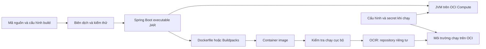

# Đóng gói Spring Boot thành JAR và container image

Trong chương **Triển khai Java và Spring Boot** của module **CLOUD_PROVIDERS_ORACLE**, đóng gói là bước biến mã nguồn thành artifact có thể kiểm thử, chuyển giao và chạy trên Oracle Cloud Infrastructure. Một ứng dụng có thể được chạy bằng JAR trên OCI Compute hoặc được đóng thành container image để đưa vào OCIR và sử dụng ở môi trường container phù hợp.

Bài học đi từ một ứng dụng HTTP nhỏ đến executable JAR, image chạy bằng JVM và image đã lưu trên Oracle Cloud Infrastructure Registry. Các vấn đề IAM, compartment, kiến trúc máy, cấu hình, quan sát và chi phí được xét trong phạm vi ảnh hưởng trực tiếp đến artifact; việc tạo VCN, cụm OKE hay triển khai cơ sở dữ liệu là các công việc riêng.

## 1. Mục tiêu và luồng đóng gói

Sau bài học, người học có thể:

- Phân biệt JAR thông thường, Spring Boot executable JAR, container image và container đang chạy.
- Tạo JAR bằng Spring Boot Maven Plugin, chạy độc lập và kiểm tra endpoint.
- Tạo image bằng Dockerfile hoặc Cloud Native Buildpacks và giải thích lựa chọn.
- Chạy image bằng tài khoản không phải root, truyền cấu hình khi khởi động và đặt giới hạn tài nguyên.
- Chọn image đúng kiến trúc OCI Compute, push lên OCIR có phân quyền và ghi nhận digest để triển khai.



Trong tài liệu container, **OCI image** có nghĩa là image theo chuẩn **Open Container Initiative**. Trong tài liệu cloud, **OCI** còn là **Oracle Cloud Infrastructure**. Image theo chuẩn Open Container Initiative không bị ràng buộc với Oracle Cloud; OCIR là dịch vụ registry của Oracle để lưu và phân phối image.

## 2. Phân biệt các loại artifact

| Khái niệm | Chứa những gì | Cần gì để chạy | Ý nghĩa triển khai |
| --- | --- | --- | --- |
| JAR thông thường | Class và resource của một module; dependency có thể ở ngoài | JVM và classpath đúng | Chưa chắc chạy được bằng `java -jar` |
| Spring Boot executable JAR | Mã ứng dụng, dependency Java và Boot loader; web starter có server nhúng | JVM tương thích | Phù hợp khi quản lý trực tiếp tiến trình Java trên VM |
| Container image | Các layer filesystem, Java runtime, ứng dụng và metadata khởi động | Container runtime, OS/CPU tương thích | Đóng gói cả không gian người dùng cần cho tiến trình |
| Container | Một phiên chạy của image với tài nguyên, mạng và cấu hình cụ thể | Máy chủ/container platform | Có vòng đời, log, trạng thái và giới hạn riêng |

Một Boot JAR **không chứa sẵn JVM**. Container image dùng JRE có JVM, nhưng Linux container chia sẻ kernel với máy chạy nó. Vì vậy không thể kết luận rằng một image Linux chạy trực tiếp trên mọi hệ điều hành hoặc mọi CPU.

JAR vẫn hữu ích ngay cả khi đích cuối là container: đó là kết quả build Java có thể kiểm tra trước khi bổ sung lớp đóng gói hệ điều hành. Với artifact đã kiểm thử, nên đưa cùng artifact đó qua các môi trường và thay cấu hình lúc chạy để giảm sai khác giữa bản kiểm thử và bản phát hành.

## 3. Chuẩn bị ví dụ thống nhất

### 3.1. Bộ công cụ

Ví dụ dùng **Java 21**, **Maven 3.9.x**, **Spring Boot 3.5.16** và Docker chạy **Linux containers**. Spring Boot được ghim phiên bản để ví dụ có thể đối chiếu, không hàm ý đây là phiên bản mới nhất hay lựa chọn mặc định cho mọi dự án. Java 21 thuộc phạm vi tương thích của nhánh tài liệu này. Trước khi áp dụng cho hệ thống thật, chọn phiên bản được tổ chức hỗ trợ và theo dõi bản vá. Xem [yêu cầu hệ thống Spring Boot 3.5](https://docs.spring.io/spring-boot/3.5/system-requirements.html).

Kiểm tra công cụ trong môi trường thực hành:

```bash
java -version
mvn -version
docker version
docker buildx version
```

Chú ý Java Maven sử dụng trong kết quả `mvn -version`; nó có thể khác Java mà IDE đang dùng. Docker CLI phải kết nối được với daemon. Máy phát triển Windows có thể dùng Docker Desktop ở chế độ Linux containers.

Các đoạn lệnh nhiều dòng phía dưới dùng **Bash**, thích hợp với Linux hoặc WSL. Trong PowerShell, không dùng dấu `\` để nối dòng; có thể viết lệnh thành một dòng. Nếu dự án có Maven Wrapper đã được quản lý trong Git, thay `mvn` bằng `./mvnw` trên Linux hoặc `.\mvnw.cmd` trong PowerShell.

### 3.2. Cấu trúc ứng dụng

Người học tạo một dự án độc lập có cấu trúc sau:

```text
oracle-demo/
├── pom.xml
├── Dockerfile
├── .dockerignore
└── src/
    └── main/
        ├── java/com/example/oracledemo/
        │   ├── OracleDemoApplication.java
        │   └── ApiController.java
        └── resources/
            └── application.yml
```

Ứng dụng mẫu chưa có dependency truy cập database. Điều này giúp kiểm tra riêng việc đóng gói, không để lỗi kết nối Oracle Database che lấp lỗi artifact.

File `pom.xml`:

```xml
<?xml version="1.0" encoding="UTF-8"?>
<project xmlns="http://maven.apache.org/POM/4.0.0"
         xmlns:xsi="http://www.w3.org/2001/XMLSchema-instance"
         xsi:schemaLocation="http://maven.apache.org/POM/4.0.0 https://maven.apache.org/xsd/maven-4.0.0.xsd">
    <modelVersion>4.0.0</modelVersion>

    <parent>
        <groupId>org.springframework.boot</groupId>
        <artifactId>spring-boot-starter-parent</artifactId>
        <version>3.5.16</version>
        <relativePath/>
    </parent>

    <groupId>com.example</groupId>
    <artifactId>oracle-demo</artifactId>
    <version>1.0.0</version>
    <packaging>jar</packaging>

    <properties>
        <java.version>21</java.version>
    </properties>

    <dependencies>
        <dependency>
            <groupId>org.springframework.boot</groupId>
            <artifactId>spring-boot-starter-web</artifactId>
        </dependency>
        <dependency>
            <groupId>org.springframework.boot</groupId>
            <artifactId>spring-boot-starter-actuator</artifactId>
        </dependency>
    </dependencies>

    <build>
        <finalName>oracle-demo</finalName>
        <plugins>
            <plugin>
                <groupId>org.springframework.boot</groupId>
                <artifactId>spring-boot-maven-plugin</artifactId>
            </plugin>
        </plugins>
    </build>
</project>
```

`spring-boot-starter-parent` quản lý các phiên bản dependency và cấu hình build liên quan. `finalName` làm tên file đầu ra ổn định: `target/oracle-demo.jar`; nó không thay đổi Maven version `1.0.0` của dự án. Tên file thuận tiện này cần được gắn với version, checksum hoặc digest trong quy trình phát hành.

File `OracleDemoApplication.java`:

```java
package com.example.oracledemo;

import org.springframework.boot.SpringApplication;
import org.springframework.boot.autoconfigure.SpringBootApplication;

@SpringBootApplication
public class OracleDemoApplication {
    public static void main(String[] args) {
        SpringApplication.run(OracleDemoApplication.class, args);
    }
}
```

File `ApiController.java`:

```java
package com.example.oracledemo;

import java.util.Map;
import org.springframework.beans.factory.annotation.Value;
import org.springframework.web.bind.annotation.GetMapping;
import org.springframework.web.bind.annotation.RestController;

@RestController
public class ApiController {
    private final String environment;

    public ApiController(@Value("${app.environment:local}") String environment) {
        this.environment = environment;
    }

    @GetMapping("/api/hello")
    public Map<String, String> hello() {
        return Map.of(
            "service", "oracle-demo",
            "environment", environment,
            "message", "Xin chao tu Spring Boot"
        );
    }
}
```

File `src/main/resources/application.yml`:

```yaml
spring:
  application:
    name: oracle-demo
  lifecycle:
    timeout-per-shutdown-phase: 25s

server:
  port: 8080
  shutdown: graceful

app:
  environment: local

management:
  endpoints:
    web:
      exposure:
        include: health
  endpoint:
    health:
      show-details: never
      probes:
        enabled: true
```

Ví dụ chỉ xuất endpoint Actuator `health`, không xuất toàn bộ endpoint quản trị. Ứng dụng chưa cấu hình xác thực cho API mẫu, nên các bước thử chỉ bind cổng máy chủ về loopback. Khi đưa ra mạng dùng chung, bổ sung cơ chế truy cập phù hợp cho API và endpoint giám sát.

## 4. Tạo và kiểm tra executable JAR

### 4.1. Build bằng Maven

Từ thư mục có `pom.xml`:

```bash
mvn clean verify
jar tf target/oracle-demo.jar
```

`verify` chạy các phase trước nó, bao gồm compile, test và package. Với dự án tối thiểu ở trên chưa có test, build thành công không chứng minh endpoint hoạt động; bước HTTP phía dưới mới kiểm tra được đường chạy cơ bản. Dự án thực tế cần có kiểm thử riêng theo hành vi nghiệp vụ.

Maven tạo JAR thông thường rồi Spring Boot Plugin dùng goal `repackage` để tạo executable archive. Khi dùng Boot parent như ví dụ, chỉ cần khai báo plugin vì execution `repackage` đã được cấu hình từ parent. Nếu dùng parent nội bộ, việc chỉ import BOM quản lý dependency không tự tạo execution này; phải cấu hình build plugin tương ứng. Xem [Packaging Executable Archives](https://docs.spring.io/spring-boot/3.5/maven-plugin/packaging.html).

Với dự án dùng parent khác, phần plugin cần có execution dạng sau, đồng thời phiên bản plugin phải được quản lý rõ ràng:

```xml
<plugin>
    <groupId>org.springframework.boot</groupId>
    <artifactId>spring-boot-maven-plugin</artifactId>
    <version>3.5.16</version>
    <executions>
        <execution>
            <goals>
                <goal>repackage</goal>
            </goals>
        </execution>
    </executions>
</plugin>
```

Không thêm một bản khai báo plugin trùng lặp vào POM mẫu; đoạn này minh họa tình huống cấu hình khác.

Trong kết quả `jar tf`, có thể nhận ra các vị trí quan trọng:

```text
META-INF/MANIFEST.MF
org/springframework/boot/loader/...
BOOT-INF/classes/com/example/oracledemo/OracleDemoApplication.class
BOOT-INF/classes/application.yml
BOOT-INF/lib/...
BOOT-INF/layers.idx
```

`BOOT-INF/classes` chứa mã và resource của ứng dụng; `BOOT-INF/lib` chứa dependency. Boot loader hỗ trợ cách bố trí dependency lồng trong JAR. Nếu xuất hiện file `.jar.original`, đó là artifact trước bước repackage theo cấu hình mặc định; không chọn file này làm executable JAR để triển khai.

### 4.2. Chạy tách khỏi IDE

```bash
java -Xms128m -Xmx256m -jar target/oracle-demo.jar --server.address=127.0.0.1
```

Giữ terminal này mở. Từ terminal thứ hai, sau khi log báo ứng dụng đã khởi động:

```bash
curl -fsS http://127.0.0.1:8080/api/hello
curl -fsS http://127.0.0.1:8080/actuator/health
```

Response nghiệp vụ dự kiến có nội dung tương đương; thứ tự field JSON có thể khác:

```json
{
  "service": "oracle-demo",
  "environment": "local",
  "message": "Xin chao tu Spring Boot"
}
```

Health dự kiến chứa `"status":"UP"`; các field khác phụ thuộc cấu hình Actuator. Dừng tiến trình bằng `Ctrl+C` sau khi kiểm tra để giải phóng cổng 8080.

Trong lệnh `java`, tùy chọn JVM như `-Xmx256m` phải đứng trước `-jar`. Tham số Spring Boot như `--server.port=8081` đứng sau đường dẫn JAR. `spring-boot:run` hữu ích khi phát triển nhưng không thay cho việc kiểm tra chính JAR đã đóng gói.

Ghi checksum để đối chiếu file khi chuyển giao:

```bash
sha256sum target/oracle-demo.jar
```

Trong PowerShell có thể dùng:

```powershell
Get-FileHash -Algorithm SHA256 -LiteralPath .\target\oracle-demo.jar
```

Checksum JAR và digest container image là hai giá trị khác nhau: chúng mô tả hai artifact khác nhau.

### 4.3. Nếu dự án dùng Gradle

Trong một dự án Gradle đã cấu hình Spring Boot Plugin và Java Plugin, task tạo Boot executable JAR là `bootJar`; không nhầm với plain JAR nếu build sinh cả hai. Đối chiếu [hướng dẫn đóng gói với Gradle](https://docs.spring.io/spring-boot/3.5/gradle-plugin/packaging.html) và chọn chính xác output của task. Phần thực hành còn lại dùng Maven để giữ một tên artifact thống nhất.

## 5. Tách cấu hình môi trường khỏi artifact

Một image nên phục vụ được nhiều môi trường mà không chứa sẵn password, wallet database hay endpoint chỉ dành cho production. Spring Boot hỗ trợ cấu hình từ file, biến môi trường, JVM system property và tham số dòng lệnh. Trong các nguồn thông dụng, command-line argument có thể ghi đè system property, system property có thể ghi đè biến môi trường, và biến môi trường có thể ghi đè config data. Xem [Externalized Configuration](https://docs.spring.io/spring-boot/3.5/reference/features/external-config.html).

Chạy lại cùng JAR với cấu hình khác:

```bash
APP_ENVIRONMENT=oci-dev java -jar target/oracle-demo.jar \
  --server.address=127.0.0.1 --server.port=8081
```

Gọi `http://127.0.0.1:8081/api/hello` để thấy `environment` đổi thành `oci-dev`. Dừng tiến trình sau khi thử.

| Thuộc tính Spring | Biến môi trường thường dùng | Mục đích |
| --- | --- | --- |
| `app.environment` | `APP_ENVIRONMENT` | Phân biệt môi trường ví dụ |
| `server.port` | `SERVER_PORT` | Đổi cổng lắng nghe |
| `spring.profiles.active` | `SPRING_PROFILES_ACTIVE` | Chọn profile cấu hình |
| `spring.datasource.url` | `SPRING_DATASOURCE_URL` | URL JDBC khi ứng dụng đã có datasource |
| `spring.datasource.username` | `SPRING_DATASOURCE_USERNAME` | Tên người dùng database |
| `spring.datasource.password` | `SPRING_DATASOURCE_PASSWORD` | Password được cấp khi chạy |

Ba biến datasource cuối chỉ minh họa một ứng dụng đã có dependency JDBC và cấu hình database. Thêm biến môi trường không tự biến ứng dụng HTTP hiện tại thành ứng dụng kết nối Oracle Database.

Với Oracle Database hoặc Autonomous Database, driver cần thiết là dependency của ứng dụng, còn thông tin kết nối và tài liệu xác thực phải được cấp theo môi trường. Nếu phương án kết nối dùng wallet, bố trí wallet ngoài image và mount với quyền đọc phù hợp. Nếu dùng OCI Vault, cần một cơ chế lấy và cung cấp secret cùng quyền IAM tương ứng; chỉ đặt tên biến không tự tích hợp ứng dụng với Vault.

Biến môi trường có thể bị xem bởi người có quyền quản trị container. Secret nhạy cảm cần được quản lý bằng cơ chế secret của môi trường chạy hoặc file mount được bảo vệ; không coi biến môi trường là một kho bí mật.

## 6. Đóng image bằng Dockerfile

### 6.1. Chọn Java runtime

Ví dụ dùng image `eclipse-temurin:21-jre-jammy`, một biến thể Java 21 JRE của [Eclipse Temurin Docker Official Image](https://hub.docker.com/_/eclipse-temurin). Image ứng dụng không bắt buộc dùng Oracle Linux chỉ vì chạy trên Oracle Cloud. Base image cần đáp ứng Java, OS, thư viện native, kiến trúc và chính sách hỗ trợ của đội vận hành.

JDK cần cho biên dịch và công cụ phát triển; JRE đủ cho ví dụ chạy JVM này. Nếu cần công cụ chẩn đoán như `jcmd`, hãy chủ động chọn phương án chẩn đoán hoặc runtime có công cụ tương ứng. Không giả định mọi image JRE đều có shell, curl hay toàn bộ bộ công cụ JDK.

Tag base image có thể thay đổi nội dung theo các lần phát hành. Để khóa đầu vào bản release, ghi nhận và ghim digest đã được xét duyệt; đồng thời có lịch cập nhật digest khi có bản vá. Ghim digest không tự giải quyết việc cập nhật bảo mật.

### 6.2. Dockerfile cơ bản

Tạo `Dockerfile` trong dự án thực hành:

```dockerfile
FROM eclipse-temurin:21-jre-jammy

WORKDIR /opt/oracle-demo

COPY --chown=10001:10001 target/oracle-demo.jar service.jar

USER 10001:10001

EXPOSE 8080

ENTRYPOINT ["java", "-jar", "/opt/oracle-demo/service.jar"]
```

Các lựa chọn trong ví dụ:

- Chỉ copy đúng JAR đầu ra để tránh chọn nhầm `.original`, JAR test hoặc nhiều JAR trùng mẫu.
- `USER 10001:10001` chạy tiến trình bằng UID/GID không phải root; thư mục và file ứng dụng phải đọc được bởi tài khoản đó.
- `ENTRYPOINT` dạng mảng thực thi Java trực tiếp, giúp tín hiệu dừng đến đúng tiến trình thay vì bị một shell trung gian xử lý sai.
- `EXPOSE` mô tả cổng dự kiến của image; phải cấu hình port publishing và mạng riêng khi chạy.

Ý nghĩa cụ thể của `COPY`, `USER`, `ENTRYPOINT` và `EXPOSE` được mô tả trong [Dockerfile reference](https://docs.docker.com/reference/dockerfile/).

Tạo `.dockerignore` theo cách chỉ cho phép artifact cần thiết đi vào build context:

```dockerignore
**
!target/
target/*
!target/oracle-demo.jar
!Dockerfile
!.dockerignore
```

Cách này dành cho luồng **build JAR ở ngoài Docker rồi copy vào image**. Nếu chuyển sang Dockerfile biên dịch từ mã nguồn, phải thiết kế lại build context. Không dùng mẫu này rồi kỳ vọng `COPY src/` hoạt động.

Không dùng `COPY . .` để đưa cả working directory vào runtime image. Secret đã nằm trong một layer vẫn có thể bị trích xuất dù bị xóa ở layer sau. Với credential cần trong quá trình build, dùng cơ chế secret mount phù hợp thay vì `ARG` hoặc `ENV` trong Dockerfile. Xem [Docker Build secrets](https://docs.docker.com/build/building/secrets/).

### 6.3. Build image và xem thông tin

Sau khi JAR đã được tạo:

```bash
docker build -t oracle-demo:1.0.0-local .
docker image inspect oracle-demo:1.0.0-local \
  --format '{{.Os}}/{{.Architecture}} user={{.Config.User}}'
docker image ls oracle-demo
```

Tên `1.0.0-local` là tag thực hành, không phải cam kết nội dung bất biến. Kết quả inspect cần thể hiện Linux và UID/GID đã đặt. Kiến trúc mặc định thường theo môi trường builder; ghi nhận nó trước khi chọn máy OCI đích.

Luồng trên tạo image từ đúng JAR đã kiểm tra. Nếu chọn multi-stage build để biên dịch trong Docker, stage build có thể dùng JDK/Maven, còn stage cuối chỉ chứa runtime và kết quả đóng gói. Multi-stage mô tả số giai đoạn build; nó không có nghĩa image hỗ trợ nhiều kiến trúc.

## 7. Chạy image và kiểm tra hành vi

### 7.1. Chạy với giới hạn cụ thể

Đảm bảo không còn tiến trình đang dùng cổng 8080 rồi chạy:

```bash
docker run -d --name oracle-demo-lab \
  -p 127.0.0.1:8080:8080 \
  --memory=512m --cpus=1 \
  --read-only \
  --tmpfs /tmp:rw,nosuid,size=64m \
  --cap-drop=ALL \
  --security-opt=no-new-privileges=true \
  --stop-timeout=45 \
  --log-opt max-size=10m --log-opt max-file=3 \
  -e APP_ENVIRONMENT=oci-dev \
  -e JAVA_TOOL_OPTIONS='-XX:MaxRAMPercentage=60' \
  oracle-demo:1.0.0-local
```

`127.0.0.1:8080:8080` giới hạn cổng publish về loopback của máy chạy Docker. Bên trong container, ứng dụng vẫn cần lắng nghe trên giao diện mà mạng container tiếp cận được; không đưa cấu hình `server.address=127.0.0.1` dùng cho JAR cục bộ vào cấu hình container này.

`--read-only` làm filesystem gốc chỉ đọc. Mount `/tmp` cấp vùng tạm cho JVM/server nhúng. Ứng dụng cần ghi upload hoặc dữ liệu khác phải có volume hay dịch vụ lưu trữ riêng; không dựa vào filesystem tạm của container làm kho bền vững. Các tùy chọn hạn chế quyền ở đây phù hợp với ứng dụng HTTP mẫu, cần kiểm tra lại nếu thêm thư viện native hoặc chức năng ghi file.

Kiểm tra log, endpoint và tài nguyên:

```bash
docker logs oracle-demo-lab
curl -fsS http://127.0.0.1:8080/api/hello
curl -fsS http://127.0.0.1:8080/actuator/health/liveness
curl -fsS http://127.0.0.1:8080/actuator/health/readiness
docker stats --no-stream oracle-demo-lab
```

Đợi log khởi động hoàn tất trước khi gọi HTTP. Một container ở trạng thái `Up` chỉ cho biết tiến trình chưa thoát, không chứng minh ứng dụng đã sẵn sàng nhận request.

### 7.2. Tính bộ nhớ cho cả tiến trình

`--memory=512m` đặt giới hạn RAM container; `MaxRAMPercentage=60` hướng JVM tính mức heap tối đa theo bộ nhớ JVM nhận biết. Với JVM/container support phù hợp và không đặt `-Xmx` khác, con số lý thuyết vào khoảng 307 MiB heap. Đây là điểm bắt đầu thực hành, không phải cam kết ứng dụng sẽ vừa 512 MiB.

Một mô hình dự trù hữu ích:

```text
RAM tiến trình Java
  ≈ Java heap
  + metaspace và code cache
  + thread stacks
  + direct/native buffers
  + thư viện native và các phần khác
```

Ngoài tiến trình Java, file trên tmpfs cũng có thể tiêu thụ bộ nhớ được hạch toán vào container. Vì vậy đặt heap bằng toàn bộ RAM container dễ gây thiếu bộ nhớ ở phần ngoài heap. CPU bị giới hạn cũng có thể kéo dài khởi động và tác động timeout. Xem [Docker resource constraints](https://docs.docker.com/engine/containers/resource_constraints/).

Khi có sự cố bộ nhớ, phân biệt JVM ném `OutOfMemoryError` với tiến trình bị runtime/kernel kết thúc do vượt giới hạn. Exit code 137 là dấu hiệu nhận `SIGKILL`, nhưng một mình nó chưa đủ khẳng định nguyên nhân là OOM.

### 7.3. Health và dừng ứng dụng

Trong mẫu, `probes.enabled=true` bật các endpoint liveness/readiness ngay cả khi chạy Docker cục bộ. Liveness mô tả khả năng tiến trình tiếp tục sống; readiness mô tả khả năng nhận traffic. Readiness mặc định không tự đưa mọi hệ thống bên ngoài như database vào nhóm kiểm tra. Xem [Actuator endpoints và probes](https://docs.spring.io/spring-boot/3.5/reference/actuator/endpoints.html).

Không nên để lỗi database dùng chung khiến mọi replica bị restart qua liveness. Quyết định có đưa database vào readiness cần dựa trên việc API có còn phục vụ được phần nghiệp vụ nào khi database gián đoạn.

Dockerfile mẫu không khai báo `HEALTHCHECK`; các endpoint HTTP chưa tự tạo health status trong `docker ps`. Môi trường triển khai phải cấu hình probe riêng hoặc bổ sung health check phù hợp. Tránh viết health command dùng `curl` nếu image không có công cụ đó.

Thử dừng và xem log trước khi xóa container:

```bash
docker stop --time 45 oracle-demo-lab
docker logs --tail 40 oracle-demo-lab
docker rm oracle-demo-lab
```

Spring Boot được cấu hình graceful shutdown với thời gian chờ 25 giây cho mỗi shutdown phase; thời gian dừng của container phải đủ cho toàn bộ chuỗi đóng tài nguyên. Khoảng 45 giây chỉ là giá trị thực hành, cần đo lại khi thêm tác vụ nền hoặc nhiều lifecycle phase. Nền tảng và load balancer cũng cần ngừng đưa request mới vào instance đang dừng. Xem [Graceful Shutdown](https://docs.spring.io/spring-boot/3.5/reference/web/graceful-shutdown.html).

## 8. Tối ưu layer khi ứng dụng lớn dần

Dockerfile cơ bản đặt cả JAR vào một layer. Khi một class thay đổi, layer chứa JAR thay đổi, dù phần lớn dependency vẫn giống trước. Layered JAR cung cấp thông tin phân nhóm để tách các phần thay đổi ít và nhiều ra các Docker layer khác nhau.

Các nhóm thường gặp gồm `dependencies`, `spring-boot-loader`, `snapshot-dependencies` và `application`. Việc có `layers.idx` trong JAR chưa tự làm Dockerfile một lệnh `COPY` tách thành nhiều layer; phải sử dụng thông tin layer trong quá trình build image.

Với JAR được đóng gói theo cấu hình mặc định của nhánh Spring Boot dùng trong bài, có thể xem nhóm layer:

```bash
java -Djarmode=tools -jar target/oracle-demo.jar list-layers
```

Một phương án thay cho Dockerfile cơ bản là `Dockerfile.layers` sau, chỉ được tạo trong dự án thực hành của người học:

```dockerfile
FROM eclipse-temurin:21-jre-jammy AS unpack
WORKDIR /work
COPY target/oracle-demo.jar input.jar
RUN java -Djarmode=tools -jar input.jar extract --layers --destination parts

FROM eclipse-temurin:21-jre-jammy
WORKDIR /opt/oracle-demo
COPY --from=unpack --chown=10001:10001 /work/parts/dependencies/ ./
COPY --from=unpack --chown=10001:10001 /work/parts/spring-boot-loader/ ./
COPY --from=unpack --chown=10001:10001 /work/parts/snapshot-dependencies/ ./
COPY --from=unpack --chown=10001:10001 /work/parts/application/ ./
USER 10001:10001
EXPOSE 8080
ENTRYPOINT ["java", "-jar", "/opt/oracle-demo/input.jar"]
```

Ở layout do `tools extract` tạo, file JAR khởi động sau extract tham chiếu tới dependency đã tách; không phải toàn bộ uber JAR ban đầu. Tên `input.jar` theo tên archive đã copy trong stage `unpack`. Luôn dùng lệnh và layout đúng với phiên bản Boot; không ghép tùy tiện ví dụ `layertools` cũ với `tools` của nhánh mới. Xem [Spring Boot Dockerfiles](https://docs.spring.io/spring-boot/3.5/reference/packaging/container-images/dockerfiles.html).

Do `.dockerignore` ở trên chỉ cho phép `Dockerfile`, khi thực hành phương án này hãy thêm dòng `!Dockerfile.layers` vào cuối file đó. Build bằng:

```bash
docker build -f Dockerfile.layers -t oracle-demo:1.0.0-layered .
```

Chạy lại bài kiểm tra HTTP với image mới trước khi sử dụng nó. Tách layer cải thiện khả năng tái sử dụng cache và giảm phần dữ liệu cần truyền khi cập nhật, nhưng không mặc nhiên làm tổng filesystem runtime nhỏ đi nhiều. Các layer dependency ổn định thường được đặt trước layer ứng dụng để tận dụng cache tốt hơn.

## 9. Phương án Cloud Native Buildpacks

Cloud Native Buildpacks tạo image từ ứng dụng mà không yêu cầu đội ứng dụng tự viết Dockerfile. Spring Boot Maven Plugin có goal `spring-boot:build-image`; goal này cần kết nối Docker daemon và bảo đảm bước package đã được thực hiện. Image được tạo để chạy bằng người dùng không phải root. Xem [Packaging OCI Images](https://docs.spring.io/spring-boot/3.5/maven-plugin/build-image.html).

Để yêu cầu Java 21 cho buildpack, thêm `configuration` sau vào **plugin Spring Boot hiện có** trong POM mẫu:

```xml
<configuration>
    <image>
        <env>
            <BP_JVM_VERSION>21</BP_JVM_VERSION>
        </env>
    </image>
</configuration>
```

Sau đó tạo image với tên riêng:

```bash
mvn spring-boot:build-image \
  -Dspring-boot.build-image.imageName=oracle-demo:1.0.0-buildpacks
```

`BP_JVM_VERSION` là cấu hình build cho buildpack Java tương ứng; nó không thay thế việc chọn JDK biên dịch. Cần ghi nhận builder, run image và các phiên bản thực tế mà build sử dụng. Khả năng build cho Arm/x86 phụ thuộc builder, buildpack và môi trường, không suy ra chỉ từ tên goal.

| Tiêu chí | Dockerfile | Buildpacks |
| --- | --- | --- |
| Kiểm soát OS và gói hệ thống | Tự chọn, tự bảo trì rõ ràng | Theo builder/run image và cách mở rộng của nền tảng |
| Chuẩn hóa nhiều ứng dụng Java | Cần duy trì mẫu Dockerfile chung | Có thể thống nhất builder và chính sách |
| Layer và Java runtime | Tự thiết kế | Công cụ tạo theo buildpack |
| Xử lý bản vá | Cập nhật base image rồi build/kiểm tra lại | Cập nhật đầu vào buildpack/run image theo quy trình tương ứng |
| Điều tra image | Dựa trên các instruction đã viết | Cần hiểu lifecycle và thành phần buildpack |

Image do Buildpacks tạo có launcher và cơ chế tính bộ nhớ riêng. Khi chuyển sang image này, đối chiếu cấu hình JVM của buildpack trước khi sao chép nguyên `JAVA_TOOL_OPTIONS` từ Dockerfile, để tránh xung đột với memory calculator. Vẫn phải chạy thử endpoint và kiểm tra cấu hình môi trường trên image cuối.

Hai phương án tạo cùng loại kết quả là container image; nhóm chỉ cần chọn một luồng phát hành phù hợp và giữ nó nhất quán.

## 10. Chọn kiến trúc phù hợp với OCI

OCI Compute có cả shape x86 và shape Arm. Ví dụ, Ampere A1 là Arm; image xây mặc định trên máy x86 thường là `linux/amd64`. Không nên đợi đến lúc tạo instance mới phát hiện runtime Java hoặc thư viện native trong image không có bản phù hợp. Xem [Oracle Arm-Based Compute](https://docs.oracle.com/en-us/iaas/Content/Compute/References/arm.htm).

| Đích chạy | Platform image cần kiểm tra | Điểm dễ nhầm |
| --- | --- | --- |
| Linux x86-64 trên Intel/AMD | `linux/amd64` | `amd64` ở đây là tên kiến trúc, không buộc CPU hãng AMD |
| Linux Arm 64-bit, như Ampere A1 | `linux/arm64` | Máy đích có thể báo `aarch64` qua `uname -m` |
| Nhóm máy có cả hai kiến trúc | Manifest/index có đủ hai platform | Mỗi biến thể phải có Java runtime và dependency native đúng |

Bytecode Java thuần thường không phụ thuộc x86/Arm nếu JVM tương thích, nhưng JVM, thư viện JNI và công cụ hệ điều hành trong image thì có. Kiểm tra cả driver/agent/native library khi ứng dụng có thêm dependency.

Có thể tạo riêng một image cho Arm:

```bash
docker buildx build --platform linux/arm64 \
  -t oracle-demo:1.0.0-arm64 --load .
```

`--load` nhập kết quả vào image store cục bộ trong trường hợp được hỗ trợ; nó không làm máy x86 tự nhiên chạy được mã Arm. Chạy platform khác với máy thật có thể cần cơ chế giả lập. Với Dockerfile có bước `RUN`, builder cần native node tương ứng hoặc khả năng giả lập thích hợp; base image cũng phải cung cấp platform đó.

Build đa kiến trúc bằng Buildx có thể dùng native builders hoặc giả lập, nhưng vẫn cần kiểm thử từng biến thể trên kiến trúc đích. Xem [Docker multi-platform builds](https://docs.docker.com/build/building/multi-platform/).

## 11. Chuẩn bị repository và quyền truy cập OCIR

### 11.1. Xác định đúng nơi lưu image

OCIR là dịch vụ lưu và phân phối image, không phải môi trường thực thi ứng dụng. Một lần push thành công chưa tạo container hay endpoint cho người dùng. Registry này hỗ trợ image và manifest cho nhiều kiến trúc. Xem [Overview of Container Registry](https://docs.oracle.com/en-us/iaas/Content/Registry/Concepts/registryoverview.htm).

Cho bài thực hành, tạo trước một **private standard repository** tên `java/oracle-demo` trong compartment dành cho ứng dụng, ở region dự kiến triển khai. Ví dụ này giả định **top-level capability tắt**, để `java/oracle-demo` là tên repository đầy đủ có dấu `/`. Pull-through cache repository không phải đích để client push. Xem [Creating a Repository](https://docs.oracle.com/en-us/iaas/Content/Registry/Tasks/registrycreatingarepository.htm).

Tham chiếu image có dạng:

```text
<registry-domain>/<tenancy-namespace>/<repository>:<tag>
```

Compartment là phạm vi quản lý và phân quyền, không phải một đoạn bắt buộc được chèn vào đường dẫn image. Namespace của tenancy cũng không phải tenancy OCID hay tên compartment.

### 11.2. Phân biệt authentication và authorization

Authentication xác định danh tính; IAM authorization quyết định danh tính đó được push/pull repository nào. Đăng nhập Docker thành công không có nghĩa đã có quyền push. Với repository tồn tại sẵn, tác vụ push cần `REPOSITORY_READ` và `REPOSITORY_UPDATE`. Xem [Policies to Control Repository Access](https://docs.oracle.com/en-us/iaas/Content/Registry/Concepts/registrypolicyrepoaccess.htm).

Ví dụ policy giới hạn nhóm phát hành vào đúng repository và hai permission này:

```text
Allow group 'Default'/'java-image-pushers' to manage repos in compartment app-dev where all {target.repo.name = 'java/oracle-demo', any {request.permission = 'REPOSITORY_READ', request.permission = 'REPOSITORY_UPDATE'}}
```

Đây là policy mẫu cho group thuộc identity domain `Default`; thay domain, group và compartment theo tenancy. Người có quyền quản trị IAM áp dụng policy tại vị trí thích hợp. Do repository được tạo trước, tài khoản push không cần được mở quyền tạo/xóa repository chỉ để hoàn tất bài này. Danh tính chỉ dùng pull nên được cấp quyền đọc trong phạm vi cần thiết.

## 12. Đăng nhập, push và ghi nhận digest

### 12.1. Đăng nhập bằng auth token

Lệnh Docker dùng OCI **auth token** cho ví dụ đăng nhập này. Không nhập password đăng nhập Console hoặc API signing key thay auth token. Username có namespace; với một số mô hình identity/federation còn có domain. Lấy đúng định dạng cho danh tính đang dùng theo [Pushing Images Using the Docker CLI](https://docs.oracle.com/en-us/iaas/Content/Registry/Tasks/registrypushingimagesusingthedockercli.htm).

Trong Bash, thay toàn bộ giá trị minh họa dưới đây bằng thông tin của tenancy. `iad.ocir.io` là ví dụ endpoint Ashburn; nếu dùng region khác, lấy endpoint đúng của region đó.

```bash
REGISTRY='iad.ocir.io'
NAMESPACE='thay_bang_namespace_thuc_te'
REPOSITORY='java/oracle-demo'
RELEASE_TAG='1.0.0-demo'
REMOTE_IMAGE="$REGISTRY/$NAMESPACE/$REPOSITORY:$RELEASE_TAG"

docker login "$REGISTRY"
```

Nhập username theo định dạng của user, chẳng hạn `<namespace>/<username>`; nếu danh tính yêu cầu thành phần domain thì dùng `<namespace>/<domain>/<username>`. Khi được hỏi password, nhập auth token. Các dấu `<...>` trong diễn giải là placeholder, không gõ nguyên vào thông tin đăng nhập.

Đối với CI, nhận token từ kho secret, đưa qua stdin và tắt cơ chế echo/tracing có thể lộ credential:

```bash
printf '%s' "$OCIR_AUTH_TOKEN" | docker login "$REGISTRY" \
  --username "$OCIR_USERNAME" --password-stdin
```

Hai biến credential phải do hệ thống CI cung cấp; không lưu giá trị của chúng trong Git, Dockerfile hay nội dung image. Thiết lập credential helper hoặc cấu hình credential store phù hợp với máy build.

### 12.2. Tag rồi push image đã kiểm tra

Nếu tiếp tục luồng Dockerfile cơ bản:

```bash
docker tag oracle-demo:1.0.0-local "$REMOTE_IMAGE"
docker push "$REMOTE_IMAGE"
docker buildx imagetools inspect "$REMOTE_IMAGE"
```

Ghi nhận repository, tag và digest mà registry trả về. Cũng kiểm tra image xuất hiện ở đúng repository/region trong OCI Console. `docker tag` chỉ tạo tham chiếu mới đến image có sẵn, không biên dịch lại mã nguồn.

Với bản phát hành thật, dùng tag có quy tắc rõ ràng, ví dụ kết hợp version ứng dụng và mã commit. Tránh dùng riêng `latest` làm định danh triển khai: nó chỉ là một tag và có thể trỏ sang nội dung khác.

### 12.3. Triển khai theo digest

Digest xác định nội dung manifest hoặc image index; tham chiếu thường có dạng `repository@sha256:...`. Docker hỗ trợ pull bằng digest để cố định artifact. Xem [docker image pull](https://docs.docker.com/reference/cli/docker/image/pull/).

Sau khi thay placeholder bằng digest thực nhận từ registry:

```bash
IMAGE_BY_DIGEST="$REGISTRY/$NAMESPACE/$REPOSITORY@sha256:THAY_BANG_64_KY_TU_HEX_THUC_TE"
docker pull "$IMAGE_BY_DIGEST"
```

Không nhầm digest registry với image ID cục bộ hoặc checksum JAR. Với multi-platform image, digest của index khác digest của từng manifest theo platform. Ghi rõ loại digest được dùng, cùng platform triển khai; khi pull một index, runtime chọn biến thể phù hợp với máy đích.

Trong CI/CD, giữ liên kết giữa commit, kết quả kiểm thử, checksum JAR, các đầu vào build image và registry digest. Digest cố định nội dung nhưng tự nó không xác minh người tạo; cần kết hợp quyền registry và quy trình xác thực nguồn gốc artifact của tổ chức.

## 13. Tạo và push image cho cả x86 và Arm

Phần này tiếp tục trong Bash đã khai báo `REGISTRY`, `NAMESPACE`, `REPOSITORY` và đã đăng nhập ở trên. Sử dụng tag riêng để không ghi đè tag của lần push trước:

```bash
MULTI_IMAGE="$REGISTRY/$NAMESPACE/$REPOSITORY:1.0.0-demo-multi"

docker buildx create --name oracle-java-builder \
  --driver docker-container --use

docker buildx inspect --bootstrap

docker buildx build \
  --platform linux/amd64,linux/arm64 \
  --tag "$MULTI_IMAGE" \
  --push .

docker buildx imagetools inspect "$MULTI_IMAGE"
```

Tên builder phải chưa được dùng; nếu builder đó đã tồn tại, chọn nó bằng `docker buildx use oracle-java-builder` thay vì tạo lại. Builder cần có quyền truy cập registry và khả năng xử lý các platform đã chọn.

`--push` xuất kết quả tới registry; không mặc định có một bản đa kiến trúc trong image store cục bộ sau lệnh này. Kiểm tra danh sách manifest có cả `linux/amd64` và `linux/arm64`. Sau đó chạy kiểm tra HTTP trên máy của từng kiến trúc hoặc hạ tầng kiểm thử phù hợp. Chỉ nhìn thấy cả hai manifest chưa chứng minh các dependency native hoạt động.

Dockerfile cơ bản có thể tái sử dụng cùng JAR cho hai kiến trúc khi ứng dụng là Java thuần và runtime có đủ biến thể. Khi thay JAR bằng GraalVM native executable, output có ràng buộc kiến trúc và quy trình build sẽ khác; container image chạy JVM trong bài này không đồng nghĩa native image.

## 14. Chuyển giao artifact cho môi trường chạy trên OCI

Hai loại đầu ra dẫn tới hai trách nhiệm vận hành khác nhau:

| Chọn artifact | Phần cần chuẩn bị ở môi trường chạy |
| --- | --- |
| Executable JAR trên Compute | JVM tương thích, user hệ điều hành, thư mục cấu hình, quản lý tiến trình như systemd, log và cập nhật runtime |
| Image từ OCIR | Runtime/platform tương thích, quyền pull, cấu hình khi chạy, mạng, giới hạn tài nguyên, health probe và cơ chế thay thế container |

Một bộ thông tin chuyển giao thực tế nên có:

- Định danh release, mã commit, JDK/Boot dùng để build và kết quả kiểm thử đã thực hiện.
- Checksum JAR hoặc tham chiếu image theo digest; với image ghi cả platform hỗ trợ.
- Cổng ứng dụng, endpoint health, cấu hình bắt buộc và cách cấp secret.
- Ngân sách CPU/RAM ban đầu, thời gian khởi động/dừng đã đo và yêu cầu vùng ghi dữ liệu.
- Artifact của bản trước và điều kiện để quay lui an toàn.

### 14.1. Phân quyền và kết nối

Quyền push của pipeline không tự trở thành quyền pull của máy hoặc platform đích. Cấp quyền và cấu hình xác thực theo môi trường sử dụng; không giả định `docker login` trên laptop đã cấu hình credential cho instance OCI hoặc node OKE.

Một private subnet có thể được thiết kế để truy cập OCIR cùng region qua service gateway với route và rule phù hợp. Điều này không tự cho phép tải mọi base image công khai bên ngoài OCI. Phân biệt đường mạng từ **máy build** để tải dependency/base image với đường mạng từ **máy chạy** để pull ứng dụng. Xem [Overview of Container Registry](https://docs.oracle.com/en-us/iaas/Content/Registry/Concepts/registryoverview.htm).

Container lắng nghe ở cổng 8080 cũng chưa đủ để nhận traffic qua OCI. Khi triển khai thật cần thống nhất port mapping/platform port, cấu hình load balancer, NSG hoặc security list và firewall hệ điều hành theo thiết kế VCN. Chỉ mở các đường cần thiết cho kiến trúc đã chọn.

### 14.2. Log, dữ liệu và tính sẵn sàng

Ứng dụng mẫu ghi log console. Container runtime thu stdout/stderr, còn việc chuyển log đến OCI Logging cần agent hoặc tích hợp của nền tảng. Đặt retention/rotation để tránh log chiếm đầy đĩa; không log token, password hay nội dung wallet.

Image không thay thế phương án lưu trữ. Upload cần bền vững có thể được thiết kế lưu vào Object Storage; dữ liệu giao dịch ở database; file tạm ở vùng tạm. Lựa chọn cụ thể phụ thuộc yêu cầu truy cập và tính nhất quán của ứng dụng.

Một image tốt không tự tạo tính sẵn sàng cao. Cần đủ replica, phân bố tài nguyên, health check, cân bằng tải và chiến lược cập nhật phù hợp. Image nhỏ hơn và tái sử dụng layer có thể giảm thời gian pull, nhưng không thay thế việc đo thời gian JVM khởi động và ứng dụng sẵn sàng.

Rollback image bằng digest của bản trước chỉ an toàn khi cấu hình và dữ liệu còn tương thích. Nếu đã thay schema database không tương thích ngược, đổi lại image chưa chắc phục hồi được dịch vụ.

### 14.3. Kiểm soát chi phí liên quan đến đóng gói

Theo dõi kích thước image, số phiên bản giữ lại, log, cache build và tài nguyên máy CI. Xóa artifact cũ theo chính sách retention nhưng giữ các bản còn phục vụ rollback. Không chạy lệnh prune hoặc xóa hàng loạt trên môi trường dùng chung chỉ để hoàn tất bài thực hành.

Đặt CPU/RAM theo số liệu giúp lựa chọn shape Compute hoặc tài nguyên container sát nhu cầu hơn. Khi so sánh shape OCI và giới hạn CPU container, đối chiếu cách tính OCPU/vCPU của đúng shape thay vì giả định mọi loại máy có cùng tỷ lệ. Không suy ra ưu đãi hay mức giá từ việc image chạy được trên Ampere.

## 15. Chẩn đoán các lỗi thường gặp

| Triệu chứng | Hướng kiểm tra | Cách xử lý phù hợp |
| --- | --- | --- |
| `no main manifest attribute` | Có chọn plain JAR hoặc bỏ bước repackage không? | Kiểm tra plugin, executable JAR và file được triển khai |
| `UnsupportedClassVersionError` | Runtime Java có cũ hơn bytecode đã biên dịch không? | Đồng bộ Java target và Java runtime của VM/image |
| `Unable to access jarfile` | Đường dẫn trong ENTRYPOINT có khớp COPY không? | Kiểm tra tên file, workdir, quyền đọc và kết quả build |
| Build báo nhiều file nguồn cho COPY | Có dùng wildcard khớp nhiều JAR không? | Chọn đúng một artifact có tên rõ ràng |
| `exec format error` | OS/CPU của image và máy đích có khớp không? | Build/pull đúng platform; kiểm tra cả script và binary native |
| `no matching manifest` | Tag/base image có biến thể cho platform yêu cầu không? | Chọn biến thể hỗ trợ hoặc cung cấp manifest đầy đủ |
| Container `Up` nhưng curl thất bại | Startup hoàn tất chưa, cổng đúng chưa, bind address đúng chưa? | Xem log, port publishing, readiness và cấu hình mạng |
| HTTP 404 ở `/actuator/health` | Có actuator, đúng base path và endpoint được expose không? | Kiểm tra dependency và cấu hình; không mở toàn bộ endpoint để chữa nhanh |
| `Read-only file system` hoặc lỗi ghi `/tmp` | Ứng dụng ghi vào đâu khi chạy read-only? | Cấp vùng ghi tối thiểu qua tmpfs/volume và đúng quyền |
| Container bị kill hoặc JVM thiếu bộ nhớ | Heap, native memory, thread và tmpfs chiếm bao nhiêu? | Xem trạng thái OOM, log, metrics rồi chỉnh ngân sách theo số liệu |
| OCIR login báo `unauthorized` | Endpoint, namespace, username/domain và auth token đúng không? | Sửa thông tin đăng nhập; không thay bằng password Console |
| OCIR push bị từ chối dù login được | Repository đúng region/compartment và có quyền read/update chưa? | Kiểm tra IAM của danh tính push và repository tồn tại sẵn |
| Build/pull bị timeout | DNS, proxy, route và egress của đúng máy có hoạt động không? | Phân biệt đường ra Internet với đường tới dịch vụ OCI |
| Docker báo tên container đã tồn tại | Container cũ còn trong danh sách không? | Kiểm tra container cụ thể trước khi dừng/xóa hoặc chọn tên mới |

Lệnh quan sát hữu ích cho container mẫu còn tồn tại:

```bash
docker ps -a --filter name=oracle-demo-lab
docker logs --tail 100 oracle-demo-lab
docker inspect oracle-demo-lab \
  --format 'exit={{.State.ExitCode}} oom={{.State.OOMKilled}} error={{.State.Error}}'
```

Thu thập log và trạng thái trước khi xóa container. Một dòng lỗi không thay thế việc xác định artifact, cấu hình và môi trường đang chạy thực tế.

## 16. Thực hành hoàn chỉnh và tiêu chí đạt

Thực hiện lần lượt với ứng dụng mẫu:

1. Build JAR bằng `mvn clean verify`, kiểm tra cấu trúc và ghi checksum.
2. Chạy chính JAR, gọi `/api/hello` và `/actuator/health`, rồi dừng tiến trình.
3. Build Dockerfile cơ bản, xem platform và user của image.
4. Chạy image có giới hạn tài nguyên, đổi `APP_ENVIRONMENT`, xác minh endpoint nghiệp vụ và probes.
5. Dừng container qua tín hiệu thông thường, xem log shutdown và xóa đúng container thực hành.
6. Chuẩn bị private standard repository đúng compartment; dùng danh tính được cấp quyền push phù hợp.
7. Tag/push image đã thử lên OCIR, đọc lại manifest và ghi digest.
8. Nếu cần hỗ trợ cả x86/Arm, tạo tag multi-platform riêng và kiểm tra từng platform.

| Bằng chứng cần có | Kết quả mong đợi |
| --- | --- |
| File JAR và checksum | Artifact xác định được, chạy độc lập ngoài IDE |
| Response từ JAR và container | Có đúng service; cấu hình `environment` phản ánh giá trị lúc chạy |
| Image metadata | Java runtime phù hợp, user không phải root, platform đúng đích |
| Quan sát tài nguyên và log | Không vượt ngân sách thực hành trong phép thử; không có secret trong log |
| Registry reference | Đúng region/namespace/repository và có digest được ghi nhận |
| Thông tin chuyển giao | Người triển khai biết cổng, health, cấu hình, secret và artifact để rollback |

Phép thử HTTP ở đây là smoke test cho luồng đóng gói. Nó không chứng minh khả năng chịu tải, hoạt động với Oracle Database, tính sẵn sàng cao hay mức độ bảo mật của một hệ thống production. Những yêu cầu đó cần được kiểm chứng trên thiết kế triển khai thực tế.
