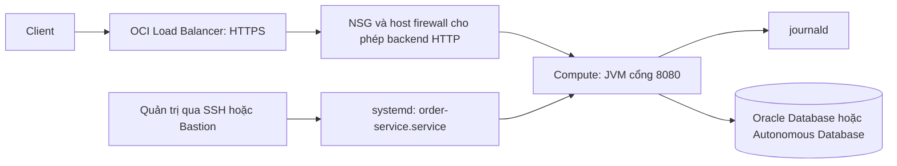

# Triển khai Java trên Compute bằng systemd

## 1. Mục tiêu và mô hình triển khai

Trong chương **Triển khai Java và Spring Boot**, chạy được `java -jar` qua SSH mới là bước kiểm tra ban đầu. Một ứng dụng trên Oracle Cloud Infrastructure (OCI) Compute cần có cách khởi động cùng máy, dừng có kiểm soát, ghi log, giới hạn tài nguyên và phục hồi khi tiến trình gặp lỗi. Bài này dùng **systemd** để quản lý một tiến trình Java chạy trực tiếp trên máy Linux.

Sau bài học, bạn có thể:

- Chuẩn bị Compute instance và bố trí JAR, cấu hình, dữ liệu theo vai trò riêng.
- Chạy ứng dụng dưới một tài khoản hệ thống không có quyền quản trị.
- Viết unit file để systemd quản lý JVM và chính sách restart.
- Phân biệt tiến trình đang chạy với ứng dụng đã sẵn sàng phục vụ.
- Đọc log, điều tra lỗi khởi động và lỗi truy cập mạng OCI.
- Cập nhật hoặc rollback một bản phát hành mà không ghi đè JAR đang sử dụng.

Môi trường minh họa là **Oracle Linux 9, Java 21 và một executable JAR của Spring Boot**. Các lệnh shell trong bài chạy bằng Bash trên Compute instance, trừ phần build/chuyển artifact được ghi rõ. Nếu dùng image hoặc phiên bản systemd khác, kiểm tra directive được hỗ trợ bằng công cụ trên chính máy đích.

Ứng dụng ví dụ tên `order-service`, cổng HTTP `8080`. Mô hình truy cập dự kiến:



Load Balancer là thành phần tùy chọn khi thực hành trên một máy. Với dịch vụ cần tính sẵn sàng, nó giúp điều phối traffic đến nhiều backend; systemd chỉ quản lý tiến trình trên từng máy, không thay thế cơ chế chịu lỗi khi cả instance ngừng hoạt động.

## 2. Chuẩn bị Compute, mạng và artifact

### 2.1. Điều kiện trên OCI

Chuẩn bị một instance Oracle Linux 9, có tài khoản quản trị qua SSH với `sudo`, đường truy cập quản trị phù hợp và tài nguyên đủ cho ứng dụng. Ví dụ bộ nhớ trong bài giả định máy có ít nhất khoảng 4 GiB RAM; cần đo lại khi chạy workload thực tế.

| Thành phần | Điều cần xác định |
| --- | --- |
| Compartment | Nơi đặt instance và phạm vi IAM cho người triển khai |
| VCN/subnet | Địa chỉ private, routing và cách quản trị máy |
| NSG/security list | Nguồn nào được truy cập SSH và cổng backend |
| Host firewall | Cho phép cùng đường traffic mà mạng OCI đã cho phép |
| Kiến trúc máy | `x86_64` hay `aarch64`, đặc biệt khi dùng JNI hoặc thư viện native |
| Bộ nhớ và ổ đĩa | Dung lượng cho JVM, OS, agent, logs và các release |
| Database hoặc dịch vụ ngoài | DNS, TLS, routing và cơ chế xác thực tương ứng |

NSG/security list và firewall trong máy là các lớp khác nhau. Mở cổng ở OCI không tự sửa firewall của hệ điều hành. Không cần mở `8080` cho toàn internet chỉ để Load Balancer truy cập backend. [Nguồn: Securing Compute](https://docs.oracle.com/en-us/iaas/Content/Security/Reference/compute_security.htm).

Trong mô hình có Load Balancer, dùng private IP của instance làm backend khi phù hợp topology, kèm cổng ứng dụng thực tế. Nếu ứng dụng chỉ bind `127.0.0.1`, Load Balancer ở máy khác không thể kết nối tới listener đó. [Nguồn: Backend Servers for Load Balancers](https://docs.oracle.com/en-us/iaas/Content/Balance/Tasks/managingbackendservers.htm).

### 2.2. Cài runtime và kiểm tra công cụ

Trên Oracle Linux 9 có AppStream phù hợp, cài OpenJDK headless và công cụ HTTP:

```bash
sudo dnf install -y java-21-openjdk-headless curl
java -version
readlink -f /usr/bin/java
systemctl --version
uname -m
free -h
df -h / /var /opt
```

Oracle Linux 9 cung cấp gói `java-21-openjdk-headless` trong AppStream. Nếu repository của image chưa có gói, kiểm tra cấu hình repository hoặc quy trình cung cấp JDK đã được nhóm phê duyệt. [Nguồn: Oracle Linux AppStream — OpenJDK 21 headless](https://yum.oracle.com/repowatch/oraclelinux9.x86_64/ol9_appstream/ac6c1ea10ff38ee1ee57963fa68e401ad01380dc95125016c95371e5412e262a).

Unit mẫu sẽ gọi `/usr/bin/java`, nên kết quả `java -version` phải đúng runtime đã chọn. Nếu máy có nhiều JDK, kiểm soát alternatives hoặc dùng đường dẫn Java ổn định được quản lý rõ ràng. Đặt `JAVA_HOME` đơn thuần không đổi binary khi `ExecStart` đã chỉ định `/usr/bin/java`.

Runtime phải hỗ trợ mức bytecode và các API mà ứng dụng dùng. Ví dụ JAR được biên dịch cho Java 21 không thể chạy bằng Java 17; lỗi này không được sửa bằng cách tăng quyền chạy service.

### 2.3. Chuẩn bị executable JAR ở máy build hoặc CI

Build ứng dụng trước khi chuyển artifact lên Compute. Với project Spring Boot đã cấu hình Maven Wrapper và Spring Boot Maven Plugin để tạo executable JAR, ví dụ trên máy build dùng Bash:

```bash
./mvnw clean package
sha256sum target/order-service-1.0.0.jar
```

Trên máy build Windows có thể dùng `mvnw.cmd` tương ứng. Chọn đúng executable JAR, không lấy nhầm plain JAR hoặc file `.original`. Compute không cần Maven chỉ để chạy một artifact đã build.

Để dùng health endpoint trong phần sau, ứng dụng cần Actuator, ví dụ dependency được quản lý phiên bản bởi cấu hình Spring Boot của project:

```xml
<dependency>
    <groupId>org.springframework.boot</groupId>
    <artifactId>spring-boot-starter-actuator</artifactId>
</dependency>
```

Chuyển JAR qua kênh quản trị hoặc artifact repository của nhóm. Ví dụ khi đã có đường SSH phù hợp:

```bash
scp target/order-service-1.0.0.jar opc@<ssh-host>:/tmp/order-service-20261120-001.jar
```

Nếu instance chỉ có private IP, dùng SSH/Bastion theo cấu hình truy cập của môi trường. Trên máy đích, tính checksum và đối chiếu với giá trị từ bản build tin cậy trước khi cài:

```bash
sha256sum /tmp/order-service-20261120-001.jar
```

Chỉ tính checksum ở máy đích mà không so sánh với nguồn tin cậy chưa xác minh được artifact đã chuyển đúng.

## 3. Tạo service user và cấu trúc thư mục

### 3.1. Tách quyền vận hành khỏi quyền ứng dụng

Người triển khai có thể dùng `sudo` để cài release và chỉnh unit. JVM chạy bằng user `orderapp`, không chạy bằng `root` hoặc tài khoản SSH cá nhân.

Trong lần thiết lập đầu tiên, tạo user nếu chưa có:

```bash
sudo useradd --system --user-group \
  --home-dir /var/lib/order-service \
  --no-create-home \
  --shell /sbin/nologin orderapp

id orderapp
```

Không tạo lại user khi triển khai release mới. Tài khoản này không cần shell đăng nhập vì systemd sẽ thực thi Java trực tiếp.

Cấu trúc được dùng trong toàn bài:

```text
/opt/order-service/
├── releases/
│   └── 20261120-001/
│       └── app.jar
└── current -> releases/20261120-001

/etc/order-service/
├── service.env
└── application-prod.properties

/var/lib/order-service/
    dữ liệu làm việc mà ứng dụng được phép ghi

/etc/systemd/system/order-service.service
```

| Đường dẫn | Chủ sở hữu/quyền dự kiến | Vai trò |
| --- | --- | --- |
| `/opt/order-service/releases` | Root quản lý, ứng dụng chỉ đọc | Các artifact không thay đổi sau khi phát hành |
| `/opt/order-service/current` | Root quản lý | Chỉ định release được chọn cho lần chạy tiếp theo |
| `/etc/order-service` | Root quản lý, group ứng dụng đọc cấu hình cần thiết | Cấu hình theo môi trường |
| `/var/lib/order-service` | User ứng dụng ghi | State cục bộ, file xuất hoặc dữ liệu làm việc |
| Journal | Hệ thống quản lý | Log stdout/stderr của tiến trình |

Ứng dụng không được ghi đè JAR hoặc unit file. Dữ liệu cần giữ qua restart không đặt vào thư mục release hay thư mục tạm.

### 3.2. Cài release đầu tiên

Sau khi đã kiểm tra checksum:

```bash
sudo install -d -o root -g root -m 0755 /opt/order-service
sudo install -d -o root -g root -m 0755 /opt/order-service/releases
sudo install -d -o root -g root -m 0755 /opt/order-service/releases/20261120-001
sudo install -d -o root -g orderapp -m 0750 /etc/order-service

sudo install -o root -g root -m 0644 \
  /tmp/order-service-20261120-001.jar \
  /opt/order-service/releases/20261120-001/app.jar

sudo ln -s releases/20261120-001 /opt/order-service/current
```

Lệnh tạo `current` ở trên dành cho lần cài đầu khi đường dẫn chưa tồn tại. Những lần sau dùng quy trình đổi release ở phần cập nhật, không sao chép JAR mới đè vào release cũ.

Thư mục `/var/lib/order-service` sẽ được systemd tạo và cấp quyền theo `StateDirectory` trong unit. Thư mục state này được giữ khi service dừng, khác với runtime directory tạm thời. [Nguồn: systemd.exec — Directory Management](https://www.freedesktop.org/software/systemd/man/latest/systemd.exec.html#StateDirectory=).

## 4. Tách cấu hình Spring Boot khỏi JAR

### 4.1. File môi trường không chứa bí mật

Tạo file bằng trình soạn thảo quản trị:

```bash
sudoedit /etc/order-service/service.env
```

Nội dung:

```ini
SPRING_PROFILES_ACTIVE=prod
SPRING_CONFIG_ADDITIONAL_LOCATION=file:/etc/order-service/
```

Sau khi lưu, đặt chủ sở hữu và quyền:

```bash
sudo chown root:root /etc/order-service/service.env
sudo chmod 0600 /etc/order-service/service.env
```

System service manager đọc file môi trường trước khi khởi chạy JVM. File này không phải shell script: không viết `export`, không kỳ vọng `$(...)` được thực thi hoặc `$OTHER_VARIABLE` tự được thay thế. Các biến từ shell SSH cũng không tự xuất hiện trong môi trường system service.

`SPRING_CONFIG_ADDITIONAL_LOCATION` bổ sung vị trí cấu hình thay vì thay thế toàn bộ vị trí mặc định. Dấu `/` cuối biểu diễn thư mục; profile `prod` làm ứng dụng xét file `application-prod.properties` tại đó. [Nguồn: Spring Boot Externalized Configuration](https://docs.spring.io/spring-boot/3.5/reference/features/external-config.html).

### 4.2. File cấu hình ứng dụng

```bash
sudoedit /etc/order-service/application-prod.properties
```

Nội dung mẫu:

```properties
spring.application.name=order-service

server.address=0.0.0.0
server.port=8080
server.shutdown=graceful
spring.lifecycle.timeout-per-shutdown-phase=30s

management.endpoints.web.exposure.include=health
management.endpoint.health.show-details=never
management.endpoint.health.probes.enabled=true

logging.level.root=INFO
```

Đặt quyền để JVM đọc được cấu hình mà không được tự sửa:

```bash
sudo chown root:orderapp /etc/order-service/application-prod.properties
sudo chmod 0640 /etc/order-service/application-prod.properties
```

Cấu hình bind `0.0.0.0` phù hợp backend được bảo vệ bằng NSG/firewall. Nếu chỉ thực hành qua SSH tunnel hoặc reverse proxy trên cùng máy, có thể chọn `127.0.0.1`; khi đó cần thay đổi mô hình truy cập tương ứng.

Actuator cung cấp health groups cho liveness/readiness khi bật probes. Việc exposure HTTP và quyền truy cập endpoint là hai cấu hình khác nhau; nếu project dùng Spring Security, cấu hình chính xác quyền cho endpoint health cần thiết thay vì vô hiệu hóa bảo mật toàn ứng dụng. [Nguồn: Spring Boot Actuator Endpoints](https://docs.spring.io/spring-boot/3.5/reference/actuator/endpoints.html).

### 4.3. Mật khẩu, wallet và quyền gọi OCI

Mẫu trên không cấu hình mật khẩu database. Khi thêm database hoặc dịch vụ cần bí mật, dùng cơ chế cấp bí mật phù hợp, chẳng hạn file được bảo vệ, systemd credentials kết hợp cấu hình ứng dụng, hoặc tích hợp OCI Vault. Biến môi trường không phải kênh giữ bí mật đáng tin cậy chỉ vì file `service.env` có mode `0600`.

Không nhúng private key, mật khẩu hay wallet vào JAR hoặc tham số dòng lệnh. Với ứng dụng dùng OCI Java SDK trên Compute, instance principal cùng dynamic group/IAM policy có thể loại bỏ nhu cầu đặt API key cá nhân lên máy. Đây là danh tính gọi API OCI, không tự cung cấp tài khoản SQL cho database. [Nguồn: Calling Services from an Instance](https://docs.oracle.com/en-us/iaas/Content/Identity/Tasks/callingservicesfrominstances.htm).

Nếu dùng `ProtectHome=true` như unit bên dưới, file đặt trong `/home/opc` sẽ không truy cập được từ service. Chuyển tài nguyên runtime thực sự cần thiết sang đường dẫn được quản lý và cấp quyền rõ ràng; không trỏ ứng dụng sản xuất vào thư mục cá nhân của người triển khai.

## 5. Unit file quản lý JVM

### 5.1. Nội dung service

Tạo unit:

```bash
sudoedit /etc/systemd/system/order-service.service
```

Nội dung dành cho môi trường mẫu:

```ini
[Unit]
Description=Order Service - Spring Boot on OCI Compute
Wants=network-online.target
After=network-online.target
StartLimitIntervalSec=60
StartLimitBurst=5

[Service]
Type=exec
User=orderapp
Group=orderapp
WorkingDirectory=/var/lib/order-service
StateDirectory=order-service
StateDirectoryMode=0750
UMask=0027

EnvironmentFile=/etc/order-service/service.env
ExecStart=/usr/bin/java -Xms256m -Xmx768m -XX:+ExitOnOutOfMemoryError -jar /opt/order-service/current/app.jar

Restart=on-failure
RestartSec=5s
SuccessExitStatus=143
KillSignal=SIGTERM
KillMode=control-group
TimeoutStopSec=75s

StandardOutput=journal
StandardError=journal
SyslogIdentifier=order-service

NoNewPrivileges=true
PrivateTmp=true
ProtectSystem=strict
ProtectHome=true

MemoryAccounting=true
MemoryHigh=1280M
MemoryMax=1536M
TasksMax=512

[Install]
WantedBy=multi-user.target
```

Sau khi lưu:

```bash
sudo chown root:root /etc/systemd/system/order-service.service
sudo chmod 0644 /etc/systemd/system/order-service.service
```

### 5.2. JVM là tiến trình chính

`ExecStart` chạy Java trực tiếp ở foreground. Không thêm `nohup`, dấu `&`, `screen`, shell đăng nhập hoặc script tự tạo PID file cho mẫu này.

`Type=exec` xác nhận binary đã được thực thi trước khi systemd coi bước khởi chạy tương ứng là thành công. Nó vẫn không đợi Spring hoàn tất khởi tạo hoặc cổng HTTP sẵn sàng. Không đổi sang `Type=notify` nếu ứng dụng chưa thực sự gửi thông báo readiness theo giao thức systemd. [Nguồn: systemd.service — Service Types](https://www.freedesktop.org/software/systemd/man/latest/systemd.service.html#Type=).

Unit không có `ExecStop=kill -9 ...`. Systemd đã quản lý PID/cgroup để gửi tín hiệu dừng; dùng tín hiệu cưỡng bức làm bước đầu sẽ bỏ qua shutdown hooks của JVM.

### 5.3. Không coi `ExecStart` là một dòng Bash

Systemd có quy tắc phân tích lệnh riêng. Không đặt pipeline, redirect hoặc chuỗi `&&` trong `ExecStart` rồi kỳ vọng nó hoạt động như shell. Cấu hình stdout/stderr đã dùng directive riêng để chuyển log vào journal.

Mẫu cũng không khai báo `JAVA_OPTS` rồi kỳ vọng Java tự đọc nó. Nếu cần thay JVM flags, sửa `ExecStart` qua unit/drop-in một cách rõ ràng; JVM flags đứng trước `-jar`, còn tham số ứng dụng đứng sau tên JAR.

## 6. Hiểu giới hạn quyền, bộ nhớ và vòng đời

### 6.1. Giới hạn ghi và quyền tiến trình

Các directive bảo vệ trong mẫu có mục đích cụ thể:

| Directive | Tác động thiết kế |
| --- | --- |
| `User`, `Group` | JVM không có quyền của người quản trị |
| `NoNewPrivileges` | Ngăn tiến trình và con của nó thu thêm đặc quyền qua cơ chế như setuid |
| `ProtectSystem=strict` | Phần lớn filesystem nhìn từ service ở chế độ chỉ đọc |
| `StateDirectory` | Tạo vùng state được cấp cho service, có thể ghi dù áp dụng bảo vệ filesystem |
| `ProtectHome` | Ngăn service dựa vào dữ liệu trong home của tài khoản cá nhân |
| `PrivateTmp` | Tách vùng `/tmp` và `/var/tmp` của service khỏi các tiến trình khác |
| `UMask` | Hạn chế quyền mặc định của file mới do ứng dụng tạo |

Nếu ứng dụng cần upload hoặc xuất file, cấu hình đường dẫn trong `/var/lib/order-service` hoặc thêm vùng ghi được thiết kế rõ ràng. Chỉ đổi working directory không làm cho mọi đường dẫn tương đối của thư viện đều đúng với yêu cầu ứng dụng.

Không thêm các directive hạn chế thực thi bộ nhớ một cách máy móc: JVM có JIT và có thể dùng thư viện native. Mỗi thay đổi hardening cần được kiểm tra với runtime và workload thực tế.

### 6.2. Heap không phải toàn bộ bộ nhớ JVM

`-Xmx768m` giới hạn Java heap trong ví dụ. Tiến trình còn dùng metaspace, code cache, thread stacks, direct buffers, thư viện native và các phần khác. Vì vậy không đặt `MemoryMax=768M` chỉ để bằng heap tối đa.

`MemoryHigh` tạo ngưỡng kiểm soát áp lực bộ nhớ; `MemoryMax` là giới hạn cuối của cgroup và có thể dẫn đến OOM kill khi không thể giữ usage dưới ngưỡng. Các giá trị còn chịu giới hạn của slice cha và hệ thống. [Nguồn: systemd.resource-control — Memory Controls](https://www.freedesktop.org/software/systemd/man/latest/systemd.resource-control.html#MemoryMax=).

Ví dụ `1280M/1536M` không phải sizing chung cho mọi Spring Boot app. Cần dành bộ nhớ cho OS, OCI agents và các tiến trình khác, rồi đo lại RSS/cgroup usage, heap, số thread và tải đồng thời. `TasksMax=512` cũng là giới hạn cần đối chiếu với số task/thread thực tế.

`-XX:+ExitOnOutOfMemoryError` giúp JVM thoát khi gặp OOM do JVM xử lý, để chính sách restart có cơ hội tác động. Nó không ngăn kernel/cgroup OOM kill và không thay thế việc tìm nguyên nhân leak hoặc thiếu bộ nhớ.

### 6.3. Network target không phải health check

`Wants=network-online.target` và `After=network-online.target` yêu cầu/thứ tự khởi chạy theo target mạng, tùy cơ chế wait-online của hệ điều hành. Chúng không kiểm tra database đã mở, DNS của dịch vụ ngoài hoạt động hoặc Vault có thể truy cập. [Nguồn: systemd.special — network-online.target](https://www.freedesktop.org/software/systemd/man/latest/systemd.special.html#network-online.target).

Ứng dụng vẫn cần timeout, retry có giới hạn và readiness phù hợp cho các dependency. Một lỗi database tạm thời không nên tự động biến thành hàng loạt JVM restart trên mọi backend.
