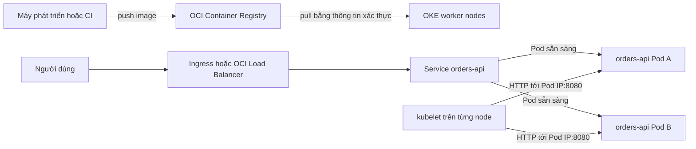

# Đưa Spring Boot lên OKE với health probes và resource limits

## 1. Mục tiêu và phạm vi

Một container Spring Boot có trạng thái `Running` mới cho biết tiến trình đang chạy. Khi đưa ứng dụng lên Oracle Kubernetes Engine (OKE), người vận hành còn phải xác định lúc nào ứng dụng nhận được lưu lượng, khi nào cần khởi động lại và mỗi bản sao được phép sử dụng bao nhiêu tài nguyên.

Trong chương **Triển khai Java và Spring Boot** của module **CLOUD_PROVIDERS_ORACLE**, bài này triển khai dịch vụ HTTP `orders-api` lên một cụm OKE đã có. Trọng tâm là nối cấu hình ứng dụng với cách Kubernetes vận hành Pod trên hạ tầng OCI:

- Công bố trạng thái ứng dụng bằng Spring Boot Actuator.
- Phân biệt startup, readiness và liveness probe.
- Đặt CPU/memory requests, limits và ngân sách bộ nhớ JVM.
- Triển khai qua Deployment và Service, đọc bằng chứng vận hành, cập nhật và rollback.
- Liên hệ với IAM, compartment, VCN, giám sát, tính sẵn sàng và chi phí OCI.

Ví dụ dùng Java 21, ứng dụng Spring Boot web dạng executable JAR và **OKE managed node pool chạy Linux**. Những con số tài nguyên trong bài là cấu hình khởi đầu cho phòng thực hành, cần đo lại theo ứng dụng thực tế. Không triển khai Oracle Database trong Pod của ví dụ; phần kết nối cơ sở dữ liệu Oracle chỉ được đề cập khi quyết định ý nghĩa của health check.

## 2. Đường đi của image, lưu lượng và phép kiểm tra



OKE cung cấp môi trường Kubernetes; OCIR lưu image. Deployment quản lý các bản sao ứng dụng, còn Service tạo điểm truy cập ổn định cho tập Pod phù hợp selector.

**Health probe của kubelet và health check của OCI Load Balancer là hai cơ chế khác nhau.** Probe trong bài đi thẳng tới Pod, không vòng qua DNS công khai hay load balancer. Vì vậy, một probe thành công chưa chứng minh đường đi từ người dùng bên ngoài hoạt động.

Trong OCI, cần phân biệt ba phạm vi:

| Phạm vi | Ví dụ trong bài | Ý nghĩa |
| --- | --- | --- |
| Tenancy và compartment | Compartment chứa cluster, node pool và tài nguyên mạng | Phạm vi quản trị, chính sách OCI và phân bổ chi phí |
| Kubernetes namespace | `java-apps` | Phạm vi đối tượng Kubernetes của bài |
| OCIR tenancy namespace | Chuỗi dùng trong đường dẫn image của tenancy | Thành phần định danh repository, không phải namespace Kubernetes |

Có kubeconfig chưa đồng nghĩa được phép triển khai mọi đối tượng. Quyền truy cập OKE cần xét cùng IAM và quyền Kubernetes/RBAC. Tài khoản triển khai chỉ nên có quyền cần thiết trong phạm vi được giao. Xem [Oracle: kiểm soát truy cập OKE](https://docs.oracle.com/en-us/iaas/Content/ContEng/Concepts/contengaboutaccesscontrol.htm).

## 3. Chuẩn bị trước khi triển khai

Cần có:

1. Cụm OKE hoạt động, worker node ở trạng thái `Ready` và còn đủ allocatable CPU/memory.
2. Máy có OCI CLI, `kubectl`, Docker và JDK/build tool phù hợp với dự án.
3. Kubeconfig được tạo cho danh tính của chính người triển khai.
4. Quyền tạo Namespace hoặc một namespace được quản trị viên cấp sẵn; quyền quản lý Deployment, Service, ConfigMap và Secret trong namespace đó.
5. Repository OCIR cùng thông tin xác thực có quyền push/pull tương ứng.
6. Kết nối từ máy quản trị tới Kubernetes API endpoint, và từ worker nodes tới OCIR, DNS cùng các hệ thống ứng dụng phụ thuộc.

Nếu API endpoint là private, hãy dùng đường truy cập đã thiết lập như bastion, VPN hoặc máy quản trị trong mạng phù hợp. Tạo kubeconfig theo lệnh mà OCI Console cung cấp cho đúng cluster và loại endpoint. Tham khảo [Oracle: thiết lập truy cập cluster](https://docs.oracle.com/en-us/iaas/Content/ContEng/Tasks/contengdownloadkubeconfigfile.htm).

Kiểm tra context trước khi thay đổi tài nguyên:

```bash
kubectl config current-context
kubectl cluster-info
kubectl get nodes -o wide
kubectl get nodes -L kubernetes.io/arch
```

Việc xem node có thể cần quyền rộng hơn quyền triển khai trong namespace; nếu bị từ chối, nhờ quản trị viên xác nhận thông tin thay vì tự mở quyền.

OCI có các shape với kiến trúc CPU khác nhau. Image phải có biến thể phù hợp `amd64` hoặc `arm64` của node chạy Pod. Ví dụ manifest bên dưới chọn node `amd64`; nếu dùng pool Arm, phải đổi cả image build và node selector.

Về VCN, cần kiểm tra đường truyền thực tế của node/subnet tới registry: DNS, route, gateway hoặc cơ chế truy cập dịch vụ OCI được thiết kế cho môi trường đó. Một image pull thất bại có thể do mạng, không chỉ do token.

## 4. Chuẩn bị ứng dụng và cấu hình Actuator

### 4.1. Ứng dụng HTTP tối thiểu

Dùng dự án Spring Boot có dependency `spring-boot-starter-web`, plugin đóng gói executable JAR và phiên bản Spring Boot tương thích Java 21. Thêm Actuator; để dependency management của dự án quản lý version:

```xml
<dependency>
    <groupId>org.springframework.boot</groupId>
    <artifactId>spring-boot-starter-actuator</artifactId>
</dependency>
```

Để có endpoint nghiệp vụ đơn giản khi kiểm tra, có thể dùng lớp ứng dụng sau:

```java
package vn.example.orders;

import java.util.Map;
import org.springframework.boot.SpringApplication;
import org.springframework.boot.autoconfigure.SpringBootApplication;
import org.springframework.web.bind.annotation.GetMapping;
import org.springframework.web.bind.annotation.RestController;

@SpringBootApplication
@RestController
public class OrdersApplication {
    public static void main(String[] args) {
        SpringApplication.run(OrdersApplication.class, args);
    }

    @GetMapping("/api/orders/status")
    public Map<String, String> status() {
        return Map.of("service", "orders-api", "status", "ok");
    }
}
```

Đây là dịch vụ stateless phục vụ bài thực hành. Nó không lưu đơn hàng trong bộ nhớ cục bộ và không yêu cầu volume hay mật khẩu cơ sở dữ liệu.

### 4.2. Cấu hình cho profile OKE

Nội dung sau sẽ được đưa vào ConfigMap ở bước triển khai:

```yaml
server:
  port: 8080
  shutdown: graceful

spring:
  lifecycle:
    timeout-per-shutdown-phase: 25s

management:
  endpoints:
    web:
      exposure:
        include: health
  endpoint:
    health:
      show-details: never
      probes:
        enabled: true
        add-additional-paths: true
```

Actuator cung cấp các nhóm health tại `/actuator/health/liveness` và `/actuator/health/readiness`. Với cấu hình additional paths, bài dùng `/livez` và `/readyz` trên cổng ứng dụng 8080 để probe đi qua cùng web server với API nghiệp vụ. Xem [Spring Boot: Kubernetes probes](https://docs.spring.io/spring-boot/reference/actuator/endpoints.html#actuator.endpoints.kubernetes-probes).

Không cần tách `management.server.port` trong ví dụ này. Nếu dùng cổng quản trị riêng, một phản hồi tốt từ cổng quản trị có thể che khuất việc cổng phục vụ nghiệp vụ bị nghẽn.

Nếu dự án có Spring Security hoặc filter xác thực, cần cho phép kubelet gọi đúng các health path mà không bị redirect tới trang đăng nhập. Vẫn giữ cơ chế xác thực của API nghiệp vụ và giới hạn việc công bố thông tin quản trị; `show-details: never` giúp tránh trả chi tiết health cho người gọi.

## 5. Đóng gói và đưa image lên OCIR

### 5.1. Container chạy bằng người dùng không đặc quyền

Đóng gói ứng dụng bằng quy trình build của dự án. Trong các lệnh minh họa dưới đây, executable JAR đã được tạo hoặc được sao chép thành `target/orders-api.jar`.

Dockerfile minh họa:

```dockerfile
FROM eclipse-temurin:21-jre
WORKDIR /app
COPY --chown=10001:10001 target/orders-api.jar /app/app.jar
USER 10001:10001
EXPOSE 8080
ENTRYPOINT ["java", "-jar", "/app/app.jar"]
```

Exec-form `ENTRYPOINT` giúp Java nhận tín hiệu dừng trực tiếp. JRE không cần chứa `curl` để chạy HTTP probe: kubelet là bên gửi HTTP request từ node.

Khi phát hành thực tế, cố định image nền và image ứng dụng theo digest được kiểm soát, quét lỗ hổng và lưu kết quả build. Thẻ tag dễ đọc vẫn hữu ích nhưng không nên bị tái sử dụng để chỉ những nội dung khác nhau.

### 5.2. Build, đăng nhập và push

Các lệnh nhiều bước trong bài dùng **Bash**, phù hợp terminal Linux hoặc WSL. Với PowerShell, điều chỉnh cú pháp biến theo shell. Thay toàn bộ giá trị trong dấu `<...>` trước khi chạy:

```bash
REGISTRY="<ocir-registry-host>"
TENANCY_NAMESPACE="<tenancy-namespace>"
OCIR_USERNAME="<tenancy-namespace>/<oci-username-or-domain-user>"
IMAGE="$REGISTRY/$TENANCY_NAMESPACE/java/orders-api:1.0.0"

docker build --platform linux/amd64 -t "$IMAGE" .
docker login "$REGISTRY" --username "$OCIR_USERNAME"
docker push "$IMAGE"
```

Nhập **OCI auth token** tại lời nhắc password, không dùng mật khẩu đăng nhập Console. Registry host phải đúng region và đúng host sẽ xuất hiện trong manifest. Đường dẫn username của danh tính liên kết/identity domain cần dùng đúng định dạng của tenancy.

Đọc digest từ kết quả push để dùng cho bản phát hành cố định. Quy trình đẩy image và định dạng đăng nhập được mô tả trong [Oracle: push image bằng Docker CLI](https://docs.oracle.com/en-us/iaas/Content/Registry/Tasks/registrypushingimagesusingthedockercli.htm).

### 5.3. Cho OKE quyền pull image private

Tạo namespace nếu người triển khai được cấp quyền:

```bash
kubectl create namespace java-apps
```

Nếu namespace đã được cấp sẵn, dùng namespace đó và điều chỉnh nhất quán các manifest. Một phương án thực hành là dùng Docker config của tài khoản pull chuyên dụng để tạo Secret:

```bash
kubectl -n java-apps create secret generic ocir-pull --from-file=.dockerconfigjson="$HOME/.docker/config.json" --type=kubernetes.io/dockerconfigjson
```

Chỉ dùng cách này khi Docker config thực sự chứa thông tin xác thực của registry cần pull. Nếu Docker dùng credential helper thì file có thể không chứa credential có thể chuyển sang Kubernetes. Khi đó, cấp registry Secret bằng quy trình secret được tổ chức hỗ trợ.

Không sao chép một Docker config chứa credential của nhiều registry không liên quan. Trong pipeline, secret nên được cấp qua kho secret hoặc cơ chế triển khai đã được phê duyệt, không ghi token vào Git. Kubernetes Secret mã hóa base64 không tự làm nội dung trở thành bí mật đối với người có quyền đọc Secret. Tham khảo [Kubernetes: pull image từ registry private](https://kubernetes.io/docs/tasks/configure-pod-container/pull-image-private-registry/).

Secret `ocir-pull` phải ở **cùng namespace với Pod**. Deployment sẽ tham chiếu Secret qua `imagePullSecrets`; credential push của CI và credential pull của runtime có thể là hai danh tính với quyền khác nhau. Xem [Oracle: pull image OCIR khi triển khai](https://docs.oracle.com/en-us/iaas/Content/ContEng/Tasks/contengpullingimagesfromocir.htm).

## 6. Chọn đúng ý nghĩa cho từng probe

| Probe | Câu hỏi cần trả lời | Khi thất bại đủ ngưỡng | Cách dùng trong bài |
| --- | --- | --- | --- |
| Startup | Ứng dụng đã vượt giai đoạn khởi động chưa? | Kubelet kết thúc container; việc khởi động lại theo restart policy | Gọi `/livez`, dành ngân sách khởi động riêng |
| Readiness | Bản sao này có nên nhận lưu lượng mới không? | Container chưa ready; không được dùng làm backend sẵn sàng của Service | Gọi `/readyz` |
| Liveness | Bản sao này có cần được khởi động lại không? | Kubelet kết thúc container; việc khởi động lại theo restart policy | Gọi `/livez` định kỳ |

Khi có startup probe, readiness và liveness chưa chạy cho đến khi startup probe thành công. Startup probe không phải một bài kiểm thử nghiệp vụ toàn diện: liveness có thể tốt trước khi ứng dụng hoàn toàn sẵn sàng, và readiness tiếp tục giữ vai trò chặn lưu lượng trong khoảng đó. Xem [Kubernetes: vòng đời các probe](https://kubernetes.io/docs/concepts/workloads/pods/probes/).

### 6.1. Không dùng database làm điều kiện liveness

Giả sử mọi Pod cùng kết nối một Oracle Autonomous Database. Nếu database bảo trì mà liveness kiểm tra database, cả hai Pod có thể liên tục bị khởi động lại dù JVM vẫn hoạt động. Vòng lặp đó không sửa database và có thể làm đợt kết nối lại nặng hơn.

Liveness nên phản ánh lỗi bên trong bản sao mà việc restart có khả năng giải quyết. Readiness có thể xét một dependency thiết yếu, nhưng cần quyết định dựa trên hành vi nghiệp vụ: khi dependency dùng chung hỏng, việc loại mọi Pod khỏi Service có thể làm mất cả những API vốn vẫn phục vụ được.

Mẫu trong bài giữ nguyên các nhóm availability của Spring Boot, không thêm database vào probe. Không dùng `/actuator/health` tổng hợp cho liveness chỉ vì endpoint đó có sẵn. Nếu sau này bổ sung một health indicator vào readiness, cần có timeout ngắn và chi phí kiểm tra thấp.

### 6.2. Hiểu ngân sách thời gian

Ví dụ Deployment sử dụng:

| Tham số | Startup | Readiness | Liveness |
| --- | --- | --- | --- |
| `periodSeconds` | 5 | 5 | 10 |
| `timeoutSeconds` | 2 | 2 | 2 |
| `failureThreshold` | 36 | 3 | 3 |
| `successThreshold` | 1 | 1 | 1 |

Ngân sách startup danh nghĩa là khoảng `36 × 5 = 180 giây`. Liveness có cửa sổ phát hiện theo chu kỳ khoảng 30 giây; readiness khoảng 15 giây. Đây là ước lượng để thiết kế, không phải cam kết thời điểm chính xác: lịch probe và thời gian request ảnh hưởng thời gian quan sát.

Chọn ngân sách startup theo thời gian khởi động đo được khi CPU bị giới hạn, có tải và có tác vụ khởi tạo. Dùng startup probe thay cho việc tăng mù `initialDelaySeconds` của liveness. Chi tiết các tham số có trong [Kubernetes: cấu hình startup, readiness và liveness probe](https://kubernetes.io/docs/tasks/configure-pod-container/configure-liveness-readiness-startup-probes/).

## 7. Requests, limits và ngân sách bộ nhớ JVM

### 7.1. Bốn giá trị có bốn vai trò

| Cấu hình mỗi container | Giá trị mẫu | Cách hiểu |
| --- | --- | --- |
| CPU request | `250m` | Scheduler dùng nhu cầu 0,25 CPU khi xếp Pod |
| CPU limit | `1000m` | CPU bị giới hạn ở mức 1 CPU; tải cao có thể bị throttling |
| Memory request | `512Mi` | Scheduler tính nhu cầu bộ nhớ 512 MiB |
| Memory limit | `1Gi` | Vượt giới hạn có thể dẫn tới OOM kill |

Request không phải trần sử dụng. Pod có thể dùng vượt request nếu tài nguyên cho phép, còn limit ràng buộc mức sử dụng. CPU limit thường gây chậm do throttling; memory limit có thể làm tiến trình bị kết thúc. Không dùng hậu tố `m` cho memory khi muốn biểu diễn MiB. Xem [Kubernetes: quản lý tài nguyên container](https://kubernetes.io/docs/concepts/configuration/manage-resources-containers/).

### 7.2. Heap chỉ là một phần bộ nhớ

Giới hạn 1 GiB phải chứa heap, metaspace, code cache, thread stacks, direct buffers và các phần native khác. Không đặt `-Xmx1g` khi container chỉ có `memory: 1Gi`.

Ví dụ dùng:

```text
JAVA_TOOL_OPTIONS=-XX:MaxRAMPercentage=60.0 -XX:+ExitOnOutOfMemoryError
```

Với giới hạn 1 GiB và JVM nhận đúng giới hạn container, ngân sách heap tối đa xấp xỉ 614 MiB trước các điều chỉnh của JVM; phần còn lại không phải bảo đảm rằng mọi bộ nhớ native đều vừa.

`ExitOnOutOfMemoryError` giúp tiến trình thoát khi JVM gặp OutOfMemoryError; nó không ngăn kernel OOM kill. Chọn tỷ lệ bằng quan sát heap, RSS, thread count, direct memory và tải thực tế. Xem [Java 21: các tùy chọn bộ nhớ JVM](https://docs.oracle.com/en/java/javase/21/docs/specs/man/java.html).

Ví dụ chẩn đoán: nếu heap đang ở 430 MiB nhưng Pod gần giới hạn 1 GiB, việc chỉ tăng heap có thể làm tình hình xấu hơn. Cần xem số luồng, thư viện native, TLS, buffer và phần bộ nhớ ngoài heap.

### 7.3. Tính tài nguyên lúc rollout

Với hai replica trong mẫu:

- Tổng request ổn định: `500m CPU + 1Gi memory`.
- Khi thêm một Pod theo `maxSurge: 1`: ít nhất `750m CPU + 1,5Gi memory` request cho ba Pod.
- Nếu cả ba cùng gần memory limit: nhu cầu có thể gần 3 GiB, chưa tính workload khác và hệ thống.

Pod đang kết thúc có thể vẫn giữ tài nguyên; cần chừa thêm dung lượng trong giai đoạn chuyển tiếp. Dùng **allocatable** và vị trí từng node để tính khả năng xếp Pod, không chỉ cộng dung lượng của cả cluster. Hai node còn tổng cộng 600 MiB nhưng mỗi node chỉ trống 300 MiB vẫn không đặt được một Pod request 512 MiB.

## 8. Manifest triển khai hoàn chỉnh

Lưu nội dung minh họa sau thành `orders-api-oke.yaml` trong môi trường thực hành của người học. Trước khi apply, thay image placeholder bằng đường dẫn đã push; nên dùng `<registry>/<tenancy-namespace>/java/orders-api@sha256:<digest>` khi phát hành.

```yaml
apiVersion: v1
kind: ConfigMap
metadata:
  name: orders-api-config-v1
  namespace: java-apps
immutable: true
data:
  application-oke.yaml: |
    server:
      port: 8080
      shutdown: graceful
    spring:
      lifecycle:
        timeout-per-shutdown-phase: 25s
    management:
      endpoints:
        web:
          exposure:
            include: health
      endpoint:
        health:
          show-details: never
          probes:
            enabled: true
            add-additional-paths: true
---
apiVersion: apps/v1
kind: Deployment
metadata:
  name: orders-api
  namespace: java-apps
  labels:
    app.kubernetes.io/name: orders-api
spec:
  replicas: 2
  revisionHistoryLimit: 3
  minReadySeconds: 10
  progressDeadlineSeconds: 600
  strategy:
    type: RollingUpdate
    rollingUpdate:
      maxSurge: 1
      maxUnavailable: 0
  selector:
    matchLabels:
      app.kubernetes.io/name: orders-api
  template:
    metadata:
      labels:
        app.kubernetes.io/name: orders-api
    spec:
      automountServiceAccountToken: false
      terminationGracePeriodSeconds: 45
      nodeSelector:
        kubernetes.io/os: linux
        kubernetes.io/arch: amd64
      imagePullSecrets:
        - name: ocir-pull
      securityContext:
        runAsNonRoot: true
        runAsUser: 10001
        runAsGroup: 10001
        fsGroup: 10001
        seccompProfile:
          type: RuntimeDefault
      topologySpreadConstraints:
        - maxSkew: 1
          topologyKey: kubernetes.io/hostname
          whenUnsatisfiable: ScheduleAnyway
          labelSelector:
            matchLabels:
              app.kubernetes.io/name: orders-api
      containers:
        - name: orders-api
          image: "<ocir-registry-host>/<tenancy-namespace>/java/orders-api:1.0.0"
          imagePullPolicy: IfNotPresent
          ports:
            - name: http
              containerPort: 8080
          env:
            - name: SPRING_PROFILES_ACTIVE
              value: oke
            - name: SPRING_CONFIG_ADDITIONAL_LOCATION
              value: file:/etc/orders/
            - name: JAVA_TOOL_OPTIONS
              value: "-XX:MaxRAMPercentage=60.0 -XX:+ExitOnOutOfMemoryError"
          resources:
            requests:
              cpu: 250m
              memory: 512Mi
            limits:
              cpu: 1000m
              memory: 1Gi
          startupProbe:
            httpGet:
              path: /livez
              port: http
            periodSeconds: 5
            timeoutSeconds: 2
            failureThreshold: 36
            successThreshold: 1
          readinessProbe:
            httpGet:
              path: /readyz
              port: http
            periodSeconds: 5
            timeoutSeconds: 2
            failureThreshold: 3
            successThreshold: 1
          livenessProbe:
            httpGet:
              path: /livez
              port: http
            periodSeconds: 10
            timeoutSeconds: 2
            failureThreshold: 3
            successThreshold: 1
          securityContext:
            allowPrivilegeEscalation: false
            readOnlyRootFilesystem: true
            capabilities:
              drop:
                - ALL
          volumeMounts:
            - name: app-config
              mountPath: /etc/orders
              readOnly: true
            - name: temp
              mountPath: /tmp
      volumes:
        - name: app-config
          configMap:
            name: orders-api-config-v1
        - name: temp
          emptyDir:
            sizeLimit: 256Mi
---
apiVersion: v1
kind: Service
metadata:
  name: orders-api
  namespace: java-apps
spec:
  type: ClusterIP
  selector:
    app.kubernetes.io/name: orders-api
  ports:
    - name: http
      port: 80
      targetPort: http
---
apiVersion: policy/v1
kind: PodDisruptionBudget
metadata:
  name: orders-api
  namespace: java-apps
spec:
  minAvailable: 1
  selector:
    matchLabels:
      app.kubernetes.io/name: orders-api
```

Các lựa chọn đáng chú ý:

- ConfigMap tên `v1` và immutable giúp giữ lại cấu hình của một revision. Khi đổi cấu hình, tạo ConfigMap `v2` và đổi tham chiếu trong Pod template; giữ `v1` trong cửa sổ rollback.
- `SPRING_CONFIG_ADDITIONAL_LOCATION` thêm thư mục cấu hình bên ngoài; profile `oke` chọn file `application-oke.yaml`. Không đặt mật khẩu trong ConfigMap.
- Root filesystem chỉ đọc; `/tmp` dùng volume riêng để ứng dụng có nơi ghi tạm. Nếu thư viện ghi sang thư mục khác, cần thiết kế đường ghi và volume phù hợp.
- `ScheduleAnyway` chỉ khuyến khích trải Pod qua node, không bảo đảm tách node khi thiếu tài nguyên. Muốn ràng buộc bắt buộc phải đánh đổi với khả năng Pod bị Pending.
- Service là `ClusterIP`, nên bước cơ bản chưa tạo OCI Load Balancer. Điều này đủ để kiểm tra ứng dụng trước khi mở đường vào bên ngoài.
- Ứng dụng ví dụ không gọi Kubernetes API nên tắt tự động mount service account token.

PodDisruptionBudget bảo vệ một phần trước gián đoạn tự nguyện qua Eviction API, chẳng hạn drain node. Nó không ngăn node chết, không chặn mọi thao tác xóa Pod và không điều khiển rolling update của Deployment. Xem [Kubernetes: disruptions và PDB](https://kubernetes.io/docs/concepts/workloads/pods/disruptions/).

## 9. Apply và đọc bằng chứng triển khai

### 9.1. Xác nhận manifest và rollout

Sau khi namespace, Secret và image đã sẵn sàng:

```bash
kubectl apply --dry-run=server -f orders-api-oke.yaml
kubectl apply -f orders-api-oke.yaml
kubectl -n java-apps rollout status deployment/orders-api --timeout=10m
kubectl -n java-apps get deployment orders-api
kubectl -n java-apps get pods -l app.kubernetes.io/name=orders-api -o wide
```

Server dry run kiểm tra được schema và các admission rule áp dụng tại thời điểm đó; nó không chứng minh image tồn tại, JVM khởi động được hay probe sẽ trả kết quả tốt.

Kết quả ổn định mong đợi là Deployment có hai replica available, mỗi Pod `READY 1/1`, image đúng bản phát hành và không có restart lặp lại. `Running` cùng `READY 0/1` là tín hiệu cần điều tra.

### 9.2. Kiểm tra đường HTTP

Mở một terminal:

```bash
kubectl -n java-apps port-forward service/orders-api 8080:80
```

Ở terminal thứ hai:

```bash
curl -i http://localhost:8080/livez
curl -i http://localhost:8080/readyz
curl -i http://localhost:8080/api/orders/status
```

Hai health endpoint phải trả HTTP 200 khi Pod khỏe và sẵn sàng; endpoint nghiệp vụ trả JSON có `"service":"orders-api"`.

Port-forward tới Service chọn một Pod phù hợp để chuyển tiếp. Nó hữu ích cho smoke test nhưng không kiểm chứng đầy đủ Service dataplane, phân phối qua mọi replica hay đường đi từ OCI Load Balancer. Khi cần, kiểm tra HTTP từ một workload trong cluster và kiểm tra riêng endpoint bên ngoài.

### 9.3. Xác nhận readiness được phản ánh vào backend

```bash
kubectl -n java-apps get endpointslices -l kubernetes.io/service-name=orders-api -o yaml
kubectl -n java-apps describe deployment orders-api
kubectl -n java-apps get events --sort-by=.metadata.creationTimestamp
```

Đối chiếu IP các Pod với endpoint và `conditions.ready`. Chỉ có endpoint mang địa chỉ chưa đủ để kết luận nó đang được dùng làm backend sẵn sàng.

## 10. Graceful shutdown, cập nhật và rollback

### 10.1. Dành đủ thời gian để dừng

Trong ví dụ, Spring có timeout 25 giây cho mỗi shutdown phase; Pod có grace period 45 giây. Không hiểu hai giá trị này là phép bảo đảm rằng mọi tác vụ chắc chắn hoàn tất.

Java cần nhận SIGTERM để đóng ứng dụng. Khi dừng, web server ngừng nhận request mới theo cơ chế của server và dành thời gian xử lý request đang chạy. Request dài, consumer nền hoặc nhiều shutdown phase có thể cần ngân sách khác. Xem [Spring Boot: graceful shutdown](https://docs.spring.io/spring-boot/reference/web/graceful-shutdown.html).

Kubernetes cập nhật trạng thái endpoint và kết thúc container theo các luồng bất đồng bộ; kết nối đang tồn tại và độ trễ của proxy vẫn cần được tính tới. Nếu hệ thống cần drain delay hoặc `preStop`, hãy đo thời gian lan truyền thực tế. `preStop` dùng chung ngân sách grace period, không cộng thêm thời gian ngoài 45 giây. Xem [Kubernetes: kết thúc Pod](https://kubernetes.io/docs/concepts/workloads/pods/pod-lifecycle/#pod-termination).

Không thêm một lệnh sleep dài chỉ để làm biểu đồ đẹp: nó có thể trì hoãn shutdown và làm chậm rollout mà vẫn chưa giải quyết đúng đường truyền lưu lượng.

### 10.2. Cập nhật một bản phát hành

Đẩy image mới với digest mới rồi cập nhật khai báo được quản lý trong Git/pipeline. Để thực hành thao tác trực tiếp:

```bash
NEW_IMAGE="<ocir-registry-host>/<tenancy-namespace>/java/orders-api@sha256:<new-digest>"
kubectl -n java-apps set image deployment/orders-api orders-api="$NEW_IMAGE"
kubectl -n java-apps rollout status deployment/orders-api --timeout=10m
kubectl -n java-apps rollout history deployment/orders-api
```

`maxUnavailable: 0` và `maxSurge: 1` cho phép thêm Pod mới trước khi giảm Pod cũ trong điều kiện đủ tài nguyên. `minReadySeconds: 10` yêu cầu Pod mới duy trì ready một khoảng trước khi được tính available. Nếu vượt progress deadline, Deployment báo lỗi tiến triển; Kubernetes không tự động rollback chỉ vì deadline bị vượt. Xem [Kubernetes: Deployment](https://kubernetes.io/docs/concepts/workloads/controllers/deployment/).

Vì ConfigMap ví dụ được version hóa, nếu phát hành đồng thời image và cấu hình, cập nhật cả image lẫn tham chiếu ConfigMap trong cùng thay đổi Pod template.

### 10.3. Rollback có chủ đích

```bash
kubectl -n java-apps rollout history deployment/orders-api
kubectl -n java-apps rollout undo deployment/orders-api --to-revision=<known-good-revision>
kubectl -n java-apps rollout status deployment/orders-api --timeout=10m
```

Rollback Deployment khôi phục Pod template của revision đã chọn. Nó không đảo ngược database migration hoặc các thay đổi ở hệ thống bên ngoài. ConfigMap cũ và image cũ phải còn tồn tại; nếu mọi revision cùng trỏ một ConfigMap đã sửa tại chỗ thì rollback template không khôi phục cấu hình cũ.

Sau thử nghiệm trực tiếp, đồng bộ lại khai báo trong nguồn quản lý để lần apply tiếp theo không vô tình đưa hệ thống về cấu hình khác.

## 11. Chẩn đoán theo triệu chứng

Dùng tên Pod thực tế thay `<pod-name>`:

```bash
kubectl -n java-apps describe pod <pod-name>
kubectl -n java-apps logs <pod-name> -c orders-api --tail=200
kubectl -n java-apps logs <pod-name> -c orders-api --previous --tail=200
kubectl -n java-apps get pod <pod-name> -o yaml
```

`--previous` hữu ích khi container đã restart và log hiện tại không chứa lỗi lần chạy trước. Kết hợp trạng thái container, last state, event và log theo cùng thời điểm; xem [Kubernetes: debug Pod](https://kubernetes.io/docs/tasks/debug/debug-application/debug-pods/).

| Triệu chứng | Hướng kiểm tra đầu tiên | Hướng xử lý |
| --- | --- | --- |
| `ImagePullBackOff` | Event pull image, registry host, repository, Secret cùng namespace, mạng tới OCIR | Sửa image/credential hoặc đường mạng trước khi chỉnh probe |
| `exec format error` | Kiến trúc image và node | Build biến thể phù hợp, đổi selector hoặc dùng image đa kiến trúc |
| Pod `Pending` | Event scheduling, request, quota, selector | Bổ sung capacity hoặc sửa ràng buộc sai |
| `Running` nhưng `0/1 Ready` | URL, cổng, health response, log khởi động | Sửa readiness hoặc nguyên nhân ứng dụng chưa sẵn sàng |
| Probe trả 401/403 | Security chain và filter | Cho phép đúng health path với chính sách phù hợp |
| Probe trả 404 | Profile, ConfigMap mount, Actuator, context path | Khớp URL thực tế với manifest |
| Startup probe thất bại | Startup log, CPU throttling, lỗi cấu hình | Sửa nguyên nhân; tăng ngân sách khi có số đo |
| `OOMKilled` | Last state, memory limit, mức dùng trước khi chết | Phân tích tổng bộ nhớ, giảm nhu cầu hoặc điều chỉnh limit |
| `CrashLoopBackOff` | Exit code, log lần trước và event | Tách lỗi ứng dụng, JVM, probe và tín hiệu hệ điều hành |
| Pod ready nhưng người dùng lỗi | DNS, Service, selector, proxy/LB, NSG và route | Lần theo đường dữ liệu bên ngoài probe |

Exit code 137 thường gắn với SIGKILL nhưng một mình nó không đủ để kết luận OOM. Tìm reason `OOMKilled` và bằng chứng liên quan. Nếu mọi Pod restart đồng loạt khi database gián đoạn, hãy xem lại thiết kế liveness trước khi tăng số replica.

Đặc biệt với Java, CPU limit thấp có thể làm JIT, GC hoặc quá trình khởi động chậm hơn. Nếu chỉ thấy timeout probe và tăng timeout liên tục, nguyên nhân thiếu CPU hoặc công việc startup bất thường vẫn còn.

## 12. Quan sát, mở rộng và kiểm soát chi phí

### 12.1. Đọc số đo đúng lớp

Khi cluster đã có Metrics Server hoạt động:

```bash
kubectl -n java-apps top pods --containers
kubectl top nodes
```

`kubectl top` cung cấp số đo tài nguyên gần hiện tại; nó cần Metrics Server và không thay thế dữ liệu lịch sử hay hệ thống cảnh báo. Nếu API metrics chưa sẵn sàng, đó không phải bằng chứng ứng dụng hỏng. Xem [Kubernetes: kubectl top](https://kubernetes.io/docs/reference/kubectl/generated/kubectl_top/).

Ở môi trường vận hành, cần ghép các tín hiệu:

| Lớp | Tín hiệu nên theo dõi | Câu hỏi vận hành |
| --- | --- | --- |
| Ứng dụng | Request rate, lỗi, p95/p99 latency, heap và GC | Người dùng có nhận được kết quả đúng trong thời gian chấp nhận được không? |
| Container/Pod | CPU, throttling, memory, restart và readiness | Giới hạn tài nguyên hoặc probe có làm mất capacity không? |
| Node/OKE | Allocatable, pressure, Pod Pending, phân bố replica | Cluster có đủ chỗ chạy và chịu mất một node không? |
| OCI | Đường mạng, load balancer, tài nguyên và chi phí theo compartment | Nút nghẽn hoặc chi phí có đến từ hạ tầng ngoài ứng dụng không? |

Thu log ứng dụng từ stdout/stderr qua hệ thống thu gom đã thiết lập, chẳng hạn tích hợp OCI Logging hoặc stack quan sát của tổ chức. Nếu cần Prometheus metrics, bổ sung registry Micrometer và kiểm soát đường scrape riêng; manifest hiện tại chỉ công bố health.

### 12.2. HPA không thay thế việc đặt requests

CPU HPA dùng utilization tương đối với CPU request. Ví dụ, mức dùng 175m so với request 250m tương đương 70%; không phải 70% của limit 1000m. Muốn HPA hoạt động cần nguồn metrics phù hợp và cấu hình request đầy đủ. Xem [Kubernetes: Horizontal Pod Autoscaling](https://kubernetes.io/docs/concepts/workloads/autoscaling/horizontal-pod-autoscale/).

HPA thêm Pod nhưng không tự tạo node. Nếu node pool hết chỗ, Pod mới vẫn Pending. Cũng cần kiểm tra tổng kết nối tới Oracle Database hoặc dịch vụ hạ nguồn: tăng replica có thể nhân số connection pool chứ không tự tăng năng lực của database.

Khi bật HPA, nguồn khai báo triển khai phải tránh liên tục áp lại số replica cố định làm nhiễu quyết định của autoscaler.

### 12.3. Phân biệt tiết kiệm tài nguyên với giảm hóa đơn

Giảm CPU/memory request có thể giúp xếp Pod hiệu quả hơn nhưng không tự giảm tiền của node đang tồn tại. Chi phí chỉ thay đổi khi tài nguyên tính phí thực tế được điều chỉnh hoặc giải phóng theo thiết kế vận hành.

Ví dụ ra quyết định: nếu request giảm mà node pool vẫn giữ cùng số node và shape, lợi ích trước mắt là phần capacity dư. Nếu đồng thời giảm node, cần kiểm tra lại capacity khi rollout, PDB, phân bố replica và khả năng chịu lỗi.

Không coi memory limit lớn là một khoản bộ nhớ đã được dự trữ chắc chắn. Khi nhiều Pod cùng tăng bộ nhớ, node có thể chịu pressure dù trước đó mọi Pod đều xếp được theo requests.

## 13. Đưa lưu lượng qua OCI Load Balancer

Sau khi đường nội bộ ổn định, có thể tích hợp Ingress đã có hoặc dùng Service `type: LoadBalancer`. Với OCI Load Balancer, annotation định danh loại LB là:

```yaml
metadata:
  annotations:
    oci.oraclecloud.com/load-balancer-type: "lb"
spec:
  type: LoadBalancer
```

Đây là phần thay đổi để ghép vào Service hiện có, không phải manifest đầy đủ để apply độc lập. Trước khi chuyển, xác định LB public hay private, subnet/NSG, TLS, quyền của controller và cấu hình health check backend. Tạo LB có thể tạo tài nguyên OCI tính phí. Xem [Oracle: cấp OCI Load Balancer cho Kubernetes Service](https://docs.oracle.com/en-us/iaas/Content/ContEng/Tasks/contengcreatingloadbalancers-subtopic.htm).

Không dùng smoke test qua port-forward để kết luận LB khỏe. Kiểm tra riêng DNS, TLS, listener, backend health và request từ mạng của người dùng. Giới hạn đường công khai tới các API cần thiết; health path cho kubelet không bắt buộc phải mở ra Internet.

Tính sẵn sàng còn phụ thuộc placement: hai replica trên cùng node vẫn có thể cùng mất khi node đó hỏng. Trên OKE, phối hợp node pool, fault domain/availability domain phù hợp region và các ràng buộc Kubernetes; không suy ra khả năng chịu lỗi chỉ từ `replicas: 2`.

## 14. Kết quả cần đạt sau thực hành

Một lượt thực hành hoàn tất khi có đủ các bằng chứng sau:

- Image đúng bản phát hành và kiến trúc được pull từ OCIR; không đưa token vào manifest hay Git.
- Deployment có hai Pod available; labels, Service selector và EndpointSlice khớp nhau.
- Startup probe cho ứng dụng thời gian khởi động; readiness kiểm soát nhận lưu lượng; liveness không phụ thuộc Oracle Database dùng chung.
- Mỗi container có requests và limits; heap được đặt trong ngân sách bộ nhớ tổng, không sát trần container.
- Smoke test trả kết quả từ health endpoint và API nghiệp vụ; giới hạn của phép thử port-forward được hiểu rõ.
- Rollout và rollback quan sát được; image và ConfigMap của revision cần khôi phục vẫn còn.
- Có số đo để giải thích restart, timeout, OOM hoặc Pending trước khi thay đổi cấu hình.
- Tài nguyên lab được rà soát và giải phóng khi không còn dùng, đặc biệt LB hoặc capacity OCI đã tạo riêng.

Các lệnh trong bài là hướng dẫn để người học thực hiện trên môi trường được cấp quyền. Giá trị tài nguyên mẫu chỉ trở thành cấu hình vận hành phù hợp sau khi được đối chiếu với tải, thời gian khởi động, độ trễ và yêu cầu sẵn sàng của chính dịch vụ.
