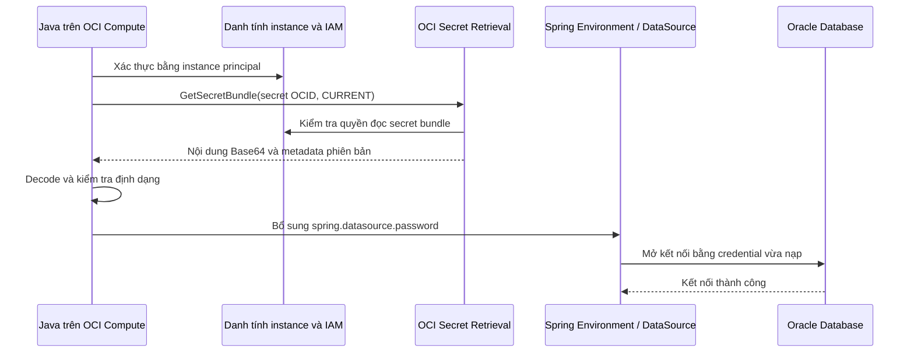

# Quản lý application configuration bằng OCI Vault

Trong chương **Triển khai Java và Spring Boot** của module `CLOUD_PROVIDERS_ORACLE`, bài học này hướng dẫn tách thông tin nhạy cảm khỏi mã nguồn, lưu chúng bằng OCI Secret Management trong Vault, rồi đưa vào cấu hình Spring Boot đúng thời điểm khởi động. Trọng tâm là một ứng dụng Java chạy trên OCI Compute, có IAM giới hạn quyền đọc secret, đường mạng tới dịch vụ và cách triển khai lại khi đổi thông tin đăng nhập cơ sở dữ liệu.

OCI Vault tham gia vào một chuỗi vận hành gồm tenancy, compartment, danh tính workload, mạng VCN và dịch vụ đích. Lưu được mật khẩu chỉ là một phần của bài toán: ứng dụng còn cần đọc đúng phiên bản, không làm lộ nội dung và tiếp tục phục vụ theo phương án tính sẵn sàng đã chọn.

## 1. Mục tiêu và tình huống triển khai

Giả sử `orders-service` là ứng dụng Spring Boot kết nối Oracle Database bằng JDBC. Bản phát hành chứa mã ứng dụng, còn môi trường triển khai quyết định địa chỉ cơ sở dữ liệu, tài khoản và secret được sử dụng.

Sau bài học, người học có thể:

- Phân biệt cấu hình thông thường, secret và khóa dùng để mã hóa secret.
- Thiết kế dynamic group và policy đọc một secret cụ thể.
- Lấy secret bằng OCI Java SDK, giải mã Base64 và đưa vào Spring `Environment` trước khi tạo các bean phụ thuộc.
- Chọn giữa đọc trực tiếp bằng SDK và cấp cấu hình qua file được mount.
- Lập quy trình xoay vòng, triển khai lại, giám sát và phục hồi phù hợp với khả năng của cơ sở dữ liệu.

Ví dụ mã dùng Java 17, ứng dụng Spring Boot 3.x đã có JDBC starter, driver Oracle và cấu hình đóng gói executable JAR. SDK được ghim ở một phiên bản cụ thể để người học biết bộ dependency đang sử dụng; không mặc định đây là phiên bản mới nhất. Các đoạn lệnh Bash bên dưới dành cho máy OCI Linux và chỉ là hướng dẫn thực hành.

## 2. Tách cấu hình theo mức độ nhạy cảm

Không nên đưa toàn bộ `application.yml` vào Vault. Trước hết hãy phân loại dữ liệu và xác định nơi quản lý phù hợp.

| Dữ liệu | Ví dụ | Nơi quản lý đề xuất trong bài |
| --- | --- | --- |
| Giá trị mặc định của ứng dụng | Tên dịch vụ, cỡ pool mặc định | `application.yml` trong dự án |
| Cấu hình triển khai | Profile, region, JDBC URL không chứa credential | Biến môi trường hoặc file cấu hình theo môi trường |
| Tham chiếu secret | OCID của secret mật khẩu | Cấu hình triển khai có kiểm soát |
| Giá trị nhạy cảm | Mật khẩu JDBC, client secret, token của dịch vụ ngoài | OCI Secret Management |
| Khóa mã hóa | Master encryption key bảo vệ secret | OCI Key Management |

OCID là định danh tài nguyên, không phải credential thay thế cho mật khẩu. Có OCID không đồng nghĩa có quyền đọc nội dung; IAM mới quyết định quyền đó. Dù vậy, không cần công khai cấu trúc tài nguyên nội bộ trong trang lỗi hoặc log dành cho khách hàng.

Ví dụ cấu hình công khai với ứng dụng:

```yaml
spring:
  application:
    name: orders-service
  datasource:
    url: ${DB_JDBC_URL}
    username: ${DB_USERNAME}
    hikari:
      maximum-pool-size: 10
      connection-timeout: 10000
```

Trong phương án SDK của bài, `spring.datasource.password` được bổ sung từ Vault. Không thêm mật khẩu mặc định để ứng dụng tự chạy tiếp khi không lấy được secret. JDBC URL trong ví dụ phải không chứa mật khẩu; việc bảo vệ mật khẩu không thay thế yêu cầu mã hóa đường truyền JDBC.

## 3. Hiểu các thành phần của OCI Vault

Có bốn khái niệm cần tách biệt:

| Thành phần | Vai trò |
| --- | --- |
| Vault | Không gian quản lý tài nguyên khóa và các secret liên quan |
| Master encryption key | Khóa bảo vệ dữ liệu secret; không phải mật khẩu của ứng dụng |
| Secret | Tài nguyên có OCID, metadata và các phiên bản nội dung |
| Secret bundle | Dữ liệu lấy về cho một phiên bản, gồm nội dung và thông tin phiên bản |

Khi tạo secret, chọn khóa mã hóa đối xứng phù hợp trong vault. Console có thể nhận văn bản và chuyển sang Base64 trước khi gửi dịch vụ. **Base64 là mã biểu diễn dữ liệu, không phải thuật toán mã hóa bảo mật.** Sau khi đọc bundle, ứng dụng vẫn cần chuyển nội dung Base64 thành các byte hoặc văn bản mà nó sử dụng. Xem [hướng dẫn tạo secret của Oracle](https://docs.oracle.com/en-us/iaas/Content/secret-management/Tasks/create-secret.htm) và [kiểu nội dung Base64 trong Java SDK](https://docs.oracle.com/en-us/iaas/tools/java/latest/com/oracle/bmc/secrets/model/Base64SecretBundleContentDetails.html).

Mật khẩu cơ sở dữ liệu và khóa mã hóa có vòng đời độc lập. Đổi phiên bản master key không đồng nghĩa đổi mật khẩu người dùng Oracle Database. Ngược lại, tạo một phiên bản secret mới cũng không tự thực hiện câu lệnh đổi mật khẩu trong cơ sở dữ liệu nếu chưa cấu hình một quy trình tích hợp làm việc đó.

Ứng dụng chỉ cần nhận được giá trị cuối cùng qua Secret Retrieval API. Không cần tự gọi API KMS `Decrypt` cho nội dung bundle, cũng không cần được cấp quyền quản trị vault chỉ để đọc mật khẩu.

## 4. Kiến trúc tham chiếu và thứ tự khởi động



Trong mô hình này, credential được đọc một lần cho mỗi tiến trình ứng dụng. Những request nghiệp vụ sau đó dùng connection pool; chúng không gọi Vault để lấy lại mật khẩu.

Điểm quyết định là thời điểm nạp cấu hình. Nếu đợi tới `ApplicationRunner`, `CommandLineRunner` hoặc một bean có `@PostConstruct`, `DataSource` có thể đã được khởi tạo. Bổ sung mật khẩu lúc ấy không bảo đảm sửa được cấu hình của pool đã tạo.

Ví dụ sẽ lấy secret trước `SpringApplication.run(...)`, sau đó dùng `ApplicationContextInitializer` thêm property source trước khi context refresh và tạo bean. Đây là cách tích hợp phục vụ các property của bean như `DataSource`. Nếu muốn secret chi phối các thiết lập được xử lý sớm hơn, cần thiết kế tích hợp vào giai đoạn cấu hình tương ứng, thay vì giả định initializer này phù hợp cho mọi property. Spring cung cấp [API khởi động và đăng ký initializer](https://docs.spring.io/spring-boot/api/java/org/springframework/boot/SpringApplication.html).

## 5. Chuẩn bị tài nguyên và danh tính

### 5.1. Phân chia phạm vi

Ví dụ sử dụng các tên quy ước sau; hãy thay bằng tài nguyên thật trong tenancy của bạn:

| Tài nguyên | Tên hoặc giá trị quy ước |
| --- | --- |
| Compartment chứa ứng dụng | `AppProd` |
| Compartment chứa secret | `SecurityProd` |
| Dynamic group | `OrdersProdInstances` |
| Secret | `orders-prod-db-password` |
| Region | `ap-singapore-1` |

Máy Compute và secret có thể ở các compartment khác nhau. Policy phải chỉ đúng compartment chứa secret, không mặc nhiên dùng compartment của máy Compute.

Đối với thực hành, người quản trị chuẩn bị vault, khóa mã hóa và secret có nội dung là mật khẩu UTF-8 của một tài khoản cơ sở dữ liệu chuyên dùng cho ứng dụng. Không đặt credential thật trong tên, mô tả, tag hoặc ảnh chụp minh họa. Tài khoản tạo và xoay vòng secret cần quyền quản trị phù hợp, tách với quyền chỉ đọc của ứng dụng.

### 5.2. Dynamic group của máy Compute

Để bài thực hành chỉ áp dụng cho một máy, dùng matching rule theo instance OCID:

```text
ALL {instance.id = '<COMPUTE_INSTANCE_OCID>'}
```

Khi sử dụng instance pool, có thể thiết kế rule theo compartment và defined tag được quản lý chặt. Ai có quyền tạo máy hoặc đổi tag ảnh hưởng đến membership cũng có thể tác động đến phạm vi quyền được cấp. Vì vậy, mở rộng rule là một quyết định về IAM, không chỉ là thao tác thuận tiện cho autoscaling. Cú pháp rule được mô tả trong [Writing Matching Rules to Define Dynamic Groups](https://docs.oracle.com/en-us/iaas/Content/Identity/dynamicgroups/Writing_Matching_Rules_to_Define_Dynamic_Groups.htm).

Instance principal giúp workload trên Compute xác thực mà không phải phân phối private key của một người dùng vào image hay file cấu hình ứng dụng. Quyền này gắn với instance: cần kiểm soát người và tiến trình có thể truy cập máy, không coi đó là danh tính riêng cho từng ứng dụng cùng chạy trên máy. Xem [Calling Services from an Instance](https://docs.oracle.com/en-us/iaas/Content/Identity/Tasks/callingservicesfrominstances.htm).

### 5.3. Policy đọc đúng secret

Policy mẫu dưới đây dùng dynamic group trong identity domain mặc định. Với domain khác, dùng cách định danh principal theo cấu hình IAM của tenancy.

```text
Allow dynamic-group OrdersProdInstances to read secret-bundles in compartment SecurityProd where target.secret.id = '<DB_PASSWORD_SECRET_OCID>'
```

Thay placeholder bằng OCID thật và tạo policy tại vị trí trong cây compartment có quyền bao phủ phạm vi cần cấp. Đây là quyền lấy nội dung secret, khác với quyền đọc metadata của tài nguyên `secrets`. Phân biệt này được thể hiện trong [bảng quyền Vault, Key Management và Secret Management](https://docs.oracle.com/en-us/iaas/Content/Identity/Reference/keypolicyreference.htm). Oracle cũng có [ví dụ policy giới hạn dynamic group theo secret OCID](https://docs.oracle.com/en-us/iaas/Content/APIGateway/Tasks/apigatewaytroubleshooting_topic-gateway_create_or_update_fails.htm).

Không cấp `manage secret-family` cho ứng dụng để xử lý một lỗi thiếu quyền đọc. Quyền tạo, sửa, xoay vòng hoặc xóa secret thuộc trách nhiệm khác. Với policy theo OCID, mỗi secret bổ sung cần được cấp quyền rõ ràng.

## 6. Kết nối từ private subnet

Có IAM đúng nhưng không có đường mạng thì ứng dụng vẫn không đọc được secret. Cần xác định endpoint Secret Retrieval theo region, bảo đảm DNS hoạt động và cho phép kết nối HTTPS ra ngoài theo thiết kế mạng.

Với private subnet, cân nhắc Service Gateway tới các dịch vụ Oracle Services Network được hỗ trợ trong cùng region, kèm route và quy tắc NSG/security list tương ứng. Nếu sử dụng endpoint công cộng qua NAT Gateway, kiểm tra đường ra và chính sách egress. Service Gateway chỉ áp dụng cho các dịch vụ nằm trong phạm vi hỗ trợ; không mặc nhiên thay mọi đường kết nối ra ngoài. Tham khảo [Access to Oracle Services: Service Gateway](https://docs.oracle.com/en-us/iaas/Content/Network/Tasks/servicegateway.htm).

Cần tách ba lớp chẩn đoán:

1. Máy có tạo được instance principal và lấy thông tin danh tính cần thiết không?
2. Máy có kết nối tới endpoint dịch vụ đúng region không?
3. IAM có cho phép principal đó đọc bundle của secret được yêu cầu không?

Không bật public IP hoặc mở rộng policy toàn tenancy chỉ để thử vượt qua một lỗi timeout. Trước hết hãy xác định lỗi thuộc mạng, xác thực hay phân quyền.

## 7. Tích hợp Java SDK vào ứng dụng Spring Boot

### 7.1. Dependency Maven

Đoạn sau bổ sung vào `pom.xml` của ứng dụng Spring Boot đã có sẵn. Không cần đưa toàn bộ OCI SDK vào ứng dụng chỉ để dùng Secret Retrieval.

```xml
<properties>
    <java.version>17</java.version>
    <oci.sdk.version>3.100.0</oci.sdk.version>
</properties>

<dependencyManagement>
    <dependencies>
        <dependency>
            <groupId>com.oracle.oci.sdk</groupId>
            <artifactId>oci-java-sdk-bom</artifactId>
            <version>${oci.sdk.version}</version>
            <type>pom</type>
            <scope>import</scope>
        </dependency>
    </dependencies>
</dependencyManagement>

<dependencies>
    <dependency>
        <groupId>com.oracle.oci.sdk</groupId>
        <artifactId>oci-java-sdk-secrets</artifactId>
    </dependency>
    <dependency>
        <groupId>com.oracle.oci.sdk</groupId>
        <artifactId>oci-java-sdk-common-httpclient-jersey3</artifactId>
    </dependency>
</dependencies>
```

Gộp các phần này vào block đang có, không tạo nhiều block cùng vai trò trong POM. SDK v3 yêu cầu lựa chọn HTTP client; ví dụ dùng Jersey 3. Giữ các module OCI cùng bộ phiên bản và kiểm tra tương thích dependency khi nâng cấp Spring Boot. Xem [Getting Started với Java SDK](https://docs.oracle.com/en-us/iaas/Content/API/SDKDocs/javasdkgettingstarted.htm), [thay đổi trong SDK v3](https://docs.oracle.com/en-us/iaas/Content/API/SDKDocs/javasdk3.htm) và [bản phát hành 3.100.0](https://github.com/oracle/oci-java-sdk/releases/tag/v3.100.0).

### 7.2. Cấu hình bootstrap không chứa giá trị secret

Trên máy Compute, tiến trình Java cần các biến môi trường sau:

```bash
export OCI_REGION="ap-singapore-1"
export OCI_DB_PASSWORD_SECRET_OCID="<DB_PASSWORD_SECRET_OCID>"
export SPRING_PROFILES_ACTIVE="prod"
export DB_JDBC_URL="jdbc:oracle:thin:@//db.internal.example:1521/ORDERS"
export DB_USERNAME="ORDERS_APP"

java -jar orders-service.jar
```

Đây là giá trị minh họa; địa chỉ, service name và phương án JDBC phải khớp với cơ sở dữ liệu thực tế. Với Autonomous Database hoặc kết nối yêu cầu TCPS/wallet, cần chuẩn bị driver, trust và wallet theo phương án xác thực của dịch vụ đó. Đọc mật khẩu từ Vault không tự hoàn tất cấu hình TLS hay cấp quyền trong database.

Trong ví dụ, mã đọc trực tiếp `System.getenv(...)` trước khi Spring chạy. Bởi vậy, `OCI_REGION` và `OCI_DB_PASSWORD_SECRET_OCID` phải tồn tại trong môi trường của tiến trình; chỉ đặt chúng trong `application-prod.yml` sẽ không đủ cho phần bootstrap này. Với systemd hoặc container, khai báo các tham chiếu đó trong cấu hình của dịch vụ triển khai.

### 7.3. Lấy mật khẩu trước khi tạo DataSource

```java
package example.orders;

import com.oracle.bmc.ClientConfiguration;
import com.oracle.bmc.Region;
import com.oracle.bmc.auth.InstancePrincipalsAuthenticationDetailsProvider;
import com.oracle.bmc.model.BmcException;
import com.oracle.bmc.retrier.RetryConfiguration;
import com.oracle.bmc.secrets.SecretsClient;
import com.oracle.bmc.secrets.model.Base64SecretBundleContentDetails;
import com.oracle.bmc.secrets.requests.GetSecretBundleRequest;
import com.oracle.bmc.secrets.responses.GetSecretBundleResponse;
import org.springframework.boot.SpringApplication;
import org.springframework.boot.autoconfigure.SpringBootApplication;
import org.springframework.core.env.MapPropertySource;

import java.nio.charset.StandardCharsets;
import java.util.Arrays;
import java.util.Base64;
import java.util.Map;

@SpringBootApplication
public class OrdersApplication {

    public static void main(String[] args) throws Exception {
        String secretId = requiredEnv("OCI_DB_PASSWORD_SECRET_OCID");
        Region region = Region.fromRegionId(requiredEnv("OCI_REGION"));
        String password = loadCurrentPassword(secretId, region);

        Map<String, Object> vaultProperties = Map.of(
                "spring.datasource.password", password
        );

        SpringApplication application =
                new SpringApplication(OrdersApplication.class);
        application.addInitializers(context ->
                context.getEnvironment().getPropertySources().addFirst(
                        new MapPropertySource(
                                "oci-vault-startup", vaultProperties
                        )
                )
        );
        application.run(args);
    }

    private static String loadCurrentPassword(
            String secretId, Region region) throws Exception {
        var provider = InstancePrincipalsAuthenticationDetailsProvider
                .builder()
                .build();

        ClientConfiguration clientConfiguration = ClientConfiguration
                .builder()
                .connectionTimeoutMillis(3000)
                .readTimeoutMillis(5000)
                .retryConfiguration(RetryConfiguration.NO_RETRY_CONFIGURATION)
                .build();

        try (SecretsClient client = SecretsClient.builder()
                .region(region)
                .configuration(clientConfiguration)
                .build(provider)) {

            GetSecretBundleResponse response = client.getSecretBundle(
                    GetSecretBundleRequest.builder()
                            .secretId(secretId)
                            .stage(GetSecretBundleRequest.Stage.Current)
                            .build()
            );

            var bundleContent = response.getSecretBundle()
                    .getSecretBundleContent();
            if (!(bundleContent instanceof
                    Base64SecretBundleContentDetails content)) {
                throw new IllegalStateException(
                        "Secret không có định dạng Base64 được hỗ trợ"
                );
            }
            if (content.getContent() == null) {
                throw new IllegalStateException("Secret không có nội dung");
            }

            byte[] decoded;
            try {
                decoded = Base64.getDecoder().decode(content.getContent());
            } catch (IllegalArgumentException invalidBase64) {
                throw new IllegalStateException("Nội dung Base64 không hợp lệ");
            }

            try {
                if (decoded.length == 0) {
                    throw new IllegalStateException("Mật khẩu trong secret rỗng");
                }
                return new String(decoded, StandardCharsets.UTF_8);
            } finally {
                Arrays.fill(decoded, (byte) 0);
            }
        } catch (BmcException error) {
            throw new IllegalStateException(
                    "Không đọc được OCI secret; HTTP="
                            + error.getStatusCode()
                            + ", code=" + error.getServiceCode()
            );
        }
    }

    private static String requiredEnv(String name) {
        String value = System.getenv(name);
        if (value == null || value.isBlank()) {
            throw new IllegalStateException(
                    "Thiếu biến môi trường bắt buộc: " + name
            );
        }
        return value;
    }
}
```

Request chỉ chọn stage `CURRENT`. Các cách chọn theo version number hoặc version name là phương án khác; không cần truyền đồng thời mọi tiêu chí. Kiểu request được mô tả trong [GetSecretBundleRequest](https://docs.oracle.com/en-us/iaas/tools/java/latest/com/oracle/bmc/secrets/requests/GetSecretBundleRequest.html).

Các quyết định trong ví dụ có ý nghĩa cụ thể:

- **Thiếu secret thì dừng khởi động:** không tạo `DataSource` bằng mật khẩu rỗng hoặc bằng một credential dự phòng giấu trong mã.
- **Nạp vào property source đầu danh sách:** `spring.datasource.password` từ Vault được ưu tiên so với những source đã có tại thời điểm thêm, kể cả biến môi trường hoặc tham số dòng lệnh. Đây là chủ đích của ví dụ; khi mở rộng ứng dụng, cần quản lý cả các source được thêm sau đó. Cơ chế thứ tự được mô tả trong [MutablePropertySources.addFirst](https://docs.spring.io/spring-framework/docs/current/javadoc-api/org/springframework/core/env/MutablePropertySources.html).
- **Không trim mật khẩu:** khoảng trắng hoặc xuống dòng có thể là một phần dữ liệu. Nếu lúc nhập secret vô tình thêm ký tự xuống dòng, sửa nội dung secret theo hợp đồng dữ liệu thay vì âm thầm sửa tại client.
- **Không in response hoặc Map:** đối tượng response và property source có chứa thông tin nhạy cảm. Chỉ ghi mã lỗi, thời gian đọc và metadata được phép quan sát.
- **Đóng client sau khi nạp:** ứng dụng này không dùng lại client trong xử lý request nghiệp vụ.

Ví dụ chỉ chấp nhận secret dạng mật khẩu văn bản UTF-8. Nếu secret chứa JSON, cần parse và kiểm tra schema trước khi ánh xạ từng property; không sử dụng cả chuỗi JSON làm mật khẩu JDBC.

Mảng byte đã decode được xóa sau khi chuyển sang `String`, nhưng việc đó không xóa các bản sao `String` đang tồn tại trong SDK, Spring hoặc JDBC. Giảm thời gian tồn tại của secret và kiểm soát heap dump, core dump, quyền debug vẫn là yêu cầu vận hành.

### 7.4. Timeout và retry của ví dụ

Để luồng thực hành rõ ràng, client đọc secret được cấu hình không tự retry, với connect timeout 3 giây và read timeout 5 giây. Đây không phải cam kết rằng toàn bộ bootstrap kết thúc trong 8 giây: tạo instance principal, DNS và các bước xác thực có thể có thời gian chờ riêng. Java SDK cung cấp [ClientConfiguration](https://docs.oracle.com/en-us/iaas/tools/java/latest/com/oracle/bmc/ClientConfiguration.ClientConfigurationBuilder.html) và [RetryConfiguration](https://docs.oracle.com/en-us/iaas/tools/java/latest/com/oracle/bmc/retrier/RetryConfiguration.html) cho các lựa chọn này.

Khi đưa vào vận hành, đặt ngân sách thời gian khởi động tổng thể. Chỉ retry hữu hạn với lỗi có khả năng tạm thời, như throttling hoặc một số lỗi dịch vụ; dùng backoff và jitter, rồi kết thúc khi vượt ngân sách. Không retry vô hạn lỗi sai policy, sai secret ID hay dữ liệu không hợp lệ. Tránh cộng dồn retry của SDK, vòng lặp của ứng dụng và chính sách restart của nền tảng thành một luồng chờ khó dự đoán.

### 7.5. Chạy trên máy phát triển và nền tảng khác

Mã trên được thiết kế chạy trong OCI Compute. Trên laptop, instance principal không có môi trường danh tính tương ứng. Có thể xây một chế độ phát triển riêng dùng `ConfigFileAuthenticationDetailsProvider` với OCI config profile và policy tối thiểu của người phát triển; không sao chép file private key đó vào image sản xuất. Java SDK hướng dẫn cách cấu hình provider trong [Getting Started](https://docs.oracle.com/en-us/iaas/Content/API/SDKDocs/javasdkgettingstarted.htm).

Với OCI Functions, OKE hoặc nền tảng khác, chọn cơ chế danh tính workload được nền tảng hỗ trợ. Đặc biệt, không mặc nhiên dùng quyền instance của worker node làm danh tính riêng cho từng pod OKE. Phần Java còn lại có thể được tổ chức để nhận một authentication provider phù hợp, nhưng cách cấp danh tính và policy phải được thiết kế cho môi trường triển khai đó.

## 8. Phương án cấp secret qua file cấu hình

Đọc SDK trong ứng dụng phù hợp khi nhóm phát triển muốn kiểm soát trực tiếp bootstrap. Một phương án khác là để thành phần triển khai được cấp quyền đọc Vault, rồi cấp file cho ứng dụng. Thành phần đó chịu trách nhiệm xác thực OCI, lấy secret, quyền file, cập nhật và vòng đời dữ liệu.

Ví dụ thư mục được mount chỉ đọc:

```text
/run/secrets/orders/
└── spring.datasource.password
```

Trong phương án file, bỏ phần bootstrap SDK và khai báo:

```yaml
spring:
  config:
    import: "configtree:/run/secrets/orders/"
```

Spring Boot dùng tên file làm property và nội dung làm giá trị. Không dùng `optional:` nếu thiếu thư mục phải khiến ứng dụng dừng. Riêng việc thiếu file bắt buộc trong một thư mục còn tồn tại vẫn cần kiểm tra cấu hình, không được suy ra rằng chỉ có import là đã xác thực đủ mọi property. Tham khảo [Externalized Configuration: configuration trees](https://docs.spring.io/spring-boot/reference/features/external-config.html).

Cần nhớ rằng `configtree:` đọc file; nó không tự liên hệ OCI Vault. Spring Boot cũng không mặc định hiểu một location như `oci-vault:` nếu chưa có thư viện tích hợp hoặc phần triển khai resolver/loader tương ứng.

| Tiêu chí | SDK trong tiến trình Java | Thành phần triển khai cấp file |
| --- | --- | --- |
| Nơi chứa logic OCI | Bootstrap ứng dụng | Agent, init job hoặc công cụ triển khai |
| Nơi có quyền đọc Vault | Danh tính workload chạy ứng dụng | Danh tính thành phần lấy secret |
| Bản sao trên filesystem | Không cần tạo file plaintext | Cần quản lý file và mount |
| Khi thay đổi giá trị | Ví dụ đọc lại khi khởi động | Phụ thuộc cơ chế cập nhật file và cách ứng dụng nạp lại |
| Trách nhiệm vận hành | SDK, timeout và xử lý lỗi trong app | Cấp file an toàn, quyền truy cập và đồng bộ dữ liệu |

Không chạy đồng thời hai phương án một cách vô thức. Nếu vừa mount file vừa `addFirst` source từ SDK, cần biết rõ nguồn nào đang thắng và thời điểm nào giá trị được lấy. Với file, ưu tiên vùng lưu trữ tạm phù hợp, quyền đọc tối thiểu và tránh đưa nội dung vào image, artifact hoặc bản backup không được kiểm soát.

## 9. Phiên bản secret và chiến lược xoay vòng

### 9.1. Chọn đúng stage

| Stage | Ý nghĩa khi lựa chọn phiên bản |
| --- | --- |
| `CURRENT` | Phiên bản được đánh dấu đang dùng |
| `PENDING` | Phiên bản chuẩn bị, chưa được đưa vào dùng hiện hành |
| `LATEST` | Phiên bản có nội dung được đưa lên gần nhất |
| `PREVIOUS` | Phiên bản từng là current ngay trước lần chuyển gần nhất |
| `DEPRECATED` | Phiên bản không giữ vai trò current, pending hoặc previous |

Một phiên bản có thể mang nhiều nhãn; chẳng hạn bản đầu tiên có thể vừa `CURRENT` vừa `LATEST`. Vì bản vừa tải lên có thể còn là `PENDING`, lựa chọn `LATEST` không bảo đảm lấy credential đang được hệ thống đích chấp nhận. Xem [Managing Secrets](https://docs.oracle.com/en-us/iaas/Content/secret-management/Concepts/manage-secrets.htm).

Với ứng dụng thông thường, đọc `CURRENT` giúp tách việc tạo phiên bản khỏi quyết định đưa phiên bản đó vào sử dụng. Với một đợt phát hành cần ghim phiên bản, có thể thiết kế đọc theo version number và theo dõi credential đó tới khi kết thúc cửa sổ sử dụng. Dù chọn cách nào, các replica phải có thông tin để người vận hành biết chúng đang dùng phiên bản nào.

### 9.2. Ba trạng thái cần đồng bộ

Một lần xoay vòng thành công phải thống nhất được ba nơi:

1. Phiên bản secret được Vault đánh dấu là current.
2. Credential mà Oracle Database thực sự chấp nhận.
3. Credential mà các tiến trình ứng dụng và connection pool đang giữ.

Trong ví dụ Java, đổi current trong Vault không thay thế giá trị đã nằm trong `MapPropertySource`, cũng không cấu hình lại HikariCP. Cần triển khai lại tiến trình hoặc bổ sung một cơ chế refresh cùng quản lý pool được thiết kế riêng. Một giá trị mới trong file mount cũng không tự chứng minh pool đang dùng mật khẩu mới.

### 9.3. Quy trình khi hệ thống đích hỗ trợ thời gian chồng lấn

Nếu cơ sở dữ liệu hoặc cách quản lý tài khoản đã được xác nhận cho phép credential cũ và mới cùng có hiệu lực trong một khoảng thời gian, có thể thực hiện:

1. Tạo credential mới bằng quy trình quản trị phù hợp và lưu phiên bản `PENDING`.
2. Cấu hình hệ thống đích để chấp nhận credential mới trong khi credential cũ vẫn còn hợp lệ.
3. Từ một canary, kiểm tra **kết nối mới** bằng phiên bản pending.
4. Chuyển phiên bản đã kiểm chứng thành `CURRENT`.
5. Triển khai lần lượt các replica; chờ mỗi replica đọc secret và kết nối database thành công trước khi nhận lưu lượng.
6. Xác nhận không còn tiến trình hoặc tác vụ nền cần credential cũ, rồi kết thúc thời gian chồng lấn theo quy trình database.

Đây là quy trình thiết kế cho tình huống có chồng lấn, không phải khả năng mặc định được giả định cho mọi Oracle Database. Cần xác minh phiên bản, cấu hình và tính năng quản lý password của hệ thống đích trước khi chọn cách này.

Nếu hệ thống chỉ chấp nhận một mật khẩu tại một thời điểm, đổi password có thể khiến các lần mở kết nối mới từ replica cũ thất bại. Cần cửa sổ bảo trì hoặc một phương án chuyển đổi tài khoản đã được chuẩn bị. Không mô tả rolling restart đơn thuần là cách bảo đảm không gián đoạn trong trường hợp đó.

Rollback cũng phải đồng bộ cả hai phía: đưa một phiên bản cũ về current chỉ có tác dụng nếu database vẫn chấp nhận credential đó hoặc đã được phục hồi theo quy trình tương ứng. Còn giữ `PREVIOUS` trong Vault không đồng nghĩa credential cũ còn hiệu lực ở database.

## 10. Tính sẵn sàng, cache và phục hồi vùng

Đọc secret lúc khởi động tạo một phụ thuộc rõ ràng: replica mới cần truy cập được Vault, còn replica đang chạy có thể tiếp tục dùng giá trị đã nạp nếu database vẫn chấp nhận nó. Khi dịch vụ secret tạm lỗi, tránh restart hàng loạt toàn bộ replica đang khỏe mạnh.

Với phương án trong bài, bản sao trong bộ nhớ chính là cache cho vòng đời tiến trình. Không gọi Vault cho từng request nghiệp vụ hoặc cho từng health check. Nếu bổ sung cache có TTL, cần xác định khi nào refresh, mức độ cũ tối đa được chấp nhận và cách thay client/pool sau khi refresh; TTL tự nó không giải quyết việc áp dụng giá trị mới.

Có thể chọn tiếp tục dùng credential đã biết là hợp lệ khi refresh tạm lỗi, nhưng chỉ trong một chính sách được xác định trước. Không âm thầm chuyển sang mật khẩu mặc định hoặc một file cũ không có thông tin phiên bản. Nếu credential đã bị thu hồi, giữ nó trong cache không phục hồi được khả năng đăng nhập.

Kế hoạch phục hồi vùng cần kiểm tra cả secret, khóa bảo vệ, endpoint, danh tính, policy, cấu hình triển khai và cơ sở dữ liệu ở vùng đích. Không mặc định tạo vault ở một region làm cho mọi region khác có đủ tài nguyên tương đương. Nếu dùng tính năng replication được hỗ trợ, cần kiểm tra trạng thái thực tế và tham chiếu mà ứng dụng ở vùng dự phòng sử dụng. Thực hành chuyển vùng phải bao gồm việc một tiến trình mới đọc được secret và tạo được kết nối mới.

## 11. Quan sát và kiểm soát chi phí

Các tín hiệu nên thu thập do ứng dụng hoặc nền tảng triển khai phát ra:

| Tín hiệu | Mục đích |
| --- | --- |
| Thời gian bootstrap lấy secret | Phân biệt chậm ở Vault với chậm tạo pool |
| Số lần lấy secret thất bại theo nhóm lỗi | Nhận diện lỗi policy, xác thực, throttling hoặc mạng |
| Phiên bản secret đã nạp, thời điểm nạp | Đối chiếu tiến độ xoay vòng giữa các replica |
| Kết quả tạo kết nối database mới | Phát hiện sai credential dù phiên đang mở vẫn còn hoạt động |
| Số replica chưa sẵn sàng sau rollout | Dừng phát hành trước khi ảnh hưởng toàn bộ dịch vụ |

Phiên bản có thể lấy từ `response.getSecretBundle().getVersionNumber()` trong luồng Java. Chỉ xuất metadata đã được cho phép; không serialize toàn bộ response để ghi nhận một field. Dùng tên metric ổn định và nhãn có số lượng giá trị được kiểm soát.

Bảo vệ các endpoint Actuator có thể phản ánh cấu hình, như `env` và `configprops`; không công khai chúng hoặc phụ thuộc hoàn toàn vào cơ chế che giá trị mặc định. Không ghi plaintext, Base64, hash của mật khẩu hoặc chuỗi kết nối có credential vào log. Hash mật khẩu entropy thấp vẫn có thể hỗ trợ việc dò đoán nên không phải một nhãn quan sát thích hợp.

Khi điều tra bằng OCI Audit, đối chiếu khoảng thời gian, principal, thao tác API và request ID nếu có. Xác minh loại sự kiện thực sự được hệ thống ghi nhận trước khi coi Audit là nguồn thống kê đầy đủ cho mọi lần đọc; metric của ứng dụng vẫn cần thiết để thấy ảnh hưởng đến khởi động.

Về chi phí, tránh thiết kế gọi dịch vụ theo lưu lượng HTTP của ứng dụng. Theo dõi số secret, phiên bản, loại vault/key được chọn và các tài nguyên phát sinh của phương án mạng, logging, monitoring, replication. Ước lượng theo mô hình giá và giới hạn đang áp dụng trong tenancy; không giả định mọi lựa chọn Vault đều miễn phí hoặc có cùng đơn vị tính. Dọn các tài nguyên thực hành bằng quy trình được phê duyệt, không xóa secret hay key mà workload khác còn dùng.

## 12. Thực hành theo luồng hoàn chỉnh

### Bước 1: Chuẩn bị một môi trường thử nghiệm tách biệt

Sử dụng tài khoản database của môi trường thử nghiệm và quyền tạo tài nguyên đã được cấp. Xác nhận ứng dụng đã có thể kết nối database khi cung cấp credential hợp lệ bằng cơ chế cấu hình hiện tại; bước này giúp phân biệt lỗi JDBC, mạng database và lỗi tích hợp Vault.

### Bước 2: Tạo secret và quyền đọc

Tạo secret từ credential thử nghiệm, ghi lại secret OCID và region. Đặt matching rule cho đúng Compute instance rồi cấp policy chỉ đọc bundle của secret đó. Sau thay đổi IAM, cần tính đến thời gian lan truyền quyền; không mở rộng phạm vi quyền chỉ vì kết quả chưa xuất hiện tức thì.

### Bước 3: Kiểm tra khả năng lấy bundle mà không in mật khẩu

Trên máy Compute có OCI CLI, kiểm tra bằng instance principal và chỉ in số phiên bản:

```bash
oci secrets secret-bundle get \
  --secret-id "$OCI_DB_PASSWORD_SECRET_OCID" \
  --stage CURRENT \
  --region "$OCI_REGION" \
  --auth instance_principal \
  --query 'data."version-number"' \
  --raw-output
```

Lệnh thực sự lấy bundle, còn truy vấn đầu ra chỉ chọn metadata. Không bật shell tracing, HTTP debug hoặc in toàn bộ output. Thành công với CLI xác nhận một phần IAM và mạng trên máy đó; vẫn phải xác nhận tiến trình Java chạy trong đúng môi trường và có dependency phù hợp. Cú pháp lấy bundle được Oracle mô tả tại [Getting a Secret’s Contents](https://docs.oracle.com/en-us/iaas/Content/secret-management/Tasks/get-secrets-contents.htm).

### Bước 4: Áp dụng bootstrap Java và khởi động ứng dụng

Bổ sung dependency, sử dụng luồng khởi động trong bài và cấu hình các biến môi trường bắt buộc. Xóa nguồn cấp mật khẩu cũ khỏi cấu hình triển khai để tránh nhầm lẫn. Kỳ vọng là tiến trình đọc `CURRENT`, tạo được pool và chỉ được đánh dấu sẵn sàng sau khi kiểm tra khả năng phục vụ có liên quan hoàn tất.

Không chỉ dựa vào thông báo web server đã mở cổng: một pool có thể chưa mở kết nối cho đến lúc dùng. Kiểm tra database bằng health check hoặc thao tác thử có kiểm soát, không gây thay đổi nghiệp vụ ngoài ý muốn.

### Bước 5: Kiểm chứng đường lỗi trong môi trường thử nghiệm

Thử bỏ biến OCID hoặc dùng một secret thử nghiệm mà instance không có quyền đọc. Tiến trình phải dừng trước khi phục vụ request; log không được chứa nội dung secret. Sau đó khôi phục cấu hình hợp lệ. Nếu thử thu hồi policy hoặc thay đổi matching rule, cần chờ thay đổi có hiệu lực trước khi kết luận.

### Bước 6: Thử xoay vòng có điều phối

Tạo phiên bản pending, áp dụng quy trình phù hợp với khả năng của database rồi đưa bản đã kiểm chứng thành current. Triển khai lại một replica trước; kiểm tra nó đã tạo **kết nối mới** bằng credential mới. Tiếp tục các replica còn lại và kết thúc credential cũ theo kế hoạch.

Kết quả mong đợi là artifact không chứa mật khẩu, đúng workload đọc được đúng secret, lỗi bootstrap khiến replica không sẵn sàng, và lần xoay vòng có bằng chứng kết nối mới thành công. Các bước này là hướng dẫn cho người học, không phải khẳng định tài nguyên OCI đã được tạo hoặc mã ví dụ đã được chạy trong một tenancy cụ thể.

## 13. Chẩn đoán lỗi thường gặp

| Hiện tượng | Hướng kiểm tra |
| --- | --- |
| Không tạo được instance principal | Có chạy trên Compute phù hợp không; truy cập metadata và dịch vụ xác thực có bị chặn không |
| HTTP 401 | Danh tính, token/chứng chỉ, thời gian hệ thống và luồng ký request |
| Lỗi `NotAuthorizedOrNotFound` hoặc tương tự | Cả quyền lẫn sự tồn tại của tài nguyên; kiểm tra OCID, region, matching rule, policy và compartment chứa secret |
| Có thể xem metadata nhưng không lấy được nội dung | Policy có cấp `read secret-bundles` hay chỉ cấp quyền trên `secrets` |
| Timeout khi gọi dịch vụ | DNS, endpoint/region, route, Service Gateway hoặc NAT, egress và cấu hình proxy |
| Lỗi không tìm thấy HTTP provider | Đã khai báo HTTP client SDK v3; dependency có xung đột hoặc thiếu khi đóng gói không |
| Database báo sai mật khẩu | Nội dung được decode đúng một lần chưa; có ký tự xuống dòng, sai tài khoản hoặc chưa đồng bộ với database không |
| Vault đổi current nhưng ứng dụng vẫn dùng giá trị cũ | Tiến trình đã nạp từ startup; kiểm tra việc triển khai lại và vòng đời connection pool |
| Máy cá nhân chạy lỗi còn Compute chạy được | Mã đang chọn instance principal; máy phát triển cần provider và quyền riêng phù hợp |
| Chạy được với CLI nhưng service Java lỗi | Môi trường của service, user chạy, proxy, region, dependency và cơ chế danh tính có thực sự giống không |

Không suy ra tài nguyên không tồn tại chỉ từ một lỗi có thể che giấu trạng thái phân quyền. Khi gửi thông tin điều tra, dùng mã lỗi và định danh request đã được phép chia sẻ; không gửi response bundle.

## 14. Các quyết định cần ghi lại cho triển khai thật

Trước khi sử dụng mô hình này cho một dịch vụ, nhóm phát triển và vận hành cần thống nhất:

- Danh tính nào được đọc từng secret và ai có thể sửa các điều kiện cấp quyền đó.
- Nguồn nào được quyền quyết định các property nhạy cảm, cùng quy tắc ưu tiên khi có nhiều nguồn.
- Thời điểm nạp, ngân sách timeout/retry và điều kiện đưa replica vào nhận lưu lượng.
- Cách đồng bộ credential giữa Vault, database và connection pool khi xoay vòng hoặc rollback.
- Dữ liệu quan sát được phép ghi lại, quyền truy cập diagnostics và cách xử lý dump bộ nhớ.
- Điều kiện phục hồi vùng và việc kiểm chứng một tiến trình mới có thể kết nối database tại vùng dự phòng.

Những quyết định đó biến Vault thành một phần có thể vận hành của hạ tầng OCI: IAM xác định ai được đọc, mạng xác định đường truy cập, bootstrap xác định thời điểm áp dụng, còn quy trình xoay vòng bảo đảm secret trong ứng dụng luôn phù hợp với hệ thống đích.
