# Kết nối Spring Boot với Oracle Database và UCP

## 1. Mục tiêu và bối cảnh triển khai trên OCI

Trong chương **Triển khai Java và Spring Boot** của module **CLOUD_PROVIDERS_ORACLE**, việc kết nối database là điểm giao nhau giữa mã ứng dụng, mạng OCI, danh tính, bí mật và năng lực xử lý của Oracle Database. Một ứng dụng khởi động thành công chưa chứng minh rằng nó đã kết nối đúng database, đúng service và đúng tài khoản.

Bài học xây dựng một cấu hình Spring Boot sử dụng Oracle JDBC Thin và **Universal Connection Pool — UCP**. Cùng cấu hình này có thể phục vụ ứng dụng chạy trên OCI Compute hoặc Oracle Kubernetes Engine (OKE), với thông tin kết nối được cung cấp theo môi trường.

Sau khi hoàn thành, người học có thể:

- Phân biệt JDBC driver, `DataSource`, UCP, database service và database user.
- Kết nối tới Oracle Database bằng service name hoặc TNS alias; hiểu trường hợp Autonomous Database dùng TLS hoặc mTLS.
- Buộc Spring Boot sử dụng UCP và xác minh pool thực tế.
- Thực hiện truy vấn có bind parameter và transaction do Spring quản lý.
- Đặt giới hạn pool, timeout, health check và phương án xoay vòng thông tin xác thực phù hợp với triển khai OCI.
- Khoanh vùng lỗi theo lớp mạng, TLS, xác thực, phân quyền và sử dụng pool.

**Phạm vi ví dụ:** Java 21, một dự án Maven đã dùng parent hoặc BOM Spring Boot **3.5.x**, Oracle JDBC/UCP dòng **23.x** được BOM quản lý, cùng Oracle Database tương thích. Đây là nền cấu hình minh họa, không phải tuyên bố phiên bản mới nhất. Khi áp dụng, chốt phiên bản vá trong dự án và đối chiếu ma trận JDK–driver–database của Oracle; không suy khả năng tương thích chỉ từ tên `ojdbc11`.

Các khối `pom.xml`, `application.yml`, SQL và Java bên dưới là nội dung để người học đưa vào **dự án thực hành của mình**. Các hostname, service và đường dẫn wallet đều là ví dụ cần thay bằng giá trị của môi trường.

## 2. Đường đi của một lần truy cập database

```mermaid
flowchart LR
    Request["HTTP request hoặc background job"]
    Spring["Spring service / transaction"]
    JDBC["JdbcTemplate hoặc JPA"]
    UCP["UCP DataSource trong mỗi JVM"]
    Driver["Oracle JDBC Thin"]
    Network["DNS, route, NSG, TLS"]
    Service["Oracle Database service"]
    Schema["Database user và quyền trên schema"]

    Request --> Spring --> JDBC --> UCP --> Driver
    Driver --> Network --> Service --> Schema
```



| Thành phần | Nhiệm vụ | Nhầm lẫn thường gặp |
| --- | --- | --- |
| Oracle JDBC Thin | Triển khai giao tiếp JDBC tới Oracle Database bằng Java | Thêm driver được cho là đã có pool |
| `javax.sql.DataSource` | Giao diện lấy kết nối | Giao diện được coi là một cơ chế pooling cụ thể |
| UCP `PoolDataSourceImpl` | Quản lý, cho mượn, nhận lại và loại bỏ kết nối | Mỗi HTTP request tạo một pool mới |
| `oracle.jdbc.pool.OracleDataSource` | Connection factory tạo kết nối vật lý cho UCP | Gán tên factory này vào `driver-class-name` |
| Database service | Điểm truy cập logic và chính sách phục vụ workload | Nhầm service name với SID hoặc tên schema |
| Database user | Đăng nhập và được cấp quyền SQL | Nhầm với người dùng hoặc policy OCI IAM |

Một pool chứa các kết nối vật lý tới database. Ứng dụng mượn một connection handle để thực hiện công việc, sau đó trả lại. Trong trường hợp bình thường, `Connection.close()` trên kết nối được mượn trả connection về pool; kết nối vật lý có thể tiếp tục được sử dụng.

UCP thuộc **từng tiến trình JVM**. Nếu ứng dụng có bốn replica thì có bốn pool riêng, kể cả khi các replica dùng cùng tên pool. Một tên như `orders-ucp` chỉ giúp nhận diện pool; nó không tạo ra một pool dùng chung cho cả cluster.

Spring Boot 3 sử dụng Jakarta cho nhiều API ứng dụng, nhưng JDBC vẫn dùng `java.sql.*` và `javax.sql.DataSource`. Không thay import thành `jakarta.sql.DataSource`.

## 3. Chuẩn bị kết nối và danh tính đúng lớp

### 3.1. Thu thập thông tin từ database đích

Trước khi viết cấu hình, cần xác định:

1. Database nằm ở loại dịch vụ nào: Base Database Service, Exadata hay Autonomous Database.
2. Endpoint là private hay public; ứng dụng có đường mạng tới endpoint đó không.
3. Hostname, cổng, **service name** hoặc **TNS alias** cần sử dụng.
4. Cơ chế bảo vệ đường truyền: TCP trong lab, TCPS/TLS hoặc mTLS.
5. Tài khoản database dành cho ứng dụng và quyền trên từng đối tượng.
6. Giới hạn kết nối, workload service và ngân sách tài nguyên dành cho ứng dụng.

Ví dụ Easy Connect sử dụng service name:

```text
jdbc:oracle:thin:@//db.internal.example:1521/orderspdb.example
```

Trong ví dụ này:

- `db.internal.example` là hostname có thể phân giải từ nơi ứng dụng chạy.
- `1521` là cổng listener của môi trường minh họa.
- `orderspdb.example` là **service name**, không phải username.

Dạng SID cũ có hình thức khác:

```text
jdbc:oracle:thin:@db.internal.example:1521:ORCL
```

Không chuyển tùy tiện giữa hai dạng. Với PDB và dịch vụ cloud, lấy đúng chuỗi service do quản trị viên hoặc OCI Console cung cấp.

### 3.2. Kết nối riêng tư trong OCI

Với database có private endpoint, ứng dụng phải có khả năng phân giải DNS và định tuyến tới địa chỉ riêng của endpoint. Compute trong cùng VCN thường có đường đi khác với laptop ngoài OCI; kết nối được từ máy quản trị không bảo đảm kết nối được từ pod ứng dụng.

Kiểm tra lần lượt DNS, route và các quy tắc ingress/egress áp dụng cho nguồn lẫn đích. Chỉ cho phép nguồn ứng dụng cần thiết truy cập cổng database. Với Autonomous Database, cổng phụ thuộc chuỗi kết nối và chế độ TLS/mTLS; không áp đặt `1521` hoặc `1522` cho mọi trường hợp. Oracle mô tả cách đặt quy tắc private endpoint trong [Configure Network Access with Private Endpoints](https://docs.oracle.com/en-us/iaas/autonomous-database-serverless/doc/private-endpoints-autonomous.html).

Có thể kiểm tra TCP trên Windows từ một máy **có cùng đường mạng phù hợp**:

```powershell
Resolve-DnsName db.internal.example
Test-NetConnection db.internal.example -Port 1521
```

TCP thành công chỉ chứng minh rằng một đường kết nối tới cổng đã mở được. Nó chưa xác minh service name, TLS, tài khoản hoặc quyền SQL. Trong OKE, cần kiểm tra từ môi trường pod hoặc một công cụ chẩn đoán có cùng điều kiện mạng thay vì chỉ kiểm tra từ laptop.

### 3.3. Phân biệt OCI IAM và quyền SQL

OCI IAM quản lý quyền đối với tài nguyên và API OCI, chẳng hạn đọc một secret hoặc quản lý một database resource. Với cấu hình username/password trong bài này, quyền SQL vẫn do database user và các `GRANT` trong database quyết định.

Một instance principal được đọc secret không tự động có quyền `SELECT` bảng nghiệp vụ. Tương tự, tải được wallet không đồng nghĩa có quyền thao tác mọi schema.

Tách hai vai trò:

- **Chủ sở hữu schema hoặc tài khoản migration:** tạo, thay đổi bảng và quản lý phiên bản schema.
- **Tài khoản runtime:** đăng nhập và thực hiện đúng các câu SQL mà ứng dụng cần.

Ví dụ lab sử dụng `APP_OWNER` sở hữu bảng, còn `APP_RUNTIME` chạy ứng dụng. DBA chuẩn bị hai tài khoản, tablespace/quota và quyền tạo đối tượng của owner theo database cụ thể. Các bước cấp quyền đối tượng xuất hiện ở phần thực hành; ứng dụng không dùng `ADMIN`, `SYSTEM`, `SYS` hay quyền `DBA`.

## 4. Khai báo dependency và chọn đúng pool

### 4.1. Bộ dependency tối thiểu

Thêm các dependency sau vào dự án đã được Spring Boot 3.5.x quản lý phiên bản:

```xml
<dependencies>
    <dependency>
        <groupId>org.springframework.boot</groupId>
        <artifactId>spring-boot-starter-jdbc</artifactId>
        <exclusions>
            <exclusion>
                <groupId>com.zaxxer</groupId>
                <artifactId>HikariCP</artifactId>
            </exclusion>
        </exclusions>
    </dependency>

    <dependency>
        <groupId>com.oracle.database.jdbc</groupId>
        <artifactId>ojdbc11</artifactId>
        <scope>runtime</scope>
    </dependency>

    <dependency>
        <groupId>com.oracle.database.jdbc</groupId>
        <artifactId>ucp</artifactId>
    </dependency>

    <dependency>
        <groupId>org.springframework.boot</groupId>
        <artifactId>spring-boot-starter-actuator</artifactId>
    </dependency>
</dependencies>
```

Không ghi `<version>` cho từng dependency ở ví dụ này vì phiên bản được parent/BOM cung cấp. Bảng [Managed Dependency Coordinates của Spring Boot 3.5](https://docs.spring.io/spring-boot/3.5/appendix/dependency-versions/coordinates.html) liệt kê Oracle JDBC, UCP và các thư viện liên quan.

`ucp` được dùng ở compile scope vì mã chẩn đoán phía dưới import API UCP; `ojdbc11` chỉ cần ở runtime khi mã ứng dụng dùng JDBC chuẩn. Không thêm đồng thời nhiều biến thể của driver hoặc UCP vào cùng classpath.

Starter JDBC thường kéo HikariCP. Việc loại Hikari ở đây giúp dependency của bài thực hành rõ ràng; cấu hình `spring.datasource.type` bên dưới vẫn cần thiết để thể hiện lựa chọn UCP. Nếu dùng nhiều starter, kiểm tra cả dependency transitively đưa Hikari trở lại.

Trong dự án thực hành, có thể kiểm tra bằng:

```bash
mvn dependency:tree -Dincludes=com.oracle.database.jdbc,com.oracle.database.security,com.zaxxer
```

### 4.2. Khi sử dụng Oracle Wallet

Với bộ thư viện Oracle 23.x sử dụng Oracle Wallet, bổ sung PKI provider tương ứng:

```xml
<dependency>
    <groupId>com.oracle.database.security</groupId>
    <artifactId>oraclepki</artifactId>
    <scope>runtime</scope>
</dependency>
```

Các hướng dẫn cho driver 19.x/21.x có thể còn yêu cầu `osdt_core` và `osdt_cert`. Cách đóng gói đã thay đổi ở dòng 23.x, vì vậy phải đọc hướng dẫn ứng với bộ driver đã chốt thay vì trộn JAR từ nhiều đời. Oracle mô tả artifact và các thay đổi này trong [Developers Guide for Maven Central](https://www.oracle.com/database/technologies/maven-central-guide.html).

Một dự án đang dùng Oracle starter chuyên dụng cũng có thể nhận dependency và auto-configuration từ starter. Trong bài này chỉ dùng cơ chế datasource của Spring Boot; không chồng thêm một cơ chế tạo `DataSource` khác.

## 5. Cấu hình Spring Boot sử dụng UCP

### 5.1. Cấu hình nền

Nội dung `application.yml` trong dự án thực hành:

```yaml
spring:
  application:
    name: orders-service
  datasource:
    type: oracle.ucp.jdbc.PoolDataSourceImpl
    driver-class-name: oracle.jdbc.OracleDriver
    url: ${DB_URL}
    username: ${DB_USERNAME}
    password: ${DB_PASSWORD}
    oracleucp:
      connection-factory-class-name: oracle.jdbc.pool.OracleDataSource
      connection-pool-name: orders-ucp
      initial-pool-size: 2
      min-pool-size: 2
      max-pool-size: 10
      connection-wait-duration: 5s
      validate-connection-on-borrow: true
      connection-validation-timeout: 2
      seconds-to-trust-idle-connection: 0
      inactive-connection-timeout: 120
      timeout-check-interval: 30
      connection-properties:
        "[oracle.net.CONNECT_TIMEOUT]": "3000"
        "[oracle.jdbc.ReadTimeout]": "10000"
        "[oracle.net.ssl_server_dn_match]": "true"
  jdbc:
    template:
      query-timeout: 5s
  sql:
    init:
      mode: never

management:
  endpoints:
    web:
      exposure:
        include: health
  endpoint:
    health:
      show-details: never
```

Các giá trị trên là điểm bắt đầu cho lab nhỏ. Chúng cần điều chỉnh theo thời gian truy vấn, ngân sách request, mạng và hạn mức database thực tế.

Spring Boot lấy các thuộc tính chung từ `spring.datasource.*` và bind các thuộc tính pool từ `spring.datasource.oracleucp.*`. Việc đặt `type` chọn implementation UCP thay cho thuật toán tự lựa chọn pool; xem [SQL Databases — Spring Boot](https://docs.spring.io/spring-boot/3.5/reference/data/sql.html).

| Thuộc tính | Ý nghĩa trong ví dụ |
| --- | --- |
| `type` | Lớp pool datasource mà Spring Boot khởi tạo |
| `driver-class-name` | Lớp JDBC driver, không phải lớp pool |
| `connection-factory-class-name` | Factory tạo kết nối vật lý bên trong UCP |
| `initial-pool-size` | Số kết nối khởi tạo khi pool được khởi động |
| `min-pool-size` | Mốc kích thước tối thiểu cấu hình cho pool |
| `max-pool-size` | Trần số kết nối của pool trong một JVM |
| `connection-wait-duration` | Khoảng chờ mượn kết nối theo API Duration của bộ UCP đang dùng |
| `connection-properties` | Thuộc tính chuyển xuống Oracle JDBC, khác các thuộc tính quản lý pool |

Các khóa JDBC có dấu chấm và chữ hoa được đặt trong dạng `"[...]" độc lập với việc YAML cần thụt dòng đúng. Cách viết này giữ nguyên tên khóa khi bind map/properties; không đổi `ReadTimeout` thành một tên tự suy diễn.

Với UCP cũ, có thể gặp `connection-wait-timeout: 5` là số giây. Cấu hình nền ở đây dùng `connection-wait-duration: 5s` theo bộ thuộc tính mới của Spring Boot 3.5/UCP 23.x. Không sao chép đồng thời hai thuộc tính hoặc giả định mọi timeout đều nhận hậu tố `s`. Đối chiếu [Common Application Properties của Spring Boot 3.5](https://docs.spring.io/spring-boot/3.5/appendix/application-properties/index.html) khi đổi phiên bản.

### 5.2. Cung cấp biến môi trường

Ví dụ PowerShell cho phiên lab dùng Easy Connect:

```powershell
$env:DB_URL = 'jdbc:oracle:thin:@//db.internal.example:1521/orderspdb.example'
$env:DB_USERNAME = 'APP_RUNTIME'

$secureDbPassword = Read-Host 'Database password' -AsSecureString
$env:DB_PASSWORD = [System.Net.NetworkCredential]::new('', $secureDbPassword).Password

try {
    java -jar .\target\orders-service.jar --spring.profiles.active=db-probe
}
finally {
    Remove-Item Env:DB_PASSWORD -ErrorAction SilentlyContinue
}
```

Tên JAR phụ thuộc cấu hình build của dự án. Ví dụ nhập mật khẩu tương tác tránh ghi mật khẩu thẳng vào lịch sử lệnh; biến môi trường vẫn được tiến trình con nhận dưới dạng chuỗi và không phải một kho bí mật.

Trên Compute hoặc OKE, dùng quy trình triển khai nhận secret từ nguồn được quản lý, chẳng hạn OCI Vault, rồi cung cấp cho tiến trình bằng cơ chế thích hợp. Đọc secret cần policy IAM theo phạm vi cần thiết; việc đặt `${DB_PASSWORD}` trong YAML tự nó không gọi Vault.

`spring.sql.init.mode: never` chủ động tách thao tác tạo bảng khỏi mỗi lần khởi động. Ở production, triển khai migration có kiểm soát; runtime account không cần quyền DDL chỉ để chạy ứng dụng.

### 5.3. Tránh tạo datasource trùng

Không tạo thêm một `@Bean DataSource` chỉ để lặp lại cấu hình trên. Khi ứng dụng đã tự khai báo datasource, nhiều nhánh auto-configuration của Spring Boot sẽ lùi lại; các thuộc tính mà người học tưởng đang được áp dụng có thể không còn được bind vào bean đó.

Nếu hệ thống cần nhiều database, hãy thiết kế nhiều datasource, template/entity manager và transaction manager rõ ràng. Cấu hình một datasource ở bài này không tự giải quyết transaction phân tán.

## 6. Kết nối Autonomous Database bằng mTLS hoặc TLS

### 6.1. Wallet, TNS alias và đường dẫn trong tiến trình

Đối với mTLS, lấy client credentials của database và đặt bộ file cần thiết ở một thư mục được bảo vệ. Một wallet bundle thường có `tnsnames.ora`, `sqlnet.ora`, `ojdbc.properties` và các file wallet/keystore. Tập file cần dùng phụ thuộc cách cấu hình bảo mật, vì vậy không xóa tùy tiện những file tưởng là dư.

Ví dụ URL cho tiến trình chạy trong container Linux:

```text
jdbc:oracle:thin:@orders_tp?TNS_ADMIN=/run/secrets/adb-wallet
```

`orders_tp` phải là alias thực sự có trong `tnsnames.ora`. `TNS_ADMIN` trỏ tới **thư mục**, không phải file ZIP chưa giải nén. Oracle trình bày cơ chế alias và tham số này trong [JDBC Thin Connections with a Wallet (mTLS)](https://docs.oracle.com/en-us/iaas/autonomous-database-serverless/doc/connect-jdbc-thin-wallet.html).

Trên Windows, ví dụ đường dẫn thư mục là `H:/secrets/adb-wallet`. Không lấy đường dẫn Windows của máy build đưa nguyên vào container Linux.

Khi triển khai, kiểm tra theo góc nhìn của tài khoản chạy JVM:

- Thư mục đã được mount vào đúng container hoặc máy ảo chưa.
- Tiến trình có quyền đọc các file cần thiết không.
- Alias có khớp database và môi trường mong muốn không.
- `sqlnet.ora` hoặc `ojdbc.properties` có chứa đường dẫn phải điều chỉnh theo runtime không.
- URL, thuộc tính JDBC và system property có vô tình chỉ tới các bộ wallet khác nhau không.

Không đóng wallet vào Git hoặc image dùng chung. Mount chỉ đọc khi khả thi và cấp quyền file cho tài khoản ứng dụng. Wallet có chứa vật liệu mật mã nhạy cảm; xử lý nó cùng mức nghiêm túc với các thông tin xác thực khác.

### 6.2. Chọn đúng service và cơ chế TLS

Tên alias có thể có hậu tố như `_tp`, `_low`, `_medium`, `_high` tùy loại Autonomous Database. Không phải database nào cũng có cùng tập alias. Lấy alias từ cấu hình đích và chọn theo workload; chữ `high` không có nghĩa mọi ứng dụng sẽ nhanh hơn.

Với môi trường cho phép TLS không yêu cầu chứng thư client, JDBC Thin phù hợp có thể kết nối **không cần wallet**. mTLS bổ sung việc xác thực bằng chứng thư client; trong cách đăng nhập username/password của bài này, vẫn cung cấp database username/password. Điều kiện TLS và lựa chọn endpoint được giải thích trong [About Connecting to an Autonomous Database Instance](https://docs.oracle.com/en-us/iaas/autonomous-database-serverless/doc/connect-introduction.html).

Dù chọn TLS hay mTLS:

- Lấy chuỗi kết nối từ database đích, giữ cấu hình xác minh server certificate và hostname/DN phù hợp.
- Không sửa `ssl_server_dn_match` thành `false` để né lỗi chứng thư.
- Không biến URL `tcps` thành `tcp` chỉ để thử cho kết nối thành công.
- Giữ đúng hostname do dịch vụ cấp; thay bằng IP có thể làm hỏng xác minh danh tính server.

URL TCP ở phần lab chỉ minh họa cấu trúc Easy Connect trong môi trường được phép. Với dữ liệu thật, lựa chọn mã hóa đường truyền phải phù hợp chính sách của môi trường.

## 7. Xác minh kết nối thực sự dùng UCP

Tạo lớp sau trong package được ứng dụng Spring Boot quét. Profile `db-probe` làm bước chẩn đoán có chủ đích, không chạy truy vấn chẩn đoán ở mọi lần khởi động.

```java
package example.orders;

import java.sql.Connection;
import java.sql.PreparedStatement;
import java.sql.ResultSet;
import javax.sql.DataSource;

import oracle.ucp.jdbc.PoolDataSource;
import org.slf4j.Logger;
import org.slf4j.LoggerFactory;
import org.springframework.boot.ApplicationRunner;
import org.springframework.context.annotation.Bean;
import org.springframework.context.annotation.Configuration;
import org.springframework.context.annotation.Profile;

@Configuration(proxyBeanMethods = false)
@Profile("db-probe")
public class DatabaseProbe {

    private static final Logger log =
            LoggerFactory.getLogger(DatabaseProbe.class);

    @Bean
    ApplicationRunner verifyOracleConnection(DataSource dataSource) {
        return args -> {
            if (!(dataSource instanceof PoolDataSource pool)) {
                throw new IllegalStateException(
                        "Expected UCP, found "
                                + dataSource.getClass().getName());
            }

            log.info("Datasource={}, pool={}, maxPoolSize={}",
                    dataSource.getClass().getName(),
                    pool.getConnectionPoolName(),
                    pool.getMaxPoolSize());

            String sql = """
                    select sys_context('USERENV', 'SESSION_USER'),
                           sys_context('USERENV', 'SERVICE_NAME')
                    from dual
                    """;

            try (Connection connection = dataSource.getConnection();
                 PreparedStatement statement =
                         connection.prepareStatement(sql)) {

                statement.setQueryTimeout(5);

                try (ResultSet result = statement.executeQuery()) {
                    if (!result.next()) {
                        throw new IllegalStateException(
                                "Oracle probe returned no row");
                    }

                    log.info("Connected as user={} to service={}",
                            result.getString(1),
                            result.getString(2));
                }
            }
        };
    }
}
```

Ở dự án dùng proxy datasource để tracing hoặc routing, kiểu bean bên ngoài có thể là wrapper. Khi đó cần cơ chế unwrap phù hợp thay cho kiểm tra trực tiếp như ví dụ. Với auto-configuration đơn giản ở bài này, bean dự kiến là implementation UCP.

Kết quả cần xác minh gồm:

1. Datasource là UCP và `maxPoolSize` đúng cấu hình.
2. Mượn được connection và chạy được câu SQL.
3. `SESSION_USER` là tài khoản runtime mong muốn.
4. `SERVICE_NAME` thuộc đúng database/service của môi trường.

Chương trình HTTP có thể đã mở cổng trước khi runner hoàn tất; chỉ coi bước probe thành công khi log xác nhận truy vấn đã hoàn thành và tiến trình không kết thúc vì lỗi runner. Không ghi password, nội dung wallet hoặc toàn bộ cấu hình bảo mật vào log. Sau chẩn đoán, bỏ profile này và giữ health check phù hợp.

Try-with-resources đóng `ResultSet`, `PreparedStatement` và connection handle ngay cả khi có lỗi. Không lưu một `Connection` trong biến static để nhiều request dùng chung.

## 8. Thực hành truy cập bảng và transaction

### 8.1. Chuẩn bị schema bằng tài khoản phù hợp

DBA hoặc công cụ quản trị được ủy quyền cấp quyền đăng nhập cho runtime:

```sql
GRANT CREATE SESSION TO APP_RUNTIME;
```

Sau đó đăng nhập bằng **APP_OWNER** và tạo bảng trong schema owner:

```sql
CREATE TABLE ORDER_RECORD (
    ORDER_ID VARCHAR2(36 CHAR) PRIMARY KEY,
    CUSTOMER_NAME VARCHAR2(100 CHAR) NOT NULL,
    AMOUNT NUMBER(12, 2) NOT NULL,
    CREATED_AT TIMESTAMP WITH TIME ZONE DEFAULT SYSTIMESTAMP NOT NULL,
    CONSTRAINT CK_ORDER_AMOUNT CHECK (AMOUNT > 0)
);

CREATE TABLE ORDER_AUDIT (
    ORDER_ID VARCHAR2(36 CHAR) PRIMARY KEY,
    EVENT_TYPE VARCHAR2(30 CHAR) NOT NULL,
    CREATED_AT TIMESTAMP WITH TIME ZONE DEFAULT SYSTIMESTAMP NOT NULL,
    CONSTRAINT FK_ORDER_AUDIT_ORDER
        FOREIGN KEY (ORDER_ID) REFERENCES ORDER_RECORD (ORDER_ID)
);

GRANT SELECT, INSERT ON ORDER_RECORD TO APP_RUNTIME;
GRANT SELECT, INSERT ON ORDER_AUDIT TO APP_RUNTIME;
```

Các câu lệnh trên giả định user owner đã có quyền và quota cần thiết trong PDB đích. Không chạy dưới root container chỉ vì câu lệnh đăng nhập thuận tiện.

Runtime chỉ cần đọc và thêm dữ liệu trong lab này nên không được cấp `UPDATE`, `DELETE` hoặc `CREATE TABLE`. Câu SQL của ứng dụng dùng tên đầy đủ `APP_OWNER.ORDER_RECORD`, nhờ đó không cần tạo synonym hoặc thay `CURRENT_SCHEMA`.

### 8.2. Service dùng JdbcTemplate

Đặt service trong package được component scan:

```java
package example.orders;

import java.math.BigDecimal;
import java.math.RoundingMode;
import java.util.UUID;

import org.springframework.jdbc.core.JdbcTemplate;
import org.springframework.stereotype.Service;
import org.springframework.transaction.annotation.Transactional;

@Service
public class OrderService {

    private final JdbcTemplate jdbc;

    public OrderService(JdbcTemplate jdbc) {
        this.jdbc = jdbc;
    }

    @Transactional(timeout = 10)
    public String createOrder(String customerName, BigDecimal amount) {
        String customer = customerName == null
                ? "" : customerName.strip();

        if (customer.isEmpty()
                || customer.codePointCount(0, customer.length()) > 100) {
            throw new IllegalArgumentException(
                    "Customer name must have 1 to 100 characters");
        }

        if (amount == null) {
            throw new IllegalArgumentException("Amount is required");
        }

        BigDecimal normalized;
        try {
            normalized = amount.setScale(2, RoundingMode.UNNECESSARY);
        } catch (ArithmeticException ex) {
            throw new IllegalArgumentException(
                    "Amount must have at most two decimal places", ex);
        }

        if (normalized.signum() <= 0
                || normalized.compareTo(
                        new BigDecimal("9999999999.99")) > 0) {
            throw new IllegalArgumentException("Amount is out of range");
        }

        String orderId = UUID.randomUUID().toString();

        jdbc.update("""
                insert into APP_OWNER.ORDER_RECORD
                    (ORDER_ID, CUSTOMER_NAME, AMOUNT)
                values (?, ?, ?)
                """, orderId, customer, normalized);

        jdbc.update("""
                insert into APP_OWNER.ORDER_AUDIT
                    (ORDER_ID, EVENT_TYPE)
                values (?, ?)
                """, orderId, "CREATED");

        return orderId;
    }

    @Transactional(readOnly = true, timeout = 5)
    public BigDecimal findAmount(String orderId) {
        return jdbc.queryForObject("""
                select AMOUNT
                from APP_OWNER.ORDER_RECORD
                where ORDER_ID = ?
                """, BigDecimal.class, orderId);
    }
}
```

Các dấu `?` là bind parameter. Không ghép `customerName` hoặc `orderId` trực tiếp vào chuỗi SQL. `BigDecimal` biểu diễn số tiền chính xác theo thang hai chữ số thập phân ở ví dụ; tránh chuyển qua `double`.

Khi gọi `createOrder` từ một bean khác thông qua Spring proxy, hai lệnh `INSERT` tham gia cùng transaction của datasource. Nếu lệnh ghi audit thất bại bằng một runtime exception do Spring chuyển đổi, lỗi phải được truyền ra để transaction rollback. Không bắt lỗi rồi trả về kết quả thành công.

`JdbcTemplate` dùng cơ chế quản lý connection của Spring và tham gia transaction đang hoạt động; xem [Controlling Database Connections — Spring Framework](https://docs.spring.io/spring-framework/reference/6.2/data-access/jdbc/connections.html). Vì vậy, trong service này không gọi thủ công `commit()`, `rollback()` hoặc `getConnection()` để tạo luồng truy cập song song.

Một số giới hạn cần nhớ:

- Gọi method annotated từ method khác trong cùng object theo cơ chế proxy thông thường không tạo một lần chặn transaction mới.
- `readOnly = true` là thông tin cho hạ tầng transaction, không thay thế quyền `GRANT` trong database.
- Timeout transaction không phải một đồng hồ cưỡng chế có thể dừng mọi thao tác Java hoặc mọi cuộc gọi mạng.
- Không giữ transaction mở trong khi gọi HTTP bên ngoài hoặc chờ người dùng nhập dữ liệu.
- `findAmount` báo lỗi nếu không tìm thấy dòng; tầng API cần chuyển nó thành hành vi phù hợp, chẳng hạn HTTP 404.

### 8.3. Runner ghi dữ liệu dành riêng cho lab

Có thể gọi service từ một bean độc lập để bảo đảm đi qua Spring proxy:

```java
package example.orders;

import java.math.BigDecimal;

import org.slf4j.Logger;
import org.slf4j.LoggerFactory;
import org.springframework.boot.ApplicationArguments;
import org.springframework.boot.ApplicationRunner;
import org.springframework.context.annotation.Profile;
import org.springframework.stereotype.Component;

@Component
@Profile("lab-write")
public class OrderLabRunner implements ApplicationRunner {

    private static final Logger log =
            LoggerFactory.getLogger(OrderLabRunner.class);

    private final OrderService orders;

    public OrderLabRunner(OrderService orders) {
        this.orders = orders;
    }

    @Override
    public void run(ApplicationArguments args) {
        String id = orders.createOrder(
                "Khách hàng lab", new BigDecimal("125000.00"));

        log.info("Created lab order={}, amount={}",
                id, orders.findAmount(id));
    }
}
```

Chạy với profile `lab-write` sẽ **thêm một đơn mới mỗi lần khởi động**. Chỉ bật trên database lab đã chuẩn bị, ghi lại `orderId` và tắt profile sau thực hành. Runner này không cung cấp cơ chế idempotency cho API nghiệp vụ.

Đăng nhập bằng runtime và xác minh hai dòng ứng với ID vừa nhận:

```sql
SELECT ORDER_ID, CUSTOMER_NAME, AMOUNT
FROM APP_OWNER.ORDER_RECORD
WHERE ORDER_ID = :order_id;

SELECT ORDER_ID, EVENT_TYPE
FROM APP_OWNER.ORDER_AUDIT
WHERE ORDER_ID = :order_id;
```

`:order_id` là bind variable của công cụ SQL, cần được đặt bằng giá trị đã log. Sau lab, tài khoản owner hoặc công cụ dọn dữ liệu được ủy quyền xóa audit trước rồi xóa order theo đúng ID; không cấp thêm `DELETE` cho runtime chỉ để tiện dọn lab.

## 9. Nếu ứng dụng dùng Spring Data JPA

JPA/Hibernate nằm phía trên datasource; nó vẫn có thể sử dụng pool UCP đã cấu hình. Thay starter JDBC của ví dụ bằng `spring-boot-starter-data-jpa` khi cần JPA, xử lý dependency Hikari tương ứng và giữ Oracle JDBC/UCP. Không cần dựng thêm một pool cho Hibernate.

Ví dụ phần cấu hình bổ sung:

```yaml
spring:
  jpa:
    open-in-view: false
    hibernate:
      ddl-auto: validate
```

Gộp phần này vào cấu hình hiện có, không tạo hai khóa `spring:` ngang hàng trong cùng một YAML document.

`ddl-auto: validate` yêu cầu schema đã được migration tạo và phù hợp mapping. Tránh `create`, `create-drop` hoặc `update` tự động trên database production. Không chép một dialect cũ từ hướng dẫn khác khi Hibernate có thể xác định dialect phù hợp từ metadata.

`spring.jdbc.template.query-timeout` chỉ cấu hình template JDBC do Boot quản lý, không tự trở thành timeout cho mọi truy vấn JPA. Với JPA, đặt timeout theo API và cấu hình Hibernate/Jakarta Persistence tương ứng phiên bản sử dụng.

## 10. Tính kích thước pool theo toàn hệ thống

### 10.1. Ngân sách kết nối khi có nhiều replica

Giả sử một replica dùng một datasource và database dành ngân sách kết nối `B` cho ứng dụng. Điều kiện thiết kế sơ bộ:

```text
R_peak × P_max + C_other + C_reserve <= B
```

Trong đó:

- `R_peak`: số replica cùng tồn tại lớn nhất, gồm cả replica tạm thời khi rolling deployment.
- `P_max`: `max-pool-size` của mỗi replica.
- `C_other`: kết nối của migration, batch job và các client liên quan ngoài pool vừa tính.
- `C_reserve`: khoảng dự phòng đã thỏa thuận.
- `B`: ngân sách của workload, không mặc nhiên là toàn bộ giới hạn session của database.

Ví dụ giả định `B = 80`, khi rolling deployment có tối đa sáu replica, các client khác dùng tối đa tám connection và để dự phòng mười hai:

```text
6 × P_max + 8 + 12 <= 80
P_max <= 10
```

Vì vậy, `max-pool-size: 10` phù hợp với **ngân sách giả định** này. Nếu autoscaling nâng trần lên mười replica, phải tính lại. Các số trên là ví dụ học tập, không phải giới hạn của dịch vụ Oracle.

### 10.2. Ước lượng nhu cầu thực sự

Dùng thời gian **giữ connection**, không chỉ thời gian request HTTP, để ước lượng:

```text
Số connection đang được mượn trung bình
≈ số lượt mượn mỗi giây × thời gian giữ trung bình (giây)
```

Ví dụ một replica mượn 120 lần/giây, mỗi lần giữ trung bình 0,04 giây, tương đương khoảng 4,8 connection đang được mượn trung bình. Con số này chưa tính phân bố đuôi, burst, query bị khóa hoặc batch; cần đo tải thực tế trước khi chọn trần.

Tăng pool có thể làm nhiều truy vấn cùng tranh CPU, I/O và lock, kéo dài thời gian giữ kết nối rồi làm tình trạng quá tải nặng hơn. Đo borrowed/available, thời gian chờ, độ trễ SQL và năng lực database trước khi tăng pool. Oracle cũng nhấn mạnh pool nhỏ, phù hợp tài nguyên database, trong [UCP Best Practices](https://docs.oracle.com/en/database/oracle/oracle-database/26/jjucp/UCP-best-practices.html).

`min-pool-size` lớn trên nhiều replica còn tạo nhiều phiên rảnh. Nếu hệ thống được scale-out nhanh, `initial-pool-size` lớn có thể gây một đợt đăng nhập đồng thời. Đặt hai giá trị này theo tải nền thực tế và khởi động replica có kiểm soát.

## 11. Phân biệt các loại timeout

| Cấu hình | Lớp tác động | Đơn vị trong ví dụ | Không bảo đảm điều gì |
| --- | --- | --- | --- |
| `connection-wait-duration: 5s` | UCP: chờ lấy connection | Duration | Không giới hạn toàn bộ request HTTP |
| `connection-validation-timeout: 2` | UCP: kiểm tra connection | Giây | Không phải timeout câu SQL nghiệp vụ |
| `oracle.net.CONNECT_TIMEOUT: "3000"` trong connection properties | JDBC: mở kết nối socket | Mili giây | Không thay thế ngân sách cho toàn bộ retry/địa chỉ |
| `oracle.jdbc.ReadTimeout: "10000"` | JDBC: đọc socket | Mili giây | Không phải thời lượng tổng của transaction |
| `spring.jdbc.template.query-timeout: 5s` | JDBC statement do template tạo | Duration, chuyển xuống statement | Không bao phủ mọi truy vấn JPA hoặc mọi thao tác mạng |
| `@Transactional(timeout = 10)` | Transaction do Spring quản lý | Giây | Không tự ngắt mọi công việc trong JVM |
| `inactive-connection-timeout: 120` | UCP: thu hồi connection rảnh theo cơ chế pool | Giây | Không sửa rò rỉ connection đang bị giữ |

Các thuộc tính JDBC có quy tắc đơn vị riêng; đặc biệt cách viết giá trị trong URL hoặc connect descriptor có thể khác khi truyền qua connection properties. Tra API của bộ driver đã chốt, chẳng hạn [OracleConnection — JDBC API](https://docs.oracle.com/en/database/oracle/oracle-database/21/jajdb/oracle/jdbc/OracleConnection.html), thay vì áp dụng một đơn vị cho mọi nơi.

Cấu hình nền đặt các giá trị độc lập để chỉ rõ từng lớp. Khi vận hành, thiết kế một ngân sách thời gian cho đường đi thực tế:

```text
Đợi connection + thực hiện SQL + retry có giới hạn + trả response
phải phù hợp với deadline của request và timeout phía gateway/client.
```

Nếu gateway hết hạn trước khi transaction hoàn thành, client có thể thấy lỗi dù thao tác ghi sau đó commit. Trường hợp này cần thiết kế idempotency và tra cứu trạng thái giao dịch, không chỉ tăng timeout.

Không hiểu `5s` chờ pool và `5s` query là cam kết mọi request sẽ kết thúc trong đúng mười giây. Một transaction có nhiều statement, nhiều endpoint hoặc vòng retry có thể có đường thực thi khác.

## 12. Validation, kết nối cũ và tài nguyên bị giữ

### 12.1. Validation trước khi cho mượn

Cấu hình nền bật:

```yaml
validate-connection-on-borrow: true
connection-validation-timeout: 2
seconds-to-trust-idle-connection: 0
```

Với Oracle JDBC, UCP có cơ chế ping nội bộ nên không cần thêm `SQLForValidateConnection` chỉ để chạy `SELECT 1 FROM DUAL` mỗi lần mượn. `seconds-to-trust-idle-connection` dương có thể giảm kiểm tra cho kết nối vừa được dùng/kiểm tra, đồng thời tạo một khoảng tin cậy cần cân nhắc. Xem [Overview of Validating Connections in UCP](https://docs.oracle.com/en/database/oracle/oracle-database/21/jjucp/validating-ucp-connections.html).

Validation giúp tránh cho mượn kết nối đã hỏng được phát hiện tại thời điểm kiểm tra. Nó không bảo đảm mạng hoặc database sẽ không lỗi ngay sau đó; tầng nghiệp vụ vẫn phải xử lý exception.

### 12.2. Thu nhỏ pool và phát hiện giữ connection quá lâu

`inactive-connection-timeout` hướng tới kết nối rảnh trong pool. Nó không phải một công cụ thay thế việc đóng connection. Việc xử lý timeout còn phụ thuộc chu kỳ kiểm tra của pool, nên không coi mốc 120 giây là lịch hẹn chính xác đến mili giây.

`max-connection-reuse-time`, `abandoned-connection-timeout` và `time-to-live-connection-timeout` xử lý các tình huống khác nhau. Hai cơ chế sau có thể thu hồi kết nối đang được mượn, vì vậy bật với giá trị nhỏ có thể phá vỡ transaction hợp lệ. Phân biệt hành vi trong [Stale Connections in UCP](https://docs.oracle.com/en/database/oracle/oracle-database/21/jjucp/stale-ucp-connections.html).

Trước khi bật cơ chế thu hồi cưỡng chế, tìm nguyên nhân giữ connection:

- ResultSet/statement/connection không được đóng ở một nhánh exception.
- Transaction bao cả một cuộc gọi HTTP chậm.
- Query đợi lock hoặc kế hoạch thực thi xấu.
- Job đọc dữ liệu lớn nhưng xử lý từng dòng quá lâu trong cùng transaction.
- Luồng ứng dụng bị kẹt trong khi vẫn giữ transaction.

Một ứng dụng có thể hết pool dù CPU JVM thấp. Điểm cần đo là connection đang nằm ở đâu và trong bao lâu.

## 13. Theo dõi pool và thiết kế health check

### 13.1. Quan sát điều gì

Theo dõi cùng thời điểm ở hai phía:

| Phía ứng dụng | Phía database |
| --- | --- |
| Số connection borrowed và available | Session theo user/service |
| Số lần và thời gian chờ mượn | SQL đang chạy, wait event và lock |
| Lỗi tạo connection/validation | Tình trạng service/listener và tài nguyên |
| Độ trễ transaction, số lần retry | CPU, I/O và giới hạn workload |
| Số replica và kích thước pool | Tổng tải từ các ứng dụng khác |

UCP cung cấp các API như `getBorrowedConnectionsCount()`, `getAvailableConnectionsCount()` và thống kê pool; tham khảo [PoolDataSource API](https://docs.oracle.com/en/database/oracle/oracle-database/21/jjuar/oracle/ucp/jdbc/PoolDataSource.html). Khi cần dashboard, tích hợp các chỉ số này với cơ chế metrics của ứng dụng, kiểm tra metric thực sự xuất hiện và đặt nhãn có số lượng giá trị hữu hạn.

Không mặc nhiên giả định mọi metric đặc thù UCP sẽ xuất hiện chỉ vì đã thêm Actuator. Chỉ bật endpoint metrics/Prometheus sau khi đã cấu hình exporter và giới hạn quyền truy cập. Không dùng order ID hoặc username khách hàng làm nhãn metric.

### 13.2. Liveness và readiness

Nếu ứng dụng chạy dạng web trên OKE và database là điều kiện bắt buộc để phục vụ, có thể **bổ sung** cấu hình:

```yaml
management:
  endpoint:
    health:
      probes:
        enabled: true
      group:
        liveness:
          include: livenessState
        readiness:
          include: readinessState,db
```

Gộp vào cây YAML sẵn có. Với một datasource tiêu chuẩn, Boot có thể tạo health contributor `db`; cần xác minh tên contributor trong ứng dụng cụ thể trước khi đưa vào readiness group.

Liveness ở ví dụ chỉ phản ánh trạng thái sống của ứng dụng. Đưa database vào liveness có thể làm mọi pod restart khi database tạm thời mất kết nối. Readiness có thể phản ánh phụ thuộc database nếu ứng dụng không có chế độ phục vụ suy giảm phù hợp. Spring Boot mô tả các lựa chọn này trong [Actuator Endpoints — Kubernetes Probes](https://docs.spring.io/spring-boot/3.5/reference/actuator/endpoints.html).

Cân nhắc tần suất probe và timeout: một cụm hàng trăm pod truy vấn database quá dày sẽ tự tạo tải. Khi pool đầy, database health check có thể thất bại vì không mượn được connection; cần đọc cùng chỉ số pool để phân biệt với database ngừng hoạt động.

Đối với ứng dụng batch không có web server, sử dụng trạng thái job, log và kiểm tra kết nối có kiểm soát thay vì mặc nhiên trông đợi một endpoint HTTP.

## 14. Bảo trì, failover và retry

UCP có thể tham gia các khả năng HA của Oracle như Fast Connection Failover (FCF), sử dụng thông tin FAN/ONS trong cấu hình phù hợp. FCF giúp phản ứng với sự kiện dịch vụ và loại kết nối không còn dùng được; nó không tự biến mọi transaction đang chạy thành thành công. Các điều kiện được mô tả trong [About Fast Connection Failover](https://docs.oracle.com/en/database/oracle/oracle-database/21/jjucp/fast-connection-failover.html).

Không chỉ bật `fast-connection-failover-enabled` rồi coi hạ tầng đã đạt HA. Cần đối chiếu topology database, loại service, thư viện/thông báo được yêu cầu và đường mạng tương ứng. Với Autonomous Database, theo hướng dẫn client và service của chính dịch vụ thay vì tự dựng cấu hình ONS từ một ví dụ RAC khác.

Application Continuity/Transparent Application Continuity là lớp khả năng riêng, phụ thuộc service, datasource/replay driver, phiên bản và giới hạn replay. Bài này dùng factory cơ bản và không khẳng định đã bật replay transaction.

Chính sách retry ở tầng nghiệp vụ nên có các đặc điểm:

1. Phân loại lỗi có khả năng tạm thời; không retry vô hạn lỗi mật khẩu hoặc thiếu quyền.
2. Mỗi lần retry transaction phải đi qua ranh giới transaction mới và lấy connection hợp lệ.
3. Giới hạn số lần, tổng thời gian và thêm backoff/jitter để tránh đợt kết nối dồn.
4. Với thao tác ghi, dùng khóa idempotency, ràng buộc duy nhất và khả năng tra cứu kết quả.
5. Khi mất kết nối ở thời điểm commit, xử lý khả năng kết quả chưa được xác nhận trước khi gửi lại.

Runner tạo đơn ở bài này dùng UUID mới cho mỗi lần gọi và chưa có hợp đồng idempotency từ client. Không bọc nó trong retry ghi tự động rồi giả định không thể sinh đơn trùng.

## 15. Khoanh vùng lỗi theo triệu chứng

| Triệu chứng | Lớp cần kiểm tra đầu tiên | Hướng xử lý |
| --- | --- | --- |
| Không tìm thấy `oracle.jdbc.OracleDriver` | Dependency/runtime classpath | Kiểm tra driver có trong artifact triển khai, không chỉ trong IDE |
| Không tải được `PoolDataSourceImpl` | Dependency UCP | Kiểm tra artifact và phiên bản UCP, loại JAR trùng |
| Probe thấy Hikari hoặc datasource khác | Auto-configuration/bean | Kiểm tra `spring.datasource.type`, profile và bean tự khai báo |
| Unknown host hoặc socket timeout | DNS, route, NSG, endpoint | Kiểm tra từ đúng runtime trước khi đổi tài khoản database |
| `ORA-12154` | Phân giải tên kết nối | Kiểm tra TNS alias, `TNS_ADMIN` và file cấu hình cần đọc |
| `ORA-12514` | Service mà listener nhận biết | Đối chiếu service name/PDB và trạng thái đăng ký service |
| `ORA-01017` | Xác thực database | Kiểm tra secret đang có hiệu lực, username và database đích |
| `ORA-28000` | Tình trạng tài khoản | Dừng vòng retry sai mật khẩu, phối hợp mở khóa và sửa nguồn credential |
| `ORA-00942` hoặc thiếu quyền SQL | Schema/object privilege | Kiểm tra owner, tên bảng và `GRANT` cho runtime; không cấp DBA để né lỗi |
| TLS handshake, lỗi wallet hoặc chứng thư | Bộ TLS/mTLS | Kiểm tra file, quyền đọc, PKI dependency, trust và hostname |
| Hết thời gian chờ connection | Pool hoặc DB chậm | So sánh borrowed với max, truy vấn đang giữ kết nối và tổng tải |
| Lỗi sau khi idle lâu | Kết nối cũ, mạng trung gian | Kiểm tra validation và chính sách idle/tuổi kết nối |
| Lỗi khi rollout/scale-out | Tổng ngân sách kết nối | Tính cả replica tạm thời, job và initial pool của từng JVM |

Không kết luận nguyên nhân từ một dòng exception ngoài cùng. Giữ mã lỗi Oracle, chuỗi nguyên nhân và mốc thời gian, đồng thời loại bỏ thông tin bí mật khỏi log hỗ trợ.

Một trình tự xử lý có ích là:

```text
Đúng artifact và profile
→ DNS/route/cổng
→ TLS hoặc wallet
→ đúng service
→ đăng nhập
→ quyền đối tượng
→ mượn/trả connection và transaction
→ tài nguyên và tải database.
```

## 16. Quy trình thực hành có thể lặp lại

Thực hiện trên môi trường lab:

1. **Chuẩn bị:** xác nhận database đích, service, đường mạng và tài khoản runtime.
2. **Đóng gói:** dùng một bộ JDBC/UCP tương thích, kiểm tra dependency tree và artifact triển khai.
3. **Cấp cấu hình:** cung cấp URL, username, password; thêm wallet được mount đúng nếu dùng mTLS.
4. **Probe đọc:** bật `db-probe`, xác minh UCP, user và service; tắt profile sau khi có kết quả.
5. **Chuẩn bị schema:** dùng owner/migration tạo hai bảng và cấp quyền cụ thể cho runtime.
6. **Ghi có transaction:** bật `lab-write` một lần, ghi lại ID và xác minh có cả order lẫn audit.
7. **Quan sát pool:** tạo tải có giới hạn, theo dõi borrowed, thời gian giữ connection và SQL chậm.
8. **Thử phục hồi có kiểm soát:** trong lab được phép, tạo một gián đoạn kết nối phù hợp rồi quan sát lỗi, readiness và khả năng kết nối lại; tránh gây sự cố database dùng chung.
9. **Triển khai nhiều replica:** tính lại ngân sách với số replica lớn nhất khi rolling deployment.
10. **Kết thúc:** tắt profile ghi, dọn đúng dữ liệu lab bằng tài khoản được ủy quyền và thu hồi tài nguyên/bí mật tạm thời.

Với OCI Compute/OKE, nên đưa URL không nhạy cảm, secret reference, đường mount wallet, giới hạn pool và profile môi trường vào quy trình triển khai có thể lặp lại. Chi phí và tính sẵn sàng liên quan trực tiếp tới số replica, kích thước pool và năng lực database; thêm tài nguyên chỉ hữu ích khi đã xác định nút nghẽn.

Kết quả mong đợi là ứng dụng truy cập đúng Oracle Database bằng tài khoản có quyền giới hạn, dùng UCP được xác minh, đóng tài nguyên đúng cách và có số liệu để giải thích hành vi khi tải tăng hoặc kết nối bị gián đoạn.
