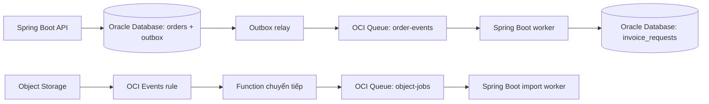

# Tích hợp sự kiện và hàng đợi vào dịch vụ Spring Boot

## 1. Mục tiêu và bài toán triển khai trên OCI

Trong chương **Triển khai Java và Spring Boot** của module **CLOUD_PROVIDERS_ORACLE**, tích hợp bất đồng bộ giúp dịch vụ Java tiếp tục phục vụ khi một công việc phía sau cần thêm thời gian hoặc một hệ thống phụ thuộc tạm thời gián đoạn. Trên Oracle Cloud Infrastructure (OCI), thiết kế này còn liên quan đến compartment, IAM, đường mạng từ VCN, cơ sở dữ liệu, giám sát và năng lực xử lý của các instance.

Xét dịch vụ tiếp nhận đơn hàng: API ghi nhận đơn, sau đó cần tạo yêu cầu xuất hóa đơn. Nếu API gọi mọi bước trong cùng một chuỗi HTTP, thời gian phản hồi và tính sẵn sàng phụ thuộc vào tất cả dịch vụ phía sau. Với hàng đợi, API có thể xác nhận đã tiếp nhận; worker Spring Boot xử lý yêu cầu theo năng lực thực tế. Phản hồi “đã tiếp nhận” phải khác với “đã xuất hóa đơn”.

Sau bài học, người học có thể:

- Phân biệt sự kiện nghiệp vụ, sự kiện tài nguyên OCI và thông điệp giao việc.
- Kết nối ứng dụng Spring Boot với OCI Queue bằng OCI Java SDK.
- Thiết kế consumer có transaction, chống xử lý lặp, retry và dead letter queue.
- Ghép OCI Events với Queue qua một Function chuyển tiếp.
- Vận hành luồng bất đồng bộ có phân quyền, quan sát được độ trễ và kiểm soát chi phí.

Ví dụ dùng Java 17+, Spring Boot 3.x, Jackson 2 và JDBC với Oracle Database. Các đoạn mã là nội dung hướng dẫn để ghép vào project; chưa được biên dịch hoặc thực thi với tenancy OCI trong bài này. Tài nguyên minh họa dùng một queue thông thường, không bật consumer groups, và một loại sự kiện nghiệp vụ.

## 2. Chọn đúng loại sự kiện và dịch vụ

### 2.1. Sự kiện và lệnh có ý nghĩa khác nhau

**Sự kiện** mô tả điều đã xảy ra, chẳng hạn `order.accepted.v1`. Bên phát không cần biết tất cả bên sẽ quan tâm đến nó. **Lệnh** yêu cầu một hành động, chẳng hạn `invoice.create.v1`, và thường hướng đến một chủ thể chịu trách nhiệm thực hiện.

**Message** là đơn vị được vận chuyển. Nội dung message có thể là sự kiện hoặc lệnh. Chọn Queue không tự quyết định ý nghĩa nghiệp vụ của message.

Một sự kiện cũng không nhất thiết cần gửi lên cloud. `ApplicationEventPublisher` phù hợp để phối hợp các component trong một ứng dụng Spring, nhưng bản thân nó không tạo ra hàng đợi bền vững giữa các process. Khi JVM dừng, một công việc chỉ tồn tại trong bộ nhớ không có cơ chế lưu giữ tương đương message broker.

### 2.2. Các vai trò trong kiến trúc OCI

| Thành phần | Vai trò trong bài học |
| --- | --- |
| Spring application event | Liên lạc giữa component trong cùng ứng dụng; cần đánh giá riêng cơ chế thực thi và lưu bền |
| OCI Events | Lọc thay đổi trạng thái tài nguyên OCI để kích hoạt action |
| OCI Queue | Chuyển công việc bất đồng bộ từ producer đến worker |
| OCI Functions | Cầu nối hoặc xử lý ngắn được kích hoạt bởi Events |
| OCI Notifications | Phân phối thông báo; có thể dùng làm đích nhận cảnh báo vận hành |
| OCI Streaming | Hướng lựa chọn khi bài toán cần luồng dữ liệu, vị trí đọc và mô hình xử lý theo stream |
| Oracle Database | Lưu trạng thái nghiệp vụ, outbox và dấu vết chống xử lý lặp |

OCI Events nhận sự kiện do các tài nguyên OCI phát, ví dụ thay đổi ở Object Storage. Đây là luồng khác với sự kiện `OrderAccepted` mà ứng dụng tự định nghĩa. Xem [tổng quan OCI Events](https://docs.oracle.com/en-us/iaas/Content/Events/Concepts/eventsoverview.htm).

OCI Queue là dịch vụ quản lý thông điệp có thao tác publish, receive, update visibility và delete. Ví dụ trong bài sử dụng REST thông qua SDK. Xem [tổng quan OCI Queue](https://docs.oracle.com/en-us/iaas/Content/queue/overview.htm).

Không suy từ tên gọi “queue” rằng OCI Queue cung cấp một JMS provider cho `@JmsListener`, hoặc rằng `@KafkaListener` có thể đọc queue này. Trong ví dụ, vòng nhận message được triển khai rõ ràng bằng SDK. Oracle AQ/Transactional Event Queues trong Oracle Database cũng cần được đánh giá như một lựa chọn riêng; không dùng lẫn API và cấu hình của chúng với OCI Queue.

### 2.3. Hai luồng cần phân biệt



Luồng đầu vận chuyển sự kiện nghiệp vụ. Luồng thứ hai biến sự kiện tài nguyên OCI thành công việc cho ứng dụng. Nên dùng queue riêng khi hợp đồng dữ liệu, quyền truy cập hoặc đặc tính tải khác nhau.

Trong queue thông thường của ví dụ, các worker cùng nhận từ một nguồn công việc và chia nhau xử lý. Nếu cần nhiều hệ thống độc lập đều nhận một sự kiện, phải thiết kế cơ chế phân phối riêng hoặc đánh giá consumer groups; không chỉ tăng số instance rồi coi đó là phát bản sao cho từng hệ thống.

## 3. Vòng đời message và các cửa sổ lỗi

### 3.1. Nhận message chưa phải xác nhận hoàn thành

Luồng consumer có thứ tự:

```text
GetMessages
    -> message tạm ẩn khỏi các consumer khác
    -> giải mã và kiểm tra hợp đồng
    -> mở transaction cơ sở dữ liệu
    -> ghi dấu chống lặp + thay đổi nghiệp vụ
    -> COMMIT
    -> DeleteMessage bằng receipt của lần nhận hiện tại
```

`GetMessages` trả về nội dung, ID vận chuyển, delivery count và `receipt`. Việc xóa hoặc đổi visibility sử dụng receipt, không sử dụng ID nghiệp vụ trong JSON. Receipt phải thuộc lần nhận còn hiệu lực; không lưu nó làm khóa chống lặp. Xem [mô hình GetMessage của Java SDK](https://docs.oracle.com/en-us/iaas/tools/java/latest/com/oracle/bmc/queue/model/GetMessage.html).

Nếu consumer không xóa hoặc gia hạn trước khi hết visibility timeout, message có thể được nhận lại. Long polling cho phép chờ message thay vì liên tục hỏi khi queue trống. Xem [cơ chế nhận message](https://docs.oracle.com/en-us/iaas/Content/queue/consume-messages.htm).

### 3.2. Những tình huống phải thiết kế trước

| Cửa sổ lỗi | Hậu quả có thể xảy ra | Cách xử lý ở ứng dụng |
| --- | --- | --- |
| Queue đã lưu, producer không nhận được phản hồi | Producer gửi lại và tạo thêm bản message | Giữ nguyên `eventId` khi thử lại |
| Consumer chết trước DB commit | Transaction không hoàn tất | Để message được giao lại |
| DB đã commit, consumer chết trước delete | Công việc đã xong nhưng message quay lại | Kiểm tra dấu chống lặp trong DB |
| Delete thành công nhưng phản hồi bị mất | Kết quả delete không chắc chắn với client | Ghi nhận lỗi; consumer vẫn phải an toàn khi nhận lại |
| Xử lý vượt visibility timeout | Worker khác có thể nhận cùng công việc | Giới hạn thời gian, gia hạn sớm và chống lặp |
| Xóa message rồi mới ghi DB | Message đã mất dù nghiệp vụ chưa được lưu | Đảo thứ tự: commit trước, delete sau |

Từ các cửa sổ lỗi này, ứng dụng phải chịu được giao lại. Không thể suy ra “nghiệp vụ đúng một lần” chỉ từ một lần gọi SDK thành công. Mục tiêu thực tế là cho phép nhiều lần nhận nhưng mỗi tác động nghiệp vụ được ghi nhận an toàn bằng transaction và khóa duy nhất.

Cũng không dựa vào thứ tự nhận để thực hiện chuỗi trạng thái như “đã thanh toán” rồi “đã giao”. Khi nghiệp vụ cần thứ tự, thêm phiên bản của thực thể, kiểm tra trạng thái hợp lệ và kiểm soát cạnh tranh trong DB. Việc chạy nhiều consumer hoặc retry đã đủ làm thời điểm hoàn thành khác với thời điểm gửi.

### 3.3. Retention khác visibility

Retention là thời gian lưu giữ message trước khi dịch vụ tự loại bỏ; visibility là khoảng thời gian message tạm ẩn sau khi nhận. Gia hạn visibility không làm message sống mãi và không vượt qua thời điểm hết retention. API cập nhật cần receipt của lần nhận. Xem [cập nhật message](https://docs.oracle.com/en-us/iaas/Content/queue/update-messages.htm).

Cấu hình thực hành đề xuất, không phải giá trị mặc định của dịch vụ:

| Tham số | Giá trị cho lab | Lý do |
| --- | --- | --- |
| Retention | 24 giờ | Tạo khoảng xử lý sự cố cho bài thực hành |
| Visibility | 60 giây | Rộng hơn công việc DB ngắn trong ví dụ |
| Poll timeout | 20 giây | Giảm các lượt nhận rỗng |
| Số message mỗi lần nhận | 1 | Dễ quan sát lease và xử lý tuần tự |
| Maximum delivery attempts | 5 | Đưa message lỗi lặp sang DLQ sau ngưỡng đã cấu hình |

Phải chọn retention theo thời gian khôi phục và backlog lớn nhất có thể chấp nhận. Cấu hình lúc tạo queue có ảnh hưởng lâu dài: tài liệu OCI lưu ý retention không thể đổi sau khi queue đã tạo. Xem [tạo queue](https://docs.oracle.com/en-us/iaas/Content/queue/queue-create.htm).

## 4. Chuẩn bị tài nguyên, IAM và đường mạng

### 4.1. Queue và định danh môi trường

Trong compartment dành cho ứng dụng, tạo queue `order-events-dev`, ghi nhận:

- OCID của queue.
- Messages endpoint được hiển thị trong thông tin queue.
- Region, compartment và cấu hình retry/DLQ của môi trường.

Queue có endpoint quản trị và endpoint cho thao tác message. Producer và consumer trong bài dùng **Messages endpoint** lấy từ Console hoặc `GetQueue`; không tự ghép một hostname từ region. Xem [Messages endpoint](https://docs.oracle.com/en-us/iaas/Content/queue/messages.htm).

Giá trị của development, staging và production phải được truyền từ cấu hình triển khai. Không đóng gói OCID production vào image dùng chung.

### 4.2. Phân quyền theo vai trò

Trên Compute, đưa instance vào dynamic group được kiểm soát bằng OCID hoặc quy tắc phù hợp. Có thể tách group của API/relay và worker:

```text
Allow dynamic-group OrderEventProducers to use queue-push in compartment AppDev
  where target.queue.id = '<QUEUE_OCID>'

Allow dynamic-group InvoiceWorkers to use queue-pull in compartment AppDev
  where target.queue.id = '<QUEUE_OCID>'
```

Thay các placeholder trước khi tạo policy. Đây là hai statement riêng. `queue-push` dành cho publish; `queue-pull` dành cho receive, update visibility và delete. Nếu ứng dụng cần tự gọi `GetQueue`, phải cấp thêm quyền đọc tương ứng; ví dụ truyền sẵn endpoint để không cần bước đó. Xem [Queue IAM policies](https://docs.oracle.com/en-us/iaas/Content/queue/policy-reference.htm).

Dùng profile OCI của người phát triển khi chạy local và instance principal khi chạy trên Compute. Không tự động chuyển sang API key nếu instance principal lỗi: hành vi đó có thể che khuất sai cấu hình quyền. Trên OKE hoặc môi trường khác, chọn cơ chế danh tính phù hợp với workload thực tế; không mặc định mọi container đều là Compute instance của ví dụ.

### 4.3. Kết nối từ VCN

Ứng dụng cần phân giải DNS, kết nối HTTPS đến Messages endpoint và truy cập DB. Tách việc kiểm tra mạng khỏi kiểm tra IAM: kết nối bị timeout khác với phản hồi bị từ chối quyền.

Với private subnet, thiết kế đường đi dịch vụ theo khả năng hỗ trợ trong region. Service Gateway chỉ áp dụng cho các dịch vụ được hỗ trợ; route table và security rules phải cho phép lưu lượng. Không suy ra rằng tạo Service Gateway đã hoàn tất mọi đường egress. Xem [Service Gateway](https://docs.oracle.com/en-us/iaas/Content/Network/Tasks/servicegateway.htm).

Queue quản lý không phải một process broker mà ứng dụng tự mở cổng inbound trong subnet. Worker của luồng SDK chủ động gọi ra để nhận message; không cần công khai HTTP endpoint chỉ để OCI Queue đẩy công việc vào.

## 5. Hợp đồng dữ liệu giữa producer và consumer

Không để consumer đoán ý nghĩa từ tên queue. Mỗi message cần định danh nghiệp vụ ổn định, loại sự kiện và phiên bản dữ liệu.

```json
{
  "eventId": "f6be2a56-f783-4c1a-8f21-968adf7f02d1",
  "eventType": "order.accepted.v1",
  "schemaVersion": 1,
  "occurredAt": "2026-11-21T08:00:00Z",
  "correlationId": "checkout-20261121-001",
  "data": {
    "orderId": "ORD-1001",
    "totalMinor": 125000,
    "currency": "VND"
  }
}
```

Đây là envelope do ứng dụng thiết kế, không phải bản sao của envelope OCI Events. `totalMinor` dùng số nguyên theo đơn vị tiền nhỏ nhất đã thống nhất; không dùng `double` cho tiền. Với VND trong lab, giá trị minh họa là 125.000 đồng.

Quy ước của hợp đồng:

- `eventId` được tạo một lần khi hình thành sự kiện và giữ nguyên qua retry, relay và replay cùng sự kiện.
- `correlationId` liên kết các bước của một yêu cầu; không thay thế khóa chống lặp.
- Thêm field tùy chọn có thể tương thích ngược; thay đổi ý nghĩa hoặc bỏ field bắt buộc cần chiến lược phiên bản.
- Không đặt mật khẩu, API key, wallet hoặc dữ liệu cá nhân không cần thiết trong message.
- Nếu payload là tài liệu lớn, cân nhắc gửi tham chiếu Object Storage kèm định danh phiên bản/checksum và cấp quyền đọc riêng.

Không dùng URL có thời hạn quá ngắn so với retention và thời gian retry. Một message còn trong queue nhưng đã mất khả năng đọc tài liệu cũng là lỗi xử lý.

Model Java của lab:

```java
package example.messaging;

import com.fasterxml.jackson.annotation.JsonIgnoreProperties;
import java.time.Instant;

@JsonIgnoreProperties(ignoreUnknown = true)
public record OrderAccepted(
        String eventId,
        String eventType,
        int schemaVersion,
        Instant occurredAt,
        String correlationId,
        Data data) {

    public void validate() {
        if (eventId == null || eventId.isBlank() || eventId.length() > 64
                || !"order.accepted.v1".equals(eventType)
                || schemaVersion != 1 || occurredAt == null
                || correlationId == null || correlationId.isBlank()
                || data == null
                || data.orderId() == null || data.orderId().isBlank()
                || data.orderId().length() > 64
                || data.totalMinor() <= 0
                || !"VND".equals(data.currency())) {
            throw new IllegalArgumentException("Unsupported order event");
        }
    }

    @JsonIgnoreProperties(ignoreUnknown = true)
    public record Data(String orderId, long totalMinor, String currency) {}
}
```

Hợp đồng VND và loại sự kiện duy nhất là phạm vi lab. Khi mở rộng, quản lý schema và routing rõ ràng thay vì âm thầm bỏ qua loại chưa hỗ trợ.

## 6. Tích hợp OCI Java SDK vào Spring Boot

### 6.1. Dependency và phạm vi phiên bản

Thêm các dependency sau vào project Spring Boot 3.x hiện có. Phiên bản OCI SDK `3.100.0` là mốc minh họa được ghim cho bài, không hàm ý đây là phiên bản mới nhất. Giữ toàn bộ module OCI cùng một BOM; khi nâng cấp cần kiểm tra lại dependency và API.

```xml
<properties>
    <java.version>17</java.version>
    <oci.sdk.version>3.100.0</oci.sdk.version>
</properties>

<dependencyManagement>
    <dependencies>
        <dependency>
            <groupId>com.oracle.oci.sdk</groupId>
            <artifactId>oci-java-sdk-bom</artifactId>
            <version>${oci.sdk.version}</version>
            <type>pom</type>
            <scope>import</scope>
        </dependency>
    </dependencies>
</dependencyManagement>

<dependencies>
    <dependency>
        <groupId>org.springframework.boot</groupId>
        <artifactId>spring-boot-starter-json</artifactId>
    </dependency>
    <dependency>
        <groupId>org.springframework.boot</groupId>
        <artifactId>spring-boot-starter-jdbc</artifactId>
    </dependency>
    <dependency>
        <groupId>org.springframework.boot</groupId>
        <artifactId>spring-boot-starter-validation</artifactId>
    </dependency>
    <dependency>
        <groupId>com.oracle.database.jdbc</groupId>
        <artifactId>ojdbc11</artifactId>
        <scope>runtime</scope>
    </dependency>
    <dependency>
        <groupId>com.oracle.oci.sdk</groupId>
        <artifactId>oci-java-sdk-queue</artifactId>
    </dependency>
    <dependency>
        <groupId>com.oracle.oci.sdk</groupId>
        <artifactId>oci-java-sdk-common-httpclient-jersey3</artifactId>
    </dependency>
</dependencies>
```

Ví dụ dựa trên dependency management của Spring Boot cho các thư viện Spring/JDBC. Không sao chép nguyên khối nếu project đã có các phần tử tương ứng; hợp nhất vào POM hiện tại. Với Autonomous Database sử dụng wallet hoặc cấu hình TLS riêng, bổ sung driver/phụ thuộc và kết nối theo cấu hình DB thực tế.

OCI Java SDK 3 yêu cầu chọn HTTP client; không chỉ thêm module Queue rồi giả định transport đã được chọn. Xem [hướng dẫn Java SDK](https://docs.oracle.com/en-us/iaas/Content/API/SDKDocs/javasdkgettingstarted.htm) và [ví dụ Jersey 3 của Oracle](https://github.com/oracle/oci-java-sdk/blob/master/bmc-other-examples/bmc-jersey3-examples/pom.xml).

### 6.2. Cấu hình ứng dụng

```yaml
app:
  oci:
    queue:
      queue-id: ${OCI_QUEUE_ID}
      messages-endpoint: ${OCI_QUEUE_MESSAGES_ENDPOINT}
      auth-mode: ${OCI_AUTH_MODE:local}
      profile: ${OCI_PROFILE:DEFAULT}
      consumer-enabled: ${OCI_QUEUE_CONSUMER_ENABLED:true}
      visibility-seconds: 60
      poll-timeout-seconds: 20
      poll-delay-ms: 1000

spring:
  datasource:
    url: ${DB_URL}
    username: ${DB_USER}
    password: ${DB_PASSWORD}
```

`OCI_QUEUE_MESSAGES_ENDPOINT` phải là URL HTTPS chính xác của queue. Ở local, profile tham chiếu file cấu hình và private key ngoài repository. Trên Compute, đặt `OCI_AUTH_MODE=instance`. Các biến DB là placeholder; cơ chế cung cấp secret trong môi trường triển khai phải được kiểm soát quyền.

```java
package example.messaging;

import jakarta.validation.constraints.Max;
import jakarta.validation.constraints.Min;
import jakarta.validation.constraints.NotBlank;
import org.springframework.boot.context.properties.ConfigurationProperties;
import org.springframework.validation.annotation.Validated;

@Validated
@ConfigurationProperties(prefix = "app.oci.queue")
public record OciQueueProperties(
        @NotBlank String queueId,
        @NotBlank String messagesEndpoint,
        @NotBlank String authMode,
        @NotBlank String profile,
        @Min(1) @Max(43200) int visibilitySeconds,
        @Min(0) @Max(30) int pollTimeoutSeconds) {}
```

```java
package example.messaging;

import com.oracle.bmc.ClientConfiguration;
import com.oracle.bmc.auth.AbstractAuthenticationDetailsProvider;
import com.oracle.bmc.auth.ConfigFileAuthenticationDetailsProvider;
import com.oracle.bmc.auth.InstancePrincipalsAuthenticationDetailsProvider;
import com.oracle.bmc.queue.QueueClient;
import java.io.IOException;
import java.util.Locale;
import org.springframework.boot.context.properties.EnableConfigurationProperties;
import org.springframework.context.annotation.Bean;
import org.springframework.context.annotation.Configuration;
import org.springframework.scheduling.annotation.EnableScheduling;

@Configuration
@EnableScheduling
@EnableConfigurationProperties(OciQueueProperties.class)
public class OciQueueConfiguration {

    @Bean
    AbstractAuthenticationDetailsProvider queueAuth(
            OciQueueProperties properties) throws IOException {
        return switch (properties.authMode().toLowerCase(Locale.ROOT)) {
            case "local" ->
                    new ConfigFileAuthenticationDetailsProvider(
                            properties.profile());
            case "instance" ->
                    InstancePrincipalsAuthenticationDetailsProvider.builder()
                            .build();
            default -> throw new IllegalArgumentException(
                    "OCI_AUTH_MODE must be local or instance");
        };
    }

    @Bean(destroyMethod = "close")
    QueueClient queueClient(
            AbstractAuthenticationDetailsProvider auth,
            OciQueueProperties properties) {
        var configuration = ClientConfiguration.builder()
                .connectionTimeoutMillis(5000)
                .readTimeoutMillis(35000)
                .build();

        var client = QueueClient.builder()
                .configuration(configuration)
                .build(auth);
        client.setEndpoint(properties.messagesEndpoint());
        return client;
    }
}
```

Tái sử dụng client do Spring quản lý thay vì tạo một client cho từng message. Không gọi `setRegion` sau khi đặt Messages endpoint vì có thể làm thay đổi endpoint đã chọn.

Read timeout của một HTTP attempt phải lớn hơn thời gian long poll kèm dư địa mạng. Giá trị 35 giây ở trên phù hợp với poll tối đa 30 giây của cấu hình này; tổng thời gian có retry vẫn có thể lớn hơn. Các trường timeout nằm trong [ClientConfiguration của SDK](https://docs.oracle.com/en-us/iaas/tools/java/latest/com/oracle/bmc/ClientConfiguration.ClientConfigurationBuilder.html).

### 6.3. Lớp vận chuyển message

Lớp này chỉ bao bọc API Queue. Nó không biết giao dịch đơn hàng hoặc trạng thái xuất hóa đơn.

```java
package example.messaging;

import com.fasterxml.jackson.core.JsonProcessingException;
import com.fasterxml.jackson.databind.ObjectMapper;
import com.oracle.bmc.queue.QueueClient;
import com.oracle.bmc.queue.model.GetMessage;
import com.oracle.bmc.queue.model.PutMessagesDetails;
import com.oracle.bmc.queue.model.PutMessagesDetailsEntry;
import com.oracle.bmc.queue.model.UpdateMessageDetails;
import com.oracle.bmc.queue.requests.DeleteMessageRequest;
import com.oracle.bmc.queue.requests.GetMessagesRequest;
import com.oracle.bmc.queue.requests.PutMessagesRequest;
import com.oracle.bmc.queue.requests.UpdateMessageRequest;
import java.util.List;
import org.springframework.stereotype.Component;

@Component
public class OciQueueTransport {
    private final QueueClient client;
    private final OciQueueProperties properties;
    private final ObjectMapper mapper;

    public OciQueueTransport(
            QueueClient client,
            OciQueueProperties properties,
            ObjectMapper mapper) {
        this.client = client;
        this.properties = properties;
        this.mapper = mapper;
    }

    public void publish(OrderAccepted event) {
        event.validate();
        final String content;
        try {
            content = mapper.writeValueAsString(event);
        } catch (JsonProcessingException e) {
            throw new IllegalArgumentException("Cannot serialize event", e);
        }

        var entry = PutMessagesDetailsEntry.builder()
                .content(content)
                .build();
        client.putMessages(PutMessagesRequest.builder()
                .queueId(properties.queueId())
                .putMessagesDetails(PutMessagesDetails.builder()
                        .messages(List.of(entry))
                        .build())
                .build());
    }

    public List<GetMessage> receiveOne() {
        var response = client.getMessages(GetMessagesRequest.builder()
                .queueId(properties.queueId())
                .limit(1)
                .timeoutInSeconds(properties.pollTimeoutSeconds())
                .visibilityInSeconds(properties.visibilitySeconds())
                .build());
        return response.getGetMessages().getMessages();
    }

    public void acknowledge(String receipt) {
        client.deleteMessage(DeleteMessageRequest.builder()
                .queueId(properties.queueId())
                .messageReceipt(receipt)
                .build());
    }

    public void changeVisibility(String receipt, int seconds) {
        client.updateMessage(UpdateMessageRequest.builder()
                .queueId(properties.queueId())
                .messageReceipt(receipt)
                .updateMessageDetails(UpdateMessageDetails.builder()
                        .visibilityInSeconds(seconds)
                        .build())
                .build());
    }
}
```

Tên `acknowledge` là quy ước của lớp ứng dụng; thao tác OCI thực tế là `DeleteMessage`. Mẫu request tham khảo từ [PutMessages](https://docs.oracle.com/en-us/iaas/tools/java-sdk-examples/latest/queue/PutMessagesExample.java.html), [GetMessages](https://docs.oracle.com/en-us/iaas/tools/java-sdk-examples/latest/queue/GetMessagesExample.java.html), [DeleteMessage](https://docs.oracle.com/en-us/iaas/tools/java-sdk-examples/latest/queue/DeleteMessageExample.java.html) và [UpdateMessage](https://docs.oracle.com/en-us/iaas/tools/java-sdk-examples/latest/queue/UpdateMessageExample.java.html).

## 7. Ghi nghiệp vụ và chống xử lý lặp trong Oracle Database

### 7.1. Không dùng bộ nhớ JVM làm nơi chống lặp

Một `HashSet` chứa event ID không đủ vì instance có thể khởi động lại hoặc nhiều worker nhận các bản sao khác nhau. Dấu chống lặp cần tồn tại cùng transaction với thay đổi nghiệp vụ.

Schema dưới đây phục vụ lab. Dấu `consumer_name` cho phép mỗi chức năng tiêu thụ có lịch sử độc lập.

```sql
CREATE TABLE processed_events (
    consumer_name VARCHAR2(80) NOT NULL,
    event_id VARCHAR2(64) NOT NULL,
    processed_at TIMESTAMP WITH TIME ZONE DEFAULT SYSTIMESTAMP NOT NULL,
    CONSTRAINT pk_processed_events PRIMARY KEY (consumer_name, event_id)
);

CREATE TABLE invoice_requests (
    event_id VARCHAR2(64) NOT NULL,
    order_id VARCHAR2(64) NOT NULL,
    total_minor NUMBER(19, 0) NOT NULL,
    currency VARCHAR2(3) NOT NULL,
    state VARCHAR2(20) DEFAULT 'PENDING' NOT NULL,
    CONSTRAINT pk_invoice_requests PRIMARY KEY (event_id)
);
```

Ví dụ chỉ tạo bản ghi yêu cầu hóa đơn; không gọi nhà cung cấp hóa đơn bên ngoài trong transaction này.

```java
package example.messaging;

import org.springframework.dao.DuplicateKeyException;
import org.springframework.jdbc.core.JdbcTemplate;
import org.springframework.stereotype.Service;
import org.springframework.transaction.annotation.Transactional;

@Service
public class InvoiceRequestHandler {
    private static final String CONSUMER = "invoice-request-v1";
    private final JdbcTemplate jdbc;

    public InvoiceRequestHandler(JdbcTemplate jdbc) {
        this.jdbc = jdbc;
    }

    @Transactional(timeout = 15)
    public void handle(OrderAccepted event) {
        event.validate();

        try {
            jdbc.update("""
                    INSERT INTO processed_events (consumer_name, event_id)
                    VALUES (?, ?)
                    """, CONSUMER, event.eventId());
        } catch (DuplicateKeyException duplicate) {
            // Oracle: trùng khóa của câu INSERT dấu chống lặp.
            // Sự kiện này đã được transaction khác ghi nhận.
            return;
        }

        jdbc.update("""
                INSERT INTO invoice_requests
                    (event_id, order_id, total_minor, currency, state)
                VALUES (?, ?, ?, ?, 'PENDING')
                """,
                event.eventId(),
                event.data().orderId(),
                event.data().totalMinor(),
                event.data().currency());
    }
}
```

Cơ chế này dựa trên Oracle Database, JDBC và khóa duy nhất; không dùng nguyên cách bắt lỗi constraint cho mọi hệ quản trị. Ở đây chỉ bắt duplicate của câu insert dấu chống lặp. Lỗi ở câu insert nghiệp vụ phải đi ra ngoài để transaction rollback, tránh giữ dấu “đã xử lý” cho công việc chưa thành công.

Hai insert sử dụng cùng `DataSource` và transaction manager. Spring Boot cần quét được các bean trong package; đặt lớp `@SpringBootApplication` ở package cha. `handle` được gọi từ bean khác để đi qua transaction proxy.

Sau khi lời gọi `handle` trả về thành công qua proxy, commit đã hoàn tất. Nếu commit lỗi, exception phải truyền về worker. Timeout transaction không phải bộ đếm có thể cưỡng bức dừng mọi loại tác vụ Java; tiếp tục cấu hình timeout cho DB và các lời gọi ngoài.

### 7.2. Giới hạn của dấu chống lặp

Khóa `(consumer_name, event_id)` chặn cùng một sự kiện được thực thi lại. Nó không nhận ra hai sự kiện có ID khác nhau nhưng cùng yêu cầu xuất hóa đơn cho một đơn. Nghiệp vụ cần ràng buộc bổ sung, chẳng hạn một hóa đơn cho mỗi `(order_id, invoice_type)`, cùng quy tắc cập nhật rõ ràng.

Không xóa dấu chống lặp quá sớm. Thời gian lưu phải bao phủ retention, backlog, DLQ và cửa sổ replay thủ công. Nếu cho phép dùng lại event ID với payload khác, nên lưu thêm hash và phát hiện xung đột; không coi mọi duplicate là dữ liệu tương đương.

## 8. Vòng nhận message trong Spring Boot

### 8.1. Consumer tối thiểu

Consumer dưới đây xử lý tối đa một message mỗi lượt, không tự tạo thread cho từng message và không xóa khi giải mã hoặc transaction thất bại.

```java
package example.messaging;

import com.fasterxml.jackson.databind.ObjectMapper;
import com.oracle.bmc.model.BmcException;
import com.oracle.bmc.queue.model.GetMessage;
import java.util.List;
import org.slf4j.Logger;
import org.slf4j.LoggerFactory;
import org.springframework.boot.autoconfigure.condition.ConditionalOnProperty;
import org.springframework.scheduling.annotation.Scheduled;
import org.springframework.stereotype.Component;

@Component
@ConditionalOnProperty(
        prefix = "app.oci.queue",
        name = "consumer-enabled",
        havingValue = "true")
public class InvoiceQueueWorker {
    private static final Logger log =
            LoggerFactory.getLogger(InvoiceQueueWorker.class);

    private final OciQueueTransport transport;
    private final ObjectMapper mapper;
    private final InvoiceRequestHandler handler;

    public InvoiceQueueWorker(
            OciQueueTransport transport,
            ObjectMapper mapper,
            InvoiceRequestHandler handler) {
        this.transport = transport;
        this.mapper = mapper;
        this.handler = handler;
    }

    @Scheduled(
        fixedDelayString = "${app.oci.queue.poll-delay-ms:1000}")
    public void poll() {
        final List<GetMessage> messages;
        try {
            messages = transport.receiveOne();
        } catch (BmcException e) {
            log.warn("Queue receive failed: status={}, requestId={}",
                    e.getStatusCode(), e.getOpcRequestId());
            return;
        } catch (RuntimeException e) {
            log.warn("Queue receive failed: errorType={}",
                    e.getClass().getSimpleName());
            return;
        }

        for (GetMessage message : messages) {
            try {
                var event = mapper.readValue(
                        message.getContent(), OrderAccepted.class);
                handler.handle(event);
            } catch (Exception e) {
                log.warn(
                    "Message processing failed: messageId={}, delivery={}, errorType={}",
                    message.getId(), message.getDeliveryCount(),
                    e.getClass().getSimpleName());
                // Không delete: cho phép nhận lại hoặc chuyển DLQ.
                continue;
            }

            try {
                transport.acknowledge(message.getReceipt());
                log.info("Message acknowledged: messageId={}",
                        message.getId());
            } catch (RuntimeException e) {
                log.warn(
                    "Message delete uncertain: messageId={}, errorType={}",
                    message.getId(), e.getClass().getSimpleName());
                // DB đã commit; lần nhận lại phải đi qua chống lặp.
            }
        }
    }
}
```

Không đặt lệnh delete trong `finally`: nhánh đó chạy cả khi handler thất bại. Không nuốt exception trong handler rồi trả về như thành công. Log của lab dùng ID và loại lỗi; không ghi payload, receipt hoặc thông tin xác thực.

`fixedDelay` tạo khoảng nghỉ sau khi lượt trước kết thúc. Cơ chế scheduling cần `@EnableScheduling`; xem [Spring task scheduling](https://docs.spring.io/spring-framework/reference/integration/scheduling.html). Khi ghép vào ứng dụng có các scheduled job khác, dành scheduler hoặc executor riêng cho polling để một lượt long poll không trì hoãn công việc khác.

Lab có thể chạy transport, producer và worker trong một JVM. Khi tách API/relay và worker thành deployment riêng, đặt `consumer-enabled=false` cho phía chỉ gửi và cấp quyền theo từng vai trò. Một process chạy cả hai vai trò sẽ cần cả hai loại quyền.

### 8.2. Chạy song song có giới hạn

Tăng concurrency bằng số replica hoặc worker được giới hạn. Không nhận một lượng lớn message rồi để chúng chờ trong executor vô hạn: visibility đã bắt đầu khi nhận, kể cả khi handler chưa chạy.

Nếu nhận batch và xử lý tuần tự, message cuối phải chờ các message trước. Với batch có `b` phần tử, thời gian chờ có thể gần `(b - 1) × thời gian xử lý`. Khi thay `limit(1)`, phải tính lại thời gian giữ lease hoặc phân phối ngay vào pool có sức chứa phù hợp.

Mức song song cần phù hợp với:

- Số connection DB và năng lực ghi/khóa của database.
- Giới hạn tốc độ của dịch vụ phía sau.
- Bộ nhớ, CPU và thời gian xử lý của worker.
- Ngưỡng backlog và thời gian hoàn thành yêu cầu của nghiệp vụ.

Ví dụ tính năng lực, chỉ là ước lượng cho thiết kế: nếu mỗi công việc mất trung bình 0,2 giây, một worker tuần tự có trần lý tưởng khoảng 5 công việc/giây. Nếu tốc độ đến là 50 công việc/giây, cần hơn 10 worker tương đương để có dư địa; vẫn phải đo dưới tải vì DB, mạng và phân bố thời gian xử lý có thể làm thay đổi kết quả.

### 8.3. Khi công việc dài hơn visibility

Với tác vụ dài, worker cần heartbeat gọi `changeVisibility(receipt, seconds)` trước khi hết thời gian đang giữ. Đây là thay đổi visibility của lần nhận hiện tại, không phải ghi thêm retry message.

Thiết kế heartbeat cần:

1. Một lịch gia hạn độc lập với thread đang làm công việc dài.
2. Khoảng gia hạn và dư địa đủ cho độ trễ mạng.
3. Dừng heartbeat khi xử lý kết thúc hoặc không còn quyền giữ message.
4. Hạn mức thời gian xử lý tổng; không gia hạn vô hạn cho công việc bị treo.

Nếu mất lease, không giả định các hành động đã thực hiện sẽ tự rollback. Với tác động ngoài DB, cần idempotency key của bên nhận hoặc cơ chế kiểm tra trạng thái. Công việc quá dài có thể được chia thành nhiều bước có checkpoint, mỗi bước là một transaction ngắn.

## 9. Retry, lỗi cố định và dead letter queue

### 9.1. Phân loại trước khi thử lại

| Loại lỗi | Ví dụ | Hướng xử lý |
| --- | --- | --- |
| Tạm thời | DB chưa sẵn sàng, HTTP 429 hoặc một số lỗi 5xx | Retry có giới hạn và backoff |
| Cấu hình/quyền | Sai endpoint, sai dynamic group, thiếu quyền | Cảnh báo, sửa cấu hình; tránh vòng thử dồn dập |
| Dữ liệu không hợp lệ | JSON hỏng, thiếu order ID, schema chưa hỗ trợ | Giữ thông tin chẩn đoán và đưa vào quy trình DLQ/cách ly |
| Xung đột nghiệp vụ | Hai yêu cầu khác nhau cùng đòi chuyển trạng thái không hợp lệ | Xử lý theo quy tắc nghiệp vụ; không coi mọi xung đột là lỗi mạng |
| Kết quả không chắc chắn | Publish hoặc delete bị timeout | Cho phép lặp an toàn, giữ ID ổn định |

SDK retry và message retry là hai tầng khác nhau. SDK retry thử lại một lời gọi mạng; message retry là một lần xử lý lại sau khi được giao lại. Nếu tầng SDK, application và gateway cùng retry nhiều lần, tổng số attempt có thể tăng mạnh. Chọn một chính sách tổng có thời hạn, theo dõi số attempt thực tế và tránh retry thao tác ghi nếu chưa có cách xử lý trùng.

Consumer tối thiểu ở trên dùng visibility ban đầu để tạo khoảng chờ nhận lại. Trong phiên bản vận hành, có thể thay đổi visibility sau lỗi tạm thời để backoff, ví dụ:

```text
delay = min(5 × 2^(deliveryCount - 1), 300) giây
delay thực tế = delay + jitter có giới hạn
```

Đây là công thức đề xuất, không phải tính năng backoff tự động đã được bật trong code. Phải giới hạn theo phạm vi API và thời gian retention còn lại. Nếu gọi update visibility thất bại, message vẫn tuân theo lease trước đó; không ghi nhận rằng backoff đã có hiệu lực. Tránh trả visibility về 0 liên tục vì có thể tạo vòng nóng và tăng delivery count nhanh.

### 9.2. DLQ là nơi điều tra, không phải nơi bỏ quên

OCI tạo dead letter queue đi kèm queue. Message có thể được chuyển sang đó sau khi số lần giao không thành công vượt ngưỡng cấu hình. Message trong DLQ vẫn chịu retention; cần xử lý trước khi hết thời hạn. Xem [dead letter queues](https://docs.oracle.com/en-us/iaas/Content/queue/deadletterqueues.htm).

Quy trình vận hành đề xuất:

1. Cảnh báo khi DLQ có message hoặc tăng bất thường.
2. Thu thập event ID, loại lỗi và phiên bản ứng dụng đã xử lý.
3. Xác định lỗi nằm ở schema, quyền, dữ liệu hay hệ thống phụ thuộc.
4. Sửa nguyên nhân và thử với một lượng nhỏ.
5. Replay có kiểm soát, giới hạn tốc độ và theo dõi kết quả.
6. Chỉ xác nhận/xóa bản DLQ khi đã bàn giao công việc thành công theo quy trình.

Replay cùng sự kiện phải giữ `eventId`. Nếu đây là lệnh sửa sai mới với ý nghĩa khác, tạo ID mới và lưu liên kết đến sự kiện gốc. Không sửa payload rồi giữ nguyên ID mà không có quy tắc về xung đột dữ liệu.

Việc poll qua Console cũng có thể tăng delivery count và làm message tạm ẩn. Không liên tục “xem thử” trên queue production rồi coi việc đó không ảnh hưởng consumer. Xem [lưu ý khi poll queue](https://docs.oracle.com/en-us/iaas/Content/queue/consume-messages-queue.htm).

## 10. Producer đáng tin cậy bằng transactional outbox

### 10.1. Vì sao gọi publish trong transaction chưa đủ

Đoạn sau có khoảng trống nhất quán:

```text
BEGIN DB TRANSACTION
    INSERT order
    gọi OCI Queue để publish
COMMIT DB TRANSACTION
```

Nếu publish thành công nhưng DB rollback, consumer có thể nhận sự kiện của một đơn chưa tồn tại. Nếu đổi thành commit trước rồi publish, ứng dụng có thể chết giữa hai bước và mất sự kiện.

`@Transactional` với JDBC không bao phủ lời gọi HTTPS của OCI Queue. Listener chạy sau commit cũng không tự thêm lưu trữ bền vững: JVM có thể dừng sau DB commit nhưng trước hoặc trong lúc listener publish. `@TransactionalEventListener` giúp gắn listener với pha transaction; vẫn cần thiết kế lưu và gửi lại khi yêu cầu bảo đảm bàn giao. Xem [transaction-bound events của Spring](https://docs.spring.io/spring-framework/reference/data-access/transaction/event.html).

### 10.2. Ghi đơn và outbox trong cùng một transaction

Schema outbox tối giản để diễn đạt thiết kế:

```sql
CREATE TABLE event_outbox (
    event_id VARCHAR2(64) NOT NULL,
    aggregate_id VARCHAR2(64) NOT NULL,
    payload CLOB NOT NULL,
    state VARCHAR2(20) DEFAULT 'NEW' NOT NULL,
    attempt_count NUMBER(10, 0) DEFAULT 0 NOT NULL,
    next_attempt_at TIMESTAMP WITH TIME ZONE DEFAULT SYSTIMESTAMP NOT NULL,
    lock_owner VARCHAR2(80),
    locked_until TIMESTAMP WITH TIME ZONE,
    created_at TIMESTAMP WITH TIME ZONE DEFAULT SYSTIMESTAMP NOT NULL,
    published_at TIMESTAMP WITH TIME ZONE,
    CONSTRAINT pk_event_outbox PRIMARY KEY (event_id)
);
```

Mã giả cho API tiếp nhận:

```text
transaction:
    kiểm tra idempotency key của request HTTP
    tạo order và eventId
    INSERT orders
    INSERT event_outbox với payload có eventId đó
commit

trả mã đã tiếp nhận cùng orderId và nơi tra cứu trạng thái
```

Nếu client HTTP thử lại sau timeout, idempotency của API vẫn cần tồn tại để tránh tạo hai order/outbox khác nhau. Outbox bảo vệ việc bàn giao sự kiện của transaction đã ghi nhận, không tự chống tạo trùng ở đầu vào HTTP.

### 10.3. Relay với nhiều instance

Relay thực hiện ba pha; đây là thuật toán thiết kế, không phải lớp hoàn chỉnh được cung cấp trong lab:

```text
Pha 1, transaction ngắn:
    chọn một số row NEW đến hạn hoặc LEASED đã hết hạn
    khóa các row đủ điều kiện, bỏ qua row đang bị worker khác khóa
    đặt state = LEASED, lock_owner, locked_until, tăng attempt_count
    commit

Pha 2, ngoài DB transaction:
    publish payload đã lưu sang OCI Queue

Pha 3, transaction ngắn:
    nếu publish được xác nhận:
        đặt SENT và published_at
        chỉ cập nhật nếu lock_owner/phiên nhận việc vẫn còn đúng
    nếu lỗi:
        ghi lịch thử lại có backoff hoặc chờ lease hết hạn
```

Trên Oracle Database, có thể dùng cơ chế khóa hàng và `FOR UPDATE SKIP LOCKED` trong thiết kế nhận việc. Cần triển khai điều kiện đến hạn, index, lease và fencing nhất quán; không chỉ thêm `SKIP LOCKED` vào một truy vấn bất kỳ rồi coi relay đã hoàn tất.

Không giữ khóa DB suốt lời gọi mạng. Nếu publish thành công nhưng chưa đánh dấu SENT thì relay có thể gửi lại; consumer phải chống lặp theo `eventId`. Khóa/lease của outbox giới hạn cạnh tranh giữa relay nhưng không xóa được cửa sổ kết quả publish không chắc chắn.

Theo dõi riêng tuổi của row outbox chưa gửi. Queue đang trống vẫn có thể che giấu lỗi producer nếu toàn bộ sự kiện bị kẹt trước khi tới Queue.

## 11. Đưa sự kiện tài nguyên OCI vào worker Spring Boot

### 11.1. Luồng Events → Function → Queue

Ví dụ bổ sung: khi một object được tạo trong bucket nhập dữ liệu, ứng dụng muốn đưa một công việc kiểm tra file vào queue.

OCI Events hỗ trợ action tới Functions, Notifications và Streaming. Do đó bài này dùng Function làm cầu nối để publish sang Queue; không cấu hình Queue như một action trực tiếp của rule. Xem [các loại action của Events rule](https://docs.oracle.com/en-us/iaas/Content/Events/Task/create-action-events-rule.htm).

Các bước triển khai:

1. Chuẩn bị bucket, queue `object-jobs-dev` và Function chuyển tiếp.
2. Bật phát object events trên bucket theo yêu cầu của Object Storage.
3. Tạo rule chọn đúng event type và giới hạn phạm vi tài nguyên.
4. Chọn action Functions, trỏ đến Function đã triển khai.
5. Function kiểm tra envelope, chuyển thành hợp đồng công việc và publish.
6. Spring Boot import worker đọc queue của luồng nhập file.

Filter minh họa cho rule:

```json
{
  "eventType": [
    "com.oraclecloud.objectstorage.createobject"
  ],
  "data": {
    "compartmentId": [
      "<SOURCE_COMPARTMENT_OCID>"
    ],
    "additionalDetails": {
      "bucketName": [
        "incoming-orders-dev"
      ]
    }
  }
}
```

Thay placeholder và đối chiếu một event mẫu của tài nguyên thực tế trước khi dùng filter. Event type và payload phụ thuộc dịch vụ phát; xem [các dịch vụ phát Events](https://docs.oracle.com/en-us/iaas/Content/Events/Reference/eventsproducers.htm) và [cơ chế lọc Events](https://docs.oracle.com/en-us/iaas/Content/Events/Concepts/filterevents.htm).

### 11.2. Chuyển đổi envelope có chủ đích

Envelope OCI Events có các trường như `eventID`, `eventType`, `eventTime` và `data`; tên trường phân biệt chữ hoa/chữ thường. Không mặc định đó là CloudEvents 1.0 với `id` và `type`. Tài liệu Events mô tả envelope theo phiên bản 0.1. Xem [nội dung event message](https://docs.oracle.com/en-us/iaas/Content/Events/Reference/eventenvelopereference.htm).

Mã giả của Function:

```text
đọc envelope OCI
kiểm tra eventType, compartment và bucket được cho phép
job.eventId       = "oci:" + envelope.eventID
job.eventType     = "object.import.requested.v1"
job.schemaVersion = 1
job.occurredAt    = envelope.eventTime
job.data          = tham chiếu object lấy từ payload thực tế

publish job vào object-jobs
chỉ báo thành công khi lời gọi publish đã được xác nhận
nếu publish lỗi: kết thúc invocation bằng lỗi có thể quan sát
```

Function không tạo UUID ngẫu nhiên mới cho mỗi lần nhận lại cùng event OCI. Worker nhập file cần model và handler riêng; không đưa `object.import.requested.v1` vào consumer `OrderAccepted` ở phần trước.

Tránh chỉ giữ một tên object có thể bị ghi đè trong khi job chờ. Tùy hợp đồng dữ liệu và khả năng versioning, ghi nhận version/checksum hoặc xác minh lại tài nguyên trước khi nhập. Một sự kiện “object đã được tạo” không bảo đảm rằng lúc worker đọc, object vẫn có đúng nội dung ban đầu.

### 11.3. Các chặng quyền độc lập

Events cần quyền thực hiện action trên Function; Function cần quyền publish Queue; worker cần quyền đọc object và xử lý message. Không gộp chúng bằng một policy quản trị toàn tenancy.

Đưa Function vào dynamic group phù hợp và cấp `queue-push` cho queue đích. Trong code Function, dùng resource principal provider của SDK. Instance principal trong ví dụ Compute không phải lựa chọn thay thế tự động cho Function. Xem [Functions truy cập tài nguyên OCI](https://docs.oracle.com/en-us/iaas/Content/Functions/Tasks/functionsaccessingociresources.htm).

Mỗi chặng có thể thất bại riêng. Phải quan sát rule/action, invocation của Function, kết quả publish và backlog Queue. DLQ của Queue chỉ hỗ trợ message đã đi đến chặng Queue; nó không lưu thay cho các event bị lỗi trước khi publish. Với quy trình quan trọng, bổ sung đối soát tài nguyên nguồn hoặc nhật ký bàn giao để phát hiện công việc chưa được tạo.

## 12. Quan sát toàn bộ đường đi của sự kiện

### 12.1. Đừng chỉ kiểm tra worker còn chạy

Một worker sống nhưng bị thiếu quyền, liên tục gặp schema lạ hoặc chờ DB vẫn có thể không tạo ra kết quả. Quan sát ba lớp:

- **Trước Queue:** số row outbox chưa gửi, tuổi row cũ nhất và lỗi relay.
- **Trong Queue:** backlog, công việc đang giữ, độ trễ và DLQ.
- **Sau Queue:** tỷ lệ xử lý nghiệp vụ thành công, thời gian commit và trạng thái yêu cầu hóa đơn.

Các metric dịch vụ trong namespace `oci_queue` có thể dùng làm đầu vào dashboard:

| Metric | Ý nghĩa cần theo dõi |
| --- | --- |
| `MessagesInQueueCount` | Số message; xem dimension `isVisible` |
| `ConsumerLag` | Độ trễ từ message cũ nhất, đơn vị phút |
| `QueueSize` | Dung lượng dữ liệu trong queue |
| `MessagesCount` | Lưu lượng theo operation |
| `RequestsLatency` | Độ trễ request, đơn vị millisecond |
| `RequestSuccess` | Tín hiệu thành công của request |

Tên và dimension tham khảo [Queue metrics](https://docs.oracle.com/en-us/iaas/Content/queue/metrics.htm). Với DLQ và in-flight, có thể bổ sung `GetStats`; các thống kê là xấp xỉ, không phải ảnh chụp transaction tức thời. Xem [Queue statistics](https://docs.oracle.com/en-us/iaas/Content/queue/queue-statistics.htm).

### 12.2. Cảnh báo theo khả năng đáp ứng nghiệp vụ

Ngưỡng minh họa để người học tự điều chỉnh:

- Outbox có row chưa gửi quá 2 phút.
- Consumer lag vượt 5 phút trong nhiều chu kỳ quan sát.
- DLQ có ít nhất một message.
- Tỷ lệ xử lý lỗi tăng trong khi backlog tiếp tục tăng.
- Worker không ghi nhận hoàn thành dù tốc độ publish vẫn dương.

Các giá trị trên là chính sách lab, không phải SLO mặc định của OCI. Chọn cửa sổ cảnh báo tránh báo động do dao động ngắn và gắn cảnh báo với người chịu trách nhiệm xử lý.

Bổ sung metric ứng dụng như `processed`, `duplicate`, `failed`, `delete_failed` và thời gian từ `occurredAt` đến hoàn thành. Không dùng `eventId` hoặc `orderId` làm nhãn metric vì số lượng giá trị tăng không giới hạn; giữ chúng trong log có kiểm soát.

Log cần cho phép nối cùng một sự kiện qua API, relay và worker bằng `eventId`/`correlationId`. Lưu request ID của OCI khi chẩn đoán lỗi SDK. Đừng tăng log level đến mức ghi private key, token, nội dung hóa đơn hoặc toàn bộ receipt.

## 13. Tính sẵn sàng, triển khai và chi phí

### 13.1. Nhiều worker và dừng có kiểm soát

Có thể chạy nhiều worker trên các fault domain hoặc availability domain phù hợp với kiến trúc triển khai. Các instance cùng dùng cơ sở dữ liệu chống lặp; việc mở rộng không được làm xuất hiện một bộ nhớ chống lặp riêng biệt cho mỗi JVM.

Khi rollout:

1. Ngừng nhận công việc mới trên instance sắp dừng.
2. Chờ công việc đang xử lý hoàn thành trong thời hạn cho phép.
3. Tiếp tục gia hạn lease nếu đang ở quy trình drain có kiểm soát.
4. Delete các message đã commit thành công.
5. Đóng SDK client và pool kết nối sau khi công việc đã kết thúc.

Nếu hết thời gian chờ, message chưa xóa phải được xử lý an toàn khi giao lại. Bản consumer tối thiểu của lab chưa cung cấp toàn bộ cơ chế drain/heartbeat; bổ sung lifecycle phù hợp trước khi dùng cho tác vụ dài hoặc rollout production.

Readiness và liveness cần mục đích khác nhau. Liveness biểu thị process còn hoạt động; không restart mọi worker liên tục chỉ vì Queue tạm thời không truy cập được. Readiness hoặc trạng thái vận hành có thể phản ánh worker chưa nhận việc, trong khi backoff và cảnh báo hỗ trợ khôi phục phụ thuộc.

### 13.2. Database và khôi phục thảm họa

Queue không loại bỏ phụ thuộc vào Oracle Database. Nếu DB xử lý chậm, tăng worker quá nhanh có thể làm tăng chờ khóa và connection timeout. Giới hạn concurrency theo phần tài nguyên yếu nhất, quan sát connection pool và năng lực commit.

Không suy ra rằng một queue trong region này đã có sẵn chiến lược phục hồi ứng dụng ở region khác. Kế hoạch khôi phục cần xác định RPO/RTO, nguồn dữ liệu có thể replay, bản sao database, cơ chế tạo lại hạ tầng và cách ngăn hai môi trường cùng tạo tác động nghiệp vụ.

Outbox chỉ giúp phát lại nếu các row cần thiết còn được giữ và có thể xác định trạng thái bàn giao. Chuyển region hay khôi phục DB có thể làm xuất hiện sự kiện cũ; thời gian lưu dấu chống lặp và các khóa nghiệp vụ phải phù hợp với phương án phục hồi.

### 13.3. Giảm thao tác thừa và kiểm soát dữ liệu

Các lựa chọn kỹ thuật ảnh hưởng trực tiếp đến tài nguyên sử dụng:

- Long polling giảm các lượt nhận rỗng so với vòng lặp hỏi liên tục.
- Batch có thể giảm số request, nhưng cần quản lý visibility và sức chứa executor.
- Payload gọn giảm truyền tải; tài liệu lớn cần chính sách lưu Object Storage và quyền đọc.
- Retry có backoff giảm tải tăng vọt khi hệ thống phụ thuộc lỗi.
- Dọn outbox đã hoàn tất và dữ liệu chẩn đoán theo chính sách lưu giữ.
- Theo dõi log volume, Compute và DB cùng với dịch vụ Queue.

Không giảm chi phí bằng cách rút retention xuống dưới thời gian xử lý sự cố cần thiết. Không lấy con số giá cố định từ bài học làm ngân sách: đối chiếu mô hình tính phí, region, quota và lượng sử dụng hiện hành của tenancy khi lập dự toán.

Cấp quyền tối thiểu cho từng chặng, bảo vệ đường kết nối DB và dùng cơ chế quản lý secret của môi trường. Mã hóa dữ liệu ở dịch vụ không thay thế việc giới hạn payload, quyền đọc message hoặc quyền truy cập log.

## 14. Thực hành luồng gửi, xử lý và nhận lại

Phần này dành cho người học thực hiện trong môi trường dev. Không chạy thử lỗi có chủ đích trên queue chứa công việc thật.

### 14.1. Chạy luồng thành công

1. Tạo queue với cấu hình lab, lấy OCID và Messages endpoint.
2. Cấu hình danh tính local hoặc Compute và áp dụng policy đúng vai trò.
3. Tạo hai bảng consumer trong Oracle Database; truyền cấu hình DB.
4. Ghép các class vào project Spring Boot có component scan phù hợp và khởi động ứng dụng.
5. Dùng Console publish JSON `OrderAccepted` ở mục 5 làm nội dung một message, hoặc gọi `OciQueueTransport.publish` từ producer của ứng dụng.
6. Quan sát worker tạo bản ghi và xóa message sau commit.

Truy vấn kiểm tra, thay ID nếu dùng sự kiện khác:

```sql
SELECT consumer_name, event_id, processed_at
FROM processed_events
WHERE event_id = 'f6be2a56-f783-4c1a-8f21-968adf7f02d1';

SELECT event_id, order_id, total_minor, currency, state
FROM invoice_requests
WHERE event_id = 'f6be2a56-f783-4c1a-8f21-968adf7f02d1';
```

Kỳ vọng là một dấu đã xử lý và một yêu cầu hóa đơn `PENDING`. Trạng thái này chỉ xác nhận đã tạo yêu cầu; chưa chứng minh hóa đơn đã được hệ thống ngoài phát hành.

### 14.2. Gửi cùng một sự kiện hai lần

Publish lại **nguyên JSON với cùng event ID**. Worker có thể nhận hai bản message khác nhau, nhưng không tạo thêm yêu cầu hóa đơn cho event ID đó.

```sql
SELECT COUNT(*) AS invoice_request_count
FROM invoice_requests
WHERE event_id = 'f6be2a56-f783-4c1a-8f21-968adf7f02d1';
```

Kết quả mong đợi là `1`. Dùng một event ID mới cho các lượt thực hành độc lập; không thay số tiền của sự kiện cũ rồi kỳ vọng nó cập nhật bản ghi.

### 14.3. Quan sát commit trước delete

Với một sự kiện mới, dùng debugger đặt điểm dừng ngay sau `handler.handle(event)` và trước `acknowledge`. Khi lời gọi handler đã trả về, dừng JVM để mô phỏng mất process.

Sau khi lease hết hạn, khởi động lại worker. Message có thể được giao lại; handler nhìn thấy dấu đã xử lý và không ghi thêm công việc. Worker mới xóa message bằng receipt mới. Đối chiếu log với truy vấn DB để quan sát đúng cửa sổ lỗi này.

### 14.4. Quan sát lỗi và DLQ

Tạo một message mới có `schemaVersion` không được hỗ trợ. Consumer phải từ chối xử lý và không delete. Qua các lần giao lại theo cấu hình, message lỗi sẽ đi vào quy trình DLQ; quan sát delivery count, cảnh báo và thời gian lưu còn lại.

Tiếp theo, mô phỏng lỗi DB ngắn hạn trong môi trường dev. Kiểm tra rằng:

- Không xuất hiện dấu đã xử lý nếu transaction nghiệp vụ rollback.
- Message chưa được delete khi xử lý thất bại.
- Khi DB trở lại, một lần xử lý hợp lệ có thể hoàn tất.
- Việc tăng worker không làm vượt giới hạn connection pool đã chọn.

Đây là các bước kiểm chứng cho người học, không phải kết quả đã được thực thi trong tài liệu.

### 14.5. Quan sát cầu nối OCI Events

Với luồng `object-jobs` riêng, tạo một object mới trong bucket đã bật phát sự kiện. Đối chiếu lần lượt rule/action, log Function, message trong queue và kết quả của import worker.

Nếu rule không khớp, chưa cần điều tra transaction của worker. Nếu Function đã nhận nhưng publish bị từ chối, kiểm tra resource principal và policy Queue của Function. Nếu Queue đã có message nhưng worker báo schema lạ, đối chiếu hợp đồng công việc của đúng luồng.

Kết thúc lab, dừng producer/relay/worker, xem lại các công việc chưa hoàn tất và xử lý DLQ theo nhu cầu trước khi xóa tài nguyên dev. Không xóa queue hoặc outbox còn công việc chưa bàn giao chỉ để dashboard trở về trống.

## 15. Chẩn đoán lỗi thường gặp

| Hiện tượng | Kiểm tra trước | Hướng điều chỉnh |
| --- | --- | --- |
| Ứng dụng lỗi lúc tạo SDK client | HTTP client dependency, phiên bản BOM, auth mode | Chọn transport rõ ràng; đồng bộ module SDK |
| Request tới Queue bị timeout | DNS, route, egress HTTPS, endpoint, HTTP timeout | Xác minh đường mạng và đúng Messages endpoint |
| SDK trả lỗi quyền hoặc không tìm thấy tài nguyên | Danh tính thực tế, queue OCID, compartment, policy | Đối chiếu request ID; không chỉ dựa vào tên group |
| Queue có backlog nhưng không thấy message nhận về | Worker đang bật hay không, in-flight, channel/filter, môi trường | Xác nhận đúng queue và lease của consumer khác |
| Cùng message xuất hiện nhiều lần | Lỗi delete, visibility ngắn, producer retry | Giữ idempotency; điều tra cửa sổ lỗi cụ thể |
| DB báo duplicate nhưng worker không xóa | Bắt lỗi sai vị trí hoặc transaction lỗi | Chỉ coi duplicate dấu chống lặp hợp lệ là hoàn tất |
| Chỉ message cuối batch thường bị giao lại | Chờ xử lý làm hết visibility | Giảm batch hoặc cấp năng lực xử lý ngay |
| DLQ tăng sau deploy | Thay schema, thay validation, lỗi kết nối mới | Ngừng tăng tải, sửa nguyên nhân rồi replay có giới hạn |
| Queue trống nhưng đơn không được xử lý | Outbox, relay và hợp đồng bàn giao | Kiểm tra tuổi outbox và trạng thái nghiệp vụ |
| Hóa đơn ngoài bị tạo lặp dù có processed_events | Side effect ngoài DB không cùng transaction | Dùng idempotency key và trạng thái bàn giao với nhà cung cấp |

Đích cần đạt là một đường đi có thể kiểm chứng: sự kiện hình thành được lưu bền, bàn giao có thể thử lại, consumer commit an toàn trước khi xóa và mọi chặng lỗi đều có cách quan sát, khôi phục.
