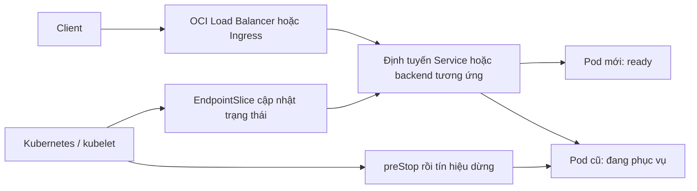
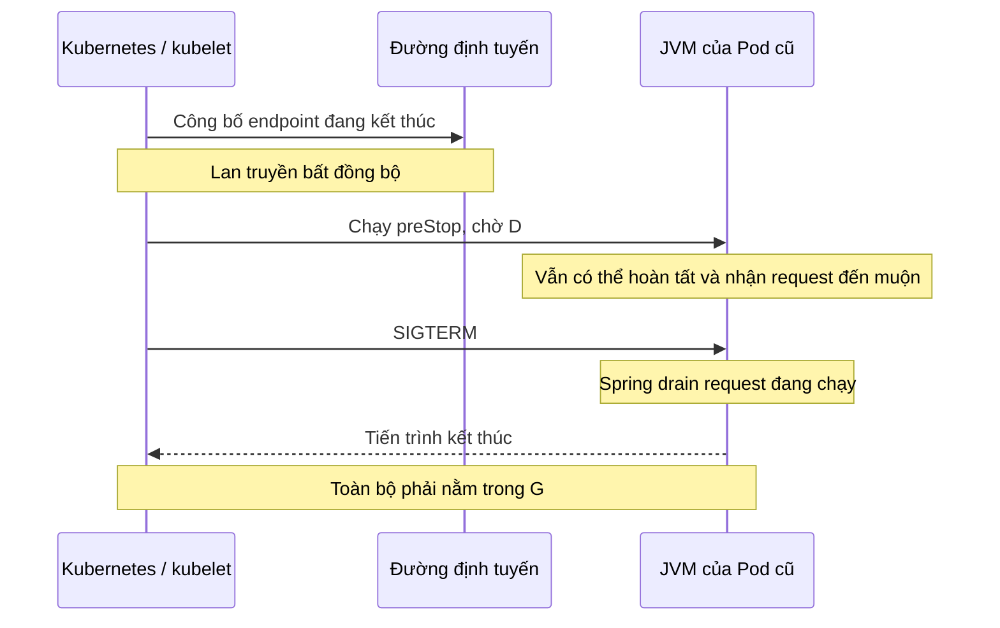

# Graceful shutdown, readiness và triển khai không gián đoạn

## 1. Mục tiêu: giữ được dịch vụ trong lúc thay phiên bản

Trong chương **Triển khai Java và Spring Boot** của module **CLOUD_PROVIDERS_ORACLE**, triển khai không gián đoạn là bài toán phối hợp ứng dụng với đường truyền lưu lượng trên Oracle Cloud Infrastructure. Có hai replica hoặc bật rolling update chưa đủ: bản mới phải thực sự phục vụ được, còn bản cũ phải có thời gian hoàn tất công việc trước khi dừng.

Bài này dùng dịch vụ Spring Boot HTTP chạy trên **Oracle Kubernetes Engine (OKE)**, image được lưu tại **OCI Container Registry (OCIR)** và đường truy cập bên ngoài đi qua Ingress hoặc OCI Load Balancer đã được cấu hình. Người học cần giải thích và kiểm chứng được:

- Khi nào một Pod được nhận lưu lượng mới.
- Điều gì xảy ra từ lúc Pod bị yêu cầu xóa đến khi JVM kết thúc.
- Cách phối hợp readiness, graceful shutdown, `preStop` và rolling update.
- Cách phát hiện request thất bại, connection reset và thiếu capacity trong quá trình thay phiên bản.
- Cách bảo toàn tương thích với Oracle Database, xử lý rollback và kiểm soát chi phí phần tài nguyên dự phòng.

Phạm vi chính là ứng dụng Spring Boot dạng executable JAR, Java 21, Spring MVC với embedded Tomcat, chạy trên Linux managed node pool. Với WebFlux, WebSocket, gRPC hoặc tác vụ nền, cần bổ sung cơ chế drain phù hợp được trình bày ở phần sau.

Ở đây, “không gián đoạn” phải gắn với tiêu chí đo: trong một lần rollout có tải xác định, không có lỗi truyền tải hoặc phản hồi lỗi ngoài dự kiến và độ trễ vẫn trong mục tiêu. Đây là kết quả phải quan sát, không phải thuộc tính tự có của một đoạn YAML.

## 2. Ba việc khác nhau: sẵn sàng, rút lưu lượng và dừng ứng dụng

| Cơ chế | Câu hỏi nó giải quyết | Điều nó không tự làm |
| --- | --- | --- |
| Readiness | Bản sao này có nên được chọn để nhận lưu lượng mới? | Không đóng mọi kết nối đang tồn tại |
| Rút lưu lượng, hay drain | Đường định tuyến đã ngừng phân phối công việc mới tới bản sao này chưa? | Không hoàn tất transaction hoặc công việc bên trong JVM |
| Graceful shutdown | Khi nhận tín hiệu dừng, ứng dụng có hoàn tất phần việc đang chạy trong ngân sách cho phép không? | Không tự bảo đảm còn replica khác đủ capacity |

Ví dụ, Pod A đang xử lý một request tạo đơn hàng mất 8 giây. Pod B và Pod C đã nhận lưu lượng mới. Nếu Pod A được dừng có điều phối, request đang chạy có thể hoàn tất trước khi JVM thoát. Nếu tiến trình bị kết thúc ngay, người dùng có thể nhận lỗi dù transaction đã commit.

Hai mặt cần giải quyết cùng nhau là **duy trì điểm phục vụ** và **bảo toàn công việc đang thực hiện**. Retry phía client chỉ là lớp bổ sung; với thao tác ghi, retry thiếu idempotency có thể tạo đơn hàng hoặc thanh toán lặp.

### 2.1. Đường lưu lượng trên OCI



Đường đi thực tế phụ thuộc kiến trúc: load balancer có thể đưa lưu lượng qua worker nodes hoặc trực tiếp tới Pod trong cấu hình được hỗ trợ. Vì vậy, không được mặc định một lần readiness fail lập tức làm mọi tầng mạng ngừng sử dụng Pod đó.

Trên OKE, cần xác định rõ backend của load balancer, controller quản lý nó, Service và chính sách định tuyến đang dùng. Oracle mô tả cả cấu hình node backend và Pod backend trong [hướng dẫn cấu hình load balancer cho OKE](https://docs.oracle.com/en-us/iaas/Content/ContEng/Tasks/contengconfiguringloadbalancersnetworkloadbalancers-subtopic.htm).

## 3. Vòng đời của một Pod bị thay thế

Khi Deployment giảm số Pod của ReplicaSet cũ, một luồng dừng thông thường có các thành phần sau:

1. Pod nhận yêu cầu xóa, có deletion timestamp và bắt đầu quá trình kết thúc.
2. Kubernetes cập nhật trạng thái endpoint liên quan; các thành phần định tuyến nhận thay đổi.
3. Kubelet thực hiện `preStop` nếu container có hook đó.
4. Sau khi hook hoàn tất, runtime gửi tín hiệu dừng tới tiến trình container; trong ví dụ là SIGTERM.
5. Spring đóng application context và thực hiện graceful shutdown.
6. Container thoát; nếu chưa kết thúc khi hết grace period, nó có thể bị buộc dừng.

**Bước cập nhật định tuyến và bước dừng container không phải một chuỗi đồng bộ toàn hệ thống.** Không có một thời điểm duy nhất mà mọi proxy, load balancer và kết nối cùng chuyển trạng thái. Xem [Kubernetes: kết thúc Pod](https://kubernetes.io/docs/concepts/workloads/pods/pod-lifecycle/#pod-termination).

Trong EndpointSlice, các condition `ready`, `serving` và `terminating` giúp phân biệt khả năng phục vụ với trạng thái kết thúc. Endpoint đang terminating thường không được chọn cho lưu lượng mới; một số chính sách proxy vẫn có thể dùng endpoint vừa serving vừa terminating nếu tất cả endpoint đều đang kết thúc. Không hiểu việc ready chuyển false là bằng chứng mọi kết nối đã bị cắt. Xem [Kubernetes: EndpointSlice conditions](https://kubernetes.io/docs/concepts/services-networking/endpoint-slices/#conditions).

### 3.1. Khoảng đua thường gây lỗi

Giả sử JVM ngừng nhận kết nối ở giây thứ nhất nhưng proxy phía trước mất vài giây mới cập nhật tuyến. Request mới vẫn có thể được gửi tới Pod vừa ngừng lắng nghe, gây connection reset hoặc lỗi gateway.

Một drain delay được đo và đặt trước SIGTERM có thể cho đường định tuyến thời gian cập nhật, trong khi ứng dụng còn phục vụ những request đến muộn. Delay này không thay thế việc cấu hình đúng controller, health check hoặc timeout.

### 3.2. Readiness không phải liveness

Readiness fail dùng để tạm ngừng chọn một bản sao cho lưu lượng. Liveness fail có thể dẫn tới restart container. Không dùng liveness để đánh dấu “đang bảo trì” hoặc “đang drain”: việc đó biến một trạng thái có chủ đích thành một lần khởi động lại không cần thiết.

Tương tự, khi Oracle Database dùng chung bị gián đoạn, restart đồng loạt JVM thường không giải quyết được nguyên nhân. Điều kiện dependency trong readiness cần được chọn theo các API còn phục vụ được, thay vì gom toàn bộ health check vào mọi probe.

## 4. Chuẩn bị Spring Boot để nhận tín hiệu dừng đúng cách

### 4.1. Cấu hình ứng dụng

Dự án cần có starter web và Actuator. Nếu dự án dùng Maven với dependency management của Spring Boot, bổ sung:

```xml
<dependency>
    <groupId>org.springframework.boot</groupId>
    <artifactId>spring-boot-starter-actuator</artifactId>
</dependency>
```

Cấu hình `application.yaml`:

```yaml
server:
  port: 8080
  shutdown: graceful

spring:
  lifecycle:
    timeout-per-shutdown-phase: 25s

management:
  endpoints:
    web:
      exposure:
        include: health
  endpoint:
    health:
      show-details: never
      probes:
        enabled: true
        add-additional-paths: true
```

Spring Boot dùng graceful shutdown khi đóng application context; các web server hỗ trợ sẽ dành thời gian cho request đang chạy và ngừng nhận request mới theo cách triển khai của server. Với Tomcat trong ví dụ, việc ngừng nhận mới diễn ra ở tầng mạng. Xem [Spring Boot: graceful shutdown](https://docs.spring.io/spring-boot/reference/web/graceful-shutdown.html).

Actuator cung cấp readiness/liveness health group. Cấu hình additional paths đưa chúng ra `/readyz` và `/livez` trên cổng ứng dụng. Không dùng một endpoint luôn trả 200 bất kể ứng dụng đã khởi tạo xong hay chưa. Xem [Spring Boot: Kubernetes probes](https://docs.spring.io/spring-boot/reference/actuator/endpoints.html#actuator.endpoints.kubernetes-probes).

Nếu có Spring Security, cho phép kubelet truy cập đúng health path mà không bị trả 401, 403 hoặc redirect đăng nhập. Điều đó không đòi hỏi công khai toàn bộ Actuator ra Internet. Không cần bật endpoint quản trị shutdown cho quy trình này.

### 4.2. Thời điểm ứng dụng bắt đầu ready

Spring Boot theo dõi availability và thường chuyển sang trạng thái nhận lưu lượng sau giai đoạn chạy application runner. Nếu warm-up thiết yếu bị đẩy sang một background thread rồi bỏ qua, readiness có thể tốt trước khi warm-up xong.

Đưa phần khởi tạo bắt buộc vào `ApplicationRunner` hoặc thiết kế readiness riêng cho phần khởi tạo bất đồng bộ. Khi ứng dụng chủ động ngừng nhận công việc, có thể công bố `ReadinessState.REFUSING_TRAFFIC`; sự kiện đó không tự đóng cổng HTTP hay hoàn tất transaction. Tham khảo [Spring Boot: application availability](https://docs.spring.io/spring-boot/reference/features/spring-application.html#features.spring-application.application-availability).

### 4.3. Java cần nhận được SIGTERM

Ví dụ Dockerfile:

```dockerfile
FROM eclipse-temurin:21-jre
WORKDIR /app
COPY --chown=10001:10001 target/orders-api.jar /app/app.jar
USER 10001:10001
EXPOSE 8080
ENTRYPOINT ["java", "-jar", "/app/app.jar"]
```

Trong ví dụ, build của dự án đã tạo executable JAR tại `target/orders-api.jar`. Exec-form giúp Java nhận tín hiệu trực tiếp. Nếu cần wrapper script, dòng khởi chạy cuối phải chuyển quyền điều khiển bằng `exec java ...` hoặc wrapper phải chuyển tiếp tín hiệu đúng.

Một phép thử chỉ bấm Stop trong IDE chưa chứng minh container xử lý SIGTERM đúng. Cần kiểm tra trên image và runtime thực tế.

## 5. Tính ngân sách thời gian trước khi viết YAML

Đặt:

- `D`: thời gian chờ đường định tuyến rút lưu lượng trước khi gửi SIGTERM.
- `S`: thời gian ứng dụng cần để kết thúc sau SIGTERM.
- `M`: phần dự phòng cho scheduling, cleanup và biến động vận hành.
- `G`: `terminationGracePeriodSeconds` của Pod.

Nguyên tắc thiết kế:

```text
G > D + S + M
```

`preStop` chạy **bên trong** grace period. Ví dụ hook mất 10 giây trong grace period 50 giây thì ứng dụng không còn nguyên 50 giây sau SIGTERM. Xem [Kubernetes: container lifecycle hooks](https://kubernetes.io/docs/concepts/containers/container-lifecycle-hooks/).

Một ngân sách khởi đầu cho lab:

| Thành phần | Giá trị minh họa | Cách diễn giải |
| --- | --- | --- |
| Drain delay trước SIGTERM | 10 giây | Dành thời gian cho thay đổi tuyến lan truyền |
| Timeout mỗi Spring shutdown phase | 25 giây | Ngân sách cho từng phase, không phải toàn bộ quá trình |
| Grace period của Pod | 50 giây | Bao gồm hook và phần dừng ứng dụng |
| Request demo dài nhất | 20 giây | Đủ ngắn để quan sát việc hoàn tất trong ngân sách mẫu |

Với ứng dụng đơn giản, lấy 10 giây drain, khoảng 25 giây dừng và 10 giây dự phòng thì tổng là 45 giây, nhỏ hơn 50 giây. Nếu ứng dụng có nhiều shutdown phase hoặc consumer nền, `S` có thể vượt 25 giây; phải đo lại và thay toàn bộ ngân sách liên quan.



Các timeout ở client, Ingress, OCI Load Balancer và ứng dụng phải phù hợp với loại request được cho phép. Grace period dài không giúp request sống sót nếu proxy cắt kết nối sớm hơn. Idle timeout của load balancer cũng khác tổng thời gian xử lý request; xem [Oracle: timeout và connection reuse](https://docs.oracle.com/en-us/iaas/Content/Balance/Reference/connectionreuse.htm).

Không kéo dài mọi timeout để che công việc không có giới hạn. Với tác vụ kéo dài hàng phút, thiết kế API bất đồng bộ trả job ID thường dễ vận hành hơn giữ một request HTTP xuyên nhiều lần triển khai.

## 6. Deployment mẫu phục vụ rollout có điều phối

### 6.1. Điều kiện môi trường

Trước khi apply, cần có:

- OKE cluster và namespace `java-apps` đã được cấp.
- Kubeconfig đúng cluster, máy quản trị truy cập được API endpoint qua VCN, VPN hoặc đường truy cập được thiết lập.
- Quyền Kubernetes phù hợp trong namespace; quyền IAM để xem đúng tài nguyên OCI trong compartment.
- Image đã push lên OCIR và Secret `ocir-pull` ở cùng namespace với Pod.
- Image đúng kiến trúc node, có Java và có `/bin/sh` cùng `sleep` nếu dùng hook exec dưới đây.
- Đường từ client tới ứng dụng được cấu hình độc lập qua Service/Ingress/LB và có thể quan sát lỗi.

Bài không tạo thêm load balancer. Có thể dùng Service nội bộ cho phép thử trong cluster, rồi kiểm chứng tiếp qua URL mà người dùng thực sự truy cập.

### 6.2. Manifest

Thay image placeholder bằng image thực tế, nên cố định digest. Các biến môi trường dưới đây áp dụng lại cấu hình vận hành quan trọng, kể cả khi image đã đóng gói `application.yaml`.

```yaml
apiVersion: apps/v1
kind: Deployment
metadata:
  name: orders-api
  namespace: java-apps
spec:
  replicas: 3
  revisionHistoryLimit: 5
  minReadySeconds: 10
  progressDeadlineSeconds: 600
  strategy:
    type: RollingUpdate
    rollingUpdate:
      maxSurge: 1
      maxUnavailable: 0
  selector:
    matchLabels:
      app.kubernetes.io/name: orders-api
  template:
    metadata:
      labels:
        app.kubernetes.io/name: orders-api
    spec:
      terminationGracePeriodSeconds: 50
      automountServiceAccountToken: false
      imagePullSecrets:
        - name: ocir-pull
      securityContext:
        runAsNonRoot: true
        runAsUser: 10001
        runAsGroup: 10001
      topologySpreadConstraints:
        - maxSkew: 1
          topologyKey: kubernetes.io/hostname
          whenUnsatisfiable: ScheduleAnyway
          labelSelector:
            matchLabels:
              app.kubernetes.io/name: orders-api
      containers:
        - name: orders-api
          image: "<ocir-host>/<tenancy-namespace>/java/orders-api@sha256:<digest-v1>"
          ports:
            - name: http
              containerPort: 8080
          env:
            - name: SERVER_SHUTDOWN
              value: graceful
            - name: SPRING_LIFECYCLE_TIMEOUT_PER_SHUTDOWN_PHASE
              value: 25s
            - name: MANAGEMENT_ENDPOINT_HEALTH_PROBES_ENABLED
              value: "true"
            - name: MANAGEMENT_ENDPOINT_HEALTH_PROBES_ADD_ADDITIONAL_PATHS
              value: "true"
            - name: MANAGEMENT_ENDPOINTS_WEB_EXPOSURE_INCLUDE
              value: health
            - name: MANAGEMENT_ENDPOINT_HEALTH_SHOW_DETAILS
              value: never
            - name: JAVA_TOOL_OPTIONS
              value: "-XX:MaxRAMPercentage=60.0"
          resources:
            requests:
              cpu: 500m
              memory: 512Mi
            limits:
              cpu: "1"
              memory: 1Gi
          startupProbe:
            httpGet:
              path: /livez
              port: http
            periodSeconds: 5
            timeoutSeconds: 2
            failureThreshold: 36
          readinessProbe:
            httpGet:
              path: /readyz
              port: http
            periodSeconds: 2
            timeoutSeconds: 2
            failureThreshold: 2
            successThreshold: 1
          livenessProbe:
            httpGet:
              path: /livez
              port: http
            periodSeconds: 10
            timeoutSeconds: 2
            failureThreshold: 3
          lifecycle:
            preStop:
              exec:
                command: ["/bin/sh", "-c", "sleep 10"]
          securityContext:
            allowPrivilegeEscalation: false
---
apiVersion: v1
kind: Service
metadata:
  name: orders-api
  namespace: java-apps
spec:
  type: ClusterIP
  selector:
    app.kubernetes.io/name: orders-api
  ports:
    - name: http
      port: 80
      targetPort: http
---
apiVersion: policy/v1
kind: PodDisruptionBudget
metadata:
  name: orders-api
  namespace: java-apps
spec:
  minAvailable: 2
  selector:
    matchLabels:
      app.kubernetes.io/name: orders-api
```

Đây là mẫu để người học lưu thành `orders-api-graceful.yaml` trong môi trường thực hành. Selector của Service và Deployment phải khớp. Không bật `publishNotReadyAddresses` cho Service HTTP thông thường này.

### 6.3. Từng tham số đóng góp điều gì?

| Thiết lập | Vai trò khi thay phiên bản |
| --- | --- |
| `replicas: 3` | Có nhiều bản sao cùng phục vụ; vẫn cần phân bố và capacity phù hợp |
| `maxUnavailable: 0` | Controller không chủ động giảm mức available theo chiến lược rollout |
| `maxSurge: 1` | Cho phép tạo thêm một bản sao trong quá trình thay thế |
| `minReadySeconds: 10` | Pod mới phải duy trì ready trước khi được tính available |
| `progressDeadlineSeconds: 600` | Báo việc rollout không tiến triển trong ngân sách đã định |
| Readiness probe | Cung cấp tín hiệu sẵn sàng của container |
| `preStop` | Trì hoãn SIGTERM trong khoảng drain đã chọn |
| Grace period 50 giây | Giới hạn thời gian để hook và tiến trình kết thúc |

Startup probe bảo vệ giai đoạn khởi động; readiness vẫn quyết định lúc nhận lưu lượng. Không thay readiness bằng một khoảng sleep cố định ở startup.

Deployment báo lỗi tiến triển khi vượt deadline, nhưng không tự rollback chỉ vì deadline đã vượt. Các quy tắc rolling update và available replica được mô tả trong [Kubernetes: Deployment](https://kubernetes.io/docs/concepts/workloads/controllers/deployment/).

`ScheduleAnyway` chỉ là ưu tiên trải Pod, không bảo đảm mỗi replica nằm trên một node. Nếu cần chống mất một node hoặc một miền lỗi, phải thiết kế placement và dự phòng tương ứng.

### 6.4. Vai trò và giới hạn của PDB

PDB `minAvailable: 2` hỗ trợ bảo vệ trước gián đoạn tự nguyện dùng Eviction API, ví dụ drain node. Nó không điều khiển rolling update của Deployment, không ngăn node chết và không ngăn mọi thao tác xóa Pod trực tiếp. Xem [Kubernetes: disruptions và PodDisruptionBudget](https://kubernetes.io/docs/concepts/workloads/pods/disruptions/).

Nếu chỉ có hai Pod healthy mà PDB yêu cầu hai Pod available, một lần drain có thể chờ thêm capacity. Cần đọc nguyên nhân thay vì vô hiệu hóa PDB theo thói quen.

## 7. Capacity là điều kiện của triển khai không gián đoạn

Trong mẫu, ba replica request tổng cộng `1,5 CPU + 1,5Gi memory`. Khi có một Pod surge, nhu cầu request đạt ít nhất `2 CPU + 2Gi memory`, chưa tính Pod đang kết thúc và workload khác.

Scheduler cần tìm được node đủ tài nguyên cho từng Pod. Tổng dung lượng trống toàn cluster không bảo đảm từng Pod xếp được, nhất là khi có ràng buộc kiến trúc, topology hoặc quota. Requests dùng cho scheduling; giới hạn memory và CPU còn ảnh hưởng khả năng xử lý và thời gian dừng. Xem [Kubernetes: quản lý tài nguyên container](https://kubernetes.io/docs/concepts/configuration/manage-resources-containers/).

Cần xét cả năng lực phục vụ, không chỉ bộ nhớ:

- Nếu mỗi Pod xử lý ổn định 100 request/giây và một Pod rời đi, hai Pod còn lại phải chịu được tải đang đến.
- Nếu mọi Pod gần CPU limit, request đang chạy có thể kết thúc chậm hơn ngân sách shutdown đã đo ở trạng thái rảnh.
- Nếu HPA đang đổi số replica trong lúc rollout, cần tính cả Pod mới, Pod cũ và Pod đang terminating.
- Nếu mỗi Pod mở một connection pool Oracle Database, surge làm tăng tổng kết nối; database có thể trở thành nút nghẽn trước khi cluster hết CPU.

Phần capacity dự phòng có chi phí OCI thật. Giảm `maxSurge` để tiết kiệm mà chưa kiểm tra mức available có thể làm rollout mắc kẹt hoặc giảm năng lực phục vụ. Theo dõi chi phí node pool, LB và tài nguyên liên quan theo compartment; request nhỏ hơn không tự làm hóa đơn node đang tồn tại giảm xuống.

## 8. Thực hành kiểm chứng bằng request và thời gian

### 8.1. Tạo endpoint có thời gian xử lý quan sát được

Để xem request có hoàn tất khi Pod dừng, thêm controller sau vào **bản image dùng cho lab**. Dự án đã có lớp `@SpringBootApplication` và starter web.

```java
package vn.example.orders;

import java.util.Map;
import java.util.Objects;
import java.util.UUID;
import org.slf4j.Logger;
import org.slf4j.LoggerFactory;
import org.springframework.http.HttpStatus;
import org.springframework.web.bind.annotation.GetMapping;
import org.springframework.web.bind.annotation.RequestParam;
import org.springframework.web.bind.annotation.RestController;
import org.springframework.web.server.ResponseStatusException;

@RestController
public class WorkController {
    private static final Logger log =
            LoggerFactory.getLogger(WorkController.class);

    @GetMapping("/demo/work")
    public Map<String, Object> work(
            @RequestParam(defaultValue = "500") long ms)
            throws InterruptedException {
        if (ms < 0 || ms > 20_000) {
            throw new ResponseStatusException(
                    HttpStatus.BAD_REQUEST, "ms must be in 0..20000");
        }

        String id = UUID.randomUUID().toString();
        String pod = Objects.toString(System.getenv("HOSTNAME"), "local");
        log.info("request_start id={} pod={} workMs={}", id, pod, ms);

        Thread.sleep(ms);

        log.info("request_end id={} pod={}", id, pod);
        return Map.of("requestId", id, "pod", pod, "workMs", ms);
    }
}
```

`Thread.sleep` chỉ mô phỏng công việc đồng bộ có thời lượng trong Spring MVC. Nó không mô phỏng đầy đủ CPU, I/O hoặc transaction, và không dùng để chặn event loop của WebFlux. Không giữ endpoint tạo tải này trong API công khai khi kết thúc lab.

### 8.2. Triển khai bản đầu tiên

Các lệnh dưới đây dùng Bash; thay placeholder và bảo đảm current context đúng:

```bash
kubectl config current-context
kubectl apply --dry-run=server -f orders-api-graceful.yaml
kubectl apply -f orders-api-graceful.yaml
kubectl -n java-apps rollout status deployment/orders-api --timeout=10m
kubectl -n java-apps get pods -l app.kubernetes.io/name=orders-api -o wide
kubectl -n java-apps get pdb orders-api
```

Chỉ bắt đầu phép thử khi có đủ Pod available, URL thực tế truy cập được và readiness tốt. Lưu tên image digest, cấu hình, số replica và thời điểm bắt đầu để đối chiếu kết quả.

Port-forward hữu ích để xem endpoint nhưng không phù hợp làm bằng chứng chính cho rollout qua LB: nó có thể gắn với một Pod và không đại diện đường đi người dùng. Dùng URL của Ingress/LB; nếu chỉ kiểm tra Service nội bộ, ghi rõ phạm vi đó.

### 8.3. Gửi request liên tục và giữ lại lỗi lần đầu

Đặt `BASE_URL` là URL không có dấu `/` cuối. Nếu ứng dụng yêu cầu xác thực, bổ sung cách cấp danh tính phù hợp với môi trường lab.

```bash
BASE_URL="https://<application-host>"

run_client() {
  worker="$1"
  for i in $(seq 1 100); do
    if result=$(curl -sS --connect-timeout 2 --max-time 30 -o /dev/null -w 'http=%{http_code} seconds=%{time_total}' "$BASE_URL/demo/work?ms=500"); then
      transport=ok
    else
      transport=failed
    fi
    printf '%s worker=%s transport=%s %s\n' "$(date -u +%FT%TZ)" "$worker" "$transport" "$result"
    sleep 0.1
  done
}

run_client A > client-A.log &
run_client B > client-B.log &
run_client C > client-C.log &
wait
```

Không bật retry trong phép thử cơ sở: retry có thể che lỗi lần gọi đầu. Ba vòng lặp này là phép kiểm tra liên tục ở tải thấp, chưa chứng minh đáp ứng SLO tại tải đỉnh.

Trong khi các client chạy, ở terminal khác, đẩy bản v2 lên OCIR rồi thay image:

```bash
NEW_IMAGE="<ocir-host>/<tenancy-namespace>/java/orders-api@sha256:<digest-v2>"
kubectl -n java-apps set image deployment/orders-api orders-api="$NEW_IMAGE"
kubectl -n java-apps rollout status deployment/orders-api --timeout=10m
```

Đọc những lần gọi có lỗi truyền tải hoặc mã HTTP ngoài 2xx:

```bash
awk '$3 != "transport=ok" || $4 !~ /^http=2[0-9][0-9]$/ { print FILENAME, $0 }' client-A.log client-B.log client-C.log
```

Không có dòng lỗi là một bằng chứng có phạm vi: đúng URL, tải, thời gian và cấu hình vừa thử. Cần thử tiếp với concurrency thực tế, request có keep-alive và các loại nghiệp vụ đại diện.

### 8.4. Theo dõi trạng thái song song

Mỗi lệnh watch chạy trong một terminal riêng:

```bash
kubectl -n java-apps get pods -l app.kubernetes.io/name=orders-api -w
kubectl -n java-apps get endpointslices -l kubernetes.io/service-name=orders-api -w
```

Khi cần xem condition của endpoint, lấy YAML của EndpointSlice; để xem sự kiện và log:

```bash
kubectl -n java-apps get endpointslices -l kubernetes.io/service-name=orders-api -o yaml
kubectl -n java-apps get events --sort-by=.metadata.creationTimestamp
kubectl -n java-apps logs <pod-name> -c orders-api --timestamps
```

Thu log về hệ thống quan sát trước khi Pod biến mất nếu cần phân tích đầy đủ sau thử nghiệm. Việc đọc log tại chỗ sau khi Pod đã xóa có thể không còn thực hiện được.

### 8.5. Kiểm tra một request đang chạy khi Pod dừng

Trong lab có đủ replica available:

1. Gửi `GET /demo/work?ms=15000` qua đường ứng dụng thực tế.
2. Đọc `request_start` để xác định Pod đang xử lý request đó.
3. Khi request vẫn đang chạy, yêu cầu xóa đúng Pod ấy bằng cách thông thường:
   `kubectl -n java-apps delete pod <pod-from-request-log> --wait=false`.
4. Quan sát response, `request_end`, log shutdown và Pod thay thế.

Với request 15 giây, drain delay 10 giây và thời điểm xóa phù hợp, request có thể còn đang chạy lúc SIGTERM đến. Một response thành công cùng log khớp request ID cho thấy công việc được hoàn tất trong lần dừng đã quan sát.

Xóa Pod trực tiếp không phải phép thử PDB; nó có thể vượt qua cơ chế bảo vệ của Eviction API. Không dùng force delete hoặc grace period bằng 0 để chứng minh graceful shutdown.

## 9. Kiểm chứng ở tầng OCI Load Balancer

Kubelet probe chỉ quan sát đường từ node tới Pod. OCI Load Balancer có health check và kết nối backend riêng; hai cơ chế không đồng nhất.

Trong một lần rollout, cần xác nhận:

- Backend của LB là node, Pod hay một tầng Ingress khác.
- Path, protocol, port và mã thành công của health check phù hợp cấu hình đó.
- Không xuất hiện khoảng không còn backend healthy.
- Không tăng lỗi gateway, timeout hoặc kết nối bị reset trong cửa sổ chuyển phiên bản.
- Request được gửi từ mạng người dùng thật, qua đúng DNS và TLS.

Health check TCP có thể chỉ chứng minh cổng mở. Health check HTTP nhắm sai path có thể báo unhealthy dù ứng dụng vẫn phục vụ tốt. Oracle mô tả cấu hình tại [health check policy của Load Balancer](https://docs.oracle.com/en-us/iaas/Content/Balance/Tasks/load_balancer_health_management.htm).

Nếu LB do Kubernetes controller quản lý, sửa qua cấu hình khai báo và cơ chế controller hỗ trợ, tránh thay đổi thủ công rồi bị reconcile về trạng thái cũ. Các tùy chọn phụ thuộc loại LB và kiểu backend; không dùng annotation của OCI Load Balancer cho Network Load Balancer theo suy đoán.

Ghép log request với metrics và log LB theo timestamp. Theo dõi ít nhất số kết nối đang hoạt động, backend timeout, phản hồi lỗi và thời gian đáp ứng; xem [Oracle: Load Balancer metrics](https://docs.oracle.com/en-us/iaas/Content/Balance/Reference/loadbalancermetrics.htm).

## 10. Tương thích dữ liệu là điều kiện của rolling update

Khi rollout, v1 và v2 cùng tồn tại. Nếu v2 đổi schema Oracle Database theo cách v1 không đọc hoặc ghi được, readiness vẫn có thể trả tốt trong khi request nghiệp vụ thất bại.

Một trình tự thay đổi kiểu mở rộng rồi thu gọn:

| Giai đoạn | Thay đổi | Điều kiện cần giữ |
| --- | --- | --- |
| Mở rộng | Thêm trường hoặc cấu trúc mới có tương thích ngược | v1 tiếp tục hoạt động |
| Chuyển ứng dụng | Triển khai v2 hiểu cả dữ liệu cũ và mới | Hai version có thể cùng chạy |
| Chuyển dữ liệu | Backfill có kiểm soát và xác nhận kết quả | Không làm quá tải database hay phá ràng buộc nghiệp vụ |
| Thu gọn | Bỏ cấu trúc cũ sau cửa sổ rollback | Không còn code hoặc job cần cấu trúc cũ |

Không để mỗi Pod mới đồng loạt chạy một migration dài ngoài kiểm soát. Migration cần cơ chế điều phối, theo dõi lock/thời gian và phương án tương thích rõ ràng.

Với API ghi, dùng mã yêu cầu/idempotency key phù hợp và ràng buộc ở nơi lưu dữ liệu để xử lý tình huống client mất response sau khi transaction đã hoàn tất. Graceful shutdown làm giảm lỗi do kết thúc tiến trình; nó không tạo bảo đảm “thực hiện đúng một lần” cho toàn hệ thống.

## 11. Request dài, consumer nền và session

### 11.1. Kết nối kéo dài

WebSocket, streaming và gRPC có thể tồn tại lâu hơn grace period. Readiness false không tự di chuyển kết nối sang Pod khác. Cần cơ chế đóng kết nối có thông báo, reconnect, giới hạn thời gian stream hoặc checkpoint phù hợp giao thức.

Client reconnect phải chịu được việc đổi Pod. Với session lưu trong RAM của một replica, request sau có thể mất trạng thái dù không có connection error. Thiết kế session/token hoặc kho trạng thái dùng chung cần tương thích với việc thay replica.

### 11.2. Consumer và tác vụ nền

Graceful shutdown của web server không chứng minh message consumer, scheduler hoặc executor tự tạo đã drain xong. Một trình tự cho worker nền thường cần:

1. Ngừng nhận message hoặc nhận job mới.
2. Giới hạn và theo dõi số việc đang thực hiện.
3. Hoàn tất hoặc checkpoint trong ngân sách dừng.
4. Chỉ ack/commit theo kết quả đã bền vững.
5. Để hệ thống có thể retry an toàn nếu tiến trình dừng giữa chừng.

Tích hợp lifecycle của thư viện và ứng dụng; không chờ vô hạn trong `@PreDestroy`. Nếu có nhiều shutdown phase, tính chúng vào tổng thời gian dừng thay vì chỉ dựa vào timeout của HTTP.

## 12. Rollback và bảo trì node OKE

### 12.1. Rollback khi vượt tiêu chí lỗi

Nếu bản mới gây lỗi hoặc latency tăng vượt ngưỡng, dừng tiến trình phát hành theo runbook và khôi phục revision tốt đã biết:

```bash
kubectl -n java-apps rollout history deployment/orders-api
kubectl -n java-apps rollout undo deployment/orders-api --to-revision=<known-good-revision>
kubectl -n java-apps rollout status deployment/orders-api --timeout=10m
```

Kiểm tra lại lưu lượng sau rollback, không chỉ trạng thái Deployment. Rollback Pod template không tự đảo ngược schema, nội dung ConfigMap bị sửa tại chỗ, Secret đã đổi hoặc dữ liệu đã ghi. Giữ image/configuration version cần thiết trong cửa sổ khôi phục và đồng bộ nguồn khai báo sau thao tác trực tiếp.

### 12.2. Phân biệt rollout ứng dụng với drain node

Trong bảo trì managed node pool, OKE có cấu hình cordon/drain và eviction grace period. Ngân sách này ở tầng **thao tác node**, khác `terminationGracePeriodSeconds` của từng Pod.

PDB quá chặt hoặc thiếu capacity có thể làm drain không hoàn tất. Tùy chọn force action/force terminate sau grace period có thể cho phép thao tác hạ tầng tiếp tục khi workload chưa được rút hết; phải hiểu tác động tới khả năng phục vụ. Tham khảo [Oracle: cordon và drain managed nodes](https://docs.oracle.com/en-us/iaas/Content/ContEng/Tasks/contengdeletingworkernodes_topic-Notes_on_cordon_and_drain.htm).

Bài thực hành rollout không cần tự reboot hoặc xóa node. Khi kiểm tra bảo trì hạ tầng, dùng kế hoạch riêng với quyền IAM, phạm vi compartment, placement và khả năng chịu mất node được xác định trước.

## 13. Chẩn đoán lỗi theo bằng chứng

| Hiện tượng trong lúc triển khai | Khả năng cần kiểm tra | Bằng chứng hữu ích |
| --- | --- | --- |
| Connection reset ngay lúc Pod dừng | JVM ngừng nghe trước khi tuyến cập nhật, kết nối đang tồn tại bị cắt | Timestamp deletion, log SIGTERM/shutdown và log proxy |
| HTTP 502 tăng | Backend unavailable, reset hoặc đường kết nối sai | LB error log, backend health, endpoint conditions |
| HTTP 504 tăng | Timeout ở đường backend hoặc dependency | Request duration, LB timeout, trace tới database/API |
| Pod mới ready nhưng API lỗi | Readiness quá sớm hoặc không phản ánh điều kiện cần | Log warm-up, request nghiệp vụ trên Pod mới |
| Pod mới Pending | Thiếu tài nguyên, quota hoặc ràng buộc placement | Event scheduling, allocatable và requests |
| Pod bị buộc dừng trước request_end | Grace period không đủ hoặc signal không đến đúng tiến trình | Hook duration, shutdown log, container last state |
| Rollout báo lỗi tiến triển | Image pull, startup/readiness, quota hoặc admission | Deployment condition, event và log Pod |
| Drain node bị chặn | PDB hoặc replica healthy không đủ | PDB allowed disruptions và work request OKE |
| Lỗi nghiệp vụ chỉ xuất hiện khi hai version cùng chạy | Schema/API/session không tương thích | Version phục vụ request, lỗi Oracle và thay đổi migration |

HTTP 502 hoặc 504 không tự chỉ ra một nguyên nhân duy nhất. Oracle hướng dẫn đối chiếu trạng thái backend và lỗi timeout trong [chẩn đoán backend Load Balancer](https://docs.oracle.com/en-us/iaas/Content/Balance/Reference/troubleshooting_backend.htm).

Exit code 137 cho biết tiến trình có thể bị SIGKILL nhưng không đủ để kết luận do hết grace period; cũng có thể liên quan OOM hoặc tác động khác. Đọc last state, reason và event trước khi thay đổi timeout.

## 14. Điều kiện chấp nhận một lần triển khai

Trước khi coi cấu hình phù hợp với dịch vụ, cần có bằng chứng cho cả bốn nhóm:

| Nhóm | Bằng chứng cần giữ |
| --- | --- |
| Lưu lượng | Số request, lỗi truyền tải, HTTP status và latency qua đúng đường người dùng |
| Ứng dụng | Readiness chuyển đúng lúc, request đang chạy hoàn tất và JVM dừng trong ngân sách |
| Kubernetes/OCI | Đủ replica/capacity, không có khoảng mất backend ngoài dự kiến, trạng thái LB và OKE phù hợp |
| Dữ liệu/khôi phục | Hai version cùng hoạt động được, retry ghi an toàn và rollback đã xét cấu hình cùng schema |

Khi đo, ghi rõ concurrency, kiểu kết nối, độ dài request, phiên bản image, thời gian rollout và điều kiện tải. Thử nghiệm có client tự retry phải phân biệt lỗi lần đầu với kết quả sau retry.

Giữ phần capacity dự phòng cần thiết cho rollout, nhưng rà soát tài nguyên lab và tài nguyên tạm sau khi hoàn tất. Một lần triển khai đạt mục tiêu là kết quả phối hợp readiness đúng, tuyến được rút kịp, công việc dừng trong ngân sách và bản còn lại tiếp tục phục vụ được.
