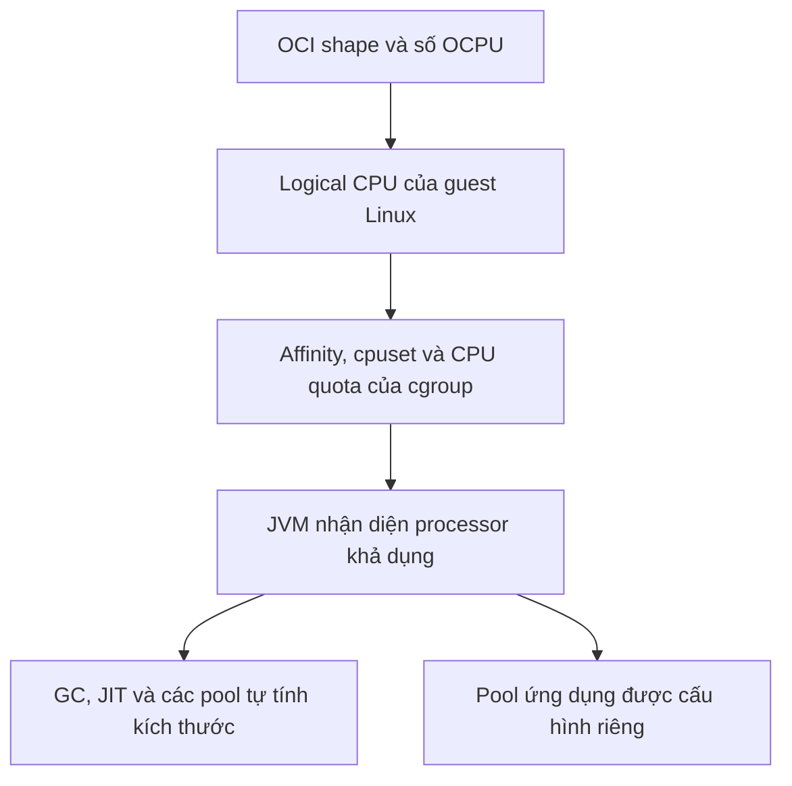

# Tuning JVM theo OCPU, bộ nhớ và kiến trúc Arm

Trong chương **Triển khai Java và Spring Boot** của module `CLOUD_PROVIDERS_ORACLE`, tuning JVM là quá trình điều chỉnh ứng dụng theo tài nguyên thực sự được cấp trên OCI. Cần nối được ba lớp: shape và OCPU của OCI, CPU/bộ nhớ mà hệ điều hành hoặc container cho phép sử dụng, rồi các giới hạn và thread pool bên trong JVM.

Bài học dùng HotSpot JDK 21 trên Linux làm mốc cho các lệnh và tùy chọn. Ví dụ ứng dụng là Spring Boot dùng Spring MVC, Tomcat và JDBC. Những con số cấu hình dưới đây là điểm bắt đầu cho một tình huống minh họa, cần đo lại trên workload thật; không phải cấu hình tối ưu chung cho mọi dịch vụ.

## 1. Tuning phải xuất phát từ mục tiêu phục vụ

Giả sử `orders-service` chạy trên OCI Compute và có thể được đóng gói thành container khi triển khai lên OKE. Nhóm muốn chuyển một phần workload từ x86 sang Arm để đánh giá chi phí, nhưng vẫn giữ yêu cầu về độ trễ và tính sẵn sàng.

Trước khi đổi một JVM flag, xác định:

- Tải mục tiêu: số request thành công mỗi giây và tỷ lệ các loại request.
- SLO: p95/p99, tỷ lệ lỗi, timeout và thời gian sẵn sàng sau khởi động.
- Giới hạn tài nguyên: CPU thực nhận, memory limit, số replica và dung lượng đĩa cho diagnostics.
- Điều kiện so sánh: phiên bản JDK, artifact, dữ liệu, database, đường mạng và công cụ tạo tải.
- Tiêu chí chấp nhận: đạt SLO ở tải mục tiêu, còn khoảng dự phòng và có phương án quay lại cấu hình cũ.

Ví dụ một SLO thử nghiệm có thể là p99 dưới 300 ms ở 200 request/giây, với tỷ lệ lỗi dưới 0,1%. Đây là mục tiêu giả định để thiết kế phép đo, không phải kết quả đo hay cam kết của OCI.

CPU trung bình thấp không chứng minh ứng dụng chưa thiếu CPU. Một thread có thể đã dùng hết một logical CPU, hoặc container có thể bị throttling trong khi node vẫn còn CPU rảnh. Tương tự, heap còn trống không chứng minh tiến trình còn đủ bộ nhớ.

## 2. Hiểu OCPU, vCPU và số processor mà JVM nhìn thấy

### 2.1. Không dùng một công thức chung cho mọi shape Arm

Đơn vị OCPU trong cấu hình OCI cần được đọc cùng tên shape. Theo tài liệu Compute Shapes, quan hệ cấp phát có các khác biệt sau:

| Dòng máy | Quan hệ cấp phát CPU | Ví dụ với 2 OCPU, trước các giới hạn của guest/container |
| --- | --- | --- |
| x86 AMD/Intel, ví dụ `VM.Standard.E4.Flex` | 1 OCPU tương ứng 2 vCPU | 4 logical CPU; không phải 4 lõi vật lý độc lập |
| Ampere A1, ví dụ `VM.Standard.A1.Flex` | 1 OCPU tương ứng 1 lõi, 1 vCPU | 2 logical CPU |
| Ampere A2/A4 | 1 OCPU tương ứng 2 lõi, 2 vCPU | 4 logical CPU |

Vì vậy, câu “Arm luôn có 1 OCPU bằng 1 vCPU” không áp dụng cho mọi thế hệ. Luôn kiểm tra [bảng shape của OCI](https://docs.oracle.com/en-us/iaas/Content/Compute/References/computeshapes.htm) cho dòng máy đang sử dụng.

Ngay cả khi hai shape cùng có 4 logical CPU, thông lượng cũng không nhất thiết bằng nhau. Thread SMT trên x86 và các lõi Arm độc lập có đặc tính khác nhau; thế hệ CPU, băng thông bộ nhớ và workload còn ảnh hưởng đến kết quả.

### 2.2. CPU của máy không phải CPU của tiến trình

Một ứng dụng có thể gặp các lớp giới hạn:



Một container giới hạn `cpu: "2"` trên OKE không có nghĩa nó được cấp 2 OCPU của node. Đó là giới hạn CPU theo đơn vị Kubernetes; cần đối chiếu với cgroup và kết quả JVM nhận diện. Hai container cùng giới hạn CPU có thể chạy trên các thế hệ hoặc kiến trúc phần cứng khác nhau.

Với JDK cập nhật có hỗ trợ container, JVM có thể sử dụng thông tin CPU và memory của Linux container khi tính ergonomics. Không suy ra hành vi của một bản JDK cũ chỉ từ số phiên bản chính; hãy ghi lại cả vendor, update và build, rồi kiểm tra trong chính môi trường chạy ứng dụng.

## 3. Lập bản kê tài nguyên trước khi thay đổi cấu hình

### 3.1. Kiểm tra kiến trúc và môi trường Linux

Các lệnh dưới đây là hướng dẫn thực hành trên máy hoặc container đích:

```bash
uname -m
lscpu
java -version
java -XshowSettings:system -version
java -XshowSettings:vm -version
java -Xlog:os+container=trace -version
```

Thông thường, Linux báo `x86_64` trên x86 và `aarch64` trên Arm 64 bit. Tên kiến trúc trong Java hoặc metadata image có thể dùng dạng khác như `amd64`, `aarch64` hoặc `arm64`; đối chiếu đúng hệ thống đang mô tả.

Các lệnh `java ... -version` tạo một JVM mới để khảo sát môi trường. Nếu ứng dụng thật có JVM flags hoặc biến môi trường riêng, kết quả JVM khảo sát chưa chắc phản ánh cấu hình tiến trình đang chạy. Với tiến trình thật, dùng công cụ chẩn đoán hoặc xuất metadata lúc startup.

### 3.2. Quan sát ngay từ tiến trình Java

Có thể thêm một bản ghi startup tương đương đoạn mã sau:

```java
Runtime runtime = Runtime.getRuntime();
long mib = 1024L * 1024L;

System.out.printf(
        "java=%s vendor=%s arch=%s processors=%d maxHeapMiB=%d%n",
        System.getProperty("java.runtime.version"),
        System.getProperty("java.vendor"),
        System.getProperty("os.arch"),
        runtime.availableProcessors(),
        runtime.maxMemory() / mib
);
```

`availableProcessors()` là số processor Java báo khả dụng cho tiến trình, không phải OCPU được tính phí. `maxMemory()` là trần heap mà JVM có thể cố gắng dùng, không phải trần RSS hay tổng bộ nhớ container. Hai ý nghĩa này được định nghĩa trong [API Runtime của Java 21](https://docs.oracle.com/en/java/javase/21/docs/api/java.base/java/lang/Runtime.html).

Không in toàn bộ environment hoặc tham số chứa credential để thu thập metadata. Bản kê tuning chỉ cần những thuộc tính tài nguyên và cấu hình đã được cho phép.

### 3.3. Đọc cgroup v2

Trong container có cgroup v2 được mount tại vị trí thông dụng, có thể khảo sát:

```bash
cat /proc/self/cgroup
cat /sys/fs/cgroup/cpu.max
cat /sys/fs/cgroup/cpu.stat
cat /sys/fs/cgroup/cpuset.cpus.effective
cat /sys/fs/cgroup/memory.max
cat /sys/fs/cgroup/memory.current
cat /sys/fs/cgroup/memory.events
```

Đường dẫn thực tế phụ thuộc namespace và cách mount; trên host phải xác định đúng cgroup của tiến trình. Cgroup cha cũng có thể tạo giới hạn hiệu dụng. Không áp dụng nguyên đường dẫn này cho cgroup v1.

Ví dụ `cpu.max` có giá trị:

```text
200000 100000
```

Điều đó biểu diễn ngân sách CPU time tương đương 2 CPU trong mỗi chu kỳ nêu trên; không chỉ định hai lõi cố định và không nói đến OCPU. Với `memory.max`, giá trị số là byte, còn `max` biểu thị không có giới hạn tại chính cấp cgroup đó.

Đọc thay đổi của `cpu.stat` và `memory.events` trong khoảng đo để tìm throttling hoặc OOM. Counter tích lũy cần lấy chênh lệch, không dùng một giá trị lớn từ lúc container khởi động để kết luận sự cố đang xảy ra. Tham khảo [tài liệu cgroup v2 của Linux kernel](https://docs.kernel.org/admin-guide/cgroup-v2.html).

## 4. Lập ngân sách bộ nhớ cho cả tiến trình

### 4.1. Heap chỉ là một phần của tổng bộ nhớ

Một cách lập ngân sách thực hành là:

```text
Ngân sách cho workload
  >= heap
   + metaspace
   + code cache/JIT
   + stack của các platform thread
   + direct buffer và native allocation
   + cấu trúc GC/JVM/agent
   + phần sử dụng khác cùng bị tính vào giới hạn
   + khoảng dự phòng
```

Đây là mô hình lập ngân sách, không phải công thức cộng chính xác các chỉ số RSS, NMT và cgroup. Các nguồn đo có phạm vi khác nhau và có thể đếm chồng nhau. Bộ nhớ container còn có thể bao gồm file cache hoặc dữ liệu tmpfs bị tính vào cgroup; RSS của một tiến trình không thay thế tổng mức sử dụng đó.

Phân biệt ba số:

| Khái niệm | Câu hỏi nó trả lời |
| --- | --- |
| Reserved | JVM đã dành phạm vi địa chỉ ảo nào? |
| Committed | Những vùng nào đã được JVM cam kết cho sử dụng? |
| Resident/cgroup usage | Hệ điều hành đang ghi nhận bộ nhớ hiện diện hoặc được tính phí như thế nào? |

Reserved lớn không tự chứng minh RAM vật lý đã bị tiêu thụ tương ứng. Ngược lại, heap used thấp vẫn có thể đi cùng RSS cao do native allocation, stack, JVM hoặc thư viện khác.

### 4.2. Ví dụ container có giới hạn 4 GiB

Giả sử container ứng dụng có giới hạn chính xác `4Gi`, tức 4096 MiB. Host vẫn cần tài nguyên riêng cho hệ điều hành, agent và workload khác; không lấy toàn bộ RAM của host làm ngân sách cho từng container.

Một dự toán khởi đầu có thể là:

| Hạng mục | Dự toán minh họa |
| --- | ---: |
| Heap tối đa | 2304 MiB |
| Metaspace | 256 MiB |
| Code cache | 192 MiB |
| Stack và cấu trúc thread | 192 MiB |
| Direct buffer/native I/O | 256 MiB |
| GC, JVM, agent và native khác | 384 MiB |
| Khoảng dự phòng | 512 MiB |
| **Tổng ngân sách** | **4096 MiB** |

Chỉ heap trong cấu hình ví dụ sắp tới được đặt trần theo con số này. Các hàng còn lại là dự toán cần đo, không phải giới hạn được tự thực thi. Nếu quan sát thấy metaspace hoặc native memory vượt dự toán, phải phân bổ lại, giảm tải giữ trong bộ nhớ hoặc tăng memory limit.

Dùng MiB/GiB rõ ràng khi tính toán: `1 GiB = 1024 MiB`. Không tráo đơn vị của OCI Console, Kubernetes và các báo cáo hệ điều hành mà không chuyển đổi.

### 4.3. Số thread cũng là quyết định về bộ nhớ

Với platform thread, `số thread × kích thước stack` là một ước lượng sơ bộ cho phần địa chỉ stack được dành, chưa gồm mọi overhead và không bằng lượng RAM resident luôn sử dụng.

Hàng trăm thread có thể tiêu tốn nhiều bộ nhớ ngoài heap. Không tự giảm `-Xss` thật thấp để bù cho pool không giới hạn: call stack sâu có thể gây `StackOverflowError`, và yêu cầu stack có thể khác theo JDK hoặc kiến trúc.

Tương tự, `-XX:MaxDirectMemorySize` chỉ điều khiển một phạm vi direct-buffer allocation của Java NIO, không giới hạn toàn bộ native memory. JNI, agent hoặc allocator của thư viện có thể tạo bộ nhớ ngoài phạm vi đó. Ý nghĩa các tùy chọn được mô tả trong [java command của JDK 21](https://docs.oracle.com/en/java/javase/21/docs/specs/man/java.html).

## 5. Thiết lập JVM khởi điểm, rồi kiểm tra giá trị thực nhận

### 5.1. Một profile minh họa cho container 4 GiB

Với ngân sách trên, có thể bắt đầu từ:

```bash
exec java \
  -Xms1g \
  -Xmx2304m \
  -XX:+UseG1GC \
  '-Xlog:gc*,safepoint:stdout:time,uptime,level,tags' \
  -XX:+HeapDumpOnOutOfMemoryError \
  -XX:HeapDumpPath=/var/lib/orders/dumps \
  -XX:+ExitOnOutOfMemoryError \
  -jar /opt/orders/orders-service.jar
```

Đường dẫn JAR và thư mục dump là ví dụ. Thư mục dump phải tồn tại, được tiến trình ghi và có đủ dung lượng; volume, quyền truy cập và thời gian lưu cần được cấu hình khi triển khai. File dump có thể chứa dữ liệu và secret đang nằm trong bộ nhớ. Tránh ghi dump lớn vào tmpfs nằm trong chính memory limit đang thiếu.

Cấu hình chọn rõ G1 để các lần so sánh sử dụng cùng collector. `-Xms1g` đặt heap ban đầu, còn `-Xmx2304m` đặt trần heap. Chúng không cấp thêm RAM cho container và không ngăn mọi allocation ngoài heap.

GC log đang đi ra stdout; nền tảng thu log cần giới hạn dung lượng và thời gian lưu. Đối với VM ghi trực tiếp vào file, có thể thay riêng tùy chọn logging bằng:

```text
-Xlog:gc*,safepoint:file=/var/log/orders/gc-%p.log:time,uptime,level,tags:filecount=5,filesize=20M
```

Thư mục log phải tồn tại và có quyền ghi. Không dùng đồng thời nhiều cơ chế log mà không kiểm soát tổng dung lượng.

### 5.2. Khi nào dùng tỷ lệ bộ nhớ?

Nếu image được chạy với nhiều memory limit khác nhau, có thể thử dùng tỷ lệ thay cho `-Xms` và `-Xmx`:

```text
-XX:InitialRAMPercentage=25.0
-XX:MaxRAMPercentage=56.25
```

Đây là **phương án thay thế hai tham số heap cố định**, không phải hai flag bổ sung để cộng thêm bộ nhớ. Với giới hạn 4 GiB mà JVM nhận đúng, tỷ lệ 56,25% hướng tới mức heap tương đương 2304 MiB trước các điều chỉnh ergonomics/alignment; xác minh bằng giá trị heap thực tế.

Tỷ lệ này không bảo đảm native memory luôn vừa phần còn lại ở mọi mức RAM. Khi thu nhỏ container, chi phí tương đối cố định của class metadata, JIT và agent chiếm tỷ trọng lớn hơn. Nếu không có memory limit phù hợp, JVM có thể tính dựa trên phạm vi RAM khác với ngân sách vận hành dự định.

Chọn một nơi sở hữu cấu hình heap. Nếu buildpack hoặc entrypoint đã tính heap, hãy kiểm tra flags hiệu dụng trước khi thêm `JAVA_TOOL_OPTIONS` hoặc tham số mới. Các cơ chế nhập tham số trùng nhau dễ làm người vận hành hiểu sai giá trị đang được dùng.

### 5.3. Có nên đặt Xms bằng Xmx?

Đặt `Xms = Xmx` có thể giúp giảm biến động do thay đổi kích thước heap, nhưng cũng làm tăng yêu cầu bộ nhớ sớm của tiến trình. Không dùng đó làm mặc định cho mọi container.

Nếu thử `-XX:+AlwaysPreTouch`, việc chạm trước các trang nhớ có thể chuyển một phần chi phí cấp trang sang startup. Phải đo lại thời gian readiness và đỉnh sử dụng bộ nhớ; không bật trong môi trường sát giới hạn chỉ vì muốn giảm dao động độ trễ.

Mục tiêu của lựa chọn này là đánh đổi có kiểm chứng giữa startup, footprint và độ ổn định, không phải làm RSS trông thấp hơn khi hệ thống chưa có tải. Oracle thảo luận các lựa chọn liên quan trong [G1 tuning guide](https://docs.oracle.com/en/java/javase/21/gctuning/garbage-first-garbage-collector-tuning.html).

## 6. Tuning theo CPU thực sự khả dụng

### 6.1. ActiveProcessorCount không tạo thêm CPU

Ưu tiên để JDK nhận diện đúng môi trường. Chỉ cân nhắc override sau khi đã kiểm tra cgroup, affinity và số processor mà ứng dụng báo.

```text
-XX:ActiveProcessorCount=2
```

Tùy chọn này thay đổi số processor JVM dùng cho các tính toán ergonomics có liên quan. Nó không đặt CPU quota, không ghim tiến trình vào hai lõi và không biến 2 OCPU x86 thành 2 logical CPU.

Cũng không được giả định mọi executor của thư viện sẽ đổi kích thước theo flag này. Pool cấu hình bằng số cố định, pool đã tạo sẵn hoặc logic nội bộ riêng cần được kiểm tra độc lập. Xem định nghĩa [ActiveProcessorCount trong java command](https://docs.oracle.com/en/java/javase/21/docs/specs/man/java.html).

Ví dụ:

| Môi trường minh họa | Quyết định ban đầu |
| --- | --- |
| A1 có 2 OCPU, ứng dụng thấy 2 processor, không có giới hạn khác | Chưa cần override chỉ để “tối ưu Arm” |
| E4 có 2 OCPU, ứng dụng thấy 4 processor | Không ép về 2 chỉ vì Console ghi 2 OCPU |
| Container có quota tương đương 2 CPU nhưng ứng dụng thấy số CPU toàn node | Điều tra JDK/cgroup; override có thể là biện pháp tạm đã được kiểm chứng |
| Container giới hạn 500m CPU | Đo throttling và latency; processor count nguyên không biểu diễn đầy đủ ngân sách nửa CPU |

Đừng đặt `ParallelGCThreads`, `ConcGCThreads` và số thread JIT theo số OCPU bằng một công thức tùy ý. GC, JIT và request handler dùng chung CPU; tăng tất cả các nhóm thread có thể làm cạnh tranh lớn hơn.

### 6.2. Nhận diện CPU throttling

Quota giới hạn thời gian CPU được dùng trong một chu kỳ. Khi nhiều thread runnable cùng tiêu hết ngân sách sớm, chúng có thể phải chờ dù node chưa bão hòa.

Đối chiếu đồng thời:

- Thông lượng, p99 và thời gian hàng đợi.
- CPU của tiến trình/container cùng mẫu số dùng để chuẩn hóa.
- Chênh lệch counter throttling trong đúng khoảng tạo tải.
- Số thread runnable, hotspot CPU và thời gian GC/JIT.

Ví dụ, CPU trung bình thấp ở cấp VM nhưng container bị throttling không phải bằng chứng cần tăng heap. Hướng thử nghiệm hợp lý hơn có thể là giảm concurrency CPU-bound, tăng CPU quota hoặc thay đổi phân bổ workload.

CPU requests và limits trong Kubernetes có vai trò khác nhau: requests tham gia scheduling và phân chia tài nguyên khi có tranh chấp, còn CPU limit có thể được thực thi qua throttling. Memory request cũng không thay memory limit. Xem [Resource Management for Pods and Containers](https://kubernetes.io/docs/concepts/configuration/manage-resources-containers/).

## 7. Điều chỉnh concurrency cùng với JVM

### 7.1. Phân biệt công việc dùng CPU và công việc chờ I/O

Một tác vụ mã hóa, nén hoặc tính toán nặng không chạy nhanh hơn vô hạn khi tăng thread. Nếu đã sử dụng hết CPU hữu ích, thêm task song song chủ yếu tăng tranh chấp, context switch và thời gian chờ.

Request chờ database hoặc HTTP ngoài có thể cần concurrency cao hơn số CPU để sử dụng tài nguyên hiệu quả. Tuy nhiên, concurrency phải phù hợp với timeout, connection pool và khả năng của hệ thống đích.

Một ước lượng theo Little's Law, trong trạng thái ổn định:

```text
Số request trung bình đang trong hệ thống
    ≈ throughput trung bình × thời gian trung bình trong hệ thống

200 request/giây × 0,2 giây = 40 request trung bình
```

Đó không phải công thức đặt chính xác 40 Tomcat thread. Nó không dùng p99 thay cho số trung bình và không tự tính đủ burst, queue hoặc các tác vụ nền. Nếu thời gian database tăng, số request bị giữ đồng thời và lượng dữ liệu đi kèm cũng có thể tăng.

### 7.2. Ví dụ cấu hình Spring MVC/Tomcat

Với Spring Boot 3.5.x dùng platform thread, có thể thử một profile như:

```yaml
server:
  tomcat:
    threads:
      max: 64
      min-spare: 8
    max-connections: 256
    accept-count: 64

spring:
  datasource:
    hikari:
      maximum-pool-size: 8
      connection-timeout: 2000
```

Các giá trị này minh họa một đợt thử tải; chúng không được suy ra trực tiếp từ 2 OCPU. `accept-count` liên quan backlog khi không thể tiếp nhận thêm kết nối theo cấu hình connector, không phải giới hạn duy nhất cho mọi hàng đợi trong ứng dụng. Cần thêm chính sách queue, timeout và từ chối tải ở nơi công việc được nhận.

Không áp dụng cấu hình Tomcat cho WebFlux/Netty. Nếu bật virtual thread, một số thuộc tính worker thread của Tomcat không còn hiệu lực như mô hình platform thread. Đối chiếu [danh mục property của Spring Boot 3.5](https://docs.spring.io/spring-boot/3.5/appendix/application-properties/index.html).

Database pool có 8 connection không có nghĩa toàn hệ thống chỉ sử dụng 8 connection. Với 6 replica, riêng các pool đó có thể yêu cầu tới 48 connection, chưa kể đợt rollout chồng lấn, batch job và công cụ quản trị. Tăng replica để giảm CPU ở JVM phải đi cùng ngân sách connection của Oracle Database.

Virtual thread giúp tổ chức công việc chờ I/O với chi phí thread khác, nhưng không làm tăng tài nguyên CPU hay số connection database. Vẫn cần giới hạn số tác vụ đồng thời, timeout và backpressure. Không dùng virtual thread như một cách bỏ mọi giới hạn concurrency. Xem [Virtual Threads trong Java 21](https://docs.oracle.com/en/java/javase/21/core/virtual-threads.html).

### 7.3. Kiểm soát dữ liệu bị giữ bởi hàng đợi

Một queue không giới hạn có thể làm heap tăng ngay cả khi tốc độ xử lý không thay đổi. Request hoặc task chờ thường giữ payload, context và các object liên quan.

Khi GC hoạt động nhiều, kiểm tra queue depth, retry backlog, batch size và cache trước khi tăng `Xmx`. Giảm dữ liệu đang chờ có thể cải thiện cả memory lẫn latency mà không cần đổi collector.

## 8. Chọn GC theo SLO và ngân sách

### 8.1. Bắt đầu với G1

G1 là điểm bắt đầu hợp lý cho phép đo trong bài. Nó thực hiện một phần công việc đồng thời với ứng dụng và cố gắng cân bằng throughput với pause time; đó là một đánh đổi tài nguyên CPU.

`MaxGCPauseMillis` là mục tiêu mềm, không phải giới hạn cứng cho mọi lần pause hoặc cho thời gian đáp ứng HTTP. Một p99 request dài có thể đến từ queue, database, khóa hoặc CPU throttling chứ không phải GC. Xem [tổng quan G1 của JDK 21](https://docs.oracle.com/en/java/javase/21/gctuning/garbage-first-g1-garbage-collector1.html).

Khi điều chỉnh G1, lần lượt kiểm tra:

1. Heap có đủ khoảng trống so với live set sau thu gom không?
2. Allocation rate có tăng do payload, serialization hoặc tạo object lặp lại không?
3. GC có đủ CPU để hoàn tất công việc đồng thời không?
4. Có Full GC, evacuation failure hoặc nhiều object lớn cần điều tra không?
5. Pause dài có trùng thời điểm tăng p99 của request không?

Tránh mang một bộ flags từ bài tuning cũ sang môi trường mới. Đặc biệt, ép kích thước young generation bằng các tùy chọn như `-Xmn` có thể hạn chế khả năng G1 điều chỉnh theo pause target. Chỉ thay một nhóm tham số khi đã có giả thuyết đo được.

### 8.2. Khi nào so sánh collector khác?

| Collector | Tình huống nên đem ra thử nghiệm | Điều cần cân nhắc |
| --- | --- | --- |
| G1 | Dịch vụ cân bằng throughput và độ trễ | Công việc concurrent vẫn cạnh tranh CPU |
| Parallel GC | Batch ưu tiên throughput, chấp nhận pause dài hơn | Không chọn chỉ vì tên có chữ “parallel” |
| ZGC | Workload có yêu cầu pause thấp, đủ CPU và memory headroom | Đo cả throughput, footprint và latency ở tải thật |
| Serial GC | Workload nhỏ, ít CPU và điều kiện pause phù hợp | Không mặc định dùng cho mọi container ít tài nguyên |

Ví dụ thử Generational ZGC trên **JDK 21** dùng:

```text
-XX:+UseZGC -XX:+ZGenerational
```

Hai tùy chọn đó thay cho lựa chọn G1; không bật đồng thời hai collector. Flags và chế độ ZGC có thể khác giữa các thế hệ JDK, vì vậy không dùng nguyên cấu hình JDK 21 như một hợp đồng cho JDK 17 hoặc các bản mới hơn. Tham khảo [các collector trong JDK 21](https://docs.oracle.com/en/java/javase/21/gctuning/available-collectors.html).

Trên ngân sách CPU nhỏ, một collector concurrent không tự bảo đảm p99 tốt hơn: request và collector vẫn dùng chung tài nguyên. Kết luận phải dựa trên SLO cùng footprint và chi phí sau thử nghiệm.

## 9. Chuyển sang Arm: kiểm tra toàn bộ chuỗi chạy

### 9.1. Bytecode Java không đồng nghĩa mọi dependency đều độc lập kiến trúc

Một JAR thuần Java có thể dùng lại khi JDK và API tương thích. Tuy nhiên, môi trường chạy còn có những thành phần cần phiên bản đúng kiến trúc:

| Thành phần | Điều phải xác minh trên Arm |
| --- | --- |
| JDK/JRE | Bản Linux AArch64, vendor và update được hỗ trợ |
| Base image | Có biến thể `linux/arm64` tương ứng |
| JNI/JNA và thư viện `.so` | Có binary Arm, ABI và thư viện hệ thống phù hợp |
| Agent APM/profiler | Hỗ trợ đúng JDK và nền tảng đích |
| Thư viện nén, TLS, crypto, xử lý ảnh | Backend native có sẵn và hành vi fallback đã được đo |
| Artifact có mã máy | Native executable hoặc archive phụ thuộc môi trường được tạo cho đúng nền tảng |

Đặc biệt, không suy ra mọi chế độ sử dụng Oracle JDBC đều có yêu cầu native giống nhau. Phải kiểm tra driver, cơ chế xác thực và thư viện thực sự được ứng dụng sử dụng. Các dependency native có thể nằm trong JAR hoặc được tải khi chạy; chỉ kiểm tra file JAR ở mức tên là chưa đủ.

OCI cung cấp nền tảng phát triển Java cho Arm; xem [Arm-Based Compute](https://docs.oracle.com/en-us/iaas/Content/Compute/References/arm.htm). Khả năng hỗ trợ nền tảng không thay việc kiểm tra agent và thư viện của ứng dụng cụ thể.

### 9.2. Image container phải có biến thể phù hợp

Có thể kiểm tra manifest của một image đã được nhóm chuẩn bị:

```bash
docker buildx imagetools inspect "$IMAGE"
```

Tìm cả `linux/amd64` và `linux/arm64` nếu muốn cùng tham chiếu image được triển khai trên hai loại node. Manifest đa kiến trúc chứa các biến thể riêng; nó không biến binary x86 thành binary Arm. Khi phát hành, ghi lại digest của image và biến thể thực tế đã chạy.

Với một quy trình build đã cấu hình đúng base image và các native dependency, Buildx hỗ trợ yêu cầu nền tảng:

```bash
docker buildx build \
  --platform linux/amd64,linux/arm64 \
  --output type=oci,dest=orders-multiarch.tar \
  .
```

Đây là ví dụ xuất artifact cục bộ cho quy trình build, không phải lệnh triển khai. Cần builder hỗ trợ các nền tảng được yêu cầu. Không hardcode `FROM --platform=linux/amd64` trong runtime stage rồi kỳ vọng ứng dụng chạy native trên Arm.

QEMU có thể hữu ích khi build hoặc kiểm tra tương thích, nhưng không dùng kết quả benchmark qua emulation để kết luận hiệu năng native Arm. Tham khảo [Multi-platform builds của Docker](https://docs.docker.com/build/building/multi-platform/).

### 9.3. Đo lại startup và steady state

JIT biên dịch mã máy cho CPU nơi JVM chạy. Sau khi chuyển kiến trúc, cần quan sát lại:

- Thời gian startup tới readiness và thời gian đạt throughput ổn định.
- CPU do JIT, class loading và khởi tạo connection pool.
- Hiệu năng các đường xử lý có nén, mã hóa, vector hóa hoặc native library.
- GC, live set, native memory và số thread thực tế.
- Thông lượng ổn định, p99 và hành vi khi workload bùng lên.

Không xem bytecode giống nhau là bằng chứng hiệu năng giống nhau. Cũng không tắt tiered compilation hoặc giới hạn compiler chỉ để startup nhìn nhanh hơn mà chưa đo tác động tới khả năng phục vụ lâu dài.

Các archive hoặc artifact chứa trạng thái phụ thuộc JVM/mã máy cần được tạo và kiểm tra cho cấu hình đích; không dùng cache từ x86 như một giả định tương thích cho AArch64.

## 10. Thu thập bằng chứng ở ba lớp

### 10.1. OCI và hệ điều hành

Dùng OCI Monitoring để quan sát CPU, bộ nhớ, mạng và I/O của máy; kiểm tra Compute monitoring đã được bật và metric nào thực sự có dữ liệu. Tài liệu [Compute Instance Metrics](https://docs.oracle.com/en-us/iaas/Content/Compute/References/computemetrics.htm) mô tả các metric và dimension.

Metric cấp VM/node không thay thế metric của container hay JVM. Nếu một pod bị giới hạn CPU thấp, biểu đồ CPU toàn node có thể che đi bottleneck của pod đó.

Gắn kết quả với region, shape, OCPU, memory, kiến trúc, instance/container, image digest và thời gian đo. Không ghép số liệu từ các khoảng thời gian hoặc replica khác nhau rồi coi là cùng một lần thử.

### 10.2. JVM và ứng dụng

Một dashboard phục vụ tuning nên có:

| Nhóm | Dữ liệu cần đối chiếu |
| --- | --- |
| Phục vụ | Offered load, throughput thành công, p50/p95/p99, timeout, tỷ lệ lỗi |
| CPU | CPU tiến trình/container, quota, throttling, thread runnable |
| Heap/GC | Heap used/committed/max, live set quan sát được, allocation rate, pause và Full GC |
| Ngoài heap | RSS, cgroup usage, metaspace, code cache, direct buffer, platform thread |
| Hệ thống đích | Thời gian database/HTTP, connection pool active/pending, queue depth |
| Vòng đời | Startup, readiness, restart và đỉnh memory khi warm-up |

Nếu dùng Actuator/Micrometer, tên meter và cách xuất dữ liệu còn phụ thuộc phiên bản cùng registry. Không giả định một JVM meter duy nhất đo được toàn bộ native memory hoặc mọi virtual thread.

### 10.3. Kiểm tra tiến trình bằng jcmd

Dùng công cụ JDK phù hợp với tiến trình đích, cùng quyền user/group và namespace có thể attach. Image runtime tối giản có thể không chứa `jcmd`; cần chuẩn bị phương án diagnostics trước sự cố.

```bash
jcmd "$JAVA_PID" VM.version
jcmd "$JAVA_PID" VM.flags
jcmd "$JAVA_PID" GC.heap_info
jcmd "$JAVA_PID" Thread.print
```

Đặt `JAVA_PID` bằng PID thật trong môi trường đang thao tác. Kiểm tra `jcmd "$JAVA_PID" help` nếu không chắc command được hỗ trợ. Không đưa thread dump hoặc các giá trị cấu hình thu được lên kênh công khai.

Một số thao tác chẩn đoán có thể tác động tới latency. Không lặp heap dump, histogram hoặc ép Full GC như một health check. Chi tiết command và mức ảnh hưởng nằm trong [jcmd của JDK 21](https://docs.oracle.com/en/java/javase/21/docs/specs/man/jcmd.html).

### 10.4. Native Memory Tracking

Để khảo sát native memory của HotSpot, thêm khi khởi động tiến trình thử nghiệm:

```text
-XX:NativeMemoryTracking=summary
```

Sau startup hoặc warm-up, đặt baseline rồi so sánh ở các thời điểm sau:

```bash
jcmd "$JAVA_PID" VM.native_memory summary scale=MB
jcmd "$JAVA_PID" VM.native_memory baseline
jcmd "$JAVA_PID" VM.native_memory summary.diff scale=MB
```

NMT cần được bật từ startup và có overhead. Nó không phải bảng kê đầy đủ mọi allocation của bên thứ ba hay mọi byte cgroup tính vào memory limit. Đọc nó cùng RSS, cgroup và metric thư viện; không trừ heap khỏi RSS rồi gán toàn bộ phần dư cho một category NMT.

Nếu so sánh hai cấu hình, giữ trạng thái instrumentation tương đương hoặc đo riêng ảnh hưởng của nó. Xem [Native Memory Tracking](https://docs.oracle.com/en/java/javase/21/vm/native-memory-tracking.html) và [hướng dẫn chẩn đoán memory leak](https://docs.oracle.com/en/java/javase/21/troubleshoot/troubleshooting-memory-leaks.html).

### 10.5. Flight Recorder cho một khoảng tải đại diện

Ví dụ thu một recording giới hạn thời gian:

```bash
jcmd "$JAVA_PID" JFR.start \
  name=oci-tuning \
  settings=profile \
  duration=120s \
  filename=/var/lib/orders/recordings/oci-tuning.jfr
```

Thư mục phải có sẵn, đủ dung lượng và quyền ghi. Chờ recording hoàn thành, rồi dùng công cụ tương thích để xem:

```bash
jfr summary /var/lib/orders/recordings/oci-tuning.jfr
```

Xem các mẫu CPU, allocation, lock, I/O và GC có liên quan tới thời điểm p99 tăng. Profile là một nguồn bằng chứng; sampling không phải phép đếm chính xác mọi lần gọi. Giữ recording trong phạm vi truy cập phù hợp vì nó có thể chứa thông tin nội bộ của ứng dụng. Tham khảo [jfr command](https://docs.oracle.com/en/java/javase/21/docs/specs/man/jfr.html).

## 11. Thiết kế phép so sánh x86 và Arm

### 11.1. Chọn câu hỏi so sánh

Có ít nhất ba câu hỏi khác nhau:

| Câu hỏi | Cách giữ điều kiện so sánh |
| --- | --- |
| Cùng ngân sách ứng dụng thì hiệu năng ra sao? | Định nghĩa CPU quota và memory limit, ghi rõ phần cứng bên dưới |
| Để đạt cùng SLO cần bao nhiêu tài nguyên? | Tìm cấu hình nhỏ nhất còn đạt SLO và khoảng dự phòng |
| Để phục vụ tải mục tiêu thì phương án nào ít tốn hơn? | So tổng chi phí các replica và hạ tầng cần thiết |

Giữ cùng số OCPU không đồng nghĩa giữ cùng số logical CPU. Giữ cùng số logical CPU cũng không đồng nghĩa cùng khả năng xử lý. Hãy ghi rõ lựa chọn chuẩn hóa thay vì tuyên bố hai máy “giống nhau”.

### 11.2. Giữ những yếu tố khác ổn định

Dùng cùng artifact logic, phiên bản JDK tương đương, dữ liệu, request mix và điều kiện database. Không đồng thời đổi kiến trúc, JDK major, collector, heap và mã ứng dụng rồi quy mọi thay đổi kết quả cho Arm.

Chạy công cụ tạo tải ở nơi khác với JVM được đo. Xác minh máy tạo tải, đường mạng, database và rate limit của dịch vụ ngoài chưa trở thành bottleneck. Với API có state, phải chuẩn bị dữ liệu để các lần chạy không làm lần sau dễ hơn hoặc khó hơn.

Tách riêng các pha:

1. **Cold start:** ghi startup, readiness, CPU và memory peak.
2. **Warm-up:** quan sát JIT, cache và pool tới trạng thái đủ ổn định.
3. **Steady load:** đo ở mức tải mục tiêu trong khoảng đại diện.
4. **Tăng tải/burst:** tìm điểm queue, throttling hoặc lỗi bắt đầu tăng.
5. **Soak và phục hồi:** quan sát xu hướng memory, backlog và khả năng trở về trạng thái ổn định.

Không chọn thời gian warm-up chỉ vì một công thức cố định. Đặc tính workload và thời gian ổn định của chỉ số quyết định khoảng đo cần thiết. Lặp lại phép đo để thấy độ biến thiên.

Công cụ tạo tải cũng phải báo offered load, request hoàn tất, timeout và thời gian chờ. Một máy chủ xử lý chậm làm client tự giảm tốc có thể tạo biểu đồ latency đẹp nhưng không đạt throughput mục tiêu. Không chỉ đếm những request thành công nhanh rồi bỏ request timeout khỏi đánh giá.

### 11.3. Chỉ thay một giả thuyết mỗi lượt

| Quan sát | Thử nghiệm có cơ sở |
| --- | --- |
| Heap nhanh đầy, live set sau GC lớn | Kiểm tra retention/cache/queue; thử phân bổ heap khác nếu tổng memory còn chỗ |
| CPU bão hòa ở mã nghiệp vụ | Tối ưu hotspot hoặc tăng CPU/replica có kiểm soát |
| Throttling tăng cùng p99 | Thử concurrency hoặc CPU quota khác, giữ heap và workload ổn định |
| Heap ổn nhưng RSS tăng | Khảo sát native memory, thread và thư viện, không tăng heap trước |
| Database pool pending kéo dài | Kiểm tra truy vấn và năng lực database; tăng pool cần có ngân sách hệ thống đích |
| Chỉ startup chậm sau chuyển Arm | Khảo sát class loading, JIT, native fallback và tác vụ khởi tạo |

Một thay đổi được giữ lại khi có kết quả lặp lại phù hợp với giả thuyết và vẫn đạt các giới hạn khác. Nếu p99 giảm nhưng tỷ lệ lỗi hoặc memory peak tăng vượt mức cho phép, đó chưa phải cấu hình đạt yêu cầu.

## 12. Gắn tuning với chi phí và tính sẵn sàng của OCI

### 12.1. Đo chi phí trên công việc hoàn thành đạt SLO

Đơn giá OCPU riêng lẻ chưa đủ để chọn kiến trúc. Một cấu hình rẻ hơn nhưng cần nhiều replica hơn có thể không giảm tổng chi phí.

Với workload steady state và cùng định nghĩa request thành công:

```text
Chi phí cho 1.000 request
    = chi phí mỗi giờ × 1.000
      / (throughput thành công mỗi giây × 3.600)
```

Chỉ so các cấu hình cùng đạt SLO, tỷ lệ lỗi và yêu cầu dự phòng. Công thức không tự tính đủ chi phí lúc tải thấp, warm-up, autoscaling, bộ nhớ, logging, mạng, lưu trữ hoặc database; cần đưa chúng vào phạm vi báo cáo khi có liên quan.

Lấy giá, quota và capacity thực tế của region/tenancy tại thời điểm lập kế hoạch. Không coi một chương trình miễn phí hoặc giá lịch sử là nền tảng cho mọi quyết định sản xuất.

### 12.2. Để chỗ cho rollout và sự cố

Một VM đơn lẻ có kết quả benchmark tốt vẫn có thể là điểm lỗi duy nhất. Với dịch vụ nhiều replica, phân bố theo fault domain hoặc availability domain phù hợp với kiến trúc, và kiểm tra khả năng tiếp nhận tải khi mất một phần capacity.

Đặt headroom cho:

- Replica mới vừa startup vừa JIT trước khi ổn định.
- Khoảng rollout khi replica cũ và mới cùng tồn tại.
- Tăng connection database trong thời gian chồng lấn.
- Tải chuyển sang các replica còn lại khi một replica mất.
- Agent, sidecar và daemon của node.

Readiness phải phản ánh khả năng nhận lưu lượng của ứng dụng, không chỉ việc cổng HTTP đã mở. Startup probe và thời gian chờ cần phù hợp với thời gian khởi động đã đo, tránh vòng restart làm ứng dụng không kịp warm-up.

Cấu hình heap, collector, pool và resource limit nên được quản lý theo phiên bản cùng cấu hình triển khai. Ghi rõ điều kiện quay lại phiên bản trước nếu lỗi, restart, p99 hoặc memory tăng ngoài mức chấp nhận.

## 13. Thực hành theo trình tự

Các bước dưới đây dành cho môi trường thử nghiệm được chuẩn bị riêng. Chúng là hướng dẫn thực hành, không phải khẳng định benchmark hay lệnh chẩn đoán đã chạy trên một tenancy cụ thể.

### Bước 1: Ghi baseline

Chọn một shape x86 hoặc A1 và ghi lại region, shape, OCPU, RAM, JDK vendor/update, image digest, cgroup và flags thực nhận. Xác nhận kết nối VCN tới database ổn định; timeout do mạng không được tự động quy thành lỗi GC.

### Bước 2: Tạo ngân sách ứng dụng

Nếu chọn container 4 GiB, bắt đầu từ profile heap minh họa của bài rồi kiểm tra tổng mức sử dụng. Với VM chạy trực tiếp không có container, lập ngân sách dựa trên phần RAM dành cho tiến trình sau khi trừ hệ điều hành, agent và các tiến trình khác; không để tỷ lệ heap mặc nhiên dùng toàn RAM của máy.

### Bước 3: Thu GC log và metric đồng thời

Đánh dấu thời điểm bắt đầu, kết thúc và từng mức tải. Lưu throughput, percentile, error rate, CPU/throttling, heap, RSS/cgroup usage, thread và pool trong cùng khoảng thời gian.

### Bước 4: Thực hiện một thay đổi có giả thuyết

Ví dụ, giảm concurrency CPU-bound khi quan sát nhiều throttling; hoặc tăng heap trong ngân sách còn đủ khi đã xác nhận live set là nguyên nhân. Chạy lại với cùng điều kiện và ghi rõ kết quả, không chỉ ghi bộ flags cuối cùng.

### Bước 5: So sánh trên Arm native

Dùng JDK, image và dependency tương thích Arm. Chạy lại cold start, warm-up và steady state; không lấy kết quả qua emulation làm đại diện. Nếu JDK hoặc thư viện có khác biệt bắt buộc, ghi chúng thành giới hạn của phép so sánh.

### Bước 6: Kiểm tra độ bền và rollout

Kiểm tra memory khi tải kéo dài, connection pool khi tăng replica và hành vi khi một replica bị loại khỏi lưu lượng. Trong môi trường thử nghiệm, xác minh cơ chế thu diagnostics và restart phù hợp; không gây OOM trên sản xuất để chứng minh flags hoạt động.

Kết quả thực hành cần gồm bản kê tài nguyên, cấu hình hiệu dụng, phép đo lặp lại, bằng chứng bottleneck và lý do chọn cấu hình. Không chỉ nộp một chuỗi JVM flags.

## 14. Phân biệt các lỗi bộ nhớ và dấu hiệu gây nhầm lẫn

| Dấu hiệu | Điều cần kiểm tra |
| --- | --- |
| `OutOfMemoryError: Java heap space` | Live set, retention, queue, allocation và trần heap |
| `OutOfMemoryError: Metaspace` | Class loading, classloader retention và giới hạn metadata nếu đã đặt |
| Lỗi direct buffer | Buffer allocation/retention và giới hạn liên quan, không chỉ heap |
| Không tạo được native thread | Số thread, native memory, giới hạn PID/thread và quota của hệ thống |
| `OOMKilled` hoặc counter `oom_kill` tăng | Memory limit, native/tmpfs/cache cùng bị tính phí và sự kiện hệ điều hành |
| Exit code 137 | Thường liên quan SIGKILL; cần sự kiện bổ sung để kết luận OOM |
| Full GC lặp lại | Live set, thiếu headroom, retention, allocation và CPU dành cho GC |
| RSS không giảm ngay sau GC | Heap committed, native allocator và chính sách trả memory; chưa đủ kết luận leak |
| `exec format error` hoặc native library không tải được | Kiến trúc image/binary, loader, ABI và thư viện hệ thống |
| CPU node thấp nhưng p99 cao | CPU quota, thread đơn bão hòa, queue, lock hoặc downstream I/O |

JVM ném `OutOfMemoryError` và kernel giết tiến trình là hai đường lỗi khác nhau. `HeapDumpOnOutOfMemoryError` không bảo đảm có dump khi kernel gửi SIGKILL; `ExitOnOutOfMemoryError` cũng không thay hệ thống giám sát và chính sách restart. Không có heap dump sau một lần OOMKilled là tình huống có thể xảy ra.

Memory leak cần bằng chứng tăng trưởng phần dữ liệu không được giải phóng hoặc tài nguyên bị giữ qua thời gian phù hợp. Một đỉnh memory khi warm-up, một cache có giới hạn hoặc vùng địa chỉ reserved lớn không tự chứng minh leak.

## 15. Hồ sơ cấu hình cần lưu sau khi tuning

Mỗi cấu hình được chọn nên đi cùng các thông tin sau:

| Nhóm | Nội dung cần lưu |
| --- | --- |
| Tài nguyên OCI | Region, shape, OCPU, RAM, số replica và phạm vi dự phòng |
| Giới hạn tiến trình | CPU quota/cpuset, memory limit, processor count JVM nhận diện |
| Runtime | Kiến trúc, JDK vendor/update/build, collector, heap và flags hiệu dụng |
| Ứng dụng | Artifact/image digest, pool, queue, timeout và native dependency |
| Bằng chứng | Request mix, dữ liệu, khoảng warm-up/đo, percentile, lỗi, GC, memory và throttling |
| Quyết định vận hành | Cấu hình được chọn, giới hạn còn tồn tại, điều kiện rollback và lịch đo lại |

Đo lại khi đổi shape, OCPU, memory limit, JDK, agent, native dependency hoặc workload đáng kể. Một bộ flags chỉ có ý nghĩa khi đi cùng tài nguyên, phép đo và mục tiêu phục vụ mà nó đã được kiểm chứng.
