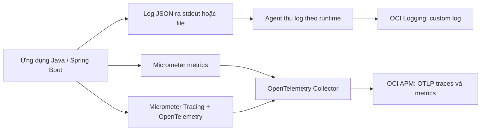

# Thu thập logs, metrics và traces cho ứng dụng Java

## 1. Mục tiêu quan sát ứng dụng trên OCI

Trong chương **Triển khai Java và Spring Boot** của module **CLOUD_PROVIDERS_ORACLE**, triển khai thành công mới chỉ đưa ứng dụng vào môi trường chạy. Khi người dùng báo chậm, lỗi hoặc thiếu dữ liệu, đội vận hành cần bằng chứng để xác định sự cố nằm ở JVM, connection pool, mạng VCN, Oracle Database hay dịch vụ phụ thuộc.

Bài này xây dựng cách thu thập ba loại tín hiệu:

- **Logs:** các sự kiện có ngữ cảnh, phục vụ giải thích chuyện gì đã xảy ra.
- **Metrics:** số đo tổng hợp theo thời gian, phục vụ phát hiện xu hướng và cảnh báo.
- **Traces:** đường đi của một lần xử lý qua nhiều bước hoặc nhiều dịch vụ, phục vụ định vị thời gian và lỗi.

Mục tiêu thực hành là tạo được các tín hiệu trong Spring Boot, chuyển chúng tới đích thu nhận và dùng cùng thời gian, tên dịch vụ, môi trường, trace ID để điều tra một tình huống cụ thể.

**Nền ví dụ:** Java 21, Spring Boot **3.5.x**, Maven, Micrometer và OpenTelemetry được parent/BOM của Spring Boot quản lý phiên bản. Đây là nền minh họa, không phải tuyên bố phiên bản mới nhất. Chốt phiên bản vá và phiên bản Collector trong dự án triển khai; khi dùng Spring Boot 4 hoặc một agent khác, đối chiếu lại tên thuộc tính và cơ chế auto-configuration.

Tất cả file cấu hình, mã Java và lệnh dưới đây dành cho **dự án lab của người học**. Hostname, OCID, đường dẫn và tên tài nguyên là ví dụ cần thay theo tenancy, compartment và region thực tế.

## 2. Ba tín hiệu trả lời những câu hỏi khác nhau

| Tín hiệu | Ví dụ | Câu hỏi phù hợp | Giới hạn |
| --- | --- | --- | --- |
| Log | Một lần gọi phụ thuộc thất bại với mã lỗi và trace ID | Lỗi cụ thể có ngữ cảnh gì? | Rất nhiều dòng log không tự cho biết toàn hệ thống đang khỏe hay không |
| Metric | Tỷ lệ HTTP 5xx, số request/giây, heap đang dùng | Mức ảnh hưởng lớn đến đâu, bắt đầu khi nào? | Số tổng hợp không giải thích đầy đủ một request riêng lẻ |
| Trace | Request HTTP chứa span nghiệp vụ và span gọi dịch vụ khác | Thời gian bị tiêu tốn ở bước nào? | Chỉ thấy các bước đã instrument và các trace được giữ lại |

Một trace gồm các **span** có thời điểm bắt đầu, kết thúc, thuộc tính và quan hệ ngữ cảnh. Các span cùng một lần xử lý chia sẻ trace ID; span ID phân biệt từng bước. Mô hình này được trình bày trong [OpenTelemetry — Traces](https://opentelemetry.io/docs/concepts/signals/traces/).

Ví dụ một request mất 900 ms:

```text
HTTP POST /orders                    900 ms
├─ kiểm tra dữ liệu                   10 ms
├─ gọi inventory-service            620 ms
└─ ghi Oracle Database              180 ms
```

Những con số này là giả định để giải thích cách đọc trace. Các span con có thể chạy song song hoặc lồng nhau, vì vậy không cộng mọi duration trong trace để suy ra thời gian request. Khoảng trống chưa có span cũng không chứng minh rằng đoạn đó không tốn thời gian.

Metrics có thể cho biết độ trễ tăng từ 09:10; trace cho biết lời gọi inventory chiếm phần lớn thời gian; log tương ứng có thể ghi nhận retry hoặc lỗi timeout. Kết luận chỉ vững khi các tín hiệu phù hợp với nhau.

## 3. Kiến trúc thu thập và ranh giới các dịch vụ OCI

### 3.1. Luồng dữ liệu chính của bài



Ứng dụng không cần giữ APM private data key nếu chỉ gửi tới một Collector nội bộ. Collector nhận telemetry, xử lý theo pipeline và xác thực khi gửi tới OCI APM.

Log JSON đi theo luồng agent tới **OCI Logging**. Việc cấu hình OTLP cho traces không tự động đọc stdout, không tự tạo custom log và không tự chuyển mọi log Java tới OCI.

### 3.2. Không trộn lẫn các đích thu nhận

| Thành phần | Vai trò trong thiết kế | Điều không nên mặc định |
| --- | --- | --- |
| OCI Logging | Thu nhận, lưu trữ và tìm kiếm log, gồm custom application logs | Bật service log của OKE là đã có log nghiệp vụ của pod |
| OCI Logging Analytics | Phân tích log theo khả năng và mô hình thu nhận riêng | Gửi tới OCI Logging là tự có bản sao trong Logging Analytics |
| OCI APM | Theo dõi và điều tra ứng dụng, có hỗ trợ thu nhận OTLP | Mọi metric gửi vào APM tự xuất hiện trong một custom namespace của Monitoring |
| OCI Monitoring | Metric namespace, truy vấn và alarms của dịch vụ Monitoring | Endpoint OTLP của APM là endpoint `PostMetricData` |
| OCI Audit | Sự kiện thao tác API/tài nguyên theo phạm vi Audit | Audit thay thế log transaction của ứng dụng |
| OpenTelemetry Collector | Tiếp nhận, xử lý, chuyển telemetry | Collector là một kho lưu trữ và giao diện tìm kiếm lâu dài |

OCI APM cung cấp các endpoint OTLP cho những loại dữ liệu được hỗ trợ; xem [Configure OpenTelemetry Data Sources](https://docs.oracle.com/en-us/iaas/application-performance-monitoring/doc/configure-opentelemetry.html). Bài chọn APM làm đích OTLP cho traces và metrics, còn luồng custom metrics tới OCI Monitoring được giải thích riêng ở phần sau.

## 4. Chuẩn hóa danh tính và thời gian trước khi thu thập

Chọn một bộ nhận diện nhất quán:

| Thuộc tính | Ví dụ | Cách sử dụng |
| --- | --- | --- |
| Service name | `orders-service` | Ổn định giữa các replica cùng dịch vụ |
| Environment | `lab`, `staging`, `production` | Phân biệt dữ liệu các môi trường |
| Service version | `2026.11.21.1` | Đối chiếu với đợt triển khai |
| Service instance ID | Pod UID hoặc định danh JVM | Phân biệt các tiến trình đồng thời |
| Region | Region OCI đang chạy | Phân vùng điều tra và chi phí |
| Trace ID, span ID | ID do tracing tạo | Nối log với lần xử lý cụ thể |

Không tạo `service.name` bằng cách ghép pod ID vào tên. Nếu mỗi replica có một service name khác nhau, sơ đồ dịch vụ và truy vấn tổng hợp sẽ bị phân mảnh.

Dùng UTC hoặc timestamp có timezone rõ ràng. Đồng bộ thời gian của node/VM và phân biệt **thời điểm sự kiện xảy ra** với **thời điểm backend nhận được dữ liệu**. Một sự kiện đến muộn có thể xuất hiện sau trong giao diện nhưng thực tế thuộc một thời điểm trước đó.

Trace ID không phải danh tính được xác thực và không được dùng làm bằng chứng phân quyền. ID có thể bắt nguồn từ ngữ cảnh request đi vào hệ thống; chỉ sử dụng nó để liên kết dữ liệu quan sát.

## 5. Chọn một cơ chế instrumentation chủ đạo

Có ba cách thường gặp:

1. **Spring Boot/Micrometer:** dùng observation của Spring, Micrometer Tracing và một exporter. Phù hợp khi đội phát triển kiểm soát mã và cấu hình framework.
2. **OpenTelemetry Java agent:** nạp agent khi khởi động JVM để instrument các thư viện được hỗ trợ.
3. **OCI APM Java agent:** dùng khả năng và hướng dẫn agent của OCI APM.

Bài sử dụng cách thứ nhất. Không gắn thêm Java agent vào chính cấu hình này rồi mặc định rằng không có span trùng, hai SDK hoặc hai đường export.

Khả năng tự động có giới hạn theo từng cách. Có HTTP server span không có nghĩa đã có span cho mọi SQL, UCP borrow, lời gọi Redis hoặc hàm nghiệp vụ. Chọn instrumentation phù hợp cho phần còn thiếu và kiểm tra trace thực tế. Spring phân biệt cách tích hợp của mình với agent/starter cộng đồng trong [Spring Boot — Observability](https://docs.spring.io/spring-boot/3.5/reference/actuator/observability.html).

Một công việc nghiệp vụ chưa được đo có thể bổ sung observation riêng. Tránh thêm observation cùng ý nghĩa lên controller hoặc repository đã được instrument để không đếm lặp.

## 6. Dependency và cấu hình nền Spring Boot

### 6.1. Dependency

Trong dự án đã dùng parent hoặc BOM Spring Boot 3.5.x:

```xml
<dependencies>
    <dependency>
        <groupId>org.springframework.boot</groupId>
        <artifactId>spring-boot-starter-web</artifactId>
    </dependency>

    <dependency>
        <groupId>org.springframework.boot</groupId>
        <artifactId>spring-boot-starter-actuator</artifactId>
    </dependency>

    <dependency>
        <groupId>io.micrometer</groupId>
        <artifactId>micrometer-tracing-bridge-otel</artifactId>
    </dependency>

    <dependency>
        <groupId>io.opentelemetry</groupId>
        <artifactId>opentelemetry-exporter-otlp</artifactId>
    </dependency>

    <dependency>
        <groupId>io.micrometer</groupId>
        <artifactId>micrometer-registry-otlp</artifactId>
    </dependency>
</dependencies>
```

Hai dependency cuối phục vụ hai luồng riêng: exporter OpenTelemetry gửi spans, còn registry Micrometer gửi metrics. Chỉ thêm tracing bridge không tạo đường export metrics.

Không ghi version riêng cho từng thư viện ở ví dụ vì parent/BOM đã quản lý. Trước khi triển khai, kiểm tra dependency tree và tránh trộn nhiều phiên bản SDK, exporter hoặc các bridge Brave/OTel mà chưa có thiết kế rõ ràng.

### 6.2. Cấu hình ứng dụng

Ví dụ `application.yml`:

```yaml
spring:
  application:
    name: orders-service

server:
  port: 8080

logging:
  level:
    root: INFO
    example.orders: INFO
  structured:
    format:
      console: logstash
    json:
      add:
        service_name: ${spring.application.name}
        environment: ${APP_ENV:lab}
        service_version: ${APP_VERSION:local}
        service_instance_id: ${INSTANCE_ID:local-1}

management:
  server:
    port: 8081
    address: 127.0.0.1
  endpoints:
    web:
      exposure:
        include: health,metrics
  endpoint:
    health:
      show-details: never
      probes:
        enabled: true
  tracing:
    sampling:
      probability: ${TRACE_SAMPLING_PROBABILITY:0.1}
  opentelemetry:
    resource-attributes:
      "[service.name]": ${spring.application.name}
      "[service.version]": ${APP_VERSION:local}
      "[service.instance.id]": ${INSTANCE_ID:local-1}
      "[deployment.environment.name]": ${APP_ENV:lab}
  otlp:
    tracing:
      endpoint: ${OTLP_TRACES_ENDPOINT:http://127.0.0.1:4318/v1/traces}
      timeout: 5s
    metrics:
      export:
        enabled: true
        url: ${OTLP_METRICS_ENDPOINT:http://127.0.0.1:4318/v1/metrics}
        step: 30s
        aggregation-temporality: cumulative
  metrics:
    tags:
      application: ${spring.application.name}
      environment: ${APP_ENV:lab}
    distribution:
      slo:
        http.server.requests: 100ms,300ms,1s,3s
```

Cổng `8080` nhận request ứng dụng. Cổng quản trị `8081` chỉ bind loopback trong cấu hình lab, vì vậy không truy cập nó từ máy khác hoặc pod khác nếu chưa điều chỉnh thiết kế mạng. Trên OKE, có thể cần bind địa chỉ phù hợp để probe/scrape hoạt động; đồng thời giới hạn đường truy cập bằng Service, ingress và NetworkPolicy theo kiến trúc cụ thể.

Ở Spring Boot 3.5, OTLP metrics dùng `management.otlp.metrics.export.url`; OTLP tracing dùng nhóm `management.otlp.tracing.*`. Tham khảo [Spring Boot — Metrics](https://docs.spring.io/spring-boot/3.5/reference/actuator/metrics.html) và [Spring Boot — Tracing](https://docs.spring.io/spring-boot/3.5/reference/actuator/tracing.html) khi thay phiên bản.

Các địa chỉ trên là **địa chỉ từ góc nhìn tiến trình Java**. `127.0.0.1` chỉ phù hợp khi Collector cùng host/network namespace, chẳng hạn sidecar cùng pod. Với Collector gateway ở pod hoặc VM khác, thay bằng DNS nội bộ có thể truy cập được.

Không suy rằng mọi biến `OTEL_*` của Java agent đều có tác dụng với cấu hình Micrometer này. Trong bài, các biến `OTLP_TRACES_ENDPOINT` và `OTLP_METRICS_ENDPOINT` được bind rõ ràng vào thuộc tính Spring.

## 7. Logs: JSON có cấu trúc và có ngữ cảnh

### 7.1. Hình thức log

Logstash JSON format của Spring Boot đưa các key/value trong MDC và SLF4J fluent logging vào JSON. Các trường trace ID/span ID do tracing cung cấp có thể xuất hiện khi đang có ngữ cảnh span; xem [Spring Boot — Structured Logging](https://docs.spring.io/spring-boot/3.5/reference/features/logging.html).

Một sự kiện minh họa, đã rút gọn:

```json
{
  "@timestamp": "2026-11-21T02:10:20.123Z",
  "level": "INFO",
  "message": "Lab operation completed",
  "service_name": "orders-service",
  "environment": "lab",
  "service_version": "local",
  "service_instance_id": "local-1",
  "event": "lab.operation.completed",
  "scenario": "slow",
  "traceId": "4bf92f3577b34da6a3ce929d0e0e4736",
  "spanId": "00f067aa0ba902b7"
}
```

JSON được trình bày nhiều dòng để dễ đọc, nhưng khi thu thập nên là **một sự kiện JSON trên một dòng vật lý**. Stack trace có thể được escape trong trường JSON thay vì làm mỗi dòng stack trace trở thành một sự kiện độc lập.

Không chỉ ghi `"Failed"` hoặc `"Done"`. Dùng trường `event` ổn định để truy vấn, `scenario` hoặc loại thao tác để phân nhóm, và exception khi cần giải thích lỗi.

### 7.2. Chọn level và thông tin cần giữ

| Level | Cách dùng phù hợp |
| --- | --- |
| ERROR | Thao tác quan trọng thất bại và cần xử lý theo chính sách của hệ thống |
| WARN | Tình huống bất thường hoặc suy giảm đã được nhận diện |
| INFO | Mốc nghiệp vụ/vận hành có giá trị và không phát sinh quá dày |
| DEBUG/TRACE | Chẩn đoán có giới hạn thời gian, phạm vi và dung lượng |

Không ghi body request/response mặc định, mật khẩu, token, authorization header, nội dung wallet hoặc JDBC URL có chứa thông tin bí mật. Trường dữ liệu nghiệp vụ cũng cần lựa chọn theo quyền truy cập và thời hạn lưu trữ; mask dữ liệu trước khi ghi tốt hơn chờ backend sửa lại sau.

Chỉ log lỗi đầy đủ tại ranh giới có trách nhiệm xử lý. Nếu mọi tầng đều ghi cùng exception rồi ném tiếp, một lỗi có thể trở thành nhiều bản ghi tưởng là nhiều sự cố.

Đổi log level khi điều tra cần có thời hạn và cách hoàn nguyên. Bật DEBUG toàn ứng dụng trong nhiều giờ có thể tăng I/O, chi phí và làm lộ thêm dữ liệu.

## 8. Lab tạo log, metric và span cho cùng một thao tác

### 8.1. Endpoint giới hạn trong profile lab

Đặt lớp sau trong package được Spring Boot quét. Ba scenario có tập giá trị cố định để giữ metric cardinality thấp.

```java
package example.orders;

import java.time.Duration;
import java.util.Set;

import io.micrometer.observation.Observation;
import io.micrometer.observation.ObservationRegistry;
import io.micrometer.tracing.Tracer;

import org.slf4j.Logger;
import org.slf4j.LoggerFactory;
import org.springframework.context.annotation.Profile;
import org.springframework.http.HttpStatus;
import org.springframework.web.bind.annotation.GetMapping;
import org.springframework.web.bind.annotation.PathVariable;
import org.springframework.web.bind.annotation.RestController;
import org.springframework.web.server.ResponseStatusException;

@RestController
@Profile("observability-lab")
public class ObservabilityLabController {

    private static final Logger log =
            LoggerFactory.getLogger(ObservabilityLabController.class);

    private static final Set<String> MODES =
            Set.of("ok", "slow", "fail");

    private final ObservationRegistry observations;
    private final Tracer tracer;

    public ObservabilityLabController(
            ObservationRegistry observations, Tracer tracer) {
        this.observations = observations;
        this.tracer = tracer;
    }

    @GetMapping("/lab/observe/{mode}")
    public LabResult observe(@PathVariable String mode) {
        if (!MODES.contains(mode)) {
            throw new ResponseStatusException(
                    HttpStatus.BAD_REQUEST, "Unknown lab scenario");
        }

        return Observation.createNotStarted(
                        "lab.operation", observations)
                .lowCardinalityKeyValue("scenario", mode)
                .observe(() -> executeScenario(mode));
    }

    private LabResult executeScenario(String mode) {
        log.atInfo()
                .addKeyValue("event", "lab.operation.started")
                .addKeyValue("scenario", mode)
                .log("Lab operation started");

        try {
            if ("slow".equals(mode)) {
                pause(Duration.ofMillis(250));
            }

            if ("fail".equals(mode)) {
                throw new ResponseStatusException(
                        HttpStatus.SERVICE_UNAVAILABLE,
                        "Simulated dependency failure");
            }

            var current = tracer.currentSpan();
            String traceId = current == null
                    ? "none" : current.context().traceId();

            log.atInfo()
                    .addKeyValue("event", "lab.operation.completed")
                    .addKeyValue("scenario", mode)
                    .log("Lab operation completed");

            return new LabResult(mode, traceId);

        } catch (RuntimeException ex) {
            log.atWarn()
                    .addKeyValue("event", "lab.operation.failed")
                    .addKeyValue("scenario", mode)
                    .setCause(ex)
                    .log("Lab operation failed");
            throw ex;
        }
    }

    private static void pause(Duration duration) {
        try {
            Thread.sleep(duration.toMillis());
        } catch (InterruptedException ex) {
            Thread.currentThread().interrupt();
            throw new IllegalStateException("Lab interrupted", ex);
        }
    }

    public record LabResult(String scenario, String traceId) {
    }
}
```

Endpoint này mô phỏng độ trễ/lỗi, không gọi database hay dịch vụ thật. Chỉ bật profile trên môi trường lab; bỏ profile sẽ loại controller khỏi ứng dụng.

Observation `lab.operation` bổ sung một phép đo thời gian và một span nghiệp vụ khi các handler tương ứng được cấu hình. HTTP request đã có observation riêng. Không cộng số đếm của hai metric để suy ra tổng request vì chúng mô tả hai tầng khác nhau.

Exception được ném ra khỏi `observe`, giúp observation nhận diện lỗi. Ghi log rồi trả kết quả thành công sẽ làm thông tin metric/span khác với kết quả nghiệp vụ mong muốn.

### 8.2. Gửi request và xem bằng chứng ở ứng dụng

Ví dụ khởi động JAR đã build trong PowerShell:

```powershell
$env:APP_ENV = 'lab'
$env:APP_VERSION = 'local'
$env:INSTANCE_ID = 'lab-java-1'
$env:TRACE_SAMPLING_PROBABILITY = '1.0'
$env:OTLP_TRACES_ENDPOINT = 'http://127.0.0.1:4318/v1/traces'
$env:OTLP_METRICS_ENDPOINT = 'http://127.0.0.1:4318/v1/metrics'

java -jar .\target\orders-service.jar --spring.profiles.active=observability-lab
```

Tên JAR phụ thuộc dự án. Collector cần chạy ở địa chỉ được cung cấp trước khi mong đợi export thành công.

Trong một terminal khác:

```powershell
$okResult = Invoke-RestMethod -Uri 'http://127.0.0.1:8080/lab/observe/ok'
$slowResult = Invoke-RestMethod -Uri 'http://127.0.0.1:8080/lab/observe/slow'

try {
    Invoke-RestMethod -Uri 'http://127.0.0.1:8080/lab/observe/fail'
}
catch {
    Write-Output 'Scenario fail dự kiến trả HTTP 503; kiểm tra status thực tế.'
}

$slowResult | ConvertTo-Json
Invoke-RestMethod -Uri 'http://127.0.0.1:8081/actuator/metrics/lab.operation' |
    ConvertTo-Json -Depth 10
```

Dòng catch không tự chứng minh status là 503; đọc status/response thực tế của công cụ HTTP. Chỉ có ba request thì histogram và tỷ lệ lỗi chưa đủ ý nghĩa để đánh giá production.

Bằng chứng mong đợi:

- `ok` và `slow` trả kết quả có trace ID.
- Log của cùng lần xử lý có trace ID trùng với response.
- `fail` trả 503 và có sự kiện `lab.operation.failed`.
- Endpoint metrics có phép đo `lab.operation` sau khi observation đã hoàn thành.
- Sau chu kỳ export/batching, backend nhận được trace và metrics tương ứng.

Việc endpoint metrics có số đo chỉ chứng minh metric đã tồn tại trong tiến trình. Nó chưa chứng minh Collector hoặc OCI đã nhận dữ liệu.

## 9. Metrics: đo tổng thể mà không làm nổ số chuỗi

### 9.1. Bắt đầu từ các nhóm tín hiệu cần quyết định

| Nhóm | Số đo hữu ích | Quyết định hỗ trợ |
| --- | --- | --- |
| HTTP | Lưu lượng, tỷ lệ 5xx, phân bố duration | Có suy giảm trải nghiệm hay không |
| JVM | Heap/non-heap, GC pause, thread, process CPU | Có áp lực bộ nhớ hoặc JVM bị nghẽn không |
| Connection pool | Borrowed/available, wait time, lỗi lấy connection | Có hết pool hoặc giữ connection quá lâu không |
| Phụ thuộc | Duration, timeout, retry, lỗi theo loại phụ thuộc | Có cần điều tra downstream không |
| Nghiệp vụ | Số thao tác thành công/thất bại theo loại cố định | Mức ảnh hưởng thực tế tới người dùng |
| Pipeline telemetry | Queue, drop, export failure, agent backlog | Có đang mất khả năng quan sát không |

Không mặc nhiên cho rằng mọi chỉ số UCP đã được expose cùng Actuator. Kiểm tra binder và metric thực tế; nếu thiếu, bổ sung meter từ API pool với tên và tag có kiểm soát.

Đối với counter tích lũy, tính tốc độ từ chênh lệch theo thời gian và xử lý reset khi tiến trình restart. Không lấy một counter ngày càng tăng đem so với ngưỡng như thể nó là số lỗi trong một phút.

`aggregation-temporality: cumulative` trong cấu hình là lựa chọn minh họa để biểu diễn metrics tích lũy. Delta/cumulative có ý nghĩa khác nhau và backend cần hiểu đúng; xem [Micrometer OTLP](https://docs.micrometer.io/micrometer/reference/implementations/otlp.html).

### 9.2. Phân biệt metric tag và ngữ cảnh chẩn đoán

Tag/dimension nên có tập giá trị nhỏ, xác định được, chẳng hạn:

- `method=GET`.
- `uri=/orders/{id}`.
- `status=503`.
- `scenario=slow`.
- `environment=production`.

Không dùng `traceId`, `orderId`, email, access token, raw URL hoặc thông báo exception tự do làm metric tag.

Ước lượng đơn giản:

```text
Số tổ hợp chuỗi
≈ số method × số route × số status × số instance × các chiều khác.
```

Nếu thêm 100.000 order ID vào tag, số chuỗi có thể tăng theo chính số ID đó. Một metric nhìn có vẻ nhỏ trong mã có thể tạo tải và chi phí lớn ở backend.

Dữ liệu chi tiết có thể xuất hiện trong log hoặc span nếu được phép và cần thiết. Việc một trường được gọi là high-cardinality không làm nó tự động an toàn về dữ liệu cá nhân.

### 9.3. Percentile, histogram và tỷ lệ lỗi

Không cộng p95 hoặc lấy trung bình p95 của các replica để tạo p95 toàn dịch vụ. Muốn tổng hợp phân bố, cần dữ liệu histogram/bucket tương thích và truy vấn phù hợp. Micrometer giải thích khác biệt giữa percentile tính ở client và histogram trong [Histograms and Percentiles](https://docs.micrometer.io/micrometer/reference/concepts/histogram-quantiles.html).

Cấu hình SLO của ví dụ đặt các mốc 100 ms, 300 ms, 1 s và 3 s cho HTTP request. Xác minh exporter và backend giữ đúng bucket/đơn vị trước khi dựng biểu đồ hoặc tính tỷ lệ request dưới ngưỡng.

Tỷ lệ 5xx trong một cửa sổ được hiểu về mặt khái niệm là:

```text
Số request HTTP 5xx trong cửa sổ
--------------------------------
Tổng request HTTP trong cùng cửa sổ
```

Tử và mẫu phải cùng service, môi trường, cửa sổ, phạm vi route và cách tổng hợp. Thêm điều kiện lưu lượng tối thiểu để tránh báo động chỉ vì một lỗi trên một request.

## 10. Traces: truyền ngữ cảnh qua các ranh giới

### 10.1. HTTP client phải được instrument

Khi gọi dịch vụ khác bằng `RestClient`, dùng builder do Spring Boot cung cấp:

```java
package example.orders;

import org.springframework.beans.factory.annotation.Value;
import org.springframework.context.annotation.Bean;
import org.springframework.context.annotation.Configuration;
import org.springframework.web.client.RestClient;

@Configuration(proxyBeanMethods = false)
public class DownstreamClientConfiguration {

    @Bean
    RestClient inventoryClient(
            RestClient.Builder builder,
            @Value("${INVENTORY_BASE_URL}") String baseUrl) {
        return builder.baseUrl(baseUrl).build();
    }
}
```

Lớp này chỉ cần khi ứng dụng thực sự có downstream và đã cấp `INVENTORY_BASE_URL`; nó không phải điều kiện để chạy controller lab.

Builder đã được auto-configure cho phép tích hợp observation và truyền trace context. Tự tạo client bằng một builder độc lập có thể bỏ qua tích hợp đó. Không tự phát sinh trace ID mới cho từng lời gọi con nếu muốn chúng nằm trong cùng trace.

Trên đường truyền, các header propagation như W3C `traceparent` mang ngữ cảnh. Proxy, gateway và dịch vụ nhận cần giữ/đọc được định dạng đã chọn. Không dùng request ID tùy ý thay thế cấu trúc trace context.

### 10.2. Executor, async và messaging

Ngữ cảnh gắn với một thread không mặc nhiên đi theo mọi tác vụ mới:

- Với executor, dùng cơ chế context propagation/task decorator phù hợp và khôi phục ngữ cảnh sau khi chạy.
- Với Reactor, dùng cơ chế propagation tương ứng thay vì giả định ThreadLocal luôn đủ.
- Với messaging, producer và consumer cần chèn/đọc context trong metadata/header.
- Với scheduled job không có request cha, tạo observation cho một lần chạy có ranh giới rõ ràng.

Không chỉ sao chép MDC rồi kết luận trace đã được truyền: MDC phục vụ log, còn tracing còn có current span và quan hệ cha/con. Ngược lại, có trace context nhưng log formatter không xuất ID thì vẫn khó tìm log liên quan.

Trong ứng dụng dùng thread pool, không dọn MDC/ngữ cảnh đúng cách còn có thể làm log của request sau mang ID của request trước.

### 10.3. Sampling và trace bị thiếu

Trong lab đặt `TRACE_SAMPLING_PROBABILITY=1.0` để dễ kiểm tra. Production cần chính sách lấy mẫu theo lưu lượng và ngân sách.

Head sampling quyết định sớm; tail sampling quyết định sau khi đã thu được dữ liệu cần xem xét. Tail sampling không phục hồi được span mà SDK đã loại bỏ từ đầu, và cần bộ nhớ/thời gian chờ cùng cách định tuyến nhất quán theo trace. Xem [OpenTelemetry — Sampling](https://opentelemetry.io/docs/concepts/sampling/).

Không có trace tương ứng chưa chứng minh request không xảy ra. Nó có thể bị loại bởi sampling, mất trên đường export, thiếu propagation hoặc nằm ngoài cửa sổ tìm kiếm.

Tỷ lệ sampling của traces cũng không tự giảm số dòng log hoặc số metric. Ba tín hiệu có các chính sách dung lượng riêng.

## 11. Collector nhận OTLP và gửi tới OCI APM

### 11.1. Chuẩn bị tài nguyên OCI

Trong môi trường thực hành:

1. Chọn compartment và region cho tài nguyên quan sát.
2. Tạo hoặc sử dụng APM domain được phép.
3. Lấy Data Upload Endpoint và private data key của domain.
4. Cung cấp các giá trị cho Collector qua cơ chế secret của môi trường.
5. Kiểm tra Collector có đường egress, DNS và TLS trust tới endpoint đích.

Giữ private data key ở phía Collector hoặc secret store theo thiết kế. Không đưa key vào response, image dùng chung hoặc Git. Quyền IAM quản lý domain/xem dữ liệu và data key dùng để upload là hai cơ chế cần phân biệt.

Các endpoint OTLP trong ví dụ có dạng:

```text
OCI_APM_TRACES_ENDPOINT=
https://<apm-upload-host>/20200101/opentelemetry/private/v1/traces

OCI_APM_METRICS_ENDPOINT=
https://<apm-upload-host>/20200101/opentelemetry/v1/metrics
```

Mỗi giá trị thực tế là **một dòng URL hoàn chỉnh**. Không thêm `/v1/metrics` sau URL traces.

`/private/` ở đường dẫn traces liên quan loại data key của API thu nhận; bản thân chuỗi này không chứng minh Collector đang đi qua một private endpoint trong VCN. Đường mạng phải được kiểm tra độc lập.

### 11.2. Cấu hình Collector

Ví dụ dành cho Collector cùng máy hoặc cùng network namespace với Java:

```yaml
receivers:
  otlp:
    protocols:
      http:
        endpoint: 127.0.0.1:4318

processors:
  memory_limiter:
    check_interval: 1s
    limit_mib: 256
    spike_limit_mib: 64
  batch:
    timeout: 5s
    send_batch_size: 512

exporters:
  otlphttp/oci_apm:
    traces_endpoint: ${env:OCI_APM_TRACES_ENDPOINT}
    metrics_endpoint: ${env:OCI_APM_METRICS_ENDPOINT}
    headers:
      Authorization: "dataKey ${env:OCI_APM_PRIVATE_DATA_KEY}"
    timeout: 10s
    retry_on_failure:
      enabled: true
      initial_interval: 1s
      max_interval: 10s
      max_elapsed_time: 60s
    sending_queue:
      enabled: true
      queue_size: 1000

service:
  pipelines:
    traces:
      receivers: [otlp]
      processors: [memory_limiter, batch]
      exporters: [otlphttp/oci_apm]
    metrics:
      receivers: [otlp]
      processors: [memory_limiter, batch]
      exporters: [otlphttp/oci_apm]
```

Dùng Collector distribution/version có các component và trường cấu hình tương ứng. Cấu hình khai báo component chưa đủ: component phải được đưa vào pipeline thích hợp mới xử lý dữ liệu. Cấu trúc được giải thích trong [OpenTelemetry Collector — Configuration](https://opentelemetry.io/docs/collector/configuration/).

Ở ví dụ này, `traces_endpoint` và `metrics_endpoint` là các URL đầy đủ, nhằm tránh nhầm hành vi tự nối suffix của `endpoint`. Header Authorization thuộc luồng upload APM, không phải OCI API signing key.

Giới hạn 256 MiB là giá trị minh họa cho processor, không phải yêu cầu tài nguyên duy nhất của tiến trình. Chọn memory limit của container/JVM bên cạnh và chừa khoảng cho overhead. Không dùng một con số nhỏ này làm cấu hình mặc định cho mọi tải.

Nếu chạy Collector gateway, cần bind interface thích hợp và đổi endpoint ứng dụng sang DNS gateway. Chỉ mở receiver cho nguồn được phép; khi vượt ranh giới tin cậy hoặc mạng, thêm TLS/xác thực phù hợp. Không expose cổng OTLP trực tiếp qua ingress công khai chỉ để tiện gửi dữ liệu.

Cổng `4318` thường dùng OTLP/HTTP, còn `4317` thường dùng OTLP/gRPC. Hai giao thức không thay thế cho nhau bằng cách chỉ đổi số cổng.

### 11.3. Đường đi không đồng nghĩa đã lưu bền vững

Collector nhận request OTLP không có nghĩa dữ liệu đã được lưu tại APM. Nó có thể đang nằm trong batch hoặc hàng đợi.

Hàng đợi in-memory có thể mất dữ liệu khi Collector restart; queue đầy hoặc hết thời gian retry cũng có thể gây mất dữ liệu. Nếu cần tăng khả năng chịu gián đoạn, cân nhắc persistent queue/storage và giới hạn đĩa theo môi trường. Các tình huống này được mô tả trong [OpenTelemetry Collector — Resiliency](https://opentelemetry.io/docs/collector/resiliency/).

Theo dõi accepted, refused, exported, failed/dropped và queue occupancy theo metric thực tế của phiên bản Collector. Một endpoint health trả OK không chứng minh dữ liệu vẫn đang đến backend.

## 12. Đưa application logs vào OCI Logging

### 12.1. Compute: file JSON và Unified Monitoring Agent

Một cách triển khai trên Compute Linux là cho ứng dụng ghi file JSON, rồi dùng Unified Monitoring Agent thu file đó vào custom log.

Phần cấu hình bổ sung trong profile Compute:

```yaml
logging:
  file:
    name: /var/log/orders-service/application.json
  structured:
    format:
      file: logstash
  logback:
    rollingpolicy:
      file-name-pattern: /var/log/orders-service/application.%d{yyyy-MM-dd}.%i.json.gz
      max-file-size: 10MB
      max-history: 7
      total-size-cap: 100MB
```

Gộp với cây YAML hiện có, không tạo hai khóa `logging:` ngang hàng trong cùng document. Tài khoản chạy Java phải ghi được thư mục; agent cần quyền đọc.

Quy trình trên OCI:

1. Tạo log group và một custom log trong compartment đã chọn.
2. Bảo đảm agent/plugin Custom Logs Monitoring được cài và hoạt động trên image/OS được hỗ trợ.
3. Tạo dynamic group chọn đúng các Compute instance cần thu log.
4. Cấp policy cần thiết cho dynamic group trong phạm vi compartment.
5. Tạo Agent Configuration, chọn host group, đường dẫn input, parser và log destination.
6. Xác minh agent nhận cấu hình, đọc file mới và backend có sự kiện mới.

Oracle mô tả mô hình quản lý này trong [Agent Management Overview](https://docs.oracle.com/en-us/iaas/Content/Logging/Concepts/agent_management.htm) và [Creating an Agent Configuration](https://docs.oracle.com/en-us/iaas/Content/Logging/Task/create-logging-agent-configuration.htm).

Ví dụ policy về phạm vi, cần thay tên và đối chiếu quyền thực tế:

```text
Allow dynamic-group java-app-hosts to use log-content in compartment app-observability
```

Đây không phải toàn bộ policy cho việc tạo tài nguyên, quản lý Agent Configuration hoặc phân quyền người đọc. Quyền `use log-content` có thể rộng hơn chỉ ghi; cần xem [Details for Logging](https://docs.oracle.com/en-us/iaas/Content/Identity/policyreference/loggingpolicyreference.htm) và điều kiện giới hạn phù hợp trước khi áp dụng.

Chỉ thu đường dẫn chủ động đã chọn. Thu cả console được redirect lẫn file do Logback ghi có thể tạo hai bản sao cùng sự kiện. Thu toàn bộ file rotate cũ từ đầu sau mỗi lần restart cũng có thể gây nhân bản dữ liệu.

Theo dõi checkpoint/tail position, quyền đọc, xử lý rotation và dung lượng buffer. Agent không đọc được file hoặc bị backlog có thể làm log mất trước khi nó đến OCI.

### 12.2. OKE: stdout và log của container runtime

Với pod ứng dụng, thường ưu tiên JSON ra stdout/stderr. Container runtime ghi log trên node; tầng thu thập cần xử lý envelope của runtime trước khi parse JSON bên trong.

Đối với managed node/self-managed node, OCI có hướng dẫn thu application logs bằng cấu hình agent gắn với các node; xem [Viewing Application Logs on Managed Nodes and Self-Managed Nodes](https://docs.oracle.com/en-us/iaas/Content/ContEng/Tasks/contengviewingworkernodelogs.htm). Không áp dụng nguyên cách gắn agent trên node cho mọi kiểu node, đặc biệt virtual node.

Các điểm cần xác minh:

- Đường dẫn log thực tế trên node, mount và symlink của runtime.
- Agent có quyền đọc và có theo dõi pod/container mới không.
- Metadata namespace, pod, container và node có được gắn đúng không.
- Chuỗi JSON có bị nằm nguyên trong một trường text thay vì được parse thành field không.
- Rotation, giới hạn kích thước và buffer có giữ được dữ liệu khi backend gián đoạn không.

Bật OKE control-plane service logs không tự động thu stdout của ứng dụng. Hai luồng phản ánh hai phần khác nhau của cluster.

`kubectl logs` hữu ích cho kiểm tra tức thời nhưng không thay thế kho log tập trung có retention và tìm kiếm. Chỉ thu một nguồn cho mỗi luồng ứng dụng nếu chưa có chủ đích sao lưu/fan-out rõ ràng.

## 13. Khi cần custom metrics trong OCI Monitoring

Luồng OTLP tới APM ở trên không cấu hình một exporter `PostMetricData` tới Monitoring. Muốn tạo alarm trên một custom namespace của Monitoring, cần bảo đảm metric thực sự được publish vào dịch vụ đó.

Các lựa chọn gồm cơ chế agent thu endpoint metric được hỗ trợ hoặc một thành phần dùng API/SDK publish custom metrics. Oracle mô tả endpoint ingestion, IAM và giới hạn trong [Publishing Custom Metrics Using the API](https://docs.oracle.com/en-us/iaas/Content/Monitoring/Tasks/publishingcustommetrics.htm).

Một hợp đồng metric minh họa:

```text
namespace: java_app_observability
name: LabOperationCount
dimensions:
  service: orders-service
  environment: lab
  outcome: success
unit: count
value: số thao tác hoàn thành trong một cửa sổ đã xác định
timestamp: thời điểm cuối cửa sổ
```

Không dùng tiền tố namespace dành riêng `oci_` hoặc `oracle_` cho metric tự định nghĩa.

Nếu chuyển counter cumulative thành số thao tác theo cửa sổ, thành phần chuyển đổi phải xử lý reset, retry, trùng dữ liệu và nhiều replica. Không gửi cùng tổng tích lũy mỗi phút rồi dùng `.sum()` như thể đó là số sự kiện độc lập từng phút.

Về IAM, thành phần publish cần quyền metric write thích hợp; người đọc dashboard và người quản lý alarm cần quyền riêng. Dùng instance/workload identity được hỗ trợ cho runtime thay vì nhúng API key cá nhân.

Trước khi tạo alarm, xác minh trên Metrics Explorer:

1. Đúng region và compartment.
2. Đúng namespace/name/dimensions.
3. Đúng timestamp và đơn vị.
4. Aggregation/interval khớp nghĩa dữ liệu.
5. Đã có dữ liệu mới từ nhiều chu kỳ.

Không giả định thấy CPU của Compute trong Monitoring là đã có metric nghiệp vụ của Spring Boot.

## 14. Dashboard và cảnh báo theo mức ảnh hưởng

### 14.1. Một dashboard đủ để bắt đầu

Sắp xếp theo câu hỏi điều tra:

1. **Người dùng bị ảnh hưởng thế nào:** lưu lượng, tỷ lệ lỗi, latency theo route.
2. **Tài nguyên nào bão hòa:** CPU, heap/GC, thread và connection pool.
3. **Phụ thuộc nào chậm:** database, HTTP downstream, hàng đợi.
4. **Có thay đổi triển khai nào gần đó:** version, số replica, thời điểm rollout.
5. **Telemetry còn đáng tin không:** agent backlog, Collector queue và export failure.

Không trộn số đo của region/môi trường khác nhau nếu không thể tách rõ. Dùng cùng bộ lọc thời gian và danh tính khi chuyển giữa metric, trace và log.

Một số panel cần bảng điều khiển riêng theo APM hoặc Monitoring; nơi lưu trữ, tên metric và câu truy vấn phải khớp pipeline thực tế.

### 14.2. Điều kiện cảnh báo minh họa

| Điều kiện khái niệm | Cách tránh báo động không có ích |
| --- | --- |
| Tỷ lệ HTTP 5xx vượt mức thỏa thuận trong vài phút | Kèm lưu lượng tối thiểu và cửa sổ rõ ràng |
| Tỷ lệ request vượt ngưỡng latency tăng | Dùng histogram phù hợp, không cộng p95 giữa replica |
| Pool liên tục sát trần và thời gian chờ tăng | Kết hợp hai triệu chứng thay vì chỉ nhìn số kết nối mở |
| Heap/GC suy giảm kéo dài | Xem xu hướng và hành vi sau GC, không cảnh báo mỗi lần heap tăng |
| Không còn telemetry mới | Phân biệt ứng dụng không có tải với pipeline ngừng hoạt động |

Các ngưỡng phải được lựa chọn từ SLO và tải nền của ứng dụng. Con số trong lab không phải ngưỡng production.

Với OCI Monitoring alarms, cấu hình pending duration, cách xử lý thiếu dữ liệu và đích notification phù hợp, rồi thử end-to-end trong môi trường được phép. Một biểu thức query có kết quả không chứng minh thông báo đã đến người trực.

Đính kèm runbook có service, môi trường, dashboard, cách lọc trace/log và bước khắc phục đầu tiên. Không đưa credential hoặc dữ liệu nhạy cảm vào nội dung notification.

## 15. Điều tra một request chậm bằng cả ba tín hiệu

Tình huống giả định: sau một rollout, người dùng báo API đặt đơn chậm.

1. **Khoanh cửa sổ metric:** xác định thời điểm latency bắt đầu tăng, route và môi trường bị ảnh hưởng.
2. **Đối chiếu lỗi/lưu lượng:** phân biệt tải tăng với thao tác cùng lưu lượng nhưng chậm hơn.
3. **Chọn trace phù hợp:** tìm trace chậm trong đúng service/version và cửa sổ thời gian.
4. **Đọc đường xử lý:** xác định span downstream/database nào chiếm thời gian, chú ý bước song song và khoảng chưa instrument.
5. **Tìm log theo trace ID:** xác minh sự kiện retry, timeout, mã lỗi hoặc thay đổi trạng thái.
6. **Đối chiếu tài nguyên:** kiểm tra pool, GC, CPU, lock/query và tình trạng phụ thuộc tại cùng thời điểm.
7. **Kết luận theo bằng chứng:** chọn can thiệp có thể kiểm chứng, rồi quan sát sau thay đổi.

Ví dụ, HTTP latency tăng cùng borrowed connection sát trần nhưng database execution span ngắn có thể gợi ý thời gian chờ lấy connection. Nếu chưa instrument bước borrow, trace hiện tại chưa chứng minh giả thuyết đó; cần số đo pool hoặc observation bổ sung.

Nếu trace cho thấy thời gian chờ downstream dài và log ghi nhiều retry, việc tăng số replica của service gọi có thể làm tải downstream lớn hơn. Dữ liệu quan sát giúp chọn hướng xử lý thay vì mặc định tăng tài nguyên.

Khi tìm log trên OCI, mở một sự kiện và xem cấu trúc field đã được parser lưu. `traceId` có thể nằm trong JSON payload lồng ở một field khác. Truy vấn đúng đường dẫn đã quan sát, không sao chép tên field chỉ từ ví dụ formatter của ứng dụng.

## 16. Chi phí, dữ liệu và độ tin cậy của pipeline

### 16.1. Ước lượng trước khi tăng mức thu thập

Ví dụ giả định:

```text
Dung lượng log thô/ngày
≈ số sự kiện/giây × kích thước trung bình × 86.400

Số span/ngày
≈ request/giây × span/request × tỷ lệ giữ trace × 86.400
```

Với 100 sự kiện/giây, mỗi sự kiện khoảng 1 KB, log thô vào khoảng 8,64 GB/ngày theo cách tính thập phân, trước metadata, nén và cơ chế tính dung lượng của dịch vụ. Đây là ước lượng kỹ thuật, không phải bảng giá OCI.

Giảm dữ liệu bằng cách chọn sự kiện có giá trị, đặt retention theo nhu cầu, giới hạn DEBUG, giữ tag hữu hạn và sampling hợp lý. Không cần giữ cùng mức chi tiết cho lab và production.

Đo cả CPU/memory của instrumentation và Collector. Thu thập quá nhiều có thể làm ứng dụng chậm và tự tạo thêm sự cố cần điều tra.

### 16.2. Gián đoạn và khả năng phục hồi

Các tình huống cần thiết kế:

- Backend trả lỗi hoặc giới hạn tốc độ: có retry/backoff và hàng đợi hữu hạn.
- Collector restart: biết dữ liệu nào chưa lưu bền vững có thể mất.
- Agent backlog: biết dung lượng đĩa và rotation còn giữ được log bao lâu.
- Pod bị terminate: có thời gian graceful shutdown để flush theo khả năng của SDK/agent.
- Region/backend khó truy cập: có chỉ báo pipeline suy giảm độc lập.

Không dùng một request nghiệp vụ đồng bộ để gọi API log/metric từ xa cho mọi sự kiện. Batch và cơ chế export phù hợp giúp giảm việc telemetry làm tăng độ trễ nghiệp vụ.

Telemetry phục vụ chẩn đoán không tự trở thành sổ cái giao dịch hoặc cơ chế audit bất biến. Nhu cầu lưu bằng chứng nghiệp vụ có các yêu cầu bền vững, đầy đủ và kiểm soát riêng.

### 16.3. Phân quyền đọc và ghi

Tách quyền của:

- Ứng dụng phát sinh telemetry.
- Agent/Collector gửi dữ liệu.
- Người đọc log/trace/dashboard.
- Người quản lý retention, domain, keys và alarms.

Log và trace có thể chứa thông tin vận hành nhạy cảm ngay cả khi không có password. Dùng compartment, policy và quy trình cấp quyền phù hợp; xoay vòng upload key và kiểm tra pipeline sau khi đổi key.

## 17. Khoanh vùng lỗi thu thập

| Triệu chứng | Kiểm tra đầu tiên | Hướng xử lý |
| --- | --- | --- |
| Log vẫn là text | Profile, formatter, Logback config riêng | Xác minh cấu hình structured logging thực sự được dùng |
| Log không có trace ID | Có đang trong span không, có bridge/context không | Gọi request đã instrument và so với log startup |
| JSON nằm nguyên trong message | Parser phía agent/runtime envelope | Parse đúng lớp ngoài và lớp JSON ứng dụng |
| OCI Logging không có sự kiện mới | Agent, quyền đọc, host group, IAM, destination | Theo dõi từng chặng từ file/stdout tới log đích |
| Chỉ có OKE control-plane logs | Chọn sai loại nguồn | Cấu hình application logs cho runtime phù hợp |
| Metrics endpoint có dữ liệu nhưng APM không có | Registry/export URL, Collector metrics pipeline | Kiểm tra export theo chu kỳ, lỗi và endpoint metrics |
| OTLP trả 404 | Sai đường dẫn/suffix hoặc đích | Phân biệt URL traces và metrics đầy đủ |
| OTLP trả 401/403 | Data key/header, domain, quyền của cơ chế tương ứng | Xác minh secret đang có hiệu lực, không log key |
| Connection refused | Collector không listen ở địa chỉ từ runtime Java | Kiểm tra bind address, DNS, Service và cổng |
| gRPC/HTTP lỗi giao thức | Gửi HTTP sang receiver gRPC hoặc ngược lại | Chọn đúng exporter/protocol |
| Trace chỉ có một service | Thiếu propagation hoặc downstream instrumentation | Kiểm tra builder/header và cấu hình dịch vụ nhận |
| Trace xuất hiện hai lần | Instrumentation/export trùng | Kiểm tra agent, bridge, SDK và fan-out |
| Thiếu một phần trace | Sampling, queue drop, async mất context | Đối chiếu từng nguyên nhân bằng số liệu |
| Metrics tách thành quá nhiều chuỗi | Raw path/ID làm tag, service name theo pod | Chuẩn hóa route/tag/resource |
| Collector healthy nhưng không có dữ liệu | Health không phản ánh export | Kiểm tra pipeline counters, queue và lỗi backend |

Không xử lý TLS bằng cách tắt xác minh chứng thư hoặc công khai receiver để bỏ qua lỗi mạng. Xác minh DNS, trust và đường đi thực tế, đồng thời giữ nguyên phạm vi truy cập cần thiết.

## 18. Quy trình thực hành và tiêu chí hoàn thành

Thực hiện trong môi trường lab đã được phép:

1. Chuẩn bị tài nguyên log/APM và cấu hình quyền theo compartment.
2. Khởi động Collector với endpoint và data key được cấp qua secret.
3. Khởi động ứng dụng profile `observability-lab`, sampling 100%.
4. Gửi lần lượt scenario `ok`, `slow`, `fail`; ghi lại trace ID và thời điểm.
5. Đọc log JSON tại nguồn, rồi xác minh cùng sự kiện có ở OCI Logging sau khi agent chuyển.
6. Kiểm tra metric `lab.operation` trong JVM và metric đã đến backend sau chu kỳ export.
7. Tìm trace có HTTP span và observation nghiệp vụ; đối chiếu log theo trace ID.
8. Trong lab, thử dừng Collector ngắn hạn để quan sát lỗi export/queue và khả năng phục hồi; ghi nhận dữ liệu có thể mất.
9. Nếu cần alarm trong Monitoring, publish metric qua đúng pipeline của Monitoring và thử notification.
10. Tắt profile lab, hoàn nguyên sampling/log level và dọn tài nguyên tạm theo kế hoạch.

Tiêu chí hoàn thành không phải chỉ thấy ba màn hình có dữ liệu. Cần chứng minh một lần xử lý cụ thể có log và trace liên kết được, metric phản ánh đúng thao tác tổng hợp, pipeline có tín hiệu khi bị gián đoạn và chi phí thu thập nằm trong ngân sách đã chọn.

Một hệ thống quan sát hữu ích giúp giải thích được ứng dụng Java đang chạy thế nào trên OCI, vì sao người dùng bị ảnh hưởng và dữ liệu nào còn thiếu để xác minh nguyên nhân.
