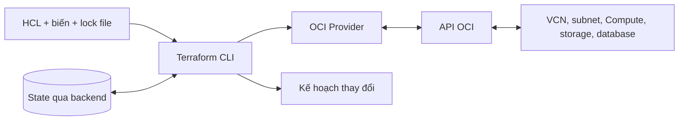

# Terraform OCI Provider và tổ chức project hạ tầng

## 1. Mục tiêu và phạm vi

Trong chương **Hạ tầng dưới dạng mã** của module **CLOUD_PROVIDERS_ORACLE**, Terraform được dùng để mô tả, xem trước và triển khai tài nguyên Oracle Cloud Infrastructure (OCI) theo một cấu hình có thể lưu phiên bản. Việc tổ chức project quyết định không chỉ nơi đặt file HCL mà còn ai được thay đổi hạ tầng, state nào bị tác động và một lỗi triển khai có thể ảnh hưởng đến đâu.

Bài học xây dựng nền tảng cho các phần hạ tầng OCI như VCN, Compute, lưu trữ và cơ sở dữ liệu Oracle. Ví dụ tập trung vào một VCN và hai private subnet để làm rõ provider, module, đầu vào, đầu ra và state. Khi bổ sung Compute, database, giám sát hoặc tự động hóa, người học tiếp tục áp dụng cùng các ranh giới về quyền, môi trường, chi phí và tính sẵn sàng.

Sau bài học, người học có thể:

- Phân biệt Terraform CLI, OCI Provider, module, backend và state.
- Cấu hình provider theo danh tính và region phù hợp.
- Tách phần triển khai theo môi trường khỏi module tái sử dụng.
- Quản lý phiên bản provider và dependency lock file.
- Thực hiện quy trình init, validate, plan, review và apply.
- Giải thích vì sao tách file, tách module và tách state là ba quyết định khác nhau.

Các đoạn mã và lệnh trong bài dành cho người học thực hành. Bài viết chưa được chạy Terraform, chưa tạo tài nguyên trong tenancy và không khẳng định kết quả triển khai đã được kiểm chứng.

## 2. Terraform làm gì khi quản lý OCI?

### 2.1. Mô tả trạng thái mong muốn

Terraform dùng cấu hình khai báo. Thay vì liệt kê các bước gọi API để tạo VCN rồi tạo subnet, cấu hình mô tả tài nguyên và quan hệ giữa chúng:

```hcl
resource "oci_core_vcn" "learning" {
  compartment_id = var.compartment_ocid
  cidr_blocks    = ["10.30.0.0/16"]
  display_name   = "java-learning-dev"
}
```

Đoạn trên chỉ minh họa một resource, chưa phải project đầy đủ. `oci_core_vcn` là loại tài nguyên do provider cung cấp; `learning` là tên logic trong cấu hình. `display_name` là thuộc tính của tài nguyên trên OCI, không phải địa chỉ quản lý của Terraform.

Một resource có thể có địa chỉ như `oci_core_vcn.learning`. Khi nằm trong module, địa chỉ có thể trở thành `module.network.oci_core_vcn.this`. State dùng các địa chỉ này để liên kết cấu hình với đối tượng OCI thực tế.

### 2.2. Các thành phần không thể dùng lẫn nhau

| Thành phần | Trách nhiệm | Ví dụ trong bài |
| --- | --- | --- |
| Terraform CLI/Core | Đọc HCL, xây đồ thị phụ thuộc, lập kế hoạch và điều phối | Lệnh `terraform plan` |
| OCI Provider | Cung cấp schema resource/data source và gọi API OCI | Provider source `oracle/oci` |
| Root module | Điểm chạy Terraform, kết hợp provider, module và biến môi trường | `environments/dev` |
| Child module | Đóng gói một nhóm tài nguyên có hợp đồng đầu vào/đầu ra | `modules/network` |
| State | Ánh xạ địa chỉ Terraform với tài nguyên đã quản lý | OCID của VCN đã tạo |
| Backend | Quyết định lưu state ở đâu và các khả năng phối hợp liên quan | Local hoặc OCI Object Storage |
| Lock file | Ghi lựa chọn phiên bản và checksum provider | `.terraform.lock.hcl` |

Tên provider và backend đều có thể là `oci`, nhưng chúng thuộc hai tầng khác nhau. Nâng OCI Provider không tự nâng khả năng của backend tích hợp trong Terraform CLI.

### 2.3. Quan hệ giữa cấu hình, state và tài nguyên thật



Terraform cần state để biết tài nguyên nào thuộc quyền quản lý của cấu hình hiện tại. Cùng tên hiển thị không đủ để nhận ra một VCN đã được tạo thủ công. Ngược lại, một VCN có thể đổi tên hiển thị mà vẫn giữ nguyên OCID và quan hệ trong state.

Tham chiếu như `vcn_id = oci_core_vcn.this.id` tạo phụ thuộc giữa subnet và VCN. Không thêm `depends_on` chỉ để mô phỏng thứ tự viết file; dùng phụ thuộc tường minh khi quan hệ cần thiết chưa thể hiện qua giá trị tham chiếu.

## 3. Khai báo và xác thực OCI Provider

### 3.1. Source, version và cấu hình là những khái niệm riêng

Trong root module:

```hcl
terraform {
  required_version = ">= 1.12.0, < 2.0.0"

  required_providers {
    oci = {
      source  = "oracle/oci"
      version = "~> 7.22.0"
    }
  }
}
```

Bài dùng dòng provider `7.22.x` làm mốc minh họa có giới hạn rõ ràng, không coi đây là phiên bản mới nhất hay lựa chọn bắt buộc cho project mới. Bản `7.22.0` có trong [kho phát hành provider](https://releases.hashicorp.com/terraform-provider-oci/7.22.0/). Khi chọn phiên bản khác, đọc tài liệu đúng phiên bản và xem lại kế hoạch thay đổi.

Ý nghĩa của từng trường:

- `required_version` ràng buộc phiên bản Terraform CLI.
- `source` xác định provider sẽ được tải.
- `version` trong `required_providers` ràng buộc phiên bản provider.
- `provider "oci"` cung cấp region và phương thức xác thực cho một cấu hình provider.

`~> 7.22.0` cho phép bản vá từ 7.22.0 đến trước 7.23.0. Nó khác với `~> 7.22`, vốn cho phép các phiên bản từ 7.22 đến trước 8.0. Không để thay đổi một ký tự trong constraint trở thành quyết định nâng cấp vô tình.

Source hiện dùng trong ví dụ là `oracle/oci`. Với project cũ sử dụng `hashicorp/oci`, cần quy trình chuyển đổi phù hợp với state; không chỉ sửa tên rồi bỏ qua các tài nguyên đang quản lý. Xem [chuyển provider source cũ](https://docs.oracle.com/en-us/iaas/Content/dev/terraform/migrating-legacy.htm).

### 3.2. Chạy local bằng profile OCI

Cấu hình API key có thể được đặt trong file cấu hình OCI dùng chung của SDK/CLI, thường là `~/.oci/config`. Trên Windows, đường dẫn này nằm dưới thư mục home của tài khoản đang chạy Terraform.

Root module chỉ tham chiếu profile:

```hcl
provider "oci" {
  region              = var.region
  config_file_profile = var.oci_profile
}
```

Profile cần thông tin xác thực hợp lệ và tham chiếu đến private key bên ngoài repository. Không đưa nội dung key vào `providers.tf`, `terraform.tfvars`, output hay ảnh chụp log. API key gắn với người dùng vẫn chịu IAM policy của người đó.

OCI Provider hỗ trợ đọc profile và các hình thức cấu hình xác thực khác; xem [cấu hình OCI Provider](https://docs.oracle.com/en-us/iaas/Content/dev/terraform/configuring.htm). Nếu môi trường có sẵn biến cấu hình OCI, phải xác định chúng có đang làm thay đổi danh tính hoặc profile dự kiến hay không.

### 3.3. Chạy trên Compute bằng instance principal

Khi runner Terraform nằm trên một OCI Compute instance được đưa vào dynamic group phù hợp, thay block provider local bằng:

```hcl
provider "oci" {
  auth   = "InstancePrincipal"
  region = var.region
}
```

Đây là phương án thay thế cho provider mặc định, không phải block mặc định thứ hai đặt cạnh block local. Dynamic group và policy quyết định instance được quản lý tài nguyên nào. Instance principal không làm Terraform có quyền quản trị toàn tenancy.

Với Functions, Resource Manager hoặc workload trên OKE, chọn cơ chế danh tính được môi trường thực thi hỗ trợ. Không mặc định một container bất kỳ có thể dùng `InstancePrincipal`, cũng không tự rơi về API key cá nhân khi phương thức chính thất bại.

### 3.4. Quyền cho project và quyền cho backend

Đối với lab mạng, một policy ở phạm vi compartment có thể có dạng:

```text
Allow group TerraformNetworkOperators to manage virtual-network-family in compartment LearningDev
```

Thay group và compartment theo môi trường thực tế. Đây là quyền quản lý mạng cho lab, không phải policy tối thiểu cho mọi tổ chức. Tài nguyên IAM, Compute, Object Storage và database cần các quyền riêng khi được thêm vào project. Xem [các mẫu policy OCI](https://docs.oracle.com/en-us/iaas/Content/Identity/Concepts/commonpolicies.htm).

Runner đọc/ghi remote state còn cần quyền cho bucket/object của backend. Có quyền tạo VCN không có nghĩa là có quyền ghi state; có quyền đọc state cũng không có nghĩa là được sửa mọi tài nguyên mà state mô tả.

## 4. Tổ chức project theo môi trường và khả năng tái sử dụng

### 4.1. Cấu trúc đề xuất cho bài thực hành

```text
oci-infra/
├── .gitignore
├── modules/
│   └── network/
│       ├── versions.tf
│       ├── variables.tf
│       ├── main.tf
│       └── outputs.tf
└── environments/
    ├── dev/
    │   ├── versions.tf
    │   ├── providers.tf
    │   ├── variables.tf
    │   ├── main.tf
    │   ├── outputs.tf
    │   ├── terraform.tfvars.example
    │   └── .terraform.lock.hcl
    └── prod/
        └── ... root module độc lập khi triển khai production
```

Các tên file HCL này là quy ước để con người đọc dễ hơn. Terraform đọc các file `.tf` trong cùng một thư mục như một module; không thực thi `01-vcn.tf` trước `02-subnet.tf` theo số thứ tự. Thư mục con không được tự động nhập vào root module. Xem [cấu trúc file Terraform](https://developer.hashicorp.com/terraform/language/files).

Thư mục `prod` chỉ thể hiện cách mở rộng cấu trúc; nội dung thực hành đầy đủ dưới đây dành cho `dev`. Không tạo môi trường production chỉ bằng cách đổi hậu tố tên và chạy lại lệnh trong cùng working directory.

### 4.2. Trách nhiệm của từng nhóm file

| Vị trí | Nội dung phù hợp |
| --- | --- |
| `versions.tf` | Yêu cầu Terraform và provider |
| `providers.tf` ở root | Region, auth và provider alias |
| `variables.tf` | Kiểu dữ liệu, mô tả, validation và mặc định có chủ đích |
| `main.tf` | Resource hoặc lời gọi module |
| `outputs.tf` | Giá trị công khai cho người vận hành/module gọi |
| `terraform.tfvars.example` | Giá trị mẫu và placeholder, không chứa secret |
| `backend.tf` nếu dùng | Loại backend và phần cấu hình backend được phép lưu trong mã |
| `.terraform.lock.hcl` ở root | Phiên bản provider đã được chọn và checksum |

Module `network` nhận compartment, CIDR và tên; nó không biết profile cá nhân, thông tin đăng nhập hay bucket state của môi trường.

### 4.3. Tách module không tự tách state

Một root module gọi nhiều child module vẫn quản lý chúng trong cùng state. Hai file `network.tf` và `database.tf` trong một thư mục cũng vẫn dùng chung state.

Nếu một mạng dùng chung thay đổi chậm, còn ứng dụng triển khai hằng ngày, có thể cân nhắc root/state riêng theo phạm vi sở hữu và vòng đời. Tuy nhiên, mỗi state mới tạo thêm việc phối hợp đầu ra, quyền và thứ tự triển khai.

Ranh giới cần cân nhắc gồm:

- Môi trường: dev, staging, prod.
- Chủ sở hữu: nền tảng mạng, nhóm ứng dụng, nhóm database.
- Tần suất thay đổi và phạm vi sự cố có thể chấp nhận.
- Mức độ nhạy cảm của dữ liệu trong state.
- Quy trình khôi phục và phê duyệt thay đổi.

Không cần một state cho từng resource. Cũng không nên dùng một state duy nhất cho toàn tenancy chỉ vì tất cả tài nguyên thuộc cùng nhà cung cấp.

## 5. Xây dựng module mạng có hợp đồng rõ ràng

Ví dụ tạo một VCN, một security list không có rule cho phép lưu lượng và hai private subnet dạng regional. Không tạo Compute, gateway hay database. Mạng này dành để học cấu trúc Terraform; muốn chạy ứng dụng cần thiết kế thêm route và quyền lưu lượng phù hợp.

### 5.1. Provider requirement của child module

File minh họa `modules/network/versions.tf`:

```hcl
terraform {
  required_version = ">= 1.5.0"

  required_providers {
    oci = {
      source  = "oracle/oci"
      version = ">= 7.22.0"
    }
  }
}
```

Child module khai báo provider nó cần, nhưng không chứa `provider "oci"` với profile/region riêng. Root module chọn giới hạn phiên bản cụ thể cho project và truyền cấu hình provider xuống.

Provider requirement không tự được thừa kế chỉ vì provider configuration được thừa kế. Việc khai báo source trong child module đặc biệt quan trọng với provider không thuộc namespace mặc định của HashiCorp. Xem [provider trong module](https://developer.hashicorp.com/terraform/language/modules/develop/providers).

### 5.2. Đầu vào của module

File minh họa `modules/network/variables.tf`:

```hcl
variable "compartment_ocid" {
  description = "Compartment hiện có sẽ chứa các tài nguyên mạng."
  type        = string

  validation {
    condition     = startswith(var.compartment_ocid, "ocid1.compartment.")
    error_message = "compartment_ocid phải có định dạng OCID compartment."
  }
}

variable "name" {
  description = "Tiền tố tên hiển thị của tài nguyên."
  type        = string
}

variable "dns_label" {
  description = "DNS label của VCN, tối đa 15 ký tự theo quy ước module."
  type        = string

  validation {
    condition     = can(regex("^[a-z][a-z0-9]{0,14}$", var.dns_label))
    error_message = "dns_label phải bắt đầu bằng chữ thường và chỉ chứa chữ/số."
  }
}

variable "vcn_cidr" {
  description = "IPv4 CIDR của VCN."
  type        = string

  validation {
    condition     = can(cidrnetmask(var.vcn_cidr))
    error_message = "vcn_cidr phải là một IPv4 CIDR hợp lệ."
  }
}

variable "subnets" {
  description = "Subnet theo khóa logic ổn định, ví dụ app và data."
  type = map(object({
    cidr_block = string
    dns_label  = string
  }))

  validation {
    condition = length(var.subnets) > 0 && alltrue([
      for subnet in values(var.subnets) :
      can(cidrnetmask(subnet.cidr_block)) &&
      can(regex("^[a-z][a-z0-9]{0,14}$", subnet.dns_label))
    ])
    error_message = "Cần ít nhất một subnet có IPv4 CIDR và DNS label hợp lệ."
  }
}

variable "tags" {
  description = "Free-form tags dùng chung."
  type        = map(string)
  default     = {}
}
```

Validation sớm giúp phát hiện nhầm kiểu hoặc chuỗi sai hình thức. Nó chưa xác minh OCID tồn tại, runner có quyền, CIDR subnet nằm trong VCN hay các subnet không chồng lấn nhau. Những điều kiện đó cần được kiểm tra trong thiết kế mạng, plan và phản hồi API.

Không biến mọi thuộc tính OCI thành biến đầu vào ngay từ đầu. Module này chủ đích chỉ tạo private subnet; nếu cần public subnet, nên mở rộng hợp đồng một cách rõ ràng và xem xét ảnh hưởng bảo mật.

### 5.3. Các tài nguyên của module

File minh họa `modules/network/main.tf`:

```hcl
resource "oci_core_vcn" "this" {
  compartment_id = var.compartment_ocid
  cidr_blocks    = [var.vcn_cidr]
  display_name   = "${var.name}-vcn"
  dns_label      = var.dns_label
  freeform_tags  = var.tags
}

resource "oci_core_security_list" "isolated" {
  compartment_id = var.compartment_ocid
  vcn_id         = oci_core_vcn.this.id
  display_name   = "${var.name}-isolated-sl"
  freeform_tags  = var.tags

  ingress_security_rules = []
  egress_security_rules  = []
}

resource "oci_core_subnet" "this" {
  for_each = var.subnets

  compartment_id             = var.compartment_ocid
  vcn_id                     = oci_core_vcn.this.id
  cidr_block                 = each.value.cidr_block
  display_name               = "${var.name}-${each.key}"
  dns_label                  = each.value.dns_label
  prohibit_public_ip_on_vnic  = true
  route_table_id             = oci_core_vcn.this.default_route_table_id
  security_list_ids          = [oci_core_security_list.isolated.id]
  freeform_tags              = var.tags
}
```

Một số quyết định đáng chú ý:

- Không đặt `availability_domain` nên subnet là regional.
- `prohibit_public_ip_on_vnic = true` ngăn gán public IP cho VNIC trong subnet.
- Gán rõ security list tùy chỉnh, tránh vô tình dùng default security list.
- Tham chiếu OCID qua resource thay vì nhập lại bằng chuỗi.
- Dùng `for_each` với khóa logic thay vì dựa trên vị trí phần tử trong danh sách.

Các trường subnet được mô tả trong [tài liệu OCI subnet resource](https://registry.terraform.io/providers/oracle/oci/latest/docs/resources/core_subnet). Security list là tài nguyên riêng có các rule ingress/egress; xem [schema security list ở phiên bản minh họa](https://github.com/oracle/terraform-provider-oci/blob/v7.22.0/website/docs/r/core_security_list.html.markdown).

Security list rỗng trong lab không cho phép lưu lượng bằng rule của chính nó. Nó không phải cấu hình sẵn cho kết nối ứng dụng, SSH hoặc JDBC. Nếu sau này thêm NSG hay các security list khác, phải đánh giá toàn bộ tập rule có hiệu lực.

VCN tạo kèm default route table, default security list và DHCP options. Ví dụ tham chiếu default route table nhưng chưa quản lý nội dung rule của nó bằng một resource Terraform riêng. Vì vậy state của module không phải cơ chế phát hiện mọi chỉnh sửa thủ công vào các default object. Xem [VCN resource](https://github.com/oracle/terraform-provider-oci/blob/v7.22.0/website/docs/r/core_vcn.html.markdown).

Với project thực tế, quyết định rõ ai quản lý default resource hoặc dùng các resource route/security chuyên biệt. Không để nhóm này cho rằng rule thuộc state nhóm khác trong khi không có cấu hình nào thực sự sở hữu chúng.

### 5.4. Output là hợp đồng của module

File minh họa `modules/network/outputs.tf`:

```hcl
output "vcn_id" {
  description = "OCID của VCN."
  value       = oci_core_vcn.this.id
}

output "subnet_ids" {
  description = "Map OCID subnet theo khóa logic."
  value = {
    for name, subnet in oci_core_subnet.this :
    name => subnet.id
  }
}
```

Module ứng dụng có thể dùng `module.network.subnet_ids["app"]`. Không cần biết tên resource nội bộ hoặc cách module bố trí file. Đổi tên output có thể làm hỏng các bên tiêu thụ dù tài nguyên OCI vẫn không đổi.

## 6. Root module cho môi trường dev

### 6.1. Khai báo version và provider

File `environments/dev/versions.tf` dùng block ở mục 3.1. File `environments/dev/providers.tf` dùng block profile ở mục 3.2 nếu chạy local.

Constraint Terraform từ 1.12 trong root nhằm dùng được backend OCI ở phần sau. Mức tối thiểu thấp hơn trong child module không có nghĩa toàn bộ root có thể chạy bằng Terraform 1.5.

### 6.2. Biến môi trường

File minh họa `environments/dev/variables.tf`:

```hcl
variable "region" {
  description = "OCI region đích."
  type        = string
}

variable "oci_profile" {
  description = "Profile dùng cho phương án xác thực local."
  type        = string
  default     = "DEFAULT"
}

variable "compartment_ocid" {
  description = "Compartment riêng cho môi trường."
  type        = string
}

variable "environment" {
  description = "Tên môi trường."
  type        = string

  validation {
    condition     = contains(["dev", "staging", "prod"], var.environment)
    error_message = "environment phải là dev, staging hoặc prod."
  }
}

variable "owner" {
  description = "Nhóm chịu trách nhiệm vận hành."
  type        = string
}

variable "vcn_dns_label" {
  description = "DNS label riêng cho VCN của môi trường."
  type        = string
}

variable "vcn_cidr" {
  description = "CIDR VCN đã được quy hoạch."
  type        = string
}

variable "subnet_cidrs" {
  description = "Map IPv4 CIDR cho từng subnet."
  type        = map(string)

  validation {
    condition = length(var.subnet_cidrs) > 0 && alltrue([
      for name, cidr in var.subnet_cidrs :
      can(regex("^[a-z][a-z0-9]{0,14}$", name)) &&
      can(cidrnetmask(cidr))
    ])
    error_message = "Khóa subnet phải phù hợp DNS label và giá trị là IPv4 CIDR."
  }
}
```

File `environments/dev/main.tf`:

```hcl
locals {
  name = "java-learning-${var.environment}"

  common_tags = {
    Project     = "java-learning"
    Environment = var.environment
    Owner       = var.owner
    ManagedBy   = "Terraform"
  }
}

module "network" {
  source = "../../modules/network"

  providers = {
    oci = oci
  }

  compartment_ocid = var.compartment_ocid
  name             = local.name
  dns_label        = var.vcn_dns_label
  vcn_cidr         = var.vcn_cidr
  tags             = local.common_tags

  subnets = {
    for name, cidr in var.subnet_cidrs :
    name => {
      cidr_block = cidr
      dns_label  = name
    }
  }
}
```

`source` là đường dẫn tương đối từ thư mục chứa lời gọi module. Với local module, không thêm `version` như khi dùng module từ registry; phiên bản local module gắn với commit repository.

File `environments/dev/outputs.tf`:

```hcl
output "vcn_id" {
  description = "VCN của môi trường."
  value       = module.network.vcn_id
}

output "subnet_ids" {
  description = "Subnet theo vai trò ứng dụng."
  value       = module.network.subnet_ids
}
```

Child output không tự xuất hiện như root output; phải công bố giá trị cần thiết qua root khi người vận hành hoặc cấu hình khác cần đọc nó.

### 6.3. File giá trị mẫu

File minh họa `environments/dev/terraform.tfvars.example`:

```hcl
region           = "ap-singapore-1"
oci_profile      = "DEFAULT"
compartment_ocid = "<DEV_COMPARTMENT_OCID>"
environment      = "dev"
owner            = "platform-team"
vcn_dns_label    = "javalabdev"
vcn_cidr         = "10.30.0.0/16"

subnet_cidrs = {
  app  = "10.30.10.0/24"
  data = "10.30.20.0/24"
}
```

Người học sao chép thành `terraform.tfvars` và thay placeholder trước khi chạy. Hậu tố `.example` không được Terraform tự nạp như `terraform.tfvars`; đây là chủ đích để tránh dùng nhầm giá trị mẫu.

Các file `*.auto.tfvars` trong root được nạp tự động. Một file thử nghiệm còn sót có thể làm đổi đầu vào; không để nhiều file tự nạp cạnh tranh cùng một biến. Xem [cơ chế input variables](https://developer.hashicorp.com/terraform/language/values/variables).

`region`, compartment và tên môi trường phải khớp nhau theo quy ước triển khai. Một biến `environment = "dev"` không ngăn provider đã đăng nhập vào tenancy production; IAM và backend vẫn là những ranh giới cần kiểm soát riêng.

## 7. Quản lý provider và module khi project lớn hơn

### 7.1. Alias cho nhiều region

Khi một root cần hai region, khai báo hai cấu hình provider có danh tính rõ ràng:

```hcl
provider "oci" {
  region              = var.region
  config_file_profile = var.oci_profile
}

provider "oci" {
  alias               = "secondary"
  region              = var.secondary_region
  config_file_profile = var.oci_profile
}
```

Trong ví dụ mở rộng này, cần khai báo thêm biến `secondary_region`. Một lời gọi module có thể ánh xạ `oci = oci.secondary`. Child module chỉ dùng provider mặc định `oci` thì không phải tự biết alias của root.

Nếu chính child module cần dùng hai cấu hình OCI trong nội bộ, nó phải khai báo `configuration_aliases` và nhận đầy đủ ánh xạ từ caller. Không xóa provider configuration đang còn được các resource trong state tham chiếu.

Alias giúp chọn cấu hình gọi API, không tự tạo dự phòng thảm họa. Tài nguyên ở region thứ hai vẫn cần thiết kế dữ liệu, định tuyến, capacity và quy trình chuyển đổi riêng.

### 7.2. Dependency lock file

Sau lần `terraform init` đầu tiên, commit `.terraform.lock.hcl` của root module. File này ghi phiên bản provider thực tế được chọn và checksum; constraint chỉ mô tả phạm vi được phép chọn.

Trong CI, sau khi repository đã có lock file, có thể dùng:

```powershell
terraform -chdir=environments/dev init -lockfile=readonly
```

Lệnh không nên âm thầm ghi lại lựa chọn dependency mới. Một lần nâng cấp có chủ đích thực hiện `init -upgrade`, xem diff lock file và lập plan mới trước khi triển khai. Xem [dependency lock file](https://developer.hashicorp.com/terraform/language/files/dependency-lock).

Với nhóm dùng Windows và runner Linux, có thể chuẩn bị checksum cho các platform được dùng:

```powershell
terraform -chdir=environments/dev providers lock -platform=windows_amd64 -platform=linux_amd64
```

Đây là bước quản lý dependency, không kiểm tra quyền OCI và không chứng minh hạ tầng sẽ deploy thành công.

Lock file không ghim nội dung mọi remote module. Với module từ registry, đặt version constraint phù hợp; với Git source, dùng ref ổn định theo chính sách phát hành. Không để code production tự đổi theo một nhánh đang phát triển mà không có review.

## 8. Thiết kế state và backend

### 8.1. Bắt đầu local và nhận biết giới hạn

Nếu root chưa có block backend, Terraform dùng local state. Điều này phù hợp để quan sát bài lab một người, nhưng không phải cách chia sẻ state bằng việc gửi file qua chat hoặc commit vào Git.

State có thể chứa thuộc tính nhạy cảm của tài nguyên. Plan đã lưu cũng cần được bảo vệ. `sensitive = true` chủ yếu điều khiển việc hiển thị giá trị; không đồng nghĩa dữ liệu đã được loại khỏi state hoặc được mã hóa riêng. Xem [quản lý dữ liệu nhạy cảm](https://developer.hashicorp.com/terraform/language/manage-sensitive-data).

Không sửa state bằng trình soạn thảo để “làm Terraform quên lỗi”. Khi cần chuyển quyền quản lý, import, đổi địa chỉ hoặc phục hồi, dùng quy trình và công cụ state phù hợp, có bản sao và kiểm tra plan.

### 8.2. Backend OCI trong Terraform CLI

Backend `oci` lưu state trên OCI Object Storage và hỗ trợ state locking. Nó được hỗ trợ từ Terraform 1.12; đây là lý do root của bài yêu cầu CLI từ phiên bản đó. Xem [giới thiệu native OCI backend của Oracle](https://blogs.oracle.com/cloud-infrastructure/terraform-oci-state-locking-backend).

Tạo thêm `environments/dev/backend.tf` khi chuyển sang remote state:

```hcl
terraform {
  backend "oci" {}
}
```

Cấu hình backend là lớp khởi tạo, không dùng được `var.region`, `local.name` hoặc output của resource. Có thể truyền phần cấu hình còn thiếu bằng file riêng khi chạy init. Xem [backend configuration](https://developer.hashicorp.com/terraform/language/backend).

File minh họa `environments/dev/dev.backend.hcl`, chỉ chứa thông tin cấu hình không phải secret:

```hcl
bucket              = "<EXISTING_STATE_BUCKET>"
namespace           = "<OBJECT_STORAGE_NAMESPACE>"
region              = "ap-singapore-1"
key                 = "java-learning/dev/infrastructure.tfstate"
auth                = "APIKey"
config_file_profile = "DEFAULT"
```

Thay placeholder; bucket phải có sẵn. Với cấu hình local dùng profile, không chèn nội dung private key hay token vào file backend. Backend có cơ chế xác thực riêng, không tự lấy provider alias hoặc biến auth của module.

Tài liệu [OCI backend](https://developer.hashicorp.com/terraform/language/backend/oci) mô tả tham số, quyền object và khóa state. Bucket nên bật versioning, giới hạn quyền và bảo vệ các bản state cũ như dữ liệu nhạy cảm.

### 8.3. Khởi tạo mới hoặc di chuyển state đã có

Nếu chưa có state cần giữ, khởi tạo backend từ thư mục project:

```powershell
terraform -chdir=environments/dev init -backend-config=dev.backend.hcl
```

Nếu đã tạo tài nguyên bằng local state của đúng root này, dùng quy trình di chuyển state, chẳng hạn:

```powershell
terraform -chdir=environments/dev init -migrate-state -backend-config=dev.backend.hcl
```

Trước khi migration, dừng các thao tác đang ghi, lưu bản sao được bảo vệ và xác minh backend đích chưa chứa một state khác cần giữ. Sau migration, lập plan để xác nhận ánh xạ tài nguyên vẫn đúng.

`-reconfigure` chỉ cấu hình lại backend theo lựa chọn mới; không thay thế chủ đích di chuyển state. Không đổi sang một backend trống rồi để Terraform đề xuất tạo lại toàn bộ tài nguyên cũ. Xem [terraform init](https://developer.hashicorp.com/terraform/cli/commands/init).

### 8.4. Bootstrap backend là một phạm vi riêng

Không trông đợi root vừa dùng một bucket làm backend vừa tạo được chính bucket đó trong lần init đầu tiên. Backend được khởi tạo trước khi Terraform có thể apply các resource.

Một cách tổ chức:

1. Nhóm nền tảng tạo bucket state bằng quy trình bootstrap.
2. Thiết lập quyền object, versioning và phương án phục hồi.
3. Các root môi trường chỉ tham chiếu bucket đã tồn tại.
4. Quản lý vòng đời bucket bootstrap riêng với vòng đời ứng dụng.

Không đặt bucket state production vào cùng phạm vi destroy của một môi trường thử nghiệm. Tài nguyên bootstrap cần người sở hữu rõ ràng và tài liệu truy cập khi có sự cố.

### 8.5. State locking và giới hạn phối hợp

State lock giúp tránh nhiều thao tác ghi cùng một state chạy đồng thời. Nó không phải khóa toàn bộ tenancy và không ngăn hai state khác nhau cùng cố quản lý một VCN.

Khi gặp lock:

- Xác định job/runner nào đang giữ và nó còn hoạt động hay không.
- Chờ hoặc kết thúc job theo quy trình vận hành.
- Chỉ mở khóa cưỡng bức khi đã chắc không còn thao tác ghi hợp lệ.
- Sau sự cố, xem lại state và plan trước khi tiếp tục.

Không dùng `-lock=false` như cách mặc định để vượt lỗi pipeline. Xem [state locking](https://developer.hashicorp.com/terraform/language/state/locking).

### 8.6. Môi trường riêng và workspace

Thay `dev.tfvars` bằng `prod.tfvars` chỉ thay đầu vào của lần chạy. Nếu vẫn dùng cùng state, Terraform có thể hiểu rằng cần biến tài nguyên dev thành cấu hình prod.

Bài chọn root directory và backend key riêng cho mỗi môi trường. Ví dụ:

| Môi trường | Root | Backend key |
| --- | --- | --- |
| Dev | `environments/dev` | `java-learning/dev/infrastructure.tfstate` |
| Prod | `environments/prod` | `java-learning/prod/infrastructure.tfstate` |

Terraform CLI workspaces có thể cung cấp nhiều state cho một cấu hình, nhưng không tự cung cấp cách ly IAM hoặc thông tin xác thực. Không dùng tên workspace như bằng chứng rằng runner chỉ có quyền ở môi trường đó. Xem [CLI workspaces](https://developer.hashicorp.com/terraform/cli/workspaces).

Khi dùng cách tổ chức của bài, giữ workspace mặc định và xác minh đúng root/backend trước mỗi lần thay đổi. Chỉ bổ sung workspaces khi có nhu cầu và quy ước vận hành cụ thể.

### 8.7. Chia sẻ đầu ra giữa các state

Nếu tách network và application thành hai root, application cần một hợp đồng lấy VCN/subnet ID. Có thể truyền ID qua cấu hình đã kiểm soát, tra cứu theo định danh ổn định hoặc đọc root outputs của state khác.

`terraform_remote_state` chỉ trình bày root outputs trong biểu thức, nhưng người có quyền truy cập dữ liệu backend có thể có khả năng đọc toàn bộ snapshot state. Không xem output là ranh giới bảo mật cho state chứa secret. Xem [terraform_remote_state](https://developer.hashicorp.com/terraform/language/state/remote-state-data).

Tránh vòng phụ thuộc: network cần output của application trong khi application lại cần network. Xác định chiều triển khai và nơi xuất bản các ID có chủ đích.

## 9. Quy trình thực hành từ cấu hình đến apply

Các lệnh dưới đây chạy từ thư mục `oci-infra` của ví dụ, không phải tự động thực thi trong tài liệu. Chuẩn bị profile, quyền và `terraform.tfvars` với giá trị thật trước khi plan.

### 9.1. Định dạng và khởi tạo

```powershell
terraform version
terraform fmt -check -recursive
terraform -chdir=environments/dev init
terraform -chdir=environments/dev validate
```

Nếu root đã khai báo backend OCI nhưng chưa khởi tạo, dùng lệnh init kèm file backend ở mục 8 thay cho init trống.

`fmt -check` kiểm tra định dạng; nếu cần định dạng lại, người học chạy `terraform fmt -recursive` rồi xem diff. `validate` kiểm tra tính hợp lệ của cấu hình và schema đã khởi tạo, không xác nhận quota, mọi quyền IAM hoặc tính kết nối của workload. Xem [terraform validate](https://developer.hashicorp.com/terraform/cli/commands/validate).

Một pipeline kiểm tra tĩnh trên repository đã có lock file có thể dùng:

```powershell
terraform fmt -check -recursive
terraform -chdir=environments/dev init -backend=false -lockfile=readonly
terraform -chdir=environments/dev validate
```

Đây chưa phải bước plan trên state production. `-backend=false` cho phép kiểm tra cấu hình mà không khởi tạo backend trong bước đó.

### 9.2. Lập và đọc kế hoạch

```powershell
terraform -chdir=environments/dev plan -input=false -out=dev.tfplan
terraform -chdir=environments/dev show dev.tfplan
```

Plan dựa trên cấu hình, giá trị biến, state và thông tin đọc từ provider. Nó chưa thay đổi tài nguyên nhưng có thể gọi API để đọc dữ liệu; cần danh tính và đường mạng phù hợp.

Khi xem plan, kiểm tra:

- Provider đang nhắm đúng tenancy/region theo danh tính dự kiến.
- Compartment và backend thuộc đúng môi trường.
- Chỉ có tài nguyên dự kiến được tạo hoặc cập nhật.
- Có thao tác destroy hoặc replacement ngoài ý định hay không.
- CIDR, public IP, rule mạng, dung lượng và tag có đúng thiết kế hay không.

Trong root mới hoàn toàn của ví dụ, dự kiến có bốn resource được quản lý trực tiếp: một VCN, một security list và hai subnet. Các default object do OCI tạo cùng VCN không trở thành bốn resource Terraform độc lập chỉ vì chúng tồn tại.

Đây là kỳ vọng của cấu hình, không phải output đã chạy trong bài. Nếu plan cho kết quả khác, cần xác định nguyên nhân trước khi tiếp tục.

Plan file là snapshot có giá trị biến và dữ liệu liên quan; bảo vệ như một artifact nhạy cảm. Tùy chọn `-detailed-exitcode` dùng trong tự động hóa có mã `0` khi không có thay đổi, `1` khi lỗi và `2` khi có thay đổi. Xem [terraform plan](https://developer.hashicorp.com/terraform/cli/commands/plan).

### 9.3. Apply đúng kế hoạch đã review

Chỉ thực hiện sau khi người có quyền đã xem và chấp thuận kế hoạch tương ứng:

```powershell
terraform -chdir=environments/dev apply -input=false dev.tfplan
```

Apply một saved plan không yêu cầu nhập lại xác nhận tương tác; chính việc cung cấp file plan được xem là chấp thuận thực thi. Vì vậy pipeline phải đặt bước review/phê duyệt trước lệnh này. Không truyền thêm bộ `tfvars` mới để thay đổi một saved plan đã được tạo. Xem [terraform apply](https://developer.hashicorp.com/terraform/cli/commands/apply).

Giữa plan và apply, nếu code, input, dependency hoặc trạng thái đã thay đổi, tạo plan mới thay vì tiếp tục dùng artifact cũ. Gắn plan với commit và môi trường cụ thể để người duyệt biết mình đang chấp thuận điều gì.

Terraform apply không phải một transaction của toàn bộ OCI. Một phần resource có thể đã tạo thành công trước khi bước sau lỗi. Giữ state, đọc lỗi và lập lại plan; không xóa state rồi chạy từ đầu.

### 9.4. Xác minh sau triển khai

```powershell
terraform -chdir=environments/dev output
terraform -chdir=environments/dev state list
terraform -chdir=environments/dev plan -input=false
```

Đối chiếu OCID và thuộc tính trong Console với output. Khi không có thay đổi mới hoặc drift liên quan, plan tiếp theo được kỳ vọng không đề xuất thay đổi.

Điều này xác nhận hạ tầng khớp cấu hình được quản lý, không chứng minh ứng dụng Spring Boot đã kết nối được. Lab chưa có route cho dịch vụ ngoài, rule JDBC, Compute hoặc cơ sở dữ liệu. Khi bổ sung chúng, phải kiểm chứng khả năng hoạt động ở tầng tương ứng.

### 9.5. Kết thúc lab có kiểm soát

Với tài nguyên dev của riêng bài và sau khi xác minh không có workload phụ thuộc:

```powershell
terraform -chdir=environments/dev plan -destroy -out=destroy.tfplan
terraform -chdir=environments/dev show destroy.tfplan
```

Chỉ khi đã xem đúng danh sách cần xóa mới thực hiện:

```powershell
terraform -chdir=environments/dev apply -input=false destroy.tfplan
```

Không chạy destroy trên state dùng chung hoặc state production như bước dọn lab. Nếu một nhóm khác đã gắn tài nguyên vào subnet, cần giải quyết phụ thuộc và quyền sở hữu trước khi xóa mạng. Giữ backend và bản ghi vận hành theo chính sách thay vì xóa bucket state cùng lúc.

## 10. Giữ quyền sở hữu tài nguyên và địa chỉ ổn định

### 10.1. Một tài nguyên không nên được nhiều state cùng quản lý

Mỗi tài nguyên OCI cần một chủ sở hữu triển khai rõ ràng. Nếu network dùng chung thuộc state nền tảng, root ứng dụng nên nhận ID hoặc đọc thông tin phù hợp, không khai báo thêm một resource để cùng điều khiển VCN đó.

Phân biệt:

| Cách sử dụng | Ý nghĩa |
| --- | --- |
| `resource` | Terraform của state này quản lý vòng đời và thuộc tính đã khai báo |
| `data` | Đọc thông tin tài nguyên phục vụ cấu hình |
| Biến OCID | Caller cung cấp định danh đã biết |
| Import | Gắn tài nguyên hiện có vào địa chỉ quản lý của state |

Data source không tự chuyển quyền sở hữu. Import cũng không bảo đảm cấu hình đã khớp tài nguyên; cần xem plan sau khi import để tránh cập nhật hoặc replacement ngoài ý định. Xem [nhập tài nguyên hiện có](https://developer.hashicorp.com/terraform/language/import).

Không thêm một VCN đã được nhóm khác quản lý vào state riêng chỉ vì có đủ quyền IAM để đọc nó.

### 10.2. Khóa for_each là một phần danh tính

Trong ví dụ, subnet ứng dụng có địa chỉ:

```text
module.network.oci_core_subnet.this["app"]
```

Thêm khóa `integration` vào map không đổi địa chỉ `app` và `data`. Nhưng đổi khóa `app` thành `application` làm thay đổi địa chỉ Terraform. Đây không chỉ là đổi nhãn hiển thị.

Khóa phải biết được khi lập plan và không được dùng dữ liệu nhạy cảm làm khóa. Xem [for_each](https://developer.hashicorp.com/terraform/language/meta-arguments/for_each).

Trong hợp đồng lab, DNS label còn được suy từ khóa subnet. Vì vậy đổi khóa có thể đồng thời đổi thuộc tính của tài nguyên. Ngay cả khi đã di chuyển địa chỉ state, vẫn phải xem plan để biết các thuộc tính mới có yêu cầu replacement hay không.

### 10.3. Refactor bằng moved block khi phù hợp

Nếu chỉ đổi tên module block từ `network` sang `foundation_network`, giữ nguyên cấu hình tài nguyên và đầu vào, có thể mô tả việc đổi địa chỉ ở root:

```hcl
moved {
  from = module.network
  to   = module.foundation_network
}
```

Ví dụ này chỉ dùng khi thực sự đã đổi tên module block và cập nhật các tham chiếu output tương ứng. Nó không phải phần cần thêm vào cấu hình lab ban đầu.

`moved` giúp Terraform hiểu lịch sử địa chỉ khi refactor; vẫn cần đọc plan để kiểm tra tác động thuộc tính. Xem [refactor module](https://developer.hashicorp.com/terraform/language/modules/develop/refactoring).

Chuyển tài nguyên giữa hai state là bài toán khác với đổi địa chỉ trong cùng state. Cần một quy trình bàn giao có phối hợp, không dùng moved block như cơ chế tự động sao chép quyền sở hữu qua mọi backend.

### 10.4. Xử lý drift bằng quyết định có chủ đích

Drift xuất hiện khi tài nguyên thực tế khác với cấu hình mong muốn, chẳng hạn ai đó sửa tên hoặc rule mạng qua Console. Khi plan phát hiện khác biệt, lựa chọn có thể là:

- Cập nhật code nếu thay đổi thực tế là chủ đích đã được chấp thuận.
- Apply cấu hình mong muốn nếu cần khôi phục chuẩn quản lý.
- Chuyển quyền sở hữu nếu tài nguyên không còn thuộc phạm vi root hiện tại.

Không thêm `ignore_changes` cho mọi trường chỉ để plan trở về sạch. Điều đó có thể che mất những thay đổi cần phát hiện. Đối với default route table trong lab, module chưa quản lý từng route rule nên không kỳ vọng plan phản ánh toàn bộ drift của object đó.

Xóa state hoặc chạy `state rm` không xóa tài nguyên OCI và có thể để lại hạ tầng không còn chủ sở hữu. Chỉ thay đổi state khi đã hiểu ảnh hưởng đến lần plan tiếp theo.

## 11. Lưu phiên bản, bảo vệ artifact và tự động hóa

### 11.1. Những gì nên và không nên vào Git

Một `.gitignore` minh họa cho cấu trúc này:

```gitignore
**/.terraform/*
*.tfstate
*.tfstate.*
*.tfplan
crash.log
crash.*.log
*.tfvars
*.tfvars.json
*.pem
*.key
.oci/
```

Các file `terraform.tfvars.example` vẫn có thể được commit vì không kết thúc bằng `.tfvars`. Không ignore `.terraform.lock.hcl`. Nếu nhóm commit tfvars không nhạy cảm, phải có quy ước cụ thể và kiểm tra nội dung; mẫu trên chọn giữ file giá trị thật ngoài Git.

Ignore không loại bỏ secret đã được commit trước đó. Với credential đã lộ, cần thu hồi/thay mới theo cơ chế của credential và xử lý lịch sử repository theo quy trình.

Bảo vệ cả:

- State hiện tại và các version cũ trong backend.
- Binary plan và JSON được xuất từ plan/state.
- Log có debug từ provider.
- Thư mục `.terraform` chứa metadata backend và dependency cục bộ.
- Artifact của pipeline có biến hoặc thuộc tính tài nguyên nhạy cảm.

### 11.2. Pipeline gắn với một môi trường cụ thể

Luồng triển khai đề xuất:

```text
commit/PR
    -> fmt + init dependency + validate
    -> plan trên đúng backend bằng danh tính được cấp quyền
    -> lưu plan, commit ID và metadata môi trường
    -> review nội dung thay đổi
    -> apply đúng plan đã được chấp thuận
    -> đối chiếu output và kiểm tra vận hành
```

Cấu hình pipeline phải ánh xạ rõ root, backend, danh tính và môi trường. Không cho tham số chuỗi tùy ý của một job dev lựa chọn backend production.

Lưu artifact plan với quyền truy cập và thời hạn hợp lý. Sau một thay đổi state hoặc code liên quan, tạo kế hoạch mới và review lại thay vì áp dụng kế hoạch cũ. Khi job thất bại giữa apply, giữ thông tin chẩn đoán để phân biệt thao tác chưa chạy với tài nguyên đã được tạo.

### 11.3. Khi dùng OCI Resource Manager

Resource Manager tổ chức cấu hình bằng stack và thực thi qua job như plan/apply. Đây là lựa chọn để quản lý quá trình chạy Terraform trên OCI; xem [stack và job](https://docs.oracle.com/en-us/iaas/Content/ResourceManager/Tasks/managingstacksandjobs.htm).

Trước khi chuyển project CLI sang service:

1. Kiểm tra phiên bản Terraform mà service/stack hỗ trợ.
2. Xác định working directory của root và bảo đảm local module được đưa vào nguồn cấu hình.
3. Chọn cơ chế danh tính, policy và cách service quản lý state.
4. Thực hiện bàn giao state hiện có nếu cần.
5. Lập plan và xem lại quyền trước lần apply đầu tiên.

Root CLI của bài yêu cầu Terraform từ 1.12. Không giả định một stack có runtime thấp hơn sẽ chạy nguyên trạng; đối chiếu [phiên bản được Resource Manager hỗ trợ](https://docs.oracle.com/en-us/iaas/Content/ResourceManager/Reference/terraformversions.htm). Module tái sử dụng, root configuration và khả năng backend/runner cần được đánh giá riêng khi chuyển môi trường thực thi.

Không để CLI và một stack cùng quản lý một tập tài nguyên qua hai state độc lập sau khi chuyển đổi.

## 12. Chi phí, tính sẵn sàng và giới hạn mở rộng của project

Tổ chức IaC tốt giúp nhìn thấy thay đổi trước khi phát sinh tài nguyên, nhưng plan không tự trở thành báo giá. Khi mở rộng module, người review cần nhận ra các yếu tố chi phí như shape Compute, số lượng replica, dung lượng block volume, loại database, lưu giữ backup/log và đường truyền dữ liệu.

Quy ước `Owner`, `Environment` và `Project` trong ví dụ giúp truy tìm người chịu trách nhiệm. Kết hợp chúng với quota, budget và báo cáo chi phí của tổ chức; kiểm tra khả năng báo cáo thực tế của loại tag được chọn.

Một mạng có hai subnet không tự cung cấp tính sẵn sàng cho ứng dụng. Khi thêm Compute và database, cần xác định số instance, fault domain/availability domain phù hợp, cân bằng tải, lưu trữ dữ liệu và phương án khôi phục. Module Terraform diễn đạt kiến trúc đã chọn; nó không tự thiết kế dự phòng từ tên `prod`.

Trước khi bổ sung một module mới, làm rõ:

- Module chịu trách nhiệm tạo gì và tài nguyên nào chỉ được tham chiếu.
- Đầu vào/đầu ra nào cần ổn định cho caller.
- Danh tính triển khai cần thêm những quyền nào.
- Tài nguyên được giữ hoặc xóa thế nào khi môi trường kết thúc.
- Việc thay đổi có thể ảnh hưởng mạng dùng chung hoặc dữ liệu lâu dài hay không.

Với database và lưu trữ, vòng đời dữ liệu thường khác với vòng đời instance ứng dụng. Ranh giới root/state cần phản ánh điều đó thay vì đưa mọi tài nguyên vào cùng một lệnh destroy thuận tiện.

## 13. Chẩn đoán lỗi thường gặp

| Hiện tượng | Nguyên nhân cần kiểm tra | Cách tiếp cận |
| --- | --- | --- |
| Init tìm provider không mong muốn | Child thiếu source hoặc project còn source cũ | Xem required_providers của các module và state liên quan |
| Các constraint không có phiên bản chung | Root và child ràng buộc mâu thuẫn | Chọn dòng provider tương thích rồi xem lại lock file |
| Validate thành công nhưng plan lỗi quyền | Validate không chứng minh IAM/API access | Kiểm tra danh tính runner, compartment và policy |
| Provider thành công nhưng backend báo lỗi | Hai lớp dùng cấu hình/quyền khác nhau | Kiểm tra profile backend và quyền object của bucket |
| Backend không nhận `var.region` | Backend khởi tạo trước biểu thức cấu hình thông thường | Dùng giá trị backend hoặc partial configuration phù hợp |
| Chuyển tfvars rồi plan muốn thay hàng loạt | Vẫn dùng cùng state cho môi trường khác | Dừng lại, xác minh root và backend trước khi apply |
| Đổi khóa map dẫn tới xóa/tạo | Địa chỉ for_each đã đổi | Giữ khóa ổn định hoặc thực hiện migration có chủ đích |
| Plan muốn tạo lại tài nguyên đã có | Sai backend/state hoặc tài nguyên chưa import | Xác minh quyền sở hữu và ánh xạ trước khi sửa code |
| Apply lỗi giữa chừng | Có thể đã tạo thành công một phần tài nguyên | Giữ state, đọc lỗi API và lập kế hoạch tiếp theo |
| Lock tồn tại sau khi runner mất kết nối | Job khác còn chạy hoặc khóa chưa được dọn | Xác minh chủ khóa trước khi mở khóa cưỡng bức |
| Kết nối ứng dụng không hoạt động sau lab | Mạng mới chưa có route/rule/workload cần thiết | Thiết kế kết nối theo luồng thật, không chỉ kiểm tra VCN tồn tại |
| Chạy trên Resource Manager báo version không phù hợp | Runtime stack khác yêu cầu root CLI | Đối chiếu phiên bản hỗ trợ và quy trình chuyển đổi |

Một project sẵn sàng để phát triển tiếp cần trả lời được bốn điều: Terraform đang chạy bằng danh tính nào, thay đổi tài nguyên ở đâu, ghi vào state nào và ai chịu trách nhiệm với phạm vi tài nguyên đó.
