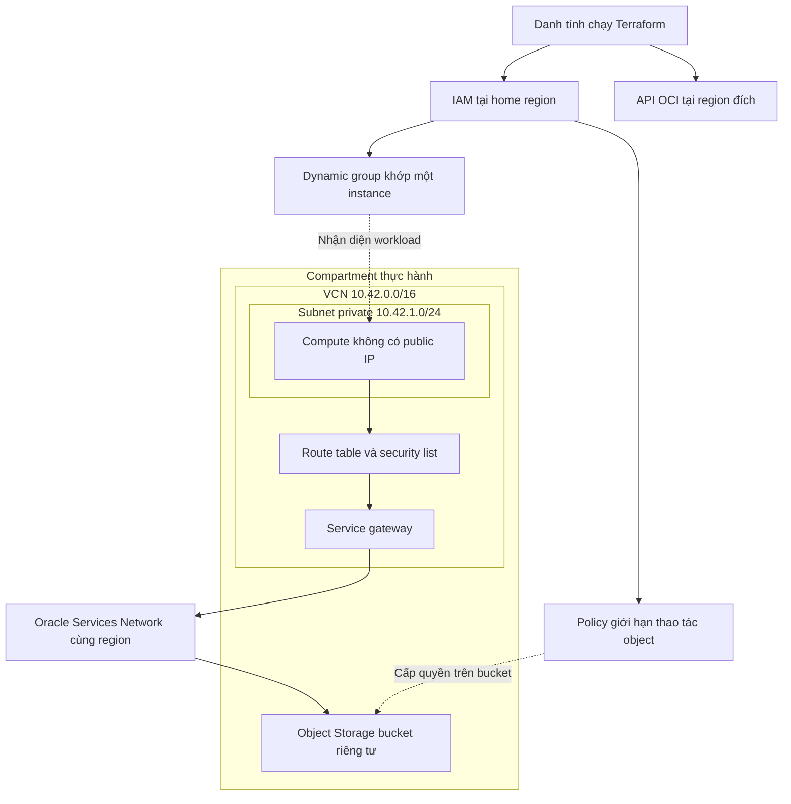

# Khai báo IAM, VCN, Compute và Object Storage bằng Terraform

Trong chương **Hạ tầng dưới dạng mã** của module **CLOUD_PROVIDERS_ORACLE**, Terraform giúp mô tả hạ tầng Oracle Cloud Infrastructure bằng mã có thể quản lý phiên bản, xem trước thay đổi và tái sử dụng. Giá trị của cách làm này không chỉ nằm ở việc tạo nhanh một máy ảo, mà còn ở khả năng diễn đạt rõ máy nằm ở đâu, được kết nối tới dịch vụ nào và có quyền làm gì.

Bài học xây dựng một cấu hình thống nhất gồm compartment, VCN, subnet private, service gateway, Compute instance và Object Storage bucket. IAM cấp cho chính instance quyền thao tác object trong đúng bucket thông qua instance principal. Cấu hình còn thể hiện các quyết định về quản lý state, bảo vệ dữ liệu, khả năng quan sát và kiểm soát chi phí khi đưa IaC vào vận hành.

## 1. Mục tiêu và kiến trúc thực hành

Sau bài học, người học có thể:

- Ánh xạ yêu cầu IAM, mạng, máy tính và lưu trữ thành các resource Terraform của OCI.
- Phân biệt quyền của danh tính chạy Terraform với quyền của workload sau khi triển khai.
- Dùng provider alias để khai báo IAM tại home region và tài nguyên ứng dụng tại region đích.
- Tạo quan hệ phụ thuộc bằng tham chiếu resource, tránh sao chép OCID đầu ra giữa các file.
- Đọc plan, triển khai có kiểm soát, xác minh tài nguyên và xử lý drift hoặc lỗi apply từng phần.

Kiến trúc mẫu:



Bucket không nằm bên trong subnet. Nó là tài nguyên Object Storage thuộc compartment và region; instance truy cập API của dịch vụ qua mạng. **Route và security rule giải quyết kết nối; IAM giải quyết quyền truy cập.** Có đường mạng không tự tạo quyền đọc object, và có quyền IAM không tự tạo đường mạng.

Mẫu tạo một VM private, chưa cài ứng dụng Java, chưa tạo load balancer và chưa thiết lập đường SSH/Bastion. Phần xác minh control plane có thể thực hiện từ máy chạy Terraform; kiểm thử instance principal bên trong VM cần một đường quản trị được chuẩn bị riêng.

## 2. Điều kiện đầu vào và phạm vi quyền

### 2.1. Những thông tin phải biết trước

| Đầu vào | Ý nghĩa | Điểm cần xác minh |
| --- | --- | --- |
| Tenancy OCID | Định danh tenancy, cũng là root compartment | Khớp tenancy của profile xác thực |
| Parent compartment OCID | Nơi tạo compartment thực hành | Người triển khai được phép tạo compartment con |
| Home region | Region quản lý IAM | Có thể khác region đặt ứng dụng |
| Region đích | Nơi tạo VCN, VM và bucket | Tenancy đã đăng ký region này |
| Availability domain | Vị trí đặt VM trong region đích | Dùng tên đầy đủ trả về cho tenancy của mình |
| Image OCID | Image hệ điều hành để khởi tạo VM | Đúng region, kiến trúc và tương thích shape |
| SSH public key | Khóa công khai cấp vào VM | Không truyền private key vào Terraform metadata |
| Tên và owner của lab | Nhận diện tài nguyên | Không trùng tên tài nguyên hiện có, không chứa secret |

Một region có thể có số availability domain khác region khác. Không sao chép tên AD từ một tenancy khác, không giả định luôn có ba AD, và không chọn image chỉ vì tên hiển thị gần giống nhau.

Ví dụ cho phép hai flexible shape: `VM.Standard.A1.Flex` cho Arm và `VM.Standard.E4.Flex` cho x86. Các lựa chọn này chỉ phục vụ minh họa cấu hình flex; không cam kết có capacity, quota hay ưu đãi miễn phí trong tenancy. Khi đổi giữa hai kiến trúc, phải đổi image tương thích và xem kỹ kế hoạch thay thế VM.

### 2.2. Hai lớp danh tính độc lập

**Danh tính triển khai** chạy provider và gọi API để tạo tài nguyên. Danh tính này cần quyền đã được cấp từ trước: quản lý các tài nguyên mạng/Compute/storage trong phạm vi thực hành, tạo compartment theo thiết kế, cùng quyền quản lý dynamic group và policy ở phạm vi cần thiết.

**Danh tính workload** là instance principal của VM. Nó chỉ nhận quyền thao tác object được policy trong bài cấp, không nhận quyền tạo VCN, sửa IAM hay chạy toàn bộ Terraform.

Không thể dựa vào một policy chưa được tạo trong chính cấu hình để cho phép người triển khai tạo policy đó. Nếu tổ chức tách quyền IAM khỏi quyền ứng dụng, đội nền tảng thực hiện phần bootstrap/IAM trong một root module và state riêng, rồi giao các đầu vào đã được quản lý cho đội ứng dụng. Không mở `manage all-resources in tenancy` chỉ để tránh phân tích lỗi quyền.

Cơ chế instance principal cho phép ứng dụng trên Compute gọi dịch vụ OCI mà không cần phân phối API signing key của người dùng vào VM. Người có quyền điều khiển VM cũng có thể sử dụng quyền của instance, nên vẫn cần kiểm soát quyền quản trị máy. Xem [Calling Services from an Instance](https://docs.oracle.com/en-us/iaas/Content/Identity/Tasks/callingservicesfrominstances.htm).

## 3. Cách đọc một cấu hình Terraform OCI

Các khái niệm sẽ dùng trong ví dụ:

| Cấu trúc | Vai trò trong bài |
| --- | --- |
| `terraform` | Ràng buộc phiên bản Terraform và provider |
| `provider "oci"` | Cấu hình region và cách xác thực khi gọi API |
| `variable` | Nhận đầu vào theo môi trường |
| `locals` | Tập trung tên, tag và giá trị được suy ra |
| `data` | Đọc thông tin đã có từ OCI, chẳng hạn namespace hoặc service gateway service |
| `resource` | Khai báo đối tượng Terraform chịu trách nhiệm quản lý |
| `output` | Xuất thông tin phục vụ kiểm tra và chuyển giao |

Ví dụ, `oci_core_subnet.private.id` là thuộc tính `id` của resource có địa chỉ Terraform `oci_core_subnet.private`. Terraform ghi nhận rằng resource tham chiếu giá trị này phải chờ subnet được tạo. Địa chỉ Terraform không phải display name trên Console và cũng không phải OCID của tài nguyên.

Terraform đọc các file `.tf` trong cùng thư mục như một root module. Các tên `network.tf`, `compute.tf` và `iam.tf` giúp người đọc tổ chức nội dung; chúng không quy định thứ tự chạy. Thứ tự đến từ đồ thị phụ thuộc và hành vi của API/provider.

## 4. Tổ chức thư mục, phiên bản và xác thực

### 4.1. Bộ file thực hành

Người học tạo một thư mục riêng, không dùng lẫn với state đang quản lý tài nguyên thật:

```text
oci-terraform-lab/
├── versions.tf
├── providers.tf
├── variables.tf
├── locals.tf
├── compartment.tf
├── network.tf
├── compute.tf
├── storage.tf
├── iam.tf
├── outputs.tf
├── lab.tfvars
└── .gitignore
```

Các code block ghi tên file trong bài là nội dung để đặt vào thư mục thực hành này. Không ghép chúng thành nhiều root module khác nhau rồi kỳ vọng các tham chiếu resource vẫn tự liên kết.

File `versions.tf`:

```hcl
terraform {
  required_version = ">= 1.5.0, < 2.0.0"

  required_providers {
    oci = {
      source  = "oracle/oci"
      version = "= 7.9.0"
    }
  }
}
```

Ví dụ ghim provider `7.9.0` để có một mốc schema cụ thể, không khẳng định đây là bản mới nhất hoặc phiên bản mặc định cho production. Khi áp dụng thực tế, chọn bản được đội vận hành hỗ trợ, đọc thay đổi và kiểm tra plan trước khi nâng cấp. Có thể đối chiếu [bản phát hành OCI provider v7.9.0](https://github.com/oracle/terraform-provider-oci/releases/tag/v7.9.0).

Sau `terraform init`, đưa `.terraform.lock.hcl` vào Git để ghi nhận provider đã chọn và checksum. File lock không thay thế việc quản lý phiên bản Terraform CLI hoặc mã module. Xem [Dependency Lock File](https://developer.hashicorp.com/terraform/language/files/dependency-lock).

### 4.2. Cấu hình provider bằng profile

Mẫu giả định máy thực hành đã có profile OCI API key tên `LAB` trong file cấu hình SDK/CLI. Private key nằm ngoài thư mục dự án, có quyền truy cập phù hợp và public key tương ứng đã được đăng ký cho user.

File `providers.tf`:

```hcl
provider "oci" {
  region              = var.region
  tenancy_ocid        = var.tenancy_ocid
  config_file_profile = var.oci_profile
}

provider "oci" {
  alias               = "home"
  region              = var.home_region
  tenancy_ocid        = var.tenancy_ocid
  config_file_profile = var.oci_profile
}
```

Provider mặc định dùng cho tài nguyên ứng dụng tại `var.region`. Provider `oci.home` dùng cho tài nguyên IAM. Home region là nơi định nghĩa và cập nhật các đối tượng IAM như compartment, policy và dynamic group. Xem [Managing Regions — The Home Region](https://docs.oracle.com/en-us/iaas/Content/Identity/Tasks/managingregions.htm).

OCI provider mặc định hỗ trợ API key authentication và có thể đọc profile cấu hình; các phương thức như instance principal hoặc resource principal phù hợp với môi trường khác. Không dùng OCIR auth token thay API signing key cho cấu hình API key này. Kiểm tra cả biến môi trường đang tác động tới provider để tránh dùng nhầm thông tin xác thực. Xem [Configuring the Provider](https://docs.oracle.com/en-us/iaas/Content/dev/terraform/configuring.htm).

Không ghi nội dung private key, passphrase, access token hay password vào `providers.tf`, `lab.tfvars` hoặc Git. Với CI, dùng cơ chế danh tính/secret của nền tảng và cấp quyền tương ứng, thay vì sao chép profile cá nhân của người phát triển.

## 5. Khai báo đầu vào và quy ước chung

File `variables.tf`:

```hcl
variable "tenancy_ocid" {
  type        = string
  description = "OCID cua tenancy dung cho bai thuc hanh"
}

variable "parent_compartment_ocid" {
  type        = string
  description = "OCID compartment cha da duoc phep su dung"
}

variable "region" {
  type        = string
  description = "Region trien khai VCN, Compute va bucket"
}

variable "home_region" {
  type        = string
  description = "Home region thuc te cua tenancy"
}

variable "oci_profile" {
  type    = string
  default = "LAB"
}

variable "lab_name" {
  type    = string
  default = "tfoci-lab01"

  validation {
    condition     = can(regex("^[a-z][a-z0-9-]{2,23}$", var.lab_name))
    error_message = "lab_name phai dai 3-24 ky tu, bat dau bang chu thuong, chi gom a-z, 0-9 va dau gach noi."
  }
}

variable "owner" {
  type    = string
  default = "learning-team"
}

variable "availability_domain" {
  type        = string
  description = "Ten day du cua AD thuoc region dich va tenancy nay"
}

variable "image_ocid" {
  type        = string
  description = "Image OCID dung region va tuong thich kien truc cua shape"
}

variable "shape" {
  type    = string
  default = "VM.Standard.A1.Flex"

  validation {
    condition = contains([
      "VM.Standard.A1.Flex",
      "VM.Standard.E4.Flex"
    ], var.shape)
    error_message = "Vi du chi cau hinh hai flexible shape A1.Flex hoac E4.Flex."
  }
}

variable "ocpus" {
  type    = number
  default = 1

  validation {
    condition     = var.ocpus > 0
    error_message = "ocpus phai lon hon 0; gioi han cu the con phu thuoc shape va quota."
  }
}

variable "memory_in_gbs" {
  type    = number
  default = 6

  validation {
    condition     = var.memory_in_gbs > 0
    error_message = "memory_in_gbs phai lon hon 0; ti le RAM/OCPU phai hop le voi shape."
  }
}

variable "ssh_public_key_path" {
  type        = string
  description = "Duong dan toi public key tren may chay Terraform"
}

variable "instance_access_enabled" {
  type        = bool
  default     = true
  description = "Bat membership cua VM trong dynamic group; co the tat khi thu hoi quyen lab"
}
```

Các validation chỉ kiểm tra quy ước đầu vào đơn giản. Chúng không chứng minh image tương thích shape, shape còn capacity, CIDR không xung đột với mạng bên ngoài hay người triển khai có đủ IAM permission.

File `locals.tf`:

```hcl
locals {
  vcn_cidr    = "10.42.0.0/16"
  subnet_cidr = "10.42.1.0/24"
  bucket_name = "${var.lab_name}-artifacts"

  common_tags = {
    Project     = var.lab_name
    Environment = "lab"
    Owner       = var.owner
    ManagedBy   = "terraform"
  }
}
```

CIDR subnet nằm trong CIDR VCN. Trước khi nối thêm VPN, peering hay mạng tổ chức, kiểm tra trùng địa chỉ theo thiết kế tổng thể. Tag giúp nhận diện và lọc tài nguyên; tag không tự tạo budget, lịch tắt máy hoặc quyền IAM.

## 6. Khai báo compartment cho các tài nguyên lab

File `compartment.tf`:

```hcl
resource "oci_identity_compartment" "lab" {
  provider       = oci.home
  compartment_id = var.parent_compartment_ocid
  name           = var.lab_name
  description    = "Dedicated compartment for the OCI Terraform learning lab"
  enable_delete  = true
  freeform_tags  = local.common_tags
}
```

Ở resource này, `compartment_id` là **compartment cha**. Ở VCN, VM hoặc bucket phía dưới, `compartment_id` sẽ là compartment thực hành vừa tạo. Không gán cùng một OCID cho mọi tham số chỉ vì chúng cùng tên.

`enable_delete = true` là quyết định dành cho compartment lab mới, có chủ sở hữu và vòng đời riêng. Với OCI provider, khi không bật lựa chọn này, compartment có thể không thực sự bị xóa khi destroy và hành vi khi trùng tên cũng khác. Với mẫu đang bật, tên trùng dẫn tới lỗi thay vì tự nhận quản lý một compartment có sẵn. Xem [oci_identity_compartment](https://docs.oracle.com/en-us/iaas/tools/terraform-provider-oci/latest/docs/r/identity_compartment.html).

Không đặt flag này lên cấu hình quản lý compartment dùng chung mà chưa đánh giá vòng đời. Xóa compartment còn phụ thuộc tài nguyên con, quyền và trạng thái phía OCI; việc đặt flag không có nghĩa có thể xóa mọi compartment ngay lập tức.

## 7. Khai báo VCN, subnet private và đường tới Object Storage

File `network.tf` gồm các block dưới đây.

### 7.1. Đọc service của region và tạo VCN

```hcl
data "oci_core_services" "regional" {}

locals {
  osn_services = [
    for service in data.oci_core_services.regional.services : service
    if can(regex("^All .* Services In Oracle Services Network$", service.name))
  ]

  osn = one(local.osn_services)
}

resource "oci_core_vcn" "lab" {
  compartment_id = oci_identity_compartment.lab.id
  cidr_blocks    = [local.vcn_cidr]
  display_name   = "${var.lab_name}-vcn"
  dns_label      = "tflab"
  freeform_tags  = local.common_tags
}
```

`oci_core_services` trả về các service có thể bật trên service gateway ở region đang dùng. Ví dụ chọn nhóm **All ... Services In Oracle Services Network** theo tên thay vì giả định phần tử `[0]` là service mong muốn. `one` yêu cầu danh sách không có nhiều hơn một phần tử; nếu không có phần tử, kết quả là `null` và các tham chiếu thuộc tính tiếp theo sẽ báo lỗi. Khi tên dịch vụ thay đổi hoặc không có đúng một kết quả, phải kiểm tra danh sách thực tế và sửa điều kiện chọn, không chọn ngẫu nhiên một service.

Đây là một data source đọc catalog, không tạo dịch vụ OCI mới. Thuộc tính `id` dùng để gắn service vào gateway, còn `cidr_block` là **service CIDR label**, dùng trong route/security rule. Xem [schema core_services của provider 7.9.0](https://github.com/oracle/terraform-provider-oci/blob/v7.9.0/website/docs/d/core_services.html.markdown).

### 7.2. Service gateway và route table

```hcl
resource "oci_core_service_gateway" "osn" {
  compartment_id = oci_identity_compartment.lab.id
  vcn_id         = oci_core_vcn.lab.id
  display_name   = "${var.lab_name}-service-gateway"
  freeform_tags  = local.common_tags

  services {
    service_id = local.osn.id
  }
}

resource "oci_core_route_table" "private" {
  compartment_id = oci_identity_compartment.lab.id
  vcn_id         = oci_core_vcn.lab.id
  display_name   = "${var.lab_name}-private-routes"
  freeform_tags  = local.common_tags

  route_rules {
    destination       = local.osn.cidr_block
    destination_type  = "SERVICE_CIDR_BLOCK"
    network_entity_id = oci_core_service_gateway.osn.id
    description       = "Private access to regional Oracle services"
  }
}
```

Service gateway cung cấp đường tới các dịch vụ Oracle được hỗ trợ trong **cùng region** mà không cần public IP, internet gateway hay NAT gateway cho đường truy cập đó. Nó không phải một gateway tới toàn bộ Internet. Việc tải package hoặc dependency từ một địa chỉ ngoài nhóm dịch vụ được hỗ trợ cần thiết kế egress khác. Xem [Access to Oracle Services: Service Gateway](https://docs.oracle.com/en-us/iaas/Content/Network/Tasks/servicegateway.htm).

Không dùng service OCID làm `destination` của route, cũng không gán chuỗi CIDR label vào chỗ `network_entity_id`: các tham số này đại diện cho các đối tượng khác nhau.

### 7.3. Security list và subnet

```hcl
resource "oci_core_security_list" "private" {
  compartment_id = oci_identity_compartment.lab.id
  vcn_id         = oci_core_vcn.lab.id
  display_name   = "${var.lab_name}-private-security"
  freeform_tags  = local.common_tags

  ingress_security_rules = []

  egress_security_rules {
    destination      = local.osn.cidr_block
    destination_type = "SERVICE_CIDR_BLOCK"
    protocol         = "6"
    stateless        = false
    description      = "HTTPS to regional Oracle services"

    tcp_options {
      min = 443
      max = 443
    }
  }
}

resource "oci_core_subnet" "private" {
  compartment_id             = oci_identity_compartment.lab.id
  vcn_id                     = oci_core_vcn.lab.id
  cidr_block                 = local.subnet_cidr
  display_name               = "${var.lab_name}-private-subnet"
  dns_label                  = "app"
  prohibit_public_ip_on_vnic  = true
  route_table_id             = oci_core_route_table.private.id
  security_list_ids          = [oci_core_security_list.private.id]
  freeform_tags              = local.common_tags
}
```

Không khai báo `availability_domain` cho subnet nên mẫu dùng regional subnet. Subnet tham chiếu rõ route table và security list tự tạo, tránh vô tình dùng default security list có rule khác với ý định. DHCP options mặc định của VCN được sử dụng; nếu tổ chức có DNS riêng, cần khai báo thiết kế DHCP/DNS tương ứng.

Security list cho phép egress TCP 443 tới nhóm dịch vụ đã chọn; `stateless = false` dùng connection tracking cho traffic phản hồi. Không có ingress rule cho SSH hoặc cổng ứng dụng. Khi bổ sung NSG/security list khác, tập rule cho phép có thể mở rộng; một security list ít rule không phủ quyết rule allow ở nơi khác.

Một chi tiết OCI cần lưu ý là security rule không được thực thi cho traffic liên quan dải link-local `169.254.0.0/16`, nơi có các dịch vụ như instance metadata. Không diễn giải security list này là cơ chế chặn metadata. Kiểm soát metadata còn cần cấu hình instance và hệ điều hành. Xem [OCI Security Rules](https://docs.oracle.com/en-us/iaas/Content/Network/Concepts/securityrules.htm).

## 8. Khai báo Compute instance

File `compute.tf`:

```hcl
resource "oci_core_instance" "app" {
  compartment_id      = oci_identity_compartment.lab.id
  availability_domain = var.availability_domain
  display_name        = "${var.lab_name}-app"
  shape               = var.shape
  freeform_tags       = local.common_tags

  shape_config {
    ocpus         = var.ocpus
    memory_in_gbs = var.memory_in_gbs
  }

  create_vnic_details {
    subnet_id        = oci_core_subnet.private.id
    assign_public_ip = false
    hostname_label   = "app01"
  }

  source_details {
    source_type = "image"
    source_id   = var.image_ocid
  }

  metadata = {
    ssh_authorized_keys = trimspace(file(pathexpand(var.ssh_public_key_path)))
  }

  instance_options {
    are_legacy_imds_endpoints_disabled = true
  }

  preserve_boot_volume = false
}
```

Các điểm quan trọng:

- `source_type = "image"` và `source_id` chỉ rõ nguồn tạo boot volume. Dùng image OCID đã được lựa chọn thay vì mỗi lần tự lấy image mới nhất.
- `shape_config` mô tả OCPU và RAM cho flexible shape; cặp giá trị phải hợp lệ với shape và quota thực tế.
- Subnet cấm public IP và VNIC cũng đặt `assign_public_ip = false`, thể hiện cùng một chủ đích ở hai lớp cấu hình.
- `file(pathexpand(...))` đọc **public key** có sẵn trên máy chạy Terraform; đặt key vào metadata không đồng nghĩa đã có đường SSH tới VM.
- Vô hiệu legacy IMDS endpoint yêu cầu image, agent và thư viện sử dụng metadata hỗ trợ cách truy cập tương ứng.
- `preserve_boot_volume = false` phù hợp với VM lab có thể tạo lại; khi instance bị terminate, không giữ boot volume như một bản sao lưu ngầm.

Tham khảo các tham số và thuộc tính của [oci_core_instance](https://docs.oracle.com/en-us/iaas/tools/terraform-provider-oci/latest/docs/r/core_instance.html).

Mẫu không có `user_data` chạy lệnh tải package. Điều này tránh giả định VM private có đường ra Internet. Nếu cần bootstrap Java/Spring Boot, chuẩn bị image đã cài runtime hoặc một nguồn artifact có đường truy cập được thiết kế; không đưa private key hay password database vào cloud-init.

Terraform quản lý vòng đời instance, không bảo đảm mọi tiến trình bên trong OS khỏe mạnh. Trạng thái `RUNNING` không chứng minh ứng dụng đã khởi động, có thể kết nối Oracle Database hoặc có đủ số replica để duy trì dịch vụ.

## 9. Khai báo Object Storage bucket riêng tư

File `storage.tf`:

```hcl
data "oci_objectstorage_namespace" "tenancy" {}

resource "oci_objectstorage_bucket" "artifacts" {
  compartment_id = oci_identity_compartment.lab.id
  namespace      = data.oci_objectstorage_namespace.tenancy.namespace
  name           = local.bucket_name
  access_type    = "NoPublicAccess"
  storage_tier   = "Standard"
  versioning     = "Enabled"
  freeform_tags  = local.common_tags

  lifecycle {
    prevent_destroy = true
  }
}
```

Namespace không phải tên compartment hoặc tenancy OCID. Data source đọc namespace cho danh tính đang xác thực; bởi vậy profile và `tenancy_ocid` phải nhất quán ngay từ đầu.

Mẫu đặt bucket ở chế độ riêng tư và bật versioning. Phiên bản object cũ có thể được giữ lại khi ghi đè; dữ liệu được giữ lại cũng ảnh hưởng chi phí và việc dọn bucket. `storage_tier` thuộc cấu hình bucket, không phải yêu cầu lập tức đưa mọi object vào một chính sách lưu trữ tùy ý. Xem [schema objectstorage_bucket của provider 7.9.0](https://github.com/oracle/terraform-provider-oci/blob/v7.9.0/website/docs/r/objectstorage_bucket.html.markdown).

`prevent_destroy` yêu cầu Terraform từ chối kế hoạch phá hủy/thay thế bucket khi block bảo vệ còn hiện diện. Nó không phải retention rule của Object Storage, không chặn người có quyền xóa tài nguyên bằng API khác, và không còn bảo vệ theo cách đó nếu cả resource block bị loại khỏi cấu hình. Xem [lifecycle meta-argument](https://developer.hashicorp.com/terraform/language/meta-arguments/lifecycle).

Ví dụ không tạo object chứa secret, pre-authenticated request hoặc customer secret key. Các đối tượng dữ liệu ứng dụng thường do ứng dụng/pipeline dữ liệu quản lý; không đưa toàn bộ dữ liệu runtime vào Terraform chỉ vì bucket được tạo bằng IaC.

## 10. Khai báo dynamic group và policy cho workload

File `iam.tf`:

```hcl
resource "oci_identity_dynamic_group" "app" {
  provider       = oci.home
  compartment_id = var.tenancy_ocid
  name           = "${var.lab_name}-app-dg"
  description    = "Instance principal for the single lab VM"
  freeform_tags  = local.common_tags

  matching_rule = var.instance_access_enabled ? (
    "ALL {instance.id = '${oci_core_instance.app.id}'}"
  ) : (
    "ALL {instance.id = '${oci_core_instance.app.id}', instance.id != '${oci_core_instance.app.id}'}"
  )
}

resource "oci_identity_policy" "app_objects" {
  provider       = oci.home
  compartment_id = oci_identity_compartment.lab.id
  name           = "${var.lab_name}-app-objects"
  description    = "Allow object operations on the lab bucket without delete"
  freeform_tags  = local.common_tags

  statements = [
    "Allow dynamic-group id ${oci_identity_dynamic_group.app.id} to manage objects in compartment id ${oci_identity_compartment.lab.id} where all {target.bucket.name = '${oci_objectstorage_bucket.artifacts.name}', any {request.permission = 'OBJECT_INSPECT', request.permission = 'OBJECT_READ', request.permission = 'OBJECT_CREATE', request.permission = 'OBJECT_OVERWRITE'}}"
  ]
}
```

### 10.1. Vì sao dynamic group dùng tenancy OCID?

Dynamic group là tài nguyên IAM ở cấp tenancy; vì vậy `compartment_id` của nó là tenancy OCID, không phải compartment chứa VM. Matching rule quyết định VM nào là thành viên. Mẫu khớp đúng OCID một instance thay vì cấp quyền cho mọi instance hiện tại và tương lai trong compartment. Xem [oci_identity_dynamic_group](https://docs.oracle.com/en-us/iaas/tools/terraform-provider-oci/latest/docs/r/identity_dynamic_group.html).

Khi `instance_access_enabled = false`, matching rule chứa hai điều kiện mâu thuẫn về cùng instance ID nên không có instance nào thỏa mãn. Đây là cách chủ động làm rỗng membership của group lab khi thu hồi quyền hoặc dọn tài nguyên; nó không phải một policy deny.

### 10.2. Policy thực sự cấp những gì?

Policy nằm trong compartment lab và giới hạn đối tượng theo tên bucket. Từ khóa `manage objects` được thu hẹp bởi điều kiện `request.permission`, nên statement này chỉ cấp bốn permission đã liệt kê:

| Permission | Mục đích trong lab |
| --- | --- |
| `OBJECT_INSPECT` | Liệt kê object |
| `OBJECT_READ` | Đọc nội dung và các thao tác đọc object tương ứng |
| `OBJECT_CREATE` | Tạo object mới |
| `OBJECT_OVERWRITE` | Ghi đè object đã có |

Statement không cấp quyền xóa object, xóa bucket hay sửa IAM. Nó cũng không tự cấp quyền liệt kê mọi bucket. Khi kiểm thử, cung cấp namespace và bucket đã biết để không đòi thêm quyền khám phá ngoài phạm vi. Các permission cụ thể phải đối chiếu với API định dùng; một workflow multipart hoặc thao tác quản trị khác có thể cần phân tích bổ sung. Xem [Details for Object Storage and Archive Storage](https://docs.oracle.com/en-us/iaas/Content/Identity/policyreference/objectstoragepolicyreference.htm).

Quyền hiệu lực là kết quả tổng hợp các policy liên quan. Không cấp `OBJECT_DELETE` trong statement này không ngăn được một policy khác đã cấp quyền xóa cho cùng principal. Vì vậy kiểm tra giới hạn quyền phải xét toàn bộ IAM áp dụng và các dynamic group mà instance thuộc về.

### 10.3. Tránh chu trình phụ thuộc

Trong mẫu, dynamic group cần `oci_core_instance.app.id`, còn instance không phụ thuộc policy. Terraform có thể tạo VM trước, tạo group khớp OCID đó, rồi tạo policy. Không thêm `depends_on = [oci_identity_policy.app_objects]` vào instance: nó sẽ tạo vòng lặp giữa instance, dynamic group và policy.

Nếu ứng dụng gọi Object Storage ngay từ cloud-init, cần thiết kế bootstrap riêng hoặc retry phù hợp. Tạo đúng thứ tự Terraform không đồng nghĩa IAM đã được truyền tới mọi endpoint ngay lập tức. `depends_on` điều khiển thứ tự, không thay thế cơ chế xử lý độ trễ truyền thay đổi IAM.

## 11. Xuất thông tin để kiểm tra và chuyển giao

File `outputs.tf`:

```hcl
output "compartment_id" {
  value = oci_identity_compartment.lab.id
}

output "region" {
  value = var.region
}

output "instance_id" {
  value = oci_core_instance.app.id
}

output "instance_private_ip" {
  value = oci_core_instance.app.private_ip
}

output "bucket_name" {
  value = oci_objectstorage_bucket.artifacts.name
}

output "object_storage_namespace" {
  value = data.oci_objectstorage_namespace.tenancy.namespace
}

output "dynamic_group_id" {
  value = oci_identity_dynamic_group.app.id
}
```

Output làm rõ hợp đồng giữa hạ tầng và bước triển khai ứng dụng. Không cần xuất private key, token hoặc nội dung secret. OCID, địa chỉ IP và namespace không phải mật khẩu, nhưng vẫn là thông tin nội bộ cần quản lý theo phạm vi truy cập phù hợp.

File `lab.tfvars` minh họa:

```hcl
tenancy_ocid          = "THAY_BANG_TENANCY_OCID"
parent_compartment_ocid = "THAY_BANG_PARENT_COMPARTMENT_OCID"
region                = "ap-singapore-1"
home_region           = "THAY_BANG_HOME_REGION_THUC_TE"
oci_profile           = "LAB"
lab_name              = "tfoci-lab01"
owner                 = "learning-team"
availability_domain   = "THAY_BANG_TEN_AD_DAY_DU"
image_ocid            = "THAY_BANG_IMAGE_OCID_ARM_DUNG_REGION"
shape                 = "VM.Standard.A1.Flex"
ocpus                 = 1
memory_in_gbs         = 6
ssh_public_key_path   = "~/.ssh/id_ed25519.pub"
instance_access_enabled = true
```

Thay tất cả placeholder trước khi plan. Region Singapore chỉ là ví dụ; chọn region đã đăng ký và có các dịch vụ/shape cần dùng. File public key phải tồn tại tại đường dẫn của chính máy chạy Terraform; đường dẫn này không được hiểu là file bên trong VM.

Một `.gitignore` tối thiểu cho thư mục thực hành:

```gitignore
.terraform/
*.tfstate
*.tfstate.*
*.tfplan
crash.log
crash.*.log
lab.tfvars
```

Đưa mã `.tf`, file lock và một file mẫu đầu vào đã loại bỏ thông tin môi trường vào Git theo quy ước của đội. Không đưa state hoặc plan lưu sẵn vào Git.

## 12. Chạy init, kiểm tra cấu hình và đọc plan

Các lệnh phía dưới dành cho người học trong thư mục lab. `init`, `validate` và `plan` không thực hiện bước tạo tài nguyên như `apply`, nhưng có thể tải provider, đọc API và tạo file cục bộ. Chuẩn bị quyền truy cập và thư mục làm việc đúng trước khi chạy.

```bash
terraform version
terraform init
terraform fmt
terraform validate
terraform plan -var-file=lab.tfvars -out=lab.tfplan
terraform show lab.tfplan
```

`fmt` chuẩn hóa cách trình bày HCL. `validate` kiểm tra cấu trúc và tính nhất quán của cấu hình với schema đã nạp; nó không bảo đảm quota, capacity, image/shape hay quyền runtime đều hợp lệ. `plan` đối chiếu cấu hình, state và dữ liệu được đọc từ provider để đề xuất hành động. Xem [terraform plan](https://developer.hashicorp.com/terraform/cli/commands/plan).

Trong plan đầu tiên cho một state mới, cần nhận ra các resource ứng với compartment, mạng, VM, bucket, dynamic group và policy; data source là các lần đọc. VCN còn có các tài nguyên mặc định do OCI tạo kèm, nên số đối tượng nhìn thấy trên Console không nhất thiết bằng số resource block riêng trong state.

Đọc plan theo tác động:

| Dấu hiệu | Ý nghĩa cần xem xét |
| --- | --- |
| `+` | Tạo tài nguyên mới |
| `~` | Cập nhật tài nguyên hiện có |
| `-` | Xóa tài nguyên |
| `-/+` hoặc `+/-` | Thay thế tài nguyên; chú ý dữ liệu, địa chỉ và thời gian gián đoạn |
| `(known after apply)` | Giá trị chỉ biết sau khi API tạo/đọc hoàn tất |

Trước apply, kiểm tra ít nhất:

- Tất cả tài nguyên thuộc đúng tenancy, compartment và region; IAM dùng provider home.
- Shape, OCPU, RAM, image và AD đúng mục đích, không có mở rộng tài nguyên ngoài dự kiến.
- VM không có public IP; subnet dùng đúng route/security list; egress đúng nhóm dịch vụ.
- Bucket vẫn riêng tư, versioning bật, không có kế hoạch xóa/thay thế dữ liệu.
- Policy không mở sang mọi bucket hay toàn tenancy và không vô tình thêm permission xóa.

Sau khi plan đã được xem xét, thực hiện đúng saved plan:

```bash
terraform apply lab.tfplan
```

Khi truyền saved plan, Terraform không hỏi xác nhận tương tác như một lần apply tự tạo plan. Do đó việc duyệt thay đổi phải hoàn thành trước lệnh này; không coi prompt trong terminal là điểm kiểm soát duy nhất. Saved plan chứa các quyết định và giá trị đã được ghi nhận, không đọc lại `lab.tfvars` để thay chúng vào phút cuối. Xem [terraform apply](https://developer.hashicorp.com/terraform/cli/commands/apply).

Nếu mã, đầu vào hoặc môi trường đã thay đổi đáng kể, tạo plan mới và xem lại. Không tái sử dụng một plan cũ như thể nó đại diện cho trạng thái mới nhất của OCI.

## 13. Xác minh sau apply

### 13.1. Xác minh control plane

Từ thư mục lab:

```bash
terraform output
terraform state list
terraform plan -var-file=lab.tfvars
```

Mục tiêu của plan tiếp theo là không còn thay đổi ngoài dự kiến. Một plan không có thay đổi chỉ chứng minh phần tài nguyên/thuộc tính được quản lý đang phù hợp theo lần đọc đó; không thay cho kiểm thử workload.

Trong Bash, nếu đã cài OCI CLI và dùng đúng profile triển khai, có thể lấy output để xem VM và bucket:

```bash
INSTANCE_ID=$(terraform output -raw instance_id)
REGION=$(terraform output -raw region)
NAMESPACE=$(terraform output -raw object_storage_namespace)
BUCKET=$(terraform output -raw bucket_name)

oci compute instance get --profile LAB --region "$REGION" \
  --instance-id "$INSTANCE_ID"

oci os bucket get --profile LAB --region "$REGION" \
  --namespace-name "$NAMESPACE" --bucket-name "$BUCKET"
```

Nếu đã đổi tên profile, thay `LAB` tương ứng. Các biến và cách nối dòng ở block này dùng Bash; trong PowerShell cần đổi cú pháp gán biến và nối dòng phù hợp.

Kiểm tra lifecycle state của VM, subnet/VNIC không có public IP, security list được gắn, route service gateway và chế độ truy cập bucket. Các lệnh dùng profile người triển khai chỉ kiểm tra bằng quyền người triển khai, chưa kiểm tra quyền instance principal.

### 13.2. Kiểm thử instance principal trên chính VM

Chỉ thực hiện khi đã có đường quản trị được phê duyệt và OCI CLI sẵn có bên trong VM. Mẫu không tạo các điều kiện này: private IP không thể được SSH trực tiếp từ Internet và việc có SSH public key trong metadata không mở ingress. Nếu dùng Bastion, VPN hoặc đường quản trị khác, cần chuẩn bị route/rule, dịch vụ và quyền tương ứng.

Trên VM, gán các giá trị region/namespace/bucket từ output đã được chuyển giao, rồi thử một object nhỏ:

```bash
REGION='THAY_BANG_REGION_DICH'
NAMESPACE='THAY_BANG_NAMESPACE_TU_OUTPUT'
BUCKET='THAY_BANG_BUCKET_TU_OUTPUT'

printf 'hello from instance principal\n' > hello.txt

oci os object put --auth instance_principal --region "$REGION" \
  --namespace-name "$NAMESPACE" --bucket-name "$BUCKET" \
  --name smoke/hello.txt --file hello.txt

oci os object list --auth instance_principal --region "$REGION" \
  --namespace-name "$NAMESPACE" --bucket-name "$BUCKET" \
  --prefix smoke/

oci os object get --auth instance_principal --region "$REGION" \
  --namespace-name "$NAMESPACE" --bucket-name "$BUCKET" \
  --name smoke/hello.txt --file downloaded.txt

cat downloaded.txt
```

Thực hiện với tên object thực hành chưa có để tránh nhầm với dữ liệu sẵn có. Không sao chép profile API key của người triển khai vào VM để làm phép thử này; `--auth instance_principal` phải sử dụng danh tính instance.

Kết quả mong đợi là tạo, liệt kê và đọc object trong bucket đích. Với dữ liệu thử và quyền đã rà soát, có thể thiết kế phép thử âm cho bucket khác hoặc thao tác ngoài phạm vi; không thử trên dữ liệu quan trọng. Nếu quyền hiệu lực rộng hơn mong muốn, kiểm tra toàn bộ policy và group membership thay vì chỉ nhìn statement trong file `iam.tf`.

Thay đổi matching rule hoặc IAM cần thời gian truyền và cập nhật membership; khi gặp lỗi vừa sau apply, kiểm tra propagation và retry có giới hạn. Không chữa lỗi bằng cách mở bucket public hoặc cấp quyền toàn tenancy.

## 14. Quản lý state, thay đổi và lỗi apply từng phần

### 14.1. State là dữ liệu vận hành

State liên kết địa chỉ Terraform với tài nguyên thật. Trong lab một người, backend local có thể giúp quan sát cơ chế; khi làm việc nhóm, chọn backend có kiểm soát truy cập, bảo vệ dữ liệu, versioning và cơ chế khóa phù hợp. Khóa state giữa các job khác với file `.terraform.lock.hcl` dùng để khóa lựa chọn provider.

Không giả định dùng Object Storage làm backend tự động có distributed locking. Phải kiểm tra khả năng của đúng backend/công cụ được chọn. Bucket dùng lưu state nên được bootstrap và quản lý với vòng đời tách biệt; không đặt state duy nhất vào chính bucket ứng dụng sắp bị destroy trong cùng cấu hình.

State và saved plan có thể chứa dữ liệu nhạy cảm từ cấu hình/provider. `sensitive = true` giúp che hiển thị trong một số ngữ cảnh, không biến toàn bộ dữ liệu state thành bí mật đã mã hóa. Xem [Manage sensitive data in Terraform](https://developer.hashicorp.com/terraform/language/manage-sensitive-data).

### 14.2. Một lần apply không phải giao dịch toàn hệ thống

Nếu mạng và bucket đã tạo nhưng VM lỗi do capacity, các tài nguyên đã tạo không tự được rollback hết. Giữ state, xác định phần nào đã thành công, xử lý nguyên nhân rồi plan lại. Không xóa state để chạy từ đầu: làm vậy có thể bỏ quên tài nguyên đang tính phí hoặc tạo trùng.

Nếu tài nguyên được tạo thủ công nhưng cần chuyển sang Terraform, dùng quy trình import và điều chỉnh cấu hình để plan phản ánh đúng tài nguyên hiện hữu. Một tài nguyên thật không nên được quản lý đồng thời bởi hai địa chỉ/state độc lập. Xem [terraform import](https://developer.hashicorp.com/terraform/cli/commands/import).

### 14.3. Drift và thay thế tài nguyên

Ví dụ một người đổi OCPU trên Console: plan tiếp theo có thể đề xuất đưa cấu hình về giá trị trong mã. Nhóm phải quyết định thay đổi trên Console là tình huống tạm thời cần hoàn nguyên hay thay đổi hợp lệ cần cập nhật vào mã. Không dùng `ignore_changes` rộng để che mọi drift.

Đổi image OCID hoặc thuộc tính không hỗ trợ cập nhật có thể dẫn tới thay thế VM; phải đọc plan cụ thể của phiên bản provider đang dùng. Với dynamic group khớp đúng instance OCID, VM mới cần được cập nhật membership trước khi workload mới sử dụng quyền. Cơ chế này giúp phạm vi rõ nhưng không tạo ra quá trình chuyển đổi không gián đoạn.

Đổi tên địa chỉ resource trong mã cũng có thể làm Terraform hiểu thành xóa/tạo nếu không quản lý việc chuyển địa chỉ. Khi refactor cấu hình đã có state, dùng quy trình chuyển địa chỉ thích hợp và xem plan, không chỉ đổi nhãn file rồi apply.

## 15. Chẩn đoán lỗi và các quyết định vận hành

| Triệu chứng | Điều cần kiểm tra | Hướng xử lý |
| --- | --- | --- |
| `NotAuthenticated` | Profile, user, fingerprint, key, thời gian máy, phương thức auth | Sửa xác thực, không thay bằng token dành cho dịch vụ khác |
| `NotAuthorizedOrNotFound` | Quyền, OCID, region, vị trí policy và propagation | Không kết luận tài nguyên chắc chắn không tồn tại chỉ từ thông báo này |
| Lỗi khi tạo/cập nhật IAM | Provider có dùng home region không? | Kiểm tra `provider = oci.home` và home region thực tế |
| Không có service phù hợp hoặc `one` báo lỗi | Catalog service ở region đích và điều kiện chọn | Xem dữ liệu thật, sửa bộ chọn có chủ đích |
| Invalid image/shape | Kiến trúc, region, image compatibility | Chọn cặp image/shape đúng và xem lại thay thế VM |
| Out of host capacity hoặc quota | Shape, AD, service limit, quota compartment | Chọn phương án trong phạm vi được duyệt; không lặp apply vô hạn |
| Không SSH được tới private IP | Chưa có đường quản trị/ingress tương ứng | Chuẩn bị đường quản trị theo thiết kế; key không thay cho kết nối |
| Object Storage timeout | DNS, route table, service gateway, egress và endpoint region | Kiểm tra mạng trước khi nới IAM |
| Object Storage bị từ chối quyền | Instance principal, matching rule, policy, bucket, API permission | Kiểm tra đúng principal; không kiểm thử bằng profile quản trị thay thế |
| Không destroy được bucket | `prevent_destroy`, object/version còn lại, retention hoặc quyền | Phân loại lớp bảo vệ, bảo toàn dữ liệu trước khi dọn lab |
| State lock bị giữ | Job nào còn chạy, backend và lock owner | Xử lý job/lock theo quy trình; không force-unlock khi còn người ghi state |
| Apply thất bại sau khi tạo một phần | State và tài nguyên thật đã có gì? | Giữ state, plan lại và xử lý nguyên nhân |

Về quan sát, tag `ManagedBy` và owner hỗ trợ truy vết nhưng không tạo sẵn dashboard, alarm hoặc log collection. Muốn biết VM dùng bao nhiêu CPU/RAM và API workload lỗi ra sao, phải bổ sung agent, metrics, log và alarm theo thiết kế giám sát.

Về chi phí, theo dõi OCPU/RAM, boot volume, dung lượng object và các version được giữ, request/transfer theo biểu phí áp dụng. Bucket private và subnet private là lựa chọn truy cập, không phải cam kết không phát sinh phí. Budget alert cũng không mặc định là cơ chế tự chặn mọi chi tiêu.

Về tính sẵn sàng, một VM là một điểm lỗi của workload. Regional subnet không biến một instance thành hệ thống đa AD hay đa region. Khi tiến tới production, cần thiết kế replica, load balancing, phân bố fault domain/AD phù hợp, lưu trữ dữ liệu và cơ chế phục hồi; chúng phải được biểu diễn thêm trong mã và được kiểm thử.

## 16. Thu hồi lab và tiêu chí hoàn thành

### 16.1. Dọn tài nguyên theo vòng đời đã thiết kế

Mẫu có `prevent_destroy = true` ở bucket nên `terraform plan -destroy` sẽ bị chặn nếu yêu cầu xóa bucket khi guard còn bật. Đây là hành vi có chủ đích; không cố vượt qua bằng cách xóa state hoặc xóa resource block để tránh kiểm tra.

Với một lab đã được xác nhận có thể hủy:

1. Ngừng workload và xác định object/version nào cần giữ hoặc chuyển giao. Nếu bucket có dữ liệu ngoài lab, tách quyền sở hữu và xử lý việc bàn giao trước.
2. Đặt `instance_access_enabled = false`, tạo plan và apply thay đổi membership; chờ quyền được cập nhật. Group cần được làm rỗng theo quy trình IAM khi xóa, không chỉ xóa policy rồi giả định membership đã hết.
3. Dọn đúng object/version thực hành bằng danh tính được phép. Xóa object hiện tại trong bucket bật versioning chưa chắc xóa toàn bộ phiên bản cũ; retention rule có thể tiếp tục ngăn thao tác.
4. Chỉ với bucket lab đã được phép xóa, thay giá trị literal `prevent_destroy` thành `false` trong cấu hình đang được kiểm soát.
5. Tạo destroy plan, xem lại toàn bộ đối tượng sẽ xóa, rồi mới apply saved plan đó.

Các lệnh cho bước cuối:

```bash
terraform plan -destroy -var-file=lab.tfvars -out=destroy.tfplan
terraform show destroy.tfplan
terraform apply destroy.tfplan
```

Kiểm tra lại state và Console sau khi hoàn tất, gồm VM/boot volume, bucket, các thành phần mạng, dynamic group, policy và compartment. Compartment chỉ xóa được khi thỏa điều kiện phía OCI; resource còn sót, độ trễ hoặc một workflow khác có thể làm destroy chưa hoàn tất. Không xóa state cho tới khi đã giải quyết quyền sở hữu và vòng đời các tài nguyên còn lại.

### 16.2. Bằng chứng đạt mục tiêu bài học

| Bằng chứng | Kết quả cần đạt |
| --- | --- |
| Mã Terraform | Có đủ IAM, VCN/subnet/route/security, Compute và Object Storage; tham chiếu liên kết nhất quán |
| Đầu vào và xác thực | Tenancy/home region/region/AD/image rõ ràng; không có private key hoặc secret trong mã |
| Plan trước apply | Đúng phạm vi, ngân sách và chính sách mạng; nhận diện thao tác thay thế/xóa |
| Kết quả control plane | VM private, bucket riêng tư và resource nằm đúng compartment/region |
| Kiểm thử workload nếu đã chuẩn bị đường quản trị | Instance principal thao tác được object trong bucket theo quyền hiệu lực đã rà soát |
| Quản lý vòng đời | State được bảo vệ, có kế hoạch xử lý drift, dữ liệu và thu hồi tài nguyên |

Một cấu hình có thể parse thành công chưa phải hạ tầng vận hành đúng. Kết quả cần hướng tới là mã thể hiện đúng ranh giới IAM, đường mạng và vòng đời dữ liệu, còn các phép kiểm tra sau triển khai cung cấp bằng chứng rằng những ranh giới đó hoạt động như dự kiến.
