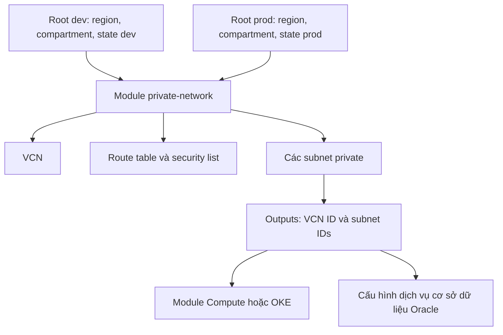

# Thiết kế Terraform modules và tái sử dụng cấu hình

## 1. Mục tiêu và bối cảnh OCI

Trong chương **Hạ tầng dưới dạng mã** của module **CLOUD_PROVIDERS_ORACLE**, tái sử dụng cấu hình không chỉ là giảm số dòng HCL. Một Terraform module hữu ích cần đóng gói được một năng lực hạ tầng, có đầu vào rõ ràng, trả đầu ra phù hợp và cho phép nâng cấp mà người sử dụng hiểu tác động.

Ví dụ, môi trường dev và prod đều cần mạng cho ứng dụng Java cùng các dịch vụ dữ liệu Oracle. Cấu trúc mạng có thể giống nhau nhưng compartment, CIDR, region, nhãn chi phí và quyền triển khai khác nhau. Sao chép toàn bộ resource sang hai thư mục dễ làm cấu hình lệch dần; gom mọi thứ thành một module quá lớn lại khiến thay đổi nhỏ ảnh hưởng quá nhiều tài nguyên.

Bài này xây dựng một module OCI tạo VCN và các subnet private, rồi dùng lại qua các root configuration. Mục tiêu là:

- Chọn ranh giới module theo trách nhiệm và vòng đời.
- Thiết kế input/output như một giao diện được duy trì lâu dài.
- Tách cấu hình provider, xác thực và state khỏi phần triển khai dùng lại.
- Dùng khóa ổn định để quản lý nhiều tài nguyên.
- Quản lý phiên bản, kiểm tra plan và refactor địa chỉ resource có kiểm soát.
- Gắn việc tái sử dụng với IAM, giám sát, tính sẵn sàng và kiểm soát chi phí trên OCI.

Terraform dùng OCI provider để gọi các dịch vụ OCI. Mã dùng lại vẫn chịu các ràng buộc của API, IAM, hạn mức và trạng thái hạ tầng thật; module không thay thế những lớp đó. Xem [Oracle: Terraform provider](https://docs.oracle.com/en-us/iaas/Content/dev/terraform/home.htm).

## 2. Root module và child module

Một thư mục chứa các file cấu hình Terraform là một module. Khi chạy Terraform trong thư mục đó, nó đóng vai trò **root module**. Khi root gọi một thư mục khác bằng block `module`, thư mục được gọi là **child module**.



Sơ đồ thể hiện việc hai root dùng cùng mã nguồn. Mỗi lần gọi module tạo một tập resource theo context và state của root đang chạy; không có một VCN dùng chung tự động chỉ vì cùng trỏ tới một thư mục source.

Các file `main.tf`, `variables.tf`, `outputs.tf` trong một thư mục được Terraform đọc như cùng một cấu hình. Tên file giúp con người tổ chức nội dung, không quy định thứ tự chạy. Một thư mục con cũng không tự được thực thi nếu chưa được gọi.

| Thành phần | Nên chịu trách nhiệm |
| --- | --- |
| Root module | Chọn môi trường, provider configuration, nguồn xác thực, backend và ghép các module |
| Child module | Thực hiện năng lực đã cam kết với input/output rõ ràng |
| Provider | Chuyển khai báo Terraform thành thao tác với OCI |
| State | Gắn địa chỉ Terraform với tài nguyên đã quản lý |

Đây là nền tảng của [thiết kế module Terraform](https://developer.hashicorp.com/terraform/language/modules/develop).

## 3. Chọn ranh giới module theo năng lực và vòng đời

### 3.1. Một module nên giải quyết điều gì?

Một module mạng có thể sở hữu VCN, subnet, routing và baseline security của mạng đó. Một module Compute có thể sở hữu nhóm máy chạy cùng một kiểu workload. Một module database có thể sở hữu dịch vụ dữ liệu cùng các thiết lập liên quan tới vòng đời của nó.

Không nhất thiết mỗi loại resource phải có một module. Một lớp chỉ nhận mọi tham số rồi chuyển nguyên sang đúng một resource thường tạo thêm giao diện mà chưa cung cấp quy tắc hay giá trị dùng lại.

Ngược lại, module tạo cả tenancy policy, toàn bộ mạng, OKE, database, load balancer và ứng dụng thường có quá nhiều trách nhiệm. Người gọi khó nâng cấp một phần, đọc plan và xác định phạm vi lỗi.

| Câu hỏi thiết kế | Dấu hiệu nên tách |
| --- | --- |
| Các tài nguyên có thay đổi cùng nhau không? | Network ổn định lâu, nhóm máy ứng dụng thay thường xuyên |
| Ai có quyền quản lý? | Nhóm mạng khác nhóm database |
| Ai chịu trách nhiệm sự cố? | Có các chủ sở hữu vận hành riêng |
| Một thay đổi cần ảnh hưởng tới đâu? | Muốn cập nhật ứng dụng mà không sửa cấu hình network |
| Chính sách có thống nhất không? | Nhiều workload dùng cùng baseline nhưng có cấu hình nghiệp vụ riêng |

Tách mã thành module và tách state là hai quyết định khác nhau. Có thể tách module để dễ hiểu nhưng vẫn ghép trong một root/state; cũng có thể tách root/state khi quyền hạn và vòng đời yêu cầu.

### 3.2. Ghép module bằng dữ liệu

Module Compute nên nhận subnet ID từ bên ngoài thay vì tự đi tìm network theo tên hiển thị. Root có thể truyền `module.network.subnets["app"].id` vào input của module Compute.

Cách ghép này cho phép người dùng dùng network do module khác tạo hoặc network đã có. Tránh để module con âm thầm tạo dependency mà người gọi không biết.

Tham chiếu output tạo quan hệ phụ thuộc dữ liệu cho Terraform. Chỉ dùng `depends_on` bổ sung khi có phụ thuộc hành vi mà tham chiếu dữ liệu không biểu diễn được; không dùng nó để biến toàn bộ cấu hình thành một chuỗi tuần tự. Xem [HashiCorp: module composition](https://developer.hashicorp.com/terraform/language/modules/develop/composition).

## 4. Thiết kế giao diện trước khi viết resource

### 4.1. Hợp đồng của module mẫu

Module `private-network` trong bài có phạm vi:

- Tạo một VCN IPv4.
- Chia các subnet bằng quy tắc tăng prefix thêm 8 bit.
- Tạo subnet regional, cấm public IP trên VNIC.
- Gắn route table riêng chưa có tuyến ra ngoài VCN.
- Gắn security list riêng, không khai báo ingress và chỉ cho egress tới CIDR VCN.
- Không tạo Internet Gateway, NAT Gateway, Compute, OKE hoặc database.
- Trả VCN ID và map subnet theo khóa logic.

Đây là module có chính sách cụ thể, không phải bộ chuyển tiếp toàn bộ thuộc tính của OCI networking. Các kết nối cho ứng dụng cần được thiết kế bổ sung, chẳng hạn NSG cho đúng luồng giữa ứng dụng và database.

| Input | Kiểu | Bắt buộc | Ý nghĩa |
| --- | --- | --- | --- |
| `compartment_id` | string | Có | Compartment hiện hữu chứa tài nguyên |
| `name_prefix` | string | Có | Tiền tố display name |
| `vcn_dns_label` | string | Có | DNS label của VCN |
| `vcn_cidr` | string | Có | Mạng IPv4 chuẩn, prefix từ /16 đến /22 trong thiết kế mẫu |
| `private_subnet_numbers` | map(number) | Có | Khóa subnet và chỉ số subnet 0..255 |
| `freeform_tags` | map(string) | Không | Nhãn từ root phục vụ quản trị |

Quy tắc prefix /16..22 không phải toàn bộ phạm vi OCI hỗ trợ. Nó là lựa chọn của module này: cộng thêm 8 bit sẽ tạo subnet /24..30. Không áp dụng quy tắc đó như chân lý cho mọi module OCI.

### 4.2. Điều gì nên là input?

Một giá trị nên trở thành input khi người gọi thực sự cần quyết định nó. Những quy tắc thuộc chính sách chung có thể nằm bên trong module.

Ví dụ, `prohibit_public_ip_on_vnic = true` là cam kết của module private network; không cần thêm biến boolean để người gọi vô tình tạo subnet public. Nếu có nhu cầu public network, cân nhắc một module hoặc giao diện riêng với điều kiện vận hành rõ ràng.

Không truyền private key, mật khẩu hoặc toàn bộ provider configuration xuống mọi module. Region là bối cảnh provider trong ví dụ; compartment là nơi đặt tài nguyên và được truyền riêng. Hai giá trị không thay thế nhau.

### 4.3. Đầu ra cũng là một cam kết

Nên trả dữ liệu mà module khác cần: VCN ID, subnet ID, CIDR hoặc endpoint cần dùng. Tránh trả toàn bộ object resource chỉ vì thuận tiện; người dùng có thể phụ thuộc vào những chi tiết nội bộ không có ý định duy trì.

Không truy cập trực tiếp resource bên trong child module từ root. Người gọi dùng output được công bố, còn bên trong module có thể được sắp xếp lại với kế hoạch migration phù hợp.

## 5. Cấu trúc thư mục của ví dụ

```text
infra/
├── modules/
│   └── private-network/
│       ├── versions.tf
│       ├── variables.tf
│       ├── main.tf
│       ├── outputs.tf
│       └── README.md
└── environments/
    ├── dev/
    │   ├── versions.tf
    │   ├── providers.tf
    │   ├── variables.tf
    │   ├── main.tf
    │   └── terraform.tfvars
    └── prod/
        ├── versions.tf
        ├── providers.tf
        ├── variables.tf
        ├── main.tf
        └── terraform.tfvars
```

Đây là cấu trúc để người học tạo trong môi trường thực hành. Mỗi thư mục môi trường là một root riêng. Backend, lock file và cấu hình pipeline được quản lý tại từng root theo mô hình vận hành của tổ chức.

README của module nên có mục đích, tài nguyên sở hữu, yêu cầu phiên bản, input/output, ví dụ sử dụng, quyền cần có và giới hạn kết nối mạng. Tham khảo [HashiCorp: cấu trúc module tiêu chuẩn](https://developer.hashicorp.com/terraform/language/modules/develop/structure).

## 6. Triển khai child module private-network

### 6.1. Khai báo yêu cầu phiên bản

File `modules/private-network/versions.tf`:

```hcl
terraform {
  required_version = ">= 1.6.0, < 2.0.0"

  required_providers {
    oci = {
      source  = "oracle/oci"
      version = ">= 9.0.0"
    }
  }
}
```

Ví dụ dùng dòng OCI provider 9.x ở root. Đây là lựa chọn phiên bản của ví dụ; khi đưa vào hệ thống khác, đối chiếu phiên bản Terraform/provider được môi trường chạy hỗ trợ.

Child module khai báo provider cần dùng và phiên bản tối thiểu của giao diện nó hỗ trợ. Nó không chứa block `provider "oci"` với region hoặc credential. Root sẽ chọn và truyền provider configuration.

### 6.2. Định nghĩa và kiểm tra inputs

File `modules/private-network/variables.tf`:

```hcl
variable "compartment_id" {
  description = "OCID of the existing target compartment."
  type        = string
  nullable    = false

  validation {
    condition     = can(regex("^ocid1[.]compartment[.]", var.compartment_id))
    error_message = "compartment_id must be a compartment OCID."
  }
}

variable "name_prefix" {
  description = "Prefix used in display names."
  type        = string
  nullable    = false

  validation {
    condition     = can(regex("^[a-z][a-z0-9-]{2,23}$", var.name_prefix))
    error_message = "name_prefix must contain 3..24 lowercase letters, digits or hyphens and start with a letter."
  }
}

variable "vcn_dns_label" {
  description = "DNS label for the VCN."
  type        = string
  nullable    = false

  validation {
    condition     = can(regex("^[a-z][a-z0-9]{0,14}$", var.vcn_dns_label))
    error_message = "vcn_dns_label must contain 1..15 lowercase alphanumeric characters and start with a letter."
  }
}

variable "vcn_cidr" {
  description = "Canonical IPv4 VCN CIDR with prefix length 16..22."
  type        = string
  nullable    = false

  validation {
    condition = try(
      cidrnetmask(var.vcn_cidr) != "" &&
      cidrhost(var.vcn_cidr, 0) == split("/", var.vcn_cidr)[0] &&
      tonumber(split("/", var.vcn_cidr)[1]) >= 16 &&
      tonumber(split("/", var.vcn_cidr)[1]) <= 22,
      false
    )
    error_message = "vcn_cidr must be a canonical IPv4 CIDR with prefix length 16..22."
  }
}

variable "private_subnet_numbers" {
  description = "Stable subnet DNS labels mapped to unique subnet numbers."
  type        = map(number)
  nullable    = false

  validation {
    condition = (
      length(var.private_subnet_numbers) > 0 &&
      alltrue([
        for key in keys(var.private_subnet_numbers) :
        can(regex("^[a-z][a-z0-9]{0,14}$", key))
      ])
    )
    error_message = "Provide at least one subnet; each key must be a valid 1..15 character DNS label."
  }

  validation {
    condition = alltrue([
      for number in values(var.private_subnet_numbers) :
      try(number >= 0 && number <= 255 && floor(number) == number, false)
    ])
    error_message = "Every subnet number must be an integer in 0..255."
  }

  validation {
    condition = (
      length(distinct(values(var.private_subnet_numbers))) ==
      length(var.private_subnet_numbers)
    )
    error_message = "Subnet numbers must be unique."
  }
}

variable "freeform_tags" {
  description = "Free-form tags supplied by the caller."
  type        = map(string)
  default     = {}
  nullable    = false
}
```

Validation làm lỗi đầu vào dễ hiểu hơn trước khi gọi API. Nó không chứng minh compartment tồn tại, danh tính có IAM permission hoặc CIDR không trùng với mạng kết nối qua peering/VPN. Những điều đó cần thêm dữ liệu và kiểm tra ở đúng phạm vi.

Hợp đồng này yêu cầu compartment OCID, không nhận tenancy OCID để dùng như root compartment. Đó là ràng buộc có chủ đích của bài, không phải giới hạn chung của OCI.

Mô hình type, default và validation của input được mô tả tại [HashiCorp: input variables](https://developer.hashicorp.com/terraform/language/values/variables).

### 6.3. Tạo tài nguyên

File `modules/private-network/main.tf`:

```hcl
locals {
  tags = merge(
    var.freeform_tags,
    {
      ManagedBy = "Terraform"
      Module    = "private-network"
    }
  )
}

resource "oci_core_vcn" "this" {
  compartment_id = var.compartment_id
  display_name   = format("%s-vcn", var.name_prefix)
  cidr_blocks    = [var.vcn_cidr]
  dns_label      = var.vcn_dns_label
  freeform_tags  = local.tags
}

resource "oci_core_route_table" "private" {
  compartment_id = var.compartment_id
  vcn_id         = oci_core_vcn.this.id
  display_name   = format("%s-private-rt", var.name_prefix)
  freeform_tags  = local.tags

  # No route to an internet, NAT or service gateway in this module.
}

resource "oci_core_security_list" "private" {
  compartment_id = var.compartment_id
  vcn_id         = oci_core_vcn.this.id
  display_name   = format("%s-private-sl", var.name_prefix)
  freeform_tags  = local.tags

  egress_security_rules {
    protocol         = "all"
    destination      = var.vcn_cidr
    destination_type = "CIDR_BLOCK"
    stateless        = false
    description      = "Allow outbound traffic within the VCN."
  }

  # No ingress rules are declared in this security list.
}

resource "oci_core_subnet" "private" {
  for_each = var.private_subnet_numbers

  compartment_id = var.compartment_id
  vcn_id         = oci_core_vcn.this.id
  display_name   = format("%s-%s", var.name_prefix, each.key)
  dns_label      = each.key
  cidr_block     = cidrsubnet(var.vcn_cidr, 8, each.value)

  prohibit_public_ip_on_vnic = true
  route_table_id            = oci_core_route_table.private.id
  security_list_ids         = [oci_core_security_list.private.id]
  dhcp_options_id           = oci_core_vcn.this.default_dhcp_options_id
  freeform_tags             = local.tags
}
```

Các quyết định OCI trong đoạn mã:

- VCN dùng `cidr_blocks`; không đồng thời gán thuộc tính `cidr_block` cũ. Xem [OCI provider: VCN](https://docs.oracle.com/en-us/iaas/tools/terraform-provider-oci/latest/docs/r/core_vcn.html).
- Không gán `availability_domain` cho subnet, nên đây là subnet regional. `prohibit_public_ip_on_vnic = true` cấm VNIC có public IP. Xem [OCI provider: subnet](https://docs.oracle.com/en-us/iaas/tools/terraform-provider-oci/latest/docs/r/core_subnet.html).
- Route table riêng không khai báo gateway route; local routing của VCN vẫn tồn tại. Xem [OCI provider: route table](https://docs.oracle.com/en-us/iaas/tools/terraform-provider-oci/latest/docs/r/core_route_table.html).
- Security list riêng không mở inbound, không gắn default security list vào subnet này. Các NSG hoặc security list bổ sung có thể cho phép thêm traffic; phải xét tập quy tắc đang áp dụng lên workload. Xem [OCI provider: security list](https://docs.oracle.com/en-us/iaas/tools/terraform-provider-oci/latest/docs/r/core_security_list.html).

VCN vẫn có các đối tượng mặc định do OCI tạo, trong đó mẫu sử dụng default DHCP options. Không quản lý cùng một đối tượng từ hai module/state khác nhau.

Module này chưa phải mạng đủ để chạy OKE hoặc database theo mọi yêu cầu. Chẳng hạn tải image từ OCIR, truy cập dịch vụ OCI hay kết nối app-to-database cần đường mạng và quy tắc riêng. Không tự thêm NAT hoặc Internet Gateway chỉ để bài mẫu có vẻ đầy đủ.

### 6.4. Hiểu cách tính subnet

Với `vcn_cidr = "10.20.0.0/16"`:

```hcl
private_subnet_numbers = {
  app  = 10
  data = 20
}
```

Kết quả:

| Khóa logic | Phép tính | CIDR |
| --- | --- | --- |
| `app` | `cidrsubnet("10.20.0.0/16", 8, 10)` | `10.20.10.0/24` |
| `data` | `cidrsubnet("10.20.0.0/16", 8, 20)` | `10.20.20.0/24` |

Chỉ số subnet không phải octet IP trong mọi trường hợp; nó là số được điền vào phần bit mới của prefix. Với VCN /20, cách diễn giải bằng octet sẽ khác. Xem [HashiCorp: cidrsubnet](https://developer.hashicorp.com/terraform/language/functions/cidrsubnet).

### 6.5. Công bố outputs

File `modules/private-network/outputs.tf`:

```hcl
output "vcn_id" {
  description = "OCID of the VCN managed by this module."
  value       = oci_core_vcn.this.id
}

output "subnets" {
  description = "Private subnets keyed by the stable logical subnet name."

  value = {
    for key, subnet in oci_core_subnet.private :
    key => {
      id         = subnet.id
      cidr_block = subnet.cidr_block
    }
  }
}
```

Người dùng có thể lấy subnet ứng dụng bằng `module.network.subnets["app"].id`. Cấu trúc output không buộc họ biết tên resource nội bộ là `oci_core_subnet.private`.

## 7. Root configuration cho môi trường dev

### 7.1. Phiên bản provider tại root

File `environments/dev/versions.tf`:

```hcl
terraform {
  required_version = ">= 1.6.0, < 2.0.0"

  required_providers {
    oci = {
      source  = "oracle/oci"
      version = "~> 9.0"
    }
  }
}
```

`~> 9.0` cho phép chọn phiên bản từ 9.0 trở lên và nhỏ hơn 10.0. Sau lần init, lock file ghi lại phiên bản provider cụ thể đã chọn. Khi nâng major, thay constraint có chủ đích và đọc hướng dẫn nâng cấp tương ứng; không xem một constraint rộng là bằng chứng mọi phiên bản đã được kiểm thử.

### 7.2. Biến của root

File `environments/dev/variables.tf`:

```hcl
variable "region" {
  description = "OCI region used by this root configuration."
  type        = string
  nullable    = false
}

variable "oci_config_profile" {
  description = "Profile in the local OCI SDK/CLI configuration."
  type        = string
  default     = "DEFAULT"
  nullable    = false
}

variable "compartment_id" {
  description = "Existing compartment for this environment."
  type        = string
  nullable    = false
}

variable "name_prefix" {
  type     = string
  nullable = false
}

variable "vcn_dns_label" {
  type     = string
  nullable = false
}

variable "vcn_cidr" {
  type     = string
  nullable = false
}

variable "private_subnet_numbers" {
  type     = map(number)
  nullable = false
}

variable "freeform_tags" {
  type     = map(string)
  default  = {}
  nullable = false
}
```

Root tiếp nhận giá trị môi trường; child tiếp tục bảo vệ hợp đồng của nó bằng validation. Với quy định dùng chung toàn tổ chức, có thể bổ sung kiểm tra ở root hoặc policy của pipeline thay vì ép từng module sao chép mọi chính sách.

### 7.3. Cấu hình xác thực ở root

File `environments/dev/providers.tf`:

```hcl
provider "oci" {
  region              = var.region
  config_file_profile = var.oci_config_profile
}
```

Mẫu này dùng profile OCI SDK/CLI đã cấu hình trên máy học viên, theo phương thức API key tương ứng. Không đưa private key vào `terraform.tfvars`, không commit file credential vào kho mã.

Nếu chạy trong môi trường hỗ trợ instance principal hoặc resource principal, root cấu hình phương thức xác thực phù hợp; mã child module không phải sửa. Các phương thức và nguồn cấu hình được mô tả trong [Oracle: configuring the provider](https://docs.oracle.com/en-us/iaas/Content/dev/terraform/configuring.htm).

Danh tính gọi Terraform cần IAM permission trên tài nguyên trong compartment được chọn. Truyền một compartment OCID không cấp thêm quyền truy cập vào compartment đó. Module mạng cũng không nên tự tạo chính sách tenancy rộng để vượt một lỗi thiếu quyền.

### 7.4. Gọi module

File `environments/dev/main.tf`:

```hcl
module "network" {
  source = "../../modules/private-network"

  providers = {
    oci = oci
  }

  compartment_id         = var.compartment_id
  name_prefix            = var.name_prefix
  vcn_dns_label          = var.vcn_dns_label
  vcn_cidr               = var.vcn_cidr
  private_subnet_numbers = var.private_subnet_numbers
  freeform_tags          = var.freeform_tags
}

output "network" {
  value = {
    vcn_id  = module.network.vcn_id
    subnets = module.network.subnets
  }
}
```

Trong cấu hình đơn giản, default provider có thể được kế thừa ngầm. Bài truyền tường minh để thể hiện root là nơi quyết định provider configuration.

`required_providers` ở child khai báo source và yêu cầu phiên bản; block `provider` ở root chứa cấu hình sử dụng. Đây là hai lớp khác nhau. Xem [HashiCorp: providers within modules](https://developer.hashicorp.com/terraform/language/modules/develop/providers).

### 7.5. Giá trị môi trường

File `environments/dev/terraform.tfvars`:

```hcl
region              = "ap-singapore-1"
oci_config_profile  = "DEFAULT"
compartment_id      = "<dev-compartment-ocid>"
name_prefix         = "orders-dev"
vcn_dns_label       = "ordersdev"
vcn_cidr            = "10.20.0.0/16"

private_subnet_numbers = {
  app  = 10
  data = 20
}

freeform_tags = {
  Environment = "dev"
  Application = "orders"
  Owner       = "platform"
}
```

Thay placeholder bằng OCID thật và chọn region đã được tenancy đăng ký. CIDR ví dụ phải được đối chiếu với quy hoạch mạng của tổ chức.

Nhãn `ManagedBy` và `Module` trong child được module giữ giá trị vì nằm ở đối số sau của `merge`. Đây là một quy tắc giao diện cần được tài liệu hóa, tránh người gọi tưởng mọi tag đều có thể ghi đè.

## 8. Tái sử dụng cho prod và region khác

### 8.1. Cùng module, khác cấu hình môi trường

Root prod có thể dùng cùng các khai báo HCL của root dev, nhưng giá trị và nơi lưu state riêng. Ví dụ `environments/prod/terraform.tfvars`:

```hcl
region              = "ap-singapore-1"
oci_config_profile  = "PROD"
compartment_id      = "<prod-compartment-ocid>"
name_prefix         = "orders-prod"
vcn_dns_label       = "ordersprod"
vcn_cidr            = "10.30.0.0/16"

private_subnet_numbers = {
  app  = 10
  data = 20
}

freeform_tags = {
  Environment = "prod"
  Application = "orders"
  Owner       = "platform"
}
```

Prod không cần một bản sao child module để đổi CIDR. Nhưng prod vẫn cần quyết định riêng về quyền apply, nguồn cấu hình, state, quan sát và khả năng khôi phục.

Phần root nhỏ có thể lặp lại một số khai báo có chủ đích. Chỉ thêm lớp orchestration dùng chung khi nó đại diện cho một mô hình thực sự ổn định; tránh nhiều tầng wrapper chỉ để loại bỏ vài dòng module call.

### 8.2. Provider alias khi dùng nhiều region

Nếu một root cần thêm network ở region thứ hai, có thể bổ sung provider alias và một module call. Đây là đoạn mở rộng cho root đã có các biến phía trên:

```hcl
provider "oci" {
  alias               = "secondary"
  region              = "ap-tokyo-1"
  config_file_profile = var.oci_config_profile
}

module "network_secondary" {
  source = "../../modules/private-network"

  providers = {
    oci = oci.secondary
  }

  compartment_id = var.compartment_id
  name_prefix    = "orders-secondary"
  vcn_dns_label  = "orderssecondary"
  vcn_cidr       = "10.40.0.0/16"

  private_subnet_numbers = {
    app  = 10
    data = 20
  }

  freeform_tags = merge(
    var.freeform_tags,
    { RegionRole = "secondary" }
  )
}
```

Child vẫn dùng local provider name `oci`; root ánh xạ nó sang `oci.secondary`. Trường hợp này không đòi hỏi child khai báo một alias tên `secondary`.

Nếu chính child cần sử dụng đồng thời nhiều provider configuration, nó phải khai báo `configuration_aliases` tương ứng và caller truyền đủ. Không chọn provider alias bằng một biểu thức động tùy từng phần tử `for_each` như chọn một giá trị string; thiết kế các module call phù hợp với liên kết provider.

Tạo hai network ở hai region chưa tạo giải pháp DR hoàn chỉnh. Replication database, bản sao dữ liệu, DNS failover, khả năng phục vụ và quy trình chuyển đổi vẫn cần thiết kế riêng.

## 9. Khóa ổn định, địa chỉ resource và for_each

Với map input, subnet có các địa chỉ như:

```text
module.network.oci_core_subnet.private["app"]
module.network.oci_core_subnet.private["data"]
```

Thêm một khóa mới không đánh lại chỉ số của các khóa cũ. Đây là lợi ích khi tài nguyên có danh tính logic. Nếu dùng `count` dựa trên vị trí list, việc chèn hoặc sắp xếp lại có thể khiến địa chỉ chỉ số trỏ tới phần tử khác.

Khóa `for_each` phải xác định được khi lập kế hoạch; không dùng OCID chỉ có sau apply làm khóa tạo các đối tượng mới. Không dùng dữ liệu bí mật làm khóa. Xem [HashiCorp: for_each](https://developer.hashicorp.com/terraform/language/meta-arguments/for_each).

Cần phân biệt hai loại thay đổi:

| Thay đổi | Tác động cần xem |
| --- | --- |
| Thêm khóa `batch` với chỉ số chưa dùng | Tạo subnet mới, giữ địa chỉ các subnet cũ |
| Xóa khóa `data` | Cấu hình không còn quản lý subnet tại địa chỉ đó; plan thường đề xuất destroy |
| Đổi `app` thành `api` | Địa chỉ Terraform đổi, cần xem migration |
| Giữ khóa nhưng đổi subnet number | CIDR thay đổi; xem khả năng update/replacement trong plan |
| Đổi DNS label hoặc VCN CIDR | Có thể thay đổi tài nguyên quan trọng; không suy ra an toàn từ khóa ổn định |

Trong mẫu, khóa cũng được dùng làm `dns_label`. Vì vậy, đổi khóa còn thay đổi thuộc tính OCI. Một block `moved` chỉ xử lý đổi địa chỉ state; nó không vô hiệu hóa yêu cầu replacement do thuộc tính hạ tầng thay đổi. Nếu cần đổi tên logic thường xuyên, phiên bản giao diện mới có thể tách `key` khỏi `dns_label` bằng object input.

## 10. Module không phải ranh giới state hoặc bảo mật

Hai module trong cùng root thông thường thuộc cùng state. Terraform không tạo state riêng cho từng child module. Muốn tách quyền và vòng đời triển khai, cần thiết kế root/backend và danh tính chạy phù hợp.

Trong phòng thực hành, hai thư mục root riêng sẽ tạo local state riêng nếu dùng backend mặc định. Khi cộng tác, chọn backend hoặc dịch vụ thực thi hỗ trợ mô hình truy cập, đồng thời kiểm tra khả năng locking, versioning và khôi phục của backend cụ thể. Backend được cấu hình tại root; xem [HashiCorp: backend configuration](https://developer.hashicorp.com/terraform/language/backend).

Các lỗi cần tránh:

- Chạy dev và prod lần lượt trên cùng state chỉ bằng cách đổi file tfvars.
- Dùng một backend location cho nhiều môi trường ngoài ý muốn.
- Để hai state cùng quản lý một VCN hoặc một default security list.
- Nghĩ rằng tách compartment tự động làm người có quyền đọc state không xem được thông tin của môi trường khác.
- Dùng CLI workspace như thay thế cho phân tách credential và kiểm soát truy cập.

CLI workspaces có thể tách nhiều state cho cùng cấu hình, nhưng không phải lựa chọn phù hợp khi cần tách credential và access control một cách độc lập. Xem [HashiCorp: state workspaces](https://developer.hashicorp.com/terraform/language/state/workspaces).

OCID thường là định danh, không phải mật khẩu. Tuy vậy, state và saved plan có thể chứa dữ liệu nhạy cảm khác, đặc biệt khi quản lý database hoặc private key. `sensitive = true` chủ yếu kiểm soát hiển thị, không mặc nhiên loại dữ liệu khỏi state. Xem [HashiCorp: sensitive data](https://developer.hashicorp.com/terraform/language/manage-sensitive-data).

## 11. Nguồn module, phiên bản và tính tái lập

### 11.1. Local source, Git và registry

| Nguồn | Cách cố định mã sử dụng | Điểm cần hiểu |
| --- | --- | --- |
| Local directory | Commit của repository chứa root và module | Không thêm `version` vào local module call |
| Git | `ref` trỏ tới commit hoặc tag được quản lý | Nhánh có thể thay đổi nội dung theo thời gian |
| Registry | `version` trong module block | Constraint cho phép phạm vi; exact version cố định một release |

Ví dụ Git source, thay host và commit bằng giá trị thật:

```hcl
module "network" {
  source = "git::https://git.example.com/platform/oci-modules.git//modules/private-network?ref=<full-commit-sha>"

  # Các input của module giữ cùng hợp đồng đã mô tả.
}
```

Ví dụ registry của tổ chức đã xuất bản module:

```hcl
module "network" {
  source  = "registry.example.com/platform/private-network/oci"
  version = "1.2.3"

  # Các input của module giữ cùng hợp đồng đã mô tả.
}
```

Hai đoạn này chỉ minh họa cách chọn source/version, không phải module call đầy đủ để apply độc lập. Nguồn phải truy cập được từ runner, bao gồm runner trong OCI Resource Manager nếu dùng dịch vụ đó. Tham khảo [HashiCorp: sử dụng module](https://developer.hashicorp.com/terraform/language/modules/configuration).

Bài dùng literal source và version để giữ ví dụ đơn giản và tương thích với mức Terraform tối thiểu đã khai báo.

### 11.2. Lock file không khóa mã module

`.terraform.lock.hcl` ghi lựa chọn provider của root configuration. Nó không tự khóa release của remote module. Vì vậy, commit lock file không thay thế việc cố định Git ref hoặc module version. Xem [HashiCorp: dependency lock file](https://developer.hashicorp.com/terraform/language/files/dependency-lock).

Cần ghi nhận ít nhất ba phiên bản khi vận hành: Terraform CLI, OCI provider và mã module. Một thay đổi chỉ sửa constraint cũng có thể làm plan khác sau lần nâng cấp dependency.

### 11.3. Khi nào là thay đổi phá vỡ hợp đồng?

Ví dụ cần xem là breaking change:

- Xóa hoặc đổi tên input/output đang được dùng.
- Chuyển input từ map(number) sang một kiểu object không tương thích.
- Đổi default làm tạo thêm gateway, mở ingress hoặc thay đổi khả năng public.
- Đổi cách tính CIDR hoặc tên DNS cho các input cũ.
- Xóa lịch sử migration mà người dùng phiên bản cũ còn cần.

Có thể dùng semantic versioning để truyền đạt phạm vi, nhưng người gọi vẫn phải đọc release note và plan. Không tự động áp tất cả module release mới vào prod chỉ vì version được gắn nhãn minor.

## 12. Refactor mã hiện hữu mà không tạo lại tài nguyên ngoài ý muốn

Giả sử VCN từng được quản lý trực tiếp tại root bằng địa chỉ `oci_core_vcn.network`, nay chuyển vào `module.network.oci_core_vcn.this`.

Nếu chỉ di chuyển code, Terraform có thể nhìn thấy một địa chỉ cũ bị bỏ và một địa chỉ mới cần tạo. Ghi rõ migration tại root:

```hcl
moved {
  from = oci_core_vcn.network
  to   = module.network.oci_core_vcn.this
}
```

Đây chỉ là ví dụ cho VCN. Khi chuyển toàn bộ network, cần xét từng route table, security list, subnet và địa chỉ có khóa tương ứng. Giữ các thuộc tính hạ tầng như cũ nếu mục tiêu chỉ là sắp xếp lại mã.

`moved` giúp Terraform hiểu ánh xạ địa chỉ trong cùng state; không phải cách chuyển tài nguyên giữa hai state độc lập. Cũng không dùng nó để “nhận” một tài nguyên OCI chưa từng có trong state; trường hợp đó cần quy trình import thích hợp.

Trước apply, plan phải thể hiện đúng việc di chuyển và không có destroy/replacement ngoài ý định. Giữ các moved block cần thiết cho người dùng nâng cấp từ release cũ. Xem [HashiCorp: refactor modules](https://developer.hashicorp.com/terraform/language/modules/develop/refactoring).

Không dùng `ignore_changes` hoặc `prevent_destroy` như cách che một ánh xạ sai. Các cơ chế lifecycle có mục đích riêng và không thay cho việc hiểu state, dependency cùng thay đổi resource thật.

## 13. Quy trình dùng thử và phát hành module

### 13.1. Kiểm tra từ root dev

Trong ví dụ, chạy từ thư mục `infra`. Các lệnh sau là hướng dẫn để người học thực hiện, không phải kết quả đã được chạy trên tenancy:

```bash
terraform -chdir=environments/dev init
terraform -chdir=environments/dev fmt -check -recursive
terraform -chdir=environments/dev validate
terraform -chdir=environments/dev plan -out=dev.tfplan
terraform -chdir=environments/dev show dev.tfplan
```

Để kiểm tra format của cả child module, chạy thêm từ thư mục `infra`:

```bash
terraform fmt -check -recursive
```

Root dev phải dùng đúng profile, compartment và backend trước khi lập plan. `validate` không chứng minh có đủ IAM permission hoặc OCI chắc chắn chấp nhận mọi thao tác khi apply.

Với hai subnet trong ví dụ mới hoàn toàn, dự kiến có 5 resource Terraform được tạo: một VCN, một route table, một security list và hai subnet. Các đối tượng mặc định do OCI tạo kèm VCN không xuất hiện như các resource block riêng của bài.

Khi plan đã được xem xét và việc tạo tài nguyên nằm trong phạm vi được cấp quyền:

```bash
terraform -chdir=environments/dev apply dev.tfplan
terraform -chdir=environments/dev output network
terraform -chdir=environments/dev plan
```

Lần plan sau nên không có thay đổi nếu cấu hình, state và hạ tầng không đổi ngoài dự kiến. Saved plan cần được bảo vệ như artifact có thể chứa dữ liệu nhạy cảm; nếu thay input hoặc code, phải lập plan mới. Xem [HashiCorp: terraform plan](https://developer.hashicorp.com/terraform/cli/commands/plan).

### 13.2. Kiểm tra hành vi của hợp đồng

Một bộ kiểm tra có giá trị cần đánh vào hành vi, chẳng hạn:

| Tình huống | Điều cần xác nhận |
| --- | --- |
| Hai subnet dùng cùng number | Validation báo lỗi trước apply |
| Input CIDR không chuẩn | Có thông báo phù hợp, không gọi API để tạo mạng sai |
| Thêm khóa `batch` | Plan thêm subnet mới, giữ địa chỉ các subnet cũ |
| Dùng provider region thứ hai | Tài nguyên được lập kế hoạch với provider configuration đã truyền |
| Nâng module từ release trước | Không có destroy hoặc đổi network policy ngoài cam kết |
| Áp dụng từ root prod | Không đọc/ghi state dev và dùng đúng danh tính được cấp |

Có thể tự động hóa bằng công cụ kiểm tra Terraform và integration test trên compartment dành riêng. Nếu một test thực hiện apply, phải tính tài nguyên thật, dữ liệu state và quy trình cleanup. Không gọi một phép format check là bằng chứng đầy đủ cho chất lượng module.

### 13.3. Phát hành và quan sát sau apply

Một quy trình phát hành nên bao gồm thay đổi mã, mô tả input/output bị ảnh hưởng, ví dụ, kế hoạch migration và plan đại diện. Kiểm tra trên môi trường phù hợp trước khi nâng prod; nâng provider và thay thiết kế mạng trong cùng một đợt lớn sẽ làm khó phân tích nguyên nhân.

Sau apply, xác nhận tài nguyên nằm đúng compartment/region, CIDR đúng quy hoạch và routing/security đúng cam kết. Khi ghép Compute, OKE hoặc database, kiểm tra đường kết nối thực tế và dữ liệu giám sát của dịch vụ tương ứng.

Tag hỗ trợ nhận diện chủ sở hữu và phân bổ chi phí nhưng không tự tạo cảnh báo. Nếu cần alarm, log hoặc flow log, xác định rõ module nào sở hữu chúng và quyền gửi dữ liệu tới đâu.

## 14. Các lỗi thiết kế thường gặp

| Dấu hiệu | Hệ quả | Hướng sửa |
| --- | --- | --- |
| Child hard-code region và credential | Khó tái sử dụng, khó kiểm soát danh tính | Chuyển provider configuration về root |
| Child không khai báo source `oracle/oci` | Terraform có thể suy luận sai provider source | Khai báo required_providers tại mọi module cần provider |
| Mọi thuộc tính resource đều thành input | Giao diện lớn, không có chính sách rõ | Chỉ công bố các quyết định người gọi cần |
| Nhiều biến bật/tắt không liên quan | Quá nhiều tổ hợp khó kiểm tra | Tách module theo năng lực hoặc mô hình triển khai |
| Tìm dependency theo display name | Dễ nhầm tài nguyên, phụ thuộc dữ liệu ngầm | Truyền ID/object tối thiểu qua input |
| Trả toàn bộ resource làm output | Người gọi phụ thuộc cấu trúc nội bộ | Trả hợp đồng dữ liệu gọn và có ý nghĩa |
| Dùng chung source nhưng tưởng state tách riêng | Dev/prod có thể ảnh hưởng nhau | Thiết kế root/backend và quyền riêng |
| Đổi key hoặc module name không có migration | Plan có thể destroy/create ngoài ý muốn | Xem địa chỉ state và moved/import đúng mục đích |
| Thêm NAT/Compute mặc định khi nâng module | Tăng chi phí và thay đổi kết nối | Công bố thay đổi hành vi, đánh giá plan và phiên bản |
| Xóa module call rồi nghĩ chỉ xóa code | Terraform có thể đề xuất xóa toàn bộ tài nguyên con | Xem plan và vòng đời tài nguyên trước apply |

## 15. Kết quả cần đạt

Một module có thể dùng lại được khi người gọi trả lời rõ năm câu hỏi:

1. Module sở hữu những tài nguyên và quy tắc nào?
2. Người gọi cần truyền gì, nhận gì và những giá trị nào không được đổi tùy tiện?
3. Provider, IAM, compartment, region và state được chọn ở đâu?
4. Nâng phiên bản hoặc refactor có thể tác động tới tài nguyên đang chạy thế nào?
5. Cần quan sát và khôi phục điều gì sau khi apply?

Với ví dụ trong bài, dev và prod dùng cùng cách tạo network nhưng giữ cấu hình, quyền và state theo môi trường. Khi bổ sung Compute, OKE, lưu trữ hay database Oracle, root ghép chúng bằng input/output rõ ràng, còn từng module giữ phạm vi sở hữu đủ nhỏ để người vận hành đọc được plan và chịu trách nhiệm cho kết quả.
