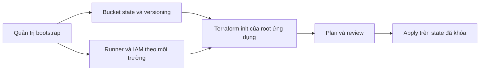
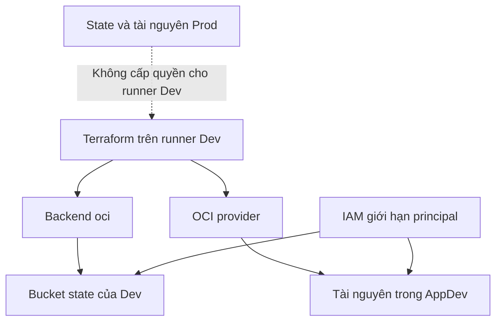

# Quản lý state, khóa truy cập và tách biệt môi trường

Trong chương **Hạ tầng dưới dạng mã** của module `CLOUD_PROVIDERS_ORACLE`, bài học này hướng dẫn tổ chức Terraform để nhiều người có thể quản lý hạ tầng OCI mà không ghi đè state của nhau, không làm lộ credential và không vô tình triển khai vào môi trường khác.

Ba phần cần được thiết kế cùng nhau là **state**, **danh tính truy cập** và **ranh giới môi trường**. State đúng nhưng credential có quyền toàn tenancy vẫn có thể gây thay đổi ngoài phạm vi. Credential được giới hạn nhưng hai pipeline cùng ghi vào một state cũng có thể làm sai lệch quản lý tài nguyên.

Ví dụ chính sử dụng Terraform CLI với backend native `oci` trên OCI Object Storage, cùng các runner OCI Compute xác thực bằng instance principal. Phần cuối đối chiếu với OCI Resource Manager. Các cấu hình và lệnh là hướng dẫn thực hành, không hàm ý tài nguyên đã được tạo hay lệnh đã được chạy trong một tenancy cụ thể.

## 1. State lưu gì và vì sao phải quản lý riêng?

Terraform cần liên kết địa chỉ trong cấu hình với tài nguyên ngoài đời thực. Ví dụ:

```text
module.network.oci_core_vcn.this
    ↔ ocid1.vcn.oc1.<region>.<resource-id>
```

State lưu mối liên kết đó cùng các thuộc tính và metadata phục vụ quản lý. Khi lập plan, Terraform phối hợp cấu hình mong muốn, state và thông tin đọc từ provider để xác định thay đổi.

State không phải bản sao mã Terraform, cũng không phải bản backup đầy đủ của hạ tầng hoặc dữ liệu ứng dụng. Chỉ có state sẽ không phục hồi nội dung database, dữ liệu Object Storage hay cấu hình không được Terraform quản lý.

Các thuộc tính có trong state có thể bao gồm:

- OCID của compartment, VCN, Compute, volume và database.
- Địa chỉ IP, endpoint, tag và thông tin phụ thuộc.
- Giá trị đầu ra của root module.
- Một số giá trị nhạy cảm mà resource hoặc data source đã sử dụng và lưu lại.

Vì vậy, state phải được xem là dữ liệu nhạy cảm. Không commit `terraform.tfstate` vào Git, không gửi toàn bộ state qua chat và không dùng một bucket công khai để tiện tải về. Tài liệu [Terraform State](https://developer.hashicorp.com/terraform/language/state) mô tả vai trò của state và cách quản lý bằng công cụ của Terraform.

### 1.1. Sensitive không có nghĩa là không lưu

Ví dụ:

```hcl
variable "database_password" {
  type      = string
  sensitive = true
}
```

`sensitive = true` giúp che giá trị ở những giao diện và ngữ cảnh hiển thị có hỗ trợ. Nó không tự mã hóa state, không xóa giá trị khỏi plan/state và không thay quyền truy cập backend.

Các tính năng ephemeral hoặc write-only có thể tránh lưu một số giá trị trong những ngữ cảnh được hỗ trợ, nhưng còn phụ thuộc phiên bản Terraform và schema của provider/resource. Không chỉ thêm `ephemeral = true` rồi truyền vào mọi thuộc tính thông thường; Terraform có ràng buộc về nơi được sử dụng. Xem [Manage sensitive data](https://developer.hashicorp.com/terraform/language/manage-sensitive-data).

Đọc secret từ OCI Vault bằng một data source rồi truyền vào resource cũng cần kiểm tra nó có bị lưu trong state hay plan không. Vault bảo vệ nguồn secret, còn Terraform có thể tạo thêm bản sao trong quá trình làm việc.

## 2. Phân biệt các loại “khóa”

| Khái niệm | Mục đích | Không thay thế được |
| --- | --- | --- |
| State lock | Ngăn nhiều thao tác xung đột trên cùng state | IAM, code review hoặc phê duyệt thay đổi |
| API signing key | Ký request OCI dưới danh tính IAM user | SSH key, state lock hoặc quyền IAM |
| Customer Secret Key | Credential Access Key/Secret Key cho S3 Compatibility API | API signing key của OCI native API |
| Khóa mã hóa Vault/KMS | Bảo vệ dữ liệu mã hóa ở lớp dịch vụ phù hợp | Quyền đọc state và khả năng giữ bí mật ở máy chạy Terraform |
| `.terraform.lock.hcl` | Ghi lựa chọn phiên bản/checksum provider | Khóa việc chạy plan/apply hoặc bảo vệ state |

API signing key của OCI gồm public/private key dùng ký request; private key cần được giữ bí mật. Nó không phải cặp SSH key đăng nhập máy Compute. Customer Secret Key là loại credential khác dành cho giao diện S3 tương thích. Xem [Required Keys and OCIDs](https://docs.oracle.com/en-us/iaas/Content/API/Concepts/apisigningkey.htm) và [Managing User Credentials](https://docs.oracle.com/en-us/iaas/Content/Identity/Tasks/managingcredentials.htm).

`.terraform.lock.hcl` nên được quản lý trong Git để review việc thay đổi provider. State lock được backend quản lý trong thời gian thao tác. Không xóa dependency lock file để xử lý lỗi “state is locked”. Chi tiết file này nằm trong [Dependency Lock File](https://developer.hashicorp.com/terraform/language/files/dependency-lock).

## 3. Thiết kế ranh giới môi trường trước khi chọn tên state

### 3.1. Một môi trường có nhiều ranh giới

Đối với dịch vụ `orders`, một thiết kế minh họa là:

| Thành phần | Dev | Prod |
| --- | --- | --- |
| Compartment workload | `AppDev` | `AppProd` |
| Compartment lưu state | `StateDev` | `StateProd` |
| Bucket state | `tfstate-orders-dev` | `tfstate-orders-prod` |
| Root module | `live/dev/network` | `live/prod/network` |
| Runner/danh tính | `TfDevRunner` | `TfProdRunner` |
| Khả năng thay đổi prod | Không được cấp | Theo quy trình của prod |

Các tên trên là ví dụ, cần thay bằng tài nguyên thật. Phân chia compartment tạo phạm vi gắn IAM; nó chỉ có hiệu quả khi policy không cấp quyền rộng hơn qua nhóm khác, policy cha hoặc danh tính được dùng chung.

Đường dẫn hoặc tên có chữ `prod` không tự bảo vệ production. Kiểm tra cả backend đích, workspace, credential đang dùng, region, compartment workload và quyền thực tế của principal.

### 3.2. Workspace không phải ranh giới IAM

Terraform CLI workspace cho phép có nhiều state trong cùng working directory/backend. Nó hữu ích cho một số bản sao thử nghiệm có cùng mô hình quyền, nhưng không phải công cụ đủ để tách các môi trường cần credential và quyền khác nhau.

Một người có quyền đọc mọi object trong bucket vẫn có thể đọc state của các workspace khác nếu policy cho phép. Việc đổi `terraform workspace select` cũng không tự đổi quyền OCI. HashiCorp phân tích giới hạn này trong [Manage Workspaces](https://developer.hashicorp.com/terraform/cli/workspaces).

Bài học chọn root module và backend riêng theo môi trường, sử dụng workspace `default` trong mỗi root để giảm nhầm lẫn. Dù vậy, tên `default` không bảo đảm backend đang đúng; pipeline vẫn phải xác định rõ cấu hình khởi tạo.

### 3.3. Chia state theo quyền sở hữu và vòng đời

Không nên gom mọi tài nguyên của tenancy vào một state chỉ vì chúng dùng cùng provider. Cân nhắc tách:

- Nền tảng bootstrap: bucket state, danh tính runner và IAM nền tảng.
- Network dùng chung.
- Hạ tầng ứng dụng.
- Database và tài nguyên có vòng đời, quyền truy cập hoặc yêu cầu phục hồi riêng.

Mỗi state cần có chủ sở hữu và quy trình thay đổi. Tách quá nhỏ cũng tăng số phụ thuộc, thứ tự triển khai và công việc phục hồi. Điểm tách nên theo quyền quản trị, mức ảnh hưởng và vòng đời, không chỉ theo loại resource.

Một tài nguyên thực tế phải có một nguồn quản lý có thẩm quyền. Không để cùng OCID xuất hiện như một managed resource do hai state độc lập cùng sở hữu.

## 4. Chọn nơi lưu state trên OCI

| Phương án | State và khóa được quản lý thế nào? | Phù hợp khi |
| --- | --- | --- |
| Local backend | State nằm trên máy chạy; không giải quyết cộng tác qua nhiều máy | Bài thử đơn lẻ có kiểm soát |
| Terraform CLI + backend `oci` | State trong Object Storage; backend hỗ trợ khóa | Nhóm tự quản runner và pipeline |
| OCI Resource Manager | Dịch vụ quản lý state theo stack và điều phối job | Nhóm muốn dùng quy trình stack/job của OCI |

Backend native `oci` có từ Terraform 1.12 theo hướng dẫn của Oracle. Backend thuộc Terraform CLI, không phải một resource của OCI provider; chỉ nâng provider sẽ không bổ sung backend cho một binary Terraform quá cũ. Oracle hiện hướng dẫn dùng native backend thay cho phương án S3-compatible cũ tại [Using Object Storage for State Files](https://docs.oracle.com/en-us/iaas/Content/dev/terraform/object-storage-state.htm).

Với native backend, không cần tạo Customer Secret Key chỉ để làm theo hướng dẫn S3 cũ. Cơ chế xác thực phải phù hợp với backend và phiên bản đang dùng.

### 4.1. Bootstrap không được phụ thuộc vòng tròn

Bucket, policy và danh tính dùng để truy cập backend phải tồn tại trước khi root ứng dụng chạy `terraform init` với backend đó.



Có thể bootstrap bằng một quy trình quản trị riêng hoặc một root riêng với nơi lưu state được chuẩn bị độc lập. Không để một lần destroy ứng dụng có thể xóa luôn bucket đang chứa state của nó và các quyền cần để phục hồi.

### 4.2. Bảo vệ bucket state

Với phương án Object Storage:

1. Tạo bucket private, dành cho state trong phạm vi đã thiết kế.
2. Bật object versioning để có lịch sử phục hồi.
3. Chỉ cấp quyền truy cập cho runner, người vận hành và vai trò phục hồi phù hợp.
4. Thiết kế mã hóa, lifecycle, theo dõi truy cập và đường mạng.
5. Xác nhận cơ chế tạo, đọc, ghi đè và xóa lock object hoạt động.

Versioning giữ các phiên bản object, bao gồm lịch sử thay đổi và delete marker; nó không thay state locking. Oracle không cho kết hợp active retention rules với bucket đang bật versioning. Không bật retention bất biến trên bucket state đang hoạt động rồi kỳ vọng mọi thao tác ghi/xóa khóa vẫn thực hiện được. Xem [Object Storage Versioning](https://docs.oracle.com/en-us/iaas/Content/Object/Tasks/usingversioning.htm).

Khi cần bản lưu trữ bất biến, thiết kế một luồng backup riêng, xét cả giới hạn tính năng và quyền đọc bản sao. Không dùng bucket archival hoặc replica chỉ đọc làm backend ghi mà chưa kiểm tra khả năng hỗ trợ.

## 5. Cấu hình backend và root module theo môi trường

### 5.1. Cấu trúc minh họa

```text
iac/
├── modules/
│   └── network/
│       └── main.tf
└── live/
    ├── dev/
    │   └── network/
    │       ├── main.tf
    │       ├── backend.hcl
    │       ├── environment.tfvars
    │       └── .terraform.lock.hcl
    └── prod/
        └── network/
            ├── main.tf
            ├── backend.hcl
            ├── environment.tfvars
            └── .terraform.lock.hcl
```

Các root dùng chung module nhưng có backend và input riêng. `.terraform.lock.hcl` do Terraform tạo và được review/commit; không cần tự viết nội dung file này theo một mẫu giả.

### 5.2. Root module

Nội dung dưới đây dùng cho `main.tf` của mỗi root môi trường:

```hcl
terraform {
  required_version = ">= 1.12.0, < 2.0.0"

  required_providers {
    oci = {
      source  = "oracle/oci"
      version = "~> 7.0"
    }
  }

  backend "oci" {}
}

provider "oci" {
  auth   = "InstancePrincipal"
  region = var.region
}

variable "region" {
  type = string
}

variable "compartment_ocid" {
  type = string
}

variable "environment" {
  type = string

  validation {
    condition     = contains(["dev", "stage", "prod"], var.environment)
    error_message = "environment phải là dev, stage hoặc prod."
  }
}

variable "vcn_cidr" {
  type = string
}

module "network" {
  source = "../../../modules/network"

  compartment_ocid = var.compartment_ocid
  environment      = var.environment
  vcn_cidr         = var.vcn_cidr
}

output "vcn_id" {
  value = module.network.vcn_id
}
```

Dòng provider 7.x là phạm vi minh họa, không phải tuyên bố đó là phiên bản mới nhất hay phù hợp cho mọi dự án. CI cần dùng phiên bản Terraform đã được chọn, cùng provider cụ thể được ghi trong lock file. Module ngoài repository cũng cần có cách ghim phiên bản riêng; dependency lock file không khóa mọi nguồn module.

Provider lấy danh tính từ Compute instance đang chạy runner. Backend cũng phải có cấu hình xác thực của nó; provider block không tự truyền credential sang backend.

### 5.3. Module network tối thiểu

Trong `modules/network/main.tf`:

```hcl
terraform {
  required_providers {
    oci = {
      source = "oracle/oci"
    }
  }
}

variable "compartment_ocid" {
  type = string
}

variable "environment" {
  type = string
}

variable "vcn_cidr" {
  type = string
}

resource "oci_core_vcn" "this" {
  compartment_id = var.compartment_ocid
  display_name   = format("orders-%s-vcn", var.environment)
  cidr_blocks    = [var.vcn_cidr]

  freeform_tags = {
    environment = var.environment
    managed_by  = "terraform"
  }
}

output "vcn_id" {
  value = oci_core_vcn.this.id
}
```

VCN chỉ là tài nguyên nhỏ để quan sát state; đây chưa phải kiến trúc mạng đầy đủ cho ứng dụng hay database. Các tham số resource được mô tả tại [oci_core_vcn](https://docs.oracle.com/en-us/iaas/tools/terraform-provider-oci/latest/docs/r/core_vcn.html).

### 5.4. Cấu hình backend không chứa private key

`live/dev/network/backend.hcl`:

```hcl
bucket    = "tfstate-orders-dev"
namespace = "<OBJECT_STORAGE_NAMESPACE>"
region    = "ap-singapore-1"
key       = "network/terraform.tfstate"
auth      = "InstancePrincipal"
```

`live/prod/network/backend.hcl`:

```hcl
bucket    = "tfstate-orders-prod"
namespace = "<OBJECT_STORAGE_NAMESPACE>"
region    = "ap-singapore-1"
key       = "network/terraform.tfstate"
auth      = "InstancePrincipal"
```

Thay namespace bằng giá trị thật của Object Storage, không dùng tên compartment thay vào. Region ở đây là region của backend bucket; nó là cấu hình độc lập với region provider dùng triển khai resource.

File backend partial chứa thuộc tính trực tiếp, không bọc thêm `terraform` hoặc `backend`. Backend được khởi tạo sớm, nên không viết `bucket = var.state_bucket` hoặc tham chiếu output resource trong backend block. Xem [Backend block configuration](https://developer.hashicorp.com/terraform/language/backend).

Trong backend native `oci`, `key` là tên object state. Dấu `/` giúp tổ chức tên object, không tự tạo một compartment hay ranh giới quyền mới. Với workspace `default`, state ở key đã chỉ định; workspace khác có cách tạo đường dẫn riêng theo `workspace_key_prefix`. Chi tiết nằm trong [OCI backend](https://developer.hashicorp.com/terraform/language/backend/oci).

### 5.5. Input môi trường

Ví dụ `live/dev/network/environment.tfvars`:

```hcl
region           = "ap-singapore-1"
compartment_ocid = "<APP_DEV_COMPARTMENT_OCID>"
environment      = "dev"
vcn_cidr         = "10.20.0.0/16"
```

Prod dùng compartment riêng, `environment = "prod"` và một CIDR phù hợp với sơ đồ địa chỉ đã được phê duyệt, chẳng hạn `10.30.0.0/16` trong mô hình thử nghiệm. Không tự tái sử dụng CIDR khi các mạng cần kết nối với nhau.

Các input trên không chứa credential. Có thể quản lý chúng theo chính sách repository của nhóm. Việc validation chấp nhận chữ `dev` hay `prod` chỉ kiểm tra giá trị đầu vào; nó không chứng minh input đó khớp với đường dẫn root, bucket hay danh tính runner.

## 6. Tách quyền backend khỏi quyền tạo hạ tầng

### 6.1. Hai kênh truy cập khác nhau



Có thể xác thực backend thành công nhưng provider bị từ chối khi tạo VCN. Cũng có thể provider đọc được tài nguyên nhưng backend không tạo/xóa được lock object. Đây là hai nhóm quyền cần chẩn đoán riêng.

Trong ví dụ, cả hai kênh dùng cùng instance principal của runner theo môi trường, nhưng policy cấp hai phạm vi nhiệm vụ khác nhau. Một thiết kế khác có thể dùng danh tính riêng cho mỗi kênh nếu công cụ và quy trình hỗ trợ; không được suy ra rằng provider block quyết định toàn bộ quyền backend.

### 6.2. Policy minh họa cho runner dev

Giả sử dynamic group `TfDevRunner` chỉ bao gồm instance runner dev và thuộc identity domain mặc định. Quản trị viên có thể đặt các policy có phạm vi bao phủ đúng hai compartment:

```text
Allow dynamic-group TfDevRunner to read buckets in compartment StateDev where target.bucket.name = 'tfstate-orders-dev'

Allow dynamic-group TfDevRunner to manage objects in compartment StateDev where all {target.bucket.name = 'tfstate-orders-dev', request.operation != 'DeleteObjectVersion'}

Allow dynamic-group TfDevRunner to manage virtual-network-family in compartment AppDev
```

Đây là policy minh họa cho root network trong bài. Quyền `manage virtual-network-family` có phạm vi rộng trong nhóm tài nguyên mạng của `AppDev`, không được gọi là quyền tối thiểu tuyệt đối cho mọi tổ chức. Khi áp dụng thật, thu hẹp theo các thao tác cần dùng và kiểm tra những phụ thuộc như tag hoặc KMS.

Backend cần đủ khả năng đọc state, tạo/ghi đè state và xử lý lock object. Quyền chỉ `read objects` không đủ cho writer. Dòng object policy loại thao tác xóa vĩnh viễn phiên bản; vai trò phục hồi riêng có thể cần các quyền khác theo quy trình quản trị.

Ví dụ điều kiện `target.bucket.name` và các quyền object nằm trong [Object Storage policy reference](https://docs.oracle.com/en-us/iaas/Content/Identity/policyreference/objectstoragepolicyreference.htm). Kiểm tra cả các policy khác: một điều kiện hạn chế trong policy này không loại bỏ quyền rộng mà principal đã được cấp từ nơi khác.

Không dùng một rule dynamic group rộng đến mức runner dev và prod đều trở thành thành viên của nhóm có quyền prod. Người được sửa membership, tag liên quan hoặc cấu hình runner cũng có thể ảnh hưởng đến phạm vi quyền thực tế.

### 6.3. Bảo vệ chính runner

Instance principal bỏ nhu cầu phân phối private key dài hạn của một IAM user vào runner. Nó không làm cho mã chạy trên runner trở nên đáng tin cậy một cách tự động.

Ai có khả năng chạy mã trên instance đó có thể sử dụng quyền của instance trong các điều kiện truy cập tương ứng. Vì thế, runner prod cần được tách khỏi job thử nghiệm, PR không tin cậy và shell dùng chung. Xem [Calling Services from an Instance](https://docs.oracle.com/en-us/iaas/Content/Identity/Tasks/callingservicesfrominstances.htm).

Không chỉ bảo vệ bước `apply`. Một cấu hình Terraform không tin cậy có thể được thực thi trong những bước liên quan tới provider hoặc data source, và `plan` có thể đọc nhiều thông tin nhạy cảm. Không cấp credential prod cho job kiểm tra mã từ nguồn chưa được tin cậy.

## 7. Khóa state và xử lý thao tác đồng thời

### 7.1. Backend native OCI khóa ra sao?

Backend `oci` sử dụng một lock object trong cùng bucket, dựa trên cơ chế tạo object có điều kiện của Object Storage. Với key ví dụ, tên lock tương ứng là:

```text
State: network/terraform.tfstate
Lock:  network/terraform.tfstate.lock
```

Khóa áp dụng cho state cụ thể mà backend đang truy cập. Nó không phải khóa toàn tenancy, không khóa mọi root module và không ngăn người khác sửa tài nguyên từ Console hoặc một state khác.

Các backend không có cùng khả năng locking. Không suy luận cơ chế khóa native OCI sang một cấu hình S3-compatible cũ hoặc backend khác. Nguyên tắc chung được mô tả trong [State Locking](https://developer.hashicorp.com/terraform/language/state/locking).

### 7.2. Chờ khóa thay vì bỏ khóa

Ví dụ lập plan với thời gian chờ lấy khóa:

```bash
terraform -chdir=live/dev/network plan \
  -lock-timeout=5m \
  -var-file=environment.tfvars \
  -out=network.tfplan
```

`-lock-timeout=5m` là thời gian chờ lấy state lock, không phải deadline tổng của quá trình triển khai. Nếu có job hợp lệ đang giữ khóa, hãy đợi hoặc điều phối lại.

Không dùng `-lock=false` như cách xử lý thông thường khi pipeline báo xung đột. Backend lock và concurrency control của CI bổ sung cho nhau: CI giảm các job tranh nhau, backend vẫn bảo vệ trước các client khác cùng truy cập.

### 7.3. Stale lock cần được xác minh

Sau khi runner chết, có thể còn lock chưa được giải phóng. Trước khi gỡ:

1. Đọc thông tin lock ID, operation, thời điểm và chủ thể liên quan.
2. Xác minh job cũ đã kết thúc, không còn tiến trình hay thao tác đang chạy.
3. Xác định đúng root, bucket, key và workspace.
4. Dừng khả năng có job mới tham gia trong lúc xử lý.
5. Dùng cơ chế unlock được backend hỗ trợ rồi lập plan mới.

Lệnh theo cơ chế của Terraform:

```bash
terraform -chdir=live/dev/network force-unlock <LOCK_ID>
```

Chỉ dùng với khóa đã xác nhận cần giải phóng theo quy trình của nhóm. Không đoán lock ID, không xóa object có tên giống state và không gỡ khóa của một job vẫn còn hoạt động. Tham khảo [force-unlock](https://developer.hashicorp.com/terraform/cli/commands/force-unlock).

Lock ID, object ETag/version ID và state `serial` là những định danh khác nhau. Không dùng chúng thay thế cho nhau.

### 7.4. Plan và apply không giữ một khóa xuyên suốt thời gian review

Sau khi `plan` kết thúc, không nên giả định backend còn giữ lock đến lúc một người review xong và chạy `apply`. Trong khoảng đó có thể có job khác thay đổi state hoặc có thay đổi ngoài Terraform.

Saved plan giúp apply đúng artifact đã được review, nhưng khi state thay đổi làm plan không còn hợp lệ, cần tạo plan mới. Không ép dùng một plan cũ để giữ quy trình hình thức; Terraform không phải giao dịch phân tán bao trùm toàn bộ khoảng review và mọi thay đổi trên OCI.

## 8. Quản lý credential theo nơi chạy Terraform

### 8.1. Chọn cơ chế danh tính phù hợp

| Nơi chạy | Phương án cần xem xét | Điểm phải kiểm soát |
| --- | --- | --- |
| Runner trên OCI Compute | Instance principal | Dynamic group, IAM và ai được chạy mã trên runner |
| Máy cá nhân | OCI profile với cơ chế xác thực được hỗ trợ | Credential riêng theo người/môi trường và quyền file |
| Runtime có resource principal | Cơ chế resource principal phù hợp | Runtime thực sự hỗ trợ và policy của principal đó |
| OKE hoặc hệ thống CI khác | Cơ chế workload identity/federation được hỗ trợ bởi các thành phần đang dùng | Không giả định backend và provider hỗ trợ giống nhau |

Backend và provider có thể dùng các thư viện hoặc lịch cập nhật khác nhau. Một cơ chế xác thực hoạt động với provider chưa đủ để kết luận nó hoạt động với backend của binary Terraform đang cài. Xem [Configuring the OCI Provider](https://docs.oracle.com/en-us/iaas/Content/dev/terraform/configuring.htm) và đối chiếu tài liệu backend.

### 8.2. Khi cần API signing key trên máy cá nhân

Một OCI config profile minh họa:

```ini
[TF_DEV]
tenancy=ocid1.tenancy.oc1..<TENANCY_ID>
user=ocid1.user.oc1..<USER_ID>
fingerprint=<PUBLIC_KEY_FINGERPRINT>
key_file=/secure/oci/tf-dev-api-key.pem
region=ap-singapore-1
```

Các giá trị là placeholder. Private key nằm trong file được bảo vệ, không chép vào HCL, tfvars, Git hay artifact của pipeline.

Nếu chuyển ví dụ sang profile này, phải thay cách xác thực của cả hai kênh. Ví dụ provider:

```hcl
provider "oci" {
  auth                = "APIKey"
  config_file_profile = "TF_DEV"
  region              = var.region
}
```

Trong backend partial tương ứng, thay `auth` bằng `"APIKey"` và đặt `config_file_profile = "TF_DEV"`. Vẫn giữ bucket, namespace, key và region đúng môi trường; profile chỉ có ý nghĩa nếu config và các credential cần thiết đã được cung cấp cho công cụ.

Dùng profile mặc định tiện lợi nhưng dễ khiến một terminal dev vô tình mang quyền rộng hơn dự định. Việc đặt profile tên `TF_DEV` cũng không làm thay đổi quyền của IAM user bên trong nó.

Trên Linux, hạn chế quyền đọc file cho tài khoản cần dùng; trên Windows, dùng ACL tương ứng. Không đặt key trong image dùng chung hoặc lưu lâu trên workspace của một runner không tin cậy.

### 8.3. Xoay vòng và thu hồi credential

Một quy trình API key có thể gồm:

1. Tạo cặp key mới bằng quy trình quản trị đã chọn.
2. Đăng ký public key, cập nhật credential ở đúng nơi chạy.
3. Kiểm tra truy cập backend và provider bằng key mới.
4. Xác nhận không còn job đang phụ thuộc key cũ.
5. Thu hồi key cũ và kiểm tra các bản sao đã được xử lý.

Đổi API key nhưng giữ nguyên IAM user không tự giảm quyền của user đó. Khi nghi ngờ lộ key, cần đánh giá cả hoạt động đã thực hiện, quyền hiện tại, artifact và các secret mà danh tính có thể đọc.

Instance principal tránh một nhóm key dài hạn được phát thủ công, nhưng quyền IAM và quyền truy cập runner vẫn cần thu hồi khi có sự cố. Khóa mã hóa KMS có vòng đời khác: không xóa hoặc vô hiệu hóa chỉ vì muốn xoay vòng credential của Terraform.

## 9. Bảo vệ mã nguồn, cache, plan và log

### 9.1. Phân loại các file

| File hoặc dữ liệu | Cách quản lý trong ví dụ |
| --- | --- |
| HCL, module, input không chứa secret | Review và quản lý phiên bản |
| `backend.hcl` chỉ chứa tham chiếu không nhạy cảm | Có thể quản lý theo chính sách repository |
| `.terraform.lock.hcl` | Commit và review thay đổi |
| `.terraform/` | Không commit; không tái sử dụng mù quáng giữa môi trường |
| State, backup state, emergency state | Lưu có kiểm soát, mã hóa và hạn chế truy cập |
| Saved plan | Artifact nhạy cảm, gắn với commit/root/môi trường và thời gian hiệu lực |
| Private key, token, tfvars chứa secret | Cấp qua cơ chế bí mật phù hợp, không commit |
| Log debug, JSON plan/state | Kiểm soát như dữ liệu có thể chứa secret |

Ví dụ các mục cần loại khỏi Git:

```gitignore
.terraform/
*.tfstate
*.tfstate.*
*.tfplan
*.pem
*.key
*.secret.tfvars
*.secret.tfvars.json
crash.log
crash.*.log
```

Không thêm `.terraform.lock.hcl` vào danh sách ignore này. Những file tfvars không bị ignore vẫn phải được review để không chứa secret; `.gitignore` không phải bộ quét secret và không xóa dữ liệu đã có trong lịch sử Git.

### 9.2. Backend metadata cũng cần được bảo vệ

Terraform lưu cấu hình backend đã khởi tạo trong `.terraform/`, tách với remote state thật. Nếu đưa credential trực tiếp vào backend block hoặc truyền plaintext qua `-backend-config`, dữ liệu nhạy cảm có thể đi vào backend metadata và saved plan.

Trong bài, `backend.hcl` chỉ chứa vị trí state và chế độ xác thực. Việc dùng file partial không làm mọi nội dung của file đó trở nên bí mật hoặc tự an toàn. Hướng dẫn [Backend credentials and sensitive data](https://developer.hashicorp.com/terraform/language/backend) giải thích phạm vi lưu trữ này.

CI nên bắt đầu từ working directory sạch theo root/environment. Nếu cache provider package để giảm thời gian tải, không vì vậy mà dùng chung toàn bộ `.terraform/` giữa dev và prod. Backend cũ trong cache có thể trỏ job đến state không mong muốn.

### 9.3. Plan là artifact có quyền lực

Saved plan có thể chứa cấu hình, state trước đó và giá trị nhạy cảm. `terraform show -json` không phải bản đã được che secret để công khai; tài liệu [terraform show](https://developer.hashicorp.com/terraform/cli/commands/show) nêu rõ dữ liệu sensitive có thể hiện ở dạng plaintext.

Gắn artifact plan với:

- Commit và phiên bản toolchain/provider.
- Root module, môi trường, backend và workspace.
- Bộ input dùng lập plan.
- Kết quả review và danh tính được phép apply.
- Khoảng thời gian sử dụng mà nhóm chấp nhận.

Chỉ người có quyền thay đổi môi trường đích mới được đưa artifact vào bước apply. Không cho phép chọn một file plan tùy ý từ job khác rồi chạy bằng credential prod.

Log debug của Terraform/provider, shell tracing hoặc bước in toàn bộ environment có thể làm lộ credential. Chỉ bật mức chẩn đoán cần thiết, hạn chế nơi lưu và xử lý dữ liệu trước khi chia sẻ.

## 10. Luồng vận hành từ init tới apply

### 10.1. Khởi tạo trên runner dev

Sau khi thay placeholder và chuẩn bị bucket/IAM, chạy trong một checkout sạch:

```bash
terraform version

terraform -chdir=live/dev/network init \
  -backend-config=backend.hcl

terraform -chdir=live/dev/network validate

terraform -chdir=live/dev/network workspace show
```

`validate` kiểm tra cấu hình theo phạm vi công cụ hỗ trợ, không chứng minh credential có đúng quyền hoặc backend đang là môi trường mong muốn. Kết quả workspace dự kiến trong thiết kế này là `default`; kiểm tra thêm bucket, key, region và compartment.

Khởi tạo lần đầu sẽ chọn provider đáp ứng constraint và tạo dependency lock file. Review/commit lựa chọn đó. Trong các job cần giữ nguyên lock file đã được review, có thể dùng `terraform init -lockfile=readonly` cùng các tham số backend phù hợp; nâng dependency phải đi qua một thay đổi riêng có chủ đích.

### 10.2. Lập và review plan

```bash
terraform -chdir=live/dev/network plan \
  -lock-timeout=5m \
  -var-file=environment.tfvars \
  -out=network.tfplan

terraform -chdir=live/dev/network show \
  -no-color \
  network.tfplan
```

Review không chỉ tổng số resource. Kiểm tra compartment, region, thao tác replace/delete, CIDR và những tài nguyên ngoài phạm vi dự kiến. Nếu một root đã quản lý tài nguyên mà bỗng plan tạo lại tất cả, cần điều tra backend/key/workspace trước khi apply.

Plan có thể đọc dữ liệu thật và cần những quyền tương ứng. Không chạy với quyền prod trên cấu hình từ PR không tin cậy chỉ vì bước này không có tên `apply`.

### 10.3. Apply đúng saved plan đã được chấp thuận

Sau khi hoàn tất review và các điều kiện của môi trường:

```bash
terraform -chdir=live/dev/network apply \
  -lock-timeout=5m \
  network.tfplan
```

Khi truyền saved plan, Terraform thực hiện plan đó mà không hỏi xác nhận tương tác như luồng tự lập plan. Bước phê duyệt cần nằm trước lệnh này trong quy trình của nhóm. Không thêm input hay planning option khác để âm thầm thay nội dung của saved plan. Xem [terraform apply](https://developer.hashicorp.com/terraform/cli/commands/apply).

Promote sang prod là sử dụng cùng phiên bản mã/module đã được chọn, rồi tạo **plan riêng của prod** bằng input, state và quyền prod. Không apply plan của dev lên prod và không sao chép state dev để “promote”.

### 10.4. Điều phối concurrency theo state

Khóa điều phối CI nên gắn với danh tính state thực tế, ví dụ:

```text
tenancy + backend-region + bucket + key + workspace
```

Hai repository hoặc hai pipeline có thể vẫn trỏ cùng state. Chỉ khóa theo branch hoặc tên job sẽ không bảo vệ được trường hợp đó.

Không tự động hủy một apply đang chạy chỉ vì có commit mới. Việc ngắt tiến trình có thể để lại tài nguyên đã tạo một phần, lock chưa giải phóng hoặc lỗi ghi state. Job mới cần biết kết quả job trước, đọc state hiện tại và lập plan phù hợp.

## 11. Chia sẻ dữ liệu giữa các state

Network state có thể cần cung cấp VCN/subnet OCID cho application state. Có thể dùng output có hợp đồng rõ ràng, đầu vào do pipeline truyền, hoặc data source đọc tài nguyên với quyền phù hợp.

`terraform_remote_state` chỉ đưa root outputs vào biểu thức Terraform, nhưng người dùng nó vẫn cần quyền truy cập snapshot state đầy đủ theo cơ chế backend. Vì vậy, không cấp quyền đọc database state chỉ để lấy một endpoint rồi coi các giá trị khác đã được giấu. Xem [terraform_remote_state](https://developer.hashicorp.com/terraform/language/state/remote-state-data).

Nếu dữ liệu chia sẻ không nhạy cảm, có thể công bố riêng một tập thuộc tính nhỏ theo cơ chế được nhóm quản lý. Nếu cần đọc OCI API, dùng principal chỉ có quyền đọc tài nguyên cần thiết. Cả hai cách vẫn cần xử lý thứ tự triển khai, phiên bản hợp đồng và thay đổi OCID khi resource bị thay thế.

Tránh phụ thuộc vòng tròn giữa nhiều state. State lock không tạo một giao dịch chung cho network, ứng dụng và database nếu chúng thuộc ba backend khác nhau.

## 12. Sao lưu, migration và khôi phục state

### 12.1. Sao lưu cần gồm cả khả năng đọc lại

Object versioning giúp giữ lịch sử nhưng không tự tạo một quy trình phục hồi hoàn chỉnh. Cần biết:

- Bucket/key/workspace nào là nguồn có thẩm quyền.
- Phiên bản object nào tương ứng lần apply hoặc migration nào.
- Ai có quyền đọc và phục hồi snapshot.
- Bản sao được bảo vệ bằng cơ chế mã hóa nào.
- Mục tiêu RPO/RTO và nơi có thể phục hồi khi region hoặc danh tính gặp sự cố.

Object Storage mã hóa dữ liệu lưu trữ theo cơ chế dịch vụ; có thể dùng khóa do Oracle quản lý hoặc Vault key theo thiết kế. Người có quyền đọc hợp lệ vẫn nhận được nội dung để sử dụng, nên mã hóa at rest không thay IAM. Xem [Object Storage Data Encryption](https://docs.oracle.com/en-us/iaas/Content/Object/Tasks/encryption.htm).

Nếu dùng customer-managed key, phục hồi state còn phụ thuộc vào khả năng truy cập và sử dụng key đó. Có một bản sao object nhưng không có khả năng giải mã chưa phải backup sử dụng được.

Một bản xuất bằng CLI có thể thực hiện trong môi trường backup được bảo vệ:

```bash
umask 077

terraform -chdir=live/dev/network state pull \
  > /secure-backups/dev-network-before-migration.tfstate
```

Thư mục phải tồn tại và được bảo vệ phù hợp; `umask` chỉ kiểm soát quyền file mặc định trên hệ thống hỗ trợ, không tự mã hóa nội dung. Không đưa file xuất vào artifact công khai hoặc để lại trên runner dùng chung.

### 12.2. Migration backend không phải đổi môi trường

Khi chuyển cùng một state từ local backend hoặc backend cũ sang backend mới:

1. Tạm dừng các writer ở cả nguồn và đích dự kiến.
2. Xác minh root/workspace, tài nguyên đang được quản lý và snapshot nguồn.
3. Sao lưu state và cấu hình backend cũ theo quy trình.
4. Chuẩn bị bucket, IAM và cấu hình backend mới.
5. Dùng cơ chế migration của Terraform và đọc kỹ đích được công cụ xác nhận.
6. Xác minh state tại đích rồi lập plan để đối chiếu với hạ tầng thật.
7. Chỉ mở lại một đường ghi có thẩm quyền; xử lý nguồn cũ theo chính sách lưu trữ.

Khi cấu hình đã được chuyển sang backend đích phù hợp, lệnh migration có dạng:

```bash
terraform -chdir=live/dev/network init \
  -migrate-state \
  -backend-config=backend.hcl
```

`-migrate-state` dùng để chuyển state giữa các cấu hình backend theo ngữ cảnh đã khởi tạo. `-reconfigure` yêu cầu bỏ qua cấu hình backend lưu cục bộ và khởi tạo lại, không thực hiện migration state. Không dùng hai ý nghĩa này thay cho nhau; xem [terraform init](https://developer.hashicorp.com/terraform/cli/commands/init).

Đổi `key` hoặc bucket rồi dùng một state rỗng có thể khiến Terraform lên kế hoạch tạo lại tài nguyên đang tồn tại. Đó không phải migration thành công.

Nếu có nhiều CLI workspace, phải kiểm kê tất cả state cần chuyển và cách backend đặt key cho chúng. Đừng chỉ xác minh workspace hiện hành rồi kết luận toàn bộ hệ thống đã được chuyển.

### 12.3. Khôi phục snapshot không rollback OCI

Một snapshot state cũ phản ánh thông tin quản lý ở thời điểm cũ. Nó không tự đưa VCN, Compute hay database về cấu hình cũ, cũng không phục hồi dữ liệu ứng dụng.

Trước khi khôi phục:

- Dừng writer và lưu lại snapshot hiện tại nếu có thể.
- Xác định sự cố là mất state, state sai hay hạ tầng đã thay đổi một phần.
- Chọn snapshot có nguồn gốc rõ ràng và đối chiếu với lịch sử job/tài nguyên.
- Kiểm tra `lineage` và `serial` của state.
- Lập phương án hòa giải giữa snapshot và trạng thái OCI thực tế.

`lineage` xác định dòng state, còn `serial` là metadata về tiến triển snapshot; không phải mã phiên bản object của Object Storage. `terraform state push` có kiểm tra lineage và serial để tránh ghi đè không an toàn. Không sửa tay các giá trị này hoặc dùng `-force` như bước phục hồi mặc định. Xem [terraform state push](https://developer.hashicorp.com/terraform/cli/commands/state/push).

Nếu kiểm tra chặn việc đưa snapshot vào backend, cần điều tra và áp dụng quy trình phục hồi phù hợp, thay vì mặc nhiên coi đó là lỗi của công cụ. Sau phục hồi, phải xem plan và đối chiếu OCI trước khi cho phép thay đổi tiếp.

### 12.4. Apply lỗi giữa chừng

Terraform không cung cấp rollback nguyên tử cho mọi thao tác OCI. Một lần apply có thể đã tạo hoặc đổi một số resource trước khi thất bại.

Nếu lỗi ghi state lên backend, công cụ có thể để lại state phục hồi cục bộ. Bảo vệ file đó và điều tra trước khi chạy lại; xem [State Storage and Locking](https://developer.hashicorp.com/terraform/language/state/backends).

Không giả định “job failed” nghĩa là “không có tài nguyên nào thay đổi”. Cần kiểm tra state, log, OCID và các operation/work request đang còn xử lý. Nếu cần import tài nguyên đã tồn tại, thực hiện theo quy trình để tránh cùng một tài nguyên do hai state sở hữu.

## 13. Đối chiếu với OCI Resource Manager

Resource Manager quản lý Terraform state theo stack và khóa state để chỉ một job chạy tại một thời điểm trên cùng stack. Nhóm không phải tự duy trì bucket backend ứng dụng theo mô hình CLI ở trên để nhận được khả năng quản lý state của stack. Xem [Overview of Resource Manager](https://docs.oracle.com/en-us/iaas/Content/ResourceManager/Concepts/resourcemanager.htm).

Những nguyên tắc vẫn giữ nguyên:

| Vấn đề | Cách áp dụng khi dùng Resource Manager |
| --- | --- |
| Tách môi trường | Stack, input và quyền theo môi trường |
| Quyền điều khiển | Ai được sửa stack, tạo/apply job và tải state |
| Quyền hạ tầng | Danh tính/cơ chế thực thi chỉ được thao tác tài nguyên cần thiết |
| Artifact nhạy cảm | State, biến, cấu hình, output và log job được bảo vệ |
| Khôi phục | Có lịch sử job/state và quy trình đối chiếu với OCI |
| Quyền sở hữu | Không có CLI khác cùng quản lý độc lập những resource đó |

Dùng cấu hình Terraform phù hợp với quy ước và phiên bản được Resource Manager hỗ trợ. Ví dụ backend `oci` của bài là cho đường chạy CLI; không sao chép nguyên mọi cấu hình backend vào stack mà chưa xem yêu cầu của dịch vụ.

Việc một người được tạo plan job không tự có nghĩa người đó được apply prod hoặc tải snapshot state. Phân quyền theo nhiệm vụ thực tế và kiểm tra các quyền quản trị kế thừa. Tài liệu [Managing Stacks and Jobs](https://docs.oracle.com/en-us/iaas/Content/ResourceManager/Tasks/managingstacksandjobs.htm) liệt kê các thao tác và yêu cầu IAM liên quan.

Không vừa dùng state do Resource Manager quản lý vừa cho một pipeline CLI riêng tiếp tục ghi state khác cho cùng tài nguyên. Khi chuyển mô hình thực thi, cần một kế hoạch chuyển quyền sở hữu, state và thời điểm dừng writer cũ.

## 14. Thực hành kiểm chứng thiết kế

### Bước 1: Chuẩn bị phạm vi thử nghiệm

Tạo các compartment, bucket private có versioning và runner theo phương án bootstrap. Dùng principal chỉ có quyền trong phạm vi thực hành. Ghi lại namespace, region, bucket, key và workspace dự kiến cho từng root.

### Bước 2: Kiểm tra khởi tạo và plan

Thay placeholder trong ví dụ, chọn toolchain/provider được nhóm sử dụng, rồi init và validate. Lập plan dev, kiểm tra VCN sẽ được tạo trong `AppDev` và không có thao tác prod.

Chỉ apply khi kế hoạch đã được review theo quy trình của môi trường thử nghiệm. Sau apply, đối chiếu output OCID, state trong backend và tài nguyên thật.

### Bước 3: Kiểm tra ranh giới quyền

Từ runner dev, thử khả năng truy cập một mục state thử nghiệm ở phạm vi được thiết kế như prod và xác nhận quyền đọc/ghi tương ứng bị từ chối. Việc kiểm thử không được thực hiện bằng cách ghi đè state prod thật.

Kiểm tra cả quyền backend lẫn workload: không đọc được bucket prod nhưng vẫn có quyền sửa tài nguyên `AppProd` thì thiết kế vẫn chưa tách môi trường đúng.

### Bước 4: Kiểm tra điều phối và khóa

Cho hai job thử nghiệm có thao tác hợp lệ trên cùng state với thời gian chồng lấn đủ để quan sát khóa. Xác nhận job thứ hai chờ hoặc thất bại có kiểm soát, thay vì vượt khóa. Không tạo lock object giả và không dùng thao tác phá hủy chỉ để kéo dài job.

Nếu mô phỏng runner bị dừng, quan sát cả lock còn lại và trạng thái resource trước khi thực hành quy trình stale lock. Không diễn tập force-unlock trên một apply prod đang chạy.

### Bước 5: Diễn tập phục hồi riêng

Xuất snapshot thử nghiệm, xác minh nơi lưu và quyền truy cập, rồi diễn tập ở một phạm vi được kiểm soát. Ghi lại snapshot nguồn, key đích, thao tác cần thiết và thời gian phục hồi.

Mục tiêu là biết đọc lại và đối chiếu state, không chỉ chứng minh bucket có nhiều version. Không tạo hai bộ state cùng được phép apply lên một tài nguyên thật sau buổi diễn tập.

### Bước 6: Ghi lại kết quả

Kết quả thực hành cần có:

- Bản đồ root → backend → principal → compartment workload.
- Provider/toolchain đã dùng và trạng thái dependency lock file.
- Bằng chứng tách quyền dev/prod.
- Kết quả quan sát state lock và cách xử lý khi có xung đột.
- Quy trình backup, migration, khôi phục và người chịu trách nhiệm.

Đây là nội dung người học cần thực hiện trong môi trường riêng, không phải báo cáo rằng các kiểm chứng OCI đã được chạy khi soạn tài liệu.

## 15. Chẩn đoán lỗi thường gặp

| Hiện tượng | Hướng kiểm tra |
| --- | --- |
| Không nhận diện backend `oci` | Binary Terraform có hỗ trợ native backend không; nâng provider không thay Terraform CLI |
| Init thành công nhưng plan tạo lại mọi thứ | Bucket/key/workspace, cache backend và việc state có thực sự được migrate |
| Provider hoạt động nhưng backend lỗi | Xác thực backend và quyền Object Storage riêng |
| Backend đọc được nhưng không lấy/giải phóng khóa | Quyền tạo/xóa object, retention hoặc job đang giữ khóa |
| Lỗi `NotAuthorizedOrNotFound` | Cả quyền lẫn namespace/bucket/region/tài nguyên thực tế |
| State luôn bị báo locked | Job có thật sự còn chạy, CI có trỏ cùng state và lock có stale không |
| `.terraform.lock.hcl` thay đổi ngoài dự kiến | Phiên bản provider được chọn, thao tác upgrade và các constraint |
| Workspace là dev nhưng tài nguyên vào prod | Credential, compartment input và backend; tên workspace không quyết định IAM |
| Secret lộ trong JSON plan/output | Phạm vi hiển thị sensitive, artifact/log và quyền truy cập |
| Không xóa vĩnh viễn version bằng runner | Chính sách chặn `DeleteObjectVersion` có thể là thiết kế có chủ đích |
| Không đọc được snapshot đã backup | Quyền truy cập, định dạng, khóa mã hóa và vị trí bản sao |
| Restore state nhưng plan vẫn có thay đổi lớn | Snapshot và hạ tầng thực tế khác nhau; restore state không rollback resource |

Không xử lý mọi lỗi phân quyền bằng cách cấp `manage all-resources in tenancy`. Xác định API, principal, resource và thao tác cụ thể rồi điều chỉnh phạm vi cần thiết.

## 16. Theo dõi vận hành và chi phí

Theo dõi thất bại khi init/plan/apply, thời gian chờ khóa, số job xung đột, thao tác thay đổi IAM, trạng thái versioning và các thay đổi ngoài pipeline. Đối chiếu audit/log phù hợp với principal và thời điểm; xác minh loại sự kiện thực sự được ghi thay vì giả định một nguồn log bao phủ mọi lần đọc state.

Lưu metadata đủ để tìm lại commit, job, plan và object version liên quan. Không đưa toàn bộ snapshot hoặc secret vào dashboard để tiện tra cứu.

State thường nhỏ nhưng lịch sử version, bản backup, artifact plan, log, runner và dịch vụ mã hóa vẫn có chi phí. Đặt lifecycle phù hợp với thời gian phục hồi cần thiết; không xóa current state hoặc các phiên bản còn thuộc cửa sổ khôi phục chỉ để giảm dung lượng.

Thiết kế đạt yêu cầu khi mỗi môi trường có quyền truy cập rõ ràng, mỗi tài nguyên có một nguồn quản lý, mỗi state có cơ chế khóa, và nhóm có thể khôi phục có kiểm chứng mà không mở rộng quyền tùy tiện.
